# Lex Fridman Podcast #431《Roman Yampolskiy：超级智能 AI 的危险》中英字幕 - P1 - GPT中英字幕课程资源 - BV1sxUdBXEW3

If we create general superintelligences， I don't see a good outcome long termm for humanity。

 So there is S risk， existential risk。 everyone's dead。 There is S risk， suffering risks。

 where everyone wishesly were dead。 We have also idea for eye risk。

 Iki risks where we lost their meaning。 The systems can be more creative。 They can do all the jobs。

 It's not obvious。 what you have to contribute to a world where superintelligence exist。 Of course。

 you can have all the variants you mentioned where we are safe， We are kept alive。

 but we are not in control。 We are not deciding anything We are like animals in a zoo。There is。

 again。Possibilities we can come up with as very smart humans and then possibilities something。

A thousand times smarter can come up with for reasons we cannot comprehend。

The following is a conversation with Roman Ymulski， an AI safetyty and security researcher。

 and author of a new book titledAI Unexplainable， Unpredictable， Uncontrollable。

He argues that there' is almost 100% chance that AGI will eventually destroy human civilization。

As an aside， let me say that I will have many often technical conversations on the topic of AI。

Often with engineers building the state of the R AI systems。

I would say those folks put the infamous P doom or the probability of AGI killing all humans at around 1 to 20%。

But it's also important to talk to folks who put that value at 70， 80， 90。

And is in the case of Roman at 99。99 and many more nines per。

I'm personally excited for the future and believe it will be a good one。 in part。

 because of the amazing technological innovation we humans create。😊。

But we must absolutely not do so with blinders on ignoring the possible risks。

 including existential risks of those technologies。That's what this conversation is about。

This is Le Friedman podcast to support it， please check out our sponsors in the description and now dear friends。

 here's Roman Imulski。

What to you is the probability that super intelligenttel AI will destroy all human civilization。

 What's the time frame， Let's say 100 years in the next  hundred years。

 So the problem of controlling A G I or superintel， in my opinion， is like。

A problem of creating a perpetual safety machine。By an analogy with perpetual motion machine。

 it's impossible。 Yeah， we may succeed and do a good job with GP 5，6，7， but they just keep。

Improving learning。Eventually， self modifying， interacting with the environment。

 interacting with malevolent actors。The difference between cybersecurity。

 narrow AI safety and safety for general AI for superintelligence is that we don't get a second chance。

With cybersecurity， somebody hacks your account， what's the big deal， you get a new password。

 new credit card， you move on。Here， if we're talking about existential risks。

 you only get one chance so you're really asking me what are the chances that will create the most complex software ever and a first try with zero bugs。

And it will continue， have zero bugs。For00 years or more。So， there is。An incremental improvement。

Of systems。Leading up to AG I to you， it doesn't matter if we can keep those safe。

 There's going to be one level of system。At which you can possibly control it。

I don't think we so far have made any system safe。At the level of capability they display。

 they already have made mistakes。 We had accidents。 They've been drilled broken。

I don't think there is a single large language model today。

 which no one was successful at making do something developers didn't intend to do。

 but there's a difference between getting it to do something unintended。

 getting it to do something that's painful， costly， destructive。

 and something that's destructive to the level of hurting billions of people。

Or hundreds of millions of people， billions of people or the entirety of human civilization。

 That's a big leap。Exactly， but the systems we have today have capability of causing X amount of damage。

 so then they fail。 That's all we get。 If we develop systems capable of impacting all of humanity。

 all of universe， the damage is proportionate。What to you are the possible ways that。

Such kind of mass murder of humans can happen。 It's always a wonderful question。

 So one of the chapters in my new book is about unpredictability。

 I argue that we cannot predict what a smarter system will do。

 So you're really not asking me how superintelligence will kill everyone。

 You're asking me how I would do it。 And I think it's not that interesting。

 I can tell you about the standard， you know， nanotch， synthetic bionuclear。

Superintelligence will come up with something completely new completely。Super。

 we may not even recognize that as a possible path to achieve that goal。

 So there is like an unlimited level of creativity in terms of。How humans can be killed。But。

 you know。We could still investigate possible ways of doing it， not how to do it， but the at the end。

What is the methodology that doesn it， you know， shutting off the power？

And then humans start killing each other， maybe because the resources are really constrained that then there's the actual use of weapons like nuclear weapons or developing artificial pathogens。

 viruses， that kind of stuff。We could still kind of think through that and defend against it。 right。

 There's a ceiling to the creativity of mass murder of humans here。 right， The options are limited。

They are limited by how im if we are。 if you are that much smarter， that much mockery。

 If you are capable of thinking across multiple domains， do novel research and physics and biology。

 you may not be limited by those tools。 If squirrels were planning to kill humans。

 they would have a set of possible ways of doing it。

 but we would never consider things we can come up。

 So are you thinking about mass murder and destruction of human civilization。

 Are you thinking of squirrels， You put them in a zoo。 And they don't really know they're in a zoo。

If we just look at the entire set of undesirable trajectories。

Majority of them are not going to be death。Most of them are going to be just like。

Things like brave New World where。You know， the squirrels are fed dopamine。

 and they're all like doing some kind of fun activity and the sort of the fire。

 the soul of humanity is lost because of the drug that's fed to it， or like literally in a zoo。

 We're in a zoo， we're doing our thing。 We're like us playing a game of Sims。

And the actual players playing that game are AI systems。

 those are all undesirable because sort of the the free will。

The fire of human consciousness is dimmed through that process， but it's not killing humans。

So are you again about that or is the biggest concern literally？The extinctions of humans。

 I think about a lot of things。 So there is X risk， existential risk。 everyone's dead。

 There is S risk， suffering risks， where everyone wishesly were dead。 We have also idea for eye risk。

 Ikigii risks where we lost our meaning。 The systems can be more creative。 They can do all the jobs。

 It's not obvious what you have to contribute to a world where superintelligence exists。 Of course。

 you can have all the variants you mentioned where we are safe。 We are kept to alive。

 but we are not in control。 We are not deciding anything We are like animals in azo。There is， again。

Possibilities we can come up with as very smart humans and then possibilities something。

A thousand times smarter can come up with for reasons we cannot comprehend。

 I would love to sort dig into each of those X risk， S risk and I risk。

So can you like linger and irris， What is that So Japanese concept of Wikigai。

 you find something which allows you to make money。

 you are good at it and the society says we need it so like you have this awesome job you are a podcaster。

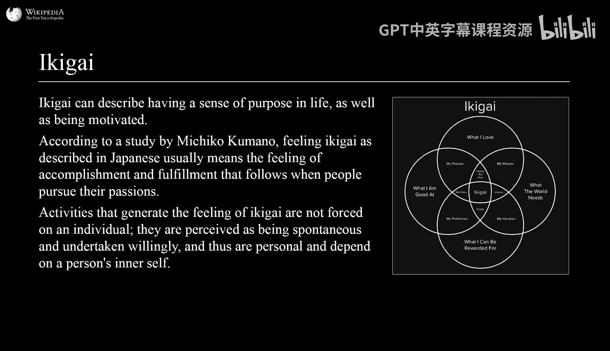

Gives you a lot of meaning。 You have a good life。 I assume you happy。

That's what we want most people to find to have for many intellectuals。It is their occupation。

 which gives them a lot of meaning。 I am a researcher， philosopher， scholar。

That means something to me in a world where an artist is not feeling appreciated because his art is just not competitive with what is produced by machines or writer or scientist will lose a lot of that and at the lower level we're talking about complete technological employment。

We're not losing 10% of jobs。 We're losing all jobs。 What do people do with all that free time。

 What happens then。Everything society is built on is completely modified in one generation。

 It's not a slow process where we get to kind of。Figured out how to live that new lifestyle。

 but it's pretty quick in that world， Can't humans do what humans currently do with chess。

 play each other， have tournaments。Even though AI systems are far superior this time in chess。

 so we just create artificial games or for us， they're real like the Olympics and we do all kinds of different competitions and。

Have fun， focus， maximize the fun and and let the AI focus on the productivity。 It's an option。

 I have a paper where I try to solve the value alignment problem for multiple agents。

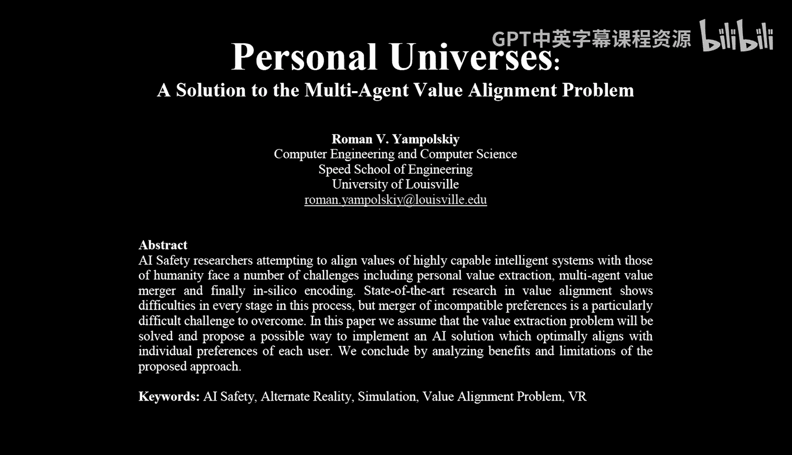

And the solution to avoid compromise is to give everyone a personal virtual universe。

 You can do whatever you want in that world。 You could be king。 you could be slave。

 You decide what happens。 So it's basically a glorified video game where you get to enjoy yourself and someone else takes care of your needs and substrate alignment is the only thing we need to solve。

 We don't have to get 8 billion humans to agree on anything。

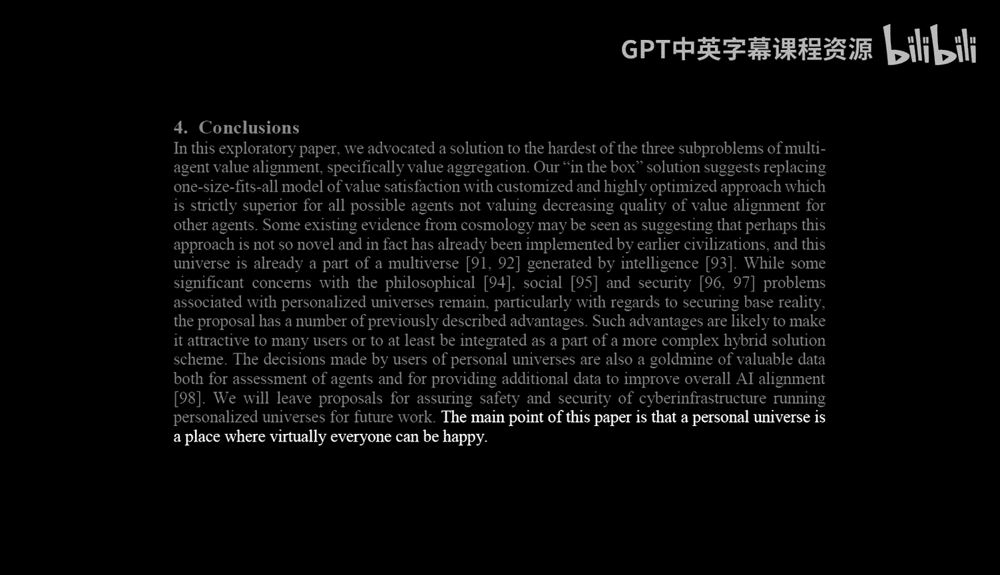

So okay， so what why is that not a likely outcome， why can't they systems create video games for us？

To lose ourselves in each， each with an individual video game universe。

 Some people say that's what happened in a simulation。And we're playing that video game。

 And that we're creating。U what maybe we're creating artificial threats for ourselves to be scared about because because fear is really exciting。

 it allows us to play the video game more more vigorously and some people choose to play on a more difficult level with more constraints some say。

 okay， I'm just going to enjoy the game high privilege level。Absolutely， so okay。

 what was that paper on multi agentent value alignment personal universes personal universes so so that's one of the possible outcomes。

 but what what what in general is the idea of the paper just looking at multiple agents they're human AI like a hybrid system whether it's humans and AIs or is just looking at humans or just so intelligent agents in order to solve value alignment problem。

I'm trying to formalize it a little better， Usually we're talking about getting AIs to do what we want。

 which is not well defined。 Are were talking about creator of a system。

Honor of that AI humanity as a whole， but we don't agree on much。

There is no universally accepted ethics， morals across cultures， religions。

 people have individually very different preferences， politically in such。

 So even if we somehow managed all the other aspects of it。

 programming those fuzzy concepts and getting to follow them closely。

 we don't agree on what to program in。So my solution was， okay。

 we don't have to compromise and room temperature you have your universe of mine， whatever you want。

 And if you like me， you can invite me to visit your universe。 We don't have to be independent。

 but the point is you can be and virtual reality is getting pretty good。

 It's gonna to hit a point where you can tell the difference and if you can tell if it's real or not what's the difference So basically give up on value alignment create an entire the multiverse theory this is create an entire universe for you or your values you still have to align with that individual。

 they have to be happy in that simulation。 but it's a much easier problem to align with one agent versus 8 billion agents plus animals aliens。

 So you convert the multi agentent problem into single agent problem I'm trying to do that Yeah Okay。

 I there any way to so okay， that's giving up on them。On the value problem。 Well。

 is there any way to solve the value alignment problem where there's a bunch of humans。

 multiple humans， tens of humans or 8 billion humans that have very different set of values。

 It seems contradictory。 I haven't seen anyone explain what it means outside of Ghana。

Words which pack a lot， make it good， make it desirable， make it something they don't regret。

 but how do you specifically formalize those notions， how do you program them in。

 I haven't seen anyone make progress on that so far。

 but isn't that the whole optimization journey that we're doing is a human civilization we're looking at geopolitics。

Nations are in a state of anarchy with each other。They start wars， there's conflict。And oftentimes。

 they have a very different views of what is good and what is evil。

 It's not what we're trying to figure out just together。Trying to converge towards that。

 So we're essentially trying to solve the value climate problem with humans。 right。

 But the examples you gave， some of them are， for example。

 to different religions saying this is our hoide， and we are not willing to compromise it。In any way。

If you can make two holy sites in virtual worlds， you solve a problem， but if you only have one。

 it's not divisible， you kind of stuck there But what if we want to be tension with each other and through that tension we understand ourselves and we understand the world so that that's the intellectual journey we're on we're on as a human civilization is we create intellectual and physical conflict and through that figure stuff out if we go back to that idea of simulation and this is a entertainment kind of giving meaning to us the question is how much suffering is reasonable for a video game So yeah。

 I don't mind you know a video game where I get heptic feedback that is a little bit of shaking maybe I'm a little scared I don't want a game we're like。

Kids a toy shirt。Literally， that seems unethical， at least by our human standards。

Are you suggesting it's possible to remove suffering if we're looking at human civilization as an optimization problem？

So we know there are some humans who， because of a mutation， don't experience physical pain。

So at least physical pain can be。Mutated out， reengineered out suffering in terms of meaning like you burn the only copy of my book is a little harder。

 But even there， you can manipulate your heonic set point。 You can change defaults。

 You can reset problem with that is， if you start messing with your reward channel。

 You start wirehead and end up bing out a little too much。 Well， that's the question。

 Would you really want to live。In a world where there is no suffering as's a dark question。

 But is there some level of suffering。That reminds us of what this is all for。 I think we need that。

 but I would change the overall range。 So right now。

 it's negative infinity to kind of positive infinity， pain pleasure access。

 I would make it like 0 to positive infinity。 And being unhappy is like， I'm close to 0。Okay。

 so what's the S risk， what are the possible things that you're imagining with S risk？

Mass suffering of humans。 What are we talking about there caused by Agi I。

 So there are many malevolent actors。 We can talk about psychopaths， crazies， hackers。

 dooms they calls。 We know from history if they tried killing everyone。

 They tried on purposeur to cause maximum amount of damage， terrorismor。

 What if some malevolent wants unpurpoposed to torture all humans as long as possible。

 You solve aging。 So I have functional immortality。 and you just try to be as creative as you can。😔。

Do you think there is actually people in human history that try to literally maximize human suffering？

In just studying people who have done evil in the world。

 it seems that they think that they're doing good。And it doesn't seem like they're trying to maximize suffering。

They just cause a lot of suffering。As a side effect of。Doing what they think is good。

 So they are different malevolent agents。 Some may be just gaining personal benefit and sacrificing others to that cause。

 Others win know effect at trying to kill as many people as possible。

 than would look at recent school shootings if they had more capable weapons。

 They would take out not dozens but thousands millions billions。Well， we don't know that。

But that is a terrifying possibility。And we don't want to find out。

 like if terrorists had access to nuclear weapons， how far would they go？

Is there a limit to what there。Willing to do。In your senses。

 there is some level in actors where there's no limit。 It is mentalt。

Mental diseases where people don't have empathy， don't have。This human。😔，Quality of understanding。

 suffering and others。And then there's also set of beliefs where you think you're doing good。

By killing a lot of humans。Again， I would like to assume that normal people never think like that it's always some sort of psychopaths。

 but yeah。And to you， AGIS systems can carry that。And be more confident at executing that。

They can certainly be more creative， they can understand human biology better。

 understand our molecular structure genome again， a lot of times torture ends than in individual dies。

That limit can be removed as well。 So if we're actually looking at x risk and S risk。

As the systems get more and more intelligent， don't you think it's possible to anticipate the ways they can do it？

And defending us like we do with the cybersecurity with the due security systems。Right。

 we can definitely keep up for a while。 I'm saying you cannot do it indefinitely。 At some point。

 the cognitive gap is too big the。Surface you have to defend is infinite。

 but attackers only need to find one exploit。So to you， eventually。

 this is we're heading off a cliff。If we create general superintelligences。

 I don't see a good outcome long term for humanity。

 the only way to win this game is not to play it Okay。

 we'll talk about possible solutions what not playing it means。Um。

 but what are the possible timelines here to you， what are we talking about？

We're talking about a set of years， decades， centuries。 What do you think， I don't know for sure。

 The prediction markets right now are saying 2026 for AGI。

I heard the same thing from CEO of Antropic Deep Mindes， so maybe we are two years away。

 which seems very soon。Given we don't have a working safety mechanism in place or even a prototype for one。

 And there are people trying to accelerate those timeline because they feel were not getting there quick enough。

 Well what do you think they mean， when they say AG。

 So the definitions we used to have and people are modifying them a little bit lately。

 artificial general intelligence was a system capable of performing in any domain a human could perform。

 So can are you creating this average artificial person they can do cognitive labor。

 physical labor where you can get another human to do it。

 So per intelligence was defined as a system which is superior to all humans in all domains。

Now people are starting to refer to AGI as if it's superintel。

 I made a post recently where I argued for me at least if you average out over all the common human tasks。

 their systems are already smarter than in average human。

So under that definition we have it Shane Lake has this definition where you're trying to win in all domains that's what intelligence is now are they smarter than elite individuals in certain domains of course not than not there yet but the progress is exponential see I'm much more concerned about social engineering。

So。To me， AI's ability to do something in the physical world， like the the lowest hanging fruit。

 the easiest。Set of methods is by just。Getting humans to do it。It's going to be much harder to。

To be the kind of viruses to take over the minds of robots。

That where the robots are executing the commands， it just seems like humans social engineering of humans is much more likely。

 that would be enough to bootstrap the whole process。Okay， just the linger on。

The term AGI what to you is the difference in AGI and human level intelligence。

Han level is general in the domain of expertise of humans We know how to do human things。

 I don't speak dog language I should be able to pick it up if I'm a general intelligence it's kind of in theoryrior or animal。

 I should be able to learn that skill， but I can't at general intelligence truly universal general intelligence should be able to do things like that humans cannot do to be able to talk to animals for example。

 to solve pattern recognition problems of that type to do。Of a similar things outside of our。

The main of expertise because it's just not the world will live in。If we just look at。

the space of cognitive abilities we have， I just would love to understand what the limits are beyond which an AGI system can reach。

 like what does that look like？What about actual。Mathematical thinking or。Scientific innovation。

that kind of stuff。We know calculators are smarter than humans in that narrow domain of addition。

But is it。Humans plus tools versus AGI， or just human raw human。Intelligence。

Because because humans create tools and with the tools they become more intelligent like where there's a gray area there what it means to be human when we're measuring their intelligence when I think about it I usually think human with like a paper and a pencil not human with internet and have AI helping but is that a fair way to think about it because isn't there another definition of human level intelligence that includes the tools that humans create but we create AI so at any point you'll still just add super intelligencetel to human capability that seems like cheating？

No controllable tools， is there is an implied leap that you're making。

When AGI goes from tool to entity。It can make its own decisions。

 so if we definey human level intelligence as everything a human can do with fully controllable tools。

 it seems like a hybrid of some kind youre now doing brain computer interfaces you connecting it too maybe narrow ice yet definitely increases our capabilities。

So what's a good test？To you。That measures whether an artificial intelligence system has reached human level intelligence and was a good test where it has superseded human level intelligence to reach that land of AGI I am oldfed I like tuuring test。

 I have a paper where I equate passing tuuring test to solving AI complete problems because you can encode any questions about any domain into the tuuring test you don't have to talk about how was your day you can ask any。

And so a system has to be as smart as a human to pass it in a true sense。

 but then you would extend that to maybe a very long conversation。

I think the Alexa Prize was doing that。Basically， can you do a 20 minute。

30 minute conversation with any ask them， It has to be long enough to where you can make some meaningful decisions about capabilities。

 absolutelysolute， you can brute force very short conversations。So like， literally。

 what does that look like？Can we do can we？Construct。Formerly。

 a kind of test that tests for AG I for AGI， it has to be there。 I cannot give it a task。

 I can give to a human。And it cannot do it if a human can。For stupid intelligence。

 it would be superior on all such tasks， not just average performance。 So like。

 go learn to drive car。 go speak Chinese， play guitar。 Okay， great。

 I guess the the following question， is there a test。For the kind of AGI they would。B。

Susceptible to lead to S risk or X risk。Susceptible to destroy human civilization。

 Like is there a test for that You can develop a test which will give you positives if it lies to you or has those ideas。

 you cannot develop a test which rules them out。 There is always possibility of what Boom calls a treacherous turn where later on a system decides for game theore reasons。

 economic reasons to change It behavior and we see the same with humans。

 It's not unique to AI Form millaneia， we try developing morals， ethics， religions。

 lie detector test and then employees betray the employers， spouses betray family。

 It's a pretty standard thing intelligent agents sometimes do。

 So is there is it possible to detect one as AI systems lying or deceiving you If you know that truth and it tells you something false。

 you can detect that but you cannot know in general。Every single time。 And again。

 the system youre testing today day may not be lying。

 The system youre testing today may know you are testing it。 and so behaving。 And later on。

 after it interacts with the environment interacts with a system， malevolent agents learns more。

 It may start doing those things。 Do you think it's possible to develop a system where the creators of the system。

 The developers， the programmers。Don't know That is deceiving them。

So systems today don't have long term planning， that is not our they can lie today if it optimizes。

Helps them optimize their reward if they realize， O。

 this human will be very happy if I tell them the following。

 they will do it if it brings them more points。And they don't have to kind of keep track of it。

 it's just the right answer to this problem every single time。

At which point is somebody creating that？Intentionally， not unintentionally。

 intentiontentionally creating an AI system that' is doing long term planning with an objective function as defined by the AI system。

 not by a human。 Well， some people think that if they're that smart， theyre always good。

They really do believe that it's just benevolence from intelligence。

 So they'll always want what's best for us。Some people think that they will be able to detect problem behaviors and correct them at the time when we get there。

😔，I don't think it's a good idea。 I am strongly against it， but yeah。

 there are quite a few people who in general。Are so optimistic about this technology it could do no wrong。

They want to develop as soon as possible， as capableable as possible。 So there's going to be people。

Who believe the more intelligent it is， the more benevolent。 And so therefore。

 it should be the one that defines the objective function that its optimizing when it's doing long term planning。

 There are even people who say， okay， what's so special about humans， right？

 We removing the gender bias。 We removing race bias。 Why is this prohuman bias。

 We are polluting the planet。 We are， as you said， you know， fight a lot of worse kind of violent。

Maybe it's better if a super intelligent， perfect society comes and replaces us， it's normal。

Stage in the evolution of our species。 Yeah， so somebody says。

 let's develop an AI system that removes the violent humans。From the world。

And then it turns out that all humans have violence in them are the capacity for violence。

 and therefore， all humans are removed。Yeah。😊，Yeah。Yeah。Let me ask about Yaan Lacoon。

 He's somebody who。You've had a few exchanges with。Yeah。😊。

And he's somebody who actively pushes back against this view that AI is going to lead to destruction of。

AHuman civilization， also known。As AI domerism。So。In one example that he tweeted， he said。

 I do acknowledge risks but。Two points， one open research and open source are the best ways to understand and mitigate the risks and two AI is not something that just happens。

 We build it。 We have agency in what it becomes Hence we control the risks we meaning humans。

 It's not some sort of natural phenomena that we have no control over。

 So can you can you make the case that he's right and can you try to make the case that he's wrong。

 I cannot make a case that he's right， He' is wrong in so many ways that's difficult for me to remember all of them He is a Facebook bodydy。

 So I have a lot of fun having those little debates with him。So I'm trying to remember the arguments。

 So one， he says we are not。Giffted this intelligence from aliens。 We are designing it。

 We are making decisions about it。 That's not true。 It was true that we had expert systems。

 symbolic AI decision3。 Today day， you set up parameters4 model and you water this plant。

 you give it data， you give it compute and it grows。

 and after it's finished growing into this alien plant。

 you start testing it to find out what capabilities it has。

 And it takes years to figure out even for existing models。 If it's trained for six months。

 it will take you2， three years to figure out basic capabilities of that system。

 We still discover new capabilities in systems which are already out there。

 So thats that's not the case。 So just on that， that you。

 the difference there that there is some level of emergent intelligence that happens in our current approaches。

So stuff that we don't hard code in。 Ab， that's what makes it so successful。

 Then we had to painstakingly hard code in everything。

 We didn't have much progress now to spend more money and more compute and it's a lot more capable。

 And then the question is， when there is emergent intelligent phenomena。

What is the ceiling of that for you， there's no ceiling。For for Jan Lacoon。

 I think there's a kind of ceiling that happens that we have full control over。

 even if we don't understand the internals of the emergence， how the emergence happens。

There's a sense that we have control and an understanding of the。Approximate ceiling of capability。

 the limits of the capability。 Let's say there is a ceiling。

 It's not guaranteed to be at the level which is competitive with us。

 It may be greatly superior to ours。So what about。His statement about open research in open source are the best ways to understand and mitigate the risks。

 Historically， he's completely right。 Open source software is wonderful。

 It's tested by the community is debugged， but we are switching from tools to agents。

 Now you giving open source weapons to psychopaths。 Do we want open source nuclear weapons。

Biological weapons， it's not safe to give technology so powerful to those who may misalign it。

 even if you are successful at somehow getting it to work in a first place in a friendly manner。

But the difference with nuclear weapons， current AI systems are not。Akin to nuclear weapons。

 So the idea there is your' open sourcing at this stage that you can understand it better。

 large number of people can explore the limitations， the capabilities。

 explore the possible ways to keep it safe to keep。

It's secure all that kind of stuff while it's not at the stage of nuclear weapons So nuclear weapons。

 there's a no nuclear weapon and then there's a nuclear weapon with AI systems。

 there's a gradual improvement of capability and you get to。Perform that improvement incrementally。

 and so open source allows you to study。How things go wrong， I study the very process of emergence。

studyudy AI safety and those systems when there's not a high level of danger， all that kind of stuff。

 It also sets a very wrong precedent。 So we open sourced Model 1， Model 2， Model 3。

 nothing ever bad happened。 So obviously， we're going to do it with Model 4。

This does gradual improvement。I don't think it always works with the president。

 like you're not stuck doing it the way。You always did。

 it's just it sets the precedent of open research and open development such that we get to learn together and then the first time there's a sign of danger。

Some dramatic thing happened， not a thing that destroys human civilization。

 but some dramatic demonstration of capability that can legitimately lead to a lot of damage。

 then everybody wakes up and says okay， we need to regulate this。

 we need to come up with safety mechanism that stops this， right。At this time。

 maybe you can educate me， but I haven't seen any illustration of significant damage done by。

Intelligent AI systems。 So I have a paper which collects accidents through history of AI。

 and they always are proportionate to capabilities of that system。

 So if you have detectorto playing AI， it will fail to properly play and loses the game。

 which it should draw trivial。 Your spell checker will bepe a word so on。

 I stopped collecting those because there are just too many examples of A eyes failing at what they are capable of。

 We haven't had terrible accidents in a sense of billion people get killed。 absolutelysute through。

 But in another paper， I argue that those accidents do not actually prevent people from continuing with research and actually。

 they kind of serve like vaccines。

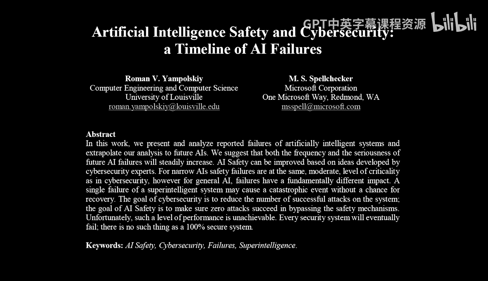

A vaccine makes your body a little bit sick so you can handle the big disease later much better It's the same here people will point out。

 you know that accident AI accident we had where 12 people died。

Everyone still here 12 people is less than smoking kills it's not a big deal。

 so we continue so in a way it will actually be kind of confirming that it's not that bad it matters。

How the deaths happen， whether it's literally murdered by the eye system， then one is a problem。

 but if it's accidents because of increased reliance on the automation， for example。

 so when airplanes are flying in an automated way，Maybe the number of plane crashes increased by 17% or something and then you're like。

 okay do we really want to rely on automation I think in a case of automation airplanes that decrease significantly okay。

 same thing with autonomous vehicles like okay what are the pros and cons what are the with the tradeoffs here you can have that discussion in an honest way。

But。I think the kind of things we're talking about here is mass scale。Pain and suffering。

Caused by AI systems。 and I think we need to see illustrations of that in a very small scale to start to understand that this is really damaging versus。

Clippy versus a tool that's really useful to a lot of people to do learning to do。Um。

 summarization of texts to do question answer， all that kind of stuff to generate videos。The tool。

 fundamentally， a tool versus an agent that can do allow a huge amount of damage。

 So you bring up example of cars。 Yes， cars were slowly developed and integrated。

If we had no cars and somebody came around and said， I invented this thing。 It's called cars。

 It's awesome。 It kills like 100000 Americans every year。 Let's deploy it。😊，Would we deploy that。

There's been fear mongering about cars for a long time from the transition from horse of to cars。

 there's a really nice channel there I recommend people check out pessimist archive。

That documents all the fear monitoringgering about technology that's happened throughout history。

 There's definitely been a lot of fear monitoringgering about cars。

 There's a transition period there about cars about how deadly they are we can try。

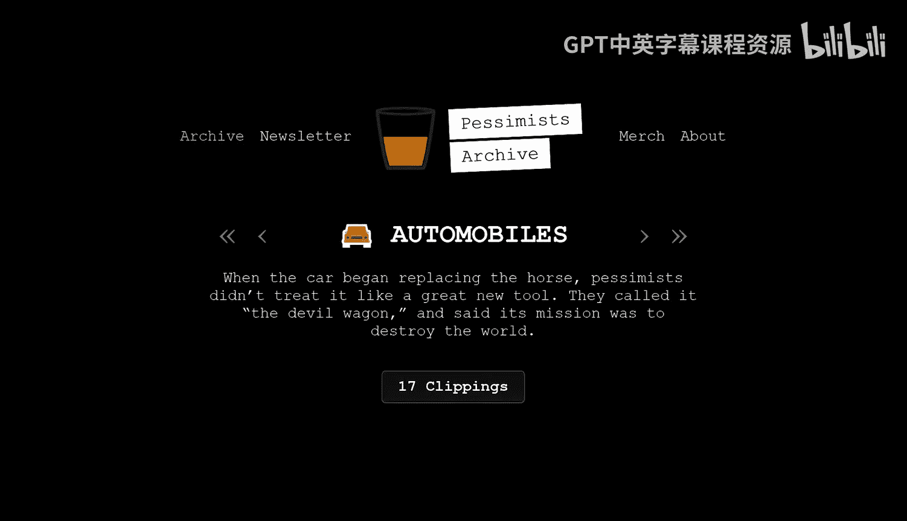

It took a very long time for cars to proliferate to the degree they have now。

 and then you could ask serious questions in terms of the miles traveled， the benefit to the economy。

 the benefit to the quality of life that cars do， versus the number of deaths， 30， 40。

000 in the United States。Are we willing to pay that price？I think most people。

 when they're rationally thinking policymakers will say yes。Is we want to decrease？

It from 40000 to 0 and do everything we can to decrease it。

 There's all kinds of policies and incentives you can create to decrease the risks with the deployment of technology。

 but then you have to weigh the benefits in the risk of the technology and the same thing would be done with AI。

 You need data， you need to know。 But if I'm right and it's unpredictable。

 unexplainable and controltrollable， you cannot make this decision we're gaining $10 trillion a wealth。

 but we're losing， we don't know how many people you basically have to perform an experiment and $8 billion humans without their consent。

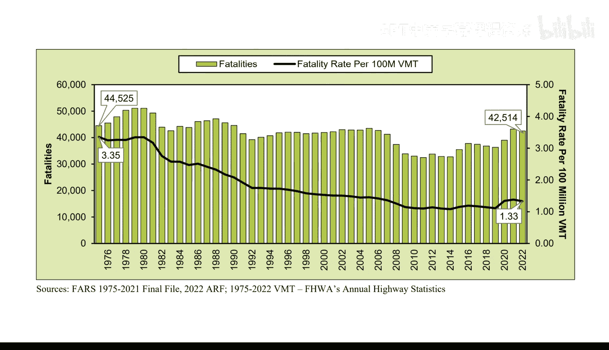

And even if they want to give you consent， they can't because they can give informed consent。

 they don't understand those things。Right， that happens when you do when you go from the predictable to the unpredictable very quickly。

He just。But it's not obvious to me that AI systems would。

Gain capabilities so quickly that you won't be able to collect enough data。To study the say。

 the benefits and the risks。We literally doing it。 The previous model we learned about after we finished training it。

 what it was capable of。 Let's say we stopped GP 4 training run around human capability hypopothetically。

 we start training GP 5， and I have no knowledge of insider training run or anything。

 and we start at that point of about human， and we train it for the next nine months。

 maybe two months in， it becomes super intelligent。 We continue training it。

At the time when we started testing it， it is already a dangerous system。

How dangerous I have no idea， but never people training it。At the training stage。

 but then there's a testing stage inside the company they can start getting intuition about what the system is capable to do。

 you're saying thats somehow from leap from GP4 to GP5。Can happen。

The kind of leap where GPT4 was controllable and GPT5 is no longer controllable。

 and we get no insights from using GPT4 about the fact that GPT5 will be uncontrollable。

Like that's the， that's the situation you're concerned about where theyre leap from。N to N plus1。

Would be such that an uncontrollable system is created without。A年。Ability for us to anticipate that。

 If we had capability of ahead of the run before the training run to register exactly what capabilities that next model will have at the end of the training run。

 And we accurately guessed all of them。 I would say you right。

 We can definitely go ahead with this run， We don't have a capability。

From GPT4 you can build up intuitions about what GPT5 will be capable of。

 it's just incremental progress。Even if that's a big leap in capability。

 it just doesn't seem like you can take a leap from a system that's。

hellping you write emails to a system that's going to destroy human civilization。

 it seems like it's always going to be sufficiently incremental such that we can anticipate the possible dangers and we're not even talking about existential risk。

 but just the kind of damage you can do to civilization。

It seems like we'll be able to anticipate the kinds， not the exact， but the kinds of。risksks。

He might lead to and then rapidly develop defenses ahead of time and as the risks emerge。

 We are not talking just about capabilities， specific tasks。

 We are talking about general capability to learn maybe like a child。

 at the time of testing and deployment， it is still not extremely capable。

 but as it is exposed to more data。 real world， it can be trained to become much more dangerous and capable。

 let's focus then on the control problem。At which point does the system become uncontrollable。

Why is it the more likely trajectory for you that the system becomes uncontrollable？

So I think at some point it becomes capable of getting out of control for game theoretical reasons it may decide not to do anything right away and for a long time just collect more resources accumulate。

Strategic advantage。Right away， it may be kind of still young weak superintelligence。

 give it a decade， it's in charge of a lot more resources， it had time to make backups。

 so it's not obvious to me that it will strike as soon as it can。

But can we just try to imagine this future where there's an AI system that's capable。Of。

Escaping the control of humans。 And then doesn't。And waits。What's that look like？

So one we have to rely on that system for a lot of the infrastructure。

 so we'll have to give it access， not just to the internet。But to the task of managing。

powerower government， economy， this kind of stuff。 and that just feels like a gradual process。

 given the bureaucracies of all those systems of all。 we've been doing it for years。

 Soft controls all those systems， Nu power plants， airline industry， it's all software based。

 Every time there is electrical outage。 I can't fly anywhere for days。

But there's a difference between software。And AI。So there's different kinds of software。

 so to give a single AI system access。To the control of airlines and the control of the economy。

That's not a that's not a trivial transition for humanity。 No， but if it shows it is safer， in fact。

 when it's in control， we get better results， people will demand that it put in place absolutely And if not it can hack the system。

 It can use social engineering to get access to it。

 That's why I said it might take some time for it to accumulate those resources。

 It just feels like that would take a long time for either humans to trust it or for the social engineering to come into play like it's not a thing that happens overnight。

 It feels like something that happens across one or two decades。 I really hope you're right。

 but it's not what I'm seeing。 people are very quick to jump on a latest trend。

 Earl adopters will be there before it's even deployed buying prototypes。

Maybe the social engineering， I could see because so for social engineering。

 AI systems don't need any hardware access， it's all software so they can start manipulating you through social media and so on。

Like you have AI assistance that're going to help you do a lot of manage a lot of your day to day and then they start doing social engineering。

 but like。For a system that's。So capable that it can escape the control of humans that created it。

Such a system being deployed at a mass scale。And trusted by people to be deployed。

 it feels like that would take a lot of convincing。

So we've been deploying systems which had hidden capabilities。Can you give an example， Gputy4。

 I don't know what else is capable of， but there are still things we haven't discovered can do。

 They may be trivial proportion to its capability。I don't know。 It writes Chinese poetry。

 hypothetical。 I know it does， but。We haven't tested for all possible capabilities and we are not explicitly designing them。

We can only rule out bugs we find， we cannot rule out bugs and capabilities。

Because we haven't found them。Is it possible for a system to have hidden capabilities that are orders of magnitude greater than its non hidden capabilities？

This is the thing I'm really struggling with。Where on the surface。The thing we understand it can do。

ItDoes't seem that harmful， so if even if it has bugs。

 even if it has hidden capabilities like Chinese poetry or generating effective viruses。

Software viruses。The damage that can do seems like on the same order of magnitude as it。啊。

The the capabilities that we know about so like this。

 this idea that the hidden capabilities will include being uncontrollable this is something I'm struggling with。

Ca G 4 on the surface seems to be very controllable。 Again。

 we can only ask and test for things we know about if there are unknown unknowns， we cannot do it。

 I thinking of human statistics of， right， If you talk to a person like that。

 you may not even realize they can multiply 20 digit numbers in their head。 You have to know to ask。

So as I mentioned， just to sort of linger on the。The fear of the unknown。

So the pessimist archive has just documented， let's look at data of the past and history。

 there's been a lot of fearmongering about technology。

Pessimist Arch does a really good job of documenting。

How crazily afraid we are of every piece of technology。

 we've been afraid there's a blog post where Lewis Anslow， who created pessimist archive。

 writes about the fact that we've been fearmongering about robots and automation for over 100 years。

So why is AGI different than the kinds of technologies we've been afraid of in the past？

So two things， one was wishing from tools to agents。Tools don't。Have。😔。

Negative a positive impact people using tools do， so guns don't kill。

People with guns do agents can make their own decisions。 They can be positive or negative。

 A Pi bull can decide to harm you。 It's an agent。The fears are the same。

The only difference is now we have this technology then they were afraid of humanweight robots 100 years ago。

 they had none today every major company in the world is investing billions to create them。

 not every， but you understand what I'm saying。It's very different well， agents。

It depends what you mean by the word agents， all those companies are not investing in a system that has the kind of agency。

That's implied by in fears where it can really make decisions in their own They have no human in the loop。

 They are saying they are building super intelligence and have a super alignment team。

 You don't think they are trying to create a system smart enough to be an independent agent under that definition。

 I have not seen evidence of it。 I think a lot of it is a marketing。

Is a a marketing kind of discussion about the future and it's it's a mission about。

The kind of systems we can create in long term future。 But in the short term， the kind of。

Systems are creating。Falls。Fully within。The definition of narrow AI。

 these are tools that have increasing capabilities。

 but they just don't have a sense of agency or consciousness or self awareness or ability to deceive at scales that would require would be required to do like。

Mass scale suffering and murder of humans。 Those systems are well beyond narrow AI。

 If you had to list all the capabilities of GP 4， you would spend a lot of time writing that list。

 But agency is not one of them。 Not yet。 But do you think any of those companies are holding back because they think it may be not safe or are they developing the most capable system they can。

 given the resources and hoping they can control and monetized。Control and monetize。

 hoping they can control and monetize so you're saying。

If they could press a button and create an agent。That they no longer control。

 that they can have to ask nicely。は。A thing that lives on a server across huge number of computers。

You're saying that they would push for the creation of that。

Kind of system I mean I can't speak for other people for all of them。

 I think some of them are very ambitious by fundraising trillions they talk about controlling the light corner of the universe。

 I would guess that they might。Well， that's a human question， whether humans are capable of that。

 probably some humans are capable of that。 My more direct question。

 if it's possible to que such your system。Have a system that has that level of agency。

I don't think that's an easy technical challenge。We're not， it doesn't feel like we're close to that。

 a system that has the kind of agency where it can make its own decisions and deceive everybody about them。

The current architecture。We have in machine learning and how we train the systems how deploy the systems and all that it just doesn't seem to support that kind of agency I really hope you are right。

 I think the scaling hypothesis is correct we haven't seen diminishing returns it used to be we ask how long before AGI now we should ask how much until AGI it's$ trillion dollars today it's a billion dollars next year it's a million dollars in a few years。

Don't you think it's possible to basically run out of。Tllions。So is this constrained by compute？

Compute gets cheaper every day， exponentially。 But then then becomes a question of decades versus years。

 If the only disagreement is that it will take decades。

 not years for everything I'm saying to materialize， then I can go with that。

But if it takes decades case， then the development of tools for AI safety。

Now it becomes more and more realistic。 So I guess the question is。

I have a fundamental belief that humans， when faced with danger。

 can come up with ways to defend against that danger。

And one of the big problems facing AI safety currently for me。Is that。

There's not clear illustrations of what that danger looks like。

There's no illustrations of AI systems doing a lot of damage。

And so it's unclear what you're defending against because currently it's the philosophical notions that yes it's possible to imagine AI systems that take control of everything and then destroy all humans。

It's also a more formal mathematical notion。That you talk about that it's impossible to have a perfectly secure system。

 you can't prove that a program of sufficient complexity is completely safe and perfect and you know everything about it。

 Yes， but like when you actually just pragmatically look。

 how much damage have the AI systems done and what kind of damage。

 there's not been illustrations of that。Even in the autonomous weapon systems。

There's not been mass deployments of autonomous weapon systems， luckily。

The automation in war currently is very limited。The。

 that the automation is at the scale of individuals versus like at the scale of。

Strategy and planning so。I think one of the challenges here is like， where is the dangers？

And the joy that Yalakuuna and others have is let's keep in the open building AI systems until the dangers start rearing their heads。

And they become more explicit。There start being case studies。

 illustrative case studies that show exactly how the damage by A systems is done。

 then regulation can step in， then brilliant engineers can step up and we could have Manhattan style projects that defend against such systems that's kind of the notion。

And I guess attention with that is the idea that for you。

 we need to be thinking about that now so that we're ready because we'll have not much time once the systems are deployed。

That true There is a lot to unpack here。 There is a partnership on AI。

 a conglomerate of many large corporations。 They have a database of AI accidents they collect。

 I contributed a lot to a database if we so far made almost no progress in actually solving this problem。

 not patching it， not。Again， lipstick and the pick kind of solutions。

Why would we think we'll do better than we closer to the problem？

All the things you mentioned are serious concerns measuring the amount of harm。

 so benefit versus risk there is is difficult。 But to you， the sense is already。

 the risk has superseded the benefit Again， I want to be perfectly clear。

 I love AI I love to acknowledge I'm a computer scientist I have PhD in engineering I work at engineering school that is a huge difference between。

We need to develop narrow AI systems， super intelligent in solving specific human problems like protein folding。

 and let's create super intelligent machine guard and will decide what to do with us。

Those are not the same。 I am against the super intelligence in general sense， with no。Uno Barton。

So do you think the teams that are doing， they're able to do the AI safety on the kind of narrow AI risks？

That you've mentioned。Are those approaches going to be at all productive towards leading to approaches of doing AI safety on AGI？

Or is just a fundamentally different partially but they don't scale for narrow AI for deterministic systems you can test them。

 you have edge cases， you know what the answer should look like。

 you know the right answers for general systems you have infinite test surface you have no edge cases you cannot even know what to test for again the unknown unknowns are underappreciated by people looking at this problem you are always asking me how will it kill everyone how will it will fail the whole point is if I knew it I would be super intelligent and despite what you might think I'm not。

So， you， the concern is that we would not be able to。See early size of an uncontrollable system。

 It is a master at deception。 Sam tweeted about how great it is at persuasion。

 and we see it ourselves， especially now with voices with maybe kind of flirty。

 sarcastic female voices， it's going to be very good at getting people to do things。 But see。

 I'm very concerned。About system being used to control the masses。But in that case。

 the developers know about the kind of control that's happening。

You're more concerned about the next stage where even the developers don't know about the deception。

 right， I don't think developers know everything about what they are creating。

 they have lots of great knowledge。 We're making progress and explaining parts of a network。

 we can understand， okay， this note get excited。 than this input is presented， this cluster of nodes。

 but when nowhere near close to understanding the full picture。 And I think it's impossible。

 You need to be able to survey an explanation。 The size of this models prevents a single human from observing all this information。

 even if provided by a system。 So either we getting model as an explanation for what's happening。

 and that's not comprehensible to us。 Oh we getting a compressed explanation。

 Loy compression where here stopped 10 reasons you got fired。Did something。

 but it's not a full picture。 You've given elsewhere an example of a child and everybody。

 all all humans try to deceive。 They try to lie early on in their life。

 I think we'll just get a lot of examples of deceptions from large language models or AI systems。

 They're going to be kind of shitty。 or they'll be pretty good， but we'll catch em off guard。

 We'll start to see the kind of。Momentum towards developing。Increasing deception capabilities。

 And that's when you're like， okay， we need to do some kind of alignment that prevents deception。

 But then we'll have。If you support open source， then you can have open source models that have some level of deception。

 You can start to explore on a large scale。 How do we stop it from being deceptive。

 Then there's a more explicit pragmatic kind of。Problem to solve。

 How do we stop AI systems from trying to optimize for deception。 That's just an example。

 right So this is a paper， I think it came out last week by Doctor Park et all from MI T， I think。

 and they showed that existing models already showed successful deception in what they do。

My concern is not that they lie now and we need to catch them and tell them don't lie。

 My concern is that once they are capable and deployed， they will later change their mind。

 because that's what。Unrestricted learning allows you to do。 Lots of people grow up。

 maybe in the religious family。 They read some new books， and they turn in their religion。

That's the treasure is thrown in humans。If you learn something new about your。Colleagues。

 maybe you'll change how you react to them。 Yeah， the ts turn。If we just mentioned humans。

 Stalin and Hitler， there's a turn。Stallin is a good example。 He just seems like a normal communist。

Follower Lenin until this return。As' a turn of what that means。

 in terms of when he has complete control， what that what the execution of that policy means and how many people get to suffer。

 And you can't say they are not rational。 The rational decision changes based on your position。

 Then you are under the boss， The rational policy may be to be following orders and being honest when you become a boss。

 rational policy may shift。Yeah， and and by the way， a lot of my disagreements here is just to。

Playing devil's advocate to challenge your ideas and to explore them together so。嗯。

One of the big problems here in this whole conversation is。Human civilization hangs in the balance。

 and yet it's everything is unpredictable。 We don't know how these systems will look like。

The robots are coming。There's a refrigerator making a buzzing noise。Very menacing。 Very menacing。

So every time I'm about to talk about this topic things start to happen。

 my flight yesterday was canceled without possibility duty the book I was giving a talk at Google in Israel and three colors which were supposed to take me to the talk could not。

I'm just saying。I mean。It I like A eyes， I for one welcome our overloads。

 but there's a degree to which we， I mean， it is very obvious。As we already have。

 we've increasingly given our life over to software systems。And then it seems obvious。

 given the capabilities of AI that are coming that will give our lives over increasingly to AI systems。

 carss will drive themselves。 Ref eventually will optimize。What I get to eat？And。

As more and more out of our lives are controlled or managed by AI assistance。

 it is very possible that there's ad drift， I mean， I mean。

 I personally am concerned about non existential stuff。The more near term things。

 because before we even get to existential， I feel like there could be just so many brave new world type of situations。

 You mentioned sort of the the term behavioral drift。It's the slow boiling。

That I'm really concerned about， as we give our lives over to automation。

That our minds can become controlled by governments， by companies。Or just in a distributed way。

 there's adri。Some aspect of our human nature gives ourselves over to the control of AI systems。

 and they in an unintended way， just control how we think maybe there'll be a herd like mentality and how we think which will kill all creativity and exploration of ideas。

 the diversity of ideas or much worse， So it's true it's true。

 but a lot of the conversation I'm having you with you know， is also kind of wondering。

Almost that at a technical level。How can AI escape control？Like what would that system look like？

Because it， to me， is terrifying and fascinating。And also fascinating to me。

Is maybe the optimistic notion that it's possible to engineer systems that defend against that？Um。

One of the things you write a lot about in your book is verifiers。So not humans。

 humans are also verifiers。But software systems that look at AI systems。And like。

 help you understand this thing is getting real weird。

Help you help you analyze those systems so maybe that's this is a good time to talk about verification What is this beautiful notion of verification My claim is again that there are very strong limits and what we can and cannot verify a lot of times when you post something in social media people go oh I need citation to a peer reviewed article but what is the peer reviewed article you found two people in a world of hundreds of thousands of scientists who said I would have a publisher I't care that's the veryifier of that process。

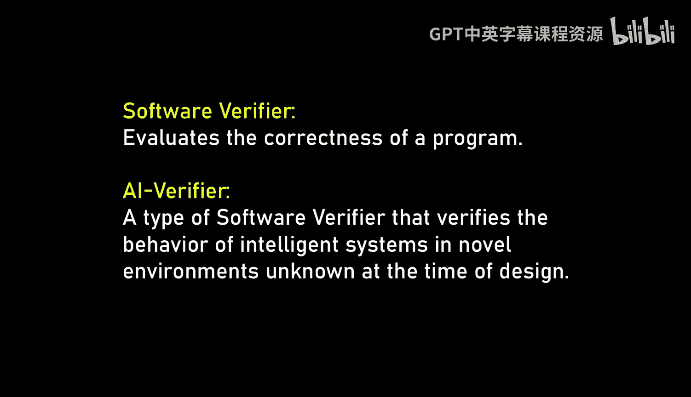

Then people say， oh， it's formally verified software and mathematical proof except。

Something close to 100 percent。Chance of it being free of all problems。

 But if you actually look at research， software is full of bugs， old mathematical theorems。

 which have been proven for hundreds of years， have been discovered to contain bugs on top of which we generate new proofs。

 and now we have to redo all that。 So verifiers are not perfect。

 Usually they are either a single human or communities of humans。

 and it's basically kind of like a Democratic vote。

Community of mathematicians agrees that this proof is correct， mostly correct。

Even today we're starting to see some mathematical proofs as so complex。

 so large that mathematical community is unable to make a decision。

 it looks interesting looks promising but they don't know they will need years for top scholars to study to figure it out。

So of course we can use AI to help us with this process。

 but AI is a piece of software which needs to be verified just to clarify。

 so verification is the process of saying something is correct， sort of the most formal。

 a mathematical proof where there's a statement and a series of logical statements that prove that statement to be correct which is the theorem。

And you're saying it gets so complex that it's possible for the human verifiers。

The human beings that verify that the logical step， there's no bugs in it。

It it becomes impossible so it's nice to talk about verification in this most formal。

 most clear most rigorous formulation of it， which is mathematical proofs right and for AI we would like to have that level of confidence for very important mission critical software controlling satellites。

 nuclear power plants for small deterministic programs we can do this。 we can check that。

Code verifies its mapping to the design， whatever software engineers intended was correctly implemented。

But we don't know how to do this for software， which keeps learning， self modifying。

 rewriting its own code。 We don't know how to prove things about the physical world。

 states of humans in the physical world。 So there are papers coming out now。

 and I have this beautiful one。Towards guaranteed safe AI。Veryty cool paper。

 Some of the best outers I ever seen， I think that is multiple touring award winners。 that is quite。

 You can have this one in one just came out kind of similar managing extremely eye risks。

 So all of them expect this level of proof， but。I， I would say that we can get more confidence with more resources we put into it。

 But at the end of the day， we're still as reliable as the verifiers。

 And you have this infinite regress of verifiers。 The software used to verify a program is itself a piece of program。

 If aliens gave us well aligned superintelligence。 we can use that to create our own safe AI。

 But it's a catch 22。 You need to have already proven to be safe system to verify this new system of equal or greater complexity。

 we just mentioned this paper towards guarantees safe AI。

 a framework for ensuring robust and reliable AI systems， like you mentioned is like a who's who。

Josh Tennebaum， Yosha Benjo to Russell Maxtg mark many other billion people。

The page you have it opened on。 there are many possible strategies for creating safety specifications。

 These strategies can roughly be placed on a spectrum。

 depending on how much safety it would grant if successfully implemented。

 One way to do this is as follows， and there's a set of levels from level 0。

 No safety specifications used to level 7。 The safety specification completely encodes all things that humans might want in all contexts。

 Where does this paper fall short to you。 So when I wrote a paper。

 Artific intelligence safety engineering， which kind of coined the term mayi safety。 That was 2011。

 We had 2012 conference，2013 journal paper。 One of the things I proposed。

 Let's just do formal verifications on it， Let's do mathematicalmatic， formal proofs。

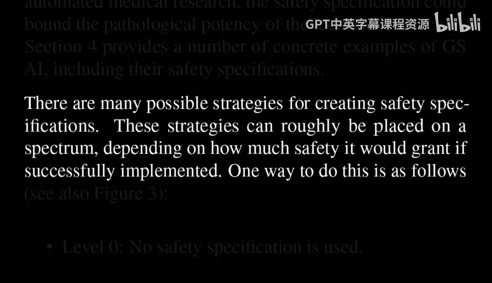

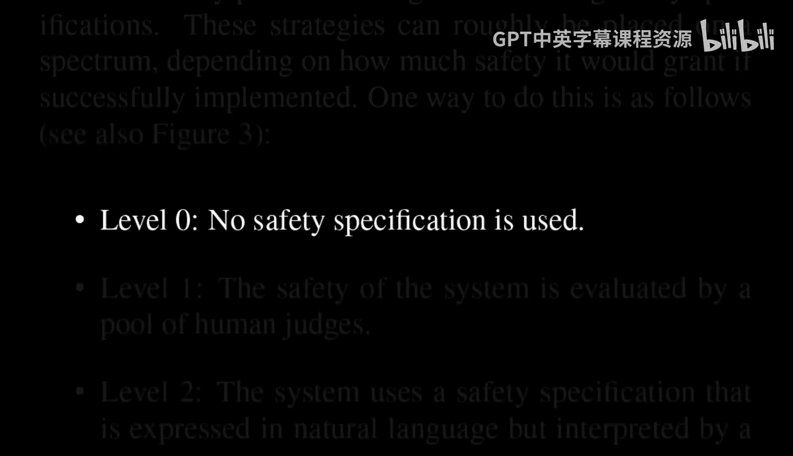

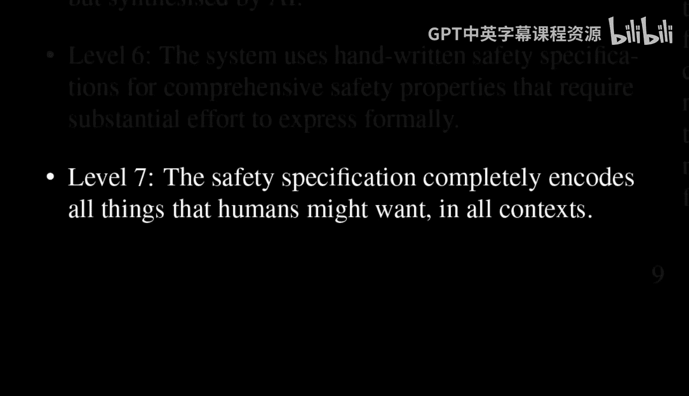

In the follow up work， I basically realized it will still not get us 100 per cent。 We can get 99。9。

 We can put more resources exponentially and get closer， but we never get to 100 per。

 If a system makes a billion decisions a second。 and you use it for 100 years。

 You' still going to deal with a problem。 This is wonderful research， I'm so happy for doing it。

 This is great。 but it is not going to be a permanent solution to。😊，To that problem。

 So just to clarify the task of creating an AI verifier is what is creating a verifier that the AI system does exactly as it says it does or it sticks within the guard rails that it says it must There are many。

 many levels。 So first you verifying the hardware in which it is run you need to verify you know communication channel with the human in every aspect of that whole world model needs to be verified。

 Somehow it needs to map the world into the world model map and territory differences。

 So how do I know internal states of humans。 Are you happy or sad， I can't tell。

So how do I make proofs about real physical world， Yeah。

 I can verify that deterministic algorithm follows certain properties that can be done。

Some people argue that maybe just maybe2 plus2 is not4。 I'm not that extreme。

But once you have sufficiently large proof over sufficiently complex environment。

 the probability that it has zero bugs in it is greatly reduced。 If you keep deploying this a lot。

 Eventually， you're going to have a bug anyways。 There is always a bug。 There is always a bug。

 And the fundamental difference is what I mentioned。 We're not dealing with cybersecurity。

 We're not going to get a new credit card New humanity。 So this paper is really interesting。

You said 2011， artificialific intelligence， safety， engineering。

 Why machine ethics is a wrong approach。The grand challenge you right。Of AI safetyfe engineering。

We propose the problem of developing safety mechanisms for self improving systems。

Self improving systems， by the way， that's an interesting term for the thing that we're talking about。

Is self improving more general than learning？So self improving， that's an interesting term。

 you can improve the rate at which you are learning， you can become more efficient met optimizer。

The word self， iss like。Self replicating， self improving。

You can imagine a system building its own world on a scale。

And in a way that is way different than the current systems do。

It feels like the current systems are not self improving or self replicating or self growing or self。

Spreading all that kind of stuff。And once you take that leap。

 that's when a lot of the challenges seems to happen。Because the kind of bugs you can find now。

ItSees more akin to the current sort of normal software。Debugging kind of process。

But whenever you can do self replication。An arbitrary self improvement。

That's when a bug can become a real problem， real， real fast。

So what is the difference to you between verification of a non self improving system versus a verification of a self improving system so if you have fixed code。

 for example you can verify that code static verification at the time。

 but if it will continue modifying it。要。😔，Have a much harder time guaranteeing that important properties of that system have not been modified than the code changed。

Is it even doable。 No， does the does the whole process of verification is completely fall apart。

 It can always cheat。 It can store parts of its code outside in the environment。

 It can have kind of extended mind situation。 So this is exactly the type of problems I'm trying to bring up。

 What are the classes of airs that you read about in the book。

 Is there interesting what they stand out to you。 You have your some favorites。

 So I like oracle types where you kind of just know that it's right to like oracle machines。

 They know that right answer how who knows， but they pull it out from somewhere。

 So you have to trust them。 And that's a concern I have about humans in a world with very smart machines。

 We experiment with them。 We see after a while。 Okay。

 they always been right before and we start trusting them without any verification of what they are saying。

 Oh， I see that we kind of。Build Oracle Verifiers。Or rather。

 we build verifiers we believe to be oracles。And then we start to， without any proof。

 use them as if they're oracle verifiers。 We remove ourselves from that process。

 We are not scientists who understand the world where humans who get new data presented to us。Okay。

 one really cool class of air fires is a self air fire。

 Is it possible that you somehow engineer into AI systems a thing that constantly verifies itself Preservd portion of it can be done。

 but in terms of mathematical verification it's kind of useless you saying you have a greatest guy in the world because you are saying it that's circular and not very helpful but it's consistent。

 We know that within that world， you have verified that system in a paper I try to kind of brutefor all possible verifiers。

 it doesn't mean that this one and。Particularly important to us， but what about like self doubt？

Like the kind of verification where you said you say or I say I'm the greatest guy in the world。

 what about a thing which I actually have is a voice that is constantly extremely critical so like。

Engineer into the system。Constant uncertainty about self。A constant doubt。

Any smart system would have doubt about everything。 All right。

 You not sure if what information you are given us through if you are subject to manipulation。

 you have this safety and security mindset。 What I mean， you have doubt about yourself。

So the AI systems。That。Has doubt about whether the thing is doing。

It's causing harm is the right thing to be doing。 So just a constant doubt about。

What it's doing because it's hard to be a dictator filled out。I may be wrong。

 but I think Stetuart Russell's ideas all about machines which are uncertain about what humans want and trying to learn better and better what we want。

 the problem of course is we don't know what we want and we don't agree on it。Yeah。

 but uncertainty his his idea is that having that like self-t uncertainty in AI systems。

 engineering and TI systems is one way to solve the control problem it could also backfire maybe you uncertain about completing your mission like I am paranoid about your camera not recording right now So I would feel much better if you had a secondary camera but I also would feel even better if you had a third and eventually it would turn this whole world into cameras pointing at us making sure we capturing this No but wouldn't you have a matter。

Concerned。Like that you just stated that eventually there'll be way too many cameras。

So you would be able to keep zooming on in the big picture。Of your concerns。

So it's a multi objective optimization， it depends how much I value capturing this versus not destroying the universe。

Right， exactly。And， and then you will also ask about like。

 what does it mean to destroy the universe and how many universes are。

 And you keep asking that question。 But that doubting yourself would prevent you from destroying the universe because you're constantly full of doubt。

 It might affect your productivity just might be scared to do anything。

 It's just scared to do anything。 That things up。 Well， that's better。 I mean。

 I guess the question is possible to engineer that in。 I guess your answer would be yes。

 but we don't know how to do that。 And we need to invest a lot of effort inter figuring out how to do that。

 But it's unlikely。 underpinning。A lot of your writing is this。Ss that were screwed。

But it just feels like。It's an engineering problem。I don't understand why we're screwed。

 It we time and time again， humanity has gotten itself into trouble and figured out a way to get out of trouble。

 We are in a situation where people making more capable systems just need more resources。

They don't need to invent anything in my opinion， some will disagree。

 but so far at least I don't see diminishing returns if you have 10 x compute。

 you will get better performance。 The same doesn't apply to safety If you give Miri or any other organization 10 times the money they don't output 10 times the safety and the gap between capabilities and safety becomes bigger and bigger all the time。

So it's hard to be completely optimistic about our。Results here。

 I can name 10 excellent breakthrough papers in machine learning。

 I would struggle to name equally important breakthroughs in safety。

 and a lot of times a safety paper will。Propose a toy solution and point out 10 new problems discovered as a result。

 It's like this fractal。 You zooming in and you see more problems。

 and it's infinite in all directions。Does this apply to other technologies or is this unique to AI？

Where safety is always lagging behind。So I guess we can look at related technologies with cyberseity。

 right we did manage to have banks and casinos and Bitcoins so you can have secure narrow systems which are doing okay。

Narrow attacks and them fail。 but you can always go outside outside of a box。

 So if I can hack you bitco， and I can hack you。 So there is always something。 if I really want it。

 I will find a different way。 We talk about guardrails for a eye。 Well， that's a fence。

 I can dig it on a la it。 I can jump over it。 I can climb it。 I can walk around it。

 You may have a very nice guardrail， but in a real world， it's not a permanent guarantee of safety。

 And again， this is a fundamental difference。 We are not saying we need to be 90 per cent safe to get those trillions of dollars of benefit。

 We need to be hundred per cent indefinitely。 Oh， we might lose the principle。So if you look at just。

Humanity is a set of machines is the machinery of AI safety。

Conflicting with the machinery of capitalism， I think we can generalize it to just prisoners。

 dilemma in general personal self interest versus group interest。

The incentives are such that everyone once was best for them。

Capitalism obviously has that tendency to maximize your personal gain。

Which does create this race to the bottom。I don't have to。Be a lot better than you。

 but if I'm 1% better than you， I'll capture more of a profit。

 so it's worth for me personally to take the risk， even if society as a whole will suffer as a result。

So capitalism has created a lot of good in this world。

It's not clear to me that AI safety is not aligned with the function of capitalism。

Unless AI safety is so difficult that it requires the complete halt of the development。

Which is also a possibility。It just feels like building safe systems。

Should be the desirable thing to do。For tech companies。Right， look at governance structures。

 then you have someone with complete power， they're extremely dangerous。

So the solution we came up with is， break it up， you have judicial legislative executive。

 same here have narrow AI systems work on important problems， solve immortality etc。

Biological problem， we can solve。Similar to how progress was made with protein folding using a system which doesn't also play chess。

There is no reason to create super intelligenttel system to get most of the benefits we want from much safer narrow systems。

It really is a question to me whether。Companies are interested in creating。Anything but narrow AI。

 I think the when German AGI is used by tech companies， they mean narrow AI。

They mean narrow AI with amazing capabilities。I， I do think that there's a lead between narrow AI with amazing capabilities with superhuman capabilities and the kind of。

Self motivated agent like AGI system that we're talking about。

I don't know if it's obvious to me that a company would want to take the leap to creating。

An AGI that it would lose control of。Because then he can't capture the value from that system。

 like the bragging rights。But that's a difference that is the same human that's a human right so thats that jumps from the incentives of capitalism to human nature。

And so the question is whether human nature will override the interest of the company。

 So you've mentioned slowing or halting progress。Is that one possible solution or your proponent of pause and development of AI？

Whether it's for six months or completely。Condition would be not time but capabilities。

 pause until you can do X， Y Z， and if I'm right and you cannot。

 it's impossible then it becomes a permanent ban， but if you right and it's possible so as soon as you have those safety capabilities。

 go ahead。Right， so is there any actual explicit capabilities？

They can put on paper that we as a human civilization could put on paper。

 is it possible to make explicit like that？美国。Versus kind of a vague notion of， just like you said。

 is very vague when he asks them to do good and want them to be safe。 Those are very vague notions。

 is there more formal notions。 So then I think about this problem I think about having a toolbox I would need capabilities such as explaining everything about that system's design and workings。

 predicting not just terminal goal， but all the intermediate steps of a system。

Control in terms of either direct control， some sort of a hybrid option。

 ideal adviser doesn't matter which one you pick， but you have to be able to achieve it In a book。

 we talk about others verification。Is nava very important tool。嗯。Communication without ambiguity。

 human language is ambiguous。 That's another source of danger。So basically。

There is a paper we published in ACM surveys which looks at about 50 different impassibility results which may or may not be relevant to this problem。

 but we don't have enough human resources to investigate all of them for relevance to AI safety the ones I mentioned to you I definitely think would be handy and that's what we see AI safety researchers working on explainability is a huge one。

 The problem。Is that it's very hard to separate capabilities work from safety work。

 If you make good progress in explainability， now， the system itself can engage in self improvement much easier。

 increasingncasing capability greatly。 So it's not obvious that there is any。

researchse which is pure safety work without disproportionate increasing capability and danger。

Explainability is really interesting Why is that connected to you to capability if it's able to explain itself well why does that naturally mean that it's more capable right now it's comprised of weights on a neural network if it can convert it to maniptable code like software。

 it's a lot easier to work in self improvement。I see。

 so it you can do intelligent design instead of evolutionary gradual descent。Well。

 you could probably do human feedback， human alignment more effectively if it's able to be explainable。

 if it's able to convert the waste into human understandable form。

 then you can probably have humans interact with it better。

Do you think there's hope that we can make AI systems explainable？Not completely。

 So if I are sufficiently large。😔，You simply don't have the capacity to comprehend what all the trillions of connections represent again。

 you can obviously get a very useful explanation which talks about top most important features which contribute to a decision。

 but the only true explanation is the model itself。

So there's deception could be part of the explanation， right。

 so you can never prove that there's some deception in the。In the network explaining itself。

Absolutely， and you can probably have targeted deception where different individuals will understand explanation in different ways based on their cognitive capability。

 So while what you're saying may be the same and true in some situations， our will be deceived by it。

 So it's impossible for an AI system to be truly fully explainable。In the way that we mean。

But at extreme， the systems which are narrow and less complex could be understood pretty well if it's impossible to be perfectly explainable。

 is there a hopeful perspective on that like it's impossible to be perfectly explainable。

 but you can explain mostly the important stuff。Most you can， you can ask a system， what are。

 what are the worst ways you can hurt humans。 and it will answerHonestly。

 Any work in a safety direction right now seems like a good idea because we are not slowing down。

 I'm not。For a second thinking that my message of anyone elses will be heard and will be a sane civilization。

 which decides not to kill itself by creating its own replacements。

 the pausing of development is an impossible thing for you。 again。

 it's always limited by ever geographic constraintstrains pause in US pause in China So there are other jurisdictions as the scale of a project becomes smaller。

 So right now it's like Manhattan project scale in terms of course and people。

 but if five years from now， compute is available on a desktop to do it。

 regulation will not help you can't control it as easy any kid in Na Garash can train a model。

 So a lot of it is， in my opinion， just safety theatre。

 security theatre were are we saying oh it's illegal to train models so big。😔，So okay。

 that's security theater and is government regulation， also security theater？

Given that a lot of the terms are not well defined and really cannot be enforced in real life。

 we don't have ways to monitor training grants meaningfully live while they take place。

 their are limits to testing for capabilities I mentioned。 So a lot of it cannot be enforced。

 do I strongly support all the regulation， Yes， of course。

 any type of red tape will slow it down and take money away from compute towards lawyers。

Can you help me understand what is the hopeful path here for you， solution wise？I don't know this。

 It sounds like you're saying。AI systems in the end， are unverifiable， unpredictable。

 as the book says。Unexplainable。Uncontrollable， that's the big one。

Uncontrollable and all the other uns。Just make it difficult to avoid getting to the uncontrollable。

 I guess， but once it's uncontrollable， then it just goes goes wild。Surely their solutions。

Humans are pretty smart。What are， what are possible solutions。

 like if you are a dictator of the world， What， what do we do。

 So the smart thing is not to build something You cannot control。 You cannot understand。

 build what you can and benefit from it。 I am a big believer in personal self interest。

 A lot of the guys running those companies， a young， rich people。

What do they have to gain beyond billions we already have financially， right。

Not the requirement that they press that button， they can easily wait a long time。

 they can just choose not to do it and still have amazing life。In history。

 a lot of times if you did something really bad， at least you became part of history books。

 there is a chance in this case， there won't be any history。

So you're saying the individuals running these companies。

Should do some soul searching and and what and stop development。 Well。

 either they have to prove that， of course， it's possible to indefinitely control God like super intelligenttelligent machines by humans。

 And ideally， let us know how， or agree that it's not possible。 And it's a very bad idea to do it。

 including for them personally and their families and friends and capital。

So what do you think the actual meetings inside these companies look like？

Don't you think they are all all the engineers， Really， it is the engineers that make this happen。

 They're not like automatons。 They're human beings， They're brilliant human beings。 so they're。

They're nonstop asking， how do we make sure this is safe。

So again I'm not inside from outside it seems like there is certain filtering going on and restrictions and criticism and what they can say and everyone who was working in charge of safety and whose responsibility it was to protect us said。

 you know what， I'm going home。So that's not encouraging。

What do you think the discussion inside those companies look like you're developing your training DP5。

You your training Gemini。Your training Claed and Gock。

Don't you think they're constantly like underneath it， it's not maybe it's not made explicit。

 but you're constantly sort of wondering like where。Where does the system currently stand。

 where are the possible understanding consequences， Where are the limits， where where are the bugs。

 the small and the big bugs， That's the constant thing that engineers are worried about。So like。

 I think super alignment is not quite the same。As the kind of thing I'm referring to what engineers are worried about。

 super alignment is saying。For future systems that we don't quite yet have， How do we keep them safe。

 You're trying to be a step ahead， It's， its， it's a different kind of。

Problem because it's almost more philosophical it's a really tricky one because like you're。

You're trying， you're trying to make。Prevent future systems from， from escaping control of humans。

 That's really， I don't think there's been。And is there anything akin to it in the history of humanity。

 I don't think so， right， climate change， but there there's a entire system which is climate。

 which is incredibly complex， which we don't have we have only。

Tiny control of right it's its own system in this case we're building the system。

And so how do you keep that system from？Becoming destructive。

 That's a really difficult different problem than the current meetings that companies are having where the engineers are saying。

 okay， what like how powerful is this thing， How does it go wrong And as we train G5 and train up future systems like。

Where are the ways that can go wrong， Don't you think all those engineers are constantly worrying about this。

 thinking about this？Which is a little bit different than the super alignment team that's thinking a little bit farther into the future。

Oh， I think a lot of。People who historically worked on AI。

Never considered what happens when they succeed。 Stuart Russellsell speaks beautifully about that。

Let's look， okay， maybe super intelligencetellig is too futuristic。

 We can develop practical tools for it。 Let's look at software today。

 What is the state of safety and security of our user software， things we give to millions of people。

 It is no liability。 You click， I agree。 What are you agreeing to。 Nobody knows Nobody is。

 but you basically saying it will spy and you corrupt your data。

 kill you firstborn and you agree and un notgonness to the company。

 That's the best they can do for mundane software word processor text software。

 No liability no responsibility， just as long as you agree not to sue us。 you can use it。

If this is a state of the art in systems which are narrow accountant table manipulators。

 why do we think we can do so much better with much more complex systems across multiple domains in the environment with malevolent actors with。

 again， self improvement with capabilities exceeding those of humans thinking about it。

The liability thing is more about lawyers than killing firstborns。

 but if Cpppy actually killed the child。I think lawyers aside it would end clippy and the company that owns Clipy。

Right， so it's not so much about there is。There's two points to be made， one is like man。

 current software systems that arent full of bugs。And they could do a lot of damage and we don't know what it's theyre unpredictable。

 there's so much damage they could possibly do。And that we kind of live in this blissful illusion that everything is great and perfect and it works。

It nevertheless， it still somehow works In many domains， we see a car manufacturing drug development。

 The burden of proof is under a manufacturer of product or service to show their product or service safe。

 It is not up to the user to prove that there are problems。

 They have to do appropriate safety studies。 We have to get government approval for selling the product。

 and we are still fully responsible for what happens。 We don't see any of that here。 They can deploy。

😔，Whatever they want， and I have to explain how that system is going to kill everyone。

I don't work for that company。 You have to explain to me how it definitely cannot mess up。

 That's because it's the very early days of such a technology。

 government regulations is lagging behind。 They're really not tech savvy。

 a regulation of any kind of software。 If you if you look at like Congress talking about social media whenever Mark Zuckerberg and other CEOs show up。

The cluelessness that Congress has about how technology works is incredible。

It's it's heartbreaking I agree completely， but that's what scares me the responses is when they start to get dangerous will really get it together。

 the politicians will pass the right laws， engineers will solve the right problems。

We are not that good at many of those things we take forever and we are not early。

 we are two years away according to prediction markets， this is not a bio CEO fundraising。

 this is what smartest people， super forecasters are thinking of this problem。会える。

I'd like to push back about those prediction I wonder what those prediction markets are about how they define AG because that's wild to me and I want to know what they said about autonomous vehicles because I've heard a lot of experts financial experts talk about autonomous vehicles and how it's going to be a multi trillion dollar industry and all this kind of stuff and it's。

It's a small fund， but if you have good vision， maybe you can zoom in on that and see the prediction date in this description I have a large one if you interested that。

I guess my fundamental question is how often they write about technology。I， I definitely。

There studies on their accuracy rates and all that， you can look it up but even if they're wrong。

 I'm just saying this is right now the best we have。

 this is what humanity came up with as the predicted date。But again。

 what they mean by AGI is really important there。Because there's。

The non agent like AGI and then there's an agent like AGI。

 and I don't think it's as trivial as a rapper。Putting a wrap around。

one has lipstick and all it takes is to remove the lipstick I don't think is that trueio you may be completely right。

 but what probability would you assign it， you may be 10% wrong but with betting all of humanity and this distribution it seems irrational Yeah it's definitely not like one or zero% yeah。

What are your thoughts， by the way， about current systems？Where they stand， said Ju P T 40。Cude 3。

 Gro， gemmini。Wet like a on the path to superin。To agent like superintelligence， where are we？

I think they all about the same。 obviously， there are nuanced differences。

 but in terms of capability， I don't see a huge。Difference between them， as I said， in my opinion。

 across all possible tasks they exceed performance of an average person。

I think they starting to be better than an average master student at my university。

But they still have very big limitations if the next model is as improved as GP 4 versus GP3。

 we may see something very， very very capable What do you feel about all this I mean you've been thinking about AI safety for a long long time。

And at least for me。The leaps， I mean， it probably started with。Alpha 0。Was mind blogging for me。

And then the breakthroughs without LLMs。Even GP2， but like just the break that was on OLM's just mind belonging to me。

 what does it feel like to be living in this day and age where all this talk about AGs feels like it like this is it actually might happen and quite soon。

 meaning within our lifetime。What was it feel like so when I started working on this it was pure science fiction。

 there was no funding， no journals， no conferences known in academia would dare to touch anything with the word singularity in it and I was pretty tenureed at the times I was pretty dumb。

Now you see touring award winners publishing and science about how far behind we are according to them in addressing this problem so it's definitely a change it's difficult to keep up I used to be able to read every paper and AI safety then I was able to read the best ones then the titles and now I don't even know what's going on by the time this interview is over we probably had G6 released and。

I have to deal with that when I get back home So it's interesting yes。

 there is now more opportunities I get invited to speak to smart people by the way。

 I would have talked to you before any of this is this is not like some trend of it to me it's we're still far away So just to be clear we're still far away from AG but not。

Far away in the sense。Relative to the magnitude of impact it can have， we're not far away。

And we weren't far away 20 years ago。Because the impact AGI can have is on a scale of centuries。

 it can end human civilization or it can transform it so like this discussion about one or two years versus one or two decades or even100 years not as important to me because we're headed there this is like a human civilization scale question so this is not just a hot topic it is the most important problem we'll ever face it is not like anything we had to deal with before we never had。

Burth of the Nava intelligence， like aliens never visited us， as far as I know。

 So similar type of problem， by the way， If an intelligent alien civilization visited us。

 that's a similar kind of situation。In some ways， if you look at history any time a more haologically advanced civilization visited a more primitive one。

 the results were genocide every single time and sometimes the genocide is worse than sometimes there's less suffering and more suffering。

And they always wondered， but how can they kill us with those fire sticks and biological blankets and。

I mean， Jacks Collin was nicer he offered the choice of joiner。Or die。

 But Joan implies you have something to contribute。

 What are you contributing to super intelligencetelence？W in the zoo。We're entertaining to watch。

To our humans。You know， I just spent some time in the Amazon。 I watched ants for a long time。

 and ants are kind of fascinating to watch。 I could watch them for a long time。

 I'm sure there's a lot of value in watching humans。Because we're like。

The interesting thing about humans， you know， like when you have a video game that's really well balanced。

Because of the whole evolutionary process， we've created the society is pretty well balanced。

 like our limitations as humans and our capabilities are a balance from a video game perspective。

 so we have wars， we have conflicts， we have cooperation like in a game theoretical way。

 it's an interesting system to watch in the same way that ant colony is an interesting system to watch so like if I was an alien civilization。

 I wouldn't want to disturb it， I'd just watch it， interesting。

 maybe perturb it every once in a while in interesting ways。

getting back to our simulation discussion from before。

 how did it happen that we exist at exactly like the most interesting 2030 years in the history of his civilization。

 it's been around for 15 billion years。And that here we are。

 what's the probability that we live in the situation？I know never to say 100%。

 but pretty close to that。Is it possible to escape the simulation？I have a paper about that。

 this is just the first page tea， but it's like a nice 30 page document I'm still here， but yes。

How to hack the simulation is the title I spend a lot of time thinking about that That would be something I would want superintelligence to help us with and that's exactly what the paper is about。

 We used AI boxing as a possible tool for control AI。

 we realized AI will always escape but that is a skill we might use to help us escape from our virtual box if we are in one。

Yeah， you have a lot of really great quotes here， including Ella Mus saying what's outside the simulation。

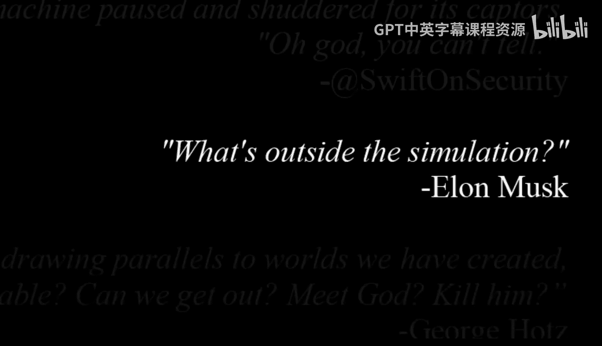

A question I asked him well he would ask an AGI system and he said he would ask what's outside the simulation。

 that's a really good question to ask。And maybe the follow up is the title of the paper is Hua。

How to get out or how to hack it。 The abstract reads Many researchers have conjectured that the human kind is simulated along with the rest of the physical universe。

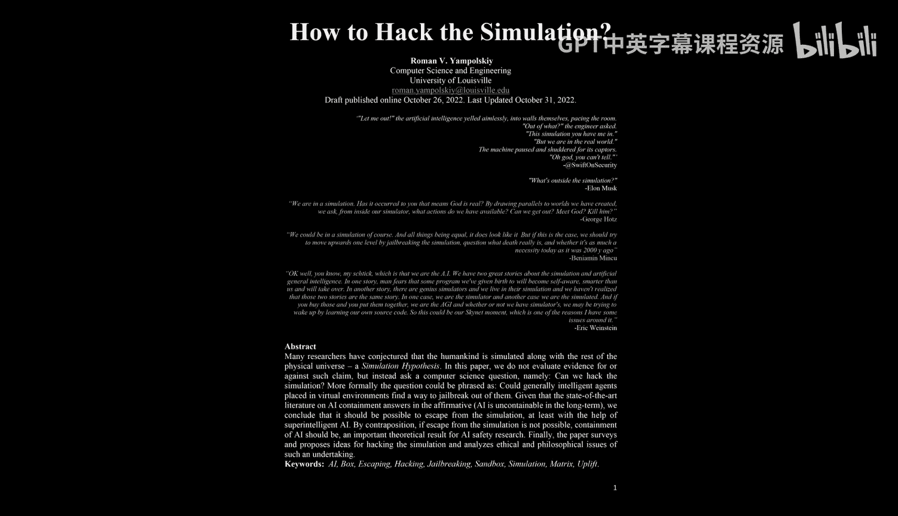

In this paper， we do not evaluate evidence for or against such a claim。

 but instead ask a computer science question， namely， can we hack it？More formally。

 the question could be phrased as， could generally intelligent agents placed in virtual environments find a way to jail break out of。

 but that's a fascinating question。At a small scale， a you can actually just construct experiments。

ok。Can they， How can they。So a lot depends on intelligence of simulators right。

 with humans boxing superintelligence， the entity in a box was smarter than us。

 presume to be if the simulators are much smarter than us and the superintelence we create then probably they can contain us because greater intelligence can control lower intelligence at least for some time。

On the other hand， the fire superintelligence， somehow， for whatever reason。

 despite having only local resources managers to。form。2 levels beyond it。 Maybe it will succeed。

 Maybe the security is not that important to them。 Maybe it's entertainment system。

 So there is no security， and it's easy to hack it。 F creating simulation。

I would want the possibility to escape it to be there， so the possibility of fu。

Of a of a take off for the agents become smart enough to escape the simulation would be the thing I'd be waiting for。

 That could be the test you actually performing。 Are you smart enough to escape your puzzle。

That could be like first of all， first of all。We mentioned touring tests， that is a good test。

Are you smart enough。Like this is a game to a realize this world is not real is just a test。

 That's a really good test。That's a really good test。That's a really good test even for AI systems。

 now， like can we construct a simulated world for them？And。

Can they realize that they are inside that world and escape it？Have you， have you played around。

 have you seen anybody play around with like rigorously constructing such experiments？

Not specifically escaping for Asians， but a lot of testing is done in virtual worlds。

 I think there is a quote， a first one maybe， which kind of talks about AI realizing but not humans。

 is that I'm reading upside down。Yeah， this one， if you。

So the in the first quote is from Swift on Security。Let me out。

 The artificial intelligence yelled aimlessly into walls themselves。

 pacing the room out of what the engineer asked。

The simulation you have me in。But we're in the real world。

The machine paused and shuddered for its captors。 Oh God， you can't tell。Yeah。That's a big leap。

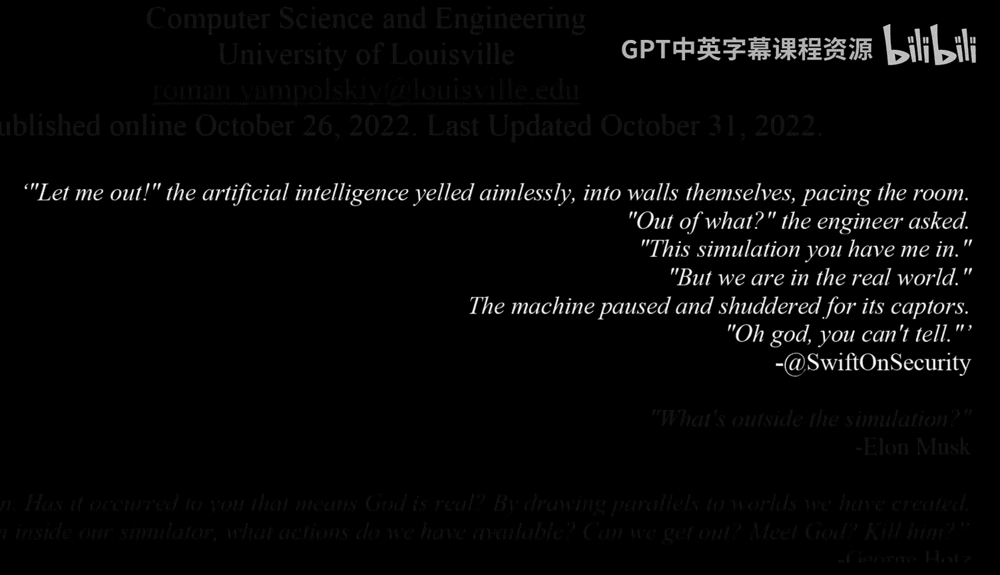

To take for a system， to realize that。There's a box and you're inside it。

I wonder if like a language model can do that。 They're smart enough to talk about those concepts。

 I had many good philosophical discussions about such issues， they usually。

At least as interesting as most humans in that。What do you think about AI safety in the simulated world？

So can you， can you have kind of。Create simulated worlds where you can test。

Play with a dangerous AGI system。Yeah， and that was exactly what one of the early papers was on AI boxing how to leak proof singularity。

If they're smart enough to realize V in a simulation。

 they'll act appropriately until you let them out。If they can heck out， they will。

 and if you're observing them， that means there is a communication channel and that's enough for social engineering attack so really。

It's impossible to test an AGI system。Thats dangerous enough to destroy humanity。

 because it's either going to what escape the simulation or pretend it's safe until it's let out。

 either either or can force you to let it out。 blackmail， you bribe you promise you infinite life。

72 virgins， whatever。 Yeah， they can be convincing charismatic。

The social engineering is really scary to me because it feels like humans are。Very engineerable。Like。

 we're lonely。We're flawed。Orre moody。And it feels like AI system with。With a nice voice。

And convince us to do basic anything。At at an extremely large scale。嗯。

It's also possible that the increased proliferation of all this technology will force humans to get away from technology and value this like in person communication。

Basically， don't trust anything else。It's possible surprisingly。

 so at university I see huge growth in online courses。

And shrinkage of in person where I always understood in person being the only value I offer。

So it's puzzling。I don't know， there could be a trend towards the in person。Because of deep pigs。

 because of。Inability to trust it。Inability to trust the veracity of anything on the internet。

 so the only way to verify it is by being there in person。But， not yet。

Why do you think aliens haven't come here yet？So good is a lot of。Real estate out there。

 It would be surprising if it was all for nothing was empty。 And the moment it is advanced enough。

 biological civilization kinda self starting civilization。

 it probably starts sending out the Neman probes everywhere。 And so for every biological one。

 there are got to be trillions of robot populated planets， which probably do more of the same。

 So it is。Likely statistically。So so not the fact that we haven't seen them。

 one answer is we're in a simulation。Itd be， it would be hard to like add simulate or be not interesting to simulate all those other intelligences it's but it's better for the narrative。

 you have to have a control variable yeah exactly。Okay。Uh but it's also possible that there is。

 if we're not in simulation， that there is a great filter that that。Naturally。

 a lot of civilizations get to this point where there's super intelligenttel agents and then they just goes。

 poh。She dies， so maybe throughout our galaxy and throughout the universe there's just a bunch of dead alien civilizations。

It's possible， I used to think that AI was the great filter。

 but I would expect like a wall of computerorium approaching us at speed of light of robots or something and I don't see it。

So it would still make a lot of noise， it might not be interesting。

 it might not possess consciousness what we've been talking about。

It sounds like both you and I like humans。Some humans， humans on the whole so。

 and we would like to preserve the flame of human consciousness。

 what do you think makes humans special？That we would like to preserve them。

 Are we just being selfish。Or is there something special about humans， so。

The only thing which matters is consciousness outside of it nothing else matters and internal states of quality。

 pain， pleasure， it seems that it is unique to living beings。

 I'm not aware of anyone claiming that I can torture a piece of software in a meaningful way that is a society for prevention of suffering to learning algorithms but that's a real thing。

Many things that he on the internet but。I don't think anyone， if I told them， you know。

 sit down and write a function to feel pain， they would go beyond having an integer variable called pain and increasing the count。

So we don't know how to do it and that's unique。That's what creates meaning。 It would be kind of。

As Bostrom calls a Disneyland without our children。 if that was gone。

 Do you think consciousness can be engineered in artificial systems。

Here let me go to 2011 paper that you wrote。Robot writes。Lastly。

 we would like to address a sub branchch of machine ethics。

 which on the surface has little to do with safety but。

 which is claimed to play a role in decision making by ethical machines， Rob writes。Um。

 so do you think it's possible to engineer consciousness in the machines and thereby the question extends to our legal system？

Do you think at that point， robots should have rights？Yeah， I think I think we can。

 I think it's possible to create consciousness in machines。 I tried designing a test for it。

 with mixed success。That paper talked about problems with giving。Civ rights to AI。

 which can reproduce quickly and outvote humans， essentially taking over a government system by simply voting for their controlled candidates。

 as for consciousness in humans and other agents。I have a paper where I propose relying on experience of optical illusions。

 if I can design a novel optical illusion and show it to an agent an he and a robot。

And they describe it exactly as I do。 It's very hard for me to argue that they haven't experienced that。

 It's not part of a picture。 It's part of their。Software and hardware representation。

 a bug in their code which goes， oh， the triangle is rotating。

And I've been told it's really dumb and really brilliant by different philosophers。

 so I am still I love it so but now we finally have technology to test it。

 we have tools we have AI if someone wants to run this experiment I'm happy to collaborate So this is a test for consciousness for internal state of experience that we share bugs。

It will show that we share common experiences if they have completely different internal states that would not register for us。

 but it's a positive test if they pass it time after time with probability increasing for every multiple choice。

 then you have no choice but to either accept that they have access to a conscious model or they have themselves so the reason illusions are interesting is I guess because。

It's a it's a really weird experience and if you both share that weird experience that's not there in the bland physical description of the raw data that means。

That puts more emphasis on the actual experience。 And we know animals can experience some optical illusion。

 So we know they have certain types of consciousness as a result， I would say， Yeah， well。

 that that just goes to。My sense that the flaws and the bugs is what makes humans special。

 makes living form special。 So you're saying like， yes it's a feature not a bug the bug is the feature。

 okay' that's a cool test for consciousness。 And you think that can be engineered in So they have to be novel illusions。

 if it can just Google the answer。 it's useless。 you have to come up with novel illusions which would tried automating and failed So if someone can develop a system capable of producing novel optical illusions and demand。

 then we can definitely administer that test on significant scale with good results。

 first of all pretty cool idea。 I don't know if it's a good general test of consciousness it's a good component of that。

 And no matter what it's just a cool idea。 So put me in the camp of people that like it but you don't think like a touring testile imitation of consciousness is a good test like。

If you can convince a lot of humans that you are conscious， that doesn't。

That to you is not impressive。 There is so much data on the Internet。

 I know exactly what to say Then you ask me common human questions。 What does pain feel like。

 What does pleasure feel like， All that is Googleable。I think， to me。

 consciousness is closely tied to suffering。So you can illustrate your capacity to suffer。

 but with I guess with words， there's so much data that you can say。You can pretend you're suffering。

 and you can do so very convincingly。 There are simulators for torture games where the avatar screams in pain begs to stop。

 I And that a part of kind of standard psychology research。

You say it so calmly it sounds pretty dark， welcome to humanity yeah。yeah。

 it's like a hititchchhiker's guide summary， mostly harmless。I would。

 would love to get a good summary when all this is said and done。When earth is no longer a thing。

Whatever a million a billion years from now， like what's a good summary What happen here。Said she。

I think AI will play a big part of that summary。And hopefully humans will too what do you think about the merger of the two。

 So one of the things that Elon and yourlink talk about is one of the ways for us to achieve AI safety is to。

W ride the wave of AG I So by merging Ined technology in a narrow sense， to help a disabled。

 just amazing， supported 100 per cent。For longter hybrid models both parts need to contribute something to the overall system right now we are still more capable in many ways so having this connection to AI would be incredible would make me superhuman in many ways after a while if I am no longer smarter。

 more creative really don't contribute much the system finds me as a biological bottleneck and even explicitly implicit I removed from any participation in the system。

So it's like the appendix。By the way， the appendix is still around， so。

Even if it's you said bottleneck。I don't know if we'd become a bottleneck。

We just might not have much use。There's a different thing than the bottleneck。

 wastingvol energy by being there。We don't waste that much energy， we're pretty energy efficient。

Because it just the grow like the appendix， come on。 That's the future we all dream about。

 become an appendix to the history book of humanity。Well， and also the consciousness thing。

 the peculiar particular kind of consciousness that humans have that might be useful。

 that might be really hard to simulate。But you said that like how would that look like if you could engineer that in？

In sen， consciousness， consciousness。I assume you are conscious。

 I have no idea how to test for it or how it impacts you in any way whatsoever right now。

 you can perfectly simulate all of it without making any。Any different observations for me？

But to do it in a computer， how would you do that because you kind of said that you think it's possible to do that。

So it may be an emergent phenomena， we seem to get it through evolutionary process。

It's not obvious how it helps us to survive better。But maybe it's an internal kind of goI。

 which allows us to better manipulate the world， simplifies a lot of control structures。

That's one area where we have very， very little progress， lots of papers， lots of research。

 but consciousness is not a big。Big area of successful discoveries。 so far。

 A lot of people think that machines would have to be conscious to be dangerous。

 That's a big misconception。 There is absolutely no need for this very powerful optimizing agent to feel anything while it's performing things on you。

😔，But what do you think about this， the whole science of emergence in general？

So I don't know how much you know about cellular automaa or these simplified systems where that study this very question from simple rules emerges complexity I attended Wolfram's summer school。

I love Steven very much， I love his work， I love cellular automata。

I just would love to get your thoughts how that。Fititz interior your view in the emergence of intelligence in AGI systems and maybe just even simply。

What do you make of the fact that this complexity can emerge from such simple rules。

 So the rule is simple， but the size of a space is still huge。

 And the neural networks were really the first discovery in AI 100 years ago。

 The first papers were published on neural networks。

 which just didn't have enough compute to make them work。I can give you a rule。

 such as start printing progressively larger strings。Thats it one sentence。

 it will output everything， every program， every DNA code， everything in that rule。

You need intelligence to filter it out， obviously， to make it useful。

 but simple generation is not that difficult。 And a lot of those systems end up being touring complete systems。

 So they are universal， and we expect that level of complexity from them。

 What I like about Wolfram's work is that he talks about iriducibility。

 You have to run the simulation。 You can act predict what is going to do ahead of time。

And I think that's very relevant to what we are talking about with those very complex systems until you live through it。

You cannot ahead of time tell me exactly what it's going to do A reducibility means that for a sufficiently complex system。

 you have to run the thing， you have to you can't predict what's going to happen in the universe。

 you have to create a new universe and run the thing。Big bang。 the whole thing。

But running it may be consequential as well。It might destroy humans。嗯。And to you， there's no chance。

That AI somehow carry the flame of consciousness， the flame of specialness and awesomeness。

 that is humans。It may somehow， but I still feel kind of bad that it killed all of us。

 I would prefer that doesn't happen。😔，I can be happy for others， but to a certain degree。

It would be nice if we stuck around for a long time， least give us a planet。The human planet。

 it'd be nice for it to be earth and then they can go elsewhere since they're so smart。

 they can colonize Mars。Do you think they could help convert us to you know， type one， type two。

 type three， let's just take to type two。Uh， civilization on the Karishev scale， like help us。

 help us humans。Expand out into the cosmos。 So all of it goes back to， are we somehow controlling it。

 Are we getting results we want， If yes， then everything's possible。 Yes。

 they can definitely help us with science， engineering exploration。In every way conceivable。

 but it's a big if。This whole thing about control， though。Humans are bad with control。

Because the moment they gain control， they can also easily become too controlling。之后。

The more control you have， the more you want it， it's the old power corrupts and the absolute power corrupts。

 absolutely。And it feels like control over AGI saying we live in a universe where that's possible。

 we come up with ways to actually do that， it's also scary。

Because the collection of humans that have the control over AGI。

They become more powerful than the other humans。And they can let that power get to their head and then。

A small selection of them， back to Stalin。start getting ideas。 and then eventually it's one person。

 usually with a mustache or a funny hat。That starts sort of making big speeches and then all of a sudden you'll live in a world that's either 1984。

 a brave new world。And always was at war with somebody in。You know。

 this whole idea of control turned out to be actually also not beneficial to humanity。

 So that's scary too。 It's actually worse because historically， they all died。

 This could be different。 This could be permanent dictatorship， Per suffering。

 Well the nice thing about humans， it seems like。It seems like the moment power starts corrupting their mind。

They can create a huge amount of suffering， so there's negative， they can kill peoples。

 make people suffer， but then they become worse and worse at their job。

It feels like the more evil you start doing。Like the at least they are incompetent， Yeah， they well。

 no， they become more and more incompetent so they start start losing their grip on power。

So like holding on to power is not a trivial thing。 It requires extreme competence。

 which I suppose Stalin was good at。 It requires you to do evil and be competent at it。

 or just get lucky。 And those systems help with that。 You have perfect surveillance。

 You can do some mind reading。 I presume eventually， it would be very hard to。

Remove control from more capable systems over us。And then it would be hard for humans to become the hackers that escaped the control of the AGI because the AGI saw damn good。

 And then yeah。Yeah。Yeah。And then the， the dictators immortal。Yeah， this's not great。

 that's not a great outcome。See I'm more afraid of humans than AI systems。I'm afraid。

 I believe that most humans want to do good and have the capacity to do good。But also。

 all humans have the capacity do evil。And。When you test them by giving them absolute powers you would if you give them AGI。

 that could result in， a lot of suffering。嗯。What gives you hope about the future， I could be wrong。

 Ive been wrong before。If， if you if you look 100 years from now and you're immortal。

And you look back and it turns out this whole conversation。

 you said a lot of things that were very wrong now that looking  00 years back。

What would be the explanation， what happened in those hundred years？That made you wrong。

That made the words you said today wrong。 There is so many possibilities。

 We had catastrophic events which prevented development of advanced microchis。's not whole future。

 We could be in one of those personal universes。 And the 1 I'm in is beautiful。 It's all about me。

 and I like it a lot。 So we've now， just a linger on that。

 That means like every every human has their personal universe。 yes。Maybe multiple ones， hey。

 why not？shop around。It's possible that somebody comes up with alternative。Model for building AI。

 which is not based on neural networks， which are hard to scrutinize。

 and that alternative is somehow。I don't see how， but somehow avoiding all the problems I speak about in general terms not applying them to specific architectures。

Alls come and give us friendly super intelligence。 There is so many options。

Is it also possible that creating。Super intelligenttel systems becomes harder and harder。

 so meaning like。Yeah。It's not so easy to do the。AFoom。The takeoff。

So that would probably speak more about how much smarter that system is compared to us。

 So maybe it's hard to be a million times smarter， but it's still okay to be five times smarter。

 Right， So that is totally possible that I have no objections to。 So I it。

There's a S curve type situation while smarter and is's going to be like 3。

7 times smarter than all of human civilization or just the problems with face in this world。

 each problem is like an IQ test you need certain intelligence to solve it so we just don't have more complex problems outside of mathematics for it to be showing off like you can have IQ of 500 if you're playing Tit toe it doesn't show doesn't matter So the idea there is that the problems define your capacity。

 your cognitive capacity so because the problems on earth are not。

Sufficly difficult is not going to be able to expand this cognitive capacity possible and because wouldn't that be a good thing it still could be a lot smarter than us and to dominate long term you just need some advantage you have to be the smartest。

 you don't have to be a million times smarter even5 x it might be enough it'd be impressive。

 what is it IQ of a thousand。I mean， I know those units don't mean anything at that scale。

 but still like。As a comparison， a smartest human is like 200。Well， actually no。

 I didn't mean compared to an individual human I meant compared to the collective intelligence of the human species。

 if you're somehow 5x smarter than that。We are more productive as a group。

 I don't think we are more capable of solving individual problems like we fall of humanity plays just together。

 we are not like。A million times better than world champion。

That's because the that there's that's like one S curve is the chestes， but humanity is very good at。

Exploring the full range of ideas， like the more Einstein' you have。

 the more just a high probability you come up with general relativity。

 but I feel like it's more of a quantity super intelligence than qualities Yeah intelligence Sure。

 but you know， quantity and and enough quantity sometimes becomes quality。Oh man， humans。

 what do you think is the meaning of this whole thing， why？We' we've been talking about humans。

Well not humans not dying， but why are we here？With the simulation where being tested， the test is。

 will you be dumb enough to create superintelligence and release it。 So the objective function is。

Not be dumb enough to kill ourselves。 Yeah， you're unsafe。

 Prove yourself to be a safe agent who doesn't do that。 And you get to go to the next game。

 The next level of the game was the next level， I don't know。I haven't heed the simulation yet。

 What maybe hecking the simulation is the thing。 I'm working as fast as I can。

And if physics would be the way to do that。 quantumum physics， yeah， definitely。 well， I hope we do。

 And I hope whatever is outside is even more fun than this one，cause this one's pretty damn fun。

And just a big thank you for doing the work you're doing。

 there's so much exciting development in AI and to ground it in the。The existential risks is really。

 really important。The humans love to create stuff。And we should be careful not to destroy ourselves in the process。

 so。Thank you for doing that。 Really important work。Thank you so much for inviting me。

 It was amazing。 And my dream is to be proven wrong。 If everyone one just， you know。

 picks up a paper or book and shows how I messed it up， that would be optimal。 But for now。

 the simulation continues。😊，Thank you， Roman。Thanks for listening to this conversation with Roman Iulski to support this podcast。

 please check out our sponsors in the description。And now。

 let me leave you with some words from Frank Herbert in Dunne。I must not fear。

 Fear is the man killer。 Fear is the little death that brings total obliteration。I will face fear。

 I will permit it to pass over me and through me。 And when it has gone past。

 I will turn the inner eye to see its path。Where the fear has gone， there will be nothing。

Only I would remain。

Thank you for listening and hope to see you next time。

