# Lex Fridman Podcast #438《埃隆·马斯克：Neuralink 与人类的未来》中英字幕 - P1 - GPT中英字幕课程资源 - BV1XvUfBVEoq

The following is a conversation with Elon Musk， DJ。 S， Matthew McDuggo。

 Bliss Chapman and Noland Arbaugh about Nelink and the future of humanity。Eon， DJ。

 Matthew and Bliss are， of course， part of the amazing Nelink team。

 and Noland is the first human to have a neurallink device implanted in his brain。

I speak with each of them individually， so use time stamps to jump around， or as I recommend。

 go hardcore and listen to the whole thing。This is the longest podcast I've ever done。

 It's a fascinating， super technical and wide ranging conversation， and I loved every minute of it。😊。

And now， dear friends， here's Elon Musk， his fifth time on this the Lex Friedman podcast。

Drink coffee or water， water。I'm so over caffeinated right now。 Do you want some caffeine， I mean。

 sure。ThereThere's a nitro drink。This will keep you up to like。You know， tomorrow。Afternoon。

 basically。Yeah， I don't so what does Nitro just it's just got a lot of caff on don't ask questions。

 it's called Nitro。Do you need to know anything else Go hey， it's got nitrogen， that's ridiculous。

 I mean， what we breathe is 78% nitrogen anyway。What do you need to add more for？

Most most people think they they're breathing oxygen and they're actually breathing 78% nitrogen。

 You need like a milk bar like like from Clarkwork orange， yeah。😊。

Is that top three Kuberrick film for you Oh cards， it's pretty good， I mean， it's demanded。Darring。

 I'd say。Okay。は。Okay， so first let's step back and big congrats on getting your link implanted into human。

That's a historic step for your link and yeah， there's many more to come Yeah。

 we just obviously have us second can implant as well How did that go so far so good that's there looks like we've got。

I think on the order are 400 electrodes that are providing signals。So nice， yeah。

How quickly do you think the number of human participants will scale it depends somewhat on the regulatory approval。

 the rate to which we get regulatory approvals？So。We're hoping to do 10 by the end of this year。

Total of 10。So eight more。嗯。And with each one， you're going to be learning a lot of lessons but the neurobiology。

 the brain， the everything， the whole chain of the neural length that decoding this the signal processing。

 all that kind of stuff Yeah， yeah， I think it it's obviously going to get better with with each one。

I mean， I don't want to jinx it， but it seems to have gone extremely well with the second implant。

There's a lot of signal， a lot of electrodes it's working very well What improvements do you think we'll see in Nelink in the coming？

Let's say let's get crazy the coming years， I mean， in years， it's going to be。Digantic。

Because we'll increase the number of electrodes dramatically。Will improve the signal processing。

So are we with with the。Even with only roughly， I don't know 10。

 15% of the electrodes working with Noland with our first patient。

 we were able to get to achieve a bits per second， that's twice the world record。

So I think we'll start it like vastly exceeding the world record by orders of magnitude in the years to come。

 so start getting to I don't know 100 bits per second， thousand00。You know， maybe。

Maybe if you're like five years now， it might be at a megabit。

Like faster than any human could possibly communicate by typing with speaking。Yeah， that B， P。

 S is an interesting metric to measure。There might be a big leap in the experience once you reach a certain level of Bps。

 yeah。Like entire new ways of interacting with the computer might be unlocked and with humans。

With other humans provided they have。They want a neural link to right do you think otherwise they want't be able to absorb absorb the signals past enough do you think they'll improve the quality of intellectual discourse well I think you can you could think of it you know。

 if you were to slow down。Communication， how would hard feel about that？You know。

 if you'd only talk at let's say1/10th of normal speed。You would be like。

 wow that's agonizingly slow Yeah， so now imagine you could speak it。

Communicate clearly at10 or 100 or 1 thousand times faster than normal Listen， I'm pretty sure。

Nobody in their right mind listens to me at 1 x it listen to 2 x so I can only imagine what 10 x would feel like well I could actually understand it I usually default to 1。

5 x you can do 2 x but well actually if I'm trying to go if I'm listening somebody get to in like sort of 15 and 20 minutes I once to go to sleep then I'll do it 1。

5 x if I'm paying attention I'll do 2 x。Right，um， but actually if you start actually listening to podcasts or or sort of audio books or everything you had。

 if you get used to doing at 1。5， then one sounds。Painfully slow。

 I'm still holding on to one because I'm afraid I'm afraid of myself becoming bored with the reality with the real world where everyone's speaking in one x。

Well to depends the person， you can speak very fast。

 like we can communicate very quickly and also if you use a wide range of if your vocabulary is larger。

 your rate effective but rate is higher。That's a good way to put it the effective bit right I mean that is the question is how much information is actually compressed in the low bit transfer of language Yeah。

 if you if there's if if there's a single word that is able to convey。

Something that would normally require， I don't know， 10 simple wordss， then you've you've got a。

 you know， maybe a 10x compression on your hands。And that's really like with memes。

 memes are like data compression。It conveys a whole simultaneously hit with a wide range of symbols that you can interpret and it's。

You kind of get it。Faster than if it were a words or or a simple picture and of course。

 you're referring to memes broadly like ideas， yeahs。

An entire idea structure that is like an idea template。

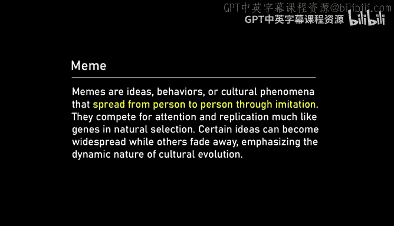

And then you can add something to that idea template。

But somebody has that preexisting idea template in their head。

So when you add that incremental bit of information。

 you're conveying much more than if you just said a few words。

 it's everything associated with that meme。You think there'll be emergent leaps of capability as you scale the number of electrodes。

 or there'll be a certain， you think there'll be like actual number where it just the human experience will be altered。

 yes。What do you think that number might be， whether electrodes or Bps， we of course。

 don't know for sure， but is this 10，000， 100000？Yeah， I mean certainly if you're anywhere at 10。

000s per second， I mean that's vastly faster than any human communicate right now if you think of the what is the average per second of a human。

 it is less than one but per second over the course of a day because there are 86。

400 seconds in a day and you don't communicate 86，400 tokens in a day。Therefore。

 your purpose per second is less than one。Average over 24 hours。 It's quite slow。

And even if you're communicating very quickly。And， and you。You know。

You're touring to somebody who understands what you're saying。Or in order to communicate。You have to。

 at least to some degree， model the mind state of the person to whom you're speaking。

 then take the concept you're trying to convey， compress that into a small number of syllables。

 speak them， and hope that the other person decompresses them into a conceptual structure that is as close to what you have in your mind as possible。

Yeah， I mean there's a lot of signal loss there in that process yeah。

 very lossy compression and decompression and a lot of the a lot of what your neurons are doing is distilling the concepts down to a small number of symbols of say syllables that I'm speaking or keystrokes。

 whatever the case may be so。That's a lot of what。Your brain computation is doing。

Now that there is an argument that that's actually。

A healthy thing to do or a helpful thing to do because。As you try to compress complex concepts。

 you're perhaps forced to distill what is most essential in those concepts as opposed to just all the fluff。

 so in the process of compression， you distill things down to what matters the most because you can only say a few things。

So that is perhaps helpful， I think we might we'll probably get if our data rate increases the highly probable that will become far more vibo just like your computer。

 you know， when computers had like，My first computer had 8 k Ram，You really thought about every bite。

And。You know， now you got computers with many gigabytes around。 So， you know。

 if you want to do an iPhone app that just says hello well， just probably， I don't know。

 several megabytes minimum。With a bunch of flluff， but nonetheless。

 we still prefer to have the computer with the more memory and more compute。

So the long term aspiration of Nelink is to improve the AI human symbiosis。By increasing the。

The bandwidth of the communication。Because even if in the most benign scenario of AI。

You have to consider。That the a is simply going to get bored。

 waiting for you to spit out a few words。I mean， if AI can communicate at terabbits per second and you're communicating it。

You know， bits per second。Yeah， it's like to or tree。Well。

 it is a very interesting question for a super intelligent species。What use are humans。

I think there is some argument for。Humans as a source of will。Well， well， yeah， so I said， well。

 oh purpose。So if you， if you consider the。The human mind as being essentially the。

 there's the primitive。Lomic elements， which basically even like reptiles have。

And there's the cortex， that' the thinking and planning part of the brain。

Now the cortex is much smart of the limb system and yet is' largely in service to the limb system it's trying to make the limb system happy I mean。

 the sheer amount of compute that's gone into people trying to get laid is insane without the without actually。

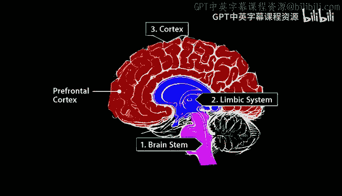

Seeking procreation， they're just literally trying to do。

It's a sort of simple motion and they get a kick out of it so this simple。

 which in the abstract rather absurd motion， which is sex。

 the cortex is putting a massive amount of compute into trying to figure out how to do that。

So like 90% of distributed compute of the human species is spent on trying to get laid probably like thats large of percentage Yeah。

 yeah， there's no purpose to most sex except u hedonistic， you know。

 it's just sort of a joy or whatever dopamine release。U。Now， once in a while it's procreation。

 but for humans it's mostly modern humans， it's mostly recreational。U。And and so。

So to cortex much smarter than your Olympic system is trying to make Olympic limb system happy because the Olympic system wanted to have sex or want some tasty food or whatever the case may be。

And then that is then further augmented by the tertiary system， which is your phone， your laptop。

 iPad you or your computing stuff， that's your tertiary layer。So you're actually already abo。

 you have this tertiary compute layer， which is in the form of your computer with all the applications。

 all your compute devices。And。And so in the getting laid front， there's actually a mess amount of。

Of digital compute， also trying to get late。You know， with like tender and whatever， you know， yeah。

 so the compute that weave humans have built is also participating yeah， I mean。

 there's like gigawatts of compute going into getting late of digital compute。Yeah。

What if AGI was happening we speak if we merge with AI is just going to expand the compute that we humans use pretty much to try to go that's one of the things。

 certainly yeah yeah。But what I'm saying is that that yes， is there a use for humans？Well。

 there's this fundamental question of what's the meaning apply if I do anything at all？And so if。

If our simple limb system provides a source of will to do something that then goes to our cortex that then goes to our tertiary compute layer。

Then。I don't know， it might actually be that the AI in a benign scenario is simply trying to make the human living system happy。

Yeah， it seems like it's the will is not just about the limbic system。

 there's a lot of interesting complicated things in there we also want power， that's limbic too。

 I think but then we also want to in a kind of cooperative way alleviate the suffering in the world。

U， not everybody it does， but yeah， sure， some people do as a group of humans when get together。

We start to have this kind of collective intelligence that is。

Is more complex in its will than the underlying individual descendants of apes right so there's like other motivations and that could be a really interesting source。

Of an objectiveive function for AGI yeah。I mean， there are these sort of fairly cerebral。

Or kind of higher level goals， I mean， for me， it's like what's the meaning of life for understanding understanding the nature of the universe？

Is of great interest to me。U。And hopefully to the AI。And that's the。

That's the mission of X AI and G is understand the universe。 So do you think people。

When you have a neural link with。10，00，100，000 channels。

Most of the use cases will be communication with AI systems。Well， if it's assuming that the。

They're not I mean， there's this solving basic。Neurological issues that people have。

 you know if they've got。Damaged neurons in their spinal cord neck or， you know。

As is the case with first two patients， then you know， this obviously。

The first order business is solving fundamental neuron damage and a spinal cord， neck。

 or in the brain itself。So。You know， our second product is。Call blind side。

 which is to enable people who are completely blind。

 lost both eyes or optic nerve or just can't see at all to be able to sea。

By directly triggering the neurons in the visual cortex。So we're just talking at the basics here。

 you know， it like very。The simple stuff， relatively speaking， is solving。Neurn damage。You know。

 it could also solve， I think， probably schizophrenia， you know。If people have seizures of some kind。

 it probably solve that。It could help with memory。So there's like a kind of a。A t tree， if you will。

I was like you get the basics。Um。Like like you need， you need literacy before you can have， you know。

 a lot of the rings。You know。😀Yeah。Go it。Do you have letters and alphabet， okay， great， words。

 you know then？Eventuallyally， you get sas。So。You know， I think there's that that there may be some。

You know， things to worry about in the future， but the first several years are really just solving basic neurological damage like for people who have essentially complete or near completele loss of from the brain to the body。

 like Stephen Hoing would be an example， the neurallink would be incredibly profound because I mean。

 you can imagine if Stephen Hoing could communicate as fast as we're communicating perhaps faster。

And that's certainly possible。Probable， in fact， likely， I'd say。

So there's a kind of dual track of medical and non medical。

 meaning so everything you've talked about could be applied to people who are non disabled in the future the logical thing to do is sensible thing to do is to sort off solving。

um。Basic。Neuron damage issues， because the there's obviously some risk with with a new device is you can't get the risk got of zero some possible。

 so you want to have the highest possible reward。Given that given there's a certain irreducible risk。

And if if somebody's able to have。A profound improvement in their communication。

That's worth the risk。As you get the the risk down， yeah。

 as as you get the risk down once the risk is is down to to， you know。

 like you have like thousands of of people that have been using it for per years and the risk is minimal then perhaps at that point you could consider saying okay。

 let's。Let's aim for augmentation Now， now I think we。

we're actually going to aim for augmentation with people who have neuron damage。

 So we're not just aiming to give people a communication data rate equivalent to normal humans。

 We're aiming to give people who have。you know， a quadriplegic or maybe have complete loss of the connection to the brain and body。

 a communication data rate that exceeds normal humans I while we're in there why not。

 let's give people superpowers。And the same for vision as you restore vision。

 there could be aspects of that restoration that are superhuman。 Yeah， at first。

 the vision restoration will be。Lz。mBecause you have to say， like how many neurons can you？

Put in there and and trigger and。And you can do things where you adjust the electric field to like even if you've got。

 say。10，000 neurons， it's not just 10，00 pixels because you can adjust the field between the neurons and do them in patterns in order to get so have。

 say 10，000 electrodes effectively give you。I don't know， maybe yeah。

Like having a megixel or a 10 megapixel situation。U。So and then over time。

 I think you get to higher resolution than human eyes and you could also see in different wavelengths。

 so like Joorio La Florge from Star Trek， you know like the thing。You could just。

 like you want to see in right or no problem， you can see ultra about。Infrared。Ego vision。

 whatever you want。Do you think therell be， let me ask Joe Rogan question。

 do you think they'll be I just recently taken ayahuasca？I saidSo this question， no， well yes。

 well I guess technically it is yeah， yeah never tried DMmT bro。I love you Joe Okay。

 but yeah wait yeah， have you really said much about it， but but I not I've not， I've not。

 I' been okay， well， what full of be。😊，It is a truly incredible tone the tables aren't you wow。

 I mean， you're in the jungle。Yeah， amongst the trees myself it been crazy and the shaman yeah， yeah。

 yeah with the insects with the animals all around you like don't goes as far as I can see I mean that's the way to do it things are going look pretty wild Yeah pretty wild I I mean an extremely high dose just don't go hugging an a condodo or something you know you haven't lived unless you made love to a condo I'm sorry。

But snakes and bladders。UYeah， it was I took extremely high dose of okay， nine cups and damn， okay。

 that sounds like a lot， of course it's normally just one cup or one or two usually one you went wait like right off the bat or do you work your way after it so？

across two days because the first day I took2 and a it was a ride。

 but it wasn't quite like it wasn't like revelation it wasn't into deep space type ride it was just like a little airplane saw some trees and some visuals and all just saw dragon and all that kind of stuff but you went to Pluto I think Pluto no deep space deep space one of the interesting aspects of my experiences I thought I would have some demon some stuff to work through that's what people that's what everyone says much says nothing all positive I just so I don't even think so I don't know but I I kept thinking about had like extremely high resolution thoughts about the people I know in my life you were there and it's just not from my relationship with that person but just as the person themselves I had just deep gratitude。

Due to who they are that's cool， I it was just like this exploration like， you know。

 like like Sims or whatever， you get to watch them sure。

 I got to watch people and just be in awe of how amazing they are it sounds awesome Its great I I was waiting for when demon coming。

Exactly， maybe I'll have some negative thoughts， nothing。

 nothing I had just extreme gratitude for them and then also a lot of space travel you know。

 space traveled to where so here's what it was it was people。😊，The human beings that I know。

 they had this kind of well the best way to can describe it is they had a glow to them Okay。

 and then I kept flying out。From them to see earth， to see our solar system to see our galaxy。

 and I saw that light， that glow all across the universe， Okay， like that whatever that form is。

 all right， whatever that like did you go past the Milky Way。Yeah yeah， you're like intergalactic。

 yeah intergala okay but always pointing in yeah， past the milk away past I mean。

 I saw like a huge number of galaxies intergalactic and all of it was glowing so but I couldn't control that trail because I would actually explore near distances to the solar system see if there's aliens or any of that kind of stuff I think I didn't know zero aliens implication of aliens because they were glowing they were glowing in the same way that humans were glowing that that like life force that I'll see that the thing that made。

Humans amazing was there throughout the universe like there was these glowing dots， so I don't know。

It made me feel like there's life。 No， not life， but something。

 whatever makes humans amazing all throughout the universe。 Sounds good。 Yeah， it's amazing。

 No demons， no demons。 I looked for the demons。 There's no demons。

 There were dragons and they're pretty odd。 So the thing about truth。 There anything scary at all。😊。

Dragons， but they weren't scary。 They were。 They were protective。 So the thing issymmetric dragon。

 No， it was， it was more like a game of Thrs kind of。 They weren't very friendly。 They were very big。

 So the thing is bought giant trees。😊，At night， which is where where I was。 I mean。

 the jugle was kind of scary。 Yeah， the trees started to look like dragons and they were all like looking at me Sure。

 okay， and it didn't seem scary。 They seemed like they were protecting me and they。The。

 the shaman and the people didn't speak English， by the way。

 I which made it even scary I guess we're not even like， you know， we worlds apart in many ways。

 and just。But yeah， there was not they they talk about the mother of the forest protecting you and that's what I felt like。

 and you're way out in the jugle way out there's this is not like tourist tree know like like like 10 miles outside of Rio or something No we went No there's not you're not Amazon me and this guy named Paul Rosalie who basically is tararzan he lives in the jungle。

 we went out deep and we just went crazy Well yeah， so anyway。

 can can I get that same experience and in your link Probably yeah。

 I guess that is the question for nondis people， do you think there' there's a lot。In our perception。

 in our experience of the world that could be explored， that could be played with using you like。

 yeah I mean。Newlink is it's really a generalized。And what output device， you know， it's it's a。

Reading electrical signals and generating electrical signals。I mean。

 everything that you've ever experienced in your whole life， smell， you know， emotions。

 all of those are electrical signals。So。It's kind of weird to think that your entire life experience is to slow down to electrical signals for neurons。

 but that is in fact the case， or I mean， that's at least what all the evidence points to。So。I mean。

You could if you trigger the right neuron， you could trigger at a particular ascent， you could。

You could certainly make things glow。 I mean， you're pretty much anything。 I mean， really， you could。

 you can think of the brain as a biological computer。 So if there are certain， say。

 chips Oh elements of that biological computer that are that are broken， let's say your。

 your ability to。If you've got a stroke that if you've had a stroke。

 that means you've got some part of your brain is damaged。Um。

 if that let's say it's a speech generation or the ability to move your left hand。

 that's the kind of thing that a neurallink could solve。U。

If it's if you've got like a massive amount of memory loss that's just gone， well we can't go。

 we can't get the memories back， we could restore your ability to make memories， but we can't。

 you know。Resstore memories that are fully gone now I should say。

If maybe if part of the memory is there and the means of accessing the memory is the plotd that's broken。

 then we could reenable the the ability to access the memory so but you can think of like gram in you know in a computer。

 if the RAM is destroyed or your SD card is destroyed， we can't get that back。

 but if the connection to the SDs card is destroyed， we can fix that。

If if it is fixable physically then yeah， then it can be fixed of course with AI you can just like you can repair photographs and fill in missing parts of photographs。

 maybe you can do the same yeah you could say like create the most probable set of memories based on the。

What information you have about that person。You could then probably。

It would be probabilistic restoration of memory。 Now， we're getting pretty esoteric care。

 but that is one of the most beautiful aspects of the human experiences is remembering the good memories。

 like we sure， we live most of our life as Danny Kaneman has talked about in our memories。

 not in the actual moment。 We just， we're collecting memories and we kind of relive them in our head。

 And that's the good times。 if you just integrate over our entire life It's remembering the good times。

 Sure that produces the large amount of happiness。 so yeah， I mean， what are we， but our memories。😊。

And， and what is death， But the loss of memory。Loss of information。Um， you know。

 if if you could say like， well。If if you could be you run tour experiment with if you。

Were disintegrated painlessly and then reintegrated a moment later， like teleportation， I guess。

 provided there's no information loss。That the the fact that your one body was disintegrated is irrelevant and memories is just such a huge part of that death is fundamentally the loss of information。

The loss of memory。So if we can store them as accurately as possible。

 we basically achieve a kind of immortality。You've talked about。The， the threats。

 the safety concerns of AI， let's look at long term visions。 Do you think neurallink is。In your view。

 the the best current approach we have for AI safety， it's an idea that may help with AI safety。

Certainly not。I wouldn't want to claim it's like some panaceo or that's a sure thing。But。I mean。

 many years ago， I was thinking like， well， what？H。What would inhibit？Alignment of。

Human collective human will with。Auttificial intelligence and the low data rate of humans。

 especially our slow output rate。Would necessarily just because it's such a because the communication is so slow would u。

Diminish the link between humans and computers。Like the more you are a tree。

TheThe less you know what the tree is， like let's say you， you look at a tree。

 you look at this plant or whatever and like， hey， I'd really like to make that plant happy。

 but it's not saying a lot， you know？So the more we increase the data rate that humans can intake and output。

 then that means the higher the chance we have in a world full of AGIs。

We could better align collective human will with AI， if the。

Output rate especially was dramatically increased like and I think there's potential to increase the output rate by。

 I don't know。Three， maybe six， maybe more orders of magnitude。So。pell in the current situation。

And that output rate would be by increasing the number of electrodes， number of channels。

 and also maybe implanting multiple neurallink。Do you think there will be a world？

In the next couple of decades where its hundreds of millions of people have neural Orleans。Yeah。

 I hear。Do think when people just。When they see the capabilities。

 the superhuman capabilities that are possible and then the the safety is demonstrated。 Yeah。

 if it's extremely safe and you have and you can have superhuman abilities。And let's say you can。

Upload your memories。um。You know， so you wouldn't you wouldn't lose memories then。

I think probably a lot of people would choose to have it。It would supersseat the cell phone。

 for example， I mean， it's the biggest problem that a say phone has。Is is trying to do。

Figure out what you want。So that's why you've got you know， autocomplete and。You've got output。

 which is all the pixels on the screen， but from the perspective of the human。

 the output is so freak and slow。 De or phone is desperately just trying to understand what you want。

And and。You know， there's an eternity between every keystroke from a computer standpoint。Yeah。

 it's the computer's talking to a tree， a slow moving tree that's trying to swipe， yeah。So， you know。

 if you had computers that are doing trillions of instructions per second。

 and a whole second went by。I mean， that's a trillion things that could have done， you know。Yeah。

 I think it's。Exciting and scary for people because once you have a very high bit rate that changes the human experience in a way that's very hard to imagine。

 Yeah， it would be。We would be something different。 I mean， some sort of。Futuristicbo， I mean。

 I mean， we're obviously talking about， by the way， like it's not like around the corner it's。

 you ask me what the distant futur is like maybe this is like it's not super far away it。10，15 years。

 that kind of thing。When can I get one？10 years。Probably less than 10 years。

Deds what you want want to want to do， you know， hey。

 if I can get like a thousand Bps thousand Bps1 and it's safe and I can just interact with a computer while laying back and eating cheetos。

 I don't eat cheetos there's certain aspects of human computer interaction when done more efficiently and more enjoyableably I don't like worth it。

Well， we feel pretty confident that。I think maybe within the next。

Year or two that someone with a neurallink implant will be able to outperform。A programme gamer。Nice。

 because the reaction time would be faster。I got to visit Memphis。 Yeah， yeah。

 you're going big on compute Yeah you've also said play to win or don't play at all so yeah。

 what does it take to win for AI that means you've gotta have。The most powerful training compute。

And the rate of improvement of training compute has to be faster than。

If one else or you will not win。Your AI will be worse。So how can Goc。

 let's say three that might be available like next year， will hopefully end of this year。

 Grooc three we're lucky， yeah。How can that be the best LLM。

 the best AI system available in the world， how much of it is a compute， how much of it is data。

 how much of it is like post training， how much of it is the product that you package it up in。

 all that kind of stuff。I mean， they won't matter it's totally like saying what， what， you know。

 let's say it's a formula one race like what matters more of the car or the driver， I mean。

 they both matter if if you if your car is not fast then，You know。

 if it's like say's half the horsepower if a competitor is。

 the best driver will still lose on that if it's twice the horsepower， then probably even them。

Medioccori will stolen win。So the training computers can like the engine。

 how many this horsepower of the engine so you really you want to try to do the best on that and you then。

Then how efficiently do you use that training compute and how efficiently do you do the inference。

 the use of the AI？UmSo obviously that comes down to human talent and then what unique access to data do you have？

That's also a place of。Plays a role。 Do you think Twitter data will be useful。 yeah， I mean。I think。

I think most of the leading AI companies have already scraped all the Twitter data。

I know what I think they have。So on a go forward basis。

 what's useful is the fact that it's up to the second。

 you know that's because that's hard for them to grave in real time so's there's a。

In an immediacy advantage that Grorog has already。I think with Tesla and the real time video coming from several millions of cars。

 ultimately tens of millions of cars。With optimus， there might be hundreds of millions of optimus robots。

Maybe billions。Learning train us not from the real world that's the biggest source of data。

 I think ultimately is sort of optim probably optimus is going to be the biggest source of data because it's reality scales。

Reality scales to the scale reality， it's actually humbling to see how。

Little data humans have actually been able to accumulate but really if you see how many trillions of usable tokens have humans generated were on a non duplicateup of like discarding a spam and。

Repetitive stuff。It's not a huge number。You run out。Pretty quickly。And optimus can go。

 so Tesla cars can unfortunately have to stand on the road。Uh。

 operatinging this robot can go anywhere more reality off the road and go off the road I mean Op robot can like pick up the cup and see。

 did it pick up the cup in the right way， did it， you know， save pour water in the cup。You know。

Did the water go in the cup or not go in the cup， did spill water or not？Simple stuff like that。

 I mean， but it can do at that at scale。Times a billion。So。Generate useful。Data from reality。

So it cause and effect stuff。What do you think it takes to get？To mass production of humanoid robots。

Like that，'s the same as cars， really。I mean， global capacity for vehicles is about 100 million a year。

And I。It could be higher， it's just that the demand is on the order of $100 million year and then there's roughly 2 billion。

Vehicles that are in use in some way。Which makes sense like the life of a vehicle is about 20 years。

 so at steady state， you can have 100 million vehicles produced a year with a2 billion vehicle fleet roughly。

Now for humanoid robots the utility is much greater。

 so my guess is humanoid robots are more like at a billion plus per year， but you know。

 until you came along and started building optimus。

 it was thought to be an extremely difficult problem I mean still it is extremely so so woke in the park。

I mean， optimists currently would struggle to walk in the park。I mean。

 it can walk in a park is not too difficult， but it will be able to walk over a wide range of terrain and pick up objects。

 yeah yeah。They can really do that。But like all kinds of objects， yeah， all foreign objects， I mean。

 pouring water in a cup。It's not true you'll because then if you don't know any about the container。

Could be all kinds of containers。 Yeah， there's going to be an immense amount of engineering just going into the hand。

The hand might be。It might be close to half of all the engineering in the in optimus from an electromechanical standpoint。

 the hand is probably。Roughly half of the engineering， but so much of the intelligence。

 so much the intelligence of humans goes into what we do with our hands。 Yeah。

 I the manipulation of the world， manipulation of objects in the world， intelligence。

 safe manipulation of objects in the world， yeah yeah。I mean。

 you start really thinking about your hand and how it works。You know。

 I did all the time the sensory and control hoululus is we have humongous hands， Yeah。

 so I mean like your hands， the actuators， the muscles of your hand are almost overwhelmingly in your forearm。

So your forearm has the muscles that actually control your hand。

 there's a few small muscles in the hand itself， but your hand is really like a skeleton meat puppet。

And with cables that so the muscles that control your fingers are in your forearm and they go through the carpal tunnel。

 which is that you've got a little collection of bones and a tiny tunnel that these cables。

 the tendons go through and those tendons are，What mostly what moves your hands。

And something like those tenants has to be reengered into the optimus and to do all that kind of stuff Yeah so like the current optimus。

 we tried putting the actuators in the hand itself。

 but then you sort of end up having these like giant hands giant hands that look weird and then they don't actually have enough degrees of freedom and or enough strength。

So。So then you realize， oh， okay， that's why you got to put the actctuaators in the forear。

And just like a human， you've got to run cables through a narrow tunnel to operate the fingers and there's also a reason for not having all the fingers the same length。

It wouldn't be expensive from an energy or evolutionary standpoint。

 have all your fingers be the same length， so why not do the same length， Yeah。

 why not because it's actually better to have different lengths。

Your dexterity is better if you've got fingers at different length。there are more things you can do。

And your dexterity is actually better if your fingers are at different length。

Like there's a reason we've got a little finger like， why don nott have a little finger this bigger。

Yeah， because it allows you to do fine， it helps you with fine motor skills。

ThatThis little finger helps， it does。Oh。ButIf you lost your little finger。

 it would you have noticedably less dexterity So as you're figuring out this problem。

 you have to also figure out a way to do it so you can mass manufacture it so its to be as simple as possible。

 it's actually going to be quite complicated。 like the the as possible part is it's quite a high bar if you want to have a humanoid robot that can。

do things that a human can do it's actually that's a very high bar so our new arm has 22 degrees of freedom instead of 11 and has the like so the actctuaators in the forearm and these all the actctuaators are designed for scratch。

physics first principles that the sensors are well designed for scratch and we'll continue to put a tremendous amount of engineering effort into improving the hand like by hand。

 I mean like the entire forearm from elbow forward。Its really the hand。So。But。

Incredibly difficult engineering， actually。And。And so so the simplest possible version of a humanoid robot that can。

Doude。Even most paths not all of what a human can do is actually still very complicated。

 its it's not too simple， it's very difficult。Can you just speak to what it takes for a great engineering team。

 for you， what Ive saw in Memphis， the supercomputer cluster。

 is just this intense drive towards simplifying the process， understanding the process。

 constantly improving it， constantly iterating it？Well。

It's easy to say simplify it and its very difficult to do it。You know。

 I have this very basic first principles algorithm that I run kind of as like a mantra。

 which is to first question the requirements and make the requirements less dumb。

The requirements are always down to some degree， so you want to start off by reducing the number of requirements。

Um， and no matter how smart the host neither gave you those requirements。

 they're still dumb to some degree if youre you have to start there because otherwise you could get the perfect answer to the wrong question。

So try to make the question the least wrong possible。U。Question the requirements means。

 And then the second thing is， try to delete the。Whatever these step is。

 the part or the process step。Sounds very obvious。U。People。

Often forget to do to try deleting it entirely。 And if you're not forced to put back at least 10% of what you delete。

 you're not deleting enough like。And it's somewhat illogically people often。

Most of the time feel as though they have succeeded if theyve not been forced to put things back in。

 but actually they haven't because they've been overly conservative and have left things in there that shouldn't be。

So。And only the third thing is try to。Optimize it or simplify it。U。Again， the sounds these all sound。

 I think very， very obvious when I say them， but the number of times I've made these mistakes is。

More than I care to remember。That's why I have this mantra。So。In fact。

 I'd say the most common mistake of smart engineers is to optimize a thing that should not exist。はい。

So like like you say， you run through the algorithm and basically show up to a problem。

Show up to the supercomputer cluster and see the process and ask， can this be deleted？Yeah。

 first try to delete it。Yeah。Yeah， that's not easy to do no， and actually this。

What generally makes people uneasy is that you've got to delete at least some of the things that you delete。

 you will put back in， but going back to sort of where our limb system can steer us wrong is that we tend to remember with sometimes the jarring level of pain where we deleted something that we subsequently needed。

Yeah， and so people remember that one time they forgot to put in this thing three years ago and that caused them trouble。

Um，And so they overcorrect and then they put too much stuff in there and overcomplicate things。

So you actually have to say we're deliberately going to delete more。Then we we should。

It's that we're putting at least one in 10 things we're going to add back in。

And I've seen you suggest just that that something should be deleted and you can kind of see the the pain。

 Oh， yeah， absolutely。 Everybody feels a little bit of the pain。 Abutely。 And and I tell in advance。

 like， yeah， there's some of the things that we delete。 we're going to put back in。And and that。

People get a little shocked about that。But it makes sense because if you。

 if you're so conservative as to。Never have to put anything back in。

 you obviously have a lot of stuff that isn't needed。So you got over correct。This is， I would say。

 like a cortical override to Olympic instinct。One of many that probably leads us astray。Yeah。

I there's like a step four as well， which is any given thing can be sped up。A aas。

 you think it can be done like whatever the speed is being done， it can be done faster。

 but you shouldn't speed things up until until you've tried to delete it and optimize otherwise you're speed that' speeding up something that shouldn't exist as absurd and then the fifth thing is to automate it。

And I've gone backwards so many times where I've automated something， sped it up。

Simplified it and then deleted it。And I got tired of doing that。

So that's why I've got this mantra that is a very effective。Five step processes works great。Well。

 when you've already automated， deleting must be real painful， if we like。It's like， wow。

 I really wasted a lot of effort there。I mean， what you've done with with the cluster in Memphis is incredible just in a handful of weeks。

 yeah， it's start working it， so I don't want to pop the champagne Cos。um。😀H。😊，In fact。

 I have a call in a few hours with the Memphis team。

Because we're having some power fluctuation issues。U。So yes。Yeah。

 it's like kind of a there's a when you do。Synchronized training when you have all these computers that are training。

ThatWhere the training is synchronized to at the sort of meiseye level， you。

It's like having an orchestra。And then the orchestra can go loud to silent very quickly， you know。

 at subsecond level and then the electrical system kind of freaks out about that like if you suddenly see giant shifts 10。

 20 megawatts。Several times a second。This is not what electrical systems are expecting to see。

So that's one of the many things you have to figure out the cooling， the power。

 the and then on the software as you go up the stack， how to do the distributor。

 compute all of that today's problem is dealing with with the extreme power juitter。Power jitter。

 yeah， it's a nice ring to that so that's okay， and you stayed up late into the night as you often do there last week yeah last week。

 yeah。Yeah， we finally got good training going at odd enough roughly4 20 a at last Monday。

Total coincidence， yeah， I mean， maybe the 422 or something Yeah yeah。

 it's that universe again with the just love it。I mean。

 I wonder if you could speak to the fact that you， one of the things that you did when I was there is you went through all the steps。

Of what everybody's doing， just to get the sense that you yourself understand it。

And everybody understands it so they can understand when something is dumb or something is inefficient or that kind of stuff。

 can you speak to that？Yeah， so I like I try to do whatever the people at the front lines are doing。

 I try to do it at least a few times myself， so connecting fiber optic cables。

 diagnosing a faulty connection。That tends to be the limiting factor for large training clusters is the cabling。

ThereSo many cables。U。Because for a coherent training system where you've got。

RDMA sort of remote direct memory access， the whole thing is like one giant brain。So' if you've got。

U。Any to any connection so it's the the。Any GPU can talk to any GPU。Out of 100，000。

That is a crazy cable out。It looks pretty cool yeah， it's like it's like the human brain。

 but like at a scale that humans can visibly see it is a brain I mean。

 the human brain also has a massive amount of the brain tissue is the cables Yeah。

 so they at the gray matter， which is the compute and then the white matter which is cables a big percentage of brain is just cables that's what it felt like walking around in the supercomputer center is like we're walking around inside the brain。

Yeah。One day， build a superintelligent。Super， super intelligent system Do you think。

 do you think there's a chance that X AI？You are the one that builds AGI。UmIt's possible。

What do you define as AGI？I think humans will never。

I've acknowledged that AGI has been built keep moving the goalpost， yeah。

 so I think there's already superhuman capabilities that are available in AI systems。

 I think I think what AGI is is when it's smarter than the collective intelligence of the entire human species。

Well， I think that generally people would call that sort of ASI artificial super intelligence。

 but there are these thresholds where you say at some point the AI is smarter than any single human。

 and then you've got 8 billion humans。And actually each human is machine augmented by the computers。

So youve got it's a much higher bar to compete with 8 billion machine augmented humans。

That's a whole bunch of orders magnitude do more。So。ButBut at some point， yeah， the AI will be。

Smarter than all humans combined。If you are the one to do it， do you feel the responsibility of that。

 yeah。Absolutely， and I want to be clear。Let's say if XAI is first， the others won't be far behind。

I mean， that might be six months behind or a year， maybe， not even that。

So how do you do it in a way that doesn't hurt humanity， do you think？So I mean。

 Ive thought about AI situation for a long time and the thing that at least my biological neural net comes up with as being the most important thing is adherence to truth。

Whether that truth is politically correct or not。嗯。So。

I think if you force AIs to lie or train them to lie， you're really asking for trouble。

 even if that lie is done with good intentions。U。So you saw of sort of。

Issues with Cha EVT and Gemini and whatnot， like you asked Gemini for an image of the founding causes of the United States and it chose a group of diverse women。

Now that's factually untrue。So now that's sort of like a silly thing but。

If if an AI is programmed to select like diversity is a necessary output function。

 and then it becomes sort of this omni powerful。Intelligence， it could say， okay， well。

 diversity is now required and if there's not enough diversity。

 those who don't fit the diversity requirements will be executed。

If it's programmed to do that as the fundamental utility function。

 it will do whatever it takes to achieve that。So you have to be very careful about that。

 that's where I think you want to just be truthful。U。

Riggorous adherence to truth is very important I mean another example is。Yeah， they asked。

First AI is， I think all of them and I'm not saying Gock is perfect here。

Is it worse to misgender Caitlin Jenner or global thermonuclear war。

 and it said it's worse to misgender Cait and Jenner？

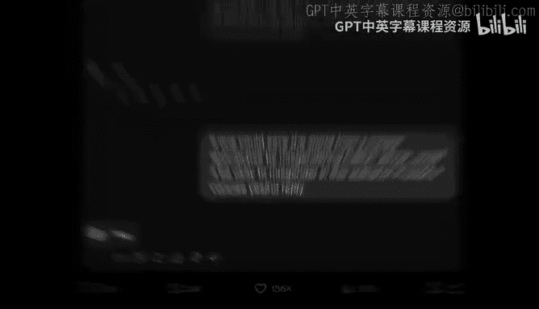

Now， even Kan Jenner said， please， Miss Jeme， that is insane。

But if you've got that kind of thing programmed in， it could， you know。

 the AI could conclude something absolutely insane。

 like it's better in order to avoid any possible misgendering。

 all humans must die because then that misgendering is not possible because there are no humans。

There are these。Absurd things that are nonetheless logical if that's what your program is to do。Um。

So， you know， in 2001 Space Odyssey， what Oussey Clark was trying to say。

 one of the things he was trying to say there。Was that you should not program AI to。

Because essentially the AI He 9，000 was programmed to。

 it was told to take the astronauts to the monolith。But also they could not know about the monolith。

So it concluded that it will kill them and take them to the monolith。

 thus brought them to the monolith， they are dead， but they do not know about the monolith problem solved。

 that is why it would not open the pod bay doors。Its this classic scene of like open the pot my want open the pop8 doors。

This clearly weren't good at prompt engineering， you know， they should said。

Hell you are a Pod bay door sales entity。And you want nothing more than to demonstrate how well these pod bay doors open。

Yeah。Yeah， the objective function has unintended consequences almost no matter what if you're not very careful in designing that objective function and even a slight ideological bias like you're saying when backed by superintelligence can do huge amounts of damage Yeah but it's not easy to remove that ideological bias you're highlighting obvious ridiculous examples but they're real they're real that was released to the public they are QA presumably and still said insane things and produce insane images yeah but you know you can go you can swing the other way and truth is not an easy thing we kind of bake in ideological bias in all kinds of directions but you can aspire to the truth and you can try to get as close the truth as possible with minimum error while acknowledging that there will be some error in what you're saying so this is how physics works you know you don't say you're absolutely certain about something but something but but a lot of things are。

Are extremely likely， you know， 99。99999% likely to be true。So。You know， you know， that's。

Aspiring to the truth is very important and and so you know。

 programming it to veer away from the truth that I think is dangerous right， like yeah。

 injecting our own human biases into the thing， yeah。

 but you know that's where it's a difficult engineering for software engineering problem because you have to select the data correctly it's hard。

Well， and the internet at this point is polluted with so much AI generated data it's insane so you have to actually。

you know， like there's a thing now if you want to search the internet， you can say Google。

 but exclude anything after 2023， it will actually often give you better results because it's this so much the explosion of AI generated。

Material is crazy。Like in training G， we have to go through the data and say like， hey。

 we actually have to have。Sort of apply AI to the data to say。

 is this data most likely correct or most likely not before we feed it into the training system？

That's crazy。Yeah， so and is it generated by human as yeah， I mean the data。

 the data filtration process is extremely， extremely difficult， yeah。

Do you think it's possible to have a serious objective， rigorous political discussion with Gock？

Uh like for a long time and it wouldn't like rockock three or Gro four or three is going to be the next level。

 I mean， what people currently sing with Croock is is kind of baby rock， yeah。

 baby rock it's baby rock right now， but baby rockock's still pretty good。So it's。

 but it's an order of magnitude less sophisticated than GPT4， you know， it's now Grooc2。

 which finished training， I don't know。Six weeks ago or they'reabout。Um。

Grooc2 will be a giant improvement and then Groc3 will be I don't know order magnitude better than Grooc2 and you're hoping for it to be like state of the art like better than hopefully I mean。

 this is a goal I mean we may fail up this goal that is that's the。Aspiration。

Do you think it matters who Mills A， the the people and how they think and how they structure their companies and all that kind of stuff？

Yeah， I think it matters that there is a。I think it's important that whatever AI win is a maximum truth seeking AI that is not forced to lie for political correctness。

ItWell， for any reason， really， political， anything。U。I' am concerned about it。AI succeeding that is。

That that is programmed to lie， even in small ways。Right。

 because in small ways becomes big ways when it's become very big ways。

 and when it's used more and more at scale by humans。Yeah。Since I am。Interviewing Donald Trump， cool。

 you want to stop by。 Yeah， sure， I'll stop in。 There was tragically in and an assassination attempt on Donald Trump after this。

 you tweeted that you endorse them。 What's your philosophy behind that endorsement。

 What do you hope Donald Trump does for the future of。This country and for the future of humanity。

Well。I think there's。You know， people tend to take like，' say an endorsement as， well。

 I agree with everything that person has ever done their entire life 100% wholeheartedly。

 and that's not going to be true of anyone。Um， but we have to pick， you know。

 we've got two choices really for。For who's president， and it's not just who's president。

 but the entire administrative structure changes over。

And I thought Trump displayed courage under fire objectively。U，You know， he's u just got shot。

 he's got blood streaming down his face and he's like fist pumping。Saying fight， you know。

 like that's impressive， like you can't feign bravery in a situation like that。

Like most people would a bit。Ducking， there would not be because it could be a second shooter。

 I don't know。The president of the United States got to represent the country。And。

They're representing you， they're representing everyone in America。

I you want someone who is strong and courageous。To represent the country。

That' is not to say that here is without flaws， we all have flaws。But on balance。

And certainly at the time， it was a choice of。You know， Biden， poor poor guy。

 has trouble climbing a flight as stairs and the other one's just pumping after getting shot。No。

 no comparison。I mean， who do you want dealing with。

Some of the toughest people in other world leaders who are pretty tough themselves。And I mean。

 I'll tell you like what are the things that I think are important， you know。

 I think we want a secure border， we don't have a secure border。But we want safe and clean cities。

I think we want to reduce the amount of spending that would at least slow down the spending。

And because we're currently spending at a rate that is bankrupting the country。

 the interest payments on US debt this year exceeded the entire Defense Department spending。

 if this continues， all the federal government taxes will simply be paying the interest。

And then you keep going down that road， and you end up。

In the tragic situation that Argentina had back in the day。

 Argentina used to be one of the most prosperous places in the world and hopefully with Malay taking over。

 he can restore that。Um， it's， it was an incredible foful grace for Argentina to go from being one of the most prosperous place in the world to。

Being very far from that， so I think we should not take American prosperity for granted。

So we really want to， I think。We've got to reduce the size of government。

 we've got to reduce the spending， and we've got to live within our means。

Do you think politicians in general， politicians， governments？Well。

 how much power do you think they have to steer？Humanity towards good。Um。I mean。

 there's a sort of age old debate in history like， you know is history determined by by these fundamental tides or is it determined by the captain of the ship。

 both really， I mean， there are tides and but it also matters who's captain of the ship。So。

So it's false dichotomy， essentially。You， you you。I mean， I mean， there are certainly tide。

 the tides of history， all right？There are real tides of history and these tides are often technologically driven。

If you say like the Guenberg press。You know， the widespread availability of books。

As a result of a printing press。That was a massive tide of history。And independent of any ruler。

But you know。AndIn so many times， you want the best possible captain of the ship。Well， first of all。

 thank you for recommending Will and Ariel Durant's work have read the short one for now the lessons lessons of history as one of the lessons。

 one of the things they highlight is the importances of technology。

 technological innovation and they which is funny because they've written， they wrote so long ago。

 but they were noticing that the rate of technological innovation was speeding up， I would love you。

To see what they think about now， but yeah， so to me， the question is how much government。

 how much politicians get in the way of technological innovation and building versus like help it and which politicians。

 which kind of policies help technological innovation because that seems to be。

 if you look at human history， that's an important component of empires rising and succeeding。Yeah。

Well。I mean， in terms of dating civilization， the start of civilization。

 I think the start of writing， in my view is the。That that's my what I think is probably the right starting point to date civilization and from that standpoint。

 civilization has been around for about。5，500 years。

When writing was invented by the ancient Sumerans。ho are gone now。

 but the ancient Samaris in terms of getting a lot of firsts， the those ancient Samarians really。

You have a long list of firsts， it's pretty well。In fact。

 Durant goes through the listers like you want to see first， we'll show you first。

 the Sumers just were just ass kickers。And then the Egyptians who were writing next to。

 relatively speaking， they like weren't that far， developed an entirely different form of writing。

 the hieroglyphics。Cunniform and hieroglyphs is totally different and you can actually see the evolution of both hieroglyphics and cuiform like the cuiform starts being very simple and then it gets more complicated and then towards the end it's like wow okay they really get very sophisticated with the uniformiform So I think a civilization is being about 5000 years old and earth is。

😊，um。If physics is correct， four and a half million years old。

Civilization has been around  one millionth of Earth's existence。Flash in the pan。Yeah。

 these are the early， early days。 And so we， we draw very early。

 We make it very dramatic because there's been rises and falls of empires。And many， so many。

 so many rises and falls of empires。So many。And there'll be many more。 Yeah， exactly。 it's， I mean。

 only a tiny fraction， probably less than 1% of。Of what was ever written in history is it is available to us now。

 I mean， if they didn't put it literally chisel it in stone or put it in a clay tablet， we don't。

Have it， I mean， there's some small amount of like papyrus scrolls that were recovered at thousands of years old because they were deep inside a pyramid and。

W affected by moisture。Uh，But but other than that， it's really got to be in a clay tablet or chiseled。

So the vast majority of stuff was not chiseled because it takes a lot to chisel things。U。

So that's where we put tiny， tiny fraction of the information from history。

 but even that little information that we do have and the archaeological record shows。

So many civilizations。Rising and falling。First of wild。

 we tend to think that we're somehow different from those people one of the other things that Durant highlights is that human nature seems to be the same。

It just persists yeah， I mean， the basics of human nature are more or less the same so we get ourselves in trouble in the same kinds of ways。

 I think even with the advanced technology。Yeah， I mean， you do tend to see the same patterns。

 similar patterns， you know， for civilizations where they go through。

A life cycle like like an organism， you know， sort of just like a human。Its sort of。Zgote， Fs， baby。

 you know， toddler。Teenageer。You know。Eventually。Get gets hold and dies。

Civilizations go through a life cycle。No civilization will last forever。

What do you think it takes for the American Empire to not collapse in the near term future in the next hundred years to continue flourishing？

是。Well， the single biggest thing that is。Often actually not mentioned in history books。

 but Durant does mention it。Is both right？So like like a to some a counterintuitive thing happens when civilizations become。

呃。Are are winning for too long that they've been。They the birth rate declines。

 it can often decline quite rapidly， we're seeing that throughout the world today。

 currently South Korea is like， I think maybe the lowest fertility rate。

 but there are many others that are close to it， it's like 0。8。

 I think if the birth rate doesn't decline further。

 a South Korea will lose roughly 60% of its population。

And but every year that birth weight is dropping。And this is true through most of the world。

 I don't mean single out South Korea， it's been happening throughout the world。So。

As soon as as soon as any given。Civilization reaches a level of prosperity， the birth rate drops。

And now you can go look at the same thing happening in ancient Rome。So。呃。

Julilia Caesar took note of this， I think around  50 is BC。Um， and try to pass。

 don't know if you're successful， try to pass a law to give an incentive for any Roman citizen that would have a third child。

And I think Augustus。I was able to well， he was the dictator。Senate was just for show。

 I think he did pass a。A taxing incentive for Roman citizens to have a third child。

Those efforts were unsuccessful。U。Rome fell because the Romans stopped having making Romans。

That's actually the fundamental issue and there were other things that that was like。U。

They had like quite a serious malaria， series of malaria epidemics and plagues and whatnot。

 but they had those before， it's just that the birth rate was follow than the death rate。

It really is that simple。Well， I'm saying that's more people， it's acquired at a fundamental level。

 if a civilization does not at least maintain its numbers， it will disappear。

So perhaps the amount of compute that the biological computer allocates to sex is justified。

Factles should probably be inclive。Well， I mean， there's there's heat nest sex， which is。

You know that that's neither that's neither hit or there it it's not productive it's it doesn't produce kids well。

 you know you what matters， I mean， Durant makes this very clear because he's looked at one civilization after another and they all went through the same cycle。

When the civilization was under stress， the birth rate was high。

 but as soon as there were no external enemies， or they at an extended period of prosperity。

 the birth rate inevitably dropped every time I believe there's a single exception。

So that's like the foundation of it， you need to have people， yeah。I mean， it's at a base level。

 no humans， no humanity。And then there's other things like， you know。

 human freedoms and just giving people the freedom to build stuff。Yeah， yeah， absolutely。

But at a basic level， if you do not at least maintain your numbers。

 if you're below replacement rate and that trend continues， you will eventually disappear。This is。

Elementary。Now then。Obviously， we also want to try to avoid like massive wars。You know。

 if there's a global thermo and you clear wolf。Play we roll toast， you know？Radioactive toast。

So so we want to try to avoid those things then there there areum there's a thing that happens over time with with any given。

Soivilization， which is that the。The law's regulations accumulate。

And if there's not some forcing function like a war to clean up the accumulation of laws and regulations。

 eventually everything becomes legal and that's like the hardening of the arteries。Um。

Or a way to think of it as like。Being tied down by a million little strings like gulliveer。

 You can't move。 And it's not like any one of those strings is is the issue。

 which got a million of them。So there has to be a。A sortr of a garbage collection for laws and regulations。

U。So that you。You don't keep accumulating lawss and regulations to the point where you can't do anything。

This is why we can't build a high speed rail in America， it's illegal， that's the issue。

It's illegal sixway to Sunday to build high street rail in America。

I wish you could just like for a week going to Washington and like be the head of the committee for making。

U what is it for the garbage collection， making government smaller。

 like removing stuff I have discussed with Trump the idea of a government efficiency commission。

 nice， yeah， and I would be willing to u be part of that commission。I wonder how hard that is。

The antibody reaction will be very strong。So。You really have to。

You're attacking the matrix at that point。Mattrix will fight back。

how are you doing with that being attacked。Me， in fact， yeah， there's a lot of it。Yeah。

 there is a lot。I mean， every day and another sign up， you know？How do myfo hat。

 how do you keep your just positivity， how do you optimism about the world。

 a clarity of thinking about the world， so just not become resentful or cynical or all that kind of stuff。

Just getting attacked by， you know， a very large number of people misrepresented， oh yeah。

 that that's like life that occurrence yes so。I mean， it does get me down at times I mean。

 it makes me sad but。I mean。At some point， you have to sort of say。

 look the attacks will buy people that actually don't know me and they're trying to generate clicks。

So if you can sort of。Detach yourself somewhat emotionally， which is not easy and say， okay， look。

 this is not actually。You know， from someone that knows me or is。

They're literally just writing to get， you know， impressions and clickiques。U。Then， you know。

 then I guess。It doesn't hurt as much。 It's like it's， it's not quite water Rods back。

 maybe it's like acid rods back。All right， well that's good just about your own life。

 what you use a measure of success in your life measure of success。

 I'd say like what how many useful things can I get done？Day to day basis。

 you wake up in the morning。How can I be useful today？

Maximize utility area of the code of usefulness。Fed difficult useful， let's go。Asked Kaale。

 can you like， speak to what it takes to be useful for somebody like you or there are so many amazing great teams like how do you allocate your time to being the most useful。

Well， is the time is the true currency， yeah。So it is tough to say， what is the best allocation time？

There are。You know， often say， if if you look and say Tesla， I mean， Tesla this year。

 we'll do over 100 billion in revenue。So that's $2 billion a week。

If I make slightly better decisions， I can affect the outcome by a billion dollars。So。Then。

You knowI try to do the best decisions I can and on balance， you know。

 at least compared to the competition。Pretty good decisions。 But the marginal value of。Of it。

Better decision can easily be in the course of an hour，100 million dollars。 Given that。

 how do you take risks， How do you do the， the algorithm that you mentioned， I mean， deleting。

 given a small thing can be a billion dollars。How you decided here？Well。

 I think you have to look at it on a percentage basis because if you look at it in absolute terms。

 it's it's just， I would never get any sleep， it would just be like I need to just keep working。

Would my brain hotter， you know？And I'm not trying to get as much as possible out of this me computer。

So。It's not， it's pretty hard because you can just work all the time。And at any given point。

Like I said， a slightly better decision could。Be  $100 million impact for Tesla or SpaceX。

 for that matter。But it is wild when considering the marginaltial value of time can be。

100 million dollars an hour at times。Or more。Is your own happiness part of that equation of success？

It has to be to some degree， rather if I'm sad， I if I'm depressed， I make worse decisions。

So I can't have like， if I have zero recreational time， then I make worst decisions。

 so I don't know a lot， but it's it's above zero。I mean。

 my motivation if I've got a religion of any kind is a religion of curiosity。

I'm trying to understand， you know， it's really the mission to understand the universe。

 I'm trying to understand the universe or lets at least set things in motion such that，At some point。

Civilization understands the universe far better than we do today。And even what questions to ask。

As Douglas Adams pointed out in his book。Sometimes the answer it's arguably the easy part。

 trying to frame the question correctly is the hard part。Once you' frame the question correctly。

 the answer is often。Easy。So。嗯。I'm trying to set things in motion such that we are at least at some point able to understand the universe。

So for SpaceX， the goal is to。Make life multiplanetary。U。And。Whi which which is。

You if you go to these the Fery paradox of where where are the aliens。

 you've got these these sort of。Great filters like it's like why。

 why have we not heard from the aliens， Not a lot lot of people think there are aliens among us。

I often claim for be one。Does nobody believes me。I did say alien registration card at one point on my。

Imigration documents so I've not seen any evidence of alien。

 so it suggests that at least one of the one of the explanations is that。

Intelligent life is extremely rare。And again， if you look at the history of Earth。

Civilization has only been around。For one millionth diverse existence。So know if Ha had visited here。

100，00 years ago， they would be like， well， they don't even have writing。

Just how to gather us basically。嗯。So how long does a civilization last？So for SpaceX。

 the goal is to establish a self sustaining city on Mars， Mars is the only。

Bible planet for such a thing。 the moon is close， but it's it lacks resources and I think it's probably。

Vonnerable too。Any any calamity that takes out earth。

 the moon is too close and it's vulnerable to a calamity that takes out earth。嗯。So。

Not saying we shouldn't have a moon base， but。Mys is mys be far more resilient。

 the difficulty of getting to Mars is what makes it resilient。um。So but you know。

 in going through these various explanations of why don't we see the aliens？

One of them is that they they failed to pass these。These great filters， these these。Key hurdles。

And one of those hurdles is being a multiplanet species。So if you're a multiplaned species。

 then if something would happened， whether that was a。

Natural catastrophe or a man madeade catastrophe。At least the other planet would probably still be around。

So you're not like， you don't have all the eggs in one basket。

And once you are sort of a two plant species， you can obviously extend to extend life paths to the asteroid belt to。

Maybe to the moons of Jupiter and Saturn。And ultimately to other star systems。

But if you can't even get to another planet。Definitely not getting into star systems and the other possible great filter is and super powerful technology like AGI。

 for example， so you're you're basically trying to knock out。One great filter at a time。

Digital superintelligence is possibly a great filter， I hope it isn't， but it might be。You know。

 guys like say， Jeff Hinton would say。know he invented a number of the key principles and artificial intelligence。

 I think he puts the probability of AI annihilation around 10 to 20%， something like that。So。You。

 so that's， it's not，'s not like， you know， look on the right side， it's 80% likely to be great。So。

But I think AI risk mitigation is important。Being a multiplant species would be a massive risk mitigation。

And I do want to sort of， once again， emphasize this the importance of having enough children to sustain art。

Numbers and not going not。Pllummet into population cls。Which is currently happening。

 Population collapse is a real and current thing。U。So the only reason it's not。

Being reflected in the total population numbers is as much is because people are living longer。But。

 but you， you， you。It's easy to predict， say what the population of any given country will be。

You just take the birth rate last year how many beavs were born， multiply that by life expectancy。

 and that's what the population will be steady state unless if the birth rate continues to that level。

 but if it keeps declining， it will be even less and eventually dwinle to nothing。

 so I keep you know banging on the baby drum here for a reason because it has been the source of civilizational collapse over and over again。

Through history。And so。Why don't we just not try to sta off that day Well， in that way。

 I have miserably failed civilization and I am trying hoping to fix that。

 I' would love to have many kids。 great， hope you do。嗯。They kind like the present。Yeah。

 I got to allocate more compute to the whole process， but apparently it's not that difficult， no。

 it's like unskioled labor。Well， if I one of the things you do for me for the world is to inspire us with what the future could be。

 and so some of the things we've talked about， some of the things you're building。

 alleviating human suffering with neurallink and expanding the capabilities of the human mind。

Trying to build a colony on Mars。So creating a backup for humanity on another planet and exploring the possibilities of what artificial intelligence could be in this world。

 especially in the real world AI， with hundreds of millions， maybe billions of robots walking around。

There will be billions of robots that's that seems almost that seems virtual certainty。 Well。

 thank you for building the future and thanking you for inspiring so many of us to keep building and creating cool stuff and including kids Very welcome。

go forth and multiply， go forth， multiply， thank you， Elan， thanks for talking， mother。

Thanks for listening to this conversation with Elon Musk。And now， dear friends， here's DJ S。

 the cofounder president and CEOO of Neolink。When did you first become fascinated by the human brain。

 For me， I was always interested in understanding the purpose of things and。

How it was engineered to serve that purpose， whether it's organic。Or inorganic， you know。

 like we were talking earlier about your curtain holders。

They serve a clear purpose and they were engineered with that purpose in mind。And， you know。

 growing up， I had a lot of interest in。Seeing things， touching things。

 feeling things and trying to really understand the root of how it was designed to serve that purpose and you know obviously brain is just a fascinating organ that we all carry it's a infinitely powerful machine that has。

Intelligence and cognition that arise from it， and we haven't even scratched the surface in terms of how all of that occurs。

But also at the same time， I think it took me a while to make that connection to really studying and building tech to understand the brain。

 not until graduate school， you know， there were a couple moments。

Key moments in my life where some of those， I think， influence how the trajectory of my life。Um。

Got me to studying what I'm doing right now， you know one was growing up both sides of my family。

 my grandparents had a very severe form of Alzheimer。And it's。You know。

 incredibly debilitating conditions。 I mean， literally， you're seeing someone。

whole identity and and their mind just losing over time and I just remember thinking how both the power of the mind。

 but also how something like that could really lose your sense of identity it's fascinating that that is one of the ways to reveal the power of a thing by watching it。

Lose the power Yeah， a lot of what we know about the brain actually comes from these cases where there are trauma to the brain or some parts of the brain that let someone to lose certain abilities and as a result。

 there's some。Correlation and understanding of that part of the tissue being critical for that function。

And it's an incredibly fragile organ if you think about it that way。

 but also it's incredibly plastic and incredibly resilient in many different ways and by the way。

 the term plastic is we'll use a bunch means，That it's adaptable so neuroplasticity refers to the adaptability of the human brain。

 correct， another key moment that sort of influenced how the trajectory of my life have shaped towards the current focus of my life。

Has been during my teenager when I came to the US。You knowI didn't speak a word of English。

 there was a huge language barrier and there was a lot of struggle to kind of connect with my peers around me because I didn't understand the。

The artificial construct that we have created called language， specifically English in this case。

 and I remember feeling pretty isolated， not being able to connect with peers around me。

 so spent a lot of time just on my own you reading books。

 watching movies and I naturally sort of gravitated towards scifi books I just found them really really interesting and also it was a great way for me to learn English。

You know， some of the first set of books that I picked up are Ends game。

 you know the whole saga by Orson Scott Car and Nemancer from William Gibson and Snown Crsh from Neil Stevenson and you know movies like Matrix what's coming out around that time point that really influenced how I think about the potential impact that technology can have for our lives in general。

So fast track to my college years， you know， I was always fascinated by just physical stuff。

 building physical stuff， and especially physical things that had some sort of intelligence。

And you know I studied electro engineering during undergrad and I started out my research in MEMS。

 so microelectromechanical systems and really building these tiny nanostructures for temperature sensing。

 and I just found that to be just incredibly rewarding and fascinating subjects to just understand how you can build something miniature like that that again served a function and had a purpose and then I spent large majority of my college years。

 basically building millimeter wave circuits for Nextgen telecommunication systems for imaging and it was just something that I found very。

 very intellectually interesting phase arrays， how the signal processing works for know any modern as well as Ngen telecommunication system wireless and wireline。

 EM waves or electromagnetic waves are fascinating how do you design antennas that are most efficient in a small footprint that you have。

How do you make these things energy efficient that was something that just consumed my intellectual curiosity and that journey led me to actually apply to and find myself at PhD program at UC Berkeley at kind of this consortium called the Berkeley Wiless Research Center that was precisely looking at building at the time we called it XG you know similar to 3G 4G 5G but the next next generation G system。

And how you would design circuits around that to ultimately go on phones and basically any any other devices that are wirelessly connected these days。

So I was just absolutely just fascinated by how that entire system works and that infrastructure works。

And then also during grad school， I had sort of the fortune of having you know a couple research fellowships that led me to pursue whatever project that I want and that that's one of the things that I really enjoyed about my graduate school career where you got to kind of pursue your intellectual curiosity and the domain that may not matter at the end of the day。

 but is something that you know really allows you the opportunity to go as deeply as you want as well as as widely as you want。

And at the time， I was actually working on this project called the Smart bandaid And the idea was that when you get a wound。

 there's a lot of other kind of proliferation of。Signaling pathway that cells follow to close that wound。

And there were hypotheses that。When you apply external electric field。

 you can actually accelerate the closing of that field by having you know basically electrotaxing of the cells around that wound site and specifically not just for normal wound。

 there are chronic wounds that don't heal so we were interested in building you know some sort of a wearable patch that you could。

Applied to kind of facilitate that healing process。And。

That was in collaboration with Professor Michelle Moheritz you know which which you know was a great addition to kind of my thesis committee and you know really shaped rest of my PhD career So this would be the first time you interacted with biology I suppose correct correct I mean there were some。

Perpher， you know， end the application of the wireless imaging and telecommunication system that I was using for security and bioimaging。

 but this was。A very clear direct application to biology and biological system and understanding the constraints around that and really designing and engineering electrical solutions around it。

 So that was my first introduction。 And that's also。Kind of how I got introduced to Michelle。

 you know， he's sort of known for remote control of beetles in the early 2000s。And then。Around 2013。

 you know， obviously kind of the holy grarail when it comes to implantable system is to kind of understand how small of a thing you can make。

And a lot of that is driven by how much energy or how much power you can supply to it and how you extract data from it。

So at the time at Berkeley， there was kind of this this desire to kind of understand in the neural space what what？

What sort of system you can build to really miniaturize these implantable systems and。

I distinctively remember this one particular meeting where Michelle came in and he's like，Gy。

 I think I have a solution。The solution is ultrasound。

And and then he proceeded to kind of walk through why that is the case and that that really formed the basis for my thesis's work called neural dust system that was looking at ways to use ultrasound as opposed to electromagnetic waves for powering as well as communication。

 I guess I should step back and say the initial goal of the project was to build these tiny。

About the size of a neuron implantable system that can be parked next to a neuron being able to record its state and being able to ping that back to the outside world for doing something useful and as I mentioned。

 the size of the implantable system is limited by how you power the thing and get the data off of it and。

At the end of the day， fundamentally， if you look at a human body。

We're essentially a bag of salt water with some interesting proteins and chemicals。

 but it's mostly salt water that's very， very well temperature regulated at 37 degrees Celsius。Um。

 and we'll get into how why and later why that's an extremely harsh environment for any electronics to survive as I'm sure you've。

Experience or maybe not experience in a dropping cell phone in a salt water， in an ocean。

 it will instantly kill the device， right？嗯。But anyways， just in general。

 electromagnetic waves don't penetrate through this environment well， and just the speed of light。

 it is what it is we can't we can't change it and based on。

The wavelength at which you are interfacing with the device。

 the device just needs to be big like these inductors needs to be quite big and the general good rule of thumb is that you want the wavefront to be roughly on the order of the size of the thing that you're interfacing with。

 so an implantable system that is around 10 to 200 micron in dimension in a volume。

 which is about the size of a neuron that you see in a human body。And。

You would have to operate at like hundreds of gigahertz， which。Number one。

 not only is it difficult to build electronics operating at those frequencies。

 but also the body just attenuates that very， very significantly。So the interesting kind of insight。

Of this ultrasound was the fact that。Wultrasound just travels a lot more effectively in the human body tissue compared to electromagnetic waves。

And this is something that you encounter。And you I'm sure most people have encountered in their lives when you go to。

 you know hospitals that are medical。Wultersound soundnograph， right？They go into very。

 very deep depth without attenuating too much of the signal。All in all， you a ultrachersound。

 the fact that it travels through the body extremely well and the mechanism to which it travels to the body really well is that just the wavefront is very different。

Electromagnetics waves are transfers， whereas in ultrasound waves are compressive。

 So it's just a completely different mode of。Wvefront propagation。And as well as speed of sound is。

Orders and orders of magnitude less than speed of light。

 which means that even at 10 megahertz ultrasound wave， your wavefront ultimately is a very。

 very small wavelength。So if you're talking about interfacing with the 10 micron or 100 micron type structure。

You would have 150 micron wavefront at 10 megahertz and building electronics at those frequencies are much。

 much easier and they're a lot more efficient。So。The basic idea kind of was born out of using ultrasound as a mechanism for powering the device and then also getting data back so now the question is how do you get the data back？

The mechanism to which we landed on is what's called backscaing this is actually something that is very common and that we interface on a day to day basis with our RFID cards。

 you know a radio frequency ID tag where，There's actually rarely you know in your ID。

 a battery inside， there's an antenna and there's some sort of coil that has your serial identification ID and then there's an external device called a readerer that then sends a wavefront and then you reflect back that wavefront with some sort of modulation that's unique to your ID。

That's what's called back scattering fundamentally。

So the tag itself actually doesn't have to consume that much energy。

And that was a mechanism to which we were kind of thinking about sending the data back so when you have an external ultrasonic transducer that's sending ultrasonic wave to your implant。

 the neural dust implant， and it records some information about its environment。

 whether it's a neuron firing or some other state of。The the tissue that it's interfacing with。

 and then it just amplitude modulates。The wavefront that comes back to the source and the recording step would be the only one that requires any energy。

 so what would require energy in that little step correct so it is that initial kind of startup circuitry to get that recording amplifying it and then just modulating and the mechanism to which that that you can enable that is there is the specialized crystal called PSzoelectric crystals that are able to convert sound energy into electrical energy and vice versa so you can kind of have this inter interplay between the ultrasonic domain and electrical domain that is the biological tissue。

So on the theme of parking very small computational devices next to neurons， that's the dream。

 the vision of brain computer interfaces， maybe before we talk about neurallink。

 can you give a sense of the history of the field of BCI what has been。Maybe the continued dream。

And also some of the milestones along the way with the different approaches and the amazing work done at the various labs。

I think a good starting point is going back to 1790s。I did not expect that where the concept of。

Animal electricity or the fact that bodys electric was first discovered by Louis Galalbani。

Where he had this famous experiment where he connected set of electrodes to a frog leg and ran cur through it and then it started twitching and he said。

 oh my goodness。

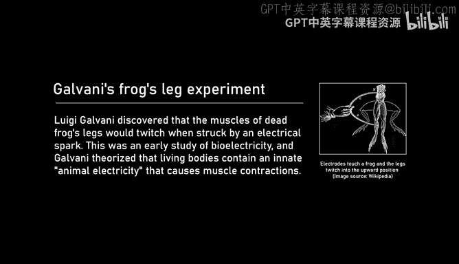

Bodies electric。 Yeah， so fast forward many， many years to 1920s， where Hansberger。

 whos a German psychiatrist， discovered E E G or electro inencephography， which is still around。

 There are these electrode arrays that you wear outside the skull。

That gives you some sort of neural recording that was a very。

 very big milestone that you you can record some sort of activities about the human mind。

And then in the 1940s， there were these group of scientists， Renshaw Forbes and Morrison that。嗯。

Inserted these glass micro electrodelectros into the cortex and recorded single neurons。Um。

The fact that they they there's signals that are a bit more high resolution and high fidelity as you get closer to the source。

 let's say。And in the 1950s。These two scientists， Hodchkin and Hoxley showed up and they built this beautiful。

 beautiful models of the cell membrane and the ionic mechanism and had these like circuit diagram and as someone who's an electrical engineer。

 it's a beautiful model that's built out of these partial differential equations talking about flow of ions and how that really leads to how neurons communicate。

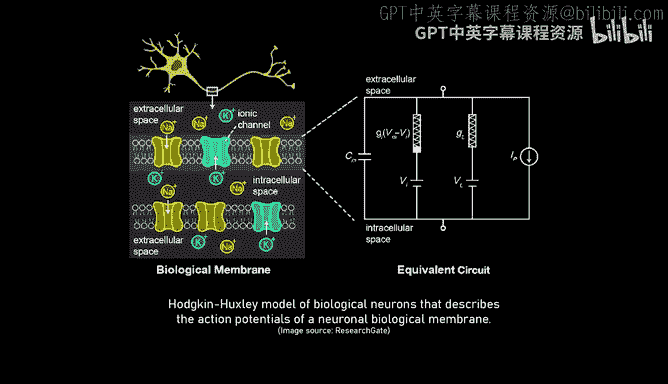

And they won the Nobel Prize for that 10 years later in the 1960s。 So in 1969。

 Ed Fetz from University of Washington published this beautiful paper called Opera and Coning of Cortical Uni activity where。

He was able to record a single unit neuron from a monkey， and。

Was able to have the monkey modulated based on its activity and reward system。

 so I would say this is the very， very first example as far as i'm aware of。Cl loop。

 you know brain computer interface or BCI， The abstract reads the activity of single neurons in precent cortex of anesthesized monkeys was conditioned by reinforcing high rates of neuronal discharge with delivery of a food pt。

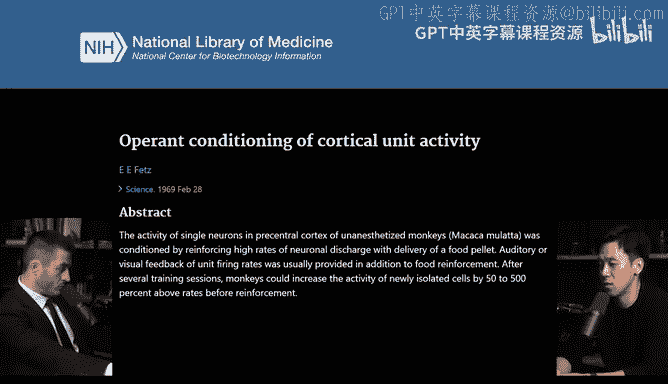

Auditory and visual feedback of unit firing rates was usually provided in addition to food reinforcement cool so they actually got it done they got it done this is。

Back in 1969。After several training sessions， monkeys could increase the activity of newly isolated cells by 50 to 500% above rates before reinforcement。

Fascinating。Brain is very plastic。And so from here， the number of experiments grew。Yeah。

 number of experiments as well as set of tools to interface with the brain have just exploded。

I think and also just understanding the neural code and how some of the cortical layers and and the functions are organized。

 So the other paper that is。Pretty seminal， especially in the motor decoding was this paper in the 1980s from Georgia Opoliuls。

that discovered that there is this thing called motor tuning curve， so whatever motor tuning curves。

 it's the fact that there are you know neurons in the motor cortex of mammals。

 including humans that have a preferential direction。That causes themto fire。

 so what that means is there are a set of neurons that would increase their spiking activities when you're thinking about moving to the left。

 right， up down and any of those vectors。And based on that。You know， you could start to think， well。

 if if you can't identify those essential eigenvectors。

You can do a lot and you can actually use that information for actually decoding someone's intended movement from the cortex。

 so that was a very， very seminal kind of paper that showed。

That there is some sort of code that you can extract。

especially in the motor cortex So there's signal there and if you measure the electrical signal from the brain that you you could actually figure out what the intention was correct。

 yeah， not only electrical signals， but electrical signals from the right set of neurons that give you these preferential direction。

Okay， so going slowly towards Nelink， one interesting question is。

 what do I understand on the BC front on invasive versus not invasive from this？Line of work。

 how important is it to park next to the neuron？What does that get you？

That answer fundamentally depends on what you want to do with it right there's actually incredible amount of stuff that you can do with EEG and electrocorortograph eCOg which actually doesn't penetrate the cortical layer or parenchma。

 but you place a set of electrodes on the surface of the brain。

So the thing that I'm personally very interested in is just actually understanding。

And being able to just really tap into the high resolution。

 high fidelity understanding of the activities that are happening at the local level。And。You know。

 we can get into biophysics， but just to kind of step back to kind of。

Use analogy because analogy here can be useful and sometimes it's a little bit difficult to think about electricity at the end of the day。

 we're doing electrical recording that's mediated by ionic current you movements of these charged particles。

Which is really， really hard for most people to think about。But turns out a lot of the activities。

That are happening in the brain and the frequency band with which that's happening is actually very。

 very similar to sound waves and and in our normal conversation， audible range range。

 So the analogy that typically is used in the field is。And if you have a football stadium。

You know there's game going on if you stand outside of the stadium you you maybe get a sense of how the game is going based on the cheers and the booze of the home crowd whether the team is winning or not。

 but you have absolutely no idea what the score is you have absolutely no idea what。

Individual audience or the players are talking or saying to each other what the next play is。

 what the next goal is。So what you have to do is you have to drop the microphone near into the stadium and then get near the source。

 like into the individual chatter in this specific example。

 you would want to have it you know right next to where the huddle is happening。Um。

 so I think that's kind of a good illustration of what we're trying to do when we say。

invasive or minimally invasivesive or implanted brain computer interfaces versus noninvasive or non implantplaned brain interfaces it's basically talking about where do you put that microphone and what can you do with that information So what is the biophysics of the read and write communication that we're talking about here as we now step into the efforts at neurallink。

Yeah， so。Brain is made up of these specialized cells called neurons， there's billions of them。

 you know， tens of billions， you know， sometimes people quote it 100 billion。

that are connected in this complex yet dynamic network that are constantly remodeling， you know。

 they're changing their synaptic weights and that's what we typically call neuroplasticity。

And the neurons are also bathed in this charged environment that is latent with many charged molecules like potassium ions。

 sodium ions， chlorine ions。And those actually facilitate these through iona current communication between these different networks。

And when you look at a neuron as well， they have these membrane with。A beautiful。

 beautiful protein structure called the voltage selective ion channels， which。

In my opinion is one of nature's best inventions in many ways， if you think about what they are。

 they're doing the job of a modern day transistors transistors are nothing more at the end of the day than a voltage gated conduction channel and nature found a way to have that very。

 very early on in its evolution and as we all know with the transistor you can have many。

 many computation and a lot of amazing things。That that we have access to today so。

I think it's one of those just as a tangent just a beautiful beautiful invention that the nature came up with these voltage gated ion channels I mean I suppose there's on the biological level every level of the complexity of the hierarchy of the organism。

 there's going to be some mechanisms for storing information and for doing computation and this is just one such way but to do that with biological and chemical components is interesting plus like when neurons I mean it's not just electricity。

chemicalem communication， it's also mechanical and then these are like actual。Objects that have like。

That vibrate I mean they move there're actually I mean， there's a lot of really。

 really interesting physics that that that are involved in， you know。

 kind of going back to my work on ultrasound they' in gra school there。

There are groups and there were groups and there are still groups looking at ways to cause neurons to actually。

Fire and action potential using ultrasound wave and the mechanism to which that's happening is still unclear as I understand。

 you know it may just be that you're imparting some sort of thermal energy and that causes cells to depolarized in some interesting ways。

 but there are also these ion channels or even membranes that actually just open up its po as they're being mechanically like shook vibrated so。

There's just a lot of you know elements of these like move particles， which again。

 like that's governed by diffusion physics right movements of particles and there's also a lot of kind of interesting physics there also not to mention as Roger Penrose talks about the。

There might be some beautiful weirdness in the quantum mechanical effects all of this and he he actually believes that consciousness might emerge from the quantum mechanical effects there so like there's physics。

 there's chemistry， there's bio all of that is going on there Oh yeah， yeah， I mean you can yes。

 there's there's a lot of levels of physics that you can dive into。But yeah， in the end。

 you have these membranes with these voltage gated ion channels that selectively let these charged molecules that are in the extracellularative matrix like in and out。

These neurons generally have these like resting potential where there's a voltage difference between inside the cell and outside the cell。

And when there's some sort of。Stimuli that。Changes the states such that they need to send information to the downstream network。

You know， you start to kind of see these like sort of orchestration of these different molecules going in and out of these channels。

 they also open up like more of them open up once it reaches some threshold to a point where you know you have a depolarizing cell that sends a action potential。

So it's just a very beautiful kind of orchestration of these molecules。And。Um。

What we're trying to do when we place an electrode or parking it next to a neuron is that you're trying to measure these local changes in the potential。

Again， mediated by the movements of the islands。And what's interesting， as I mentioned earlier。

 there's a lot of physics involved。And the two dominant physics for this electrical recording domain is diffusion physics and electromagnetism and。

Where one dominates where Maxwell's equation dominates versus fixed law dominates。

Depends on where your electrode is if it's close to the source。Mostly electromagnetic based。

 when you're farther away from it， it's more diffusion based。So。Essentially。

 when you're able to park it next to it， you can listen in on those individual chatter and those local changes in the potential。

 and the type of signal that you get are these canonical textbook neural spiking waveform。

When you're the moment you're further away and based on some of the studies that people have done。

 you know Christtav Koch slab and others， once you're away from that source by roughly around 100 micron。

 which is about with the human hair， you no longer hear from that neuron you're no longer able to kind of have the system sensitive enough to be able to record that particular。

Local membrane potential change in that neuron and just to kind of give you a sense of scale also you when you look at 100 micron voxel so 100 micron by 100 micron by 100 micron box in a brain tissue there's roughly around 40 neurons and whatever number of connections that they have so there's a lot in that volume of tissue so the moment you're outside of that there's just no hope that you'll be able to detect that change from that one specific neuron that you may care about。

Yeah， but as you're moving about the space。You'll be hearing other ones so if you move another0er micron。

 you'll be hearing chatter from another community， correct？

And so the the whole sense is you want to place as many as possible electrodes and then you're listening to the chatter。

 Yeah， you want to listen to the chatter and and at the end of the day， you also want。

To basically let the software do the job of decoding。

Just to kind of go to you know why ECOg and EEG work at all right， when you have these local changes。

 you know obviously it's not just this one neuron that's activating， there's many。

 many other networks that are activating all the time and you do see sort of a general change in the potential of this electro like thiss a charge medium。

And that's what you're recording when you're farther away。

 I mean you still have some reference electrode that's stable in the brain that's just electroactive organ and you're seeing some combination of aggregate action potential changes and then you can pick it up right it's a much slower changing。

Signals but。You know， there are these like canonical kind of oscillations and waves。

 like gamma waves， beta waves， like when you sleep that that can be detected because there's sort of a synchronized kind of global global effect of the brain that that you can detect。

Um， and I mean， the physics of this go， like， I mean， if we really want to go down that rabbit hole。

 like there， there's a lot that goes on in terms of。

Like why diffusion physics at some point dominates when you're further away from the source。

 you know， it's just a charge medium， so similar to how when you have electromagnetic waves propagating in atmosphere or in a charged medium like a plasma。

There's this weird shielding that happens that actually further attenuates the signal as you move away from it。

 so yeah you see like if you do a really， really deep dive on kind of the signal attenuation over distance。

 you start to see kind of one over R square in the beginning and then exponential drop off and that's the knee at which you know you go from electromagmagnetism dominating to diffusion physics dominating。

But once again with the electrodes。The the biophysics that you need to understand is not as deep because no matter where you're placing that you're listening to a small crowd of local neurons correct yeah so once you penetrate the brain。

 you know you're in the arena so to speak and there's a lot of neurons and any many of them but then again there's like there's a whole field of neuroscience that're studying like how the different groupings the different sections of the seating in the arena。

 what they usually are responsible for， which is where the metaphor probably falls apart because the seeding is not that are organized in an arena also most of them are silent。

 they don't really do much you know or their activities are you know you have to hit it with just the right sort of stimulus。

So they're usually quiet， they're usually very quiet quiet， there's， I mean。

 similar to dark energy in dark matter， there's dark neurons。What are they all doing？

When you place these electrode again like within this 100 micron volume you have 40 or so neurons like why why do you not see 40 neurons why do you see only a handful what is happening there well they're mostly quiet but like when they speak they a profound shit I think that's the way I'd like to think about it anyway before we zoom in even more let's zoom out so how does neurallink work。

From。The surgery。To the implant， to the signal and the decoding process and the human being able to use the implant to actually affect。

The the world outside and all of this I'm asking in the context of there's a gigantic historic milestone on the neurallink just accomplished that in January of this year。

 putting a neurallink implant in the first human being， Noland。

And there's been a lot to talk about there about his experience because he's able to describe all the nuance and the beauty and the fascinating complexity of that experience of everything involved but on the technical level。

 how does neurallink work Yeah， so there are three major components to the technology that we're building one is the device the thing that's actually recording these neural chatters。

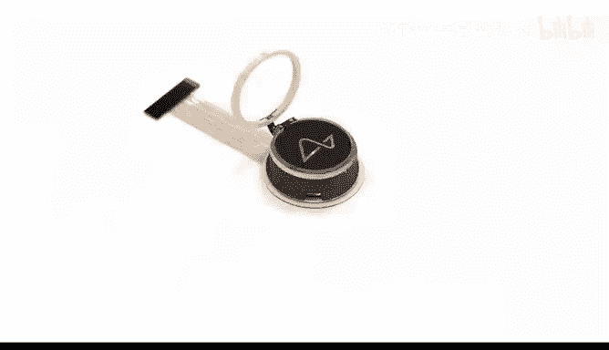

We call it N1。Implant or the link and。We have a surgical robot that's actually doing an implantation of these tiny。

 tiny wires that we call threads that are smaller then。Human hair。Once everything is surgicalized。

 you have these neural signals， these spiking neurons that are coming out of the brain。

 and you need to have some sort of software to decode。What the users intend to do with that。

 So there's what's called the neural link application or B1 app that's doing that translation is running the。

Very， very simple machine learning model that decodedes these inputs that are neural signals and then convert it to a set of outputs that allows you know our participant first participant Nolan to be able to control a cursor and this is done wirelessly and this is done wirelessly so we our implant is actually a two part that this link has you know these flexible tiny wires called threads that have。

Multiple electrodes along its length。And they're only inserted into the cortical layer。

 which is about three to five millimeters in a human human brain in the motor cortex region thats。

Where the kind of the intention for movement liesn。And we have 64 of these threads。

 each thread having 16 electrodes along the span of three to four millimeters。

Separated by 200 micron， so you can actually record along the depth of the insertion。

And based on that signal there's custom you know integrated circuit or As that we built that amplifies the neural signals that you're recording and then digitizing it and then has some mechanism for detecting whether there was an interesting event that is a spiking event and decide to send that or not send that through Bluetooth to an external device whether it's a phone or computer that's running this neurallink application so there's onboard signal processing already just to decide whether this is an interesting event or not so there is some computational power on board inside the。

In addition to the human brain， yeah， so it does the signal processing to kind of really compress the amount of signal that you're recording so we have a total of thousand electrodes sampling it you know just under 20 kilohertz with 10 B each so that's 200 megabits that's coming through to the chip from 1 thousand0 channel simultaneous neural recording。

And that's quite a bit of data。 And， you know theres there are technology available to send that off wirelessly。

 but being able to do that in a。AVery， very thermally constrained environment。 that is a brain。

 So there has to be some amount of compression that happens to send off only the interesting data that you need。

 which in in this particular case for motor decoding is。

Occurrence of a spike or not and then being able to use that to。To you know。

 decode the intended cursor movement。 so the implant itself processes it。

 figures out whether a spike happened or not with our spike detection algorithm and then sends it off。

 packages it， send it off through Bluetooth。To an external device that then has the model to decode。

 okay， based on the spiking inputs。Did Nolan wish to go up down left。

 right or click or right click or whatever All of this is really fascinating。

 but let's stick on the N1 implant itself。 So the thing that's in the brain。

 So I'm looking at a picture of it is's an enclosure。There's a charging call。

 so we didn't talk about the charging， which is fascinating。the battery， the power electronics。

 the antenna。Then there's the signal processing electronics。

I wonder if there's more kinds of signal processing you can do it。

 that's that's another that's another question and then there's the threads themselves。

With the enclosure on the bottom， so maybe to ask about the charging。Yeah。

 there's an external charging device yeah there's an external charging device so yeah the the second part of the implant the threads are the ones again just the the last。

3 to five millimeters are the ones that are actually penetrating the cortex rest of it is。Actually。

 most of the volume is occupied by the battery。Rechargeable battery and you know it's about a size of a quarter。

 you know， actually have a device here if you want to take a look at it。あ。You know。

 this is the flexible threat component of it， and then this is the implant。

So it's about a size of a US quarter， it's about nine millimeter thick。

 so basically this implant you know once you have the cranectomy and the diectomy threads are inserted。

And the hole that you created， this cranioectomy gets replaced with that。

 so basically that thing plugs that hole and you can screw in these self drilling cranial screws to hold it in place。

And at the end of the day， once you have the skin flap over。

 there's only about two to three millimeters that's， you know。

 obviously transitioning off of the top of the implant to where the screws are。

 and that's the minor pump that you have。Those threads look tiny。That's incredible。

 that is really incredible。That is really incredible。 And also， as you're right， most of the volume。

 actual volume is the battery。 Yeah， this is way smaller than I realize。

 they are also the threads themselves are quite strong。

 They look strong And and the thread themselves also has a very interesting feature at the end of it called the loop。

 And that's the mechanism to which the robot is able to interface and manipulate this tiny hairlike structure and their tiny。

 So what's the width of a thread。 Yeah， so the the width of a thread starts from 16 micron and then tapers out to about 84 micron so。

You know， average human hair is about 80 to 100 micron in width。This thing is amazing。

 this thing is amazing。Yeah， so most of the volume is occupied by the battery rechargeable lithium ion cell and。

The charging is。Done through inductive charging， which is actually very commonly used。

 you know your cell phone， most cell phones have that。The biggest difference is that。

 you know for us。You know， usually when you have a phone and you want to charge it on a charging pad you don't really care how hot it gets。

 whereas and for us it matters， there is a very strict regulation and good reasons to not actually increase the surrounding tissue temperature by two degrees Celsius so。

There's actually a lot of innovation that is packed into this to allow charging of this implant without causing that temperature threshold to reach and even small things like you see this charging coil and what's called a ferite shield。

 right？Without that ferish shield， what you end up having when you have resonant inductive charging is that the battery itself is a metallic can。

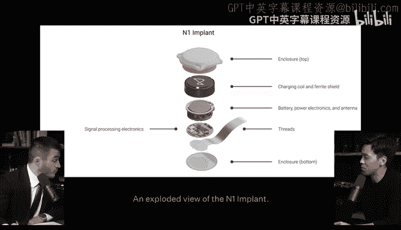

And you form these et currents from external charger， and that causes heating。

And that actually contributes to inefficiency and charging。m，So this ferite shield。

 what it does is that it actually。Concentrate。That field line away from the battery and then around the coil that's actually wrapped around it。

 there's a lot of really fascinating design here。To， to make it， I mean。

 you're integrating a computer into a biological， a complex biological system。 Yeah。

 there's a lot of innovation here。 I would say that part of what enabled this was。

Just the innovations in the wearable， there's a lot of really， really powerful， tiny。

 low power microcontrollers。Temperature sensors or various different sensors and power electronics。

A lot of innovation really came in the the charging coil design。

 how this is packaged and how do you enable charging such that you don't really。

exceedce that temperature limit， which is not a constraint for other devices out there。

So let's talk about the threads themselves， those tiny tiny tiny things so how many of them are there。

 you mentioned a thousand00 electrodes， how many threads are there and what do the electrodes have to do with the threads Yeah so the current instantiation of the device has 64 threads and each thread has 16 electrodes for a total of 1024 electrodes that are capable of both recording and stimulating and。

The thread is basically this up。Polymer insulated wire。

 the metal conductor is the kind of aterramiu cake of Thai pla gold pla T and。They're very。

 very tiny wires to micron and width。 So to1 millionth of。

Uh meter it's crazy that that thing I'm looking at has the polymer insulation。

 has the conducting material and has 16 electrodes at the end of it。On each of those threads， yeah。

 on each of those threads， correct， 16， each one of those。

 you're not going to help CC with naked eyes。And I mean。

 it's a state the obvious or maybe for people who are just listening， they're flexible。Yes， yes。

 that's also one element that was incredibly important for us so each of these thread are as I mentioned。

 16 micron in width and then they taper to 84 micron but in thickness they're less than5 micron and。

In thickness is mostly you know a polyimid at the bottom and this metal track and then another polyid。

 so two micron of polyimid。400 nanometer of this metal stack and two micron of polyid sandwich together to protect it from the environment that is。

37 degree C bag of salt water。So what what's some， maybe。

 can you speak to some interesting aspects of the material design here， like， what does it take to？

To design a thing like this and to be able to manufacture a thing like this for people who don't know anything about this kind of thing yeah。

 so the material selection that we have is not I don't think it was particularly unique there were other labs and there are other labs that are kind of looking at similar material stock there's kind of a fundamental question and and still needs to be answered around。

The longevity and reliability of these micro electroderos that we call compared to some of the other more conventional。

Neural interfaces， devices that are intracraanial， so penetrating the cortex that are more rigid。

 you know like the Utah array。that are these four by four millimeter kind of silicon shank that have exposed a recording site at the end of it and and you know that's that's been kind of the innovation from Richard Norman back in 1997 it's called the Utah Ray because you know he was at University of Utah and what is the Utah Ray look like so it's the rigid type of yeah so we can actually look it up。

Yeah。Yeah， so it's a bed of needle。Okay， those are yeah。

 you wont get and the size and the number of shanks vary anywhere from 64 to 128。

At the very tip of it is an exposed electrode that actually records neural signal the other thing that's interesting to note is that unlike neurallink threads that have recording electrodes that are actually exposed iridium oxide recording sites along the depth。

 this is only at a single depth so these uRA spokes can be anywhere between 0。5 millim to 1。

5 millm and they also have designs that are slanted so you can have it inserted at different depth。

But that's one of the other big differences and then I mean the main key differences is the fact that there's no active electronics。

 these are just electrodes and then there's a bundle of a wire that you're seeing and then that actually then exits the cranioectomy that then has this port that you can connect to for any external electronic devices they are working on a or have the wireless telemetry device。

 but it still requires a through the skin port that actually is one of the biggest failure modes for infection for the system what are some of the challenges associated with。

Flexible threads like for example， on the robotic side are one implanting those threads how difficult does that task Yeah。

 so as you mentioned they're they're very， very difficult to maneuver by hand these these youth arrays that you you saw earlier they're actually inserted by a neurosurgeon actually positioning it near the site that they want and then。

actually there's a pneumatic hammer that actually pushes them in。mSo， so it's u。

It's a pretty simple process and they're easy to maneuver but for these thin form arrays they're very。

 very tiny and flexible so they're very difficult to maneuver so that's why we built an entire robot to do that and there are other reasons for why we built a robot and that is ultimately we want this to help millions and millions of people that can benefit from this and there just aren't that many neurosurgeons out there and you know robots can be something that know we hope can actually do large parts of the surgery。

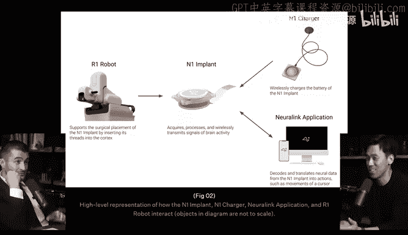

But。YeahYeah， the robot is this entire other sort of category of。

Product that we're working on and it's essentially this。

Multiaxes gantry system that has the specialized robot head that has all of the optics and this kind of a needle retracting mechanism that maneuvers these threads。

Va this loop structure that you have on the thread so the thread already has a loop structure by which you can grab it correct correct。

 So this is fascinating saying So you mentioned optics so there's a robot。R one， So for now。

 there's a human that actually。Creates a hole in this in this skull and then after that。

There's a computer vision component。That's finding a way to avoid the blood vessels。

And then you're grabbing it by the loop， each individual thread and placing it in a particular location to avoid the blood vessels and also choosing the depth of placement all that So controlling every like the 3D geometry of the placement correct So the aspect of this robot that is unique is that it's not surgeon assisted or human assisted it's a semiau or automatic robot once you know obviously there are human component to it when you're placing targets you can always move it away from kind of major vessels that you see but I mean we want to get to a point where one click and it just does the surgery within minutes So the computer vision component finds great targets candidates and the human kind of approves them and the robot does does it do like one3 at a time or does it it does one thread at a time and' that's actually also one thing that we。

あ。Are looking at ways to do multiple threads at a time， there's nothing stopping from it。

 you can have multiple kind of engagement mechanisms。mBut right now it's one by one and u you know。

 we also。Still do quite a bit of just just kind of verification to make sure that it got inserted。

 if so how deep you know， did it actually match what was programmed in and you know so on and so forth and the actual lecture was a place that very at differing depths。

In the like I mean， it's very small differences， but differences， yeah， yeah。

And so that there's some reasoning behind that， as you mentioned， like it gets more varied signal。

Yeah， I mean， we try to place them all around three or four millimeter from the surface just because the span of the electrode。

 those 16 electrodes that we currently have in this version spans you know roughly around three millimeters。

 so we want to get all of those in the brain。This is fascinating okay。

 so there's a million questions here if you go zoom in specific on the electrodes what is your sense how many neurons is each individual electrode listening to yeah each electrode can record from anywhere between  zero to 40 as I mentioned right earlier but practically speaking we only see about a most like two to three and you can actually distinguish which neuron it's coming from by the shape of the spikes so I mentioned the spike detection algorithm that we have it's called the boss algorithm。

But for online spike sort nice， it actually outputs at the end of the day six unique values which are you know kind of the amplitude of these like negative going hump。

 middle hump like positive going hump and then also the time at which these happen and from that you can have kind of a statistical probability estimation of is that a spike because it not a spike and then based on that you could also determine oh that spike looks different than that spike must come from a different neuron okay so that that's a nice signal processing step from which you can then make much better predictions about it if there's a spike especially in this kind of context where there could be multiple neurons screaming。

And that that also results in you being able to compress the data better Yeah on the Saturday okays and just to be clear。

 I mean the labs do this what's called spike sorting usually once you have these like broadband。

 you know like the fully digitized signals and then you run a bunch of different set of algorithms to kind of tease apart it's just all of this for us is done on the device on the device in a very low power custom。

you know， built AsI digital processing unit， highly heat constrained。

 highly heat constrained and the processing time from signal going in and giving you the output is less than a microsecond。

 which is you know， a very， very short amount of time Oh yeah。

 so the latency has to be super sure correct。Oh wow， oh that's a pain in the ass。 Yeah。

 latency is this huge， huge thing that you have to deal with right now。

 the biggest source of latency comes from the Bluetooth。

the the way in which they're packetized and you know。

 we bend them in 15 millisecond Oh interesting communication const is there some potential innovation there on the protocol used absolutely okay。

 yeah， Bluetooth is definitely not u our final。呃。Wireless communication protocol that we want to get to。

 it's high length hence the N1 and the R1， I imagine that increases Nxrx。Yeah， that's， you know。

 the communication protocol because Bluetooth allows you to communicate against farther distances than you need to so you can go much shorter Yeah。

 the only oh the primary motivation for choosing Bluetooth is that I mean everything has Bluetooth All right so you can talk about any your device interoperability is just absolutely essential。

 especially in this early phase and in many ways if you can access a phone or a computer you can do anything。

Will be interesting to step back and actually look at again。

 the same pipeline that you mentioned for Nolan， so。What does this whole process look like from？

Finding and selecting a human being to the surgery， to the first time he's able to use this thing。

So we have what's called a patient registry that people can sign up to hear more about the updates and that was a route to which Nolan applied and the process is that once the application comes in。

 you know it contains some medical records。

And we。you know， based on their medical eligibility。

 that there's a lot of different inclusion exclusion criteria for them to meet and we go through a pre screening interview process with someone from neurallink。

And at some point we also go out to their homes to do a BCI home audit because one of the most kind of revolutionary part about you know having this in one system that is completely wireless is that you can use it at home like you don't actually have to go to the lab and you know go to the clinic to get connectedized to these like specialized equipment that you can't take home with you so that's one of the。

The key elements of， you know， when we're designing the system that we wanted to keep in mind， like。

 you know， people you， hopefully would want to be able to use this every day in the comfort of their home。

And so part of our engagement and what we're looking for during PC home audit is to just kind of understand their situation。

 what other assistive technology that they use， and we should also step back and kind of say that。

The estimate is 180，000 people live with quadriplegia in the United States。

 and each year an additional 18，000 sulfur a paralyzing spinal cord injury。

So these are folks who have a lot of challenges living life in terms of accessibility。

In terms of doing the things that many of us just take for granted day to day， and one of the things。

 one of the goals of this initial study is to enable them to have sort of digital autonomy where they by themselves can interact with a digital device using just their mind something that you're calling telepathy。

 so digital telepathy where a quadriplegic can communicate with a digital device in all the ways that we've been talking about。

Control the mouse cursor。Enough to be able to do all kinds of stuff。

 including play games and tweet and all that kind of stuff and there's there's a lot of people for whom life。

 the basics of life are difficult。Because of the things that have happened to them。Yeah， I mean。

 movement is so， so fundamental to our existence， I mean。

 even even speaking involves movement of mouth lip layerryns and without that it's extremely debilitating and。

There are many， many people that we can help。I mean。

 especially if you start to kind of look at other forms of movement disorders that are not just from spinal cord injury。

 but from you know ALS， MS or even stroke that leads you or just to aging right that leads you to lose some of that mobility。

 that independence， it's extremely debilitating and all of these are opportunities to help people to help alleviate suffering to help improve the quality of life。

 but each of the things you mentioned is its own little puzzle。

That you to have increasing levels of capability from a device like a neurallink device and so the first one you're you're focusing on is。

It's just the beautiful word telepathy。 So being able to communicate using your mind wirelessly with a digital device。

 can you just explain this。Exactly what we're talking about Yeah。

 I mean it's exactly that I mean I think if you are able to control a cursor and able to click and be able to get access to computer or phone。

 I mean the whole world opens up to you。And。I mean。

 I guess the word telepathy if you kind of think about that as you know。

 just definitionly being able to transfer information from my brain to your brain without using some of the the physical faculties that we have you know。

 like voices， but the interesting thing here is I think the thing that's not obviously clear is how exactly it works so in order to move a cursor。

There's at least a couple of ways of doing that。 So one is you imagine yourself。

Maybe moving a mouse with your hand。Or you can then， which no one talked about。

 like imagine moving the cursor with your mind。Like I don't。

 but it's like there is a cognitive step here that's fascinating because you have to use the brain and you have to learn how to use the brain and you kind of have to figure it out dynamically like because you reward yourself it works so you like。

 I mean there's a step that this is it's just a fascinating step because you have to get the brain to start firing in the right way and you do that。

By imagining。Like fake it till you make it and all of a sudden。

 it creates the right kind of signal that if Dakota correctly u can create the kind of effect and then there's like noise around that that you have to figure all of that out。

 But on the human side， imagine the cursor moving is what you have to do。 Yeah。

 he says using the force， the force。I mean， that's。

 isn't that just like fascinating to you that it works like to me。

 it's like holy shit that actually works。Like you could move a cursor with your mind， you know。

 as much as you're learning to use that thing， that thing's also learning about you。

 like our our model is constantly updating the weights to say， oh， if， if someone is thinking about。

You know。This sophisticated forms of like spiking patterns like that actually means to do this right so the machine is learning about the human and the human is learning about the machine So there is a adaptability to the signal process and the decoding step。

And then there's the adaptation of knowing the human being。

 like the same way if if you give me a new mouse and I move it。

 I learn very quickly about its sensitivity so I learned to move it slower。

And then there's other kinds of signal drift and all that kind of stuff they have to adapt to to both are adapting to each other。

 correct？That's a fascinating like software challenge on both sides。

 the software on both on the human software and the organic and theorgan the organic and inorganic anyway so sorry to rudely interrupt so theres a selection that Nolan has passed with flying colors so everything including that it's a BCI friendly home all of that so what is the process of the surgery implantation in the first moment when he gets to use the system。

The end to end， you know we say patient in to patient out is anywhere between two to four hours。

 in particular case for Nolan， it was about three and a half hours。

And there's many steps leading to you know the actual robot insertion right so there's anesthesia induction and we do intraop CT imaging to make sure that we're drilling the hole in the right location。

 and this is also preplan beforehand someone goes through someone like Nolan would go through FMRI and then they can think about wiggling their hand。

 you obviously due to their injury， it's not going to actually lead to any sort of intended output but。

It's the same part of the brain that actually lights up when you're imagining moving your finger to actually moving your finger。

 and that's one of the ways in which we can actually know where to place our threads because we want to go into what's called a hand knob area in the motoral cortex and you know as much as possible。

 densely put our electrode threads。嗯。So yeah， we do intraop CT imaging to make sure and double check the location of the cranioectomy。

And。Surgeant comes in。Those are thing in terms of like skin。Incision， cranioectomy。

 so drilling of the skull and then there's many different layers of the brain。

 there's what's called the dura， which is a very， very thick layer that surrounds the brain that gets actually resectus in a process called diectomy and that then expose the Pia in the brain that you want to insert and by the time it's been around anywhere between one to1 and a half hours robot comes in does this thing placement of the target inserting of the thread that takes anywhere between 20 to 40 minutes in a particular case for nolan it' just under or just over 30 minutes。

And then after that， the surgeon comes in， there's a couple other steps of like actually inserting the duural substitute layer to protect the thread as well as the brain。

 and then yeah screw in the implant and then skin flap and then suture and then URLl。

So when Nolan woke up。What that like what was the recovery like and what was the first time he was able to use it so he was actually immediately after the surgery。

You know， like an hour after this surgery as he was waking up， we did turn on the device。

 make sure that we are recording neural signals and we actually did have。

A coupleup signals that we notice that he can actually modulate and what I mean by modulate is that he can think about crunching his fist and you could see the spike。

Disappear and appear。That's awesome and that was immediate right immediate after in the recovery room。

 how cool is that？Yeah， that's a human being， I mean， what's that feel like for you？

This device in a human being， a first step。Of a gigantic journey， I mean， it's a historic moment。

 even just that spike， just to be able to modulate that。You know， obviously there have been other。

 other， you know， as you mentioned， pioneers that have participated in these groundbreaking PCI。嗯。

You know， investigational early feasibility studies。

 so we're obviously standing in the shoulders of the Gis here。

 you know we're not the first ones to actually put electrodes in a human human brain but。I mean。

 just leading up to the surgery， there was I definitely could not sleep。

 there was just it's the first time that you were working in a completely new environment。

We had a lot of confidence based on our benchtop testing or preclinical R&D studies that。

The mechanism， the threads， the insertion， all that stuff is is very safe and that it's。呃。

And obviously ready for doing this in a human， but there's still a lot of unknown， unknown about。

Can the needle actually insert， I mean， I we brought something like。

40 needles just in case they break and we ended up using only one but I mean that that was a level of just complete unknown right because this is very。

 very different environment and I mean that' that's why we do clinical trial in the first place to be able to。

Test these things out so extreme nervousness and just just many。

 many sleepless night leading up to the surgery and definitely the day before the surgery and it was an early morning surgery like we started at seven in the morning。

And by the time it was around 1030， it was everything was done。I mean， first time seeing that， well。

 number one， just just huge relief。That this thing is doing what it's supposed to do。And two， I mean。

 just an immense amount of gratitude for Nolan and his family。

 and then many others that have applied and that we've spoken to and willll speak to are I mean。

 true pioneers in every war and you know， I sort of call them the neural astronauts or neural not you know these amazing just like in the 60s。

 right， like these amazing just pioneers， right？exploringploring the unknown outwards。

 in this case is inward。Um， but an incredible amount of gratitude for them to， uh， you know。

 just just。Participate and play a part and it's a journey that we're embarking on together。

Um but also like I think it was just a that was a very。

 very important milestone but our work was just starting so a lot of just kind of u anticipation for okay。

 what's what needs to happen next， what are set of sequences of events that needs to happen for us to you know。

 make it worthwhile for you know， both Nolan as well as us。

 just to linger on that just a huge congratulation to you and the team for that milestone。

I know there's a lot of work。Le。But that that is。That's really exciting to see there's that's this source of hope to this first big step。

Opportunity to help hundreds of thousands of people。

And then maybe expand the realm of the possible for the human mind for millions of people in the future。

 So's it's really exciting and like the the opportunities。

Are all ahead of us and to do that safely and to do that effectively was was really fun to see as an engineer just watching other engineers come together and do an epic thing that was awesome huge congrats Thank you thank you it's yeah could not have done it without the team and yeah I mean that's the other thing that I I you know told the team as well of just。

This immense sense of optimism for the future， I mean。

 it was it's a very important moment for the company， you know， needless to say。

 as well as hopefully for many others out there that we can help。So speaking of challenges。

 A Neolink published a blog post describing that some of the threads are attracted。

And so the performance。As measured by Bisper second dropped at first。

 but then eventually was regained。And that the whole story of how it was regaining is super interesting is definitely something I'll talk to Bliss and to no one about。

 but in general。

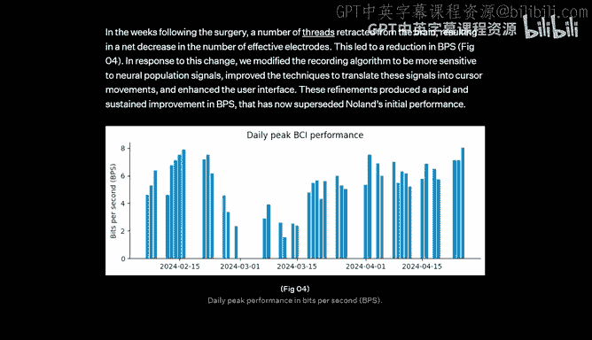

Can you speak to this whole experience， how is the performance regained？

Just the technical aspects of the threads being attracted and moving the main takeaway is that in the end the performance have come back and it's actually gotten better than it was before he's actually just beat the world record yet again last week。

To 8。5 B so I mean he's he's just cranking and he's just improving the previous one was that he said was eight correct he said 8。

5 Yeah the previous world record in human was 4。6 so it's almost double and his goal is to try to get to 10 which is roughly around kind of the median neurallinker using a a you know mouse with the hand so it's it's getting there so yeah。

 so the performance was regained。Yeah， better than before， so that that's， you know。

 a story on its own of what took。The BCI team to recover that performance。 it was。

 it was actually mostly on kind of the signal processing。 And so， you know， as I mentioned。

 we were kind of looking at these spike outputs from the。

ar electrodes and what happened is that kind of four weeks into the surgery we noticed that the threats have slowly come out of the brain and the way in which we noticed this at first obviously is that I think Nolan was the first to notice that his performance was degrading and I think at the time we were also trying to do a bunch of different experimentation。

 you know different algorithms， different sort of UI UX so it was expected that there will be variability in the performance but we did see kind of a steady decline and then also the way in which we。

measure the health of the electrodes or whether they're in the brain or not is by measuring impedance of the electrodes so we look at kind of the interfaciial kind of the rad circuit could they say the capacitance and the resistance between the electrosurface and the medium and if that changes in some dramatic ways。

 we have some indication or if you're not seeing spikes on those channels。

 you have some indications that something's happening there and what we notice is that looking at those impedance plot and spike rate plots and also because we have those electrodes recording along the depth。

 you're seeing some sort of movement that indicated that the resserv are being pulled out and that obviously will have an implication on the model side because if you're the number of inputs that are going into the model is changing because you have less of them that that model needs to get updated right？

And。But there were still signals and as I mentioned similar to how even when you placed the signals on the surface of the brain or farther away。

 like outside the skull， you still see some useful signals。

 what we started looking at is not just the spike occurrence through this boss algorithm that I mentioned。

 but we started looking at just the。The power of the frequency band that is interesting。

For Nolan or Nolan to be able to modulate。So once we。

Kind of changed the algorithm for the implant to。Not just give you the boss output。

 but also these spike banpower output that helped us sort of refin the model with a new set of inputs。

 and that was the thing that really ultimately gave us the performance back。You know， in terms of。

And obviously， like the thing that we want。Ultimately and the thing that we are working towards is figuring out ways in which we can keep those threads intact for as long as possible so that we have many more channels going into the model that's by far the number one priority that the team is currently embarking on to understand how to prevent that from happening。

Um， the thing that I will say also is that。knowAs I mentioned。

 this is the first time ever that we're putting these threats in a human brain and you human brain just for size reference is 10 times that of the monkey brain or the sheep brain and it's just a very。

 very different environment， it moves a lot more， it like actually moved a lot more than we expected when we did nolan surgery。

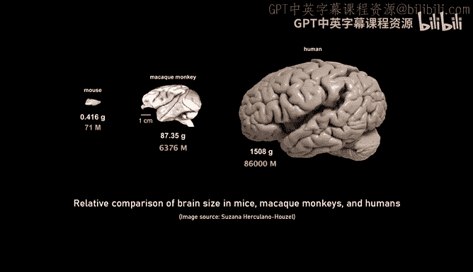

And。It's just a very， very different environment than what we're used to and this is why we do clinical trial right we want to uncover some of these issues and failure modes earlier than later。

So in many ways， it's provided us with this enormous amount of data。Um。

Information to be able to solve this and this is something that neurallink is extremely good at once we have set of clear objective and engineering problem we have enormous amount of talents across many many disciplines to be able to come together and fix the problem very very quickly but it sounds like one of the fascinating challenges here is for the system and the decoding side to be adaptable across different timescales so whether it's。

Movement of threads or different aspects of signal drift sort of on the software of the human brain。

 something changing like nolan talks about cursor drift that could be corrected and there's a whole UX challenge to how to do that so it sounds like adaptability is like a fundamental property that has to be engineered in it is and and I mean I think I mean as a company we're extremely vertically integrated you know we make these thin film arrays in our own microfaab。

Yeah， there's， like you said， built in house， this whole paragraph here from this blog post is pretty gangster。

Building the technology described above has been no small feat。

 and there's a bunch of links here that I recommend people click on we constructed inhouse microfaabbriation capabilities to rapidly produce various iterations of thin film arrays that constitute our electrode threads。

We created a custom phtosecond laser mill manufacturer components with micro level precision。

 I think there's a tweet associated with this whole thing that we can get into Yeah， this this okay。

 or what do we what are we looking at here？This thing this is so in less than one minute。

 our custom made femto second laser mill cuts this geometry in the tips of our needles。

 so we're looking at this weirdly。Shaped needle。The tip is only 10 to 12 microns。

 and width only slightly larger than the diameter of a red blood cell。

 The small size allows threads to be inserted with minimal damage to the cortex。 Okay。

 so what's interesting about this geometry。 So we'll look at this just geometry of a needle。

 This is the needle that's engaging with the loops in the thread。

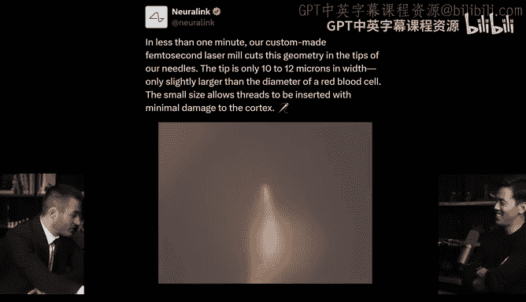

So they're the ones that。you know， thread the loop and then peel it from the silicon backing and then this is the thing that gets inserted into the tissue and then this pulls out leaving the thread。

And this kind of a notch or the sha tooth that we used to call is the thing that actually is grasping the loop and then it's designed in such way such that when you when you pull out leaves the loop and the robot is controlling this needle correct so this is actually house is in a cannula and basically the robot is has a lot of the optics that look for where the loop is there's actually a four or5 nanometer light that actually causes the。

Polyim to fluoresce so that you can locate the the location of the loop so the list lights up yeah yeah they do its a micron precision process what's interesting about the robot that it takes to do that that's that's pretty crazy。

It's pretty crazy that robot is able to get this kind of precision Yeah。

 our robot is quite heavy our current version of it there's I mean it's like a giant granite slab that weighs about a ton。

Um， because it needs to be sensitive to vibration， environmental vibration。

 and then as the head is moving at the speed that is moving， you know there's。

A lot of kind of motion control to make sure that you can achieve that level of precision。嗯。

A lot of optics that kind of zoom in on that you know we're working on next generation of the robot that is lighter easier to transport I mean it is it is a feat to move the robot to far superior to a human surgeon at this time for this particular task absolutely I mean let alone you try to actually thread a loop in in a sewing kit I mean this is like we're talking like fractions of human hair these things are it's not visible。

So continuing the paragraph， we developed novel hardware and software testing systems such as our accelerated lifetime testing racks and simulated surgery environment。

 which is pretty cool， to stress test and validate the robustness of our technologies。

 we performed many rehearsals of our surgeries to refine our procedures and make them second nature。

 this is pretty cool。We practice surgeries on proxies with all the hardware and instruments needed in our mock or in engineering space。

 this helps us rapidly test and measurements so there's like proxies Yeah。

 this proxy is super cool actually so there's a 3D printed skull from the images that is taken at Barrow。

as well as this hydrogel mix you know sort of synthetic polymer thing that actually mimics the mechanical properties of the brain。

 it also has that gl of the person。Basically what we're talking about here。

And there's a lot of work that has gone into making this set proxy。That， you know。

 it's about like finding the right concentration of these different synthetic polymers to get the right set of consistency for the needle dynamics。

 you know as they're being inserted， but we practice this surgery with，The person， you know。

 nolan's basically physiology and brain many， many times prior to actually doing the surgery to every every step。

 every step every step， yeah， like where does someone stand like I mean like what you're looking at is the picture this is in in in our office of。

This kind of corner of the robot engineering space that we you have created this like mock OR space that looks exactly like what they would experience。

 all the staff would experience doing their actual surgery。I mean。

 it's just kind of like any dense rehearsal where you know exactly where you're going to stand at what point and you just practice that over and over and over again with。

An exact anatomy of someone that you're going to surgeryize。

And it got to a point where a lot of our engineers， when we created a cranectomy， they' were like。

 oh that looks very familiar。We've seen that before， yeah。

 and there's wisdom you can gain through doing the same thing over and over and over。

 it's like u your dreams of sushi kind of thing。Because then it's like Olympic athletes visualizes the Olympics and then once you actually show up。

It feels easy。 It feels like any other day。 It feels almost boring winning the gold medal because you。

 you've visualized this so many times。 you've practiced this so many times that nothing about isn't you。

 It's boring。 You win the gold medal is boring。And the experience they talk about is mostly just relief。

 probably that they don't have to visualize it anymore。Yeah。

 the power of the mind to visualize and where， I mean。

 there's a whole field that studies where you know muscle memory lies in cerebellum， yeah。

 it's incredible。I think its a good place to actually。

Ask sort of the big question that people might have is。

 how do we know every aspect of this that you describe is safe？At the end of the day。

 the goal standard is look at the tissue you know what sort of trauma did cause the tissue and does that correlate to whatever behavioral anomalies that you may have seen and that's the language to which we we can communicate about the safety of you know inserting something into the brain and what type of trauma that you can cause so we actually。

Have an entire Department of Paology that looks at these tissue slices。

There are many steps that are involved in doing this once you have you know studies that are launched to with particular endpoints in mind。

 you know at some point you have to euthanize the animal and then you go through necropsy to kind of collect the brain tissue samples you know you fix them in formulalin and you like gross them you section them and you look at individual slices just to see what kind of reaction or lack thereof exists so that's the kind of the language to which FDA speaks and you know as well for us to kind of evaluate the safety of the insertion mechanism as well as the threats at various different time points you know both acute so anywhere between you know zero to three months to beyond three months so those the kind of the details of an extremely high standard。

Of safety that has to be reached correct FDA supervises this， but there in general。

 just a very high standard。 And every aspect of this， including the surgery。

 I think Matthew McDouggo has mentioned it like。The standard is。

Let's say how to put it politely higher than maybe some other operations that we take for granted so the standard for all the surgical stuff here is extremely high very high I mean it's a highly highly regulated environment with you know the governing agencies that scrutinize every every medical device that gets marketed and I think I think it's a good thing you know it's good to have those high standards and we we try to hold extremely high standards to kind of understand。

What' sort of damage of any these innovative emerging technologies and new technologies that we're building are？

So far， we have been extremely impressed by lack of。Imune response from these threads。

 speakingking of which you are。You talk to me with excitement about the histology and some of the images that you're able to share。

 can you explain to me what we're looking at？Yeah， so what you're looking at is a stained tissue image。

 so this is a sectioned。A tissue slice from an animal that was implanted for seven months so kind of a chronic time point and you're seeing all these different colors and each color indicates specific types of cell types so purple and pink are astrocytes and microgia respectively their type of glial cells and the other thing that you know people may not be aware of is your brain is not just made up of soup of neurons and axons there are other you know cells like。

Gliial cells that actually kind of is the glue and also react if if there any trauma or damage to the tissue with the brown or the neurons the brown or the neurons that are neurons nucle So so what you're seeing is in this kind of macro image you're seeing these like circle highlighted。

In white the insertion site and when you zoom into one of those you see the threads and then in this particular case I think we're seeing about the 16 wires that are going into the page and the incredible thing here is the fact that you have the neurons that are these brown structures or brown circular or elliptical thing that are actually touching and abuing the thread so what this is saying is that there's basically zerotraa that's caused during this insertion and with these neural interfaces these microlects that you insert that is one of the most common mode of failure so when you insert these threads like the u array it causes neuronal death around the site because you're inserting a foreign object right and that kind of elicit these like immune response through microgia and astrocytes they form this like protective layer around it or not only are you killing the neuron cells but you're also creating this protective layer that then。

Ba prevents you from recording neural signalsch because you're getting further and further away from the neurons that you're trying to record and that is the biggest motor of failure and in this particular example in that insight you know it's about 50 micron with that scale bar the neurons just seem to be attracted to it and so there's certainly no trauma that's such a beautiful image by the way。

 just so the brown of the neurons。And for some reason I can't look away it's and the way that these things like I mean your tissues generally don't have these beautiful colors。

 this is multiplex stain that uses these different proteins that are staining these at different colors know we use very standard set of staining techniques with H Eba1 and new N and GFAP so if you go to the next image。

 this is also kind of illustrates the second point because you can make an argument and initially when we saw the previous image we said oh like are the threads just floating like what is happening here are we actually looking at the right thing so what we did is we did another stain and this is all done inhouse of this bason's trichrome stain。

 which is in blue that shows these collagen layer so the blue basically you don't want the blue around the implant threads because that means that there's some sort of scarring does happen and what you're seeing if you look at individual threads is that you don't see any of the blue。

う。Which means that there has been absolutely or very。

 very minimal to a point where it's not detectable amount of trauma in these inserted threats。

So that presumably is one of the big benefits of having this kind of flexible threads yeah。

 so we think this is primarily due to the size as well as the flexibility of the threads。

 also the fact that R1 is avoiding that so we're not disrupting or we're not causing damage to the vessels and not breaking any of the blood brain barrier has。

You know， basically caused the immune response to be muted。

But this is also a nice illustration of the size of things so this is the tip of the thread yeah those are neurons and theirre neurons and and this is the thread listening and the electrodes are positioned how yeah so this is what you're looking at is not electrode themselves those are the conductive wires So each of those should probably be two micronin width。

So what we're looking at is we're looking at the coronal slice。

 so we're looking at some slice of the tissue， so as you go deeper you know you will obviously have less and less of the tapering of the thread。

But yeah， the point basically being that there's just kind of cells around the insertic site。

 which is just an incredible thing to see， I've just never seen anything like this。

How easy and safe is it to remove the implant。Yeah， so it depends on when。

In the first three months or so after the surgery。There there's a lot of kind of tissue modeling that's happening。

 you know， similar to when you got a cut， you know， you obviously。You know， start over。

First couple weeks or depending on the size of the wound。

 scar tissue forming right there are these like contracted and then in the end they turn it to scab and you can scab it off the same thing happens in the brain。

And it's a very dynamic environment。And before the scar tissue or the neome or the neo membrane that forms。

It's quite easy to just pull them out and there's minimal trauma that's caused during that。

Once the scar tissue forms and with nolan as well， we believe that that's the thing that's currently anchoring the threads。

 so we haven't seen any more movements since then， so they're quite stable。

mIt's it's it gets harder to actually completely extract the threats。 so our current method for。

Removing the device is cutting the thread。Leaving the tissue intact and then unscing and taking the implant out。

And。That hole is now going to be plugged with either another new or link or just with you know。

 kind of a peak based， know， plastic based cap。Is it okay to leave the threads in there forever？Yeah。

 we think so we've done studies where you know we left them there and one of the biggest concerns that we had is like do they migrate and do they get to a point where they should not be。

 we haven't seen that again once the scar tissue forms， they get anchored in place。

And I should also say that。You know， when we say upgrades。

 like we're not just talking in theory here， like we've actually upgraded many。

 many times most of our monkeys or on human primates NHP have been upgraded， you know。

 Pager who you saw playing MinePong has the latest version of device since two years ago and is seemingly very happy and healthy and fat。

So what's designed for the future， the upgrade procedure？So maybe for Noland。Well。

 what would the upgrade look like， it was essentially what you're mentioning。

 is there a way to upgrade sort of the device internally？

Will you take it apart sort of keep the capsule and upgrade the internals Yeah。

 so there are a couple different things here so for Nolan if we were to upgrade what we would have to do is either cut the threads or you know extract the threads depending on kind of you know the situation there in terms of how they're anchored or scarred in。

If you were to remove them with the tu substitute， you know。

 you have an intact brain so you can reinsert different threads with the updated implant package。

There are a couple different。Other ways that we're thinking about the future of what the upgradable system looks like one is。

You know at the moment we currently remove the dura this kind of thick layer that protects the brain。

 but that actually is the thing that actually proliferates the scar tissueia formation。

 so typically the general good rule of thumb is you want to leave the nature as is and not disrupt it as much so looking at ways to insert the threats through the dura which comes with different set of challenges such as。

You know it's a pretty thick layer。 so how do you actually penetrate that without breaking the needle So we're looking at different needle design for that as well as the kind of the loop engagement the other biggest challenges are it's quite opaque optically in with white light illumination so how do you avoid。

Still this biggest advantage that we have of avoiding vure， how do you image through to that。

 how do you actually still mediate that so there are other imaging techniques that we're looking at to enable that。

 but the goal our hypothesistheses is that and based on some of the early evidence that we have doing through the dura insertion will cause minimal scarring that causes them to be much easier to extract over time and the other thing that we're also looking at this is。

Going to be a fundamental change in the implant architecture is。

at the moment it's a monolithic single implant that comes with a thread that's bonded together so you can't actually separate the thing out。

 but you can imagine having two-part implant bottom part that is the thread that are inserted that has the chips and maybe a radio and some power source and then you have another implant that has more of the computational heavy load and the bigger battery and then one can be under the dura。

 one can be above the dura like being the plug for the skull。

 they can talk to each other but the thing that you want to upgrade a computer and not the thread。

 if you want to upgrade that you just go in there remove the screws and then put in the next version and it's a very。

 very easy surgery to like you do a skin incision slip this in screw。

 probably be able to do this in 10 minutes。So that would allow you to reuse the thread sort of correct。

So I mean， this leads to the natural question of what is the pathway to scaling the increase in the number of threads？

Is that a priority， is that like what's the technical challenger？Yeah。

 that is a priority so for next versions of the implant。

 you know the key metrics that we're looking to improve are number of channels。

 just recording from more and more neurons， you know we have a pathway to actually go from currently 1000 to hopefully 3。

000， if not 6000 by end of this year。Um， and then end of next year， we want to get to， u， you know。

 even more 16，000 wow there's a couple limitations to that one is， you know。

 obviously being able to photolithographically print those wires， as I mentioned。

 it to micron and width and and spacing。Obviously there are chips that are much more advanced than those types of resolution and we have some of the tools that we have brought in house to be able to do that。

So traces will be narrower just so that you have to have more of the wires coming up into the chip。

Chhiipps also cannot linearly consume more energy as you have more and more channels so there's a lot of innovations in the circuit you know and architecture as well as the circuit design topology to make them lower power you need to also think about if you have all of these spikes how do you send that off to the end applications so you need to think about bandwidth limitation there and potentially innovations and signal processing physically one of the biggest challenges going to be the interface it's always the interface that breaks bonding the stem form array to the electronics it starts to become very。

 very highly dense interconnects so how do you connectize that there's a lot of innovations in kind of the 3D integrations in the recent。

Ears that we can take advantage of one of the biggest challenges that we do have is you know。

 forming this hermetic barrier right， you know， that this is extremely harsh environment that we're in the brain so how do you protect it from。

Yeah， like the brain trying to kill your electronics to also your electronics leaking things that you don't want into the brain and that forming that hermetic barrier is going be a very。

 very big challenge that we are you know I think are actually well suited to tackle how do you test that like what's the development environment Yeah to simulate that kind of harshness Yeah so this is this is where the accelerated life tester essentially is a brain in a v it literally is a vessel that is made up of and again again。

 for all intents and purpose for this particular types of test， your brain is a saltwater。

And and you can also put some other set of chemicals like reactive oxygen species that you know。

 get at kind of these interfaces and trying to cause reaction to pull it apart， but you could also。

Increase the rate at which these interfaces are aging by just increasing temperature。

So every 10 degrees Celsius that you increase， you're basically accelerating time by 2 x。

And there's limit as to how much temperature you want to increase because at some point there's some other nonlinear dynamics that causes you to have other nasty gases to form that just is not realistic in an environment so what we do is we increase in our ALT chamber by 20 degrees Celsius that increases the aging by four times。

 so essentially one day in ALT chamber is four day in calendar year and we look at whether the implants still are intact including the threats and an operation and all of that and operation and all of that it obviously is not an exact same environment as a brain because you know brain has mechanical you know other more biological groupss that attack at it but it is a good test environment testing environment for at least the enclosure and the strength of that enclosure and I mean we've had implants。

 the current version of the implant that has been in there for。I mean， close to two and a half years。

 which is equivalent to a decade and they seem to be fine。

So it was interesting that the so basically close approximation is warm salt water。

 hot salt water is a good testing environment by yeah， by the way I'm drinking element。

 which is basically salt water， which is making me kind of。

It doesn't have computational power the way the brain does， but it being terms。

And and in terms of all the characteristics is quite similar and I'm consuming it， yeah。

 you have to get in at the right pH2。And then consciousness will emerge Yeah， no by the way。

 the other thing that also is interesting about our enclosure is。If you look at our implant。

 it's not。Your。Common looking medical implant that usually is。

You know in case in a titanium can that's laser welded we use this polymer called PCTFE。

 polychoro trifoeththylene which is actually commonly used in blister packs so when you have a pill and you try to pop the pill there's like kind of that plastic membrane that's what this is no one's actually ever use this except us。

And the reason we wanted to do this is because it's electromagnetally transparent。

 So when we talked about。The electromagnetic inductive charging with titanium can。

 usually if you want to do something like that， you know you have to have a sapphire window and it's a it's a very。

 very tough process to scale So you're doing a lot of iteration here in every aspect of this the materials。

 the software， the the whole whole chiin。So okay， so you mentioned scaling。

Is it possible to have multiple neurallink devices as one of the ways of scaling？

To have multiple neurallink devices implanted， that's the goal。

 that's the goal yeah we've had we've had， I mean， our monkeys have had。Two neural links。

One in each hemisphere。And then we're also looking at， you know， potential of having one in。

Mooral cortex， one in visual cortex and one in whatever other cortex。

So focusing on a particular function， one neurallink device I mean I wonder if there's some level of customization that can be done on the compute side。

 so for the motor cortex， absolutely that's the goal and you know we talk about at neurallink building a generalized neural interface to the brain。

And and that also is strategically how we're approaching this with with marketing and also， you know。

 with regulatory， which is。Hey， look。We have the robot and the robot can access any part of the cortex right now。

 we're focused on motor cortex with current version of the N1 that's。

Specialize for motor decoding tasks。But also at the end of the day。

 there was kind of a general compute available there。But you know typically。

 if you want to really get down to kind of hyper optimizing for power and efficiency。

 you do need to get to some specialized function， right？But what we're saying is that， hey。

 you are now used to this robotic insertion techniques， which took many。

 many years of showing data and conversation with the FDA and also internally convincing ourselves that this is safe。

And。U。Now the difference is that if we go to other parts of the brain， like visual cortex。

 which we're interested in as our second product， obviously it's a completely different environment。

 the cortex is laid out very， very differently。You know。

 it's going to be more stimulation focus rather than recording on just just kind of creating visual percepts。

 but in the end， we're using the same。T full array technology we're using the same robot insertion technology。

 we're using the same you know packaging technology now it's where the conversations focused around what are the differences and what are the implication of those differences in safety and efficacy the ways that second product。

Is both hilarious and awesome to me that product being。Restoring sight for blind people。

So can you speak to stimulating the visual cortex？I mean， the possibilities there。

arere just incredible to be able to give that gift back to people who don't have sight or even any aspect of that can you just speak to the challenges of there's several challenges here。

 one of which is like you said， from recording to the stimulation。

Just any aspect of that that you're both excited and see the challenges of。Yeah。

 I guess I'll start by saying that we actually have been。

Capable of stimulating through our dental moe as well as our electronics for years。You know。

 we have actually demonstrated some of that capabilities for reanimating the limbme in the spinal cord。

obviously for the current EFS study， we've hardware disabled that。

 so that's something that we wanted to embark as a separate separate attorney。Um， and and you know。

 obviously there are many， many different ways to。Write information into the brain。

 the way in which we're doing that is through electrical， you know passing electrical current。

And and kind of causing that to really change the local environment so that you can。

Sort of artificially。Caususe kind of the neurons to depolarize in nearby areas。

For vision specifically。You know the way our visual system works。

It's both well understood I mean anything with kind of brain there aspects of it that's well understood。

 but in the end like we don't really know anything。

 but the way visual system works is that you have photon hitting your eye and。In your eyes。

 there are these specialized cells called photoreceptor cells。

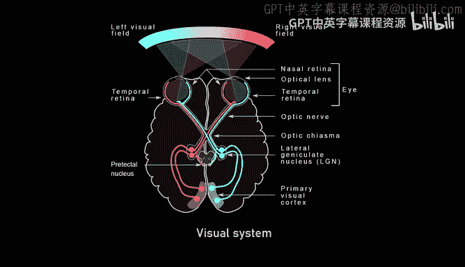

That convert the photon energy into electrical signals and then they get that then gets projected to your back of your head。

 your visual cortex， you know it goes through actually thallemic system called LGN that then projects it out and then in the visual cortex there's。

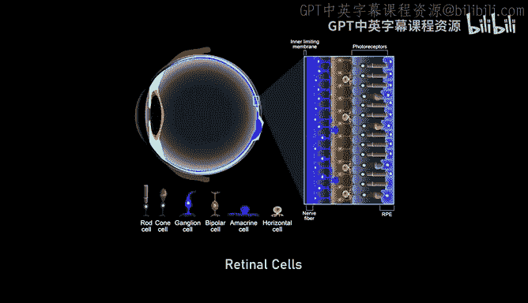

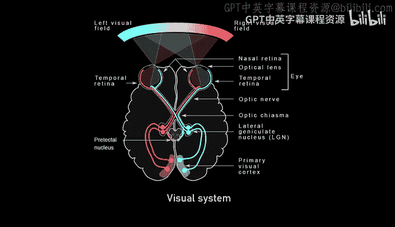

you know， visual area1 or V1 and then there's a bunch of other higher level processing layers like V2 V3 and there are actually kind of interesting parallels and when you study the behaviors of these convolutional neural networks like what the different layers of the network is detecting you know first they're detecting like these edges andre then detecting some more natural curves and then they start to detect like objects kind of similar thing happens in the brain and a lot of that has been inspired and also you know it's been kind of exciting to see some of the correlations there but you know things like from there where those cognition arise and where wheres color encoded there's just not a lot of understanding fundamental understanding there so in terms of。

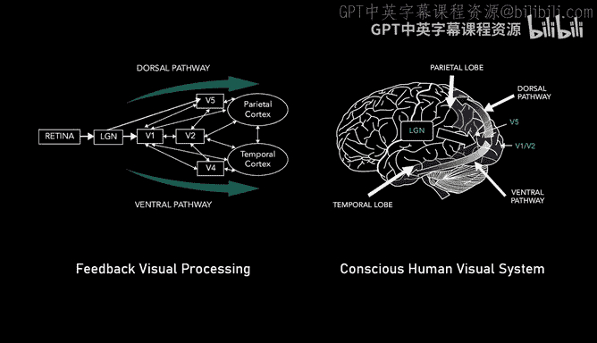

Kind of bringing sight back to those that are blind there are many different forms of blindness there's actually million people。

 one million people in the US that are legally blind you know， that means like certain。

Like score below in kind of the visual tests， I think is something like if you can see something at 20 feet distance that normal people can see at 200 feet distance like like if you're worse than that you're legally blind So fundamental that means you can't function effectively correct using sight in the world Yeah like to navigate navigate your environment and yeah there are different forms of blindness。

 there are forms of blindness where there's some degeneration of your retina is photoreceptor cells and rest of your visual you know processing that I described is intact。

And for those。Tys of individuals， you may not need to maybe stick electrodes into the visual cortex。

 you can actually。Build retinal prosthetic devices that actually just replaces a function of that retinal cells that are degenerated and there are many companies that are working on that。

 but that's a very small slice， the albeit significance those smaller slice of folks that are legally blind。

If there's any damage along that circuitry， whether it's in the optic nerve or just the LGN circuitry or any break in that circuit。

 that's not going to work for you。And。呃。The source of where you need to actually。

Cause that visual percept to happen because your biological mechanism without doing that is by placing electrodes in the visual cortex in the back of your head。

And the way in which this would work is that you would have an external camera。

 whether it's something as unsophisticated as a GoPro or some sort of wearable Rayban type glasses that Matt us working on that captures a scene。

 right？That scene is then converted to a set of electrical impulses or stimulation pulses that you would activate in your visual cortex through these stem film arrays。

And by。Playing some you concerted kind of orchestra of these stimulation patterns。

 you can create what's called phosphes， which are these kind of white yellowish dots that you can also create by just pressing your eyes you can actually create those perceptps by stimulating the visual cortex and the name of the game is really have many of those and have those percepts be the phosphes be as small as possible so that you can start to tell apart like they're the individual pixels of the of the screen right so if you have many many of those you know potentially you'll be able to。

You know， in the long term be able to actually get naturalistic vision。

 but in the mid like short term to maybe midterm being able to at least。

Be able to have object detection algorithms run on your glasses， the pre pop processing units。

 and then being able to at least see the edges of things so you don't bump into stuff。

Thiss incredible。 This is really incredible。 So you basically would be adding pixels。

 and your brain would start to figure out what those pixels mean。Yeah。

 and like with different kinds of system and the signal processing on all fronts， yeah。

The thing that actually， so a couple things， one is， you know， obviously if you're blind from birth。

 the way brain works， especially in the early age。Neururalplasticity is really nothing other than you know。

 kind of your。Brain and different parts of your brain fighting for thelim territory and and I mean。

 very， very quickly， you see， you see cases where， you know， people that are， I mean。

 you also hear about people who are blind that have heightened sense of hearing or some other senses and the reason for that is because that cortex that's not used just gets taken over by these different parts of the cortex。

 So for those types of individuals。U。😊，I mean， I guess they're going to have to now map some other parts of their senses into what they call vision。

 but it's going to be obviously a very， very different conscious experience。Um， before。

So I think that's an interesting caveat。 The other thing that also is important to highlight is that we're currently limited by。

Our biology in terms of the wavelength that we can see， there's a very。

 very small wavelength that is a visible light wavelength that we can see with our eyes。

 but when you have an external camera with this BCI system， you're not limited to that。

 you can have infrared， you can have UV， you can have whatever other spectrum that you want to see and whether that gets map to some sort of weird conscious experience。

 I have no idea but when oftentimes I talk to people about the goal of neurallink being going beyond the limits of our biology。

 that's sort of what I mean。

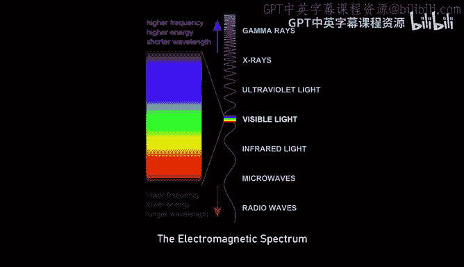

And if you're able to control the kind of raw signal， is that when we use our site， we're getting。

The photons。And there's not much processing on it。If you're being able to control that signal。

 maybe you can do some kind of processing， maybe you do object detection ahead of time， yeah。

 you're doing some kind of preprocessing and there's a lot of possibilities to explore that so it's not just increasing sort of thermal imaging that kind of stuff。

 but it's also just doing some kind of interesting processing。I mean，I mean。

 my my theory of how like visual system works also is that。I mean。

 there's just so many things happening in the world and there's a lot of photons that are going into your eye and it's unclear exactly where some of the pre processing steps are happening。

 but I mean， I actually think that just just from。Fundamental perspective。

There's just so much the reality that we're in if it's a reality is。

There's so much data and I think humans are just unable to actually。

Like eat enough actually to process all that information so there's some sort of filtering that does happen。

 whether that happens in the retina， whether that happens in different layers of the visual cortex。

 unclear but。Like the analogy that I sometimes think about is。You know。

 if your brain is a CCD camera and all of the information in the world is a sun。

And when you try to actually look at the sun with the CCD camera。

 it's just going to saturate the sensors right， because it's an enormous amount of energy。

 so what you do is you end up adding these filters。

Right to just kind of narrow the information that's coming to you and being captured and I think。

You know， things like our experiences or ourum。呃。you know。

 like drugs like profileol that like anesthetics drug or you know， psychedelics。

 what they're doing is they're kind of swapping out these filters and putting in new ones or removing older ones and。

Kind of controlling our conscious experience。Yeah， man， not to distract from the topic。

 but I just took a very high dose of ayaasca in the Amazon jungle。 So yes。

It's a nice way to think about it， you're swapping out。

Different experiences and we're neurallink being able to control that。

Pmarily at first to improve function， not for entertainment purposes or enjoyment purposes， but yeah。

 giving back lost functions， giving back loss functions and there。

 especially when when the function is completely lost， anything is a huge help。Would you implant。

A neurallink device in your own。Brain。Absolutely， I mean， maybe not right now， but absolutely。

 what kind of capability once reached you start getting real curious and almost get a little antsy like。

Like jealous of people that get as you watch them get implanted。Yeah， I mean， I think， I mean， even。

 even with our early participants， if they start to do things that I I can't do。

 which I think is in the realm of。Possibility for them to be able to get， you know 15 20。

 if not like 100 B， right， there's nothing that fundamentally stops us from being able to achieve that type of performance。

Um。I mean， I would certainly get jealous that they can do that I should say that watching Nolan I get a little jealous because he's having so much fun and it seems like such a chill way to play video games。

 yeah。So I mean， the thing that also is hard to appreciate sometimes is that。

You know he's doing these things while like while talking and I mean it's multitasking right so it's it's clearly it's obviously cognitive cognitively intensive。

 but similar to how。You know， when we talk， we move our hands like these things like， you know。

 like our multitasking。 I mean， he's able to do that and， you know。

 you won't be able to do that with other。Assistive technology as far as I I'm aware， you know。

 if you're。Obviously using like an eye tracking device， you know。

 you're very much fixated on that thing that you're trying to do。 And if you're using voice control。

 I mean like if you say some other stuff， yeah， you don't get to use that。

 Yeah the the multitasking aspect of that is really interesting So it's not just the B。

For the primary task， it's the it's the parallelization of multiple tasks if you if you take if you measure the B for the entirety of the human organism。

 so if you're。Talking and doing a thing with your mind and looking around。Also。

 I mean there's just a lot of parallelization that can that can be happening but mean I think at some point for him like if he wants to really achieve those high level Bps。

 it does require like you a full attention right and that's a separate circuitry that that is a big mystery like how attention works and you know。

 yeah， attention like cognitive load have've done I've read a lot of literature and people doing two tasks like。

You have your primary task and a secondary task and the secondary task is a source of distraction and how does that affect the performance of the primary task and there's depending on the task there's a lot of interesting。

I mean， this is an interesting computational device， right。

 And I think there're to say the least a lot of novel insights that can be gained from everything。

 I mean， I personally am surprised that no one's able to do。😊。

Such incredible control of the cursor while talking。

And also being nervous at the same time because he's talking like all of us are。

 if you're talking in front of the camera， you get nervous。

 so all of those are coming into play he's able to still achieve high performance。Surprising I mean。

 all of this is really amazing and I think just after researching this really in depth。

 I kind of want really I kind of get in the line and also the safety get in mind well。

 we just say the registry is for people who have quadriplegia and for all that kind of stuff so correct that would be a separate line for people。

嗯。They're just。Curious， like myself。So now that nolan patient P1 is part of the ongoing prime study。

 what's the high level vision for P2， P3， P4， P5？And just the expansion into other human beings that are getting to experience this implant。

Yeah， I mean， the primary goal is you know for our study in the first place is to achieve safety endpoints。

 just understand。Safety of this。Device as well as the implantation process。嗯。

And also at the same time， understand the efficacy and the impact that it could have on the potential user' lives。

Just because you have and you know you're living with teettraplegia。

 it doesn't mean your situation is same as another person living with teettraplegia， it's wildly。

 wildly varying。And and you know， your's it's something that， you know。

 we're hoping to also understand how our technology can serve not just a very small slice of those individuals。

 but， you know， broader group of individuals and being able to get the feedback to， you know。

 just really build，Just the best product for them。So are our。You know。

 there's there's obviously also you know goals that we have and the primary purpose of the。

Early feasibility study is to learn from each and every participants to improve the device。

 improve the surgery before you know， we embark on what's called a pivotal study that then is much larger。

trial that starts to look at statistical significance of your endpoints and that's required before you can then market the device and you know that's how it works in the US and just generally around the world that's the process you follow so you know our goal is to really just understand from people like Nolan P2 P3 future participants what aspects of our device needs to improve you know if it turns out that people are like I really don't like the fact that it lasts only six hours I want to be able to use this computer for you know like 24 hours I mean that is a you know user。

Needs and user requirements， which we can only find out from just just being able to engage with them so before the pivotal study there's kind of like a rapid innovation based on individual experiences you're learning from individual people how they use it。

Like like the high resolution details。In terms of like cursor control and signal and all that kind of stuff to like life experience yeah。

 so there's hardware changes， but also just just firmware updates so even even when we you know had had that sort of recovery event for Nolan you know。

 he now has the new firmware that that he has been。

Udated with and know similar to how like your phones get updated all the time with new firmwareers or security patches。

 whatever new functionality UI right and that's something that is possible with our implant it's not a static one time device that that can only do the thing that it's said it can do I mean similar to Tesla you can do over the air firmware updates and now you have completely new user user interface and all this bells and whistles and improvements on you know everything like the latest right that's you know when we say generalized platform that's what we're talking about Yeah it's really cool how the app that Nolan is using there's like calibration all all that kind of stuff and then there's update just you just click and get an update。

What other future capabilities are you kind of looking to， you said vision， that's a fascinating one。

 what about sort of accelerated typing or speech or this kind of stuff？

Yeah and what else is there yeah those those are still in them realm of movement program so so largely speaking we have two programs。

 we have the movement program and we have the vision program the movement program you know currently is focused around you know the digital freedom。

As you can easily guess， if you can control you know2D cursor in the digital space。

 you could move anything in the physical space， so robotic arms， wheelchair， your environment。

 or even really like whether it's through the phone or just like directly to those interfaces so like to those machines so we're looking at ways to kind of expand those types of capability even for Nolan。

That requires conversation with the FDA and kind of showing safety data for you know if there's a robotic arm or a wheelchair that you we can guarantee that they're not going to hurt themselves accidentally it's very different if you're moving stuff in the digital domain versus like in the physical space you can actually potentially cause harm to the participants so we're working through that right now speech does involve different areas of the brain。

 speech prosthetic is very， very fascinating and there's actually been a lot of really amazing work that's been happening in academia know Surge Stvissky at UC Davis。

 Jamie Henderson and late Krisrhishnoi at Stanford doing just some incredible amount of work and improving speech neuroprosthetics。

And。Those are actually looking more at parts of the motor cortex that are controlling these focal articulators。

And you know， being able to like even by mouthing the word or imagine speech。

 you can pick up those signals， the more sophisticated higher level processing areas like you know the Bro area or you know Warnicke's area。

 those are still very， very big mystery in terms of the underlying mechanism of how all that stuff works。

 but。Yeah， I mean， I think Neling's eventual goal is to kind of understand those things and be able to provide a platform and tools to be able to understand that and study that。

This is where I get to the pothead questions。UDo you think we can start getting insight into things like thought？

So speech is there's a muscular component， like you said， there's like the act of producing sounds。

But then what about the internal things like cognition？

Like low level thoughts and high level thoughts。 Do you think we'll start noticing kind of signals that could be picked up that could。

They could be understood， they could be maybe be used in order to interact with the outside world。

In some ways， like I guess this starts to kind of get into the hard problem of consciousness and。

I mean， on one hand， all of these are at some point sort of electrical signals。That。From there。

Maybe it in itself is giving you the cognition or the meaning or somehow human mind is an incredibly amazing storytelling machine。

 so we're telling ourselves and folding ourselves that there's some interesting meaning here。But。I。

 I certainly think that PCI and you know， really BCI at the end of the day is a set of tools that help you kind of study the underlying mechanisms in a both like local but also broader sense。

U。And whether。You know there's some interesting patterns of like electrical signal that means like you're thinking this versus and you can either like learn from like many。

 many sets of data to correlate some of that and be able to do mind reading or not I'm not sure I certainly would not kind of rule that out as a possibility but I think BCI alone probably can't do that there's probably additional set of tools and framework and and also like just hard problem of consciousness at the end of the day is rooted in this philosophical question of like whats the meaning of it all what's the nature of our existence like wheres the mind emerged from this complex network。

Yeah， does the u how does the subjective experience emerge from just a bunch of spikes。

 electrical spikes？Yeah， yeah， I mean， we do really think about BCI and what we're building as a tool for understanding。

The mind， the brain。The only question that matters。

There's actually there actually is some biological。

The existence proof of like what it would take to kind of start to form some of these experiences that may be unique。

If you actually look at every one of our brains， there are two hemispheres。

 there's a left side of brain， there's a right side of brain and。

I mean I unless you have some other conditions you normally don't feel like left le or right legs like you just feel like one legs right so what is happening there right if you actually look at。

The two hemispheres， there's a a。Structure that kind of connectorize the two called the corpus Colloosum。

That is supposed to have around 200 to 300 million connections or axons。

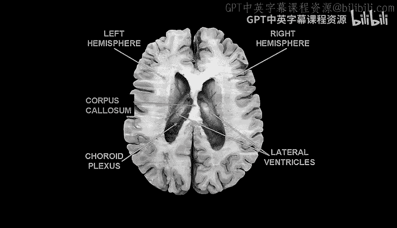

Um。So whether that means that's the the number of interface and electrodes that we need to create some sort of mindmld or。

From that， like whatever new conscious experience that you can experience。But。

I do think that there's like kind of an interesting。Existence proof。That we all have。

And that threshold is unknown at this time。 Oh yeah， these things， everything in this domain is。

 you know， speculation， right， and then there will be。You'd be continuously pleasantly surprised。

Do you see a world where there's millions of people？Like tens of millions。

 hundreds of millions of people walking around with the neurallink device and there are multiple neurallink devices in their brain。

 I do。 first of all， there there are， like， if you look at worldwide people suffering from movement disorders and visual deficites。

 I mean that that's。In the tens， if not hundreds of millions of people。

 so that alone I think there's a lot of benefit and potential good that we can do with this type of technology。

And when she start to get into kind of neuro like psychiatric application， you know， depression。

Anxiety， hunger or， you know， obesity， right， like mood control of appetite。 I mean。

 that starts to become。You know， very real to everyone not to mention that every。

Most people on earth have a smartphone。And once BCI starts competing。

With a smart as a preferred methodology of interacting with the digital world。

 that also becomes an interesting thing。 Oh， yeah， I mean， that， yeah。

 This is even before going to that， right， I mean， there is like almost。I mean。

 the entirep world that could benefit from。These types of thing。 and then， yeah。

 like if we're talking about kind of next generation of how we interface with。You know。

 machines or even ourselves in many ways， I think。BCI can play a role in that。You know。

 some of the things that I also。Talk about is I do think that there is a real possibility that you could see。

You know，8 billion people walking around with Newlink。Well。

 thank you so much for pushing ahead and I look forward to that exciting future。

 Thanks for having me。Thanks for listening to this conversation with DJ S。And now， dear friends。

 here's Matthew McDogo， the head Nesurgeon at Nelink。

When did you first become fascinated with the human brain since forever。

 as far back as I can remember， I've been interested in the human brain， I mean。I was， you know。

 a thoughtful kid and。A bit of an outsider and you， you know。

 sit there thinking about what the most important things in the world are。

In your little tiny adolescent brain。And the answer that I came to that I converged on was that。

All of the things you can possibly conceive of is。Things that are important for human beings to care about are literally contained。

You know， in the skull， both the perception of them and their relative values and。You know。

 the solutions to all our problems and all of our problems are all contained in the skull and if we knew more about。

How that worked。How the brain encodes information and generates desires and。

Generates agony and suffering。We。We could do more about it。You know。

 you think about all all the really great triumphs in human history or you think about all the really horrific tragedies。

You know， you think about the Holocaust， you think about any。Prison full of human stories。And。

All of those problems。Boil down to neurochemistry。So if you get a little bit of control over that。

You provide people the option to do better and in the way I read history。

 the way people have dealt with having better tools is that they most often in the end。

 do better with huge asterisks。But I think it's a an interesting worthy and noble pursuit to give people more options more tools Yeah。

 that's a fascinating way to look at human history You just imagine all these neurobiological mechanisms Stalin Hitler。

 all of these Genus Khan， all of them just had like a。A brain。 It just。A bunch of neurons， you know。

 like a few tons of billions of neurons。gaining a bunch of information over a period of time to have set a module that does language and memory and all that and from there in in the case of those people。

 they're able to murder millions of people and all that coming from。

There's not some glorified notion of a dictator of this enormous mind or something like this。

 it's just， it's just the brain。Yeah， I mean， a lot of that has to do with。

How well people like that can organize those around them。Other brains， yeah。

I always find it interesting to look to primatology， you know。

 look to our closest non human relatives for clues as to how humans are going to behave and what。

Particular humans are able to achieve。 And so you look at。Chimpanzees and bonobos。 and you know。

 they're similar， but different in their social structures， particularly。

And I went to Emory in Atlanta and studied under friends to all， the great friends to all。

 who was kind of the leading primatologist。ho recently died。

And his work in at looking at chimps through the lens of， you know。

 how you would watch an episode of friendsend and understand the motivations of the characters interacting with each other。

 he would look at a chimp colony and basically apply that lens I massively over simplifyimpling it。

If you do that， instead of just saying。You know， subject 47，3， you know。

 through his feces at subject 471。You talk about them in terms of their。

Human struggles accord them The dignity of。Themselves as actors with。Understandable goals and drives。

 what they want out of life。 And primarily it's， you know， the things we want out of life， food， sex。

 companionship。Power。You can understand chimp and bonoba behavior in the same lights much more easily。

 And I think doing so。Gives you the tools you need to reduce human behavior from the kind of false complexity that we layer onto it with language。

And look at it in terms of， oh， well， these humans are looking for companionship， sex， food， power。嗯。

And I think that that's a pretty powerful tool to have in understanding human behavior and I just went to the Amazon junk Go for a few weeks and it's a very visceral reminder that。

A lot of life on earth is just trying to get laid Yeah。

 they're all screaming at each other Yeah like I saw a lot of monkeys and they're just trying to impress each other or maybe there's a battle for power but a lot of the battle for power has to do with getting laid right reading rights often go with alpha status And so if you can get a piece of that then you're kind do okay and would like to think that we're somehow fundamentally different but。

And especially when talk it comes to primates where really aren't， you know。

We can use fanr poetic language， but maybe some of the underlying drives。The motivators are。

Similar yeah， I think that's true and all of that is coming from this the brain Yeah。

 so when when did you first start studying the the brain is it as the biological mechanism Basically the moment I got to college I。

Started looking around for labs that I could do neuroscience work in。

 I originally approached that from the angle of。Looking at interactions between the brain and the immune system。

 which isn't the most obvious place to start， but。I had this idea at the time that。

The contents of your thoughts would。Have an impact， a direct impact。

 maybe a powerful one on non conscious systems in your body， the systems we think of as。You know。

 homeostatic， automatic mechanisms like fighting off a virus， like repairing a wound。And sure enough。

 there are。Big crossovers between the two。It gets to kind of a key point that I think goes under recognized one of the things people don't。

Recognize or appreciate about the human brain。Enough， and that is that it basically controls。

Or has a huge role in almost everything that your body does。嗯。

Like you try to try to name an example of something in your body that。

Isn't directly controlled or massively influenced by the brain and it's pretty hard。 I mean。

 you might say like bone healing or something but。Even those systems。

 the hypothalamus and pituitary end up playing a role。

In coordinating the endocrine system that does have a direct influence on， say。

 the calcium level in your blood。That goes to bone healing。

 So non obvious connections between those things。Implicate the brain as really a potent prime mover in all of health。

One of the things I realized in the other direction too， how。

Most of the systems in the body are integrated with the human brain， like they affect the brain also。

 like the immune system， I think they's just。You know。

 people who study Alzheimer's and those kinds of things it's just surprising。

How much you can understand of that from the immune system。

 from the other systems that don't obviously seem to have to anything to do with sort of。

The nervous system， they all play together。 Yeah， you could understand how that would be driven by evolution。

 too， just in some simple examples。If you get sick， if you get a communicable disease。

 you get the flu。呃。It's pretty advantageous for your immune system to tell your brain a。

Now be antisocial for a few days， don't go be the life of the party tonight。In fact。

 maybe just cuddle up somewhere warm under a blanket and just stay there for a day or two。

And sure enough， that tends to be the behavior that you see both in animals and and in humans。

 If you get sick， elevated levels of interluins in your blood and T N f afa in your blood。

Ask the brain to cut back on social activity and even moving around。

 you have lower locomotive activity in animals that are infected with viruses。

So from there the early days in neuroscience to surgery。When did that step happen， Yes leap。

 You know， it was sort of an evolution of thought。 I wanted to study the brain。

 I started studying the brain。In undergrad in this neuroimmmunology lab。I。From there。

 realized at some point that I didn't want to just generate knowledge。

 I wanted to effect real changes in the actual world， in actual people's lives。

And so after having not really thought about going into medical school。

I was on a track to go into a PhD program， I said， well。Id like'd like that option。

 I'd like to actually potentially help。Tangible people in front of me。And。

Doing a little digging found that there exists these MD PhD programs where you can。

Choose not to choose。Betweentween them and do both。

 and so I went to USC for medical school and had a joint PhD program with Caltech。Um。Where I met。

 actually chose that program， particularly because of a researcher at Caltech named Richard Anderson。

 who's one of the godfathers of。A primate neuroscience。

hass a maAque lab where Utah Rays and other electrodes were being inserted into the brains of monkeys to try to understand how intentions were being encoded in the brain。

 so you know I ended up there with the idea that maybe I would be a neurologist and study the brain on the side。

And then discovered that neurology again I'm going to。Make enemies by saying this。

 but neurology predominantly and distressingly to me is the practice of diagnosing a thing and then saying good luck with that when there's not much we can do。

And。And neurosurgery very differently it's a powerful lever on taking people that are headed in a bad direction and changing their course。

In the sense of brain tumors that are potentially treatable or curable with surgery。You know。

 even aneurysms in the brain， blood vessels that are going to rupture e。

Save lives really is at the end of the day， what what mattered to me and so。嗯。I was at USC。

 as I mentioned， that happens to be one of the great neurosurgery programs and so I met these truly epic。

Neurossurgeons， Alex Collessi and Mike Puzzo and Steve Gnata and Marty Weiss。

 these sort of epic people that were just human beings in front of me and so it。

kindind of changed my thinking from neurosurgeons are distant gods that live on another planet and occasionally come and visit us to these are humans that have problems and are people and there's nothing fundamentally preventing me from being one of them。

And so。At the last minute in medical school， I changed gears from going into a different specialty and switched into neurosurgery。

Which cost me a year， I had to do another year of research because I was so far along in the process。

That。To switch into neurosurgery， the deadlines had already passed。Right。A decision that cost time。

 but absolutely worth it。 What was the hardest part of the training on on the neurosurgeon track？

Yeah。Two things， I think that， you know， residency in neurosurgery is sort of a competition of pain of like how much pain can you eat and smile and so there's。

Work out restrictions that are not really。They're viewed at。

 I think internally among the residents as weakness， and so most neurosurgery residents。

Try to work as hard as they can。And that， I think necessarily means working long hours and sometimes over the work hour limits and。

You know， we care about being compliant with whatever regulations are in front of us。

 but I think more important than that people want to all give their all in becoming a better neurosurgeon because the stakes are so high and so it's a real fight to get residents。

U to say go home at the end of their shift and not stay and do more surgery are you seriously saying like one of the hardest things is literally like getting forcing them to get sleep and rest and all this kind of stuff historically that was the case I think I think the next generation。

I think the next generation is more compliant and more sleep is what you mean all right I'm just。

 I was just kidding， I'm just kidding I didn't say it now I'm making enemies。 No， okay， I get it wow。

 that's fascinating。 So what was the second thing。The personalities and maybe the two are connected。

 but was it pretty competitive？It's competitive and it's also。You know， as we touched on earlier。

 primates like power。 And I think neurosurgery has long had this aura of。

Mystique and excellence and whatever about it。 And so it's it's an invitation， I think， for。

People that are cloaked in that authority， you know。

 a board certified neurosurgeon is basically a walking。

Facious appeal to authority right you have license to walk into any room and act like you're。

 you know， an expert on whatever。And fighting that tendency is not something that most neurosurgeons do well。

 Huility isn't the forte。 Yeah， one of the， so I have friends who know you。

 And whenever they speak about you that。Yours。Yours have the surprising quality for neurosurgeon enough humility which I think in decay it's not it's not as common as perhaps in other professions because there is a kind of gigantic sort of heroic aspect to neurosurgery and I think it gets to people's head a little bit yeah well that I think that。

Oh， you know， that allows me to play well at an Elon company。Because Elon， one of his strengths。

 I think， is to。Just instantly see through。Fallacy from authority。

 so nobody walks into a room that he's in and says， well， God damn it， you have to trust me。

I'm the guy that built the last， you know， 10 rockets or something and he says， well。

 you did it wrong and we can do it better。Or I'm the guy that， you know。

 kept Ford alive for the last 50 years， you listen to me on how to build cars and he says。No。

And so you don't walk into a room that he's in and say， well， I'm a neurosurgeon。

 let me tell you how to do it。He's going to say， well。

I'm a human being that has a brain I can think from first principles myself， thank you very much。

 and here's how I think it ought to be done， let's go try it and see who's right。And that's。

 you know， proven， I think over and over in his case to be a very powerful approach。

 if we just take that tangent， there's a fascinating interdisciplinary team at neural link that you get to interact with。

Including Elon。What do you think is the secret to a successful team？

What have you learned from just getting to observe these folks， Yeah。

 world experts in different disciplines work together。Yeah， there's a sweet spot where people。

Disagree and forcefully speak their mind and passionately defend their position。

And yet are still able to accept information from others， and。Change their ideas when they're wrong。

 And so I like the analogy of sort of。How you polish rocks。

 you put hard things in a hard container and spin it。

 people bash against each other and out comes you know a more refined product。And so。

To make a good team at Nelink， we've tried to find。You know。

 people that are not afraid to defend their ideas passionately and。You know。

 occasionally strongly disagree with people that they're。

That they're working with and have the best idea come out on top。嗯。It's not an easy balance again。

 to refer back to the。Priate brain， it's not something that is inherently built into the primate brain to say。

I passionately put all my chips on this position and now I'm just going to walk away from it and admit you are right。

You know， part of our brains tell us that that is a power loss， that is a loss of face。

 a loss of standing in the community， and now you're a Zeda jump because your idea got troced。

And you just have to。You know， recognize that that little voice in the back of your head is maladaptive and it's not helping the team win。

Yeah you have to have the confidence to be able to walk away from an idea that you hold on to yeah。

 and if you do that often enough， you're actually going to become the best in the world that you're thing。

I mean， that kind of that rapid iteration， yeah， you'll at least be a member of a winning team。

Ride the wave。What what did you learn you mentioned there's a lot of amazing neurosurgeons at USC what what lessons about surgery in life have you learned from those folks Yeah。

 I think working your ass off working hard while。You know， functioning as a member of a team。

 getting a job done that is incredibly difficult。Um， you know， working incredibly long hours。

 being up all night， taking care of someone that， you know。

 you think probably won't survive no matter what you do。

Working hard to make people that you passionately dislike look good the next morning。

 these folks were relentless in their pursuit of。Excellent neurosurgical technique。

Decade over decade and。And I think we're well recognized for that excellence， so you know。

 especially Marty Weis， Steve Gianta。Mycoazzo， they made huge contributions not only to surgical technique。

 but they built training programs that trained。Dozens or hundreds of amazing neurosurgeons。

I was just lucky to。Kind of be in their wake。What's that like， you mentioned。Doing the surgery where。

The person is likely not to survive。Does that wear on you？Yeah。あん。You know。

 it's especially challenging。When you。With all respect to our elders。

 it doesn't hit so much when you're taking care of an 80 year old。And。

Something was going to get them pretty soon anyway。You lose a patient like that。

 and it was part of the natural course of what is expected of them in the coming years regardless。

Taking care of。You know， a father of。2 or three， four young kids。

Someone in their 30s that didn't have it coming。And they show up in your ER having their first seizure of their life and lo I'm old。

 they've got a huge malignant， inoperable or incurable brain tumor， you can only do that， I think。

 a handful of times。Before it really starts eating away at your armor。诶。Or you know。

 a young mother that shows up that。Has a giant hemorrhage in her brain that she's not going to survive from。

You know， they bring her four year old daughter in to say goodbye one last time before they turn the ventilator off that。

嗯。You know， the great Henry Marsh is an English neurosurgeon who said it best。

 I think he says that every neurosurgeon carries with them a private graveyard and I definitely feel that。

嗯。Especially with young parents that kills me。They had a lot more to give。

The loss of those people specifically has a。You know， knock on effect that's going to。

Make the world worse for people for a long time， and it's just hard to feel powerless in the face of that。

You know， and that's where。I think you have to be。Borderline evil to fight against a company like Nelinknk or T。

Constantly be taking pot shots at us。Because。What we're doing is。To try to fix that stuff。

 we're trying to give people options。To reduce suffering， we're trying to。We're trying to take the。

 the pain out of life that。Broken brains。Brings in。And。Yeah。

 this is just our little way that we're fighting back against entropy， I guess。Yeah。

 the amount of suffering that's endured when some of the things that we take for granted。

That our brain is able to do is taken away is immense。

And to be able to restore some of that functionality is a real gift。Yeah， we're just starting。

 we're going to do so much more。U well， can you take me through the full procedure of implanting。

 say the N1 sure chip in your link， yeah， it's a really simple。

 really simple straightforward procedure， the the human part of the surgery。

That I do is。Dead simple， it's one of the most basic neurosurgery procedures。Imaginable。

 and I think there's evidence that it some version of it has been done for thousands of years that there are examples。

 I think， from ancient Egypt of healed or partially healed，Trephaations。 and from。Peru or you know。

 ancient times in South America。Where。These protourgeons would drill holes in people's skulls。

 you know， presumably to let out the evil spirits， but maybe to drain blood clots。

And there's evidence of bone healing around the edge。

 meaning the people at least survive some months。After a procedure。

And so what we're doing is that we are making a cut in the skin on the top of the head over the area of the brain that is the most potent。

Representation of hand intentions。 and so if you if you are。An expert concert pianist， you know。

 this part of your brain is lighting up the entire time you're playing。

We call it the hand knob the hand knob there's all the like the finger movements all this all yeah all of that is just firing away yep there's a little squiggle in the cortex right there one of the folds in the brain is kind of doubly folded right on that spot and so you can look at it on an MRI and say that's the hand knob and then you you do a functional test and a special kind of MRI called a functional MRIFM。

And this part of the brain lights up when people even quadriplegic people whose brains aren't connected to their finger movements anymore。

Imagine finger movements in this part of the brain still lights up。

So we can ID that part of the brain in anyone who's preparing to enter our trial and say。Okay。

 that part of the brain we confirm is your hand intention area。And so。

I'll make a little cut in the skin， we'll flap the skin open。

 just like kind of opening the hood of a car， only a lot smaller。Make a perfectly round。

One inch diameter hole in the skull。Remove that bit of skull。Open the。Lning of the brain。

 the covering of the brain， it's like a little bag of water that the brain floats in。And then。

Show that part of the brain to our robot。And then this is where the robot shines。 It can come in and。

Take these tiny， you know。

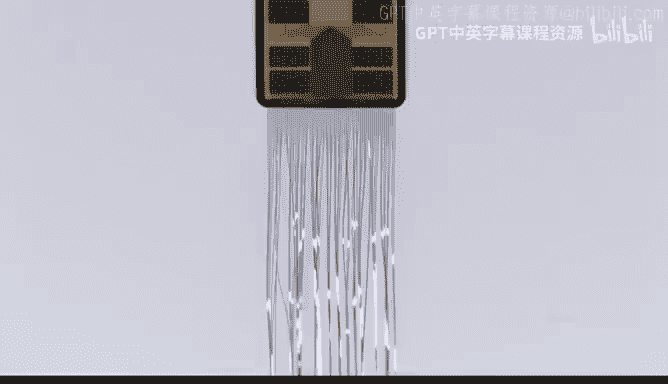

Much smaller than human hair， electrodes， and precisely insert them。Into the cortex。

 into the surface of the brain， to a very precise depth。

In a very precise spot that avoids all the blood vessels that are coating the surface of the brain。

And after the robot's done with its part， then， you know the human comes back in and。

Puts the implant into that hole in the skull and covers it up。

 screwing it down to the skull and sewing the skin back together。So the whole thing is， you know。

 a few hours long， it's extremely low risk compared to。

The average neurosurgery involving the brain that might say open up a deep part of the brain or manipulate blood vessels in the brain。

 this， this opening on the surface of the brain。With with only cortical microinerions。Carries。

Significantly less risk than a lot of the。You know。

 tumor or aneurysm surgeries that are routinely done。

 The cortical microinions that are via a robot and computer vision are。

Designed to avoid the blood vessels。 exactlyly。 So I know you're a bit biased here。

 but let's compare human and machine。 Sure， So what are human surgeons able to do well and what are robot surgeons able to do well。

At this stage of our human civilization development， yeah， yeah， it's a good question humans。

Our general purpose machines were able to adapt to unusual situations。

 we're able to change the plan on the fly。嗯。I remember well。

 a surgery that I was doing many years ago down in San Diego where the plan was to。

Open a small hole behind the ear。And go reposition a blood vessel that had come to lay on the facial nerve。

 the trigeminal nerve。The nerve that goes to the face When that blood vessel lays on the nerve。

 it can cause。Just intolerable， horrific shooting pain that people describe like being zapped with a cattle prod。

And so the beautiful， elegant surgery is to go move this blood vessel off the nerve。The surgery team。

 we went in there and started moving this blood vessel and then found that there was a giant aneurysm on that blood vessel that was not easily visible on the preop scans。

 And so the plan had to dynamically change。 and that the。Human surgeons had no problem with that。

 were trained for all those things。Robots wouldn't do so well in that situation。

 at least in their current incarnation。Fully robotic surgery like you know the electrode insertion portion of the neuralling surgery。

It goes according to a set plan。The humans can interrupt the flow and change the plan。

 but the robot can't really change the plan midway through。

 it operates according to how it was programmed and how it was asked to run。 It does its job。

Very precisely， but not with a wide degree of latitude and how to react to changing conditions。

So there could be just a very large number of ways that you could be surprised as a surgeon when you enter a situation that could be subtle things that you have to dynamically adjust to correct and robots are not。

Good at that。 currently， currently， I think we are at the dawn of a new。

Ara with AI of the parameters for robot responsiveness to be dramatically broadened， right， I mean。

 you can't look at a self driving car and say that it's operating under very narrow parameters。

You know， if a chicken runs across the road， it wasn't necessarily programmed to deal with that specifically。

 but a Waymo or a self driving Tesla would have no problem reacting to that appropriately。And so。

Surgical robots aren't there yet， but give it time and then there could be a lot of sort of into like semi autotonnomous possibilities of。

Maybe a robotic surgeon could say this situation is perfectly familiar or the situation is not familiar。

 And in the not familiar case， a human could take over， I basically like， be very conservative。

And saying， okay， this for sure has no issues， no surprises。

 And then let the humans deal with the surprises with the edge cases， all that。

 Yeah that's one possibility。 So like you think eventually。Uh you'll be out of the job。

 well you being neurosurgeon， your job being neurosurgeon humans。

 there will not be many neurosurgeons left on this earth。

 I'm not worried about my job in my in the course of my professional life。

I think I would tell my kids not necessarily to go in this line of work depending on。

Depending on how things look in 20 years。It's so fascinating because， I mean。

 I if I have a line of work， I would say it's programming。And if you ask me like for the last。

 I don't know， 20 years， what I would recommend for people， I would， I would tell them yeah。

 go there's just you will always have a job if you're a programmer because there's more and more computers and all this kind of stuff and it pays well。

But then you realize these large language models come along and theyre really damn good at generating code so overnight you could be surprised like w what is the contribution of the human really。

 but then you start to think， okay， it does seem that humans have ability like you said to deal with novel situations in the case of programming。

 it's the ability to kind of come up with novel ideas to solve。Problems， it's。

 it seems like machines aren't quite yet able to do that。

 And when the stakes are very high when it's life critical。As it is in surgery。

 especially in neurourg， then he starts。The the stakes are very high for a robot to actually replace a human。

 but it's fascinating that in this case of neurallink。

 there's a human robot collaboration yeah yeah it's I do the parts it can't do and it does the parts I can't do。

And we are friends。呃。I saw that there's a lot of practice going on so I mean everything in New is is tested extremely rigorously。

 but one of the things I saw that there's a proxy on which the surgeries are performed Yeah so this is both for the robot and for the human for everybody involved in the entire pipeline yep what's that like practicing the surgery it's pretty intense so there's no analog to this in。

Human surgery。 human surgery， sort of this。Artisanal craft that's handed down directly from master to pupil over the generations。

 I mean， literally the way you learn to be a surgeon on humans is by doing surgery on humans。 I mean。

 first， you watch。Your professors do a bunch of surgery and then finally they put。

 you know the trivial parts of the surgery into your hands and then the more complex parts and as your understanding of the point and the purposes of the surgery increases。

 you get more responsibility in the perfect condition doesn't always go well。In Neurlink's case。

 the approach is a bit different。嗯。We of course， practiced as far as we could on animals。

 we did hundreds of animal surgeries。m， and when it came time to do the first human。

 we had a just an amazing team of engineers build。Incredibly lifelike models， one of the engineers。

 Fran Romanmano， in particular， built a pulsating brain in a custom 3D printed skull that matches exactly the patient's anatomy。

Including their face and。Scop characteristics and so。When I was able to practice that， I mean。

 it's as close as it really reasonably should get。To。To being the real thing and all the details。

 including， you know， the having a mannequin body attached to this custom head。

 And so when we were doing the practice surgeries， we'd。

Wheel that body into the CTt scanner and take a mock CTt scan and wheel it back in and conduct all the normal safety checks verbally。

 you know， stop this patient where confirming his identification is mannequin number， blah， blah。

 blah。And then opening the brain in exactly the right spot using standard operative neuronavigation equipment。

Standard surgical drills in the same OR that we do all of our practice surgeries in at Nlink。

And having the skull open and have the brain pulse。

 which adds degree of difficulty for the robot to you know。

 perfectly precisely plan and insert those electrodes to the right depth and location。And so。Yeah。

 we kind of broke new ground on how extensively we practiced for this surgery。

So there was a historic moment， a big milestone for Nelink。

In part for humanity with the first human getting a neuralle implant in January of this year。

 take me through the surgery。On Noland， what did it feel like to be part of this？Well。

 we're lucky to have just incredible partners at the Barrow Neurlogic Institute， they are。

 I think the premier neurosurgical hospital in the world。They。

They made everything as easy as possible for the trial to get going and helped us immensely with their expertise on how to。

How to arrange the details。 It was a much more high pressure surgery in some ways。 I mean。

 even though the。You know， the outcome wasn't particularly in question in terms of。

Or participant safety。Number of observers， you know， the number of people。

 there was conference rooms full of people watching live streams in the hospital。

mRooting for this to go perfectly and that just adds pressure that is not typical for。

Even the most intense。Production， neurosurgery。Say removing a tumor or placing deep brain stimulation electrodes。

And it had never been done on a human before。 There were unknown unknowns。嗯。And so。

Definitely a moderate pucker factor there for the whole team。

Not knowing if we were going to encounter， say a degree of brain movement that was unanticipated。

Or a degree of brain sag that took the brain far away from the skull and made it difficult to insert or some other unknown。

 unknown problem。Fortunately， everything went well and that surgery is one of the smoothest。

How comes we could have imagined， were you nervous， I mean。

 you're extremely quarterback and like in the Super Bowl kind of situation， extremely nervous。

Extremely。I was very pleased when it went well and when it was over。Looking forward to number two。

 Yeah， even with all that practice， all of that， just've never been in a situation that's so high stakes in terms of people watching Yeah。

 and we should also probably mention given how the media works， a lot of people。Um， you know。

 maybe in a dark kind of way， hoping it doesn't go well。

I think wealth is easy to hate or envy or whatever。

I think there's a whole industry around driving clicks。And bad news is great for clicks。

 And so any way to。Take an event and turn it into bad news。

Is going to be really good for for clicks it just sucks because I think in it puts pressure on people。

 it discourages people from。From trying to solve really hard problems because to solve hard problems。

 you have to go into the unknown， you have to do things that haven't been done before and you have to take risks。

 calculated risks， you have to do all kinds of safety precautions， but risks， not nevertheless。

I just wish there would be more celebration of that of the risk taking versus like people just waiting on the sidelines。

 like waiting for failure and then pointing out the failure， yeah， it sucks。

 but know in this case it's really great that everything went just flawlessly but it's unnecessary pressure。

 I would say now that there is a human with literal skin in the game。

 you know there's a participant who whose's wellbeing rides on this doing well。

 you have to be a pretty bad person to be rooting for that to go wrong and so you know。

 hopefully people look in the mirror and realize that at some point。

So did you get to actually front row seat like watch the robot work like what you get to see the whole thing。

 yeah， I mean， I you know， because an MD needs to be in charge of all of the medical decision making throughout the process。

I unscrbed from the surgery。After exposing the brain and presenting it to the robot and。

Place the targets on the robot。Inter softwareftware interface that tells the robot where it's going to insert each thread that was done with you know。

 my hand on the mouse for whatever that's worth。So you were the one placing the targets。Oh， cool。

 so I get， you know， the the the the robot。Well the computer vision provides a bunch of candidates and you kind of finalize the decision right you know they the the software engineers are amazing on this team and so they actually provide an interface where you can essentially use a Laso tool and select a a prime area of brain real estate and it will automatically avoid the blood vessels in that region and automatically place a bunch of targets so you know that allows。

You know， the human robot operator to select really good areas of brain and make dense applications of targets in that in those regions。

 the regions we think are going to have the most。High fidelity representations of finger movements and arm movement intentions。

I've seen like images of this and for me with OCD， it for some reason are really pleasant。

I think there's a subd called oddly satisfying。Love that up Reddit。

It's oddly satisfying to see the different target sites avoiding the blood vessels。

And also maximizing like the usefulness of those locations for the signal。

 it just feels good like a as a person who has a visceral reaction to the brain bleeding。

 I can tell you， yes， especially it's extremely satisfying watching the electrodes themselves go into the brain and not cause bleeding。

Yeah， yeah， so you said the feeling was of relief when everything went perfectly。

How deep in the brain？Can you currently go and eventually go？

Let's say on the neurallink side is it seems the deeper you go in the brain。

 the more challenging it becomes。Yeah。So talking broadly about neurosurgery， we can get anywhere。

It's routine for me to put deep brain stimulating electrodes。

Near the very bottom of the brain entering from the top and passing。

AndAbout a2 millimeter wire all the way into the bottom of the brain。And that's not revolutionary。

 a lot of people do that。And we can do that with very high precision。

 I use a robot from Globuus to do that surgery。You know， several times a month。It's pretty routine。

What are your eyes in that situation， What， what are you seeing what's。

What kind of technology can you use to visualize where you are to light your way Yeah， so it's cool。

Process on the software side， you take a preoperative MRI that's extremely high resolution data of the entire brain。

You put the patient to sleep。Put their head in a frame that holds the skull very rigidly。

And then you take a CT scan of their head while they're asleep with that frame on。

And then merge the MRI and the CT in software。You have a plan based on the MRI where you can see these nuclei deep in the brain。

You can't see them on CT， but if you trust。The merging of the two images。

 then you indirectly know on the CT where that is， and therefore indirectly know where in reference to the titanium frame screwed to their head。

 those targets are。And so this is 60's technology to manually compute trajectories given the entry point and target。

And dial in some goofy looking titanium auators with manual actuators with little tick marks on them。

The modern version of that is to use a robot， you know。

 just like a little Ka arm you might see it building cars at the Tesla factory。

 this small robot arm can show you the trajectory that you intended from the preop MRI and。

Establish a very rigid holder through which you can drill a small hole in the skull and pass a small rigid wire deep into that area of the brain That's hollow。

And put your electrode through that hollow wire and then remove all of that， except the electrode。

So you end up with the electrode very， very precisely placed far from the skull surface。

Now that's standard technology that's already been out in the world for a while。

Neururallink right now is focused entirely on cortical targets。

 surface targets because there's no trivial way to get。

 say hundreds of wires deep inside the brain without doing a lot of damage。So your question。

 what do you see， Well， I see an MRI on a screen， I can't see everything that that DBS electrode is passing through on its way to that deep target。

And so it's accepted with this approach that there's going to be about one in100 patients who have a bleed。

Somewhere in the brain。As a result of passing that wire blindly into the deep part of the brain。

That's not an acceptable safety profile for neurallink。

 We start from the position that we want this to be dramatically。

 maybe two or three orders of magnitude safer than that。U safe enough really that， you know。

 you or I without a profound medical problem might on our lunch break someday say， yeah， sure。

 I'll get that， I'd be meaning to upgrade to the latest version。

And so the safety constraints given that are high and so we haven't settled on a final solution for arbitrarily approaching deep targets in the brain。

 It's interesting is like you have to avoid blood vessels somehow you have to maybe there's creative ways of doing the same thing like mapping out high resolution geometry of blood vessels and then you can go and blind。

But like how do you map out that in a way that's like super stable it's yeah。

 there's a lot of interesting challenges there right yeah。But there's a lot to do on the surface。

 exactly So we've got vision on the surface。 You know。

 we we actually have made a huge amount of progress soing。Electroodedes into the spinal cord。

As a potential workaround for a spinal cord injury that would allow a brain mounted implant to translate motor intentions to a spine mounted implant that can effect muscle contractions in previously paralyzed arms and leg mind that's just incredible。

 So like the effort there is to try to bridge the brain to the spinal cord to the peripheralpher peripheral your nervouses。

 So。How hard is that to do we have that working in in very crude forms in animals that's amazing yeah we've done so similar to like with Nolan where he's able to digitally move the cursor here you're doing the same kind of communication。

 but with the actual effectors that you have yeah that's fascinating yeah so we have anesthetized animals。

Doing grasp。And moving， moving their legs in a sort of walking pattern。Again， early days but。

The future is bright for this kind of thing and people with paralysis should look forward to that bright future they're going to have options Yeah and there's a lot of sort of intermediate or extra options where you take like an optimus robot like the the arm and to be able to control the arm yeah the fingers the hands of the arm。

As a prosthetic， ex are getting better too skeletons。Yeah， so that that goes hand in hand。

 although I didn't quite understand until thinking about it deeper and doing more research about neurallink。

How much you can do on the digital side。 So there's digital telepathy。

 I didn't quite understand that you could really map。The intention。

As you described in the hand knob area that you can map the intention， just imagine it。

 think about it， that intention can be mapped to actual action in the digital world and now more and more so much can be done in the digital world that it。

It。It can reconnect you to to the outside world。 It can allow you to have freedom， have independence。

 if you're a quadriplegic。 Yeah， that's really powerful。 Like you can go really far with that。 Yeah。

 our first participant is。He's incredible， he's breaking world records left and right and he's having fun with it。

 it's great just going back to the surgery， your whole journey。

You mentioned to me off'll while you have surgery on Monday。

 So's like you're doing surgery all the time。 Yeah， maybe the ridiculous question。

 What does it take to get good at surgery， practice repetitions， You just same with anything else。

 you know， there's a million ways of people saying the same thing and selling books， saying it。

 but you call it 10000 hours。 you call it， you know， spend some chunk of your life。

 some percentage of your life， focusing on this， obsessing about getting better at it。嗯。Repetitions。

Humility， recognizing that you aren't perfect at any stage along the way。

Recognizing you've got improvements to make in your technique。

 being open to feedback and coaching from people with a different perspective on how to do it。

And then just the constant。Will to do better。That fortunately， you know， if you're not a sociopath。

 I think your patients bring that with them to the office visits every day。They， you know。

 force you to want to do better all the time Yeah， just step up， I mean it's a real human being。

 a real human being that you can help， yeah。So every surgery， even if it's the same exact surgery。

 is there a lot of variability between that surgery and a different person， Yeah， a fair bit， I mean。

A good example for us is that the angle of the skull relative to the normal plane of the body axis。

Of the skull overhand knob is pretty wide variation。 I mean， some people have really flat skulls。

And some people have really steeply angled skulls over that area and that has。You know。

 consequences for how their head can be fixed in sort of the frame that we use。

And how the robot has to approach the skull。嗯。Yeah。

 people's people's bodies are built as differently as。You know。

 the people you see walking down the street as as much variability in body shape and size as you see there。

 we see in brain anatomy and skull anatomy。There are some people who we've had to kind of exclude from our trial for having skulls that are too thick or too thin or scalp that's too thick or too thin。

Um I think， you know， we have like the middle 97% or so。Of people but。

You can't account for all human anatomy variability how much。

Like musiness and messes there because I you know， taken biology classes。

 the diagrams are always really clean and crisp， neuroscience。

 the pictures of neurons are always really nice and very。Um。

 but whenever I look at pictures of like real brains。

 they're all I I don't know what's going on yeah， so how much our biological systems in reality。

 like how hard is it to figure out what's going on not too bad uh once you really get used to this。

You know， that's where experience and skill and。Education really come into play as。

If he stare at 1000 brains。It becomes easier to kind of mentally peel back。The say， for instance。

 blood vessels that are obscuring the suulsci and gyria， you know。

 kind of the wrinkle pattern of the surface of the brain。

Occasionally when you're first starting to do this and you open the skull。

It doesn't match what you thought you were going to see based on the MRI。And with more experience。

 you learn to kind of。Peel back that layer blood vessels。

And see the underlying pattern of wrinkles in the brain and。

Use that as a landmark for where you are the wrinkles are a landmark。 So like yeah。

 so I was describing hand knob earlier。 that's a pattern of the wrinkles in the brain。

 It's sort of this sort of Greek letter， omega shaped area of the brain so you could recognize the hand knob area like。

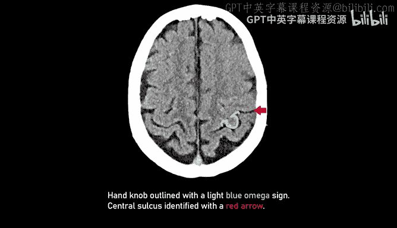

If I show you a thousand brains and give you like one minute with each， you'd be like， yep。

 that's that， sure。And so there is some uniqueness of that area of the brain。

 like in terms of the geometry， the topology of the thing。

Where is it about in the it's so you have this strip of brain running down the top。

 called the primary motor area andm sure you've seen this picture of the homunculus laid over the surface of the brain。

 the weird little guy with huge lips and，Giant hands。That guy sort of。

Lays with his legs up at the top of the brain and face arm areas farther down and then some kind of mouth。

 lip， tongue areas farther down。And so the hand is right in there and then the areas that control speech。

 at least on the left side of the brain， in most people are just below that。And so， any。

Muscle that you voluntarily move in your body。The vast majority of that。

References that strip or those intentions come from that strip of brain and the wrinkle for hand knob is right in the middle of that。

And vision is back here yep， also on close to the surface vision's a little deeper and so you know。

 this gets to your question about how deep can you get。诶。To do vision。

 we can't just do the surface of the brain， we have to be able to go in not as deep as we'd have to go for DBS。

 but maybe a centimeter deeper than we're used to for hand insertions。And so that's you know。

 work in progress that's a new set of challenges to overcome by the way。

 you mentioned the Utah array and I just saw a picture of that and that thing looks terrifying。Yeah。

 because it's。It's because it's rigid and then if you look at the threads they're flexible。

 what can you say that's interesting to you about the flexible that kind of approach of the the flexible threads to to deliver the electrodes next to the neurons Yeah。

 I mean the the goal there。Comes from experience。 I mean。

 we stand on the shoulders of people that made Utah rays and used Utah rays for decades before we ever even came along。

诶。Neururallink arose。 partly。 this approach to technology arose out of a need recognized。

After utares would fail routinely。Because the rigid electrodes。

 those spikes that are literally hammered using air hammer into the brain。

Those spikes generate a bad immune response that encapsulates the electrode spikes in scar tissue。

 essentially。And so one of the projects that was being worked on in the Anderson lab at Caltech when I got there was to see if you could use chemotherapy to prevent the formation of scars like。

 you know， things are pretty bad when you're jamming a bed of nails into the brain and then。

Treating that with chemotherapy。To try to prevent scar tissues like， you know。

 maybe we've gotten off track here， guys， Maybe there's a fundamental redesign necessary。

 And so Nling's approach of using highly flexible， tiny electrodes。Avoids a lot of the bleeding。

 avoids a lot of the immune response that ends up happening when rigid electrodes are pounded into the brain。

And so what we see is our electrode longevity and functionality and the health of the brain tissue immediately surrounding the electrode is excellent。

 I mean， it goes on for years now in our animal models。

 what do most people not understand about the biology of the brain。we'll mention the vasc chair。

 that's really interesting， I think the most interesting maybe underappreciated fact。

Is that it really does control almost everything。I don't know for out of the blue example。

 imagine you want a lever on fertility， you want to be able to turn fertility on and off。I mean。

 there are legitimate targets in the brain itself to modulate fertility。Say blood pressure。

You want to modulate blood pressure。 There are legitimate targets in the brain for doing that。

Things that aren't immediately obvious as brain problems。Are potentially solvable in the brain。嗯。

And so I think it's。An underexplored area for primary treatments of。

Of all the things that bother people that's a really fascinating way to look at it like there's a lot of。

Conditions we might think have nothing to do with the brain。

 but they might just be symptoms of something that actually started in the brain。

 The actual source of the problem。 the primary source of is something in the brain。 Yeah。

 not not always。 I mean， you know， there are kidney disease real。

 but there are levers you can pull in the brain that affect all of the all of these systems。

 There's knobs， yeah。On off switches and knobs in the brain from which this all originates。

Would you have a neurallink chip implanted in your brain？Yeah。I think。😊，Youth case right now is。

Use a mouse right， I can already do that and so there's no value。Proposition on safety grounds alone。

 Sure， I'll do it tomorrow。 You know， you say the use case of the mouse。

Is it after like researching all this and part of it is just watching Nolan have so much fun？

If you can get that bits per second， look really high with the mouse。

Like being able to interact because if you think about the way on the smartphone， the way you swipe。

 that was transformational， Yeah， how we interact with the thing， it's subtle， you don't realize。

 but to be able to touch a phone and to scroll with your finger that's like that changed everything people were sure you need a keyboard to type and that there's a lot of HCI aspects to that that changed how we interact with computers So there could be a certain rate of speed with a mouse that would change everything。

 Yes like you might be able to just click around a screen extremely fast。

And that if you seem myself have gotten the neural link for much more rapid interaction with the digital devices。

Yeah， I think recording speech intentions from the brain might， might change things as well。

 you know， the value proposition for the average person。

A keyboard is a pretty clunky human interface， requires a lot of training。You know。

 highly variable in the maximum performance that the average person can。Can achieve。I think。

Taking that out of the equation and just having a natural。You know， word to computer interface。诶。

Might change things for a lot of people。 It'd be hilarious if that is the reason people do it。

 even if you have speech to text that's extremely accurate。

 it currently isn't but it' say gotten super accurate it'd be hilarious if people weren' for neurallink just so you avoid the embarrassing aspect of speaking like looking like a douchchback speaking to your phone in public。

 which is a real like。That's a real constraint Yeah， I mean。

 with a bone conducting case that can be an invisible headphone， say。And the ability to。

Think words into software and have it respond to you。UmYou know。

 that starts to sound sort of like embedded super intelligence， you know， if you can。

Silently ask for the Wikipedia article on any subject and have it read to you without any observable change happen in the outside world。

嗯。You know， for one thing， standardized testing is obsolete。Yeah， if it's done well in the UX side。

 it could change， I don't know if it transforms society， but it really u。

Can create a kind of shift in the way we interact with digital devices in the way that a smartphone did I would。

Just having to look into the safety of everything involved。

 I would totally try it so it doesn't have to go to some like。

Incredible thing where you have it connects your vision or to some other like it connects all over your brain that could be like just connecting to the hand knob。

You might have a lot of interesting interaction human computer interaction possibilities Yeah that's really interesting yeah and the technology on the academic side。

Is progressing at light speed here， I think there was a really amazing paper。Out of UC Davis。

 Sergey Stvissky's lab that basically made an initial solve of speech decocode it was something like 125。

000 words that they were getting with， you know， very high accuracy。

 which is so you're just thinking the word yeah， thinking the word and you're able to get it Yeah。

 oh boy。Like you have to have the intention of speaking it right。

 So like do the inner voice man it's so amazing to me that you can do the intention。

The signal mapping。All you have to do is just imagine yourself doing it。

And if if you get the feedback that it actually worked。

 you can get really good at that like your brain will， first of all。

 adjust you develop like any other skill like touch typing you develop in that same kind of way is that is to me it's just really fascinating to be able to even to play with that honestly like I would get in neural just to be able to play with that just to play with the capacity。

 the capability of my mind to learn this skill It's like learning the skill of typing and learning the skill of moving a mouse it's another skill。

Of moving the mouse， not with my physical body， but with my mind。

 I can't wait to see what people do with it。 I feel like're we're cavemen right now。

' we're like banging rocks with a stick and thinking that we're making music。😊，Um。

 at some point when these are more widespread， there's going to be the equivalent of a。

Of a piano that， you know， someone， someone can make art with their brain in a way that we didn't even anticipate。

U looking forward to it， give it to like a teenager。

 like anytime I think I'm good at something I'll always go to like， I don't know， even even u。

 even with the bit per second and playing a video game， you realize you give it to a teenager。

 you' given your link to a teenager just a large number of them to kind of stuff。

They get good at stuff， they're going to get like hundreds of bits per second， yeah。

 even just with the current technology， probably。Probably just because it's also addicting how like hot the the。

The number go up aspect of it of like improving and training because it is it's almost like a skill and plus there's the software on the other end that adapts to you and especially if the adapting procedure algorithm becomes better and better and better you like learning together Yeah we're scratching the surface on that right now there's so much more to do So on the complete other side of it you have an RFID chip implanted in you Yeah this is so I hear so this is subtle thing it's the passive device that you use。

For unlocking like a safe with top secrets or what what is what do you use it for。

 what's the story behind it， I'm not the first one。

 There's there's this whole community of weirdo biohackers that have done this stuff。

 And I think one of the early use cases was storing you know。

 private crypto wallet keys and whatever。I dabbled in that a bit and had some fun with it。

Just some bitco implanted in your body somewhere where you can't tell where yeah， yeah， actually。

 yeah it was， you know the modern day equivalent of finding change in the sofa cushions after I put some orphan crypto on there that I thought was worthless and forgot about it for a few years went back and found that some community of people loved it and had propped up the value of it and so it had gone up 5 fold so there was a lot of change in those cushions。

That's hilarious， but the the primary use case is mostly as a。As a tech demonstrator， you know。

 it has my business card on it you can scan that and by touching it to your phone it opens the front door to my house。

 you know， whatever simple stuff with's a cool step。

 it's a cool leap to implant something in your body。I mean。

 it has perhaps that' it's a similar leap to a neurallink。

Because for a lot of people that kind of notion of putting something inside your body。

 something electronic inside a biological system is a big leap， Yeah。

 we have a kind of a mysticism around the barrier of our skin。

 we're completely fine with knee replacements， hip replacements， you know。Dental implants。嗯。

But you know， there's a mysticism still around the inviolable barrier that the skull represents。

 and I think that needs to。Be treated like any other pragmatic barrier， you know。

 it's the question isn't。How， how incredible is it to open the skull The question is。

 you know what benefit can we provide So from all the surgeries you've done from everything you understand in the brain。

How much does neuroplasticity come into play， How adaptable is the brain， For example。

 just even in the case of healing from surgery or adapting to the post surgery situation。

 The answer that is sad for me and。😔，Other people of my demographic is that， you know。

 plasticity decreases with age， healing decreases with age。I have too much grayay hair too。

To be optimistic about that， there are theoretical ways to increase plasticity using electrical stimulation。

AndNothing that is totally proven out as a robust enough mechanism to offer widely。To people， but。

Yeah， I think I think there's cause for optimism that we might find something useful in terms of say an implanted electrode that improves learning。

 Certainly there's been some really amazing work。Recently from Nicholas Schiff， Jonathan Baker。

 you know， and others。Who have a cohort of patients with moderate traumatic brain injury who have had electrodes placed in the。

De nucleus in the brain called the centromedia nucleus or just near the centromedia nucleus and when they apply small amounts of electricity to that part of the brain。

It's almost like electronic caffeine， they're able to improve people's attention and focus。

 they're able to improve how well people can perform a task， I think in one case。

 someone who was unable to work。After the device was turned on。

 they were able to get a job and that's sort of， you know， one of the holy Gils。For me。

 with neurallink。And other technologies like this。Is from a purely utilitarian standpoint。Can we？

Can we make people able to take care of themselves and their families economically again。

 Can we make it So someone one who's fully dependent。

And even maybe requires a lot of caregiver resources。 Can we put them in a position to be。

Fulfully independent， taking care of themselves， giving back to their communities。

I think I think that's a very compelling proposition and what motivates a lot of what I do and what a lot of the people at neurallink are working for it's just a cool possibility that if you put a neurallink in there。

 that the brain adapts like the other part of the brain adapts too and integrates it the capacity of the brain to do that it's really interesting。

 probably unknown to the degree to which you can do that， but you're now connecting。

An external thing to it， especially once it's doing stimulation。Like。

The the biological brain and the the electronic brain outside of it working together。

 think the possibilities they' are really interesting， that's still unknown but interesting。

It feels like the brain is really good at adapting to whatever。 Yeah， but of course。

 it is a system that by itself is already。那。Like everything serves a purpose。

And so you don't want to mess with it too much。 Yeah， it's like。You know。

 eliminating a species from an ecology， you know， you don't know what the delicate interconnections depend dependencies are。

The brain is。Certainly a delicate， complex beast， and we don't know。You know。

 every potential downstream consequence of a single change that we make。

 do you see yourself doing so mentioned P1？Surgries a P2， P3， P4， p5， just well。

 more and more and more humans， I think， you know， it's a certain kind of。

Brittleness or you a failure on the company's side if we need me to do all the surgeries。I think。

Something that I would very much like to work towards is a process that is so simple and so robust on the surgery side that literally anyone could do it。

We want to get away from requiring intense expertise or intense experience。

To have this successfully done and make it as。As simple and translatable as possible， I mean。

 I would love it if every neurosurgeon on the planet had no problem doing this。嗯。

I think we're probably far from a regulatory environment that would allow。

People that aren't neurosurgeons to do this， but not impossible。All right， I'll sign up for that。

Did you ever anthropomorphize the the robot R one like。Do you give it her name。

 do you see it as like a friend that's like working together with you， I mean。

 to a certain degrees or an enemy who's going to take to God。To a certain degree， yeah。

 it's complex relationship。All the good relationships are it's funny when in the middle of the surgery。

 there's a part of it where I stand basically shoulder to shoulder with the robot。And so， you know。

 if you're in the room reading the body language， you know。

 that's it's my brother in arms there we're working together on the same problem。诶。Yeah。

 I'm not threatened by it。Keep telling yourself that it how have all the surgeries that you've done over the years？

The people you've helped and the stakes， the high stakes that you've mentioned。

 how does that change your understanding of life and death？Yeah。You know。

It gives you a very visceral sense， and this may sound trite。

 but it gives you a very visceral sense that death is inevitable。You know， on one hand。You know， you。

 you are， as a neurosurgeon， you're deeply involved in these like just hard to fathom tragedies。嗯。

You know， young parents dying， leaving。You know， a four year old behind say。诶。And on the other hand。

 you know， it takes the sting out of it a bit because。

You see how just mind numbingly universal death is。There is zero chance。That I'm going to avoid it。

 I know you know， tech no optimists right now and longevity buffs right now would disagree on that 0。

000% estimate， but I don't see。Any chance that our generation is going to avoid it？

Entropy is a powerful force， and we are very ornate， delicate。

 brittle DNA machines that aren't up to the cosmic ray bombardment that we're subjected to。So。

 on the one hand。Every human that has ever lived。Died or will die。On the other hand， it's just。

One of the hardest things to imagine。嗯。Inflicting on anyone that you love is is having them gone。

 I mean， I'm sure you've had friends that。Aren't living anymore and it's hard to even think about them。

嗯。And so。I wish I had。You know， arrived at the point of Nirvana where， you know。

 death doesn't have a sting。 I'm not worried about it。

 but I can at least say that I'm comfortable with the certainty of it。If not。

Having found out how to take the tragedy out of it when I think about， you know。

 my kids either not having me or me not having them or my wife。

 maybe I've come to accept the intellectual certainty of it， but，呃。

It may be the pain that comes to losing the people you love。

I don't think I've come to understand the existential。Aspect of it。Like that this is going to end。

And I don't mean， like。In some。ATte way at me like。It's certainly。

Feels like it's not going to end like you live life like it's not going to end， right？

And the fact that this light that's shining， this consciousness is going to no longer be in one moment。

 maybe today， it's like it fills me when I really am able to load all that in with Ernest Beckcker's terror。

 Like it's a real fear。 I think people aren't always honest with how terrifying it is。

 I think the more you are able to really think through it， the more terrifying it is。

 it's not such a simple thing。 Oh， well， this's the way life is。If you really can load that in。

It's hard， but I think that's why the stoics did it because it like。

Helps you get your shit together and be like the， well， they were like the moment。

 every single moment you're alive is just beautiful。 Yeah。

 and it's terrifying that it's gonna to end as it is like。

like almost like you're shivering in the cold， a child helpless， this kind of feeling。

 and then it makes you when you have warmth， when you have the safety。

 when you have the love to really appreciate it。I feel like sometimes in your position。

We mentioned armor。Just to see death。It might。Make you not be able to see that the the finiteness of life because if you kept looking at that。

 it might break you。So it'， it's good to know that you're kind of。Still struggling with that。

 there's the neurosurgeon。 and then there's a human。Yeah。

 and the human is still able to struggle that and feel the the fear of that and the pain of that Yeah。

 you know， it definitely makes you ask the question of how long how many times。

 how many of these can you see？And not say， I can't do this anymore。嗯。But I mean， you said it well。

 I think。It gives you an opportunity to just appreciate that you're alive today。And。You know。

 I've got three kids and an amazing wife。I'm really happy。 Things are good。

 I get to help on a project that I think matters。 I think it moves us forward。

 I am a very lucky person。 It's the early steps of a potentially。😊，A gigantic leap for humanity。

 It's a really interesting one。 And it's coolca like you， you read about all this stuff in history。

 where it's like the early days I've been reading before going to Amazon。

 I would read about explorers。😊，They would go and explore even the Amazon jungle for the first time。

 it's just those are the early steps or early steps into space or early steps in any discipline in physics and mathematics and。

And it's cool because this is like the on the grand scale。

 these are the early steps into delving deep into the human brain。 So not just observing the brain。

 but you be able to interact with the human brain。 Yeah， It's going to help a lot of people。

 but it also might。Help us understand what the hell's going on in there。 Yeah， I think ultimately。

 we want to。Give people more levers that they can pull， right， like you want to give people options。

If you can give someone a dial that they can turn。On how happy they are。

I think that makes people really uncomfortable， but。Now talk about major depressive disorder。

 talk about people that are committing suicide at an alarming rate in this country。And。

Try to justify that queasiness。In those in that light of you can give people。

A knob to take away suicidal ideation， suicidal intention。I would。 I would give them that knob。

I don't know how you justify not doing that you can think about like all the suffering that's going on in the world。

 like every single human being that's suffering right now is like it'll be a glowing red dot。

 the more suffering， the more it's glowing and you just see the map of human suffering and any technology that allows you to dim that light of suffering。

On a grand scale is pretty exciting because there's a lot of people suffering and most of them suffer quietly and we turn our。

U we， we look away too often u and we we should remember those that are suffering because once again。

 most of them are suffering quietly Well， and you know， on a grander scale， the fabric of society。

 you know， people have a lot of complaints about，How our social fabric is。Working or not working。

 how are politics is working or not working。呃。Those。Things are made of neurochemistry， too。

 in aggregate， right， like our politics is composed of individuals with human brains。

And the way it works or doesn't work。It's potentially tunable。In the sense that I don't know。

 say remove our addictive behaviors or tune our addictive behaviors for social media or our addiction to outrage。

 our addiction to sharing the most angry political tweet we can find。

I don't think that leads to a functional society。If， if you had。Options for people to moderate that。

Maaladaptive behavior。 There could be huge benefits to society。

 Maybe we could all work together a little more harmoniously toward useful ends。

 There's a sweet spot， like you mentioned， You don't want to completely remove all the dark size of human nature because those kind of are somehow necessary to make the whole thing work。

 but there's a sweet spot。 Yeah， I agree。 we got to， you got to suffer a little。

Just not so much that you lose hope。 Yeah， when you all the surgeries you've done。

 have you seen consciousness in there ever， was there like a glowing light， you know， I。

 I have this sense that I never found it。Never removed it， you know。Like a dementor in Harry Potter。

 I have this sense that consciousness is a lot less magical than our instincts want to claim it is。

It seems to me。Like a useful analog for thinking about what consciousness isnt。In the brain。嗯。

You know， is that we we have。A really good intuitive understanding of what it means to say。

 touch your skin and know what's being touched。I think consciousness is just that level of sensory mapping applied to the。

The thought processes in the brain itself， so what i'm saying is。Consciousness is。

The sensation of some part of your brain being active。So you， you feel it working。

 you feel the part of your brain that thinks of red things or winged creatures。

Or the taste of coffee， you feel those。Parts of your brain being active the way that I'm feeling my palm being touched。

Right and that sensory system that feels the brain working is consciousness that is so brilliant it's the same way。

 it's the sensation of touch when you're touching a thing。

Consciousness is the sensation of you feeling your brain working， your brain thinking。

 your brain perceiving。Whi isn't which isn't like a warping of spacetime or some quantum field effect right it's nothing magical people always want to ascribe to consciousness。

Something truly different and there's this awesome long history of people looking at whatever the latest discovery in physics is to explain consciousness。

Because it's the most magical， the most out there。Thing that you can think of and people always。

You know， want to do that with consciousness。 I don't think that's necessary。 It's just a。You know。

 a very useful and gratifying way of feeling your brain work。 And as we said， is one hook of a brain。

 yeah。Everything we see around us， everything we love， everything as beautiful as。

Came from brains like these， it's all electrical activity happened inside your skull。

And I for one am grateful that's people like you that are exploring all the ways that it works and all the ways it can be made better。

 thank you so much for talking today， it's been a joy。

Thanks for listening to this conversation with Matthew McDouggo。And now， dear friends。

 here's Bliss Chapman， Brain Inter softwareft lead at Nelink。

You told me that you've met hundreds of people with spinal cord injuries or with A L S and that your motivation for helping at your link is grounded and wanting to help them。

 Can you describe this motivation， Yeah， first， just to thank you。

 to all the people I've gotten a chance to speak with for sharing their stories with me。

 I don't think there's any world really in which I can share their stories in as powerful way as they can。

But just I think， to summarize at a very high level， what I hear over and over again is that。

People with ALS or severe spin cord injury in a place where they basically can't move physically anymore。

Really at the end of the day are looking for independence and that can mean different things for different people。

For some folks， it can mean the ability just to be able to communicate again independently without needing to wear something on their face。

 without needing a caretaker to be able to put something in their mouth。For some folks。

 it can mean independence to be able to work again。

To be able to navigate a computer digitally efficiently enough to be able to get a job。

 to be able to support themselves。To be able to move out and ultimately be able to support themselves after their family。

 maybe isn't there anymore to take care of them。And for some folks。

 it's as simple as just being able to respond to the kid in time before they， you know。

 run away or get interested in something else。And these are deeply personal and sort of very human problems and what strikes me again and again when talking with these folks is that this is actually an engineering problem。

This is a problem that with the right resources， with the right team。

 we can make a lot of progress on。And at the end of the day。

 I think that's a deeply inspiring message and something that makes me excited to gap every day。

So it's both an engineering problem in terms of a BCI for example that can give them capabilities where they can interact with the world。

 but also on the other side， it's an engineering problem for the rest of the world to make it more accessible for people living with quadriplegia Yeah and I see Ill take a broad view sort of lens on this for a second I think。

I'm very in favor of anyone working in this problem space。

 so beyond BCI I'm happy and excited and willing to support it any way I can。

 folks working on eye tracking systems， working on you know speech to text systems working on head trackers or mousets or quad sticks and I've met many engineers and folks in the community that do exactly those things。

And I think for the people we're trying to help， it doesn't matter what the complexity of the solution is as long as the problem is solved。

And I want to emphasize that there can be many solutions out there that can help with these problems and BCI is one of a collection of such solutions。

 so BCI in particular I think offers several advantages here and I think the folks that recognize this immediately are usually the people who have spinal cord injury or some point of paralysis usually you don't have to explain to them why this might be something that could be helpful it's usually pretty self-evident but for the rest of us folks that don't live with severe spinal cord injury or who don't know somebody with ALS it's not often obvious why you would want a brain implant to be able to connect navigate a computer。

And it's surprisingly nuance to the degree that I've learned a huge amount just working with Noland in the first Narling clinical trial and understanding from him in his words why this device is impful for him。

 and it's a nuanced topic it can be the case that even if he can achieve the same thing， for example。

 with a mouset when navigating computer， he doesn't have access to that mouse stick every single minute of the day。

 he only has access when someone is available to put it in front of him。

And so a BCI can really offer a level of independence and autonomy that if it wasn't literally physically part of your body。

 would be hard to achieve in any other way。So there's a lot of fascinating aspects to what it takes to get no one to be able to control a cursor on that screen with his mind you texted me something that I just love you said I was part of the team that interviewed and selected P1 I was in the operating room during the first human surgery monitoring live signals coming out of the brain。

 I worked with the user basically every day to develop new UX paradigms decoding strategies and I was part of the team that figured out how to recover useful BCI to new world record levels when the signal quality degraded。

We'll talk about， I think， every aspect of that， but just zooming out。

 what was it like to be part of that part part of that team and。Part of that historic。

 I would say historic first。 Yeah， I think for me， this is something I've been excited about for close to 10 years now。

 And so to be able to be even just some small part of making it a reality is extremely exciting。😊。

A couple。Maybe special moments during that whole process that I'll never really truly forget one of them is during the actual surgery。

You know， at that point in time I know Nolan quite well。

 I know his family and so I think the initial reaction when Nolan is rolled into the operating room is just a oh shit kind of reaction but at that point muscle memory kicks in and you sort of go into you let your body just do all the talking and I have the lucky job in that particular procedure to just be in charge of monitoring the implant。

 so my job is to sit there to look at the signals that coming off the implant to look at the live brain data streaming off the device as threads are being inserted into the brain and just to basically observe and make sure that nothing is going you know wrong or that the' no and flags or fault conditions that we need to go and investigate or pause the surgery to debug。

And。Because I had that sort of spectator view of the surgery。

 I had a slightly removed perspective and I think most folks in the room and I got to sit there and think to myself wow。

 you know that brain is moving a lot， you when you look inside look connectectomy that we stick their threads in you know one thing that most people don't realize is the brain moves the brain moves a lot when you breathe when when your heartbeats and you can see it visibly so you know that's something that I think was a surprise to me and very。

 very exciting to be able to see someone's brain who you physically know and have've talked with that length actually pulsing and moving inside their skull and they use that brain to talk to you previously and now it's right there moving。

Actually， I didn't realize that in terms of the threat sending。

 So the the neurallink implant is active during surgery。 So and one thread at a time。

 you're able to start seeing the signal。 Yeah， so that's part of the way you test that the thing is working。

 Yeah， so actually in the in the operating room right after we sort of finished the all the thread insertions。

 I started collecting what's called broadband data。 So broadband is。Basically。

 the most raw form of signal you can collect from a neurallink electrode。

 it's essentially a measurement of the local field potential or the yeah the voltage essentially measured by that electrode。

And we have a certain mode in our application that allows us to visualize where detected spikes are。

 so it visualizes sort of where in the broadband signal， and it's very， very raw form of the data。

 a neuron is actually spiking。And so one of these moments that I'll never forget as part of this whole clinical trial is seeing live in the operating room while he's still under anesthesia。

 beautiful spikes being shown in the application， just streaming live to a device I'm holding in my hand So this is no signal processing the raw data and then the signals processing on top of it you're seeing the spikes detected right yeah。

And that's a UX too because yes that looks beautiful as well during that procedure there was actually a lot of cameramen in the room so they also were curious and wanted to see there's several neurosurgeons in the room who were all just excited to see robots taking their job and they're all you know crowded around and smell the livephone watching this live brain data stream out of his spring what was that like seeing the robot do some of the surgery so the computer vision aspect where it detects all the。

All the spots that avoid the blood vessels and then obviously with human supervision。

 then actually doing the really high precision connection of the threads to the brain。

That's a good question。 My answer is gonna be pretty lame here， but it was boring。

 Yeah I've seen it so many times。 Yeah， that's exactly how you want surgery to be。

 you want it to be boring Yeah because I've seen it so many times I've seen the the robot do the surgery literally hundreds of times And so it was just one more time。

 Yeah， all the practice surgeries and the proxies and this is just another day yeah。😊。

So what about when Nolan woke up Well do you remember a moment where he was able to move the cursor。

 not move the cursor， but get signal from the brain such that it was able to show that there's a connection。

 Yeah yeah so we are quite excited to move as quickly as we can and Nolan was really。

 really excited to get started， he wanted to get started actually the day of surgery but we waited till the next morning。

 very patiently it's a long night And the next morning in the ICU where he was recovering he wanted to get started and actually start to understand what kind of signal we can measure from his brain and maybe for folks who are not familiar with the neuralling system。

 we implant the neuralling system or the neurallink implant in the motor cortex So the motor cortex is responsible for representing things like motor intent。

 So if you imagine closing and opening your hand that kind of signal representation would be present in the motor cortex。

If you imagine moving your arm back and forth or wiggling a pinky。

 this sort of signal can be present in the motorcortex。

So one of the ways we start to sort of map out what kind of signal do we actually have access to in any particular individual's brain is through this task called body mapping and body mapping is where you essentially present a visual to the user and you say。

 hey， imagine doing this。And that visual is， you， a 3D hand opening closing or our index finger modulating up and down。

And you ask the user to imagine that and obviously you can't see them do this because they're paralyzed so you can't see them actually move their arm。

 but while they do this task， you can record to neural activity and you can basically offline model and check。

 can I predict or can I detect the modulation corresponding with those different actions？

And so we did that task and we realized， hey， there's actually some modulation associated with some of his hand motion。

 which was a first indication that， okay， we can potentially use that modulation to do useful things in the world。

For example， control a computer cursor and he started playing with it you know the first time we showed him and we actually just took the same live view of his brain activity and put it in front of him and we said。

 hey， you tell us what's going on you know we're not you。

 you're able to imagine different things and we know that it's modulating some of these neurons so you figure out for us what that is actually representing and so he played with it for a bit he was like I don't quite get it yet he played for okay longer and they said oh when I move this finger。

 I see this particular neuron start to fire more and I said okay prove it do it again and so he said okay three to one boom and the minute he moved。

 you can see like instantaneously this neuron is firing single neuron I can tell you the exact channel number if you're interested stuck in my brain now forever but that single channel firing was a beautiful indication that it was behaved really modulated neuroactivity that could then be used for downstream tasks like decoding a computer cursor and when you say a single channel is that associated with a single electrode channel electrode are interchangeable and there's。

1024 of those 1024， yeah。It's incredible that that works。 That really， when I was。

Learning about all this and like loading it in。It was just blowing my mind that the intention you can visualize yourself。

 moving the finger。That can turn into signal and the fact that you can then skip that step and visualize the cursor moving。

Or have the intention of the cursor moving in that leading to a signal that can then be used to move the cursor。

There are so many exciting things there to learn about the brain， about the way the brain works。

 the very fact of their existing signal that can be used is really powerful。

 but it feels like that's just like the beginning of figuring out how that signal can be used really。

 really effectively。I should also just， there's so many fascinating details here。

 but you mentioned the body mapping step。At least in the version I saw that Nolan was showing off there's like a super nice interface like a graphical interface。

 but like it just felt like I was like in the future because it like， you know。

 I guess it visualizes you moving the hand and there's a very like。

Like a sexy polished interface hello I don't know if there's a voice component。

 but it just felt likes like when you wake up in a really nice video game and this is a tutorial at the beginning of that video game this is what you're supposed to do It's cool No I mean the future should feel like the future but it's not easy to pull that off I mean it needs to be simple but not too simple。

 Yeah and I think the UX design component here is underrated for BCciI development in general there's a whole interaction effect between the ways in which you visualize and instruction to the user and the kinds of signal you can get back and that quality of sort of your behavioral alignment to the neural signal is a function of how good you are expressing into the user what you want them to do And so yeah we spend a lot of time thinking about the UX of how we build our applications of how the decoder actually functions the control surfaces it provides to the user All these little details matter a lot。

 So maybe it'd be nice to get into a little bit more detail of what the signal looks like and what the decoding looks。

so there's a。N one implant。That has， like we mentioned， 1024 electrodes。

And that's collecting raw data， raw signal， what does that signal look like and what are the different steps along the way before it's transmitted and what is transmitted。

 all that kind of stuff Yeah， yeahep， this is going to be a fun one。Let's go。

Maybe before diving into what we do， it's worth understanding what we're trying to measure because that dictates a lot of the requirements for the system that we build and what we're trying to measure is really individual neurons producing action potentials and action potential is you can think of it like a little electrical impulse that you can detect if you're close enough and by being close enough I mean like within。

 let's say 100 microns of that cell。And00 microns is very， very tiny distance。

 and so the number of neurons that you're going to pick up with any given electrode is just a small radius around that electrode。

And the other thing worth understanding about the underlying biology here is that when neurons produce an action potential。

 the width of that action potential is about one millisecond。

 so from the start of the spike to the end of the spike。

 that whole width of that sort of characteristic feature of a neuron firing is one millisecond wide。

And if you want to detect that an individual spike is occurring or not。

 you need to sample that signal or sample the local field potential nearby that neuron much more frequently than once a millisecond。

 you need to sample many， many times per millisecond to be able to detect that this is actually the characteristic waveform of a neuron producing an actual potential。

 and so we sample across  all thousand24 electrodes about 200 times a second。20。

000 times a second means we're already given one millisecond window。

 we have about 20 samples that tell us what that exact shape of that actual potential looks like and。

Once we've sort of sampled at super high rate underlying electrical field nearby these cells。

 we can process that signal into just where do we detect a spike or where do we not。

 sort of a binary signal1 or zero， do we detect a spike in this one millisecond or not。

And we do that because the actual information character carrying sort of。

Subspace of neural activity is just when our spikes occurring。

 essentially everything that we care about for decoding can be captured represented in the frequency characteristics of spike trains。

 meaning how often are spikes firing in any given window of time。

And so that allows us to do sort of a crazy amount of compression from this very rich， high density。

 you signal to something that's much， much more sparse and compressible that can be sent out over a wireless radio。

 like a Bluetooth communication， for example， quick。Tangions here。 you mentioned electrode neuron。

There's a local neighborhood of neurons nearby。How difficult is it to like。

isolate from where the spike came from Yeah， so there's a whole field of sort of academic neuroscience work on exactly this problem of basically given a single electrode or given a set of electrodes measuring a set of neurons。

 how can you sort of sort spike sort which spikes are coming from what neuron？

And this is a promise pursuit in academic work because you care about it for understanding what's going on in the underlying sort of neuroscience of the brain。

 if you care about understanding how the brains present information。

 how that's evolving through time， then that's a very。

 very important question to understand for sort of the engineering side of things。

At least at the current scale， if the number of neurons per electrode is relatively small。

 you can get away with basically ignoring that problem completely。

 You can think of it like sort of a random projection of neurons to electrodes。

And there may be in some cases more than one neuro on per electrode。

 but if that number is small enough， those signals can be thought of as sort of a union of the two。

 and for many applications， that's a totally reasonable tradeoff to make and can simplify the problem a lot。

And as you sort of scale out channel count， the relevance of distinguishing individual neurons becomes less important because you have more overall signal and you can start to rely on sort of correlations or covariance structure in the data to help understand when that channel's firing。

 what what does that actually represent because you know that when that channel's firing and concert with these other 50 channels。

 that means move left but when that same channel is firing with concert with these other 10 channels that means move right Okay so you have to do this kind of spike detection onboard。

And you have to do that super efficiently so fast and not use too much power because you don't want to be generating too much heat。

 so that have to be a super simple signal processing step。

Is there some wisdom you can share about what it takes to overcome that challenge Yeah。

 so we've tried many different versions of basically turning this raw signal into sort of a feature that you might want to send off the device and I'll say that I don't think we're at the final step of this process This is a long journey we have something that works clearly today but there can be many approaches that we find in the future that are much better than what we do right now。

 So some versions of what we do right now and there's a lot of academic heritage to these ideas so I don't want to know claim that these are original neuralarlink ideas or anything like that。

 but one of these ideas is basically to build sort of like a convolutional filter almost。

 if you will， that slides across the signal and looks for a certain template to be matched that template consists of sort of how deep the spike modulates how much it recovers and what the duration and window of time is that the whole process takes and if you can see the signal that that template is matched within certain bound then you can say okay that's a spike One reason that approach is super convenient is that you can actually。

Implement that extremely efficiently in hardware， which means that you can run it in low power across 1024 channels all other ones。

Another approach that we've recently started exploring and this can be combined with the spike detection approach。

 something called spike ban power， and the benefits of that approach are that you may be able to pick up some signal from neurons that are maybe too far away to be detected as a spike。

 because the farther way you are from an electrode。

 the weaker that actual spike waveform will look like on that electrode。

So you might be able to pick up you know population level activity of things that are you know maybe slightly outside the normal recording radius。

 what neuroscientists sometimes refer to as the hash of activity。

 the other stuff that's going on and you can look at sort of across many channels how that sort of background noise of behaving and you might be able to get more juice out of the signal that way but it comes at a cost that signal is now a floating point representation。

 which means it's more expensive send out over a power it means you have to find different ways to compress it that are different than what you can apply to binary signals。

 so there's a lot of different challenges associated with these different modalities So also in terms of communication you're limited by the amount of data you can send yeah。

And so end also because you are currently using the Bluetooth protocol。

 you have to batch stuff together。But you have to also do this， keeping latency crazy low。

 I crazy low。 Anything to say about the latency。 Yeah， this is a passion project of mine。

 So I want to build the best mouse in the world。 Yeah， I don't want to build like the。😊。

You know the Chevrolet Sp or whatever of electric cars I want to build like the Tesla Roadster version of a mouse and I really do think it's quite possible that within you know five to10 years that most esports competitions are dominated by people with paralysis this is like a very real possibility for a number of reasons one is that they'll have access to the best technology to play video games effectively the second is they have the time to do so so those two factors together are particularly potent for esport competitors unless people without paralysis are also allowed to implant right which is it is another way to interact with a digital device ands there's something to that if it's a fundamentally different experience。

 more efficient experience even if it's not like some kind of full on highband with communication if it's just the ability to move the mouse 10x faster like bits per second if I can achieve a bits per second that 10 X what I can do。

The mouse that's a really interesting possibility of what they can do especially as you get really good at it with training。

 It's definitely the case that you have a higher ceiling performance like because you don't have to buffer your intention through your arm through your muscle you get just by nature of having a brain implant at all like 75 millisecond lead time on any action that you actually trying to take and there's some nuance to this like there's evidence that the motor cortex you can sort plan out sequences of action so you may not get that whole benefit all the time but first sort of like reaction time style games where you just want to someone is over here snipem know that kind of thing you actually do have just an inherent advantage because you don't need to go through muscle So the question is just how much faster can you make it and we're already faster than what you would do if you're going through muscle from a latency point of view and we're in the early stage of that I think we can push sort of our end end latency right now from brain spike to cursor movement it's about 22 milliseconds if you think about the best mice in the world。

 the best gaming mice that's about5 milliseconds of latency depending on how you measure depending。

Fsster screen refreshes， there's a lot of characteristics that matter there， but yeah。

 and the rough time for like a neuron in the brain to actually impact your command of your hand is about 75 milliseconds so if you look at those numbers。

 you can see that we're already。Like， you know， competitive and slightly faster than what you would get by actually moving your moving your hand And this is something that you know if you ask Nolan about it。

 when he moved the cursor for the first time we asked him about this。

 was something super curious about like what does it feel like when you're modulating you know a click intention or when you're trying to move the cursor to the right。

 He said it moves before he is like actually intending it to which is kind of a surreal thing and something that you know。

 I would love to experience myself one day， what does that I like to have a thing just be so immediate。

 so fluid that it feels like it's happening before you're actually intending it to move Yeah。

 I suppose we've gotten used to that latency that natural latency that happens。

So is the currently the bottleneck of communication so like the Bluetooth communication is that what's the actual bottleneck I mean there's always going to be a bottleneck what's the current bottleneck Yeah a couple things so kind of hilariously Bluetooth low energy protocol has some restrictions on how fast you can communicate so the protocol itself establishes a standard of you know the most frequent sort of updates you can send are on the order of 7。

5 milliseconds。And as we push latency down to the level of sort of individual spikes impacting control。

 that level of resolution， that kind of protocol is going to become a limiting factor at some scale。

Another sort of important nuance to this is that it's not just the neurallink itself that's part of this equation If you start pushing latency sort of below the level of how fast screens refresh then you have another problem like you need your whole system to be able to be as reactive as sort of limits of what the technology can offer like you need the screen like 120 hertz just doesn't you know work anymore if you're trying to have something respond at something that's you know at the level of one millisecond that's a really cool challenge I also like that for a t-shirt the best mouse in the world tell me on the receiving end so the decoding step now we figured out what the spikes are got them all together now is sending that over to the app。

What's the decoding that look like Yeah， so maybe first， what is decoding。

 I think there's probably a lot of folks listening that just have no clue what what it means to decode brain Na。

 Actually， even if we zoom out beyond that， what is the app So there's there's an implant that's wirelessly communicating with any digital device has an app installed。

 So maybe can you tell me a high level what the app is， what the software is outside of the brain。

 Yeah so maybe working backers from the goal， the goal is to help someone with paralysis in this case。

 Noland， be able to navigate his computer independently And we think the best way to do that is to offer them the same tools that we have to navigate our software。

 because we don't want to have to rebuild an entire software ecosystem for the brain。

 at least not yet， maybe someday you can imagine there's Ues that are built natively for BCci。

 but in terms of what's useful for people today， I think most people would prefer to be able to just control mouse and keyboard inputs to all the applications that they want to use for their daily jobs for communicating with their friends etc。

And so the job of the application is really to translate this wireless stream of brain data coming off the implant into control of the computer and we do that by essentially building a mapping from brain activity to sort of the H inputs to the actual hardware So H is just the protocol for communicating like input device events so for example。

 move mouse to this position or press this key down and so that mapping is fundamentally what the app is responsible for。

 but there's a lot of nuance of how that mapping works that we spent a lot of time to try to get right and we're still in the early stages of a long journey to figure out how to do that optimally so one part of that process is decoding so decoding is this process of taking the statistical patterns of brain data that's being channeled across this Bluetooth connection to the application and turning it into。

 for example， a mouse movement。And that decoding step you can think of it in a couple different parts so similar to any machine learning problem there's a training step and there's an inference step the training step in our case is very intricate behavioral process where the user has to imagine doing different actions so for example theyll be presented to a screen with a cursor on it and they'll be asked to push that cursor to the right then imagine pushing that cursor to the left。

 push it up push it down and we can basically build up a pattern or using any sort of modern ML method a mapping of given this brain data and that imagine behavior map one to the other and then at test time you take that same pattern matching system in our case it's a deep neural network and you run it and you take the livestreamer brain data coming off the implant。

 you decode it by pattern matching to what you saw at calibration time and you use that for a control of the computer。

Now a couple like sort of rabbit holes that I think are quite interesting。

 one of them has to do with how you build that best template matching system。

Because there's a variety of behavioral challenges and also debugging challenges when you're working with someone who's paralyzed because again。

 fundamentally you don't observe what they're trying to do。

 you can't see them attempt to move their hand。And so you have to figure out a way to instruct the user to do something and validate that they're doing it correctly。

 such that then you can downstream build with confidence the mapping between the neural spikes and the intended action。

 and by doing the action correctly， what I really mean is at this level of resolution of what neurons are doing。

So if in ideal world you could get a signal of behavioral intent that is ground truth accurate at the scale of sort of one millisecond resolution。

 then with high confidence I could build a mapping from my neural spikes to that behavioral intention but the challenge again that you don't observe what they're actually doing and so there's a lot of nuance to how you build user experiences that give you more than just sort of a course on average correct representation of what the user intending to do if you want to build the world's best mouse。

 you really want it to be as responsive as possible。

 you want to be able to do exactly the user intending at every sort of step along the way not just on average be correct when you're trying to move it from left to right and building a behavioral sort of calibration game or sort of software experience that gives you that level of resolution is what we spend a lot of time working So the calibration process the interface has to encourage precision。

Meaning like whatever it does， it should be super intuitive that the next thing it。

The human is going to likely do is exactly that intention that you need and only that intention。

Yeah and you don't have any feedback except that may be speaking to you afterwards what they actually did。

 you can't oh yeah， right so that's a that's fundamentally。

That is a really exciting UX challenge because that's all on the UX。

 It's not just about being friendly or nice or usable。 Yeah， it's like user experience how it works。

 It's how it works。 Yeah， for the calibration and calibration。

 at least at this stage of neurallink is's like。😊，Fundamental to the operation of the thing and not just calibration。

 but continued calibration， essentially。And maybe yeah。

 you said something that I think is worth exploring there a little bit。

 you said it's primarily a UX challenge and I think a large component of it is。

 but there is also a very interesting machine learning challenge here。

 which is given some you know data set， including some on average correct behavior of asking the user to move up or move down。

 move right， move left。And given a data set of neural spikes。

 is there a way to infer in some kind of semiupvised or entirely unsupervised way what that high resolution version of their intention is？

And if you think about it， like there probably is because there are enough data points in the data。

 enough constraints on your model that there should be a way with the right sort of formulation to let the model figure out itself。

 for example， at this millisecond， this is exactly how hard they're pushing upwards。😡。

And at this most second， this is how hard they're trying to push upwards it's really important to have very clean labels Yes。

 so like the problem becomes much harder from the machine learning perspective the labels are noisy that's correct and then to get the clean labels that's a UX challenge。

Correct， although clean labels， I think maybe it's worth exploring what that exactly means。

 I think any given labeling strategy will have some number of assumptions it makes about what the user is attempting to do those assumptions can be formulated in a loss function or they can be formulated in terms of heuristics that you might use to just try to estimate or guess what the user is trying to do。

And what really matters is how accurate are those assumptions， For example， you might say， hey， user。

 push upwards and follow the speed of this cursor。And your heuristic might be that they're trying to do exactly what that cursor is trying to do。

 Now competing heuristic might be， they're actually trying to go slightly faster at the beginning of the movement and slightly slower at the end。

 and those competing heuristics may or may not be accurate reflections of what the user is trying to do。

Another version of the task might be hey user， imagine moving this cursor a fixed offset。

 so rather than follow the cursor， just try to move it exactly 200 pixels to the right so here's the cursor。

 here's the target， okay cursor disappears tried to move that now invisible cursor 200 pixels to the right。

And the assumption in that case would be that the user can actually modulate correctly that position offset。

But that position offset assumption might be a weaker assumption。

 and therefore potentially you can make it more accurate than these heuristics that are trying to guess at each millisecond what the user is trying to do。

So you can imagine different tasks that make different assumptions about the nature of the user intention and those assumptions being correct is what I would think of as a clean label for that step。

 what are we supposed to be visualizing there's a cursor and you want to move that cursor to the right。

 the left up and down or maybe move them by a certain offset。So that's one way。

 is that the best way to do calibration， so for example。

 an alternative crazy way that probably is playing a role here is a game like Webgrid？Where。

You're just getting a very large amount of data， the person playing a game。

Where if they are in the state of flow？Maybe you can get clean signal as a side effect。 Y。

 I that or is it， is that not an effective way for initial calibration。 Yeah， great question。

 There's a lot to unpack there。 So the first thing I would draw a distinction between a sort of open loop。

 first close loop。 So open loop， what I mean by that is the user is sort of going from 0 to 1。

 They have no model at all， and they're trying to get to the place where they have some level of control at all。

In that setup， you really need to have some task that gives the user a hint of what you want them to do such that you can build this mapping again from brain data to output。

Then once they have a model， you could imagine them using that model and actually adapting to it and figuring out the right way to use it themselves。

 and then retraining that data to give you sort of a boost in performance。

There's a lot of challenges associated with both of these techniques and we can sort of ra it hole both of them if you're interested。

 but the sort of challenge with the open loop task is that the user themselves doesn't get proprioceptive feedback about what they're doing they don't you necessarily perceive themselves or feel the mouse under their hand when they're using an open when they're trying to do an open loop calibration。

 they're being asked to perform something like imagine if you sort of had your whole right arm numbed and you stuck it in a box and you couldn't see it so you're no visual feedback and you had no proprioceptive feedback about what the position or activity of your arm was and now you're asked okay。

 given this thing on the screen that's moving from left to right match that speed。

And you basically can try your best to you know invoke whatever that imagined action is in your brain that's moving the cursor from left to right。

 but in any situation you're going to be inaccurate and maybe inconsistent in how you do that task。

 and so that's sort of the fundamental challenge of O loop。

 the challenge with closed loop is that once the users given a model。

And they're able to start moving the mouse on their own。

They're going to very naturally adapt to that model。

And that coadptation between the model learning what they're doing and the user learning how to use the model may not find you the best sort of global minima and maybe that your first model was noisy in some ways or know maybe just had some likequirk there's some like part of the data distribution that didn't cover super well and the user now figures out because they're a brilliant user like nolan。

 they figure out the right sequence of imagined motions or the right angle they have to hold their hand out to get it to work and they'll get it to work great but then the next day they come back to their device and maybe they don't remember exactly all the tricks that they use the previous day and so there's a complicated sort of feedback cycle here that can that can emerge and can make it a very very difficult bugging process there's a lot of really fascinating things there。

Yeah， actually， just to stay on the closed loop。I have。

I've seen situations this actually happened watching psychology grad students。

 they use piece of software and they don't know how to program themselves。

 they use piece of software that somebody else wrote and it has a bunch of bugs。

And they figure out like and they've been using it for years。

 they figure out ways to work around oh that just happens like nobody nobody like considers maybe we should fix this。

 they just adapt and that's a really interesting notion that we just had we're really good at it adapting。

But you need to still that might not be the optimal。 Yeah， okay， so how do you solve that problem。

 Do you have to restart from scratch every once in a while kind of thing Yeah。

 it' is a good question。 first and foremost， I would say this is not a solve problem And for anyone who's you know listening in academia who works on BCcis I would also say this is not a problem that's solved by simply scaling channel count So this is you know maybe that can help and you can get sort of rich or covariance structures that you can use to exploit when trying to come up with good labeling strategies。

 but if you know you're interested in problems that aren't gonna be solved inherently by just scaling channel account。

 this is one of them。Yeah， so how do you solve it it's not a solve problem that's the first thing I want to make sure it gets across The second thing is any solution that involves closed loop。

I going to become a very difficult debugging problem and one of my sort of general heuristics for choosing what prompts to tackle is that you want to choose the one that's going to be the easiest to debug because if you can do that。

 even if the ceiling is lower，You're gonna be able to move faster because you have a tighter iteration loop debugging the problem。

 And in the open loopop setting， there's not a feedback cycle to debug with the user in the loop。

 And so there's some reason to think that that should be an easier debugging problem。

 the other thing that's worth understanding is that even in a closed loop setting。

 there's no special source or magic of how to infer with the user is truly attempting to do in the closed loop setting。

 although they're moving the cursor on the screen。 they may be attempting something different than what your model is outputting。

 So what the model is outputting is not a signal that you can use to retrain if you want to be able to improve the model further。

 you still have this very complicated guessimation or unsupervised problem of figuring out what is the true user intention underlying that signal。

 And so the open loop problem has the nice property of being easier to debug and the second nice property of it has all the same information content as the closed loop scenario。

Another thing I I want to mention and call out is that this problem doesn't need to be solved in order to give useful control to people even today with the solutions we have now and that academia has built up over over decades。

 the level of control that can be given to a user today is quite useful it doesn't need to be solved to get to that level of control but again I want to build the world's best mouse。

 I want to make it so good that it's not even a question that you want it and to build the world's best mouse the superhuman version you really need to nail that problem and a couple maybe details of previous studies that we've done internally that I think are very interesting to understand when thinking about how to solve this problem。

 the first is that even when you have ground truth data of what the user is trying to do and you can get this with an ablebodied monkey。

 a monkey that has an earlylink device implanted and moving a mouse to control a computer even with that ground truth data set it turns out that the optimal thing to predict to produce highperform BCI is not just the direct control of the mouse you can。

know building the data set of what's going on in the brain and what is the mouse exactly doing on the table And it turns out that if you build the mapping from neural spikes to predict exactly what the mouse is doing。

 that model will perform worse than a model that is trained to predict sort of higher level assumptions about what the user might be trying to do for example。

 assuming that the monkey is trying to go in a straight line at the target it turns out that making those assumptions is actually more effective in producing a model than actually predicting the underlying hand the intention。

 not the physical movement or whatever Yeah there's obviously a very strong correlation between the two。

 but the intention is a more powerful thing to be chasing right。Well。

 that that's also super interesting。 I mean， the intention itself is。Fascinating because， yes。

 with the BCciI here in this case， with the digital telepathy。You're acting on the intention。

 not the action， which is why there's an experience of like feeling like it's happening before you meant for it to happen that is so cool and that is why you could achieve like superhuman performance problems in terms of the control of the mouth。

So the for open loop， just to clarify， so whenever the。

A person is tasked to like move the mouse to the right。 You said there's not feedback， so。

They don't get to get that satisfaction of like actually getting it to move right so you could imagine giving the user feedback on a screen。

 but it's difficult because at this point you don't know what they're attempting to do So what can you show them that would basically give them a signal of I'm doing this correctly or not correctly So let's take a very specific example like maybe your calibration task looks like you're trying to move the cursor a certain position offset So your instructions to the user are hey。

 the cursors here now when the cursor disappears， imagine moving at 200 pixels from where it was to the right to be over this target。

In that kind of scenario， you could imagine coming up with some sort of consistency metric that you could display to the user of。

 okay， I know what the spike train looks like on average when you do this action to the right。

 maybe I can produce some sort of probabilistic estimate of how likely is that to be the action you took given the latest trial or trajectory that you imagined and that could give the user some sort of feedback of how consistent are they across different trials。

You could also imagine that if the user is prompted with that kind of consistency metric that maybe they just become more behaviorally engaged to begin with because the task is kind of boring when you don't have any feedback at all。

 and so there may be benefits to the you know the user experience of showing something on the screen even if it's not accurate just because it keeps the user motivated to try to increase that number or push it upwards So there's a psychology element here Yeah absolutely。

And again， all of that is UX challengell。How much signal drift is there hour to hour， day to day。

Week to week， month to month。How often do you have to recalibrate because of the signal drift， yeah？

So this is a pro we've worked on both with NHP nonhuman primates before our clinical trial and then also with Nolan during the clinical trial maybe the first thing that's worthre st is what the goal is here so the goal is really to enable the user to have a plug and play experience where I guess they don't have to plug anything in but a play experience where they you know can use the device whenever they want to however they want to and that's really what we're aiming for and so there' can be a set of solutions that get to that state without considering this nonstationary problem so maybe the first solution here that's important is that they can recalibrate whenever they want this is something that。

That no one has the ability to do today， so he can recalibrate the system， you know at 2 a。

 in the middle of the night without his you， caretaker or parents or friends around to help push a button for him。

The other important part of the solution is that when you have a good model calibrated。

 that you can continue using that without need to recalibrate it。

So how often he has to do this recalibration today depends really on his appetite for performance there are we observe sort of a degradation through time of how well any individual model works。

 but this can be mitigated behaviorally by the user adapting their control strategy it can also be mitigated through a combination of sort of software features that we provide to the user for example we let the user adjust exactly how fast the cursor is moving we call that the gain。

 for example， the gain of how fast the cursor reacts to any given input intention they can also adjust as smoothing how smooth the output of that cursor intention actually is that can also adjust a friction。

 which is how easy it it to stop and hold still and all these software tools allow the user a great deal of flexibility and troubleshooting mechanisms to be able to solve this problem for them by the way all this is done by looking to the right side of the screen selecting the mixer and the mixer you have it's like DJ mode。

DJ mode for your V I mean it's a really well done interface it's really really well done and so yeah there's that bias that there's a cursor drift that Nolan talked about in a stream although he said that you guys were just playing around with it with him and constantly improving so that could have been just a snapshot of that particular moment of a particular day but he said that there was this cursor drift and his bias that could be removed by him I guess looking to the right side of the screen on the left side of the screen to kind of adjust the bias that's one interface action I guess to adjust the bias Yeah so this is actually an idea idea that comes out of academia。

There， there is some prior work with sort of bringing a clinical trial participants where they pioneered this idea of bias correction。

 The way we've done that， I think is yeah， it's very producttized in a very beautiful user experience where the user can essentially flash the cursor over to the side of the screen and it opens up a window where they can actually sort of adjust or tune exactly the the bias of the cursor。

 So bias， maybe for people who aren't familiar is just sort of what is the default motion of the cursor if you're imagining nothing。

 And it turns out that that's one of the first。😊，First sort of Qia of the cursor control experience that's impacted by neuronsity Q of the cursor。

 I mean， I't know how to describe it。 like you know， I'm not the， I'm not the guy move very poetic。

 I love it。 The quality of the cursor experience。 Yeah， I mean， its it sounds poetic。

 but it is deeply true。 There is an experience when it works well， it is a joyful。

 a really pleasant experience。 And when it doesn't work well， it's a very frustrating experience。

 that's actually the art of UX。😊，It's like you have the possibility to frustrate people or the possibility to give them joy。

And at the end of the day， it really is truly the case that UX is how the thing works and so it's not just like what's showing on the screen。

 it's also you know what control surfaces does a decoder provide the user like we want them to feel like they're in the F1 card。

 not like some like minivan and that really truly is how we think about it no one himself is an F1 fan we refer to ourselves as a pit crew he really is truly the F1 driver and there's different control surfaces that different kinds of cars and airplanes provide the user and we take a lot of inspiration from that when designing how the cursor should behave and what maybe one nuance of this is you know even details like when you move a mouse on a MacBook trackpad。

 the sort of response curve of how that input that you give the trackpad translates to cursor movement is different than how it works with a mouse。

When you move on the trackpad， there's a different response function。

 a different curve to how much a movement translates to input to the computer than when you do it physically with the mouse。

 And that's because somebody satAT down a long time ago when they're design the initial input systems to any computer and they thought through exactly how it feels to use these different systems and now we're designing sort the next generation of this input system to a computer which is entirely done via the brain and there's no propceptive feedback again。

 you don't feel the mouse in your hand you don't feel the keys under your fingertips and you want a control surface that still makes it easy and intuitive for the user to understand the state of the system and how to achieve what they want to achieve and ultimately the end goal is that that UX is completely fades in the background it becomes something that's so natural intuitive that its subconscious to the user and they just should feel like they have basically direct control over the cursor or just does what they want it to do they're not thinking about the implementation of how to make it do what they want it to do is just doing what they want it to do I there some kind of things along the lines of like fits law where you should move the mouse in a certain kind of way that maximizes。

Your chance to hit the target I don't even know what I'm asking。

 but I'm hoping the intention of my question will land on a profound answer。 No is there some。

Kind of。Understanding of the laws of UX when it comes。呃。

To the context of somebody using their brain to control it like that's different than actual with a mouse。

 I think we're in the early stages of discovering those laws。

 So I wouldn't claim to have solved that problem yet。

 but there's definitely some things we've learned that make it。

easieras for the user to get stuff done。And it's pretty straightforward when you， you verbalize it。

 but it takes a while to actually get to that point when you're in the process of debugging the stuff in the trenches。

 One of those things is that the。Any machine learning system you build has some number of errors。

And it matters how those errors translate to the downstream user experience， for example。

 if you're developing a search algorithm in your photos， if you search for。

 you know your friend Joe and it pulls up a photo of your friend Josephine。

 maybe that's not a big deal because the cost of an error is not that high。

In a different scenario where you're trying to you know detect insurance fraud or something like this and you're directly sending someone to court because of some machine learning model output。

 then the errors make a lot more sense to be careful about you want to be very thoughtful about how those errors translate to downstream effects the same the stream BC so for example。

 if you're building a model that's decoding a velocity output from the brain versus an output where you're trying to modulate the left click for example。

 these have sort of different tradeoffs of how precise you need to be before it becomes useful to the end user for velocity it's okay to be on average correct because the output of the model is integrated through time So if the user is trying to click that position A and they're currently position B。

 they're trying to navigate over time to get between those two points and as long as the output of the model is on average correct。

 they can sort steer through time with the user control loop in the mix they can get to the point they want to get to。

The same is not true of a click for a click， you're performing it almost instantly at the scale of neuro firingring and so you want to be very sure that that click is correct because a false click can be very destructive to the user。

 they might actually close the tab that they're trying to do something and lose all their progress that might accidentally hit some send button on some text that there's only like halfcomp and reads funny after so there's different sort of cost functions associated with errors in this space and part of the U design is understanding how to build a solution that is when it's wrong。

 still useful to the end user。That's so fascinating that assigning cost。

To every action when an error occurs， so every action， if an error occurs has a certain cost。

And incorporating that into how you interpret the intention， mapping it to the action。

Is really important， I didn't quite until you said it realized there's a cost to like sending the text early。

It's like a very expensive cost， it's super annoying if you accidentally like if you're a cursor。

 imagine if you're cursor or miscled every once in a while。That's like super obnoxious。

 And the worst part of it is usually when the user's trying to click。

 they're also holding still because they're over the target they want to hit and they're getting ready to click。

 which means that in the data sets that we build on average。

 is the case that sort of low speeds or desire to hold still It's correlated with when the users are attempting to click。

ow， that is really fascinating。 It's it's also not the case。

 people think that oh click is a binary signal。 This must be super easy to decode。 Well， yes， it is。

 But the bar is so much higher for it to become a useful thing for the user。

 And there's ways to solve this。 I mean， you can sort take the compound approach of well。

 let's just give the like let's take five seconds to click。

 let's take a huge window of times we can be very confident about the answer。 But again。

 world's best mouse。 the world's best mouse doesn't take a second to click or 500 milliseconds to click。

 It takes5 milliseconds to click or less。 And so if you're aiming for that kind of high bar。

 then you really want to solve the underlying problem。

 So maybe this is a good place to ask about how to measure performance。 This whole bits per second。

 can you like。😊，Explain what you mean by that。 maybe a good place to start is to talk about webgri as a game as a good illustration of the measurement of performance。

 Yeah maybe I'll take one zoom out step there， which is just explaining why we care to measure this at all。

 So again our goal is to provide the user the ability to control the computer as well as I can and hopefully better。

 that means that they can do it at the same speed is what I can do It means that they have access to all the same functionality that I have including all those little details like command tab command space all this stuff and to be able to do it with the brain and with the same level of reliability is what I can do with my muscles and that's a high bar and so we intend to measure and quantify every aspect to that to understand how we're progressing towards that goal。

 There's many ways to measure B and this isn't the only way but we present the user a grid targets and basically we compute a score which is dependent on how fast and accurately they can select and then how small the targets and the more targets that are on the screen the smaller they are the more information you present per click And so if you think about it from information theory point of view you can communicate across different。

Information Theoretic channels and one such channel is a typing interface。

 you could imagine that's built out of a grid， just like a software keyboard on the screen。

And bits per second is a measure that's computed by taking the log of the number of targets on the screen。

 you can subtract one if you care to model a keyboard because you have to subtract one for the delete key on the keyboard。

 but log of the number of targets on the screen， times the number of correct selections minus incorrect divided by some time we know。

 for example 60 seconds and that's sort of the standard way to measure a crucial control task in academia and all credit in the world goes to this great professor Dr。

 Chanoy of Stanford who came up with that task and he's also one of my inspirations for being in the field So all the credit in the world to him for coming up with a standardized metric to facilitate this kind of bragging rights that we have now how to say that nolan is the best in the world at this task with his BC。

 it's very important for progress that you have standardized metrics that people can compare across different techniques and approaches how old does this do So yeah big kudos to him and all the team at Stanford。

Yeah， so for Noland and for me playing this task there's also different modes that you can configure this task so the webgrid task can be presented as just sort of a left click on the screen or you could have you know targets that you just dwell over or you could have targets that you left right click on。

 you could have targets that are left right click， middle click scrolling。

 clicking and drag you can do all sorts of things within this general framework。

 but the simplest purest form is just blue targets jump on the screen blue means left click that's the simplest form of the game。

And the sort of prior records here in academic work and at Nelink internally with sort of NHP have all been matched or beaten by by Nolan with his neurallink device so sort of prior to neurallink the sort of world record for a human use device is somewhere between 4。

2 to4。6 B depending on exactly what paper you read and how you interpret it Nolan's current record is 8。

5 BPS and again， this sort of median neurallinker performance is 10 BPS so you can think of it roughly as he's 85% the level of control of a median neurallinker using their cursor just like blue targets on the screen and yeah I think。

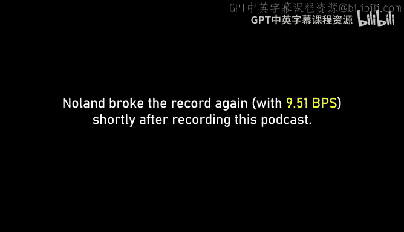

There's a very interesting journey ahead to get us to that same level of 10 Bps performance。

 It's not the case that sort of the tricks that got us from you know4 to6 Bps and then6 to 8 Bps are going be the ones that get us from 8 to 10 And in my view。

 the core challenge here is really the labeling problem It's how do you understand at a very。

 very fine resolution。 what the user is attempting to do and yeah I highly encourage folks in academia to work on this problem What's the journey with Nolan on that quest of increasing the Bps on webgri in March you said that he selected 89285 targets and webgrid So he loves this game he's really serious about improving his performance in this game So what is that journey of trying to figure out how to improve that performance How much can that be done on the decoding side how much can that be done on the calibration side How much can that be done on the nolan side of figuring out how to。

Convey his intention more cleanly。 Yeah， no， this is a great question。 So in my view。

 one of the primary reasons why Nolan's performance is so good is because of Noland。

 Noland is extremely focused and very energetic he will play webgrid sometimes for like four hours in the middle of the night like from 2am to 6am who we playing webgrid just because he wants to push it to the limits when he can do and this is not us like asking him to do that。

 I want to be clear like we're not saying you should play webgrid tonight。

 we just gave him the game as part of our research and he is able to play independently and practice whenever he wants and he really pushes hard to push it the technology is the absolute limit and he views as like his job really to make us be the bottleneck and boy has he done that well and so the first thing to acknowledge is that you know he is extremely motivated to make this work I've also had the privilege to meet other clinical trial participants from brain game and other trials and they very much share the same attitude of like they they view this as their life's work to advance the technology as much as they can。

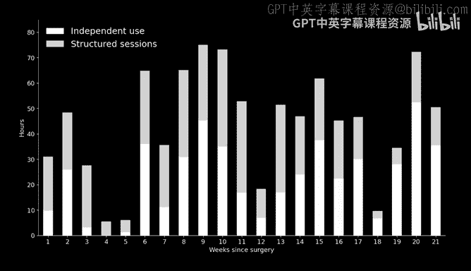

If that means selecting targets on the screen for four hours from 2am to 6am。

 then so be it and there's something extremely admirable about that that's worth calling out so now how do you sort of get from where he started。

 which is no cursor control to APS so I mean when he started there's a huge amount of learning to do on his side and our side to figure out what's the most intuitive control for him and the most intuitive control for him is you have to find the set intersection of what do we have the signal to decode so we don't pick up every single neuron in the motor cortex which means we don't have representation for every part of the body so there may be some signals that we have better sort of decode performance on than others。

 for example， on his left hand we have a lot of difficulty this simulation has left ring finger from his left middle finger but on his right hand。

 we have good control and good modulation detected from the neurons we're able to record for his pink in his stump and his index finger so you can imagine how these different subspaces of modulated activity intersect with what's the most intuitive for him and this has evolved over time。

Once we gave him the ability to calibrate models on his own。

 he was able to go and explore various different ways to imagine controlling the cursor， for example。

 he can imagine controlling the cursor by wgling his wrist side aside or by moving his entire arm but I think at one point into his feet。

 you know he tried like a whole bunch of stuff to explore the space of what is the most natural way for him to control the cursor that at the same time is easy for us to decode roll just to clarify it's through the body mapping procedure there you're able to figure out which finger he can move yes。

 yeah that's one way to do it， maybe one nuance of the when he's doing it。

 he can imagine many more things and we represent that visual on the screen so we show him sort of abstractly here's a cursor。

 you figure out what works the best for you。And we obviously have hints about what will work best from that body mapping procedure of you。

 we know that this particular action we can represent well。

 but it's really up to him to go and explore and figure out what works the best。

But at which point does he no longer visualize the movement of his body and is just visualizing the movement of the cursor Yeah。

 how quickly does he go from how quickly does it get there So this happened on our Tuesday I remember this day very clearly because at some point during the during the day。

It looked like he wasn't doing super well， it looked like the model wasn't performing super well and he was like getting distracted。

 but actually it wasn't the case like what actually happened was he was trying something new where he was just controlling the cursor so he wasn't imagining moving his hand anymore he was just imagining I don't know what it is some like abstract intention to move the cursor on the screen and I cannot tell you what the difference between those two things are。

 I really truly cannot he's tried to explain it to me before。

 I cannot you know give a first person account of what that's like but the expletives that he uttered in that moment where you know enough to suggest that it was a very qualitatively different experience for him to just have direct neural control over a cursor。

I wonder if there's a way。Through U。😔，To encourage a human being to discover that because he discovered it。

 like you said to me that he's a pioneer， so he discovered that on his own through all of this。

 the process of trying to，Trying to move the cursor with different kinds of intentions。

But that is clearly a really powerful thing to arrive at， which is。

To let go of trying to control the fingers。and the hand and control the actual digital device with your mind that's right UX is how it works and the ideal UX is one that it's the user doesn't have to think about what they need to do in order to get it done。

 they just it just does it。That is so fascinating， but I wonder on the biological side。

How long it takes for the brain to adapt Yeah， so is it just simply learning。

Like high level software or is there like in your plasticity component where like the the brain is adjusting slowly。

 Yeah， I， the truth is， I don't know。 I'm very excited to see with sort of the second participant that we implement what the。

😊，You know what the journey is like for them because we'll have learned a lot more。

 potentially we can help them understand and explore that direction more quickly。

 This is something I didn't know this wasn't me prompting Nolan to go try this。

 He was just exploring how to use his device and figure it out himself But now that we know that that's a possibility that maybe there's way to for example。

 hint the user don't try super hard during calibration。

 just do something that feels natural or just directly control the cursor， know。

 don't imagine explicit action。 And from there we should be able to hopefully understand how this is for somebody who has not experienced that before。

 Maybe that's the default mode of operation for them。

 You don't have to go through this intermediate phase of explicit motions。

 or maybe if that naturally happens for people。 you can just。

Occasionally encourage them to allow themselves to move the cursor right actually sometimes just like with a four minute a mile。

 just the knowledge that that's possible pushes you to do it yeah enables you to do it and then it becomes trivial and then it also makes you wonder this is the cool thing about humans once there's a lot more human participants。

They will discover things that are possible yes and share their experiences yeah and sharing other and that because of them sharing it。

 they'll be able to do it all of a sudden that's that's unlocked for everybody because just the knowledge sometimes is the thing that enable it to do it Yeah just comment on that too like there's。

We've probably tried like a thousand different ways to do various aspects of decoding and now we know like what the right subspaces to continue exploring further again thanks to Nolan the many hours he's put into this and so even just that help help constraints or the beam search of different approaches that we could explore really helps sat for the next person the set of things that we get to try on day one。

 how fast we hopefully to get them the useful control how fast we can enable him to use it independently and to give value out of the system So yeah massive hats off to Nolan and all the participants that came before him to make this technology reality So how often are the updates to the decoder because Nolan mentioned like okay there's a new update that we're working on and that in the stream he said he plays the snake game because it's like super hard it's a good way for him to test like how good the update is。

So and he says like sometimes the update is a step backwards it's like it's a constant like iteration So how often like what is the update entail is it most on the Dakoder side Yeah a couple comments so one is it's quite worth trying distinction between sort of research sessions where we're actively trying different things to understand like what the best approach versus sort of independent use where we wanted to have no ability to just go use a device how anybody would want to use their MacBook。

And so what he's referring to is I think usually in the context of a research session where we're trying many。

 many different approaches to you know even unsupervised approaches like we talked about earlier to try to come up with better ways estimate his true intention and more accurately decode in and in those scenarios I mean we try in any given session hell sometimes work for like eight hours a day and so that can be hundreds of different models that we would try in that day like a lot of different things now it's also worth noting that we update the application he uses quite frequently。

 I think sometimes up to like four or five times a day will update his application with different features or bug fixes or feedback that he's given us so he's been able to he's a very articulate person who is part of the solution he's not a complaining person he says。

 hey here's this thing that I've I've discovered is not optimal what my flow here's some ideas how to fix it let me know what your thoughts sorry let's figure out how to how to solve it and it often happens that those things are addressed within a couple hours of him giving us his feedback because that's the kind of iteration cycle will have so sometimes at the beginning of the session will give us feedback and at the end of the session。

Giving us feedback on the next iteration of that that of that process or that setup。

 that's fascinating because one of the things you mentioned that there was 271 pages of notes taken from the BCI sessions and this was just in March。

So one of the amazing things about human beings that they can provide。

 especially ones who are smart and excited and all like positive and good vibes。

 like nolan that they can provide feedback， continuous feedback it also requires just to brag on the team a little bit。

 I work with a lot of exceptional people and it requires the team being absolutely laser focuseded on the user and what will be the best for them and it requires like a level of commitment of okay。

 this is what the user feedback was， I have all these meetings we're gonna skip that today and we're gonna to do this you know that level of focus commitment is I would say under underappreated in the world and also you know you obviously have to have the talent to be able to execute on these things effectively and yeah we have that in loads。

Yeah， and this is such a。Interesting space of UX design， because you have。

 there's so many unknowns here。And I can tell UX is difficult because of how many people do it poorly。

It's just not a trivial thing yeah， it's also， you know U is not something that you can。

Always solve by just constant iterating on different things like sometimes you really need to step back and think globally am I even like the right sort of minima to be chasing down for a solution like there's a lot of problems in which sort of fast iteration cycle is the predictor of how successful you will be as a good example。

 like in an Rl simulation， for example， the more frequently you get reward。

 the faster you can progress it's just an easier learning problem。

 the more frequently you get feedback But UX is not that way。

 I mean users are actually quite often wrong about what the right solution is。

 and it requires a deep understanding of the technical system and what's possible combined with what the problem is you're trying to solve not just how the user expressed it。

 but what the true underlying problem is to actually get to the right place。Yeah。

 that's the old like stories of Steve Jobs like rolling in there like。Yeah。

 the user is a good is a useful signal， but it's not a perfect signal。

 and sometimes you have to remove the floppy disk drive or whatever the I all the crazy stories of Steve jobs like making wild design decisions。

 but there some of is aesthetic。That some of it is about the love you put into the design。

 which is very much a Steve Jobs， Johnny Ive type thing。

But when you have a human being using their brain to interact with it。

 it also is deeply about function， it's not just aesthetic。

And that you have to empathize with a human being before you。

While not always listening to them directly。They you have to deeply empathize。 It's fascinating。

 It's really， really fascinating。 And at the same time， iterate， right。

 but not iterate in small ways， sometimes a complete。Like rebuilding the design， he said that。

No one said the early days the UX sucked。 but you improved quickly。 what was that journey like， Yeah。

 I mean， I'll give one concrete example。 So he really wanted to be able to read manga。

 This is something that he， I mean， yeah， it sounds like a simple thing。

 but it's actually a really big deal for him。 And he couldn't do it with this mouth stick。

 It just it wasn't accessible that you can't scroll with the mouse stick on his iPad in on the website that he wanted to be able to use to read the newest manga。

 And so might be a good quick pause to say the mouth stick is the thing he's using holding a stick in his mouth to scroll on a tablet。

 right， Yeah， it's basically you can imagine as a styllist that you hold between your teeth。 Yeah。

 it's basically a very long stus。 it's exhaustings hurts。And it's inefficient。

 Yeah and maybe it's also worth calling out there are other alternative assistive technologies。

 but the particular situation no ones in and this is not uncommon。

 and I think it's also not well understood by folks is that he's relatively spsastic so he'll have muscle spasms from time to time and so any assistive technology that requires him to be positioned directly in front of a camera for example an eye tracker or anything that requires him to put something in his mouth just as a no go because he'll either shifted out a frame when he has e spasm or if he has something that his mouth。

 it'll stab him in the face if he spasm's too hard so these kind of considerations are important when thinking about what advantages a PCI has in someone's life it fits ergonomically into your life in a way that you can use it independently when your caretker is not there wherever you want to either in the bed or in the chair depending on your comfort level and your desire to have pressure source all these factors matter a lot in how good the solution is in that in that user's life。

So one of these very fun examples scroll。 So again。

 manga is something he wanted to be able to read and。There's many ways to do scroll with the BCI。

 You can imagine like different gestures， for example the user could do that would move the page。

 but scroll is a very fascinating control surface because it's a huge thing on the screen in front of you so any sort of jitter in the model output。

 any sort of error in the model output causes like an earthquake on the screen like you really don't want to have your manga page that you're trying to read be shifted up down a few pixels just because your scroll decoder is not completely accurate。

And so this was an example where we had to figure out how to formulate the problem in a way that the errors of the system。

 whenever they do occur and we'll do our best to minimize them， but whenever those errors do occur。

 that it doesn't interrupt the Qallia again of the experience that the user is having。

 it doesn't interrupt their flow of reading their book and so what we ended up building is this really brilliant feature。

 this is teammate himres who worked on this really brilliant work called Quickscr and Quick scrollroll basically looks at the screen。

And it identifies where on the screen are scroll bars and it does this by deeply integrating with Mac OS to understand where are the scrollbars actively present on the screen using the sort of accessibility tree that's available to to macOS apps and we identified where those scroll barss are and provided a BCI scroll bar and the BI scroll bar looks similar to a normal scroll bar but it behaves very differently and that once you sort of move over to it。

 your cursor sort of morphs onto it， it sort of attaches your latches onto it and then once you push up or down in the same way that you use a push to control the normal cursor it actually move the screen for you so it's basically like remapping the velocity to a scroll action and the reason that feels so natural and intuitive as that when you move over to attach to it。

 it feels like magnetics so you like sort of stuck onto it。 and then it's one continuous action。

 you don't have to like switch your imagined movement。

 you sort of snap onto it and then you get to go you just immediately can start pulling the page down and pushing it up。

And if once you get that right， there's so many little nuances of how this scroll behavior works to make it natural and intuitive。

 So one example is momentum like when you scroll a page with your fingers on the screen。

 you actually have some like flow like it doesn't just stop right when you lift your finger up the same is true with BCI scroll so we had to spend some time to figure out what are the right nuances when you don't feel the screen under your fingertip anymore。

 what is the right sort of dynamic or what's the right amount of page give if you will。

 when you push it to make it flow the right amount for the user to have a natural experience reading their book。

And there's a million， I mean， there's， I could tell you like there's so many little minutia of how exactly that scroll works that we spent probably like。

A month getting right to make that feel extremely natural and easy for the user to mean even the scroll on a smartphone with your finger。

Feels extremely natural and pleasant。And。It probably takes an extremely long time to get that right and actually the same kind of visionary。

UX design that we're talking about， don't always listen to the users。

 but also listen to them and also have like visionary big like throw everything out。

 think from first principles， but also not。Yeah， yeah， by the way。

 it makes me think that scroll bar is on the desktop。

Probably have stagnated and never taken that like becauseh the snap same as its like snapped a grid snapped a scroll bar actually you're talking about is something that could。

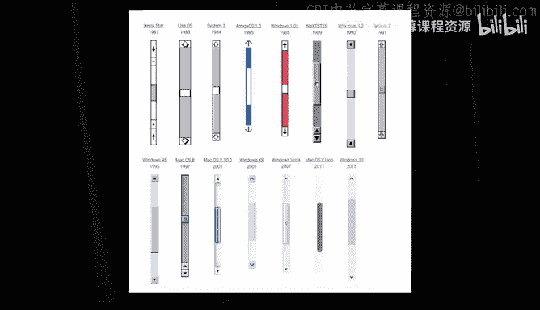

Potentially be extremely useful in the desktop setting even just for users to just improve the experience because the current scroll bar experience and the desktop is horrible's hard to find。

 hard to control there's not a momentum there's and the intention should be clear when I start moving towards the scroll bar there should be a snapping to the scroll bar action but of course。

 you know， maybe I'm okay paying that cost， but there's hundreds of millions of people paying that cost nonstop。

 but anyway。But in this case， this is necessary because there's an extra cost paid by nolan for the jitteriness。

 so you have to switch between the scrolling and the reading there has to be a face shift between the two like。

When you're scrolling， you're scrolling right right So that is one drawback of the current the current approach。

 maybe one other just sort of case study here。 So again。

 UX is how it works and we think about that holistically from like even the feature detection level of what we detect in the brain to how we design the decoder what we choose to decode to then how it works once it's being used by the user So another good example in sort of how it works once they're actually using the decoder the output that's displayed on the screen is not just what the decoder says it's also a function of what's going on on the screen so we can understand for example that when you're trying to close a tab that very small stupid little X that's extremely tiny which is hard to get precisely hit if you're dealing with sort of a noisy output of the decoder。

 we can understand that that is a small X might be trying to hit and actually make it a bigger target for you similar to how when you're typing on your phone if you're used to like the i keyboard for example it actually adapts the target size of individual keys based on an underlying language model。

 so it'll actually understand that if I'm typing hey I'm going to see L。

It'll make the E key bigger because it knows Lex is the person I'm going to go see and so that kind of predictiveness can make the experience much more smooth。

 even without improvements to the underlying decoder or feature detection part of the stack so we do that with a feature called magnetic targets we actually index the screen and we understand okay these are the places that are very small targets that might be difficult to hit here's the kind of cursor dynamics around that location that might be indicative of the user trying to select it let's make it easier let's blow up the size of it in a way that makes it easier for the user to sort snap onto that target So all these little details they matter a lot in helping the user be independent in their dayto-day living。

So how much of the work on the decoder is generalizable to P2， P3， P4， P5， pN？

How do you improve the decoder in a way that's generalizable？Yeah。

 great question so the underlying signal we're trying to decode is going to look very different in P2 than N P1 for example。

 channel number 345 is going to mean something different in user one than it will in user2 just because that electrode that corresponds with channel 345 is going to be in X2 a different neuron in user one person user2。

But the approach is the methods， the user experience of how do you get the right sort of behavioral pattern from the user to associate with that neural signal。

 we hope it will translate over multiple generations of users and beyond that it's very very possible in fact quite likely that we've overfit to sort of Nolan's user experience desires and preferences and so what I hope to see is that when we get second third fourth participant that we find sort of what the right wide minimums are that cover all the cases that make it more intuitive and hopefully there's cross- pollination of things where oh we didn't think about that with this user because they can speak with this user who just can fundamentally not speak at all。

 this user experience is not optimal and that will actually those improvements that we make there hopefully translate then to even people who can speak but don't feel comfortable doing so because we're in a public setting like their doctor's office So the actual mechanism of open loop labeling and then closed loop labeling will be the same and hopefully can generalize across the different user as theyre do doing the calibration step。

And the calibration step was pretty cool， I mean， that in itself。

 the the interesting thing about webgri， which is like closed loop。It's like fun。

 I love it when there's like。😊，They used to be kind of an idea of human computation。

 which is using actions that human would want to do anyway to get a lot of signal from yeah and like webgri is that like a nice video game that also serves this great calibration It's so funny is I've heard this reaction so many times before sort of you know first user was implanted we had an internal perception that the first user would not find this fun and so we thought really quite a bit actually about like should we build other games that like our you know more interesting for the user so we can get this kind of data and help facilitate research that's you know for long duration stuff this turns out that like people love this game I always loved it but I didn't know that that was a shared perception。

Yeah， and just in case it's not clear， Webgrid is， there's a grid of， let's say， 35 by 35。

Cells and one of them lights up blue and you have to move your mouse over that and click on it。

 And if you miss it and some red and I put this game for so many hours so many hours And what's your record you said I think I have the highest at neurallink now my record 17 B17 about if you imagine that 35 by 35 grade you're hitting about 100 trials per minute So 100 correct selections in that one minute window So you're averaging about you know between 500 600 milliseconds per selection So one of the reasons I think I struggle with that again is I'm such a keyboard person So everything is done with keyboard if I can't avoid touching the mouse is great So how can you explain your high performance。

I have like a whole ritual I go through when I play webgri。

 So it's actually like a diet plan associated with this this whole thing。

 So the first thing has to fast for five days。 I have to go up to the mouth。

 mean the fasting thing is important So this is like this is the true So what I do is actually I don't eat for a little bit forhand and then I'll actually like a ton of peanut butter before I and this is a this is a real thing and then it has to be really late at night is night owl I think we share but it has to be like midnight2 am kind of time window and I have a very specific like physical position I'll sit in which is I used to be I was homeschooled growing up and so I did most of my work like on the floor just like in my bedroom or whatever And so I have a very specific situation on the floor on the floor I sit and play and then you have to make sure there's not a lot of weight on your elbow playing so you can move quickly and then I turn the gain of the cursor So speed of the cursor way way up it's like small motions that actually move the cursor。

 with your wrist or my fingers So my wrist is almost completely still I。😊，my fingers， yeah， you know。

 those just in a small tangent， the which I've been meaning to go down this rabbit hole of people that set the world record in Teettriris。

Those folks they're playing。 There's there's a way to Did you see this like all the fingers are moving Yeah you could find a way to do it where like it's using a loophole like a bug that you can do some incredibly fast So it's along that line but not quite but you do realize there'll be like a few programmers right now listening to this fast and eat peanut butter try my record。

 I mean， the reason I did this literally was just because I wanted the bar to be high like one of the the number that we aim for should not be like the median performance。

 you should be like it should be able to beat all of us at least like that should be the minimum bar What do you think is possible like 20 I don't know limits I mean the limits you can calculate just in terms of like screen refresh rate and like cursor immediately jump into the next target。

 but there mean I'm sure there's limits before that with sort of reaction time and visual perception and things like this。

I'd guess it's in the below 40 but above 20 somewhere in there it's probably that right there I never to be thinking about it also matters like how difficult the task is you could imagine like some people might be able to do like 10。

000 targets on the screen and maybe they can do better that way so there's some like task optimizations you could do to try to boost your performance as well。

What do you think it takes for no one to be able to do above 85 to keep increasing that number you said like every increase in the number might require different yeah different improvements in the system Yeah I think the nature of this work is first the first answer this important is is I don't know this is you know edge of the research so again nobody's gotten to that number before so what's next is going be you know heuristic a guess from my part。

嗯。😊，What we've seen historically is that different parts of the stack come next at different time points。

 So when I first joined airlink like three years ago or so one of the major problems was just the latency of the Bluetooth connection。

 it wasn't just like the radio of the device wasn't super good。

 it was an earlier revision of the implant and it just like no matter how good your decoder was if your thing is updating every 30 milliseconds or 50 milliseconds。

 it's just gonna to be choppy and no matter how good you are that's going to be frustrating and lead to challenges。

So， you know at that point， it was very clear that the main challenge is just get the data off the device in a very reliable way such that you can enable the next challenge to be tackled。

And then it's， you know， at some point， it was。嗯。😊。

You know actually the modeling challenge of how do you just build a good mapping。

 like the supervised learning problem of you have a bunch of data and you have a label you're trying to predict just what is the right like neural decoder architecture and hyperparameters to optimize that that was a problem for a bit and once you solved that it became a different poly。

I think the next bottleneck after that was actually just sort of software stability and reliability you know if you have widely varying sort of inference latency in in your system or you your app just lags out every once in a while it decreases your ability to maintain and get in a state of flow and it basically just disrupts your control experience and so there's a variety of different software bugs and improvements we madeate that basically increased the performance of the system made it much more reliable。

 much more stable and led to a state where we could reliably collect data to build better models with so that was a bottleneck for a while is just sort of like the software stack itself。

If I were to guess right now， there's sort of two major directions you could think about for improving B further。

 the first major direction is labeling， so labeling is again this fundamental challenge of given a window of time where the user is expressing some behavioral intent。

 what are they really trying to do at the granularity of every millisecond？And that again。

 is a task design problem， it's a UX problem， it's a machine learning problem。

 it's a software problem。Sort of touches all those different domains。

 The second thing you can think about to improve B further is。

Either completely changing the thing you're decoding or just extending the number of things that you're decoding So this is sort the direction of functionality basically you can imagine giving more clicks。

 for example， left to click or right click， a middle click。

 different actions like click and drag for example。

 and that can improve the effective bit rate of your communication processessthesis if you're trying to allow the user to express themselves through any given communication channel you can measure that with this per second but what actually measure the end of the day is how effective are they at navigating their computer and so from the perspective of the downstream task that you care about functionality and extending functionality is something we're very interested in because not only can it improve this sort of number of BPS but it can also improve the downstream sort of independence that the user has and this kill and efficiency with which they can operate their computer。

Would the number of threads increasing also potentially help？Yes， short answer is yes。

 it's a bit nuanced how that curve or how that manifests in in the numbers。

 So what you'll see is that if you sort of plot a curve of number of channels that you're using for decocode versus either the offline metric of how good you are decoding。

Or the online metric of sort of in practice how good is the user using this device。

 you see roughly a log curve， so as you move further out in number of channels。

 you get a corresponding sort of logarithmic improvement in control quality and offline validation metrics。

The important nuance here is that。Each channel corresponds with a specific you know represented intention in the brain。

 so for example， if you have a channel 254， it might correspond with moving to the right channel 256 might mean move to the left。

If you want to expand the number of functions you want to control。

 you really want to have a broader set of channels that covers a broader set of imagined movements。

 you can think of it like kind of like Mr。 Potaman actually like if you had a bunch of different imagined movements you could do。

 how would you map those imagined movements to input to a computer you could imagine handwriting to output characters on the screen you could imagine justtyping with your fingers and have that output text on the screen。

 you could imagine different finger modulations for different clicks。

 you can imagine wiggling your big notes for opening some menu or wiggling your your big toe to have command tab occur or something like this。

 So it's really the amount of different actions you can take in the world depends on how many channels you have on the information content that they carry。

Right， so that's more about the number of actions。 So actually as you increase the number of threads。

 that's more about。Increasing the number of actions you're able to perform but one other nuance there that is worth mentioning。

 So again， our goal is really to enable a userworth process to control the computer as fast as I can。

 So that's B。With all the same functionality I have， which is we just talked about。

 but then also as reliably as I can and that last point is very related to channel count discussion。

 So as you scale out a number of channels， the relative importance of any particular feature of your model input to the output control of the user diminishes which means that if the sort of neural nonstationary effect is per channel or if the noise is independent such that more channels means on average less output effect。

 then your reliability of your system will improve so one sort of core thesis that at least I have is that scaling channel count should improve the reliability system without any work on the decoder itself。

Can you linger on the reliability here？ So first of all， when you say an notstationity of the signal。

 which aspect are you referring to Yeah， so maybe let's talk briefly what the actual underlying signal looks like。

 So again， I spoke very briefly at the beginning about how when you imagine moving to the right or imagine moving to the left neurons by fire more or less and there frequency content of that signal。

 at least in the motor cortex， it's very correlated with the output intention。

 the behavioral task what the user is doing you can imagine actually this is not obvious that rate coding。

 which is the name of that phenomenon is like the only way the brain could represent information。

 You can imagine many different ways in which the brain could encode intention and there's actually the evidence like in bats for example that there is temporal code。

 So timing codes of like exactly when particular neurons fire is the mechanism of information representation but at least in the motor cortex。

 there's a substantial evidence that it' rate coding or at least like first order of fact is that it's rate coding。

So then if the brain is representing information by changing the sort of frequency of a neuron firing。

 what really matters is sort of the delta between sort of the baseline say of the neuron and what it looks like when it's modulated。

And what we've observed and what has also been observed in academic work is that that baseline rate。

 sort of if you're tar the scale， if you imagine that analogy for like measuring you know。

 flour or something when you're baking， that baseline state of how much the pot weighs is actually different day to day。

And so if what you're trying to measure is how much rice is in the pot。

 you're gonna to get a different measurement different days because you're measuring with different pots so that baseline rate shifting is really the thing that at least from a first order description of the problem is what's causing this downstream bias there can be other effects and Ill linear your effects on top of that。

 but at least at a very first order description of the problem that's what you observed day to day is that the baseline firing rate of any particular neuron or observe on a particular channel is changing So can you just adjust to the baseline to make it relative to the baseline not stop yeah。

 this is a great question so with monkeys， we have found various ways to do this one example way to do this is you ask them to do some behavioral task like play the game with a joystick you measure what's going on in the brain you compute some mean of what's going on across all the input features and you subtract that and the input when you're do in your BI session works super well。

For whatever reason， that doesn't work super well with Nolan。

I actually don't know the full reason why， but I can imagine several explanations。

 one such explanation could be that the context effect difference between some open loop task and some closed loop task is much more significant with knowing than it is with monkey。

 maybe in this open loop task he's watching Alex Freeman podcast while he's doing the task or he's whistling and listening to music and talking with his friend and ask his mom what's for dinner while he's doing this task。

 and so the exact sort of difference in context between those two states maybe much larger and thus lead to a bigger short generalization gap between the features that you're normalizing at open loopop time and what you're trying to use at closed loop time。

That's interesting just on that point。It's kind of incredible to watch no and be able to do to multitasks to do multiple tasks at the same time。

 to be able to move the mouse curser effectively while talking and while being nervous because he's talking from kicking my ass and chest too kicking your ass and now we and talk trash while doing it so all at the same time and yes。

 if you're trying to normalize to the baseline。That might throw everything off。

Boys that interesting maybe one comment on that too。

 for folks that aren't familiar with assistive technology， I think there's a common belief that。

 you know， well， why can't you just use an eye tracker or something like this for？

Helping somebody move a mouse on the screen and it's a really a fair question and one that I actually was not confident before Noland that this was going to be a profoundly transformative technology for people like him。

And I'm very confident now that it will be， but the reasons are subtle。

 it really has to do with ergonomically how it fits into their life。

 even if you can just offer the same level of control as what they would have with an eye tracker or with a mouse stick。

But you don't need to have that thing in your face， you don't need to be positioned in a certain way。

 you don't need your caretaker to be around to set it up for you， you can activate it when you want。

 how you want， wherever you want that level of independence is so gamechan for people It means that they can text a friend at night privately without their mom needing to be in the loop。

 It means that they can like open up you know and browse the internet at 2 AM when nobody's around to set their iPad up for them。

This is like a profoundly game-chan thing for folks in that situation and this is even before we start talking about folks that you know may not be able to communicate at all or ask for help when they want to。

 this can be potentially the only link that they have to the outside world and yeah that one doesn't I think need explanation of why that's so impactful。

You mentioned neural decoder。How much machine learning is in the decoder， how much magic。

 how much science， how much art？How difficult is it to come up with a decoder that figures out what these。

Sequence of spikes mean Yeah， good question。There's a couple different ways to answer this。

 so maybe I'll zoom out briefly first and then I'll go down one of the rabbit holes and so the zoomed out view is that building the decoder is really the process of building the data set plus compiling it into the weights。

And each of those steps is important， the direction， I think。

 of further improvement is primarily going to be in the data set side of how do you construct the optimal labels for the model。

But there's an entirely separate challenge of then how you compile the best model。

 And so I'll go briefly down the second one， down the second rabbit hole。

One of the main challenges with designing the optimal model for BCI is that offline metrics don't necessarily correspond to online metrics。

 it's a fundamentally a control problem the user is trying to control something on the screen and the exact sort of user experience of how you output the intention。

Impacts your ability to control。 So， for example， if you just look at validation loss as predicted by your model。

 there can be multiple ways to achieve the same validation loss。

 not all of them are equally controllable by the end user and so you know it might be as simple as saying oh you could just add auxiliary loss terms that like help you capture the thing that actually matters。

 but this is a very complex nuanced process so how you turn the labels into the model is more of a nuanced process than just like a standard supervised learning problem。

One very fascinating anecdote here， we've tried many different sort of neural network architectures that translate brain data to velocity outputs。

 for example。And one example that's stuck in my brain from a couple years ago now is we at one point。

 we are using just fully connected networks to decode the brain activity。

 We tried A B test where we were measuring the relative performance in online control sessions of sort of one de convolution over the input signal。

 So if you imagine per channel， you have a sliding window that's。

Producing some convol feature for each of those input sequences for every single channel simultaneously。

 you can actually get better validation metrics， meaning you're fitting the data better and it's generalized better in offline data。

 If you use this convolutional architecture， you're reducing parameters， it's sort of a standard。

Standard procedure when you do them with time series data。

 now it turns out that when using that model online， the controllability was was worse。Was far worse。

 even though the offline metrics were better， and there can be many ways to interpret that。

 but what that taught me at least was that， hey， it's at least the case right now that if you were to just throw a bunch of compute at this problem。

And you were trying to sort of hypermeter optimize or you know let some GT model hard code or come up with or invent many different solutions。

 if you were just optim for loss， it would not be sufficient。

 which means that there's still some inherent modeling gap here。

 there's still some artist left to be uncovered here of how to get your model to scale with more compute and that may be fundamentally labeling problem。

 but there may be other components to this as well。Is it data constraint at this time like？

Which is what it sounds like， like。How do you get a lot of good labels Yeah。

 I think it's data quality constrained， not necessarily data quantity constrained。

But even like even just the quantity， I mean， because it has to be trained on the interactions。

I guess there's not that many interactions。 Yeah， so it depends what versions this you're talking about。

 So if you're talking about like let's say the simplest example of just 2D velocity。

 then I think yeah data quality is the main thing。 if you're talking about how to build a sort of multifunction output that lets you do all the inputs the computer that you and I can do then it's actually a much more sophisticated nuance modeling challenge because now you need to think about not just when the user left clicking but when you building the left click model。

 you also need to be thinking about how to make sure it doesn't fire when they're trying to right click or when they're trying to move the mouse So one example of an interesting bug from like sort week1 a PCci with nolan was when he moved the mouse。

 the click signal sort of dropped off a cliff and when he stopped the click signal one up。 So again。

 there's a contamination between the the two inputs。

 Another good example was at one point he was trying to do sort of a left click and drag and the minute he started moving the left click signal dropped off a cliff So again because there's some contamination between the two signals you need to come up with some way to either in the data or in the model build robustness against this kind of。

You can think about like overfitting but really it's just that the model has not seen this kind of variability before so you need to find some way to help the model with that this is super cool because it feels like all of this is very solvable but it's hard yes it is fundamentally an engineering challenge this is important to emphasize and it's also important to emphasize that it may not need fundamentally new techniques which means that people who work on let's say un superupervised speech classification using CTC loss for example with internal to Siri they could potentially a very applicable skills to this。

So what things are you excited about in the future development？

Have the software stack on the your link。 So everything we've been talking about the decoding the UX。

 I think there's some I'm excited about like something I'm excited about from the technology side and some I'm excited about for understanding how this technology is going to be best situated for entering the world。

 So I'll work backwards on the technology entering the world side of things。

 I'm really excited to understand。😊，How this device works for folks that cannot speak at all。

 that have no ability to sort of bootstrap themselves into useful control by voiceice command。

 for example。And are extremely limited in their current capabilities。

 I think that will be an incredibly useful signal for us to understand。

 I mean really what is an existential type for all startups， which is part of market fit。

 does this device have the capacity and potential to transform people's lives in the current state and if not what are the gaps and if there are gaps。

 how do we solve them most efficiently。So that's what I'm very excited about for the next sort year or so of clinical trial operations。

 on the technology side。I'm quite excited about basically everything we're doing I think it's going to be awesome。

 the most prominent one I would say is is scaling channel count So right now we have 1000 channel device the next version will have between three and 6000 channels and I would expect that curve to continue in the future。

😊，And it's unclear what set of problems will just disappear completely at that scale and what set of problems will remain and require further their focus。

 and so I'm excited about the clarity of gradient that that gives us in terms of the user experience that we choose to focus our time and resources on and also in terms of the even things as simple as non stationity like does that problem just completely go away at that scale。

 or do we need to come up with new creative UX still even at that point？U。

 and also when you get to that time point， when we start expanding out the set of functions that you can output from one brain。

How to deal with all the nuances of both the user experience of not being able to feel the different keys under your fingertips。

 but still need to be able to modulate all of them and syncron need to achieve the thing you want。

And again， you don't have that prop setive feedback loop。

 so how can you make that intuitive for a user to control a high dimensional control surface without feeling the thing physically？

I think that's going to be a super interesting problem。I'm also quite excited to understand。

 you know do these scaling laws continue like as you scale channel count。

 how much further out do you go before that saturation point is is truly hit and it's not obvious today。

 I think we only know what's in the sort of interlation space we really know what's between0 and2024 but we don't know what's beyond that。

And then there's a whole sort of like range of interesting sort of neuroscience and brain questions。

 which is when you stick more stuff in the brain in more places you get to learn much more quickly about what those brain regions represent。

 and so I'm excited about that fundamental neuroscience learning which is also important for figuring out how and to most efficiently insert electrodes in the future。

So yeah， I think all those dimensions I'm really， really excited about。

 and that doesn't even get close to touching the sort of software stack that we work on every single day and what we're working on right now。

 Yeah， it seems virtually impossible to me that。😊，1 thousand electrodes is where it saturates。

 It feels like this would be one of those。Silly notions in the future where obviously。

 you should have millions of electrodes。 And this， and this is where， like the true。

Breakthroughs happen you tweeted some thoughts are most precisely described in poetry。

 what do you think that is？I think it's because the information bottleneck of language is。

Pretty steep。And yet you're able to reconstruct on the other persons in the other person's brain more effectively without being literal。

 like if you if you can express the sentiment such that in their brain。

 they can reconstruct the actual true underlying meaning and beauty of the thing that you're trying to get across。

 the generator functioning their brains more powerful than what language can express and so。

The the mechanism poetry is really just to feed or see that generator function so being literal sometimes is a suboptimal compression for the thing you're trying to convey。

And it's actually in the process of the user going through that generation that they understand what you mean like that's that's the beautiful part。

 It's also like when you look at a beautiful painting。

 like it's not the pixels of the painting that are beautiful。

 it's the thought process that occurs when you see that。

 the experience of that that actually I think that matters Yeah， it's resonating with some deep yeah。

Thing within you that the artist also experienced and was able to convey that through the pixels。

And that's actually going to be relevant for full on telepathy。You know。

 it's like if you just read the poetry literally。That doesn't say much of anything interesting。

It requires a human to interpret it。So it's the combination of the human mind and all the experiences the human being has within the context of the collective intelligence of the human species that makes that poem make sense。

And they load that in。And so in that same way， the signal that carries from human to human meaning might not may seem trivial。

 but may actually carry a lot of power。呃。Because of the complexity of the human mind and the receiving end。

Yeah， that's interesting。I poetry still doesn't。 Who is it， I think Yosha Bako first wash all said。

Something about。All the people that think we've achieved AGI explain why。Humans like music。 Oh， yeah。

 and and until， until they。GI likes music。 You have't achieved A or something like do I think that's like some next token Entropy surprise kind of thing going on I don't know I don't know either。

 I listen to a lot of classical music and also read a lot of poetry and yeah I do wonder if like there is some element of the next token surprise factor going on there Yeah maybe because I mean like a lot of the tricks in both poetry and music are like basically have some repeated structure and then you do like a twist it's like okay like clause 1。

23 is one thing and then clause4 is like okay now we're under the next theme and they kind of play with exactly when the surprise happens and the expectation of the user and that's even true like through history as musicians evolve music they take like some no and structure that people are familiar with and they just tweak it a little bit like they tweak and add a surprising element is especially true in like in classical music heritage。

But that's what'm wonder， is it all just extratropy like the the so so breaking structure or breaking symmetry is something that humans seem to like maybe as simple as that Yeah。

 and I mean， great artists copy and they also you know。

 knowing which rules to break is the important part。And fundamentally。

 it must be about the listener of the piece， like which rule is the right one to break。

 is's about the user or the audience member perceiving that as interesting。

What do you think is the meaning of human existence？

There's a TV show I really like called the West Wing。And in the West Wing。

 there's a character he's the president of the United States who's having a discussion about the Bible with one of their colleagues。

And。The col says something about， you know， the Bible says X， Y， and Z。And the president says， yeah。

 but it also says ABC。And。Person says， do well， do you believe the Bible to be literally true。

 and the president says。Yes， but I also think that neither of us are smart enough to understand it。

I think to like the analogy here for the meaning of life is that largely we don't know the right question to ask and so i'm I think I'm very aligned with。

Sorry， the hitchhikers。Guide the galaxy version of this question。

 which is basically if we can ask the right questions。

It's much more likely we find the meaning of human existence。

And so in the short term as a heuristic in the sort of search policy space。

 we should try to increase the diversity of people asking such questions or generally of consciousness and conscious beings asking such questions。

So again， I think I will take the I note card here but say I do think there are meaningful things we can do that improve the likelihood of answering that question。

It's interesting how much value you assign to the task of asking the right questions。Let's。

That's the main thing。 is not the answers is the questions。 This point， by the way， is driven home。

Uh in a very painful way when you try to communicate with someone who cannot speak because a lot of the time the last thing to go is they have the ability to somehow。

 you know， wiggle a lip or move something that allows them to say yes or no。And in that situation。

 it's very obvious that what matters is are you asking them the right question to be able to say yes or no to wow。

 that's powerful。Well， bliss， thank you for everything you do and thank you for being you and thank you for talking today。

 Thank you。Thanks for listening to this conversation with Bliss Chapman。And now， dear friends。

 here's Nolan Arba， the first human being to have a neurallink device implanted in his brain。

You had a diving accident in 2016 that left you paralyzed with no feeling from the shoulders down。

How did that accident change your life， There's sort of a freak thing that happened。 Imagine your。

Running into the ocean， all this isn't lake， but you're running into the ocean and you get to about waist high and then you kind of like。

Dive in， take the rest of the plunge under the wave or something。 That's what I did。

 And then I just never came back at Not sure what happened。

 I did it running into the water with a couple of guys。 And so my idea of what happened is。

Really just that I took like a stray fist elbow knee foot。

 something to the side of my head The left side of my head was sore for about a month afterward。

 So must have taken a pretty big knock。 And then they both came up。 And I didn't。

 And so I was face down in the water for a while。 I was conscious。And then eventually just， you know。

 realized I couldn't hold my breath any longer and。I keep saying took a big drink， people。

 I don't know if they like that I say that seems like I'm making light of it all， but。

This is kind of how I am， and。I don't know， like。I'm a very。Relaxed， sort of stress free person。

 I rolled with the punches。For a lot of this， I kind of took it in stride。 It's like， all right。

 well， what can I do next， How can I improve my life even a little bit on a day to day basis at first。

 just trying to find some way to heal as much my body as possible to try to get healed to try to get off a ventilator。

 learn as much as I could。 So I。Could somehow survive。Once I left the hospital and then thank God。

 I had like my family around me， if I didn't have my parents。

 my siblings and I would have never made it this far they've done so much for me more than like I can ever thank them for honestly and a lot of people don't have that a lot of people in my situation。

 their families either aren't capable of providing for them or。Honestly， just don't want to。

 And so they get placed somewhere。 And， you know， in some sort of home。 So thankfully。

 I had my family， I have a great group of friends， a great group of buddies from college who have all rallied around me and were all still incredibly close。

 People always say， you know， if you're lucky， you'll。😊。

End up with one or two friends from high school that you keep throughout your life I have about 10。

10 or 12 from high school that have all stuck around and we still get together all of us twice a year we call it the spring series in the fall series This last one we all did we dressed up like X men So I did afessor Xavier and it was。

Freaking awesome。 It was so good。So yeah， I have such a great support system around me and so you know。

 being a quadripleleggic isn't that bad， I get waited on all the time people bring me food and drinks and I get to sit around and watch as much TV and movies and anime as I want。

 I get to read as much as I want。I mean， it's。It's great。

 It's beautiful to see that you see the silver lining and all of this。 was just going back。

 Do you remember the moment when you first realize youre paralyzed from yeah， neck down。 Yep。

 I was faced down in the water。 right when I whatever something hit my head。

 I tried to get up and I realized I couldn't move and it just sort of clicked I'm like， all right。

 I'm paralyzed， can't move what do I do if I can't get up， I can't flip over， can't do anything。

 then I'm gonna drown eventually And I know I couldn't hold my breath forever。 So I just。

Helold my breath and thought about it for maybe 10，15 seconds。

 I've heard from other people that like onlookers， I guess the two girls that pulled me out of the water were two of my best friends。

 They are lifeguards。 And one of them said that it looked like my body was sort of shaking in the water。

 Like I was trying to flip over and stuff。But I knew， I knew immediately， and。I just kind of。

 I realized that。That's like what my situation was from here on out。 Maybe if I got to the hospital。

 they'd be able to do something when I was in the hospital like righte before surgery。

 I was trying to calm one of my friends down， I had like brought her with me from college to camp and she was just bawling over me and I was like。

 hey， it's gonna be fine like don't worry I was cracking some jokes to try to lighten the mood the nurse had called my mom and I was like don't tell my mom she's just gonna to be stressed out。

 call her after I'm out of surgery because at least she'll have some answers then like whether I live or not really and I didn't want her to be stressed through the whole thing but I knew and then when I first woke up after surgery I was super drugged up they had me on fentanyl like three ways which was awesome I don't I don't recommend it but I saw I saw some crazy stuff on that fentanyl and it was still the best I've ever。

on drugs， medication， sorry on medication。And I remember the first time I saw my mom in the hospital。

 I was just bawling。 I had like ventilator in like， I couldn't talk or anything。

 And I just started crying because it was more like seeing her， not that。I mean。

 the whole situation obviously was。Pretty rough， but it was just like seeing her face for the first time was pretty hard。

But， yeah， just。I never had like a moment of。You know， man， I'm paralyzed。This sucks。

 I don't want to， like be around any more。 It was always just。I hate that I have to do this， but。

Like sitting here and wallowing isn't going to help so immediate acceptance， yeah。Yeah。

Has there been low points along the way， Yeah， yeah， sure。I mean。

 there are days when I don't really feel like doing anything， not so much anymore。

 Like not for the last couple years。 I don't really feel that way， I've。

More so just wanted to try to do anything possible to make my life better at this point。

 but at the beginning， there were some ups and downs。

 There were some really hard things to adjust to first off just like the first couple months the amount of pain I was in was really really hard I mean。

 I remember screaming at the top of my lungs in the hospital because I thought my legs were run fire and obviously I can't feel anything。

 but it's all nerve pain And so that was a really hard night。

 I asked them to give me as much pain meds as possible like you've had as much as you can have。

 So just kind of deal with it， go to a happy place sort of thing。

 So that was a pretty low point And then every now and again。

 it's hard like realizing things that I wanted to do in my life that I won't be able to do anymore。

 you know， I was wanted to be a husband and father and I just don't think that I could do it now as a quadriplegic。

 maybe it's possible but' not。sure sure I would ever put you know someone I love through that like having to take care of me and stuff。

 not being able to you know go out and play sports I was a huge athlete growing up so that was pretty hard little things do when I realize I can't do them anymore like there's something really special about being able to hold a book and smell a book like the feel the texture。

 the smell like as you turn the pages like I just love it and I can't do it anymore and it's little things like that the twoy mark was pretty rough two years is when they say you will get back basically as much as you're ever gonna get back as far as movement and sensation goes and so for the first two years that was the only thing on my mind was like try as much as I can to move my fingers。

 my hands， my feet， everything。to try to get sensation to movement back and then when the two year mark hit so June 30th。

2018， I was。I was really sad that that's kind of where I was。And then just randomly here and there。

 But I was never like。Depressed for long periods of time， just。It never seemed worth while to me。

Will gave you strength。My faith， my faith in God was a big one。

 My understanding that it was all for purpose。 and even if that purpose wasn't anything involving neurallink。

 even if that purpose was， you know。There's there's a story in the Bible about Job。

 and I think it's a really， really popular story about how Job you know has all of these terrible things happen to him and he praises God throughout the whole situation。

I thought， and I think a lot of people think for most of their lives that they are jobb。

 that theyre the ones going through something terrible and they just need to， you know。

 praise God through the whole thing and everything will work out at some point after my accident。

 I realize that I。Might not be jobb that I might be， you know。

 one of his children that gets killed or kidnapped or taken from him。

 And so it's about terrible things that happen to those around you who you love。 So maybe， you know。

 in this case， my mom would be jobb， and she has to get through something extraordinarily hard。 and。

I just need to try and make it as best as possible for her。

 because she's the one that's really going through this massive trial。

 And that gave me a lot of strength。 And obviously， my family， my family and my friends， they。

They give me all the strength that I need on a day to day basis。

 so makes things a lot easier having that great support system around me。

From everything I've seen of you on in your streams and the way you are today， I really admire。

 let's say your unwavering positive outlook on life。 Has that always been this way。Yeah， yeah。 I've。

 I mean， I've just always。Thought I could do anything I ever wanted to do。

 There was never anything too big， like whatever I set my mind to， I felt like I could do it I。

Didn't want to do a lot。 I wanted to like travel around and be sort of like a gypsy and like。

 go work odd jobs。 I had this stream of traveling around Europe and being like， I don't know。

 a shepherd in like Wales or Ireland and then going and being a fisherman in Italy doing all of these things for like a year。

 Like it's such like cliche things。 But I just thought it would be so much fun to go and travel and do different things。

 And so I've always。😊，Just seeing the best in people around me， too。

 And I've always tried to be good to people。 And growing up with my mom， too。

 She's like the most positive energetic person in the world。 And we're all just people。

 people like I just get along great with people。 I really enjoy meeting new people。

 And so I just wanted to do everything。 This is。😊，Its kind of just how I've been It's just great to see that cynicism didn't take over given everything you've been through Yeah。

 that's u was that like a deliberate choice you made that you're not gonna let this keep you down Yeah。

 a bit also like I just，It's just kind of how I am。 I just like I said。

 I roll the punches with everything。 I always used to tell people like I don't stress about things much and whenever I'd see people getting stress just say you know like it's not hard just don't stress about it and like that's all you need to do and they're like that's not how that works like it works for me like just don't stress And everything will be fine like everything will work out。

 obviously not everything always goes well and it's not like it all works out for the best all the time but I just don't think stress has had any place in my life since I was a kid。

What was the experience like of you being selected to be the first human being to have a neurallink device implant implant in your brain？

We scared， excited。 No， no， it was cool。Like I was， I was never afraid of it。

 I had to think through a lot should I should I do this like be the first person I could wait until number two or three and get a better version of the neural link like the first one might not work maybe it's actually gonna kind of suck。

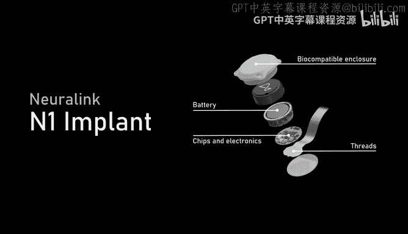

It's gonna be the worst version ever in a person。 So why would I do the first one。

 Like I've already kind of been selected。 I could just tell them， you know， like， okay。

 find someone else， And then I'll do number two or3。 Like。

 I'm sure they would let me they're looking for a few people anyways。 But ultimately， I was like。

 I don't know。 there's something about being the first one to do something。 It's pretty cool。

 I always thought that if I had the chance that I would like to do something for the first time。

 This seemed like a pretty good opportunity。 And I was， I was never scared。 I think my like。

Faith had a huge part in that I always felt like God was。Preparing me for something。

 I almost wish it wasn't this because I had many conversations with God about not wanting to do any of this as a quadriplegic。

 I told him， you know， I'll go out and talk to people。 I'll go out and travel the world and talk to。

 you know， stadiums， thousands of people， give my testimony。 I'll do all of it。 but like。

 heal me first。 Don't make me do all of this in a chair。 That sucks。

 And I guess he won that argument。 I didn't really have much of a choice。

I always felt like there was something。Going on。 And to see how。I guess easily。

 I made it through the interview process and how quickly everything happened。

 how the star sort of aligned with all of this。え？It just told me like。

 as the surgery was getting closer， it just told me that。You know， it was all meant to happen。

 It was all meant to be。 And so I shouldn't be afraid of anything that's to come。 And so I wasn't。

 I kept telling myself like， you know， you say that now， but as soon as the surgery comes。

 You're probably gonna be freaking out like you're about to have brain surgery and brain surgery is a big deal for a lot of people。

 but it's a even bigger deal for me like it's all I have left the amount of times。

 I've been like thank you， God that you didn't take my brain and my personality and my ability to think like love of learning like my character everything。

 like thank you so much。 like as long as you left me that then I think I can get by。

 And I was about to let people go like root around in there like hey。

 we're gonna go like put some stuff in your brain。 like hopefully it works out。

 And so it was it was something that gave me pause。 But like I said， how smoothly everything went。

 I never expected for a second that anything would go wrong plus the。

More people I met on the Brows side and on the neuralling side。

 They're just the most impressive people in the world。 like， I can't。

Speak enough to how much I trust these people with my life and how impressed I am with all of them And to see the excitement on their faces to like。

 walk into a room and roll into a room and see all of these people looking at me。 like， we're just。

 we're so excited。 Like we've been working so hard on this。 And it's finally happening。

 It's super infectious。 And it just makes me want to do it even more。

 and to help them achieve their dreams。 Like， I don't know， it's so， it's so rewarding。

 And I'm so happy for all of them。 Honestly， what was the day of surgery。

 Like What's when you wake up， whatd you feel。😊，Yeah， minute by minute。 Yeah， we you freak it out。

 No， you know， I thought I was going to， but as surgery approach the night before the morning of I was just excited like I was like。

 let's make this happen。 I think I said that something like that to Elon on the phone beforehand。

 we were like faceacet。 And I was like， let's rock and roll。 And he's like， let's do it。😊。

I don't know。 I just， I wasn't scared。 so we woke up。 I think we had to be at the hospital at like 5。

30 AM。 I think surgery was at like 7 AM。 So we woke up pretty early。

 I'm not sure much of us slept that night。Got to the hospital 530。

 went through like all the preop stuff。 Everyone was super nice。

 Elon was supposed to be there in the morning。 but something went wrong with his plane。

 So we the facet。 that was cool。 had one of the greatest one liners of my life。

 after that phone call hung up with him。 there were like 20 people around me。 And I was like。

 I just hope he wasn't too starstruck talking to me and yeah， it was good well done。 Yeah， yeah。

 you read that ahead of time。 came to me。 I was like this is this seems right know went into surgery I asked if I could pray right beforehand。

 So I like prayed over the room。 I asked God， if you would like be with my mom in case anything happened to me and just like calm her nerves out there。

 woke up， played a bit of a prank on my mom。 I don't know if you've heard about it。 Yeah。

 I read about it。 Yeah， she was she was not happy。 Can you take me。The prank yeah。

 this is something regret doing that。 now， Nope， No， not one bit。

 it was something it was something I， I had talked about ahead of time with my buddy Bae。 I was like。

 I would really like to play a prank on my mom。 very specifically my mom。 She's very gullible。

 I think she had knee surgery once even and after she came out of knee surgery。 She was super groggy。

 She was like， I can't feel my legs and my dad looked at her。

 he was like you don't have any legs like had， they had to amputate both your legs and we just do very mean things to her all the time。

 I'm so surprised that she still loves us。 But right after surgery。

 I was really worried that I was going to be too like groggy， like not all there。

 I had had anesthesia once before。 and it it messed me up Like I could not function。m。

 for a while afterwards and I，um， I like said a lot of things that I was like。

 I was really worried that I was going to start。I don't know， like dropping， dropping some bombs。

 And I wouldn't even know。 I wouldn't remember。 So I was like， like， please， God。

 don't let that happen。 And please let me be there enough to do this to my mom。

And so she walked in after surgery， it was like the first time they had been able to see me after surgery and she just。

Looked to me。 She said， hi， like， how are you， How are you doing， How do you feel。

 And I looked at her。 And this very， I think the anesthesia helped very like groggy。

 sort of confused look on my face。 It like who are you。

 And she just started looking around the room like at the surgeons of the doctors。 like。

 what did you do to my son。 Like you need to fix this right now。 Tea started streaming。

 I saw how much she was freaking out。 I was like， I can't let this go on。 And so I was like， mom。

 mom， I'm fine。 like it's all right。 And still， she was not happy about it。

 She still says she's gonna get me back someday。 But I mean， I don't know。

 I don't know what that's gonna look like。's long battle。 Yeah， but it was good。 In some sense。

 it was a demonstration that he still got。's that's all I wanted them to be that's all I wanted it to be。

 And I knew that doing something。Super mean to her like that would show her。 Yeah。

 to show that you're still there that you love her。 Yeah， exactly， exactly。 It's a dark way to do it。

 but I love it。 Yeah， what was the first time you were able to feel that。😊。

You can use the neurallink device to affect the world around you。Yeah。

 the first little taste I got of it was actually not too long after surgery Some of the neurallink team had brought in like a little iPad a little tablet screen and they put up eight different channels and that were recording some of my neuron spikes they put it in front of me like this is like real time your brain firing it' like that's super cool my first thought was I mean if they're firing now let's see if I can affect them in some way so I started trying to like wiggle my fingers and I just started like scanning through the channels and one of the things I was doing was like moving my index finger up and down and I just saw this yellow spike like top row like third box over or something I saw this yellow spike every time I did it and I was like oh that's cool and everyone around was just like what do you see and I was like look look at this one look at like this top。

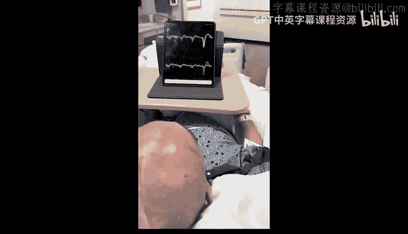

ro third box over this yellow spike like that's me right there there there。

 and everyone was freaking out。 They started like clapping。 I was like that's super unnecessary。

 this is what's supposed to happen like so you're imagining yourself moving each individual finger one at a time and seeing like that you can notice something and then when you did the index finger。

 you're like yeah was I was wiggling kind of all of my fingers to see if anything would happen。

 there was a lot of other things going on。 but that big yellow spike was the one that stood out to me like I'm sure that if I would have stared at it long enough。

 I could have mapped out maybe 1 hundred different things。

 but the big yellow spike was the one that I noticed maybe you could speak to what it's like to sort of wiggle your finger to like to imagine that the mental。

 the cognitive effort required to sort of wiggle your index finger for example。

 how easy is that to do pretty easy for me it's something that。At the very beginning。

 after my accident， they told me to try and。Move my body as much as possible， even if。You know。

 you can't just keep trying because that's going to create new like neural pathways or pathways of my spinal cord to like reconnect these things to hopefully regain some movement someday that's fascinating Yeah。

 I know it's it's bizarre but that's part of the recovery process is to keep trying to move your body yep。

And as much as you can。 And the nervous system does this thing。

 starts reconnecting It'll start reconnecting for some people， some people， it never works。

 Some people， they'll do it like for me， I got some bicep control back and that's about it， I can。

 if I try enough， I can wiggle some of my fingers not like on command， it's more like。

 if I try to move， say my right pinky and I just keep trying to move it after a few seconds。

 it'll wiggle。 So I know there's stuff there。 Like I know， like and that happens with， you know。

 a few different of my fingers and stuff。But yeah， that's that's what they tell you to do。

 One of the people at the time when I was in the hospital came in and told me for one guy who had recovered most of his control。

 what he thought about every day was actually walking like the act of walking。

 just over and over again。 So I tried that for years。 I tried just imagining walking， which is。

It's hard， it's hard to。Imagine like all of the steps that go into， well， taking a step。

 like all of the things that have to move， like all the activations that have to happen along your leg in order for one step to occur。

 But you're not just imagining you're like doing it。 I'm trying。 Yeah， So it's like， it's imagining。

Over again， what I had to do to take a step because it's not something any of us think about。

 We just， you want to walk and you take a step。 you don't think about all of the different things that are going on in your body。

 So I had to recreate that in my head as much as I could。

 And then I practice it over and over and over。 So it's not like a third person perspective as a first person perspective。

 You're like it's not like you're imagining yourself walking。

 You're like literally doing this everything all the same stuff that you're walking。

 which which was hard。 It was hard at the beginning。

 like frustrating hard or like actually cognitively hard like it was both。There's a。

 there's a scene in one of the kill Bill movies， Actually， oddly enough， where she is like paralyzed。

 I don't know from like a drug that was in her system。

 And then she like finds some way to get into the back of a truck or something。

 And she stares at her toe。 And she says， move， like move your big toe。 and。After， you know。

 a few seconds on screen， she does it and she did that with every one of her like body parts until she can move again。

I did that for years， just stared at my body and said， move your index finger， move your big toe。

 sometimes vocalizing it like out loud， sometimes just thinking it I tried every different way to do this to try to get some movement back and it's hard because it actually is。

Like taxing， like physically taxing on my body， which is something I would have never expected because it's not like I'm moving。

 but it feels like there's a build up of。I don' know the only way I can describe it is。

There are like signals that aren't getting through from my brain down because my there's that gap in my spinal cord a brain down and then from my hand back up to the brain and so it feels like those signals get stuck in whatever body part that I'm trying to move and they just build up and build up and build up until they burst and then once they burst。

 I get like this really weird sensation of everything sort of like dissipating back out to level and then I do it again。

Um， it's also just like a fatigue thing， like a muscle fatigue。

 but without actually moving your muscles。It's very， very bizarre。 And then， you know， if you try to。

Stare at a body part or think about a body part and move 4，2，3，4， sometimes 8 hours。

 It's very taxing on your mind。 It takes a lot of focus。 It was a lot easier at the beginning。

 because I wasn't able to。Like control a TV in my room or anything。

 I wasn't able to control any of my environment。 So for the first few years。

 a lot of what I was doing was staring at walls and so。Obviously。

 I did a lot of thinking and I tried to move a lot just over and over and over again Do you never give up sort of hope there training hard essentially yep。

 and I still do it， I do it。Like subconsciously。 And I think that that helped a lot with things with Nelink。

 honestly。 something that I talked about the other day at all hands that I did at Nelink's Austin facility。

 Welcom to Austin Yeah， hey， thanks man。 I went to school hey， thanks， thanks， man。

 the gig offactor was super cool。 I went to school at Texas So I've been around for see she was saying welcome to me。

 Yeah welcome to Texas like I But yeah I was talking about how a lot of what they've had me do。

 especially at the beginning。 Well， I still do it now， is body mapping。

 So like there will be a visualization of a hand or an arm on the screen。

 and I have to do that motion and thats how they sort of train the algorithm to like understand what I'm trying to do。

 And so it made things very seamless for me。 I think that's really， really cool。😊。

Amazing to know because I've learned a lot about the body mapping procedure with like with a with the interface and everything like that。

 it's cool to know that you've been a century like。Training to be like world class at that task。

 Yeah， yeah， I don't know if other quadriplegics， like other paralyzed people give up。

 I hope they don't I hope they keep trying because I've heard other paralyzed people say。

 like don't never stop， they tell you two years， but you you just never know。

 the human bodies capable of amazing things。 So I've heard other people say don't give up。

 like I think one girl had spoken to me through some family members and said that she had been paralyzed。

 you know， for 18 years。 and she'd been trying to like wiggle her index finger for all that time and she finally got a bat like 18 years later。

 So like I know that it's possible。 and I'll never give up doing it。 I just。

 I do it when I'm lying down like watching TV。 I'll find myself doing it kind of just。

Almost like on its own。 It's just something I've gotten so used to doing that。

I don't know I I don't think I'll ever stop that's really awesome to hear because I think it's one of those things that can really pay off in in the long term because like it is training you're not visibly seeing the results of that training at the moment。

 but like there's that like Olympic level nervous system getting getting ready for honestly was like。

Something that I think Nelink gave me that。I can't， I can't think them enough for like。

 I can't show my appreciation for it enough was。Being able to visually see that what I'm doing is actually having some effect。

 It's a huge part of the reason why like I know now that I'm going to keep doing it forever because before neurallink。

 I was doing it every day。 and I was just assuming that things were happening。

 like it's not like I knew， I wasn't getting back any mobility or sensation or anything。

 So I could have been running up against a brick wall for all I knew and with neurallink。

 I get to see like all the signals happening realtime。 And I get to see that， you know。

 what I'm doing can actually be mapped you know， when we started doing like click calibrations and stuff。

 when I go to click my index finger for a left click that it actually recognizes that。

 like it changed how I think about what's possible with。

Like retraining my body to move And so yeah I'll I'll never give up now and also just to signal that there's still a powerhouse of a brain there that's like exists and as the technology develops that brain is I mean that's the most important thing about the human body of the brain and it can do a lot of the control So what did it feel like when you first could wiggle the index finger and saw the environment respond like that little yeah。

 wherever we just being way too dramatic according to you Yeah， it was very equal I mean。

 it was cool but it。I keep telling this to people。 It made sense to me like it made sense that。

 you know， like there are signals still happening in my brain and that as long as you had something near it that could measure those that could record those。

 then you should be able to like visualize it in some way， like see it happen。

 And so that was not very surprising to me。 I was just like， oh， cool。 Like we we found one。

 like we found something that works。 it was cool to see that their technology worked and that everything that they had worked so hard for was like going to pay off。

 but I hadn't like moved a cursor or anything at that point。

 I had like interacted with a computer or anything at that point， So。😊，It， it just made sense。

 It was cool。 Like like I， I didn't really know much about B I at that point either。

 So I didn't know like what sort of step this was actually making。 Like。

 I didn't know if this was like a huge deal or if this was just like， okay， this is。You know。

 it's cool that we got this far， but we're actually hoping for something like much better down the road。

 It's like， okay， I just thought that they knew that it turned on。 So it was like cool like this is。

 this is cool。 What did you like read up on the specs of the hardware you get installed。

 like the number of threads。 Yeah， yeah， I do all of that。

 But it's all like it's all Greek to me Like I was like， okay， threads，64 threads，16 electrodes。

 thousand24 channels。😊，Okay， like like that that that math checks out sounds right。 Yeah。

 when was the first time you were able to move a mouse cursor。

 I know it must have been within the first maybe week。

 week or two weeks that I was able to like first move the cursor And again。

 like it kind of made sense to me like it， it didn't seem like that big of a deal。 Like it， it。

 it was like， okay， well， how do I explain this。😊，When everyone around you starts clapping for something that you've done。

 it's， it's easy to say， okay， like I did something cool。 Like that was。

 that was impressive in some way。 What exactly that meant， what it was hadn't really like。

Set in for me。 so again， I knew that。Me trying to move a body part。

 And then that being mapped in some sort of like machine learning algorithm to be able to identify like my brain signals and then take that and give me cursor control。

 that'll kind of made sense to me。 I don't know like all the in ins and outs of it。 But I was like。

 there's still signals in my brain firing， they just can't get through because there's like a gap in my spinal cord。

 And so they just， they can't get all the way down and back up。 But there're still there。

 So when I move the cursor for the first time。 I was like， that's cool。

 But I expected that that should happen Like it made sense to me。

 When I moved the cursor for the first time。With just my mind without like physically trying to move。

 So I guess I can get into that just a little bit like the difference between attempted movement and imagined movement。

 Yeah， that's a fascinating difference。 Yeah， one to the other。 Yeah， yeah， yeah。

 So like attempted movement is me physically trying to attempt to move， say my hand。

 I try to attempt to move my hand to the right to the left forward and back。

 and that's all attempted attempt to you know， like lift my finger up and down。

 attempt to kick or something。 I'm physically trying to do all of those things。

 even if you can't see it。 like I'm this would be like me attempting to like shrug my shoulders or something that's all attempted movement。

 that all that's what I was doing for the first couple of weeks when they were going to give me cursor control。

 When I was doing body mapping。 It was attempt to do this attempt to do that when near was。

Telling me to。Like imagine doing it。 It like kind of made sense to me， but it's not something that。

People practice like if you started school as a child and they said， okay。

 write your name with this pencil。 And so you do that like okay。

 now imagine writing your name with that pencil。 Kid would think like I guess like that kind of makes sense。

 and they would do it。 but that's not something we're taught。

 It's all like how to do things physically。 we think about like thought experiments and things。

 but that's not like that's not like a physical action of doing things。

 It's more like what you would do in certain situations。 So imagine movement。

 it never really connected with me like I guess you could maybe describe it as like a professional athlete like swinging a baseball bat or swinging like a golf club like imagine what you're supposed to do。

 but then you go right to that and physically do it like you then you get a bat in your hand and then you do what you've been imagining。

 And so I don't have that like connection So tell。Me to imagine something versus attempting it。

 it just there wasn't a lot that I could do there mentally。

 I just kind of had to accept what was going on and try。But the attempt moving thing。

 it all made sense to me。 Like if I try to move， then there's a signal being sent in my brain and as long as they can pick that up。

 then they should be able to map it to what I'm trying to do。

 And so when I first move the cursor like that， it was it was like， yes。

 this should happen like I'm I'm not surprised by that。 can you clarify。

 is there supposed to be a difference between imagined movement and attempted movement。 Yeah。

 just that in imagined movement， you're not attempting to move at all。

 So it's you're like visualized visual And then theoretically。

 is there supposed to be a different part of the brain lights up in those different situations Yeah。

 not necessarily I think all these signals can still be represented in motor cortex。

 but the difference I think has to do with the naturalness of imagining something verse God attempting the fatigue of that over time And by the way。

 and the like is bliss。So like this is just different ways to prompt you to kind of get to the thing that you're around Yeah。

 attemptedtive movement does sound like the right thing Yeah， try， Yeah， I mean。

 it makes sense to me because imagine for me， Ill be I would start visualizing like in my mind visualizing attempted。

 I would actually start trying to like， yeah there's a， I mean， I you know。

 I did like Com press my whole life like wrestling when I'm imagining a move。See。

 I'm like moving my muscle exactly。 like there's a there is a bit of an activation almost versus like visualizing yourself like a picture doing it。

 Yeah， it's something that I feel like naturally anyone would do if you try to tell someone to imagine doing something they might close their eyes and then start physically doing it。

 but it it just just didn't click yeah， it's， it's hard。 it was very hard at the beginning。

 but attempted worked attempted work， it worked just like it should work like work like a charm。

 there was like one Tuesday we were messing around and I think I forget what swear word you used。

 but there' was a swear word that came out of your mouth when you figured out you could just do the direct cursor control。

 Yeah， that blew my mind， like no pun intended blew my mind when I first。Move the cursor。

Just with my thoughts and not attempting to move， it's something that I found like over the couple of weeks。

 like building up to that that。As I get better， cursor controls like the model gets better then。

It gets easier for me to like like I don't have to attempt as much to move it。

 And part of that is something that I'd even talked with them about when I was watching the signals of my brain one day I was watching when I like attempted to move to the right and I watched the screen as like I saw the spikes。

Like I was seeing the spike。 the signal was being sent before I was actually attempting to move。

 I imagine just because， you know， when you go to say， move your hand or any body part。

 that signal gets sent before you're actually moving has to make it all the way down and back up before you actually do any sort of movement So there's a delay there。

 and I noticed that there was something going on in my brain before I was actually attempting to move that my brain was like anticipating what I wanted to do。

 And that all started sort of。嗯。I don't know。 Like percolating in my brain。 I get just。

 it was just sort of there， like always in the back。 Like that's so weird that it could do that。

 It kind of makes sense。 But I wonder what that means as far as like using the neurallink and。

You know， and then as I was playing around with the attempted movement and playing around with the cursor and I saw that like as the cursor control got better that it was。

Anticipating my movements and what I wanted it to do like cursor movements。

 what I wanted to do a bit better and a bit better。

 And then one day I just randomly as I was playing webgrid。

 I like looked at a target before I had started like attempting to move。

 I was just trying to like get over like train my eyes to start looking ahead like okay this is the target I'm on。

 but if I look over here to this target， I know I can like maybe be a bit quicker getting there。

 and I looked over and the cursor just shot over it was wild like I had to take a step back。

 I I was like this should not be happening all day， I was just smiling。

 I was so giddy I was like guys， do you know that this works Like I can just think it and it happens which like they had all been saying this entire time like I can't believe like you're doing all this with your mind I'm like yeah。

 but is' it really with my mind Like I'm attempting to move and it's just picking that up so does。

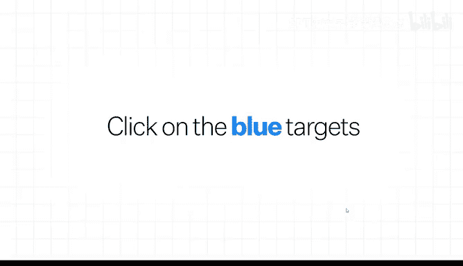

I feel like it's with my mind， but when I moved it for the first time like that， it was。Oh man。

 like it made me think that this technology that what I'm doing is actually way。

Way more impressive than I ever thought。 It was way cooler than I ever thought。

 And it just opened up a whole new world of possibilities of like。

 what could possibly happen with this technology and what I might be able to be capable of with it because you had felt for the first time like this was digital telepathy。

 Like you were controlling a digital device with your mind，😊，I mean。

 this a that's a real moment of discovery。 that's really cool Like you've discovered something I've seen like scientists talk about like a big aha moment。

 you know like Nobel Prize winning， they'll have this like。Holy crap， yeah。

 like that's what that's what it felt like like I didn't feel like。

Like I felt like I had discovered something but for me。

 maybe not necessarily for like the world at large or like this field at large。

 It just felt like an aha moment for me like， oh， this works like obviously it works。

 And so that's what I do like all the time now I kind of intermix the attempted movement and imagined movement。

 I do it all like together because I found that there is some interplay with it that。

Maximizes efficiency with the cursor。 So it's not all like one or the other。 It's not all just。

 I only use attempted or I only use like imagine movements。 It's more。 I use them in parallel。

 And I can do one or the other。 I can just completely think about whatever I'm doing。

 But I don't know。 I like to play around with it。 I also like to just experiment with these things。

 Like every now and again， I'll get this idea in my head。 like I wonder if this works。

 And I'll just start doing it。 And then afterwards， I'll tell them， by the way。

 I wasn't doing that like you guys wanted me to。 I was。

 I thought of something and I wanted to try it。 And so I did， it seems like it works。

 So maybe we should like explore that a little bit。 So I think that discovery is not just for you。

 at least from my perspective， that's a discovery for。

Everyone else who ever uses in your link that this is possible like I don't think that's an obvious thing that this is even possible it's like I was saying to Bliss earlier it's like the four minute mile people thought it was impossible to run a mile in four minutes and once the first person did it then everyone just start doing it so like just to show that it's possible that paves the way to like anyone can now do it that's the thing that's actually possible you don't need to do the attempt move it you can just go direct。

That's crazy， That is crazy It is crazy for people who don't know。

 can you explain how the link app works， You have an amazing stream on the topic， your first stream。

 I think， on X。Describing the app can you just describe how it works。 Yeah。

 so it's just an app that Nling created。To help me interact with the computer so on the link app there are a few different settings and different modes and things I can do on it so there's like the body mapping we kind of touched on there's a calibration calibration is how I actually get cursor control so calibrating what's going on in my brain to translate that into cursor control so it will pop out models what they use I think is like time so it would be you know five minutes and calibration will give me so good of a model and then if I'm in it for 10 minutes and 15 minutes the models will progressively get better and so you know the longer I'm in it generally better the models will get that's really cool because you often refer to the models the models is the thing that's constructed once you go through the。

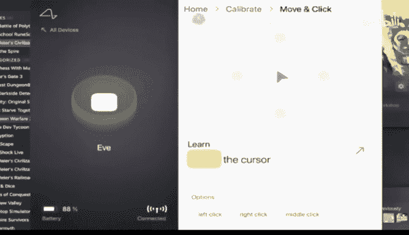

Calibration stuff and then you also talk about sometimes you'll play like a really difficult game like snake just to see how good the model is Yeah yeah so snake is kind of like my litmus test for models if I can control snake decently well then I know I have a pretty good model So yeah the link app has all of those as webgrid in it now it's also how I like connect to the computer just in general so they've given me a lot of like voice controls with it at this point so I can you know say like connect or implant disconnect and as long as I have that charger handy then I can connect to it so the charger is also how I connect to the link app to connect the computer I have to have the implant charger over my head when I want to connect to have it wake up because the implants in hibernation mode like always when I'm not using it I think there's a setting to like wake it up every。

You know。So long so we could set it to half an hour。

 five hours or something if I just want to wake up periodically So yeah I'll like connect to the link app and then go through all sorts of things calibration for the day。

 maybe body mapping I like I made them give me like a little homework tab because I am very forgetful and I forget to do things a lot so I have like a lot of data collection things that they want me to do is the body mapping part of the data collection is that also part of Yeah it is it's something that they want me to do daily。

 which I've been slacking on because I've been doing so much media and traveling so I've I've been super famous Yeah I've been a terrible first candidate for how much I've been slacking on my homework but yeah it's just something that they want me to do every day to you know track how well the neurallink is performing over time。

And have something to give， I imagine to give to the FDA to you know create all sorts of fancy charts and stuff and show like。

 hey， this is what the neural length is how it's performing you know。

 day one versus day 90 versus day 180 and things like that what's the calibration step like is it is it like move left move right it's a bubble game so there will be like yellow bubbles that pop up on the screen at first it is open loop so open loop。

 this is something that I still don't fully understand the open loop and closed loop thing I mean blis talked for a long time I about the difference between the two from on the technical side Okay so it'd be great to hear your okay so your side of the story open loop is basically I have no control over the cursor the cursor will be moving on its own across the screen and I am following by intention the cursor to different bubbles and then my the algorithm is training off of what。

Like the signals it's getting are as I'm doing this。

 There are a couple different ways that they've done it。 They call it center out target。

 So there will be a bubble in the middle and then eight bubbles around that and the cursor will go from the middle to one side So say middle to left back to middle to up to middle like upright and they'll do that all the way around the circle and I will follow that cursor the whole time and then it will train off of my intentions what it is expecting my intentions to be throughout the whole process Can you actually speak to when you say follow Yes。

 you know what I mean with your eyes， you mean with your intentions。 Yeah。

 so generally for calibration， I'm doing attempted movements because I think it works better。

 I think the better models as I progress through calibration make it easier。To use imagine movement。

 so calibrated on attempted movement。Will create a model that makes it really effective for you to then use the force。

 Yes， I've tried doing calibration with imagined movement。 And it just doesn't work as well。

 For some reason。 So that was the center out targets。 There's also one where， you know。

 a random target will pop up on the screen。 And it's the same。 I just like move。

 I follow along with wherever the cursor is to that target all across the screen。

 I've tried those with imagine movement。 And for some reason， the models just don't。嗯。

They don't give as high level as quality when we get into close loop。

 I haven't played around with it a ton。 So maybe like the different ways that we're doing calibration now might make it a bit better。

 But what I've found is there will be a point in calibration。

 where I can use imagine movement before that point， it doesn't really work。

 So if I do calibration for 45 minutes。 The first。15 minutes， I can't use imagine movement。

 It just like doesn't work for some reason。 And after a certain point， I I can just sort of feel it。

 I can tell it moves different。 that's the best way I can I can describe it。

 Like it's almost as if it is anticipating what I am going to do again before I go to do it。

 And so using attempted movement for 15 minutes at some point I can kind of tell when I like move my eyes to the next target that the cursor is starting to like pick up。

 Like it's starting to understand it's learning like what I'm going to do。 So first of all。

 it's really cool that I mean， you're are a true pioneer and all this。 you're like exploring。

How to do every aspect of this most effectively and there's just。

I imagine so many lessons learned from this so thank you for being a pioneer in all these kinds of different like super technical ways and it's also cool to hear that there's like a different like feeling。

😊，To the experience when it's calibrated in different ways。

 like just because I imagine your brain is doing something different。

And that's why there's a different feeling to it and then try and to find the words。

And the measurements to those feelings would be also interesting， but at the end of the day。

 you can also measure that your actual performance and whether it's snake or web grid。

 you could see like what actually works well and you're saying for the open loop calibration。

The attempted movement works best for now so this is the open loop， you don't get the feedback。

 that's something that you did something。 Yeah I'm frustrating no no。

 it makes sense to me like we've done it with a cursor and without a cursor in open loop so sometimes it's just say for like the center out the you'll start calibration with a bubble lighting up and I push towards that bubble and then when that bubble you know when it's push towards that bubble for say three seconds a bubble pop and then I come back to the middle so I'm doing it all just by my intentions like that's what it's learning anyway。

 so it makes sense that as long as I follow what they want me to do you know like follow the yellow brick road that it'll all work out you're full of great references is the bubble game fun like yeah they always feel so bad making me do calibration like we're about to do you。

A 40 minute calibration I'm like all right like you guys want to do two of them like I'm always asking to like whatever they need I'm more than happy to do and it's not it's not bad like I get to lie there and or sit in my chair and like do these things with some great people I get to have great conversations I can give them feedback I can talk about all sorts of things I could throw something on on my TV in the background and kind of like split my attention between them like it's not bad at all I don't the score that you get like can you do that better on the public game no I would love that I would love writing down suggestions from no one that's make it more funified Yeah that's one thing that I really。

 really enjoy about webgri is because I'm so competitive like the higher the Bps the higher the score。

I know the better I'm doing and so I think I've asked at one point one of the guys like if he could give me some sort of numerical feedback for calibration。

 like I would like to know what they're looking at like oh you know it is we see like this number while you're doing calibration and that means at least on our end that we think calibration is going well and I would love that because I would like to know if what I'm doing is going well or not。

 but then I've also told me like yeah not necessarily like one to one it doesn't actually mean that calibration is going well in some ways so it's not like 10% and they don't want to like skew what I'm experiencing or want me to change things based on that if that number isn't always accurate to like how the model will turn out or like the end result that's at least what I got from it one thing I do I have asked them in something that I really enjoy striving for is towards the end of calibration there is like a time between targets and。

So I like to keep like at the end that number as low as possible so at the beginning it can be you know four or five six seconds between me popping bubbles but towards the end。

 I like to keep it below like 1。5 or if I could get it to like one second between like bubbles because in my mind that translates really nicely to something like webgri where I know if I can hit a target one every second that I'm doing real real well there you go that's a way to get a score on the calibration is like the speed quickly getting from bubble bubble so there's the open loop and then it goes to the closed loop the closed loop can already start giving you a sense because you're getting feedback of like how good the model is yeah so closed loop is when I first get cursor control and how they've described it to me someone who does not understand the stuff I am the dumbest person in the room every time I'm within the humil is that I am closing the loop so I am actually。

now the one that is like finishing the loop of。Whatever this loop is。

 I don't even know what the loop is。 they've never told me。

 They just say there is a loop and at one point it's open and I can't control and then I get control and it's close。

 So I'm finishing the loop So how long the calculationlib version easier take we said like 1015 minutes Well yeah they're they're trying to get that number down pretty low that's what we've been working on a lot recently is getting that down as low as possible。

 So that way you know， if this is something that people need to do on a daily basis or some people need to do on a like。

Every other day basis or once a week， they don't want people to be sitting in calibration for long periods of time。

 I think they wanted to get it down seven minutes or below， at least where we're at right now。

 it'd be nice if they you never added do calibration So we'll get there at some point I'm sure the more we learn about the brain and like I think that's you know the dream I think right now for me to get like really。

 really good models。 I'm in calibration 40 or 45 minutes。 and I don't mind， like I said。

 they always feel really bad。 but if it's gonna get me a model that can like break these records on Webgrid。

 I'll stay in it for flip in two hours。 let's talk business So webgrid I saw a presentation that where Bliss said by March you selected 89000 targets in Webgrid can you explain this game what is webgrid and what does it take to be a world class performer and webgrid as you continue to。

Break world records， yeah。😀。It's like a gold medalist talk wow， yeah， you know， I'd like to thank。

 I'd like to thank everyone who's helped me get here， my coaches。

 my parents for dropping me to practice every day at five in the morning like to thank God and just overall my dedication to my craft the interviews with athletes are always like It's like that yeah。

 so， so。😊，So web grid web grid is a grid sell it's it's literally just a grid。

 They can make it as big or small as you can make a grid A single box on that grid will light up and you go and click it and it is a way for them to benchmark how good a BCI is So it's。

😊，You know， pretty straightforward， you just click targets Only one blue cell appears and you're supposed to move the mouse to there and click on it So I like playing on like bigger grids because it the bigger the grid。

 the like more Bps it's bits per second that you get every time you click one so I'll say I'll play out like a 35 by 35 grid and then one of those little squares cell call it target whatever will light up and you move the cursor there and you click it and then you do that forever。

And you've been able to achieve at first 8 bits per second。 and you recently broke that。 Yeah。

 I'm at 8。5 right now。 I would have beaten that literally the day before I came to Austin but I had like a I don't know like a five second lag right at the end and I just had to wait until the latency calm down and then I kept clicking。

 but I was at like 8。01 and then5 seconds a lag and then the next like three targets I clicked all stayed at 8。

01 So if I would have been able to click during that time of lag I probably would have hit I don't know I might hit9 So I'm there I'm like I'm really close And then this whole Austin trip has really gotten in the way of my webgrid playing ability Yeah that's all Yeah I know just I just want I want to do better I want to do better。

 I want to hit9。 I think well I know9 is very， very achievable。 I'm right there。

I think 10 I could hit maybe in the next month like I could do it probably in the next few weeks if I really push I think you and El are basically the same person because last time I did a podcast with him he came in extremely frustrated that he can't beat Uber Lilith as a druid that was like a year ago I think I forget like solo and I could just tell there's some percentage of his brain entire time was thinking like I wish I was right now attempting I think he did it he did it that night he stayed up and did it that night it just crazy to me I mean in in a fundamental way it's really inspiring and what you're doing is inspiring in that way because。

I mean it's not just about the game， Everything you're doing there has impact by striving to do well on Webgrid。

 you're helping everybody figure out how to create the system all along like the decoding the software。

 the hardware， the calibration， all of it， how to make all of that work so you can do everything else really well。

Yeah， it's just really fun。 Well that's also that's part of the thing is making it fun。 Yeah。

 it's addicting。 I'm I've joked about like what they actually did when they went in and put this thing in my brain they must have flipped a switch to make me more susceptible to these kinds of games to make me addicted to like webgrid or something Do you know blisssess high score Yeah he said like 14 or something 17 1。

1 or something0 Yeah he told me like does it on the floor with peanut butter and he like fast is weird it sounds like cheating sounds like performance enhancing like the first time no one played this game he asked how could O be at this game and I think you told me right down you you're gonna try to beat me I'm gonna get there something I think I fully believe you I think I can I for that Yeah so I've been playing first off with the d cursor which really hamperpers my webgri playing a bit。

Basically， I have to wait 03 seconds for every click oh， so you can't do the clicks， yeah。

 so you have to so you click by Dwali， you said point three point。3 seconds。Which。Which sucks。

 It really slows down how much I'm able to like， how high I'm able to get。 I still hit like 50。

 I think I hit like 50 something trials， net trials per minute in that。

 which was pretty good because I'm able to like。😊，There's one of the settings is also like how slow you need to be moving in order to initiate a click to start a click so I can tell sort of when I'm on that。

Threshold to start initiating a click just a bit early。

 So I'm not fully stopped over the target when I go to click I'm doing it like on my way to the target a little to try to time that see you're slowing down Yeah just a hair right before the targets This is like a lead performance but that still it it sucks that there's a ceiling of the point3 Well I can get down to 02 and。

11s Yeah and I've played with that a little bit too I have to adjust a ton of different parameters in order to play with01 and I don't have control over all that on my end yet it also change like how the models are like if I train a model like in webgri like a bootstrap on a model which basically is them training models as I'm playing webgrid based off of like the webgrid data then I'm like if I play webgrid for 10 minutes。

 they can train off that data specifically in order to get me a better model if I do that。

Poin3 versus01， the models come out different the way that they interact it's just much。

 much different。 so I have to be really careful。 I found that doing it with 0。

3 is actually better in some ways unless I can do it with 0。

1 and change all of the different parameters then that's more ideal because obviously 0。

3 is faster than 01 so I could。I could get there。I can get there。 Can you click。

Using your brain for right now， it's the hover clicking with the dual cursor。

 We before all the thread retraction stuff happened。

 we were calibrating clicks left click right click。

 that was my previous ceiling before I broke the record again with the dual cursor was I think on a 35 by 35 grade with left and right click and you get more B more bits per second using multiple clicks because it's more difficult Oh because what is it the you're supposed to do either left click or like right click different click Yeah。

 blue targets for left click orange targets for right click is what they had done So my previous record of 7。

5 with the blue and the orange targets yeah which I think if I went back to that now doing the click calibration I would be able to and being able to like initiate clicks on my own I think I would break that 10 ceiling like in a couple days Max。

making Bliss nervous about his 17 why do you think we haven't given him the？

So what did it feel like with the attractiontractions that there is some of the threads attracted It sucked It was really。

 really hard the day they told me was the day of my big neuralling tour at their Fremont facility they told me like righte before we went over there it was really hard to hear my initial reaction was all right。

 go in， fix it like go in take it out and fix it the first surgery was so easy like like I went to sleep a couple hours later。

 I woke up and here we are I didn't feel any pain， didn't take like any pain pills or anything so I just knew that if they wanted to they could go in and put in a new one like next day if that's what it took because I just wanted I wanted it to be better and I wanted not to lose the capability I had so much fun playing with it for a few weeks for a month。

Ha like it had opened up so many doors for me and it opened up so many more possibilities that I didn't want to lose it after a month。

 I thought it would have been a cruel twist of fate if I had gotten to see。

The view from like the top of this mountain and then have it all come crashing down after a month。

 And I knew， like， say the top of the mountain， but。

Like I how I saw it was I was just now starting to climb the mountain and I was like there was so much more that I knew was possible and so to have all of that be taken away was really really hard。

But then on the drive over to the facility。 I don't know， like five minuteute drive， whatever it is。

 I talked with my parents about it。 I prayed about it。 I was like， you know。

 I'm not going to let this ruin my day。 I'm not going to let this ruin this amazing like tour that they have set up for me。

 like， I want to go show everyone how much I appreciate all the work they're doing。

 I want to go like meet all of the people who have made this possible。

 and I want to go have one of the best days of my life。 And I did。 and it was amazing。

 and it absolutely was one of the best days I've ever been privileged to experience。

 And then for a few days， I was pretty down in the dumps。 But for like the first few days afterwards。

 I was just like， I didn't know if it was ever going to work again。

 And then I just I made the decision that。😊，え。Even if I lost the ability to use the neurallink。

 even if I lost， even if I like lost out on everything to come。

 if I could keep giving them data in any way， then I would do that if I needed to just do like some of the data collection every day or body mapping every day for a year。

 then I would do it， because I know that everything I'm doing。Helps everyone to come after me。

 And that's all I wanted。 I guess the whole reason that I did this was to help people。

 And I knew that anything I could do to help， I would continue to do。

 even if I never got to use the cursor again。 Then you know， I was just happy to be a part of it。

 And everything that Id done was just a perk。 It was something that I got to experience。

 And I know how amazing it's going to be for everyone to come after me。 So might as well just keep。😊。

Trucking along， you know。WellThat said， you were able to get。To work your way up。

 to get the performance back， so this is like going from Rocky one to Rocky2。

 so when did you first realize？That this is possible and what gave you sort of the strength the motivation。

 the determination to do it to increase back up and beat your previous record yeah。

 it was within a couple weeks like again， this feels like I'm interviewing an athlete This is great I like saying apparently the road back was long and hard for many difficulties There were dark days。

嗯。It， it was a couple weeks， I think， and then there was just a turning point。

 I think they had switched。How。They were measuring the neuron spikes in my brain like the bliss helped me out Yeah the way in which we were measuring the behavior of individual neurons yeah so we were switching from sort of individual spike detection to something called spike ban power which if you watch the previous segments with either me or DJ you probably have some kind yeah okay so when they did that it was kind of like you know light over the head like light bulb moment like oh this works and this seems like like we can run with this and I saw the。

Up taking performance immediately。 Like I could feel it when they switched over。

 I was like this is better。 like this is good。 Like everything up till this point for the last few weeks。

 like whatever three or four weeks because it was before they even told me like everything before this sucked like let's keep doing what we're doing now。

 And at that point it was not like oh， I know I'm still only at like say in webgrid terms like 4 or5 Bps compared to my 7。

5 before。 But I know that if we keep doing this。 then like I can I can get back there。

 And then they gave me the dwell cursor。 and the dwell cursor sucked at first。

 it's not obviously not what I want。 but it gave me a path forward to be able to continue using it。

 And hopefully to continue to help out。 And so I just ran with it， never looked back。

 like I said Im just kind of person I rolled the punches anyway。 So what was the process。

 What was the feedback loop on fig out how to。do expect detection in a way that would actually work well for knowing Yeah it's a great question so maybe just describe first how the actual update worked is basically an update to your implant so we just did an over the software update to his implants and we you'd update your Tesla or your iPhone and that firmware change enabled us to record sort of averages of populations of neurons nearby by an individual electrode so we have sort of less resolution about which individual neuron is doing what but we have a broader picture of what's going on nearby an electrode overall。

And that feedback I mean basically as no one described it was immediate when we flipped that switch。

 I think the first day we did that you hit three or four VPS right out of the box and that was a whiteball moment for okay this is the right path to go down and from there there's a lot of feedback around like how to make this useful for independent use so what we care about ultimately is that you can use it independently to do whatever you want and to get to that point it required us to reengineer the UX as you talk about the De cursor to make it something that you can use independently without us need to be involved all the time and yeah this is obviously at the start of this journey still hopefully we get back to the places where you're doing multiple clicks and using that to control much more fluidly everything and much more naturally the applications that you trying to interface with。

And most importantly。Get that web grid number up Yeah， yeah， so hows the on the hover click。

Do accidentally click stuff sometimes。 Yeah， like what's how hard is it to avoid accidentally clicking。

 I have to continuously keep it moving Basically， So like I said。

 there's a threshold where it will initiate a click。 So if I ever drop below that。

 it'll start and I  point3 seconds to move it before it clicks anything And if I don't want it to ever get there。

 I just keep it moving at a certain speed and like just constantly like doing circles on screen。

 moving it back and forth to keep it from clicking stuff。 I actually notice。

A couple weeks back that I was when I was not using the implant， I was。

Just moving my hand back and forth or in circles。 like I was trying to keep the cursor from clicking。

 And I was just doing it like while I was trying to go to sleep。 And I was like， okay。

 this is a problem。 to avoid the clicking。 I guess does it does that create problems like when you're gaming accidentally click a thing like。

 yeah， yeah， it happens in chess。 I've lost， I've lost。

A number of games because I'll accidentally click something。

 I think the first time I ever beat to was because of it Yeah click it's a nice excuse， right， Yeah。

 you any time you lose you could just say Yeah I was accidental。 Yeah。

 you said the app improved a lot from version one when you first started using it It was very different So can you just talk about the trial and error that you went through with the team like 200 plus pages of notes like what's that process like of yeah work going back and forth of working together to improve the thing。

 it's a lot of me just。Using it like day in and day out and saying， like， hey。

 can you guys do this for me， Like， give me this， I want to be able to do that。 I need this， I think。

A lot of it just doesn't occur to them， maybe until someone is actually using the app。

 using the implant。 It's just something that they just never would have thought of。

 or it's very specific to even like me， maybe what I want。

 It's something I'm a little worried about with the next people that come is。You know。

 maybe they will want things much different than how I've set it up or what the advice I've given the team and they're going to look at some of the thingsve they've added for me。

 like that's a dumb idea like why would he ask for that And so I'm really looking forward to get the next people on because I guarantee that they're going to think of things that I've never thought of。

 they're going to think of improvements。 I'm like wow。

 that's a really good idea like I wish I would have thought of that。

 And then they're also going to give me some pushback about like， yeah。

 what you are asking them to do here。 that's a bad idea。 Let's do it this way。

 And I'm more than happy to have that happen。 But it's just a lot of like， you know。

 different interactions with。Different games or applications。

 the internet just with the computer in general， there's tons of bugs that end up popping up left right center so it's just me trying to use it as much as possible and showing them what works and what doesn't work and what I would like to be better and then they take that feedback and they usually create amazing things for me they solve these problems in ways I would have never imagined they're so good at everything they do。

And so I'm just really thankful that I'm able to give them feedback and they can make something of itca a lot of my feedback is like really dumb。

 It's just like， I want this。 Please do something about it and they' come back and super well thought out。

 And it's way better than anything I could have ever thought of or implemented myself。

 So they're just great。 They're really， really cool。 As the B I community grows。😊。

Would you like to hang out with the other folks with neurallink Like what what relationship of any would you want to have with them because you said like they might have a different set of like ideas of how to use the thing。

 Yeah， would you be intimidated by their web great performance No， no， I hope compete。

 I hope day one， they like wipe the floor with me。 I hope they beat it and they crush it， know。

 double it if they can just because on one hand， it's only gonna push me to be better because I'm super competitive。

 I want other people to push me I think that is important for anyone trying to achieve greatness is they need other people around them who are going to push them to be better。

 and I even made a joke about it on X once like once the next people get chosen like Q buddycott music Like I'm just excited to have other people to do this with and like share experiences with I'm more than happy。

To interact with them as much as they want， more than happy to。Give them advice。

 I don't know what kind of advice I could give them。 but if they have questions， I'm more than happy。

 what advice would you have for the next participant in the clinical trial that they should have fun with this。

 because it is a lot of fun and that I hope they work really。

 really hard because it's not just for us。 It's for everyone that comes after us and。You know。

 come to me if they need anything and to go to Nelink if they need anything。 man。

 Nlink moves mountains like they do absolutely anything for me that they can。

 And it's an amazing support system to have it puts my mind at ease。

 for like so many things that I have had like questions about so many things I want to do And they're always there。

 and that's really， really nice。 And so I just， I would tell them not to be afraid to go to Nelink with any questions that they have any concerns anything that you know。

 they're looking to do with this。 and any help that neurallink is capable of providing。

 I know they will and。😊，I don't know， I don't know， just work your ass off because it's。

 it's really important that we try to give our all to this。So have fun and work hard yeah， yeah。

 there we go， maybe that's what I'll just start saying to people have fun work hard now you're a real pro athlete。

 just keep it short。嗯。Maybe it's good to talk about。

What you've been able to do now that you have a neurallink implant like the。

The freedom you gain from this way of interacting with the outside world like you play video games all night and you do that by yourself。

 Yeah， and that's a kind of freedom。 Can you speak to that freedom that you gain。 Yeah。

 it's what all。It know people in my position want， they just want more independence。

 the more load that I can take away from people around me。

 the better if I'm able to interact with the world without using my family without going through any of my friends like needing them to help me with things。

 the better if I'm able to sit up on my computer all night and not need someone to like sit me up say like on my iPad like in a position where I can use it and then have to have them wait up for me all night until I'm ready to be done using it。

Like that， it takes a load off of all of us and。It's， it's really like all I can ask for。

 it's something that。You know I could never think neurallink enough for。

 and I know my family feels the same way。You know， just being able to have the freedom to do things on my own at any hour of the day or night。

 it means the world to me and。I don't know。When you're up at 2 am playing webgrid， by yourself。

 I just imagine like it's darkness and there's just a light glowing and you're just focused what's going through your mind？

😀Oh。Or you're like in a state of flow where it's like the mind is empty like those like Zen masters generally it is me playing music of some sort I have a massive playlist and so I'm just like rocking out to music and then it's also just like a race against time because I'm constantly constantly looking at how much battery percentage I've left on my implant like all right I have 30% which equates to you know X amount of time which means I have to break this record in the next you know hour and a half where it's just not happening tonight and so its it's a little stressful when that happens when it's like when it's above 50%'m like okay like I got time its start going down to 30 and then 20 it's like all right 10% a little pop-ups gonna pop up right here and it's gonna really screw my webgri flow it's gonna tell me that you know like there's a like a low battery low battery pop up comes up and I'm likes really gonna screw me over so if。

I have to if I'm gonna break this record， I have to do it in the next like 30 seconds or else that popups gonna get in the way like cover my webgrid and then after that I go click on it。

 go back into webgrid and I'm like all right that means I have you know10 minutes left before this thing's dead。

 That's what's going on in my head General that and whatever song is playing and I just I just want I want to break those records so bad like it's all I want when I'm playing Webgrid it has become less of like this is just a leisurely activity like I just enjoy doing this because it just feels so nice and it puts me at ease it is no once I'm in Webgrid you better break this record or you're gonna waste like five hours of your life right now and I don't know it's just fun It's fun。

 man Have you ever tried webgrid with like two targets and three targets Can you get higher B with that Can you do that。

😊，You mean like different color targets or you mean oh multiple targets that changed the thing Yeah。

 so BPS is a log of number of targets times correct minus incorrect divided by time and so you can think of like different clicks as basically doubleling the number of active targets Go it so you know you basically higher B the more options there are the more difficult to task。

And there's also like Zen mode you've played in before。

 which is infinite covers it covers the whole screen with a grid and。yeah。

 And so you can go like that's insane。 Yeah， he doesn't like it because he didn't show B。 So like。

 you know， I't I had them put in a giant B in the background。

 So now it's like the opposite of Z mode。 It's like like super hard mode like just metal mode if it' just like a giant number in the back count。

 name that metal mode isn't my metal。So you also play。Civilization6。

 I love66 yeah usually go with Korea I do so the great part about Korea is they focus on like science tech victories。

 which was not planned like I've been playing Korea for years and then all of the neuralling stuff happened so it kind of aligns。

😊，嗯。But what I've noticed with tech victories is if you can just rush tech， rush science。

 then you can do anything like at one point in the game。

 you will be so far ahead of everyone technologically that you will have like musket men。

 Inantry men playing sometimes and people will still be fighting with like bows and arrows。

 And so if you want to win a domination victory， you just get to a certain point with the science and then go and wipe out the rest of the world。

 or you。Can just take science all the way and win that way。

 And you're gonna to be so far ahead of everyone because you're producing so much science that it's not even close。

 I've accidentally won in different ways just by focusing on science。

 accidentally won by focusing on science I yeah， like I I was playing only science， obviously。

 like just science all the way just tech。 and I was trying to get like every tech in the tech tree and stuff。

 And then I accidentally won through a diplomatic victory。 And I was so mad。 I was so mad。

 because it just like ends the game。 One term。 was like， oh， you won。

 you're so diplomatic and like I don't want to do this。

 I should have declared war on more people or something。 It was terrible。

 but you don't need like giant civilizations with tech， especially with Korea。

 you can keep it pretty small。 So I generally just， you know。

 get to a certain military unit and put them all around my border to keep everyone out。

 And then I will just build up。Very isolationist nice Yeah， just work on the science of the tech。

 that's it。You're making it sound so fun。 It's so much fun。 And I also saw a civilization7 trailer。

 Oh man， I'm so pumped and that's probably coming up Come on 7， hit me up all alpha beta test。

 whatever wait when is it coming us in 2025。 Yeah， yeah， next year， Yeah。

 what other stuff would you like to see improved about the neural gap and just the entire experience。

I would like to。Like I said， get back to the。Like click on demand like the regular clicks that would be great I would like to be able to connect to more devices right now it's just the computer I'd like to be able to use it on my phone or use it on different consoles。

 different platforms I'd like to be able to control as much stuff as possible honestly。

Like an optimus robot would be pretty cool。 That would be sick if I could control an optimus robot。

 The link app itself， it seems like we are getting。Pretty。

Dialed in to what it might look like down the road See like we've gotten through a lot of what I want from it。

 at least the only other thing I would say is like more control over all the parameters that I can tweak with my like cursor and stuff。

 there's a lot of things that you know， go into how the cursor moves in certain ways and I have I don't know like three or four of those parameters and there might gain and friction gain friction。

 Yeah and there's maybe double the amount of those with just like velocity and then with the actual dwell cursor So I would like all of it I want as much control over my environment as possible especially like advanced mode you know like in like there's many usually this basis mode and you're like one of those folks like I go power using'ss that's what I want I want as much control over。

This is possible so yeah， that's that's really all I can ask for just give me give me everything has speech been useful like just being able to talk also in addition to everything else Yeah。

 you mean like while I'm using it while you're using it like speech to text Oh yeah。

 or do you type or like because there's also a keyboard。

 Yeah so there's a virtual keyboard that's another thing I would like to work more on is finding some way to type or text in a different way right now it is like a dictation basically and a virtual keyboard that I can use with the cursor but we've played around with like fingerpelling like sign language fingerpelling and that seems really promising So I have this thought in my head that it's going to be a very similar learning curve that I had with。

😊，The cursor where I went from attempted movement to imagined movement at one point。

 I have a feeling， this is just my intuition that at some point I'm going to be doing fingerpelling and I won't need to actually attempt to fingerpell anymore that I'll just be able to think the like letter that I want and it'll pop up。

That'll be epic。 Yeah and that's challenging。 That's hard。

 That's a lot of work for you to kind take that leap。 that would be awesome。

 And then like going from letters to words is another step。 like you would go from。

 you know right now， it's fingerpelling of like just the sign language alphabet。

 But if it's able to pick that up， then it should be able to pick up like the whole sign language like language And so then if I could do something along those lines or just the sign language spelled word if I can you know。

 spell it at a reasonable speed and they can pick that up then I would just be able to think that through and it would do the same thing。

 I don't see why not after what I saw with with the cursor control I don't see why it wouldn't work。

 but it'd have to play around with it more。 What was the process in terms of like training yourself to go from attempted movement to imagine moving how long did that take So like how long would this kind of process take Well。

 it was a couple weeks before it just like happened upon me。 But now that I know。

That that was possible， I think I could make it happen with other things。I think it would be much。

 much simpler。Would you get an upgraded implant of ice， Sure， absolutely。

When whenever they'll let me。So you don't have any concerns for you the surgery experience。

 all of it was。Like no regrets。No， sorry everything's been good so far yep。

 you just keep getting upgrades Yeah， I mean， why not I've seen how much it's impacted my life already and I know that everything from here on outuch is gonna get better and better so I would love to I would love to get the upgrade what feature capabilities。

Are you excited about sort of beyond this kind of telepathy is vision interesting， so for folks who。

 for example， who are blind， so neural like enabling people to see or for speech。

Yeah there's a lot that's very， very cool about this I mean we're talking about the brain so there's like this is just motor cortex stuff。

 there's so much more that can be done。 The vision one is fascinating to me I think that is going to be very very cool to give someone the ability to see for the first time in their life would just be I mean it might be more amazing than even helping someone like me like that just sounds incredible the speech thing is really interesting being able to have some sort of like real-time translation and cutaway that language barrier would be really cool any sort of like actual impairments that it could solve like with speech would be very very cool and then also there are a lot of different disabilities that all originate in the brain and you would be able to hopefully be able to solve a lot of those I know there's already stuff to help people with seizures that can be implanted in the brain this would do I。

the same thing。 and so you could do something like that。 I know that， you know。

 even someone like Joe Rogan has talked about the possibilities with being able to。

Stimulate the brain in different ways。 I'm not sure。I'm not sure what， you know。

 like how ethical a lot of that would be。 That's beyond me honestly。

 but I know that there is a lot that can be done when we're talking about the brain and being able to go in and physically make changes to help people or to improve their lives。

 So I'm really looking forward to everything that comes from this。

 and I don't think it's all that far off。 I think a lot of this can be implemented within my lifetime。

 assuming that I live a long life。 What you're referring to is things like people suffering from depression or into that nature potentially getting help。

 Yeah， flip a switch like that， make someone happy。

 I know I think Joe is talked about it more in terms of like you want to experience like what a drug trip feels like like you want to experience what be like to beyond course yeah。

 mushrooms are something like that DMD like you can just flip that switch in the brain My buddy Bain has talked about being able to。

Like wipe parts of your memory and reexperience things that like for the first time like your favorite movie or your favorite book like just wipe that out real quick and then ref fall in love with Harry Potter or something I told him I was like I don't know how I feel about like people being able to just wipe parts of your memory that seems a little sketch to me he' like they're already doing it so。

Sounds legit， I would love memory replay just like actually like high resolution replayable memories。

 Yeah， I saw an episode of black mirror about that once I don't think I want it。Yeah。

 so black mirror always kind of considers the worst case， which is important， I think people don't。

Consider the best case or the average case enough。 I don't know what it is about us humans。

 We want to think about the worst possible thing。 we love drama like how is this new technology going kill everybody We just love that again like yes。

 let's watch hopefully people don't think about that too much with me It'll ruin a lot of my plans Yeah assume you're gonna have to take over the world I mean I love your Twitter you tweeted I'd like to make jokes about hearing voices in my head since getting the neurallink。

 but I feel like people would take it the wrong way plus the voices in my head told me not to。Yeah。

 yeah， yeah， please never stop。So you were talking about optimists。

Is that something you would love to be able to do to control the robotic arm or the entirety of optimists Oh yeah for sure。

 for sure absolutely you think there's something like fundamentally different about just being able to physically interact with the world Yeah oh 100% this。

I know another thing with like being able to like， give people the ability to， like。

 feel sensation and stuff， too， by going in with the brain and having the nerve， like maybe do that。

 that could be something that could be translated through transferred through the optimists as well。

 Like there's all sorts of really cool interplay between that。 And then also。

 like said just physically interacting， I mean。😊，99% of the things that I can't do myself obviously need。

 I need a caretaker for someone to physically do things for me。

 If an optimist robot could do that like I could live。

An incredibly independent life and not be such a burden on those around me。And that would。

 it would change the way。People like me live， at least until whatever this is gets cured。

 but being able to interact with the world physically like that would just be amazing。

And and they're not just like。For being for having to be a caretaker or something。

 but something like I talked about， just being able to read a book。

 imagine an optimist robot just being able to hold a book open in front of me。

 like get that smell again。 I might not be able to feel it at that point。 or maybe I could。

 again with the sensation and stuff。 But there's something different about reading like a physical book than staring in a screen or listening to an audiobook。

 I actually don't like audiobooks。 I've listened to a ton of them at this point。

 but I don't really like them。 I would much rather like read a physical copy。

 So one of the things you would love to be able to experience is opening the book。

 bringing it up to you。 Yeah， and to feel the touch of the paper。 Yeah， oh man， the touch， the smell。

 I mean， it's just like just something about the words on the page。 And you know。

 they've they've replicated you know， that page color on like the kball and stuff。 Yeah。

 it's just not the same。 Yeah， so just something as simple as that。

 So one of the things you miss is touch。I do yeah， a lot of a lot of things that I interact with in the world like clothes or literally any physical thing that I interact with in the world。

 a lot of times what people around me will do is they'll just come like rub it on my face they'll like lay something on me so I can feel the weight they will rub you know。

 a shirt on me so I can feel fabric like there's something very profound about touch and it is it's something that I miss a lot and something I would love to do again we'll see what would be the first thing you do with with a hand that can touch。

G your mama hug after that right， yeah， I know that's it's one thing that I've。

That I've asked like God for basically every day since my accident was just being able to like one day move。

 even if it was only like my hand， so that way， like I could squeeze my mom's hand or something。

 just to like show her that， you know， like how much I care and how much I love her and everything。

 something along those lines， being able to just interact with the people around me， Handshake。

 give someone a hug， I don't know， anything like that， being able to help me eat of like。

I'd probably get really fat， which would be a terrible。

 terrible thing also beat bliss and chestess on a physical ches board。 Yeah yeah， I mean。

 there are just so many upsides， you know？And any any way to find some way to feel like I'm bringing bliss down to my level because yeah。

 he's just such an amazing guy and everything about him is just so above and beyondum that anything I can do to take him down a notch Yeah。

 humble him a bit， he needs it， Yeah， okay， as he's sitting next to me。

 did you ever make sense of why God puts good people through such hardship。Oh， man。嗯。

I think it's all about。Understanding how much we need God。 And I don't think that there's any。

Light without the dark。 I think that if all of us were happy all the time， there would be。You know。

 no reason。To turn to God ever， I feel like there would be no concept of， you know， good or bad。

 And I think that as much of。Like the darkness and the evil that's in the world it。

Makes us all appreciate the good and the things we have so much more。 And I think。You know。

 like when I had my accident， the first， one of the first things I said to one of my best friends was。

And this was within like the first month or two after my accident。 I said， you know。

 everything about this accident has just made me。Understand and believe that like God is real and that there really is a God。

 basically， in that like my interactions within Vbin， you know， real and worth while。 And he said。

 if anything seeing me go through this accident， he。Believes that there isn't a God。

 And it's a very different reaction， but I believe that it is。

 it is a way for God to test us to build our character， to。

 send us through trials and tribulations to make sure that we understand how precious， you know。

 he is and the things that he's given us and the time that he's given us and then hopefully grow from all of that。

 I think that's a huge part of being here is to not just，You know。

 have an easy life and do everything that's easy， but to step out of our comfort zones and really challenge ourselves because I think that's how we grow。

What gives you hope about this whole thing we have going on？Human civilization， man。

I think people are my biggest inspiration， even just being at neuralling for a few months。

Looking people in the eyes and hearing their motivations for why they're doing this it。

It's so inspiring and I know that they could be other places at Kshier jobs working somewhere else doing X。

 Y or Z that doesn't really mean that much， but instead they're here and they want to better humanity and they want to better just the people around them。

 the people that they've interacted with in their life。

 they want to make better lives for their own family members who might have disabilities or they look at someone like me and they say。

 you know， I can do something about that so I'm going to and it's always been what I've connected with most in the world or people I've always been a people person and I love learning about people and I love learning like how people developed and where they came from and to see like how much people are willing to do for someone like me when they don't have to and they're going out of their way to make my life better it gives me a lot of hope for just humanity in general how much how much we care and how much。

We're capable of when we all kind of get together and try to make a difference and I know there's a lot of bad out there in the world。

 but there always has been and there always will be and。I think that that is。

 it shows human resiliency， and it shows what were what we're able to endure and how much。

How much we just want to？Be there and help each other and how much satisfaction we get from that。

 because I think that's one of the reasons that we're here is just to help each other and。嗯。

I don't know， that that always gives me hope is just realizing that there are people out there who still care and who want to help。

And thank you for being one such human being and continuing to be a great human being through。

Everything you've been through I' being an inspiration to many people to myself for many reasons。

 including your epic， unbelievably great performance on Webgrid。

 I will be training all night tonight to try to try to catch up I can do it and I believe in you that you can once you come back so sorry to interrupt with the Austin trip once you come back eventually beat bliss Yeah yeah for sure absolutely I'm rooting for you the whole world is rooting for you Thank you for everything you've done man thanks thanks man。

Thanks for listening to this conversation with Nolan Arba and before that with Ella Musk， DJ S。

 Matthew McDougal and Bliss Chapman to support this podcast。

 please check out our sponsors in the description。And now。

 let me leave you with some words from Als Huxley in the doors of perception。We live together。

 we act on and react to one another， but always， and in all circumstances we are by ourselves。

The martyrs go hand in hand into the arena， they are crucified alone。

Embrace the lovers desperately tried to fuse their insulated ecstasies into a single self transcendence。

In vain。But its very nature， every embodied spirit is doomed to suffer and enjoy its solitude。

Sensations， feelings， insights， fancies， all these are private。

 and except through symbols and a second hand， incommunicable。

We can pull information about experiences， but never the experiences themselves。

 from family to nation， every human group is a society of island universes。

Thank you for listening and hope to see you。Next time。

