# Lex Fridman Podcast #447《Cursor 团队：人工智能驱动下的编程未来》中英字幕 - P1 - GPT中英字幕课程资源 - BV1AkSwBTEgN

The following is conversation with the founding members of the cursor team， Michael Trull， Swli Asff。

 Arvid Lumark， and Amman Sger。Csor is a code editor based on VS code that adds a lot of powerful features for AI assisted coding。

 It has captivated the attention and excitement of the programming and AI communities。

So I thought this is an excellent opportunity to dive deep into the role of AI in programming。

This is a super technical conversation that is bigger than just about one code editor。

 it's about the future of programming， and in general the future of human AI collaboration in designing and engineering complicated and powerful systems。

This is Alex Friman podcast to support it。 Please check on our sponsors in the description。

 and now dear friends， here's Michael， Swle， Arvid and Amman。

All right， this is awesome。 We have Michael Amman Swle Arvid here from the cursor team first up big ridiculous question what's the point of a code editor So the code editor is largely the place where you build software。

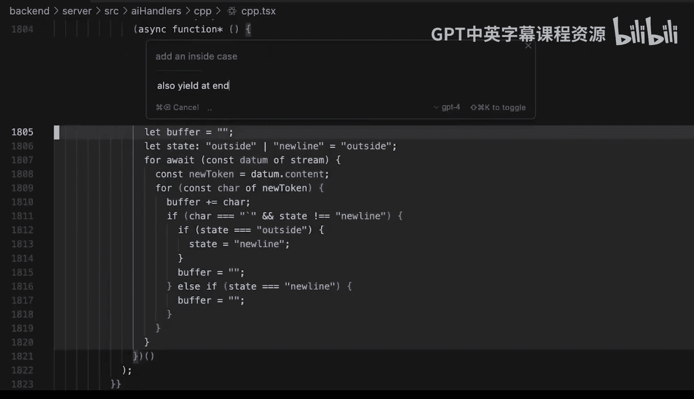

And today， or for a long time that's meant the place where you texted it a formal programming language and for people who aren't programmers。

 the way to think of a code editor is like a really souped up word processor for programmers where the reason it's soupped up is code has a lot of structure and so the quote unquoteword processor。

 the code editor。Can actually do a lot for you that word processors sort of in the writing space haven't been able to do for people editing text there and so you know that's everything from giving you visual differentiation of like the actual tokens in the code so you can scan it quickly to letting you navigate around the codebase sort of like you're naviating around the internet with like hyperperlinks you're going to sort of definitions of things you're using to error checking to catch rudimentary bugs。

UmAnd so traditionally， that's what a code editor has meant。And I think that。

What code editor is is going to change a lot over the next 10 years as what it means to build software maybe starts to look a bit different。

I think also coded should just be fun Yes， that is very important that is very important and it's actually sort of an underrated aspect of how we decide what to build like a lot of the things that we build and then we we try them out we do an experiment and then we actually throw them out because they're not fun and and so a big part of being fun is like being fast a lot of the time fast is fun Yeah fast yeah yeah that should be a t-shirt like fundamentally。

I think one of the things that draws a lot of people to building stuff on computers is this like insane integration speed where。

 you know in other disciplines， you might be sort of gate capped by resources or the ability。

 even the ability you know to get a large group together and coding is this like amazing thing where it's you in the computer and that alone you can build really cool stuff really quickly。

So for people don't know， cursor is this super cool new editor， that's the fork of VS code。

It would be interesting to get your kind of explanation of your own journey of editors how did you。

 I think all of you or were big fans of VS code with Copilot。How did you arrive to VS code？

How did that lead to your journey with cursor？I think a lot of us。

 all of us were originally Vm users， pure pure vi， Yeah， no Neimm， just pure vim in a terminal。

And at least， at least for myself。It was around the time that Co pilotlate came out。 So 2021 that。

I really wanted to try it。 So I went into V S code， the only platform。

 the only code editor in which it was available。 And even though I， you know。

 really enjoyed using themm， just the experience of co pilot with with V S code was。😊。

More than good enough to convince me to switch。 And so that kind of was the default until we started working on cursor。

 And maybe we should explain what Copa does。 It's like a really nice autocomple。It suggests。

 as you start writing a thing， it suggests one or two or three lines how to complete the thing。

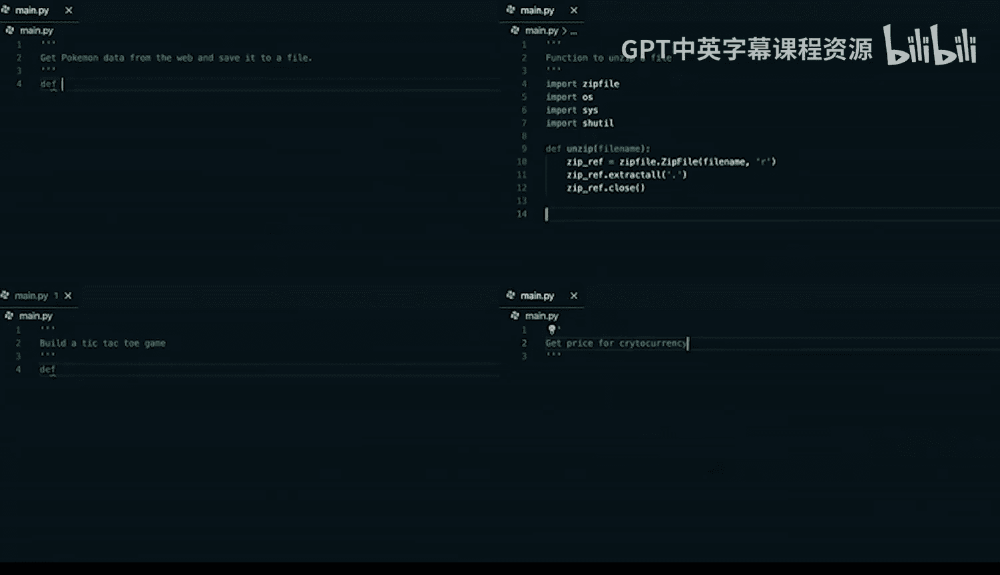

And theres a fun experience in that， you know， like when you have a close friendship and your friend completes your sentences like when it's done well。

 there's an intimate feeling there's probably a better word than intimate but there's' a cool feeling of like holy shit it gets me and then there's an unpleasant feeling when it doesn't get you And so there's that kind of friction but I would say for a lot of people the feeling that it gets me over powers that it doesn't And I think actually one of the underrated aspects of get up Co is that even when is wrong is like a little bit annoying。

 but it's not that bad because you just type another character and then maybe then it gets you or you type another character and then it gets you So even when it's wrong is not that bad Yeah you can sort of iterate and fix it I mean the other underrated part of copo it for me was just the first real real AI product It's like the first language model consumer product So cop pile was kind of like the first killer app for。

Yeahs， yeah， and like the Beto was out in 2021， right， okay。

 u so what's the the origin story of cursor so around 2020 the scaling loss papers came out from from open AI。

And that was a moment where this looked like clear predictable progress for the field where even if we didn't have any more ideas。

 it looked like you could make these models a lot better if you had more compute and more data by the way。

 we'll probably talk for three to four hours on the topic of scaling loss but just just to summarize it's a paper and a set of papers and set of ideas that say bigger might be better for model size and data size in the realm of machine learning it's bigger and better but predictably better Okay。

 this on the topic of conversation so around the time for some of us there were like a lot of conceptual conversations about。

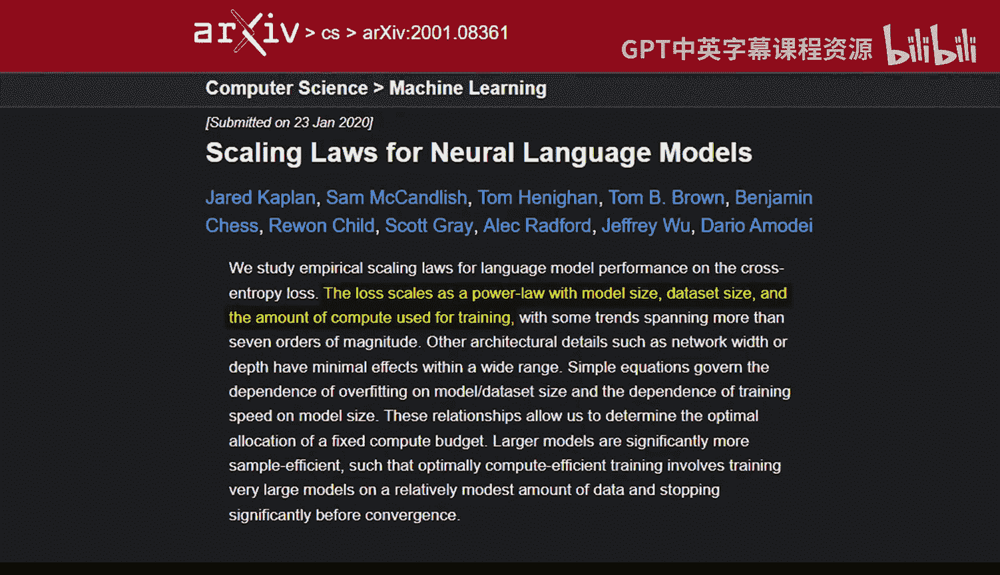

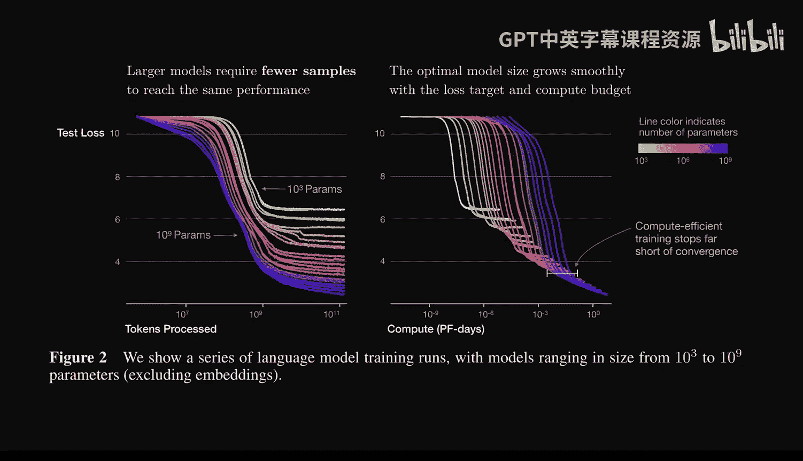

What's this going to look like， what's the story going to be for all these different knowledge worker fields about how they're going to be made better by this technology getting better？

And then I think there were a couple of moments where like the theoretical gains predicted in that paper started to feel really concrete and it started to feel like a moment where you could actually go and not do a PhD if you wanted to work on do useful work in AI actually felt like now there was this whole set of systems one could build that were really useful and I think that the first moment we already talked about a little bit which was playing with the early bit of Co like that was awesome and magical I think that the next big moment where everything kind of click together。

It was actually getting early access to GP4， so it was sort of end of 2022 was when we were tinkering with that model and the step of in capabilities felt enormous。

And previous to that， we had been working on a couple of different projects we had been because of Copilo。

 because of scaling odds， because of our prior interest in the technology。

 we had been tinkering around with tools for programmers but things that are like very specific so you know we were building tools for financial professionals you have to work with within in a Gpyter notebook or like playing around with can you do static analysis with these models and then the stuff up in G4 felt like look。

 that really made concrete the theoretical gains that we had predicted before felt like you could build a lot more just immediately at that point in time and also。

If we were being consistent， it really felt like this wasn't just gonna be a point solution thing。

 This was gonna to be all of programming was going to flow through these models。

 It felt like that demanded a different type of programming environment。

 a different type of programming。 And so we set off to build that that sort of larger vision around that There's one that I distinctly remember So my roommate is and then IMO gold winner and there's a competition in the US called the Putnam which is sort of the IMO for college people and is this math competition is exceptionally good So Shengtng and Amman I remember it's sort of sort of June June of 2022 had this bet on whether the like 2024 June or July you were going to win a gold medal in the IMO with like models IMO is and international Ma Olympian IMOs International Ma Olympia and so Arvind and I are both also competed in it so。

Was sort of personal and and I I remember thinking Matt is just this is not gonna happen This was like it was like even though I I sort of believed in progress。

 I thought， you know， I'm a girl just like a modest is delusional that was the that was the and and to be honest。

 I mean I I was to be clear， very wrong but that was maybe the most prescient bet in the group So the the new results on deep mind。

It turned out that you were correct。 That's what Well was technically not technically correct。

 But one point away， Aman was very enthusiastic about this stuff。

 Yeah and before Aman had this like scaling laws t shirt that he would walk around with where it had the like charts of like the formulas on it。

 So you like felt the A or you felt the。 Yeah， I distinctly remember there was this one conversation I had with Michael。

 where before it hadn't thought super deeply and critically about scaling laws。

 And he kind of posed the question， why isn't scaling all you need or why isn't scaling and result in massive gains and progress。

 And I think I went through like the like the stages of grief。

 there is anger denial And then finally at the end just thinking about it acceptance。😊。

And I think I've。Been quite hopeful and optimistic about progress since I think one thing I'll caveat is。

I think it also depends on like which domains you're going to see progress like math is a great domain because especially like formal they improving because you get this fantastic signal of actually verifying if the thing was correct and so this means something like Rl can work really really well and I think like you could have systems that are perhaps very superhuman to math and still not technically have AGI Okay so can we take it all the way to cursor and what is cursor it's a fork of VS code and VS code is one of the most popular editors for a long time like everybody fell in love with it everybody left Vim I left DMax for sorry so unified in some fundamental way the developer community and then you look at the space of things you look at the scaling laws AI is becoming amazing。

And you decided， okay， it's not enough to just write an extension fee of VS code。

Because there's a lot of limitations to that。we need if AI is going to keep getting better， better。

 better， we need to really like rethink how the AI is going to be part of the editing process。

 and so you decided to fork VS code and start to build a lot of the amazing features we'll be able to talk about but what was that decision like because there's a lot of extensions including Copiot？

Of V S code that are doing sort of AI type of stuff。

 What was the decision like to just fork V S code， So the decision to do an editor seemed。

Kind of self evident to us for at least what we wanted to do and achieve。

Because when we started working on the editor， the idea was these models are going to get much better。

 their capabilities are going to improve and it's going to entirely change how you build software。

 both in a you will have big productivity gains， but also radical now like the act of building software is going to change a lot。

And so you're very limited。In the control you have over a code editor if you're a plug into an existing coding environment and we didn't want to get locked in by those limitations。

 we wanted to be able to just build the most useful stuff Okay， well then the natural question is。😊。

You know， VS code is kind of with Copiit a competitor。So how do you win？

Iss it basically just the speed and the quality of the features Yeah， I mean。

 I think this is a space。That is quite interesting， perhaps quite unique where。

If you look at previous tech waves， maybe there's kind of one major thing that happened and unlock a new wave of companies。

 but every single year， every single model capability or jump you get model capabilities。

 you now unlock this new wave of features， things that are possible， especially in programming。

 and so I think in AI programming being even just a few months ahead， let alone a year ahead。

Makes your product much， much， much more useful。 I think the cursor a year from now will need to make the cursor of today look obsolete。

And I think， you know， Microsoft has done a number of like fantastic things。

 but I don't think they're in a great place to really keep innovating and pushing on this in the way that a startup can。

Just rapidly implementing features。And push， yeah， like and and kind of doing。

The research experimentation necessary。So really push the ceiling。 I don。

 I don't know if I think of it in terms of features as I think of it in terms of like capabilities for。

 for programmers， it's that like， you know， as。You know。

 the new one model came out and I'm sure there were going to be more。

 more models of different types like longer context and maybe faster。 like there's all these。

Crazy ideas that you can try。 and hopefully 10% of the crazy ideas will make it into something kind of cool and useful and。

We want people to have that sooner to rephrase， it's like an underrated fact is we're making it for ourselves when we started cursor。

 you really felt this frustration that， you know， models you could see models getting better。

But the Cobalt experience had not changed。It's like man this these guys like the ceiling is getting higher like why is they not making you think like they should be making you things they should be like he like like where' where's where's all the alpha features there there were no alpha features it was like。

I'm sure it was selling well， I'm sure it was a great business。

 but it didn't feel I'm one of these people that really want to try and use new things and it was like just there's no new thing for like a very long while Yeah。

 it's interesting I don't know how you put that into words， but when you compare a cursor with cop。

Coilot pretty quickly became started to feel stale for some reason Yeah I think one thing that I think helps us is that we're sort of doing it all in one where we're developing the UX and the way you interact with the model at the same time as we're developing like how we actually make the model give better answers so like how you build up the prompt or like how do you find the context and for a cursor tab like how do you train the model So I think that helps us to have all of it like sort of like the same people working on the entire experience and trend Yeah it's like the person making the UI and the person training the model like sit to like 18 feet away the same person even Yeah often often in the same person。

You can， you can create things that that are sort of not possible if you're not you're not talking you're not experimenting and you're using。

 like you said， cursor to write cursor of course， oh yeah。

 yeah well let's talk about some of these features Let's talk about the all knowing the all powerful praise be to the tab for the you know autocomplete on Stoids。

Basically， so how does Tab work， what does tabab to highlight and summarizemar areas at a high level。

 I'd say that there are two things that cursor is pretty good at right now。

 there are other things that it does， but two things that it helps programmers with。

One is this idea of looking over your shoulder and being like a really fast colleague who can kind of jump ahead of you and type and figure out what you're going to do next and that was the original idea behind that was kind of the kernel the idea behind good autocompte was predicting what you're going to do next。

 but you can make that concept even more ambitious by not just predicting the characters after your cursor actually predicting the next entire change you're going to make the next di。

 next place you're going to jump to。嗯。😊，And the second thing。Kser is pretty good out right now too。

 is helping you sometimes jump ahead of the AI。And tell it what to do and go from instructions to code。

And on both of those， we've done a lot of forkcon making the editing experience for those things ergonomic and also making those things smart and fast。

One of the things we really wanted was we wanted the model to be able to edit code for us。

 That was kind of a wish。 And we had multiple attempts at it before。

 before we had a sort of a good model that could edit code for you。

Then after after we had a good model， I think there have been a lot of effort to make the inference fast for。

 you know， having having a good， good experience。And。We've been starting to incorporate， I mean。

 Michael sort of mentioned this like ability to jump to different places and that jump to different places。

 I think came from a feeling of， you know， once you once you accept an edit。嗯。😊，It was like man。

 it should be just really obvious where to go next it's like it's like I made this change the model should just know that like the next place to go to is like 18 lines down like if you're if you're a wim user。

 you could press 1，8 JJ or whatever。But like why， why even， why am I doing this like the model。

 the model should just know it。 And then so so the idea was， show you just press tab。

 I would go 18 lines down and then make it would show you show you the next edit and you would press tab So it was just you as long as you could keep pressing tab then so the internal competition was how many tabs can we make someone press once you have like the idea more。

 more sort of。Abstractly， the， the thing to think about is sort of like once。

 how how how are the edits sort of0，0 entropy。 So once you've sort of expressed your intent and the edit is。

There's no like new bits of information to finish your thought。

 but you still have to type some characters to like make the computer understand what you're actually thinking then maybe the model you just sort of read your mind and and all those zero entropy bits should just beat like tab way Yeah's sort of the abstract there's an interesting thing where if you look at language model loss on different domains I believe the bits per byte which is a kind of character normalize loss for code is lower than language which means in general。

 there are a lot of tokens and code that are super predictable a lot of characters that are super predictable and this is。

 I think even magnified when you're not just trying to autocomplete code but predicting what the user is going to do next in their editing of existing code and so you know the goal of cursor tabs。

 let's eliminate all the low entropy actions you take inside of the editor when then Tt is effectively determined。

 let's just jump you forward in time， skip you forward。Well， well。

 what's the intuition and what's the technical details of how to do next cursor prediction of the that jump that's not。

 that's not so intuitive， I think the people。 Yeah。

 I think I can speak to a few of the details on how， how to make these things work。

 They're incredibly low latency。 So you need to train small models on this on this task in particular。

They're incredibly prefill token hungry。 What that means is they have these really。

 really long prompts where they see a lot of your code and they're not actually generating that many tokens。

 And so the perfect fit for that is using a sparse model， meaning an M model。

 So that was kind of one1 breakthrough one breakthrough remade that substantially improves performance at longer context。

 The other being。A variant of speculative decoding that we kind of built out called speculative edits These are two。

 I think， important pieces of what make it quite high quality and very fast Okay so Moe makes of experts the input is huge the output is small Yeah okay so like what else can you say about how to make is like caching play a role in caching caching plays a huge role because you're dealing with this many input tokens if every single keystroke that you're typing in a given line you had to rerun the model on all those tokens passed in you're just going to one significantly tograde latency to you're gonna kill your GPs with load So you need you need to design the actual prompts use for the model such that they're cache caching aware and then yeah you you need to reuse the Kvc across request just so that you're spending less work less compute。

Again， what are the things that Tab is supposed to be able to do kind of in the near term？

Just to like sort of linger on that。Genary code。Like， fill empty space。

Also edit code across multiple lines and then jump to different locations inside the same file and then like jump to different files also so if you make an edit in one file and。

Maybe maybe you have to go， maybe you have to go to another file to finish your thought it should it should go to the second file also。

Yeah， and then the full generalization is like next next action and prediction。

 like sometimes you need to run a command in the terminal and it should be able to suggest the command based on the code that you wrote to or sometimes you actually need to。

Like it suggests something but you it's hard for you to know if it's correct because you actually need some more information to learn like you need to know the type to be able to verify that is correct and maybe it should actually take you to a place that's like the definition of something and then take you back so that you have all the requisite knowledge to be able to accept the next completion so providing the human the knowledge yes。

Right， yeah， can you integrate like I just u gotten to know a guy named Prime Jen。

 who I believe has an SS， you can order coffee via SSH。Oh yeah， we did that We did that。

 So can that also the model do that like you and like and provide you with caffeine。 Okay。

 so that's the general framework。 Yeah then， and the the magic moment would be if。😊。

It is programming is this weird discipline where sometimes the next five minutes not always。

 but sometimes the next five minutes of what're going to do is actually predictable from the stuff you've done recently and so can you get to a world where that next five minutes either happens by you disengaging and it taking you through or maybe a little bit more of just you seeing next step what it's going to do and you're like okay that's good that's good that's good that's good and you can just sort of tap tap tap through these big changes as we're talking about this as you mentioned one of the really cool and noticeable things bio cursor is that there's this whole diff interface situation going on so like the model suggests。

With the red and the green of like here's how we're going to modify the code and in the chat window。

 you can apply and it shows you the diff and you can accept the diff。

 So maybe can you speak to whatever direction of that We'll probably have like four or five different kinds of diffs we we have optimized the diff for the autocomplete。

 So that has a different diff interface then。Then when you're reviewing larger blocks of code。

And then we're trying to optimize another different thing for when you're doing multiple different files。

And and sort of at a high level， the difference for。When you're doing autocomplete。

 it should be really， really fast to read。Actually。

 it should be really fast to read in all situations but in autocomplet it sort of you're really like your eye focused in one area you can't be in too many the humans can't look in too many different places So you're talking about on the interface side on the interface So it currently has this box on the side so we have the current box and if you tries to delete code in some place and tries to add other code it tries to show you a box on the side you maybe show it if we pull it up and co This is what we're talking on So that box it was like three or four different attempts at trying to make this thing work where first the attempt was like blue crossed out line So before it was a box on the side it's used to show you the code you delete by showing you like Google doc style you would see like a line through it then you would see the new code。

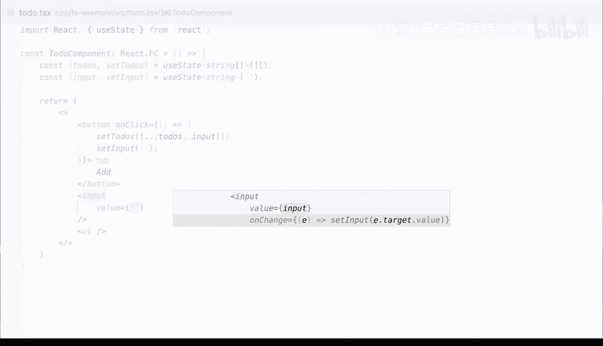

And that was super distracting。And then we tried many different you know。

 there was there was sort of deletions that was trying to red highlight。

 Then the next iteration of it， which is sort of funny would you would hold。The on Mac。

 the option button， so it would it would sort of highlight a region of code to show you that there might be something coming。

So maybe in this example， like the input and the value。Would get would all get blue。

And the blue would to highlight that the AI had a suggestion for you。

So instead of directly showing you the thing it would show you that the AI it would just hint that the AI had a suggestion and if you really wanted to see it you would hold the option button and then you would see the new suggestion if you release the option button you would then see the original code so that's by the way that's pretty nice but you have to know to hold the option button by the way'm not a Mac user but I got it was it was a button I guess you people have it's you knows again it's it's just nonintuitive I think that's that's the key thing and there's a chance this is also not the final version of it I am personally very excited for。

Making a lot of improvements in this area like we we often talk about it as the verification problem where these dips are great for small edits for large edits or like when it's multiple files or something it's actually。

😊，A little bit prohibitive to review these dis。And so there are like a couple of different ideas here like one idea that we have is okay。

 you know like parts of the diffs are important， they have a lot of information and then parts of the diff are just very low entropy they're like like the same thing over and over again and so maybe you can highlight the important pieces and then gray out the not so important pieces or maybe you can have a model that looks at the diff and and sees oh there's a likely bug here I will like mark this with a little red sququiggly and say like you should probably like review this part of the diff and ideas in that vein I think are exciting Yeah that's a really fascinating space of like UX design engineering so you basically try to guide the human programmer through all the things they need to read and nothing more like optimally Yeah and you want an intelligent model to do it like currently dis diff algorithms are they're like。

like there are just like normal algorithms。 There is no intelligence。

 There's like intelligence that went into designing the algorithm。

 but then there there is no like you don't care if if it's about this thing or this thing as you want a model to to do this。

 So I think the the the general question is like。Mat。

 these models are going to get much smarter as the models get much smarter。

 the changes they will be able to propose are much bigger。

So as the changes gets bigger and bigger and bigger。

 the humans have to do more and more more verification work。

 it gets more and more more hard like it's just you need， you need to help them out its sort of。

I I don't want to spend all my time reviewing good。

can you say a little more across multiple files div Yeah。

 I mean so Github tries solve this right with code review when you're doing code review。

 you're reviewing multiple dis across multiple files， but like Arvid had said earlier， I think。

You can do much better than code review。 You know， code review kind of sucks like you spend a lot of time trying to gck this code that's often quite unfamiliar to you and。

It often like doesn't even actually catch that many bugs and I think you can significantly improve that review experience using language models。

 for example， using the kinds of tricks that A had described of maybe pointing you towards the regions that actually matter。

I think also if the code is produced by these language models and it's not produced by someone else like。

The code review experience is。Design for both the reviewer and the person that produced the code。

In the case where the person that produced the code is the language model。

You don't have to care that much about their experience and you can design the entire thing around the reviewers。

 such about the reviewer's job。Is as fun， as easy as productive as possible。

But I think that that feels like the issue with just kind of naively trying to make。

These things look like code review I think you can be a lot more creative and push the boundary in what's possible just one one idea there is。

 I think ordering matters generally when you review a PR you you have this list of files and you're reviewing them from top to bottom but actually like you actually want to understand this part first because I came like logically first and then you want to understand the next part and you don't want to have to figure out that yourself。

 you want a model to guide you through the thing。And is the step of creation going to be more more natural language is the goal versus with actual I think sometimes I don't think it's going to be the case that all of programming will be natural language and the reason for that is you know if I'm pair programmingm with Sw wallet is that the computer in the keyboard and sometimes if I'm like driving I want to say to swallow hey like implement this function and that works and then sometimes it's just so annoying to explain to Swid what I want him to do and so I actually take over the keyboard and I show him I write like part of the example and then it makes sense and that's the easiest way to communicate and so I think that's also the case for AI like sometimes the easiest way to communicate with the AI will be to show an example and then it goes and does the thing everywhere else or sometimes if you're making a website for example the easiest way to show to the A what you want is not to tell it what to do but you know drag things around or draw things。

And yeah and and like maybe eventually we will get to like bring machine interfaces or whatever any kind of like understand where you're thinking And so I think natural language will have a place。

 I think it will not definitely not be the way most people program most of the time I'm really feeling the A with this editor It feels like there's a lot of machine learning going on underneath Tell me about some of the ML stuff that makes it all work where cursor really works via this ensemble of custom models that we frame alongside you know the frontier models that are fantastic at the reasoning intense things and so cursor tab for example is a great example of where you can specialize as models to be even better than even frontier models if you look at Es on the task we set it at The other domain which it's kind of surprising that requires custom models but it' kind of necessary and works quite well。

 is in apply。Um， so。I think these models are like the frontier models are quite good。

 It's sketching out plans for code and generating like rough sketches of like the change。

 but actually。Creating deaths is quite hard for frontier models， for your training models。Like。

You try to do this with Sonet with01 any frontier model and it really messes up stupid things like counting line numbers。

 especially in super， super large files and so what we've done to alleviate this is we let the model kind of sketch out this rough code block that indicates what the change will be。

And we train a model to then apply that change。To the file and we should say that apply is the model looks at your code。

 it gives you a really damn good suggestion of what new things to do。

And the seemingly for humans trivial step of。Combining the two you're saying is not so trivial Con to popular perception it is not a deterministic algorithm Yeah I think like you see shallow copies of apply elsewhere and it just breaks like most of the time because you think you can kind of try to do some deterministic matching and then it fails。

 you know。At least 40% of the time， and that just results in a terrible product experience。

I think in general， this， this regime of you are going to get smarter and smarter models。 And like。

 so one other thing that applied， it lets you do is it lets you。

Use fewer tokens with the most intelligent models。This is both expensive in terms of latency for generating all these tokens and cost。

So you can give this very very rough sketch and then have your model models go and implement it because it's a much easier task to implement this very。

 very sketched out code and I think that this regime will continue where you can use smarter and smallerer models to the planning and then maybe the implementation details can be handled by the less intelligent ones。

 perhaps you'll have you know maybe01， maybe it'll be even more capable models given and even higher level plan that is kind of recursively。

Applied by Sonet and then the applied model。 Maybe we should we should talk about how to how to make it fast。

 Yeah， you like Yeah， asked there's always an interesting pass。 Yeah， how do you make it fast。 Yeah。

 so one big component of making it fast is speculative edits。

 So speculative edits are a variant of speculative decoding and maybe be helpful to briefly describe speculative decoding with speculative decoding What you do is you you can kind of take advantage of the fact that。

😊，You know， most of the time and I'll add the caveat that it would be when you're memory bound in language model generation if you。

Process multiple tokens at once， it is faster than generating one token at a time。

 so this is like the same reason why if you look at tokens per second with prompt tokens versus generated tokens。

 it's much， much faster for prompt tokens。U。😊，So what we do is instead of using what speculative decoding normally does。

 which is using a really small model to predict these draft tokens that your larger model will then go in and verify。

With code edits， we have a very strong prior of what the existing code will look like and that prior is literally the same exact code so you can do is you could just feed chunks of the original code back into the model and then the model will just pretty much agree most of the time that okay I'm just going to spit this code back out and so you can process all of those lines in parallel and you just do this with sufficiently many chunks and then eventually you'll reach a point of disagreement where the model will now predict text that is different from the ground truth original code it'll generate those tokens and then we kind of will decide after enough tokens match the original code to re start speculating a chunks of code what this actually ends up looking like is just a much faster version of normal editing code So it's just like it looks like a much faster version of the model rewriting all the code so we can use the same exact interface that we use for dis but it will just stream down a lot faster。

And then， and then the advantages that wire wireless streaming， you can just also be reviewing。

 start reviewing the code before， before it's done。 So there's no， no big loading screen so。

Maybe that is part of the advantage。So the human can start reading before the thing is done I think the interesting riff here is something like like speculation is a fairly common idea nowadays。

 it's like not only in language models， I mean there's obviously speculation and CPUs and there's's like speculation for databases and there'ss like speculation all over the place。

Let me ask the sort of the ridiculous question of which LLM is better at coding， GT， Claude。

 who wins in the context of programming， and I'm sure the answer is much more nuanced because it sounds like every single part of this involves a different model。

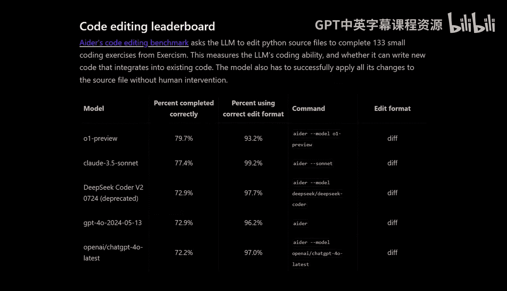

Yeah， I think there， there's no model that。Prato dominates others。

 meaning it is better in all categories that we think matter。 the categories being speed。

Ability to edit code， ability to process lots of code， long context， you know。

 a couple of other things and kind of coding capabilities。

The one that I'd say right now is just kind of net bestest is sonnet。

 I think this is a consensus opinion Our one's really interesting and it's really good at reasoning。

 so if you give it really hard programming interview style problems or lead code problems。

 it can do quite quite well on them， but it doesn't feel like it kind of understands your rough intent as well as sonnet does。

Like if you look at a lot of the other frontier models。

 one quo I have is it feels like they're not necessarily over I'm not saying they train on benchmarks。

 but they perform really well in benchmarks relative to kind of everything that's kind of in the middle So if you try in all these benchmarks and things that are in the distribution of the benchmarks they're evaluated on。

 you know， they'll do really well。 But when you push them a little bit outside of that。 So on it。

 I think the one that kind of does best at kind of maintaining that same capability。

 like you kind of have the same capability in the benchmark as when you try to instruct it to do anything with coding another ridiculous question is the difference between the normal programming experience versus what benchmarks represent Like where do benchmarks fall short do you think when we're evaluating these models by the way。

 that's like a really， really hards like like critically important detail like how different like benchmarks are versus versus like real coding where real coding。

It's not interview style coding。 It's your， you're doing these。You know。

 humans are saying like half broken English sometimes。 and sometimes you're saying like， oh。

 do what I did before。 sometimes you're saying， you know。

 go add this thing and then do this other thing for me and then make this UI element。 and then。

 you know， it's it's just。Of like a lot of things are sort of context dependent。

You really want to like understand the human and then do do what the human wants as opposed to sort of this。

 maybe the the way to put it is sort of abstractly is the interview problems are very。Well specified。

They lean lot on specification while the human stuff is less specified。Yeah。

 I think that this this benchmark question is both complicated by what S I just mentioned and then also to。

What Aman was getting into is that even if you like you know。

 there's this problem of like the skew between what can you actually model in a benchmark versus real programming and that can be sometimes hard to encapsulate because it's like real programming is like very messy and。

Sometimes things aren't Sp well specified what's correct or what isn't。

 but then it's also doubly hard because of this public benchmark problem and that's both because public benchmarks are sometimes kind of hill climbedbed on。

 but then it's like really， really hard to also get the data from the public benchmarks out of the models and so for instance。

 like one of the most popular like agent benchmarks S benchnch。

Is really really contaminated in the training data of these foundation models and so if you ask these foundation models to do a sweep benchch problem。

 you actually don't give them the context of a databasebase。

 they can like hallucinate the right file pass they can hallucinate the right function names and so that it's also just the public aspect of these things is tricky yeah like in that case it could be trained on the literal issues or pull requests themselves and maybe the lab will start to do a better job or they've already done a good job at dentaming those things but they're not going to omit the actual training data of the repository itself like these are all like some of the most popular Python repositories like SIimpPA is one example。

I don't think they're going to handicap their models on SII and all these popular Pythlon repositories in order to get true evaluation scores in these benchmarks I think that given the dearths in benchmarks there have been like a few interesting crutches that places that build systems with these models or build these models actually use to get a sense of are they going in the right direction or not and in a lot of places people will actually just have humans play with the things and give qualitative feedback on these like one or two of the foundation model companies they have people who that's a big part of their role and internally we also you qualitatively assess these models and actually lean on that a lot in addition to like privates that we have。

It's like the vibe， the vibe， yeah， the vibe vibe， the vibe benchmark， human benchmark， human。

 you pull in the humans to do a vibe check。 Yeah， okay， I mean。

 that's that's kind of what I do like just like reading online forums and Reddit and X just like。

I don't know how to。Properly lo in people's opinions because they'll say things like I feel like Claude or G's gotten dumber or something。

 they'll say， I feel like。And then I sometimes feel like that too。

 but I wonder if it's the model's problem or mine。Yeah， with Claude。

 there's an interesting take I heard where。I think。😊。

AWS has different chips and I suspect they have slightly different numers than NviIdia GPUs and someone speculated that Cla's de graded performance had to do with maybe using the quantize version that existed on AWS bedrock versus whatever was running on anthropics GPU I interview a bunch of people that have conspiracy theories I'm glad spoke to this conspiracy Well it's not not like conspiracy theory as much as they're just they're like they're you know humans humans are humans and's there's these details and you know you're doing。

Like this  crazyy amount of flops and， you know， chips are messy。

 and man you can just have bugs like bugs are。It's hard to overstate how hard bugs are to avoid。

What's the role of a good prompt in all this See we mentioned that benchmarks have really。

Stucd well formulated problems。What should a human be doing to maximize success？

And what's the importance of what the humans you wrote a blog post on， he called it prompt design。

Yeah， I think it depends on which model you're using and all of them are likely different and they respond differently to different prompts。

 but I think。The original GP4 and the original sort of pre models last year。

 they were quite sensitive to the pros， and they also had a very small context window。

And so we have all of these pieces of information around the codebase that would maybe be relevant in the prompt like you have the docs。

 you have the files that you add， you have the conversation history and then there's a problem like how do you decide what you actually put in the prompt and when you have a limited space and even for today's models even when you have long context。

 filling out the entire context window means that it's slower。

 it means that sometimes the model actually gets confused and some models get more confused than others and we have this one system internally that we call preempt which helps us with that a little bit and I think it was。

Built for the。Arrra before where we had 8000 token contact windows and it's a little bit similar to when you're making a website。

 you you sort of you want it to work on mobile， you want it to work on a desktop screen and you have this。

Dynamic information which you don't have， for example。

 if you're making like designing a print magazine you have like you know exactly where you can put stuff but when you have a website or when you have a prompt you have these inputs and then you need to format them to always work even if the input is really big then you might have to cut something down and and and so the idea was okay like let's take some inspiration what's the best way to design websites while the thing that we really like is is react and the declarative approach where you。

You use Jsx in ja and then you declare this is what I want。

 And I think this has higher priority or like this has higher Z index than something else。

 and then you have this rendering engine in web design is like Chrome and in our case it a preempter renderer which then fits everything onto the page and as you declared we decide what you want and then it figures out what you want。

 And as we have found that to be quite helpful。 And I think the role of it has sort of shifted over time where initially was to fit to these small context windows now it's really useful because you it helps us with。

Splitting up the data that goes into the prompt and the actual rendering of it and so it's easier to debug because you can change the rendering of the prompt and then try it on old prompt because you have the raw data that went into the prompt and then you can see did my change actually improve for like this entire evil set they do literally prompted JSX so it kind of looks like react there are components like we have one component that's file a component and it takes in like the cursor like usually there's like one line where the cursor is in your file and that's like probably the most important line because that's one you're looking at and so then you can give priorities so like that line has the highest priority and then you subtract one for every line that is farther away and then eventually when it's rendered it figure out how many lines can actually fit in it centers around that thing that's amazing and you can do like other fancy things where if you have lots of code blocks from the entire code base you could use retrieval。

s like embedding and reraking scores to add priorities for you to these components。So should humans。

 when they ask questions， also use， try to use something like that， like would it be beneficial？

To write JSX in the and the problem or the whole idea should be loose and messy I think our goal is kind of that you should just do whatever is the most natural thing for you and then we our job is different figure out Sure how do we actually like retrieve the relative event think so that your thing actually make sense Well this is sort of the discussion I had with Arvin of perplexity is like his whole idea like you should let the person be as lazy Yeah but like。

Yet， that's a beautiful thing。But I feel like you're allowed to ask more programmers， right。

 so like if you say just do what you want， I mean， humans are lazy。

There's a kind of tension between just being lazy versus like provide more as。

Be prompted almost like the system pressuring you or inspiring you to be articulate。

 not in terms of the grammar of the sentences， but in terms of the depth of thoughts that you convey inside the the prompt。

 I think even as the system gets closer to some level of perfection。

Often when you ask the model for something you just are not not enough intent is conveyed to know what to do and there are like a few ways to resolve that intent one is the simple thing of having models just ask you I'm not sure how to do these parts based in your query could you clarify that I think the other could be maybe。

If you， there are five or six possible generations。

 given the uncertainty present in your query so far。

 why don't we just actually show you all of those and let you pick them？

How hard is it to for the model to choose to speak， talk back？

Sort of versuss that's hard sort of like how to deal with the uncertainty。

Do I do I choose to ask for more information to reduce the ambiguity， So， I mean。

 one of the things we we do is it's like a recent addition is try to suggest files that you can add。

 So and while you're typing。One can guess what the uncertainty is and maybe suggest that like。

 you know， maybe maybe you're writing your API。And。We can guess using the commits。

That you have made previously in the same file that the client and the server is super useful。

There's like a hard technical problem of how do you resolve it across all commits。

 which files are the most important given your current prompt and we still sort of initial version is rolledd out and I'm sure we can make it much more accurate。

It'ss it's very experimental， but then the ideas is we show you like。

 do you just want to add this file， this file， this file also to tell。

 you know the model to edit those files for you。Because if you maybe you're making the API。

 like you should also edit the client and the server that is using the API and the other one resolving the API so that will be kind of cool both there's the phase where you're writing a prompt and there's before you even click enter maybe we can help resolve some of the uncertainty to what degree to use agent approaches。

 how useful for our agents。We think agents are really。

 really cool like I think agents is like it's like resembles sort of like a human it its sort of like the things like you can kind of feel that it like you're getting closer to AGI because you see a demo where it acts as as a human would and and it's really。

 really cool I think。Agents are not yet super useful for many things。 They。

 I think we we're getting close to where they will actually be useful and so。

I think there are certain types of tasks where having an agent would be really nice like I would love to have an agent。

 for example if like we have a bug where you sometimes can't command C and command V inside our chat input box and that's a task that's super well specified I just wanted to say like in two sentences this does not work please fix it and then I would love to have an agent that just goes off does it and then a day later I come back and I reviewed the thing you mean it goes finds the right file Yeah it finds the right files it like tries to reproduce the bug it like fixes the bug and then it verifies that it's correct and this is could be a process that takes a long time and so I think I would love to have that and then I think a lot of programming like there is often this belief that agents will take over all of programming。

I don't think we think that that's the case because a lot of programming。

 a lot of the value is in iterating or you don't actually want to specify something upfront because you don't really know what you want until you've seen an initial version and then you want to iterate on that and then you provide more information and so for a lot of programming I think you actually want a system that's instant that gives you an initial version instantly back and then you can iterate super super quickly。

What about something like that Rethink came out repple agent？

That does also like setting up the development environment and install software packages。

 configuring everything， configuring the databases and actually deploying the app Yeah is that also in the set of things you dream about I think so I think that would be really cool for certain types of programming it would be really cool I that within scope of cursor。

Yeah， we aren't actively working on it right now， but it's definitely like we want to make the programmerss life easier and more fun and some things are just really tedious and you need to go through a bunch of steps and you want to delegate that to an agent and then some things you can actually have an agent in the background while you're working like let's say you have a PR that's both backend and front end and you're working in the front end and then you can have a background agent that does't work and figure out kind of what you're doing and then when you get to the backend part of your PR then you have some like initial piece of code that you can iterate on。

And so that would also be really cool。One of the things we' already talked about is speed。

 but I wonder if we can just linger on that some more in the various places that the technical details involved in making this thing really fast。

 So every single aspect of cursor， Most aspects of curor feel really fast Like I mentioned。

 the apply is probably the slowest thing for me from the pain it's a pain It's a pain that we're feeling and we're working and fixing it Yeah。

 I mean， it says something that something that feels。

 I don't know what it is like one second or two seconds that feels slow。

 that means that's actually shows that everything else is just really， really fast。

 So is there some technical details about how to make some of these models how to make the chat fast。

 how to make。The dis fast is there something that just jumps to mind Yeah， I mean。

 so we can go over a lot of the strategies that we use one interesting thing is cache warming and so what you can do is if as the user is typing you can have。

Yeah you're probably going to use some piece of context and you can know that before the user's done typing so you know as we discussed before reusing the KVc results in lower latency。

 lower costs cross requests so as the user starts typing。

 you can immediately warm the cache with like let's say the current file contents and then when they press enter there's very few tokens it actually has to prefill and compute before starting the generation。

 this will significantly lower TTF can you explain how KVc works Yeah so the way transformers work like I mean like one of the mechanisms that allow transformers to not just independently like the mechanism that allows transformers to not just independently look at each token but see previous tokens are the keys and values to tension and generally the way attention works is you have at your current token some query and then you've all the keys and values of all your preview。

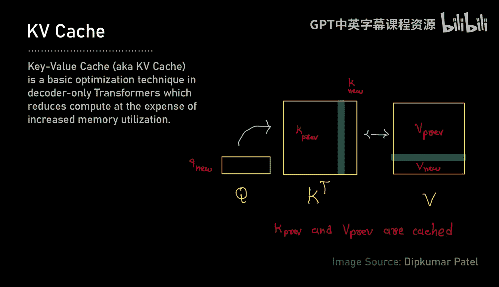

Tokens， which are some kind of representation that the model stores internally of all the previous tokens in the prompt。

And。😊，Like by default， when you're doing a chat， the model has to for every single token do this for pass through the entire model that's a lot of matrix multiplies that happen and that is really。

 really slow。 Instead， if you have already done that and you stored the keys and values and you keep that in the GPU。

Then when I'm， let's say I have sort for the last end tokens。

 if I now want to compute the output token for the n plus one token。

 I don't need to pass those first n tokens through the entire model because I already have all those keys and values and so you just need to do the forward pass through that last token and then when you're doing attention you're reusing those keys and values that have been computed。

 which is the only kind of sequential part or sequentially dependent part of the transformer I there like higher level caching of like caching of the problems or that kind of stuff I help Yeah there's other types of caching you can kind of do。

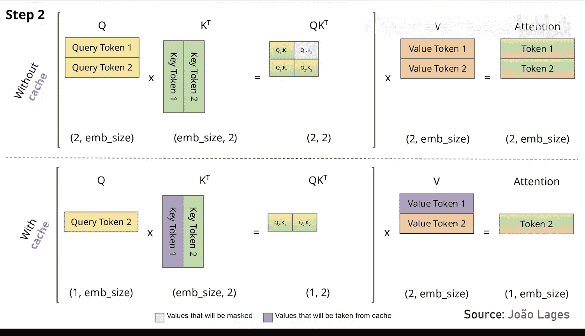

One interesting thing that you can do for cursor tab is。

You can basically predict ahead as if the user would have accepted the suggestion and then trigger another request。

And so then you've cache， you've done the speculative it's a mix of speculation and caching right because you're speculating what would happen if they accepted it and then you have this value that is cash。

 this suggestion and then when they press tab， the next one would be waiting for them immediately it's a kind of clever Heuristic trick that uses a higher level caching and can give it feels fast despite there're not actually being any changes in the model and if you can make the TV cache smaller。

 one of the advantages you get is like maybe maybe you can speculate it even more maybe you can guess here's the 10 things that could be useful predict the next 10 and it's possible the user hits one of the 10 it's like much higher chance than the user hits like the exact one that you show them maybe they the  typeping other character and we sort hit something else into cache there's all these tricks where。

嗯。The general phenomena here is。I think it's also super useful for RL is， you know。

Maybe a single sample from the model isn't very good， but if you predict。

Like 10 different things turns out that one of the 10 that's right is the probability is much higher。

 there's these passive K curves and you know part of RL like what RL does is。And you can。

 you can exploit this passive K phenomena to， to make many different predictions and and。

One one way to think about this， the model sort of knows internally has like has some uncertainty over like which of the key things is correct or like which of the key things does the human wants when we areL are。

You know， cursor tab model。And one of the things we're doing is we're predicting。

Wwhichch like which of the hundred different suggestions the model produces is more amenable for humans like which of them do humans more like than other things maybe maybe like there's something where the model can predict very far ahead versus like a little bit and maybe somewhere in the middle and and and then you can give a reward to the things that humans would like more and sort of punish the things that it would like and sort of then train the model to output the suggestions that humans would like more you have these like RL loops that are very useful that exploit these passage K curves Oman maybe can can go into even more detail Yeah it's little it is a little different than speed but I mean like technically you tied back in because you can get away at the smaller model if you arel your smaller model and gets the same performance as the bigger one。

U。That's like， and， and so I was mentioning stuff about。

KB about reducing the size of your KB cache there are other techniques there as well。

 they're really helpful for speed so kind of back in the day like all the way two years ago。

 people mainly use multied attention and I think there's been a migration towards more efficient attention schemes like group query or multi queryry attention and this is really helpful for then with larger batch sizes being able to generate the tokens much faster the interesting thing here is this now has no effect on that time to first token prefill speed the thing this matters for is now generating tokens why is that because when you're generating tokens instead of being bottlenecked by doing these superparizable matrix multiplies across all your tokens your bottleneck by how quickly for long context with large batch size is by how quickly you can read those cache keys and。

I'll use。And so then how that's memory bandwidth and how can we make this faster。

 we can try to compress the size of these keys and values so multi query attention is the most aggressive of these where normally with multi head attention you have some number of quote unquote attention heads。

😊，In some number of kind of query query heads， multi query just preserves the query heads。

 gets rid of all the key value heads， so there's only one kind of key value head and there's all the remaining query heads。

With group query， you instead you know， preserve all the query heads and then your。

Keys and values are kind of in there are fewer heads for the keys and values。

 but you're not reducing it's just one， but anyways。

 like the whole point here is you're just reducing the size of your Kd cash。And then there is Emily。

Yeah， multilant， that's a little more complicated and the way that this works is it kind of turns the entirety of your keys and values across all your heads into this kind of one latent vector。

That is then kind of expanded in for time。 But MLA is from this company called Deepseek。

 it's quite an interesting algorithm。 Maybe the key idea is sort of。In both MQA and in other places。

 what you're doing is you're sort of reducing the like the number of KV heads。

 and the advantage you get from that is。Is you know， there's less of them。

 but maybe the theory is that you actually want a lot of different。

 like you want each of the the keys and values to actually be different。

 So one way to reduce the size is you keep。One big shared vector for all the keys and values。

 and then you have smaller vectors for every single token so that when you you can you can store the only the smaller thing Theres some sort of like lower rank reduction and the lower rank reduction will that and at the end of the time when you when you eventually want to compute the final thing remember that like your memory bound。

 which means that like you still have some some compute left that you can use for these things and sort of you can expand the。

De latent vector backout and somehow like this is far more efficient because。

Just like you're reducing like， for example， maybe like reducing deck 32 or something like the size of the vector that you're keeping。

 Yeah， there's perhaps some richness in having a separate set of keys and values and query that kind of pairwise matchup versus compressing that onto into one。

And that interaction， at least。Okay， and all of that is dealing with being memory bound and。What。

 I mean， ultimately， how does that map to the user experience trying to get the Yeah。

 the the two things that a maps to is you can now make your cache a lot larger because you've。

Le space allocated for the KV cache you can cache a lot more aggressively and a lot more things。

 So you get more cash hits， which are helpful for reducing the time to first token for the reasons were kind of described earlier。

 And then the second being when you。Start doing inference with more and more requests and larger and larger batch sizes。

 you don't see much of a slowdown in as it's generating the tokens the speed of that it also allows you to make your prompt bigger for certain yeah so like the basic the size of your kvc is both the size of all your prompts multiply by the number of prompt process and parallel so you could increase either of those dimensions the batch size or the size of your prompts without degrading the latency of generating tokens right you wrote a blog post shadow workspace iterating on code in the background so what's going on so to be clear we want there to be a lot of stuff happening in the background and we're experimenting with a lot of things right now we don't have much stuff happening other than like the cache warming or like you know figuring out the right context that goes into your comm prompts for example but the idea is if you can actually spent computation in the background then you can help。

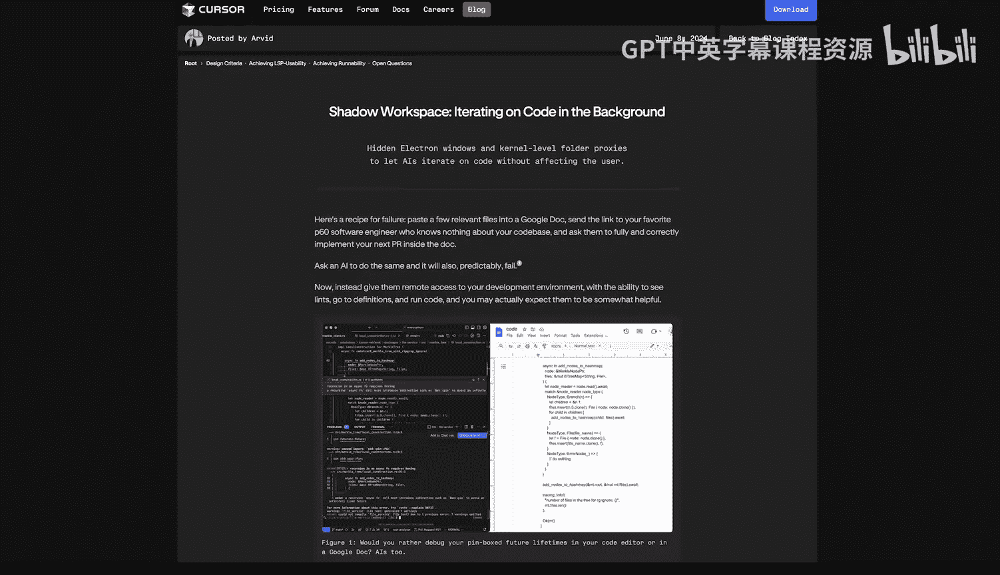

嗯。😊，Help the user maybe like at a slightly longer time horizon than just predicting the next few lines that you're gonna to make。

 but actually like in the next 10 minutes， whatever you're going to make and by doing it the background。

 you can spend more computation doing that and so the idea of the shadow workspace that we implemented and we use it internally for like experiments is that to actually get advantage of doing stuff in the background you one some kind of feedback signal to give back to the model because otherwise like you can get higher performance by just letting the model think for longer and so like01 is a good example of that but another way you can improve performance is by letting the model。

Iterate and get feedback and and so one very important piece of feedback when you're a programmer is the language server。

 which is。This thing it exists for most different languages and there's like a separate language server per language and it can tell you。

 you know you're using the wrong type here and then gives you an error or it can allow you to go to definition it sort of understands the structure of your code So language servers are extensions developed by like there's a typepescript language serverdeveloped by the TpeScr people Ru language server developed by the rest people and then the all interface over the language server protocol to a VS code so that VS code doesn't need to have all of the different languages built into VS code but rather you can use the existing compiler infrastructure for Liing purposes's it's for Linting it's for going to definition and if we' like seeing the right types that you're using doing like type checking also Yes type checking and going to references and that's like when you're working in a big project you kind of need that if you don't have that it's like really hard to code in a big project Can you say again how that's being used inside。

language server protocol communication thing So is's being used in cursor to show to the programmer just like NVS code but then the idea is you want to show that same information to the models the I models and you want to do that in a way that doesn't affect the user because you want to do it in background and so the idea behind the chatter workspace was okay like one way we can do this is we spawn a separate window of cursor that's hidden and so you can set this flag electron is hidden there is a window but you don't actually see it and inside of this window the AI agents can modify code however they want as long as they don't save it because it's still the same folder and then can get feedback from the Ls and go to definition and iterate under code like literally run everything in the background like as if maybe even run the code so that's the eventual version that's what you want and a lot of the blog post is actually about。

How do you make that happen because it's a little bit tricky。

 you want it to be on the user's machines so that it exactly mirrors the user's environment and then on Linux you can do this cool thing where you can actually mirror the file system and have the AI make changes to the files and it thinks that it's operating on the file level but actually that's stored in memory you can create this kernel extension to make it work whereas on Mac and Windows it's a little bit more difficult and but it's a fun technical problem that way one maybe be hacky but interesting idea that I like is holding a lock on saving and so basically you can then have the language model kind of whole but lock un savingaving to disk and then instead of you operating in the ground truth version of the files that are safe to disk。

 you actually are operating what was the shadow work before and these unsaavfe things that only。

istent memory that you still get L errors for and you can code in and then when you try to maybe run code。

 it's just like there's a small warning that there's a lock and then you kind of will take back the lock from the language server if you're trying to do things concurrently or from the shadow workspace if you're trying to do things concurrently that's such an exciting future。

 by the way， it's a bit of a tangent but like to allow a model to change files。It's scary for people。

But like it's really cool to be able to just like let the agent do a set of tasks and you come back the next day。

And kind of observe like it's a colleague or something like that and I think there may be different versions of like runability where for the simple things where you're doing things in the span of a few minutes on behalf of the user as they' programming it makes sense to make something work locally in their machine I think for the more aggressive things where you're making larger changes that take longer periods of time you'll probably want to do this in some sandbox remote environment and that's another incredibly tricky problem of how do you exactly reproduce or mostly reproduce to the point of it being effectively equivalent for running code。

 the user's environment with this remote sandbox I'm curious what kind of agency you want for coding do you want them to find bugs do you want them to like implement new features like what agents do you want So by the way。

 when I think about agents that don't think just about coding I think so for the practices this particular podcast this video editing and a lot of if you look in Adobe。

A lot of there's code behind it's very poorly documented code。

 but you can interact with Premiere for example， using code and basically all the uploading。

 everything I do on YouTube， everything as you could probably imagine I do all of that through code and including translation and overdoubing all of this so I envision all of those kinds of tasks so automating many of the tasks that don't have to do directly with the editing so that okay that's what I was thinking about but in terms of。

Coding， I would be fundamentally thinking about bug finding。

Like many levels of kind of bug finding and also bug finding like logical bugs。

 not logical like spiritual bugs or something ones like sort of big directions of implementation。

 that kind of stuff。Ma Joe buying on bugfinding， Yeah， I mean。

 it's really interesting that these models are so bad at bug findingding when just naively prompted to find a bug。

 they're incredibly poorly calibrated even the the smartest model exactly even0 even0 one。

 how do you explain that？Is there a good intuition？

I think these models are really strong reflection of the pretraining distribution and I do think they generalize as the loss gets lower and lower。

 but I don't think the loss and the scale is quite or the loss is low enough such that they're like really fully generalizing encode like the things that we use these things for。

 the frontier models。That they're quite good at are really cogen and question answering and these things exist in massive quantities and pretraining with all of the code and Github and the scale of many。

 many trillions of tokens and questions and answers on things like stack up orflow and maybe Github issues and so。

When you try to push into these things that really don't exist very much online， like， for example。

 the cursor tab objective but predicting the next edit， given the edit's done so far。

 the brittleness kind of shows and then bug detection is another great example where there aren't really that many examples of like actually detecting real bugs and then proposing fixes。

And the models just kind of like really struggle at it。

But I think it's a question of transferring the model。

 like in the same way that you get this fantastic transfer from pretrained models just on code in general to the cursor tab objective。

 you'll see a very， very similar thing with generalized models that are really good to code to bug detection。

 it just takes like a little bit of kind of nudging in that direction Like to be clear。

 I think they sort of understand code really well like while they're being pretrained like the representation that's being built up like almost certainly like somewhere in the stream。

 there's。The model knows that maybe there's there's some something sketchy going on right it sort of has some sketchiness。

 but actually eliciting the sketchiness to。like actually like part part of it is that humans are really calibrated on which bugs are really important It's not just actually it's not just actually saying like there's something sketchy it's like it's just a sketchy trivial。

 it's this sketchy like you're gonna take the server down it' just like like part of it is maybe the cultural knowledge of like why is the staff engineer staff engineer a staff engineer is good because they know that three years ago like someone wrote a really you know sketchy piece of code that took took the server down and as opposed to like as opposed to maybe there's like you know you' just。

This thing is like an experiment。 So like a few bugs are fine。

 Like you're just trying to experiment and get the feel of the thing。

 And so if the model gets really annoying when you're writing an experiment， that's really bad。

 But if you're writing something for super production， you're like writing a database， right。

' you're writing code in Postgres or Linux or whatever， like your Linus Torvals。

'' it's sort of unacceptable to have even in that case and just having the calibration of like。

How paranoid is the user like， but even then， like if you're putting in a maximum paranoia。

 it still just like doesn't quite get it Yeah， yeah， yeah， I mean， but it's hard for humans too。

 to understand what which line of code is important which is not like you。

 I think one of your principles on a website says if if a code can do a lot of damage。

One should add a comment that' say this line of code is dangerous。

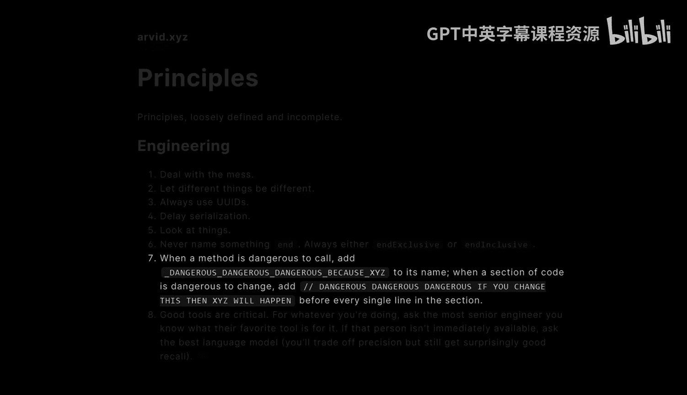

And all caps 10 times no you say like for every single line of code inside the function you have to and that's quite profound that says something about human beings because the engineers move on even the same person might just forget how it can sync the Titanic a single function liket you might not intuit that quite clearly by looking at the single piece of code Yeah and I think that one is also partially also for today's AI models where if you actually write dangerous。

 dangerous， dangerous and every single line like the models will pay more attention to that and will be more likely to find bugs in that region that's actually just straight up a really good practice of labeling code of how much damage this can do。

Yeah， I mean， it's controversial。 I some people think it's ugly swallow。 I actually think it's。

 it's like， in fact， I actually think this is one of the things I learned from our of it is。

 you know， like I sort of aesthetically。 I don't like it。

 But I think there's certainly something where like it's。

 it's useful for the models And and humans just forget a lot。

 And it's really easy to make a small mistake and cause like。😊，Bring on， you know。

 like just bring on the server and like you like。of course we we like test a lot and whatever。 but。

 there's always these things that you have to be very careful。 Yeah。

 like with just normal doc strings， I think people will often just skim it when making a change and think。

 oh， I I know how to do this and you kind of really need to point it out to them so that that doesn't slip through。

Yeah， you have to be reminded that you could do a lot of damage。

That's like we don't really think about that like yeah， you think about， okay。

 how do I figure out how this works so I can improve it。

 you don't think about the other direction that it could do this until until we have formal verification for everything。

Then you can do whatever you want and you know for certain that you have not introduced a bug if the proof pass conly what do you think that future would look like I think people will just not write tests anymore and the model will suggest like you write a function。

 the model will suggest a spec and you review the spec and in the meantime smart reasoning model computes a proof that the implementation follows the spec and I think that happens for most functions if you think this gets a little bit some of the stuff you were talking about earlier with the difficulty of specifying intent for what you want with software where sometimes it might be because the intent is really hard to specify it's also then going to be really hard to prove that it's actually matching whatever your intent is like you think that spec is hard to generate。

Yeah， or just like。For a given spec， maybe you can， I think there is a question of like。

 can you actually do the formal verification， Like， that's like， is that possible。

 I think that there's like more to dig into there。 But then also， even if you have this spec。

 if you have this spec how do you you have the spec， I is the spec written in natural language。

 Yeah How is No， this spec spec would be formal。But how easy would then I think that you care about things that are not going to be easily well specified in the spec language I see I see would be yeah。

 maybe an argument against formal verification is all you need。 Yeah。

 the worry is there's this massive replacing replacing something like unes， Sure， yeah yeah。

I think you can probably also evolve the spec languages to capture some of the things。

They don't really capture right now but I don't know。

 I think it's very exciting and you're speaking not just about like single functions。

 you're speaking about entire code basiss。 I think entire code basis is harder。

 but that that is what I would love to have and I think should be possible and because you can even there there's like a lot of work recently where you can prove。

😊，Formerly verify down to the hardware so like through you formally verify the C code and then you formally verify through the GCC compiler and then through the very log down to the hardware and that's like incredibly big system but it actually works and I think big code basis are sort of similar in that they're like multilayered system and if you can decompose it and formally verify each parts then I think it should be possible I think the specification problem is a real problem but how do you handle side effects or how do you handle I guess external dependencies like calling Stripe API maybe Stripe would right expect for it but you do this for everything like can you do this for everything you use like how how do you do it if there's a language like maybe maybe like people use language models as primitives in the program right and there's like a dependence on it and how do you now include that I think you might be able to prove that still。

Prove what about language models， I think if it feels possible that you could actually prove that a language model is aligned。

 for example， or like you can prove that it actually gives the the right answer。Um。

 there's the dream， yeah， that is， I mean， that's if it's possible。

It's your I have a dream speech if it's possible that will certainly help with you know。

 making sure your code doesn't have bugs and making sure AI doesn't destroy all human civilization。

 So the the full spectrum of AI safety to just bug finding So you said the models struggle with bug finding what's the hope you know my hope initially is and and I can let Michael Michael chime into。

 but its like there's。It should， you know， first help with the stupid bugs like it should query quickly catch the stupid bugs like off by one editor。

 like sometimes you write something in a comment and do the other way。 It's like very common。

 Like I do this。 I writes like less than in a comment。

 And like I maybe be write to creator than or something I。And the model is like， it looks sketchy。

 like， did you sure you want to do that？But eventually you should be able to catch harder bucks to you。

Yeah， and I think that。It's also important to note that this is。

Having good bug finding models feels necessary to get to the highest reaches of having AI do more and more programming for you where you're going to you know if AI is building more and more of the system for you。

 you need to not just generate but also verify and without that some of the problems that we've talked about before with programming with these models will just become untenable so it's not just for humans like you write a bug I write a bug find the bug for me but it's also being able to verify the AIs code and check it is really important Yeah and then how do you actually do this like we have had a lot of contentious dinner discussions of how do you actually screen a bug model but one very popular ideas you know it's kind of potentially easy to introduce a bug then actually finding the bug and so you can train a model to introduce bugs in existing code and then you can train a reverse bug model then that can find bugs using this synthetic data so that's like one example but。

There are lots of ideas for how to you can also you can also do a bunch of work。

 not even at the model level of taking the biggest models and then maybe giving them access to a lot of information that's not just the code like it's kind of a hard problem to stare at a file and be like where's the bug and that's hard for humans off end right and so often you have to run the code and being able to see things like traces and step through a bugger there's another whole nother direction where it kind of tends toward that and it could also be that there're kind of two different product form factors here。

 it could be that you have a really specialty model that's quite fast that's kind of running in the background and trying to spot bugs and it might be that sometimes sort of Harvardd's earlier example about some nefarious input box bug it might be that sometimes you want to you know there's a bug you're not just like checking hypothesis free you're like this is a problem I really want to solve it and you zap that with tons and tons and tons of compute and you're willing to put in like $50 to solve that bug or something even more have you thought about integrating money into this whole thing like I would pay probably a large amount of money for if you found a bug or even generated code。

I really appreciated like I had a moment a few days ago when I started using cursor or it generated。

perfecterect。Like perfect three functions for。Interacting with the YouTube API to update。

Cptions and for localization like in different languages。The API documentation is not very good。

 and the code across， like if I I Googled it for a while， I couldn't find exactly。

 there's a lot of confusing information。 and Cursor generated it perfectly。 And I was like。

 I just set back， I read the code。 I was like， this is correct。 I tested it。 is correct。 I was like。

 I want a tip。On on a button that goes here's $5， one that's really good just to support the company and support what its face is and the others that probably sends a strong signal like good job。

 right there'ss a much stronger signal than just accepting the code right。

 you just actually send like a strong good job that and for bug finding obviously like there's a lot of people you know。

 that would pay a huge amount of money for a bug like a bug bounty thing。Right。

 is that you guys think about that Yeah， it's a controversial idea inside the company。

 I think it sort of depends on how much you believe in humanity almostless you know like I think it would be really cool if like you spend nothing to try to find a bug and if it doesn't find a bug you spend zero And then if it does find a bug and you click accept then it also shows like in parentheses like$1 and you spend $1 to accept a bug and then of course there's a worry like okay we spend a lot of computation like maybe people will just copy paste I think that's a worry and then there is also the worry that like introducing money into the product makes it like kind of。

😊，You know， like it doesn't feel as fun anymore like you have to like think about money and and you all you want to think about is like the code and so maybe it actually makes more sense to separate it out and like you pay some fee like every month and then you get all of these things for free。

 but there could be a tipping component which is not like it still has that like dollar well I think it's fine but I also see the point where like。

Maybe you don't want to introduce it Yeah， I was gonna to say the moment that feels like people do this is when they share it when they have this fantastic example。

 they just kind of share it with their friends There is also a potential world where there's a technical solution to this like honor system problem too where if we can get to a place where we understand the output of the system more I mean to the stuff we were talking about with like you know error tracking with the LSP and then also running the code but if you could get to a place where you could actually somehow verify oh I have fix the bug maybe then the bouncy system doesn't need to rely on the honor system too how much interaction is there between the terminal and the code like how much information is gained from if you're on the code and the terminal。

Like， can you use， can you do like a？A loop where it runs runs the code and suggests how to change the code if the code and runtime gives an error。

Is right now they're separate worlds completely like I know you can do control K inside the terminal to help you write the code you can use terminal context as well inside of check man K kind of everything we don't have the looping part yet though we expect something like this could make a lot of sense there's a question of whether it happens in the foreground too or if it happens in the background like what we've been discussing Sure the background is pretty cool like can we do running the code in different ways plus there's a database side to this which how do you protect it from not modifying the database but okay。

I mean， there's there's certainly cool solutions there。

 there's this new API that is being developed for。It it's not in AWS。

 but you know it's certainly I think it's in Planet scale。

 I don't know if Planet scale was the first one to you add。

 it's dis sort of add branches to a database which is like if you're working on a feature and you want to test against the broad database but you don't actually want to test against the broad database you could sort of add a branch to the database and the way they do that is to add a branch to the right ahead log and there's obviously a lot of technical complexity in doing it correctly I guess database companies need new things to do they have a databases now and I think like Tbo buffer which is one of the databases we use as is going to add hope maybe branching to the righthead log。

And so so maybe maybe the the AI agents will use will use branching the' like test against them branch and it's sort of going to be a requirement for the database to like support branching or something be really interesting is you get branch of file system right。

 yeah I you like everything needs branching it's like that yeah yeah。

 like that's the problem with the multiverse， right？But like if you branch on everything。

 that's like a lot， I mean， there's， there's obviously these like super clever algorithmisms to make sure that you don't actually kind of use a lot of space or CPU or whatever。

Okay， this is a good place to ask about infrastructure So you guys mostly use AWS but what are some interesting details。

 what are some interesting challenges why did you choose AWS why why is AWS still winning hashtag AWS is just really really good is really good like。

Whenever。You use an AWS product。 You just know that it's going to work like it might be absolute hell to go through the steps to set it up。

 Why is the interface so horrible Because it's just so good It doesn't need the nature of winning I think use exactly it's just nature they're winning Yeah yeah。

 but AWs you can always trust like it will always work And if there is a problem。

 it's probably your problem。Yeah。Okay， is there some interesting like challenges to you guys a pretty new startup to scaling to like to so many people and yeah。

 I think that there it has been an interesting journey adding you know each extra zero to the request per second you run into all of these with like the general components you're using for caching and databases run into issues is you make things bigger and bigger and now we're at the scale where we get like into overflows on our tables and things like that and then also there have been some custom systems that we've built like for instance our retrieval system for computing a semantic index if your codebase and answering questions about a codebase that have continually I feel like one of the trickier things to scale I have a few friends who are super super senior engineers and one of their sort of lines is like it's very hard to predict where systems will break when you scaled them you can sort of。

Tryed to predict in advance， like there's there's always something weird that's going to happen when when you add this extra your you you thought you thought through everything which you didn't actually think through everything。

 but I think for that particular system we've。So for concrete details。

 the thing we do is obviously we upload when like we chunk up all of your code and then we send up sort of the code for embedding and we embed the code and then we store the embeddings in a database but we don't actually store any of the code and then there's reasons around making sure that we don't introduce client bugs because we're very。

 very paranoid by client bugs， we store much of the details on the server。

 like everything is sort of encrypted。So one of the technical challenges is always making sure that the local index。

 the local code base state， is the same as the state that is on the server。

And and the way sort of technically we ended up doing that is so for every single file。

 you can you can sort of keep this hash and then for every folder， you can sort of keep a hash。

 which is sort。The hash of all of its children and you can sort of recursively do that until the top and why why do something something complicated one thing you could do is you could keep a hash for every file then every minute you could try to download the hashes that are on the server。

 figure out what are the files that don't exist on the server， maybe you just created a new file。

 maybe you just deleted a files， maybe you checked out a new branch。

And try to reconcile the state between the client and the server。

But that introduces like absolutely ginormous network overhead， both both on the client side， I mean。

 nobody really wants us to hammer their wfi all the time if you're using cursor。But also， like。

 I mean， it would introduce like ginormous overhead in the database mean。

 it would sort of be reading that。A。Tens of terabyte database sort of approaching like 20 terabytes or something database like。

Every second that's just just sort of kind of crazy， you definitely don't want to do that。

So what you do you sort of you just try to reconcile the single hash which is at the root of the project and then if something mismatches。

 then you go you find where all the things disagree。

 maybe you look at the children and see if the hashes match and if the hashes don't match go look at their children and so on but you only do that in the scenario where things don't match and for most people most of the time the hashs match So it's a kind of like hierarchical reconciliation Yeah something like that it's called the Merrkles Merkel I mean so yeah this is cool to see that you kind have to think through all these problems and I mean the point of like the reason's gotten hard is just because like the number of people using it and some of your customers have really really large code base to the point where。

 you know， we originally reed a jar code base， which is which is big。

 but I mean it's just not the size of some。Company that's been there for 20 years and sort of has a g number of files and you sort of want to scale that across programmers's there's all these details where like building the simple thing is easy。

 but sort of scaling it to a lot of people like a lot of companies is is obviously a difficult problem。

 which is sort of you independent of actually So that there's part of this scaling our current solution is also coming up with new ideas that obviously we're working on。

But then in scaling all of that in the last few weeks， months， yeah。

 and there are a lot of clever things like additional things that that go into this indexing system。

For example， the bottleneck in terms of costs is not soing things in the vector database or the database it's actually embedding the code and you don't want to reembed the code base for every single person in a company that is using the same exact code except for maybe there at a different branch with a few different files or they've made a few local changes and so because again embeddings of the bottleneck you can do one clever trick and not have to worry about like the complexity of like dealing with branches and the other databases where you just。

Have some cache on the actual vectors computed from the hash of a giving chunk。

And so this means that when the n person at a company goes into Venor codeb，'s it's really。

 really fast and you do all this without actually storing any code under our servers at all。

 no code data stored， we just stored the vectors in the vector database and the vector cache what's the biggest gains。

At this time。You get from indexing the code base， like just out of curiosity， like what？

What benefit do users have， it seems like longer term there'll be more and more benefit。

 but in the short term just asking questions of the code base。What what's the use。

 what's the usefulness of that， I think the most obvious one is。Just。

You want to find out where something is happening in your large codebase and you sort of have a fuzzy memory of okay I want to find the place where we do X but you don't exactly know what to search for in a normal text search and so you ask the chat you hit command enter to ask with the codebase chat and then very often it finds the right place that you were thinking of I think like you mentioned in the future I think this is only going to get more and more powerful or we're working a lot on improving the quality for our retrieval and I think the ceiling for that is really really much higher than people give a credit for one question that's good to ask here have you considered and why haven't you much done of local stuff？

To where you can do the it seems like everything we just discussed is exceptionally difficult to do to go to go to the cloud。

 you have to think about all these things with the caching and the。呃。You know。

 large code basically a large number of programmers are using the same code base。

 you have to figure out the puzzle of that a lot of it， you know， most。

Software just does stuff this heavy computational stuff locally that you consider doing sort of embeddings locally Yeah we thought about it and I think it would be cool to do it locally。

 I think it's just really hard and one thing to keep in mind is that some of our users use the latest MacBook Pro but most of our users like more than 80% of our users are in Windows machines which and many of them are not very powerful and so local models really only works on the latest computers and it's also a big overhead to build that in and so even if we would like to do that it's currently not something that we are able to focus on and I think there are some people that do that and I think that's great but especially as models get bigger and bigger and you want to do fancier things with like bigger models it becomes even harder to do it locally and it's not a problem of like weaker computer。

It's just that for example， if you're some big company， you have big company codeb。

 it's just really hard to process big company codeb even on the beefies Mac pros。

 so even if it's not even a matter of like if you're if you're just like。

A student or something I think。If you're like the best programmer at a big company。

 you're still going to have a horrible experience if you do everything locally where you could do edge and sort of scrape by but like again。

 it wouldn't be fun anymore like an approximate nearest neighbors and this massive code bases going to just eat up your memory in your CPU and best off of that and and that' and that's just that let's talk about like also the modeling side where as Robert said there are these massive headwinds against local models where one things that seems to move towards Mos which like one benefit is maybe they're more memory bandwidth bound which plays in favor of local versus using GPUs or using NviIDdia GPUs but the downside is these models are just bigger in total and you they're going to need to fit often not even on a single node of multiple nodes there's no way that's gonna to fit inside of even really good MacBooks。

And I think especially for coding。It's not a question as much of like does it clear some bar of like the models good enough to do these things and then like we're satisfied。

 which may may be the case for other problems and maybe where local models shine。

 but people are always going to want the best the most intelligent。

 the most capable things and that's going to be really。

 really hard to run for almost all people locally don't you want the most capable model like you want you want sonnet you and also with。

I like how you're pitching me would you be satisfied with an inferior model， I listen， I'm， yes。

 I'm one of those， but there's some people that like to do stuff locally， especially like I really。

 there's a whole obviously open source movement that kind of resist and it's good that they exist actually because you want to resist。

The power centers that are growing are there's actually an alternative to local models that I am particularly fond of。

 I think it's still。Very much in the research stage。

 but you could imagine to do homomorphic encryption for language model inference。

 So you encrypt your input on your local machine， then you send that up and then the server can use loss of computation。

 They can run models that you cannot run locally on this encrypted data but they cannot see what the data is。

 and then they send back the answer and you decrypt the answer anyway， you can see the answer。

 So I think that's still very much research and all of it is about trying to make the overhead lower because right now the overhead is really big but if you can make that happen。

 I think that would be really， really cool and I think it would be really， really impactful。

 because I think one thing that's actually kind of worrisome is that as these models get better and better。

 they're going to become more and more economically useful。

 And so more and more if the world's information and data will flow through。😊，You know。

 one or two centralized actors and then。There are worries about you know。

 there can be traditional hacker attempts， but it also creates this kind of scary part where if all of the world's information is flowing through one node and plain text。

 you can have surveillance lines in very bad ways and sometimes that will happen for。You know。

 initially will be like good reasons like people will want to try to protect protect against like bad actors using AI models in bad ways and then you will add in some surveillance code and then someone else will come in and you know you're in a slipper slope and then you start。

Doing bad things with a lot of the world's data and so I I'm very hopeful that we can solve homomorphic encryption for model learning doing privacy preserving machine learning。

 but I would say like that's the challenge we have with all software these days it's like。

There's so many features that can be provided from the cloud and all us increasingly rely on it and make our life awesome。

 but there's downsides and that that why you rely on really good security to protect from basic attacks。

 but there's also only a small set of companies that are controlling that data。You know。

 and they obviously have leverage and they could be infiltrated in all kinds of ways。

 that's the world we live in。Yeah， I mean， the thing I'm just actually quite worried about is sort of the world where means the Anthtroropic has this responsible scaling policy and where we're on like the low low ASLs。

 which is the enthropic security level whatever， of like of the models。

 but as we get you like code encodequote ASL three ESL4。

 whatever models which are sort of very powerful， but。

for mostly reasonable security reasons you would want to monitor all the prompts。

 but I think that' that's sort of reasonable and understandable where everyone is coming from。

 but Matt it'd be really horrible if if sort of like all the world's information is sort of monitor that heavily it's way too centralized's it's like sort this like really fine line you're walking where。

On the one side， like， you don't want the models to go rogue on the other side， like mend's。

 humans like。I don'， I don't know if I， if I trust like all the world's information to pass through like three。

 three model providers， Yeah why do you think it's different than cloud providers because I think。

This is a lot of this data would never have gone to the cloud providers the in the first place where。

This is often like you want to give more data to the EIo models want to。

Personal data that you would never have put online in the first place to these companies or to these models。

 and it also centralizes control where right now for for。Cloud。

 you can often use your own encryption keys and like it can't really do much。But here is just。

Centralized actors that see the exact plain text of everything。

On the top of a context that that's actually been a friction for me when I'm writing code。

 you know in Python， there's a bunch of stuff imported。

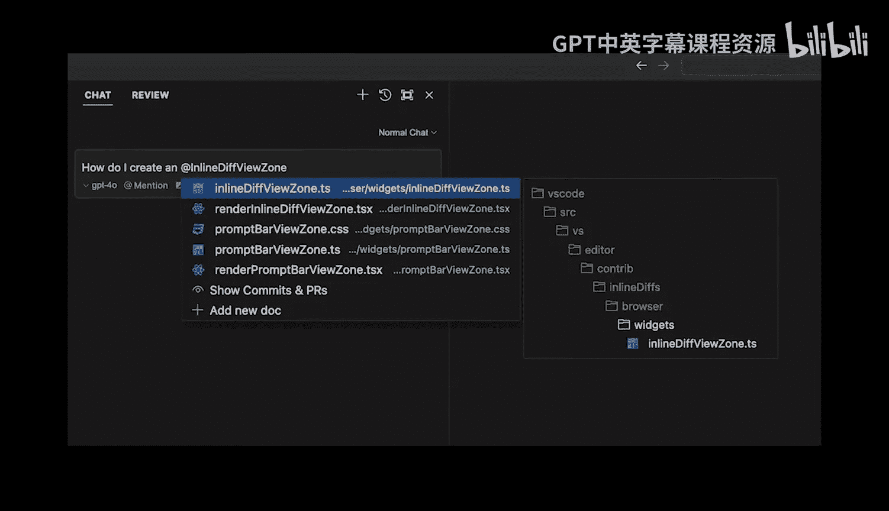

There's a you could probably intuit the kind of stuff I would like to include in the context。

Is there like how hard is it to auto figure out the context？

It's tricky I think we can do a lot better at computing in context automatically in the future。

 one thing that's important to notice there are trade offs with including automatic context。😊。

So the more context you include for these models， first of all， the slower they are。

And the more expensive those requests are， which means you can then do less model calls and do less fancy stuff in the background。

 also for a lot of these models they get confused if you have a lot of information on the prompt so the bar for accuracy and for relevance of the context you include should be quite high。

Um， but this is already we do some automatic context in some places within the product。

 it's definitely something we want to get a lot better at。

And I think that there are a lot of cool ideas to try there both on the learning better retrieval systems。

 like Better embedding models better reras， I think that there are also cool academic ideas。

 you know stuff we've tried out internally but also the field is grappling with writ large about can you get language models to a place where you can actually just have the model itself like understand a newcorpus of information and the most popular talked about version of this is can you make the context windows infinite。

 then if you make the context windows infinite can you make the model actually pay attention to the infinite context。

 and then after you can make it pay attention to the infinite context to make it somewhat feasible to actually do it。

 can you then do caching for that infinite context you don't have to recompute that all the time。

But there are other cool ideas that are being tried that are a little bit more analogous to fine tuning of actually learning this information and the weights of the model。

And it might be that you actually get sort of a qualitatively different type of understanding if you do it more at the weight level than if you do it at the in context learning level。

 I think the the jury is still a little bit out on how this is all going to work in the end but in the interim us as a company we are really excited about better retrieval systems and picking the parts of the code base that are most relevant to what you're doing we could do that a lot better like one interesting proof of concept for the learning this knowledge directly in the weights is with VS code so we're in a VS code fork and VS code the code is all public so these models in pretraining of seeing all the code they've probably also seen questions and answers about it and then they've been fine tune in RCh to be able to be able to answer questions about code in general so when you ask it a question about VS code sometimes it'll hallucinate but sometimes it actually does a pretty good job at answering the question and I think like this is just by it happen。

To be okay， but what if you could actually like specifically train or post train a model such that it really was。

Built to understand this code base it's an open research question。

 one that we're quite interested in and then there's also uncertainty of like do you want the model to be the thing that end to end is doing everything i。

e。 it's doing the retrieval and its internals and then kind of answering a question creating the code or do you want to separate the retrieval from the frontier model where maybe you know you'll get some really capable models that are much better than like the best open source ones in a handful of months。

And then you'll want to separately train a really good open source model to be the retriever。

 to be the thing that feeds in the context to these larger models Can you speak a little more to the post training a model to understand the code base。

Like what do you mean by that with is this a synthetic data direction is this yeah I mean there are many possible ways you could try doing it there's certainly no shortages of ideas it's just a question of going in and like trying all of them and being empirical about which one works best you know one very naive thing is to try to replicate what's done with Bs code and these frontier models so let's like continue pretraining some kind of continued pretraining that includes general code data but also throws in a lot of the data of some particular repository that you care about and then impose posttrain meaning in let's just start with instruction fine tuning you have like a normal instruction fine tuning data set about code and you throw on a lot of questions about code in that repository so you could either get ground truth ones which might be difficult or you could do what you kind of hinted at or suggested using synthetic data i。

e。 kind of having the model。Ask questions about various recent pieces of the code so you kind of take the pieces of the code then prompt the model or have a model propose a question for that piece of code and then add those as instruction find too data points and then in theory this might unlock the model's ability to answer questions about that code base。

😊，Let me ask you about OpenaiI01 what do you think is the role of that kind of test time compute system in programming I think test time compute is really really interesting so there's been the pretraining regime which will kind of as you scale up the amount of data and the size of your model get you better and better performance both on loss and then on downstream benchmarks and just general performance when we use it for coding or other tasks。

We're starting to hit a bit of a data wall meaning it's going to be hard to continue scaling up this regime and so scaling up1 test time compute is an interesting way if now you increasing the number of inference time flops that we use but still getting like like yeah as you increase the number of flops use inference time getting corresponding improvements in the performance of these models。

 traditionally we just had to literally train a bigger model that always uses that always used that many more flops。

 but now we could perhaps use the same size model and run it for longer to be able to get an answer at the quality of a much larger model and so the really interesting thing I like about this is there are some problems that perhaps require。

100 trillion parameter model intelligence trained on 100 trillion tokens， but that's like maybe 1%。

 maybe like 0。1% of all queries， so are you going to spend all of this effort。

 all this compute train a model that cost that much and then run it so infrequently。

 it feels completely wasteful when instead said you get the model that that you train the model that's capable of doing the 99。

9% of queries then you have a way of inference time running it longer for those few people that really。

 really want max intelligence。How do you figure out which problem requires what level of intelligence？

Is that possible the dynamically figure out when to use GP4。

 when to use like when to use a small model and when you need the01？I mean。

Yeah that' that's an open research problem certainly I don't think anyone's actually cracked this model routing problem quite well we'd like to。

 we have like kind of initial implementations of this for things for something like cursor tabab。

 but at the level of like going between 40 sonnet 201。

It's a bit trickier like there's also a question like what level of intelligence do you need to determine if the thing is too hard for the four level model。

 maybe you need the01 level model it's really unclear but you mentioned this so there's's there's a pretraining process then there's post training and then there's like test time compute that fair to sort of separate where's the bigs gains Well it's weird because like test time compute there's like a whole training strategy needed to get test time to compute to work and the really the other really weird thing about this is。

Noown like outside of the big labs and maybe even just open AI， no one really knows how it works。

 like there have been some really interesting papers that show hints of what they might be doing and so perhaps they're doing something with treesearch using process reward models。

 but yeah， it just I think the issue is we don't quite know exactly what it looks like so it would be hard to kind of comment on like where it fits in I would put it in post training。

 but maybe like the compute spent for this kind of for getting test time compute to work for a model is going to dwarf pretraining eventually。

So we don't even know if 01 is using just like chain of thought Rl。

 we don't know how they're using any of these， I don't know anything it's fun to speculate like if you were to build a competing model。

 what would you do？Yeah， so one thing to do would be I think you probably need to train a process reward model which is so maybe we can get into reward models and outcome reward models versus process reward models outcome reward models are the kind of traditional reward models that people are trained for language models language modeling and it's just looking at the final thing so if you're doing some math problem。

 let's look at that final thing you've done everything and let's assign a great to it how likely we think like what's the reward for this this outcome process reward models instead try to grade the chain of thought and so openAI had some preliminary paper on this I think last summer where they use human labelers to get this pretty large several hundred thousand data set of grading chains of thought。

Ultimately， it feels like I haven't seen anything interesting in in the ways that people use process reward models outside of just。

Using it as a means of affecting how we choose between a bunch of samples so like what people do in all these papers is they sample a bunch of outputs from the language model and then use the process reward models to grade all those generations alongside maybe some other heuristics and then use that to choose the best answer the really interesting thing that people think might work and people want to work is tree search with these process reward models because if you really can grade every single step of the chain of thought。

 then you can kind of branch out and you know explore multiple paths of this chain of thought and then use these process reward models to evaluate how good is this branch that you're taking。

Yeah， when the quality of the branch is somehow strongly correlated with the quality of the outcome at the very end。

 so like you have a good model of knowing which branch should take so not just in the short term in the long term Yeah and like the interesting work that I think has been done is figuring out how to properly train the process or the interesting work that has been open source in people I think talk about is how to train the process reward models maybe in a more automated way。

 I could be wrong here， could not be mentioning some papers I haven't seen anything super that seems to work really well for using the process reward models creatively to do tree search code this is kind of an AI safety maybe a bit of a philosophy question so open AI says that they're hiding the chain of thought from the user。

And they've said that that was a difficult decision to make， they。

 instead of showing the chain of thought， they're asking the model to summarize the chain of thought。

They're also in the background saying they're going to monitor the chain of thought to make sure the model is not trying to manipulate the user。

 which is a fascinating possibility， but anyway， what do you think about hiding the chain of thought One consideration for Open AI and this is completely speculative。

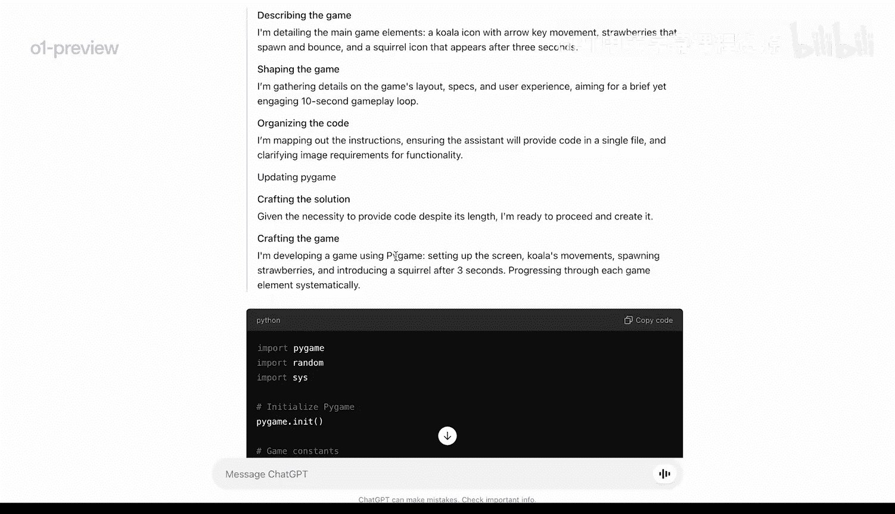

Could be that they want to make it hard for people to distill these capabilities out of their model。

It might actually be easier if you had access to that hidden chain of thought to replicate the technology because that's pretty important data like seeing the steps that the model took to get to the final results。

 so you could probably train on that also and there was sort of a mirror situation with this with some of the large language model providers and also this is speculation but some of these APIs used to offer easy access to log probabilities for the tokens that they're generating。

And also log probabilities over the prom tokens and then some of these APIs took those away and again。

 complete speculation but。😊，One of the thoughts is that the reason those were taken away is if you have access log probabilities similar to this hidden and train thought。

 that can give you even more information to try and distill these capabilities out of the APIs out of these biggest models。

Into models you control as an asterisks on also the previous discussion about us integrating O1。

 I think that we're still learning how to use this model so we made O1 available in cursor because like we were when we got the model we were really interested in trying it out。

 I think a lot of programmers are going to be interested in trying it out。

 but01 is not part of the default cursor experience in any way up。

And we still haven't found a way to get integrate into an editor into the editor in a way that we we we reach for sort of。

 you know， every hour， maybe even every day， and so I think that the jurys still out on how how to use the model and we haven't seen examples yet of of people releasing things where。

It seems really clear like oh that' that's like now the use case the obvious one to to return to is maybe this can make it easier for you to have these background things running to have these models and loops to have these models be ajuic but we're still still discovering to be clear we have ideas we just need to we need you try get something incredibly useful before we put it out there but it has these significant limitations like even like barring capabilities it does not stream and that means it's really really painful to use for things where you want to supervise the output and instead you're just waiting for the wall text to show up Also it does feel like the early innings of test time compute search where it's just like a very very much of v zero and there's so many things that like。

Like don't feel quite right and I suspect in parallel to people increasing the amount of pre traininging data and beside the models in pretraining and finding fixeds there。

 you'll now have this other thread of getting search to work better and better。

So let me ask you about。Strawberry tomorrow eyes， so it looks like Gitthub Copit might be integrating 01 in some kind of way。

And I think some of the comments are saying， does this mean cursor is done？

I think I saw one comment saying that I saw time to shut down cursory time shut down cursory so is a time to shut down cursor I think this space is a little bit different from past software spaces over the 20 tons where I think that the ceiling here is really。

 really， really incredibly high and so I think that the best product in three to four years will just be so much more useful than the best product today。

And you can like wax poetic about mos this and brand that and you know this is our advantage。

 but I think in the end， just if you don't have like if you stop innovating on the product you you will lose and that's also great for startups that's great for people trying to enter this market because it means you have an opportunity to win against people who have you lots of users already。

By just building something better。And so I think yeah， over the next few years。

 it's just about building the best product， building the best system and that both comes down to the modeling engine side of things and it also comes down to the to the editing experience Yeah。

 I think most of the additional value from cursor versus everything else out there is not just integrating the new model fast like01 it comes from all of the kind of depth that goes into these custom models that you don't realize are working for you in kind of every facet of the product as well as like the really。

Thoughtful UX with every single feature。All right， from that profound answer。

 let to send back down to the technical， you mentioned。

 do you have a taxonomy of synthetic data Oh yeah， can you please explain Yeah。

 I think there are three main kinds of synthetic data。

The first is so what is synthetic data first so there's normal data like nonynthetic data which is just data that's naturally created i。

e。 usually it'll be from humans having done things so from some human process you get this data syntheticyn data the first one would be distillation so having a language model kind of output tokens or probability distributions over tokens and then you can train some less capable model on this this approach is not going to get you a net like more capable model in the original one that is produced the tokens but it's really useful for if there's some capability you want to elicit from some really expensive high latency model you can then distill that down into some smaller task- specific model。

Um， the second kind is when like one direction of the problem is easier than the reverse。

And so a great example of this is bug detection， like we mentioned earlier where。

It's a lot easier to introduce reasonable looking bugs。

Then it is to actually detect them and this is probably the case for humans too and so。

What you can do is you can get a model that's not trained that much data that's not that smart to introduce a bunch of bugs and code。

 And then you can use that to then train， use a synthetic data to train a model that can be really good at detecting bugs。

 The last category， I think is， I guess the main one that it feels like the big labs are doing for synthetic data。

 which is。Producing text with language models that can then be verified easily。So like， you know。

 an extreme example of this is if you have a verification system that can detect if。😊。

Language is Shakespeare level。 and then you a bunch of monkeys typing in typewriters like you can eventually get enough training data to train a Shakespeare level language model。

 And I mean， this is the case， like very much the case for math where verification is is is actually really。

 really easy for formal。Formal languages and then what you can do is you can have an okay model generate a ton of rollouts and then choose the ones that you know have actually proved the ground truth theorem theorems and then train that further there's similar things you can do for code with leadcode like problems or where if you have some set of tests that you know correspond to if something passes these tests it is actually solved the problem you could do the same thing where we verify that is passed the tests and then train the model in the output set have past the tests I think it's going be a little tricky getting this to work in。

All domains or just in general， like having the perfect verifier feels really。

 really hard to do with just like openended miscellaneous tasks you give the model or more like long horizon tasks even in coding that's because you're not as optimistic as Arvid but yeah so yeah that that third category requires having a verifier Yeah verification is it feels like it's best when you know for a fact that it's correct and like then like it wouldn't be like using a language model to verify it'd be using tests or formal systems or running the thing too doing like the human form of verification where youre just do manual quality control Yeah but like the language model version of that where it's like running the thing it's actually understand the output yeah no that's for somewhere between yeah I think that that's the category that is most likely to result in like massive gains What about Rl with feedback side RHf versus R Aif。

What's the role of that in getting better performance on the models？Yeah。

 so RHF is when the reward model you use is trained from some labels you've collected from humans giving feedback。

Um I think this works if you have the ability to get a ton of human feedback for this kind of task that you care about RL AIF is interesting because you're kind of depending on。

Like this is actually kind of going to this， it's depending on the constraint that verification is actually a decent but easier than generation。

Because it feels like okay， like what are you doing you're using this language model to look at the language model outputs and then improve the language model。

 but no it actually may work if the language model has a much easier time verifying some solution than it does generating it then you actually could perhaps get this kind of recursive。

 but I don't think it's gonna to look exactly like that the other thing you could do is。😊。

That we kind of do is like a little bit of a mix of RAIF in RLHF where usually the model is actually quite correct。

 and this is in the case precursor tab picking between like two possible generations of what is the better one。

 and then it just needs like a little bit of human nudging with only on the order of 50。

100 examples to like kind of align that prior the model has with exactly with what you want it looks different than I think normal RLHF we youre usually training these reward models and tons of examples。

What's your intuition when you compare？Generation and verification of generation and ranking。

Is is ranking way easier， the generation。My intuition would just say， yeah。

 probably it should be like this is kind of。Going back to。Like if you。

 if you believe P does not equal NPp， then there's this massive。Class of problems that are much。

 much easier to verify given proof than actually proving it。

I wonder if the same thing will prove p not equal to MP or P equal to MP。

 that would mean that would be really cool that be of whatever feels metal by AI。

 who gets the credit？No open philosophical question。

 I I'm actually I'm actually surprisingly curious what what what like a good bet for one1 AI will get to fields will be specialty I don't know what a month bet here is Nobel Prize or level solve Well。

 you would say that of course but it's also this like isolated system like I don't even if I don't need to do I feel like22 felt like the path to get to IM O was a little bit more clear because it already could get a few IM O problems And there are a bunch of like there was a bunch of low hanging fruit given literature at the time of like what what tactics people could take I think I' one much less first in the space that they're improving now to。

😊，Yeah， less intuition about how close we are to solving these really， really hard open problems。

So you think it'll be fields as amount of first， it won't be like in physics or in oh 100%。

 I think I， I think I think that's probably more likely like it's probably much more likely that it'll get then。

Yeah， yeah， yeah。 Well， I think it goess to like， I don't know， like BSD。

 which is a Bs Winter di conjecture or like Rimon iPos or any one of these like hard。

 hard math problems which just like actually really hard。

 It's sort of unclear what the past you to get even a solution looks like。 Like we。

 we don't even know what a path looks like， let alone。

And you mean idea that this is like an isolated system and you can actually you have a good reward system and it feels like it's easier to train for that I think we might get fields metal before AGI I think I mean。

I'll be very happy。Were very happy， but I don't know if I， I think。2028， 2030。

20 feels metal feels metal， all right。Its feels like forever from now given how fast things have been going。

 speaking of how fast things have been going， let's talk about scaling laws。

So for people who don't know， maybe it's good to talk about this whole。Id of scaling walls。

 what are they， where do things stand and where do you think things are going？

I think it was interesting， the original scaling loss paper by Open AI was slightly wrong because I think of some issues they did with learning write schedules。

 and then Chinchilla showed a more correct version。

 and then from then people have again kind of deviated from doing the compute optimal thing because people start now optimizing more so for making the thing work really well given an inference budget。

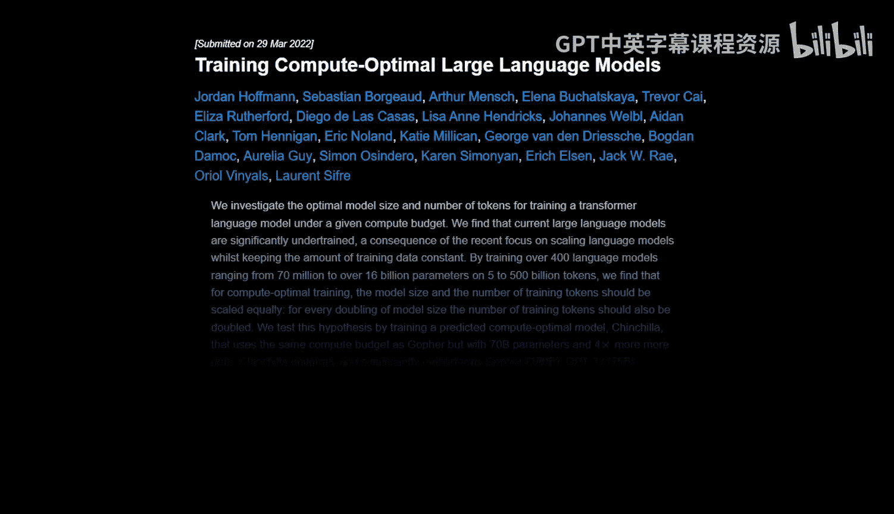

And I think there are a lot more dimensions to these curves than what we originally used of just compute number of parameters and data。

Like inference compute is the obvious one I think context length is another obvious one so if you like let's say you care about the two things of inference compute and and then context window。

 maybe the thing you want to train is some kind of SSM because they're much much cheaper and faster at super super long context and even if maybe it has 10x worth scaling properties during training meaning you spend 10x more compute to train the thing to get the same level of capabilities it's worth it because you care most about that inference budget for really long context windows。

So'll really interesting to see how people kind of play with all these dimensions So yeah let mean you speak to the multiple dimensions obviously the original conception was just looking at the variables of the size of the model as measured by parameters and the size of the data as measured by the number of tokens and looking at the ratio of the two Yeah and it's it's kind of a compelling notion that there is a number。

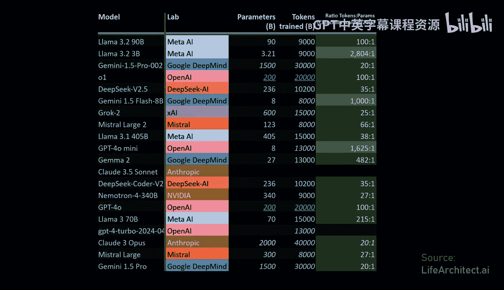

Or at least a minimum。 And it seems like one was emerging。U。

Do you still believe that there is a kind of。Bigger is better。I mean。

 I think bigger is certainly better for just raw performance and raw intelligence and raw intelligence。

 I think the path that people might take is I'm particularly bullish on distillation and like yeah。

 how many knobs can you turn to if we spend like a ton ton of money on training。

 like get the most capable cheap model right， like really。

 really caring as much as you can because like the naive version of caring as much as you can about inference time computers。

 what people have already done with like thellma models or just overtraining the shit out of 70 models on way。

 way， way more tokens than essential optimal。 But if you really care about it。

 maybe you think to do is what gamma did， which is let's not let's not just train on tokens。

 Let's literally train on。😊，MimMizing the kL divergence with the distribution of Gemma 2070 right so knowledge distillation there and you're spending the compute of literally training this 27 billion model billion parameter model on all these tokens just to get out this I don't know smaller model and the distillation gives you just a faster model smaller means faster yeah distillation in theory is。

I think getting out more signal from the data that you're training on and it's like another it's perhaps another way of getting over not like completely over。

 but like partially helping with the data wall where like you only have so much data to train on。

 let's like train this really really big model on all these tokens and we'll distill it into this smaller one and maybe we can get more signal per token for this for this much smaller model then we would have originally if we trained it So if I gave you $10 trillion how would you how would you spend it I mean you can't buy an island or whatever how would you allocate it in terms of improving the big model versus。

Maybebe paying for HF in the RLHF or yeah， I think there's a lot of these secrets and details about training these large models that I just don't know and are pri these to the large labs and the issue is I would waste a lot of that money if I even attempted this because I wouldn't know those things。

Suspending a lot of disbelief and assuming like you had the know how。Um。

And operate or if you're saying like you have to operate with like the the limited information you have now。

 no， no， no， actually， I would say。You swoop in and you get all the information。

 all the little heuristic， all the little parameters， all the。

All the parameters that define how the thing is trained？

If we look in how to invest money for the next five years in terms of maximizing what you called raw intelligence I mean isn't the answer like really simple。

 you you just try to get as much compute as possible like like at the end of the day all you need to buy is the GPUs and then that the researchers can find find all like they can sort of you can tune whether you want to pre a big model or a small model like well this gets into the question of like are you really limited by compute and money or are you limited by these other things I'm more prid tos ArVd's belief that we're sort of ideal limited but。

There's always like but if you have a lot of compute。

 you can run a lot of experiments So you would run a lot of experiments versus like use that compute to try a gigantic model I would but I I do believe that we are limited in terms of ideas that we have I think yeah。

 because even with all this compute and like， you know， all the data you could collect in the world。

 I think you really are ultimately limited by not even ideas but just like，Really good engineering。

Like even with all the capital in the world， would you really be able to assemble like there aren't that many people in the world who really make the difference here。

 and there's so much work that goes into research that is just like pure really。

 really hard engineering work as like a very kind of handwa the example。

 if you look at the original transformer paper， you know how much work was kind of joining together a lot of these really interesting concepts embedded in the literature versus then going in and writing all the codes。

 like maybe the co kernels， maybe whatever else I don't know if it ran on GPUs or GPUs originally such that actually saturated GPU performance。

 getting noome she's here to go in and do all of this code and is like probably one of the best engineers in the world or maybe going a step further like the next generation of models having these things like getting model parallellist into work and scaling it on like you know thousands of for maybe tens of thousands of like V 100s which I think G3 may have been。

 there's just so much engineering effort。That has to go into all these things to make it work if you really brought that cost down to。

Like you know， maybe not zero， but just made it 10 x easier。

 made it super easy for someone with really fantastic ideas to immediately get to the version of like the new architecture they dreamed up that is like getting 50 40% utilization on the GPs。

 I think that would just speed up。Research by a ton。I mean。

 I I think if you see a clear path improvement， you should always sort of take the low hanging fruit first。

 right， and I think probably open the eye in。And all the other labs it did the right thing to pick off the low hanging fruit where the low hanging fruit is like sort of。

You could scale up to a GP 4。25 scale。Um， and and you just keep scaling and and like things。

 things keep getting better and as long as like you。

There's there's no point of experimenting with new ideas when like everything everything is working and you should sort of bang on and try try to get as much as much juice out as the possible and and then maybe maybe when you really need new ideas for。

 I think I think if if you're spending 1 trillion dollars probably want to spend some you know。

 then actually like create evalu your ideas like probably your idea little bit at that point。

 I think all of us believe new ideas。I probably needed to get。You know， all the way there to A and。

All of us also probably believe。There exist ways of testing out those ideas at smaller scale and being fairly confident that they'll play out。

It's just quite difficult for the labs in their current position to dedicate their very limited research and engineering talent to exploring all these other ideas when there's like this core thing that will。

Probably like improve performance for some like decent amount of time。Yeah。

 but also these big labs like winning。Iic。This's just going wild， okay。

 so how u big question looking out into the future。

 you're now at the the center of the programming world， how do you think programming。

 the nature programming changes in the next？Few months in the next year and the next two years。

 the next five years，10 years。I think we're really excited about a future where the programmer is in the driver's seat for a long time。

 and you've heard us talk about this a little bit， but one that emphasizes speed and agency for the programmer and control the ability to modify anything you want to modify the ability to iterate really fast on what you're building。

And。This is a little different， I think than where some people are are jumping to in the space where I think。

One idea that's captivated people is can you talk to your computer。

 can you have it built software for you as if you're talking to like an engineering department or an engineer over Slack and can it just be this sort of isolated text box and part of the reason we're not excited about that。

Is you know some of the stuff we've talked about with latency。

 but then a big piece a reason we're not excited about that is because that comes with giving up a lot of control it's much harder to be really specific when you're talking in the text box and if you're necessarily just going to communicate with a thing like you would be communicating with an engineering department you're actually appbdcating tons of tons of really important decisions to this bo。

And this kind of gets at fundamentally what engineering is。

 I think that some people who are a little bit more removed from engineering might think of it as you know the spec is completely written out and then the engineers just calm and they just implement and it's just about making the thing happen in code and making the thing exists。

Um， but I think a lot of the best engineering， the engineering we enjoy。

involves tons of tiny microdecisions about what exactly you're building and about really hard tradeoffs between you know speed and costs and all the other things involved in a system and we want as long as humans are actually the ones making you designing the software and the ones specifying what they want to be built and it's not just like company run by all AIs。

 we think you'll really want the humor the human in a driver's seat dictating these decisions and so there's the jury still out on kind of what that looks like。

 I think that you know one weird idea for what that could look like is it could look like you kind of you can control the level of abstraction you view a codebase at。

And you can point at specific parts of a code base that like maybe you digest a code base by looking at it in the form of pseudocode and you can actually edit that pseudocode too。

 and then have changes get made down at the sort of formal programming level and you keep like you know you can gestureest at any piece of logic in your software component of programming。

 you keep the inflow text editing component of programming。

 you keep the control of you can even go down into the code， you can go at higher levels of abstract。

Well also giving you these big productivity gains it'd be nice if you can go up and down the abstraction stack and there are a lot of details to figure out there that's sort of like a fuzzy idea。

 time will tell if it actually works， but these principles of control and speed in the human in the driver seat we think are really important we think for some things like ArVd mentioned before for some styles of programming you can kind of hand it off chatpot style you know if you have a bug that's really well specified。

 but that's not。Most of programming。 And that's also not most of the programming。

 we think a lot of people value。 what about like the fundamental skill of programming。

 There's a lot of people like。Young people right now kind of scared。

Like thinkingca they like love programming but they're scared about like will I be able to have a future if I pursue this career path Do you think the very skill of programming will change fundamentally I actually think this is a really。

 really exciting time to be building software like we remember what programming was like and you know 2013。

 2012 whatever it was and there was just so much more craft and boilerplate and you know。

Looking up something really gnarly and that stuff still exists， it's definitely not at zero but。

Programming each day is way more fun than back then it's like we're really getting down to the delight concentration and all the things that really draw people to programming like for instance this element of being able to build things really fast and speed and also individual control like all those are just being turned up a ton and so I think it's just be I think it's going to be a really really fun time for people who build software I think that the skills will probably change too I think that people's taste and creative ideas will be magnified and it will be less about。

Maybe less a little bit about whether plate text editing。

 maybe even a little bit less about carefulness， which I think is really important today if you're a programmer。

 I think it'll be a lot more fun。B， I think。I agree I'm。

 I'm very excited to be able to change like just。One thing that happened recently was like we wanted to do a relatively big migration to our codebase。

 we were using asynchlocical storage in nodeJS which is known to be not very performant and we wanted to migrate to our context object and this is a big migration and affects the entire codebase and Swal and I spent。

I don't know five days working through this even with today's AI tools and I am really excited for a future where I can just show a couple of examples and then the AI applies that to all of the locations and then it highlights oh this is a new example like what should I do and then I show exactly what to do there and then that can be done in like 10 minutes and then you can iterate much。

 much faster then you can。😊，Then you don't have to think as much upfront and stay stand at the Blackboard and like think exactly like how are we going to do this because the cost is so high。

 but you can just try something first and you realize， oh。

 this is not actually exactly what I want and then you can change it instantly again after so。Yeah。

 I think being a programmer in the future is going to be a lot of fun Yeah I really like that point about it feels like a lot of the time with programming there are two ways you can go about it。

 one is like you think really hard carefully upffront about the best possible way to do it and then you spend your limited time of engineering to actually implement it。

Uh， but I must prefer just getting in the code and like， you know。

 taking a crack at and seeing how how it kind of lays out and then。Iterating really quickly on that。

 that feels more fun。Yeah， like just speaking to generating the boilerplate is great so you just focus on the difficult design。

 nuanced， difficult design decisions， migration， I feel like this is，This is a cool one。

 like it seems like larger language models able to basically translate from one program language to another or like translate like migrate in the general sense of what migrate is。

 but that's in the current moment。So I mean， that the fear has to do with like， okay。

 as these models get better and better， then you're doing less and less creative decisions。

 and is it going to kind of move to a place where it's。

You're operating in the design space of natural language where natural language is the main programming language。

And I guess I could ask that by way of advice， like if somebody's interested in programming now。

 what do you think they should learn？Like to say you guys started some Java and。I forget the。

 oh some PhP objective C， objective C， there you go， I mean， in the end。

 we all know JavaScript is going to win。And not Typescript is just it's going to be like vanilla jascript It just going to eat the world and maybe a little of PhP。

 And I mean， it also brings up the question of like， I think Don Nuth has a。

This idea that some percent of the population is geese and like there's a particular kind of psychology in mind required for programming and it feels like more and more that expands the kind of person that should be able to can do great programming might expand。

I think different people do programming for different reasons， but I think。

The true maybe like the best programmers。Um， arere the ones that really love。

Just like absolutely love programming， for example， there' folks in our team who。Literally。

 when there。They get back from work， they go， and then they vod up cursor。

 and then they start coding on their side projects for the entire night and they say oh 3 am doing that。

And when they're sad， they said。I just really need to code。And I think like。

You know there's there's that level of programmer where like this obsession and love of programming I think makes really the best programmers and I think these types of people will。

Really get into the details of how things work。I guess the question I'm asking。

 that exact program was think about that person。When when the super tab。

 the super awesome praise be the tab is succeeds。You keep pressing tab that person in the team loves cursor T more than anybody else。

 right Yeah， and it's also not just like。Like pressing tab is like the just pressing tab that's like the easy way to say it and the catch catchph。

 you know， but what you're actually doing when you're pressing tab is that you're you're injecting intent all the time while you're doing it you're sometimes you're rejecting it sometimes you're typing a few more characters and that's the way that you're。

😊，You're sort of shaping the things as being created and I think programming will change a lot to just what is it that you want to make sort of higher bandwidth。

 the communication to the computer just becomes higher and higher bandwidth as opposed person to like。

Like just typing is much lower bandwidth than than communicating intent， I mean。

 this goes to your manifesto。Titled Engineering Genius。

 we are an applied research lab building extraordinary productive human AI systems。

 So speaking to this like hybrid element， to start， we're building the engineer of the future。

 A human AI programmer。 That's an order of magnitude more effective than any one engineer。

 This hybrid engineer will have effortless control over their code base and no low entropy keystrokes。

 They will iterate at the speed of their judgment， even in the most complex systems。

 using a combination of AI and human ingenuity， they will outsmart and out engineer the best pure AI systems。

 we are a group of researchers and engineers， we build software and models to invent at the edge of what's useful was possible。

 Our work has already improve the lives of hundreds of thousands of programmers。

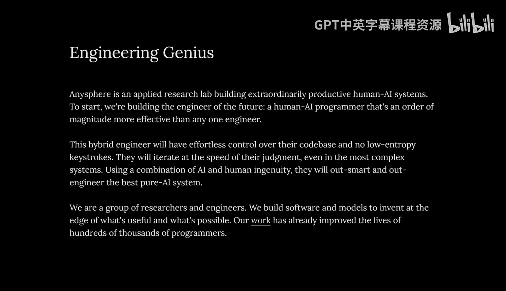

And on the way to that well at least make programming more fun。 So thank you for talking today。

 Thank you， Thanks for having us Thank you。 Thank you。

Thanks for listening to this conversation with Michael， Swle。

 Arvid and Amman to support this podcast， please check out our sponsors in the description。

And now， let me leave you with。Random。Funny and perhaps profound programming code I saw on Reddit。

 Nothing is as permanent as a temporary solution that works。

Thank you for listening and hope to see you next time。

