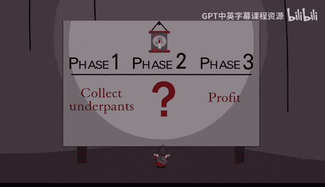
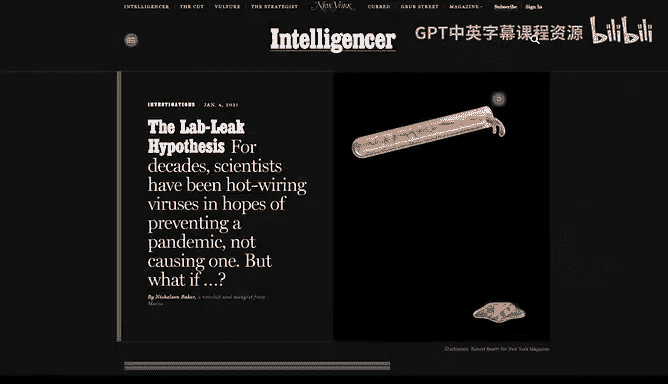
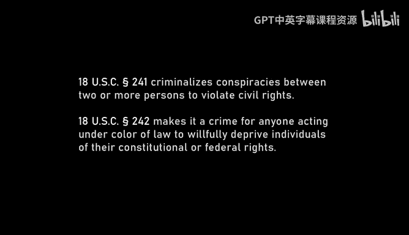
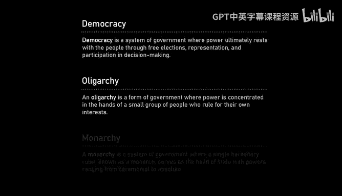
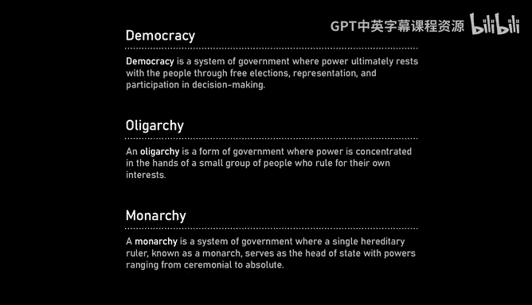

# Lex Fridman Podcast #458《Marc Andreessen：特朗普、权力、科技、人工智能、移民与美国的未来》中英字幕 - P1：Lex Fridman Podcast #458《特朗普、权力、科技、人工智能、移民与美国的未来》中英字幕 - GPT中英字幕课程资源 - BV1q1kXBDEby

I mean， look we're adding a trillion dollars to the national debt every 100 days right now and it's now passing the size of the Defense Department budget and it's compounding and it's pretty soon it's going to be adding a trillion dollars every 90 days and then it's going be adding a trillion every 80 days and then it's going to be a trillion dollars every 70 days and then if this doesn't get fixed at some point we enter a hyperinflary spiral and we become Argentina or Brazil and。

The following is a conversation with Mark andreesson。 His second time on the podcast。

 Mark is a visionary tech leader and investor who fundamentally shaped the development of the Internet and the tech industry in general over the past 30 years。

 he is the co creator of Mosaic， the first widely used web browser， co foundunder of Netscape。

 cofounder of the legendary Silicon Valley venture capital firm and Desson Horowitz。

 and is one of the most influential voices in the tech world。

 including at the intersection of technology and politics。

This is Alex Friedman podcast to support it， please check out our sponsors in the description。

 and now dear friends， here's Mark and Reesson。All right， let's start with optimism。

If you were to imagine the best possible one to two years。

 2025-26 for tech for big tech and small tech， what would it be。

 what would it look like lay out your vision for the best possible scenario trajectory for America The roaring 20s theing the Roaring 20s。

 I mean， look couple things， it is remarkable over the last several years with all of the issues。

 including you know not just everything in politics。

 but also COVID and every other thing that's happened It's really amazing the United States just kept growing if you just look at economic growth charts。

 the US just kept growing and very significantly many other countries stopped growing So Canada stopped growing the UK has stopped growing Germany has stopped growing and you know some of those countries maybe actually going backwards at this point and there's a very long discussion to be had about what's wrong with those countries and there's of course plenty of things that are wrong with our country。

 but the US is just flat out primed for growth and I think that's a consequence of many factors you know。

 some of which we are lucky at some of which through hard work and so the luck。Part is just。

 you know number one， you know we just have like incredible physical security by being our own continent you know we have incredible natural resources there's this running joke now that whenever it looks like the U is going run out of some like rare earth material some farmer in North Dakota like kicks over a hay ba and finds like a$2 trillion deposit I mean we're just like blessed with geography in the natural resources energy we can be energy independent anytime we want this last administration decided they didn't want to be they wanted to turn off American energy。

 this new administration has declared that they have a goal of turning it on in a dramatic way there's no question we can be energy dependent。

 we can be a giant net energy exporter it's purely question of choice and I think the new administration is going to do that and so oh and then I would say two other things one is we are the beneficiaries and you're an example this we're a beneficiary where the beneficiary of 50100200 years of like basically most aggressive driven smartest people in the world most capable people moving to the US and raise their kids here and so we just have。

far the most dynamic， we're by far the most dynamic population。

 most aggressive we're the most aggressive set of characters certainly in any Western country and have been for a long time and certainly are today and then finally I would just say look we are overwhelmingly advanced technology leader we have our issues and I would say particular issue with manufacturing which we could talk about but for anything in software。

 anything in AI， anything in advanced biotech all these advanced areas of technology like we're by far the leader again in part because many of the best scientists engineers in those fields come to the U and so we just we have all of the preconditions for for just a monster boom I could see economic growth going way up I could see productivity growth going way up rate of technology adoption going way up and then we we can do a global tour if you like。

 but basically all of our competitors have like profound issues and we could kind of go through them one by one but the competitive landscape it's like it's remarkable how much。

Better position we are for growth。 What about the humans themselves。

 almost the philosophical questions， you know， I travel across the world and there's something about the American spirit。

 the entrepreneurial spirit that's uniquely intense in America。 I don't know what that is。

I've talked to saga who claims it might be the Scottots Irish blood that runs through the history of America。

 What is it you at the heart of Silicon Valley。 is there something in the water。

 Why is there's this intraial spirit Yeah， so is this a family show am I allowed to swear you could say whatever the fuck you want Okay。

 so the great TV show succession the show of course which you were intended to root for exactly zero of the characters Yes。

 the best line for succession was in the final episode of the first season when the whole family's over in Logan Roy's ancestral homeland of Scotland and they're at this castle you know。

 for some wedding and Logan is just like completely miserable after having you because he's been in York for 50 years。

 He's totally miserable being back in in。In Scotland and he gets in some argument with somebody and hes like he says finally just says。

 my God， I cannot wait to get out of here and go back to America where we could fuck without condoms。

Was that a metaphor or okay， exactly right， And so no， but it's exactly the thing。

 And everybody instantly knows what like everybody watching that instantly starts laughingca you know what it means。

 which is it's exactly this。 I think there's like an ethnographic， you know。

 way of there's a bunch of books on like all like you said the Scotts Irishish like all the different derivations of all the different ethnic groups that have come to the US over the course of the last 400 years。

😊，RightBut what we have is this sort of amalgamation of like the Northeast Yankees who were like super tough and hardcore。

 that's Scotts Irish you're super aggressive， we've got the Southerners and the Texans and the sort of kind of blended of anglo- Hispanic thing super incredibly tough。

 strong driven capable characters the Texas Rers we've got we've got the California。

 we've got the wild， we've got the incrediblyventive hippies。

 but we also have the hardcore engineers， we've got the best rocket scientists in the world。

 we've got the best artists in the world create professionals the best movies and so yeah there is say all of our problems I think are basically in my view to some extent extent attempts to basically sand all that off and make everything basically boring and mediocre but there is something in the national spirit that basically keep bouncing back and basically what we discover over time as we basically just need people to stand up at a certain point and say。

 it's time to you。Time to build， it's time to grow。

 know it's time to do things so and there's something in the American spirit that just like wears right back to life and I've seen it before I actually I saw it as a kid here in the early 80s because the 70s were like horribly depressing in the US like they were a nightmare on many fronts and in a lot of ways the last decade to me has felt a lot like the 70s just being mired in misery and just this self-defeating negative attitude and everybody's upset about everything then by the way。

 like energy crisis and hostage crisis and foreign wars and just demoralization the low point for in the 70s was Jimmy Carter who just passed away。

 he went on TV and he gave this speech known as the Malay speech and it was like the weakest possible trying to like rouse people back to a sense of like passion completely failed and we had the hostages Iran for I think 440 days and every night in the nightly news lines around the block。

 energy crisis， depression， inflation。And then， you know， Reagan came in and， you know。

 Reagan was a very controversial character at the time。 And you know， he came in and he's like， y。

 nope， it's morning in America。 And we're the shining city on the hill and we're gonna do it。

 And he did it。 And we did it。 And the national spirit came rolling back and， you know。

 we worked really hard for a full decade。 And I think that's exactly what I think， you know。

 we'll see。 But I think that's what could happen here。

 And I just did a super long podcast on Milton Friedman with Jennifer Burns。

 who's this incredible professor at Stanford。 And he was part of the Reagan。

 So something there's a bunch of components to that， one of which is economic。 Yes。

 And one of which maybe you can put a word on it of。😊，Not to be romantic or anything but freedom。

 individual freedom， economic freedom， political freedom， and just in general individualism。

 Yeah that's right。 Yeah， and America has this incredible streak of individualism。

 individualism in America probably peaked I think between roughly call it the end of the Civil War 1865 through to probably call it 1931 or something and there was this like incredible mean that period we know know that period is a second industrial revolution and it's when the United States basically assumed global leadership and basically took over technological and economic leadership from England and then that led to ultimately then therefore being able to not only industrialized world but also win World War I and then win the Cold War and yeah there's a massive industrial massive individualistic streak by the way。

 Milton Friedman's old videos are all on YouTube。 they are every bit as compelling and inspiring as they as they were then is a singular figure and many of us know I never knew him。

 but he was actually。At Stanford for many years at the Hoover Instit， but I never met it。

 but I know a lot of people have worked with him and he was a singular figure。

 but all of his lessons live on or fully available but I would also say it's not just individualism and this is one of the big things it's like playing out in a lot of our culture and political fights right now。

 which is basically this feeling certainly that I have and I share with a lot of people which is it's not enough for America to just be an economic zone and it's not enough for us to just be individuals and it's not enough to just have line go up and it's not enough to just have economic success therere deeper questions at play and also there's more to a country than just that and quite frankly a lot of it is intangible a lot of it is involve spirit and and passion and like I said we have more of it than anybody else but we have to choose to want it the way I look at it is like all of our problems are selfinflicted like decline is a choice all of our problems are basically demoralization campaigns basically people。

People in positions of authority telling us that we should we shouldn't you know stand out。

 we shouldn't be adventurous， we shouldn't be exciting， we shouldn't be exploratory。

 you know we shouldn't you this， that and the other thing and we should feel bad about everything that we do and I think we've lived through a decade where that's been the prevailing theme and I think quite honestly as of November。

 I think people are done with it。If we could go on a tangent of a tangent since we're talking about individualism and that's not all that it takes。

 you've mentioned in the past the book， the Anent city by if I could only pronounce the name French historian in Numa deni Fusel du I I don't know that was amazing from the 19th century anyway。

 you said this is an important book to understand who we are and where would come from so what that book does it's actually quite a striking book so that book has written by this guy is let lets do the pronunciations the foreign language pronunciations for the day he was a professor classics at the Cban in Paris the top university actually in the 1860s so actually run around after the US Civil War and he was a savant of a particular kind which is and you can see this in the book is he had apparently read sort of absorb and memorized every possible scrap of Greek and Roman literature and there was like a walking like index on basically Greek and Roman everything we know about Greek and Roman culture。

That's significant。 The reason this matters is because basically none of that has changed And so he had access to the exact samerant materials that we have access to。

 And so we've learned nothing。 And then specifically what he did is he talked about the Greeks and the Romans。

 but specifically what he did is he went back further。

 He reconstructed the people who came before the Greeks and the Romans and what their life and society was like and these were the people who were now known as the Indo-eopans and you may have heard of these。

 These are the people who came down from the steps。

 and so they came out of what's now like Eastern Europe around sort outskirts of what's now Russia and then they sort of swept through Europe。

 they ultimately took over all of Europe by the way almost many of the ethnicities in the Americas the hundreds of years to follow or Indo-europan so they were basically this warrior basically class that came down and swept through essentially populated much of the world。

 and there's a whole interesting saga there， but and then they basically from there came basically what we know as the Greeks and the Romans were kind evolutions off of that。

 And so what he reconstructed sort of what life was like what life was like at least in the West for people in their kind of。

inal social state and the significance of that is the original social state is living in the state of the absolute imperative for survival with absolutely no technology like no modern systems。

 no nothing you've got closing your back you've got your you've got whatever you can build with your bare hands this is predates basically all concepts of technologies we understand it today and so these are people under like maximum levels of physical survival pressure and so what social patterns did they evolved to be able to do that and then the social pattern basically was as follows a threepart social structure family tribe and city and zero concept of individual rights and essentially no concept of individualism and so you were not an individual remember of your family and then a set of families would aggregate into a tribe and then a set of tribes would aggregate into a into a city and then the morality was completely it was actually what Nnietzsche talks about the morality was entirely master morality not slave morality and so in their morality。

Anything that was strong was good and anythingth that was weak was bad and it's very clear why that is right it' because strong equals good equals survive weak equals bad equals die and that led to what became known later as the master slave dialectic which is is it more important for you to live on your feet as a master even at the risk of dying or are you willing to live as a slave on your knees in order to not die and this is sort of the derivation of that moral framework Christianity later inverted that moral framework but the original framework lasted for many。

 many thousands of years？No concept of individualism。

 the head of the family had total life and death control over the family， the head of the tribe。

 same thing， head of the city， same thing， and then you were morally obligated to kill members of the other cities on contact you were morally required to like if you didn't do it。

 you were a bad person。And then the form of the society was basically maximum fascism combined with maximum communism right And so it was maximum fascism in the form of this like absolute top down control where the head of the family tribe or city could kill other members of the community at any time with no repercussions at all So maximum hierarchy but combined with maximum communism。

 which is no market economy and so everything gets shared and sort of the point of being in one of these collectives is that it's a collective and people are sharing。

 And of course， that limited how big they could get because know the problem with communism is it does a scale it works at the level of a family it's much harder to make it work at the level of a country。

Imposible maximum fascism， maximum communism and then it was all intricately tied into their religion and their religion was it was in two parts。

 it was veneration of ancestors and it was veneration of nature and the veneration of ancestors is extremely important because it was basically like basically the ancestors for the people who got you to where you were。

 ancestors for the people who had everything to teach you right and then it was veneration of nature because of course nature is the thing that's trying to kill you and then you had your ancestor。

 every family tribe or city had their ancestor gods and then they had their they had their nature gods okay so fast forwardward to today。

 like we live in a world that is like radically different。

 but in the book takes you through kind of what happened from that through the Greeks and Romans through to Christianity。

And so but it's very helpful to kind of think in these terms because the conventional view of the progress through time is that we are。

 you know the cliche is the arc of the moral universe。

 you know Be stores justice or so-called Wig history。

 which is you know that the arc of progress is positive right and so what you hear all the time which you're taught in school and everything is you every year that goes by we get better and better and more and more moral and more and more pure and a better version of ourselves。

Our Indo-eopean ancestors would say， oh no， like you people have like fallen to shit。

 like you people took all of the principles of basically your civilization and you have dilud them down to the point where they barely even matter。

 you know， and you're having know children on a wedlock and you know you regularly encounter people of other cities and you don't try to kill them and like how crazy is that and they would basically consider us to be living like an incredibly diluted version of this sort of highly religious。

 highly cult like highly organized highly fasci fascist communist society。

I can't resist noting that as a consequence of basically going through all the transitions we've been through going all the way through Christianity coming out the other end of Christianity。

 Nietzsche declares God is dead， we're in a secular society you know that still has tininges of Christianity but largely prizes itself on no longer being religious in that way we being the sort of most fully evolvedd modern secular you expert scientists and so forth have basically re-evolved or fallen back on the exact same religious structure that the enddo-europans had specifically ancestor worship。

 which is identity politics and nature worship which is environmentalism and so we have actually like worked our way all the way back to their cult religions without realizing it and it just goes to show that in some ways we have fallen far from far from the family tree。

 but in some cases we're exactly the same you kind of described this progressive idea of wokeism and so on as worshipping ancestors。

 identity politics is worshiping ancestors right it's tagging newborn infants。

Either benefits or responsibilities or levels of condemnation based on who their ancestors were。

The enddo Europeans would have recognized it on site。

We somehow think it's like super socially progressive。 Yeah， and it is not。 I mean， I would say。

 obviously not， those， you know， get get new ask， which is where I think you're headed。

 which is look like。It is the idea that you can like completely reinvent society every generation and have no regard whatsoever for what came before you that seems like a really bad idea。

 right that's like the Cambodians with your Ze under Paul Po and you know death you know follows it's obviously the Soviets tried that。

You know you know the utopian fantasists who think that they can just rip up everything that came before and create something new in the human condition in human society have a very bad history of causing enormous destruction。

 So on the one hand it's like okay there is like a deeply important role for tradition and in the way I think about that is the process of evolutionary learning which is what tradition ought to be is the distilled wisdom of all and know this is how the new Europeans thought about it it should be the distilled wisdom of everybody who came before all those important and powerful lessons learned and that's why I think it's fastened to go back and study how these people live is because that's part of the history and part of the learning that got us where we are today Having said that there are many cultures around the world that are mired in tradition to the point of not being able to progress and in fact。

 you might even say globally that's the default human condition which is a lot of people are in societies in which there's like absolute seniority by age you know kids are completely you know like in the US like for some reason we decided kids are in charge of everything and know they're the trendsettors and they're allowed to like set all the agendas and like。

politicstics instead of the culture and maybe that's a little bit crazy but like in a lot of other cultures kids have no voice at all。

 no role at all because it's the old people who are in charge of everything you know they're geocracies and it's all a bunch of 80 year olds running everything which by the way we have a little bit of that too right and so what I would say is like there's there's a real downside you know full traditionalism is communitarianism you know it's ethnic particularism you know its ethnic chauvinism it's you know this incredible level of resistance to change' mean it just doesn't get you anywhere like it may be good and fine at the level of individual tribe but it's a society living in the modern world you can't evolve。

' you can't advance， you can't participate in all the good things that that have happen。

And so I think probably this is one of those things where extremeness on either side is probably a bad idea。

 but this needs to be approached in a sophisticated and nuanced way。

So the beautiful picture you painted of the roaring 20s。

How can the Trump administration play a part in making that future happen？ Yeah， so look。

 a big part of this is getting the government boot off the neck of the American economy。

 the American technology industry， the American people， again。

 this is a replay of what happened in the 60s and 70s， which is for what started out looking like。

 I'm sure good and virtuous purposes， we ended up both then and now with this what I describe as sort of a form of soft authoritarianism。

 know the good news is it's not like a military decictatorship。

 It's not like you get thrown into rubbiianca for the most part。

 that it's not coming at four in the morning。 you're not getting dragged off to a cell。

 So it's not hard authoritarianism， but it is soft authoritarianism And so it's this incredible suppressive blanket of regulation rules。

 this concept of a vetoccracy What's required to get anything done。

 know you need to get 40 people to sign off in anything。 any one of them can veto it。

 a lot of how political system works。 and then just this general idea of progress is bad and technology is bad and capitalism is bad and building businesses。

ad and success is bad， you know tall poppy syndrome。

 you know basically anybody who sticks their head up deserves to get it chopped off anybody who's wrong about anything deserves to get condemned forever know just this very kind of grinding repression and then coupled with specific government actions such as censorship regimes and debanking and know draconian deliberately kneeapping critical American industries and then congratulating yourselfves in the back for doing it or having these horrible social policies like let' let all the criminals out of jail and see what happens and so like we've just been through this period I call it a moralization campaign like we've just been through this period where whether it started that way or not ended up basically being this comprehensive message that says you're terrible and if you try to do anything you're terrible and fuck you and the Biden administration reached kind of the full pinnacle of that in our time they got really bad on many fronts at the same time and so just like relieving that and getting kind of back to。

reasonably you know kind of optimistic constructive you pro growthrow frame of mind there's there's so much pent- up energy and potentially in the American system that that alone is going to I think cause you growth and spirit to take off and then there's a lot of things proactively and then there's a lot of things proactively that could be done So how do you relieve that to a degree has the thing you describe ideologically permeated government and permeated big companies disclaimer first which is I don't want to predict anything on any of this stuff because I've learned the hard way that I can't predict politics or Washington at all but I would just say the plans and intentions are clear and the staffing supports it and all the conversations are consistent with the new administration and that they plan to take very rapid action on a lot of these fronts very quickly they're going to do as much as they can through executive orders and then they're going to do legislation and regulatory changes for the rest and so they're gonna to move I think quickly on a whole bunch of stuff you can already feel I think a shift to the national spirit or at least let's put it this way I feel it for sure in Silicon Valley like I。

we just saw a great example of this with what Mark Zuckerberg is doing I'm involved with his company。

 but we just saw it kind of in public the scope and speed of the changes are reflective of sort of a lot of these shifts but I would say that same conversation。

 those same kinds of things are happening throughout the industry and so the tech industry itself whether people were pro Trumpmp or antitump like there's just like a giant five shift mood shift that's like kicked in already and then I was with a group of Hollywood people about two weeks ago and they were still people who at at least vocally were still very antitrump。

I said， you know， has anything changed since November 6 and they immediately said oh。

 it's completely different。 It feels like the Isis th you know woke is over， you know。

 they said that all kinds of projects are going to be able to get made now they couldn't before that you know probably was gonna start making comedies again。

 know they were just like it's like just like an incredible immediate environmental change and' as I talked to people kind of throughout certainly throughout the economy。

 people who run businesses I hear that all the time。

 which is just this this last 10 years of misery is just over。

 I mean the one that I'm watching this really funny。

 I mean Facebook's giving a Me' is getting a lot of attention。

 but the other funny one is Blackrock which I'm I don't know him， but I've watched for a long time。

 And so you know Larry Fi's a CEO Blackrock was like first in as a major know investment CEO on like every dumb social trend and rule set like every。

All right， I'm going for it every retard。Every retarded thing you can imagine every ESG and every every possible satellitely companies with every aspect of just these crazy ideological positions and you know he was coming in he literally was like had aggregated together trillions of dollars of shareholdersholdings that he did not that that were his customers rights and seized their voting control of their shares and was using it to force all these companies to do all of this like crazy ideological stuff and he was like the typhoid Mary of all this stuff in corporate America and he in the last year has been like backpededalling from that stuff like as fast as he possibly can and said just an example last week he pulled out of whatever the corporate net Ze alliance he pulled out of the crazy energy stuff and so he's backing away as fast as he can' doing remember the Richard Pryor backwards walk Richard Pryor had this way where he could back out of a room while like he was walking forward。

U。And so， you know， even they're doing that and just the whole thing， I mean。

 if you saw the court recently ruled that NaSdaq had these crazy Board of directors composition rules。

 one of the funniest moments of my life is when my friend Peter Teel and I were on the meta board and these Nasdaq rules came down mandated diversity on corporate boards and so we sat around the table and had to figure out you know which of us counted as diverse and the very professional attorneys at Me explained with a 100% complete straight phase that Peter Tel counts us diverse。

 by virtue of being LGBT。And this is a guy who literally wrote a book calledThe Diversity Myth。

 and he literally looked like he'd swallowed a lot goldfish。Um， and and and and this was imposed。

 I mean， this was just like so incredibly offensive to him that like it just like it was just absolutely appalling and I felt terrible for him。

 but the look in his face was very funny。It was imposed by Nasdaq。

 you know your stock exchange imposing the stuff on you and then the court。

 whatever the court of Appeals just nuked that， you like these things basically are being like ripped down one by one and what's on the other side of it is basically you finally being able to get back to you know everything that you know everybody always wanted to do。

 which is like run their companies have great products happy customers。

 you know like succeed like succeed， achieve， outperform and you know work with the best and the brightest and not be made to feel bad about it and I think that's happening in many areas of American society iss great to hear that Peter Te is。

Fundamentally a diversity higher Well， so it was very， you know， there was a moment so so Peter。

 you know， Peter， of course，um， you know， is， you know， is publicly gay has been for a long time。

You know， but you know， there are other men on the board right and you know。

 we're sitting there and we're all looking at it and we're like all right， like okay。

 LGBT and we just we keep coming back to the B right and it's like。You know， it's like， all right。

 you know， I'm willing to do a lot for this company， but。

It's all about sacrifice for diversity Well yeah， and then it's like okay。

 like is there a test right you know， so oh yeah， exactly how do you prove it the questions that got asked。

 you know？What are you willing to do Yeah， and I think under I think I'm very good at asking lawyers completely observed questions with a totally straight face。

And do they answer a straight face sometimes okay， I think in fairness。

 they have trouble telling what I'm joking。So you mentioned the Hollywood folks。

 maybe people in Silicon Valley， and the vibe shift， maybe you can speak to preference falsification。

 what do they actually believe？How many of them actually hate Trump what like what percent of them are feeling this vibe shift in our？

Interested in creating the roaring 20s in the way Davidd described。

So first we should maybe talk population so there's like all of Silicon Valley and the way to just measure that is just look at voting records and what that shows consistently Silicon Valley is just at least historically my entire time there has been overwhelmingly majority just straight up Democrat the other way to look at that is political donation records and again the political donations in the valley range from 90 to 99% to one side and so I just brings up because we'll see what happens with the voting and with donations going forward we maybe talk about the fire later but I can tell you there is a very big question of what's happening in Los Angeles right now It want to get into the fire but it's catastrophic and there was already a rightward shift in the big cities in California and I think a lot of people in LA are really thinking about things right now as we're trying to literally save their houses and save their families。

But you know even in San Francisco there was a big it was a big shift to the right in the voting in 24 so we'll see where that goes。

 but you observe that by just looking at the numbers over time the part that I'm more focused on is and I don't know how to exactly describe this。

 but it's like the top thousand00 or the top 10，000 people right and and I don't have a list but it's it's all the top founders。

 top CEOs， top executives， top engineers， top VCs， and then kind into the ranks。

 the people who kind of built and run the companies。And I don't have numbers。

 but I have a much more tactile feel， for what's happening。So。

IThe big thing I I have now come to believe is that the idea that people have beliefs is mostly wrong。

Um。I think that most people just go along and I think even most high status people just go along and I think maybe the most high status people are the most prone to just go along because they're the most focused on status。

And the way I would describe that is you know one of the great forbidden philosophers of our time is the Unobomber。

 Te Kzysky and amidst his madness， he had this extremely interesting articulation。

 was he was an insane lunatic murderer， but he was also at Harvard super genius not that those are in conflict but shots fired man but it was a very bright guy and he did this whole thing where he talked about basically he was very right wing and talked about leftism a lot。

 and he had this great concept that just stuck on my mind ever since I wrote it。

 which is he had this concept Jesus called over socialization。Um， and so， you know。

 most people are socialized yeah， most people are socialized like most people are， you know。

 we live in a society， most people learn how to be part of a society。

 they give some deference to the society。There's something about modern Western elites where they're over socialized and they're just like overly oriented towards what other people like themselves you know think and believe。

 and you can get a real sense of that if you have a little bit of an outside perspective。

 which I just do， I think as a consequence of where I grew up like even before I had the views that I have today。

 there was always just this weird thing where it's like why does every dinner party have the exact same conversation。

 why does everybody agree on every single issue， why is that agreement precisely what was in the New York Times today。

 why are these positions not the same as they were five years ago？

Right but why does everybody like snap into agreement every step of the way and that was true when I came to Silicon Valley and it's just just true today 30 years later and so I think most people are just literally I think they're taking their cues from it's some combination of the press。

 the universities， the big foundations， so it's like basically it's like the New York Times， Harvard。

 the Ford Foundation and you know I don't know you know a few CEOs and a few public figures and you know maybe the president of few parties in power and like whatever that is everybody just everybody who's sort of good and proper and elite and good standing and in charge of things and a sort of correct member of you know let's call it coastal American society。

 everybody just believes those things。And then you the two interesting things about that is number one。

 there's no divergence among the organs of power right so the Harvard and Yale believe the exact same thing The New York Times of the Washington Post believe the exact same thing。

 the Ford Foundation and the Rockefeller Foundation believed the exact same thing。

 Google and whatever Microsoft believed the exact same thing。

 but those things change over time but there's never conflict in the moment right and so the New York Times the Washington Post agreed on exactly everything in 1970。

 1980， 1990， 200 2010 and 2020， despite the fact that the specifics changed radically。

The lockstep was what mattered and so I think basically we in the valley were're on the tail end that and the same way Hol was on tail end that and the same way New York's on the tail into that。

 the same way the media is on the tail end that' it's like some sort of collective hi mind thing And I just go through that to say like I don't think most people in my orbit or you know say the top 10000 people in the valley。

Or the top 10000 people in LA I don't think they're sitting there thinking basically I have rocks。

 I mean， they probably think they have rocks lot beliefs。

 but they don't actually have like some inner core rockot beliefs and then they kind of watch reality change around them and try to figure out how to keep their beliefs like correct。

 I don't think that's what happens I think what happens is they conform to the belief system around them and I think most of the time they're not even aware that they're basically part of a herd I it possible that the surface chatter of dinner parties underneath that there is a turmoil of ideas and thoughts and beliefs that's going on but you're just talking to people really close to you or in your own mind and the socialization happens at the dinner parties like when you go outside the inner circle of one。

2，3 four people who you really trust then you start to conform but inside inside the mind there is an actual belief or a struggle attention within New York Times or for the listener there's a slow smile。

Over to Mark andreesson's face so I'll just tell you what I think which is at the dinner parties and at the conferences no。

 there's none of that what there is is that all of the heretical conversations have anything that challenges the status quo any heretical ideas and any new idea you it a heretical idea any deviation it's either discussed a one on one face to face it's like a whisper network。

Or it's like a real life social network。 Here's a secret handshake， which is like， okay。

 you meet somebody and you like know each other a little bit， but like not well。 And like。

 you're both trying to figure out if you can like talk to the other person openly or whether you have to like。

 be fully conformist。 It's a joke。Oh yeah， humor somebody cracks a joke， right。

 somebody cracks a joke， if the other person laughs， the conversation is on， Yeah， yeah。

 if the other person doesn't laugh。Back slowly away from the scene。

I didn't mean anything by it then by the way， it doesn't have to be like a super offensive joke。

 It just has to be a joke。 It's just up against the edge of one of the use the Sambankmanfrd term。

 one of the chivals know it has to be up against one of the things one of the things that you're absolutely required to believe to be the dinner parties then at that point what happens is you have a peer-topeer network one to one connection with somebody and then your little conspiracy of criminality and then you have you've probably been through this。

 you have your network of thought criminals and then they have their network of thought criminals and then you have delicate mating dance as to whether you should bring the criminals together and the dance of fundamental mechanism of the dance is humor is humor of for two reasons。

 number one number one humor is a way to have deniability humor is a way to discuss serious things having deniability I'm sorry it was just a joke so that's part of it。

 which is one of the reasons why comedians can get away with saying things the rest of us can they can always call back on yeah it was just going for the laugh。

The key thing about humor right is that laughter is involuntary you either laugh or you don't and it's not like a conscious decision whether you're gonna laugh and everybody can tell when somebody's fake laughing and every professional comedian knows this the laughter is the clue that you're onto something truthful people don't laugh made up bullshit stories laugh because you're revealing something that they either have not been allowed to think about or have not been allowed to talk about or as off limits and all of a sudden it's like the ice breaks and's like oh yeah that's the thing and it's funny and I laugh then course this is why of course live comedy so powerful because you're all doing that at the same time So you start to have the safety of the safety of numbers So the comedians have like is no no surprise to me example Joe has been as successful as he has because they have this hack the rest of us who are not professional comedians don't have you have your inperson burden of it and then you got the question of whether whether you can sort of join the networks together and you probably to this at some point's's like the al dinner party The Tcker Middle dinner party and you get six or eight people together and you join the networks and those are like the happiest at least in the last。

Those are like the happiest moments of everybody's lives because they're just like everybody's just ecstatic because they're like I don't have to worry about getting yelled at and shamed like for every third sentence it comes out of my mouth and we can actually talk about real things so that's the live version of it then of course the other side of the group chat phenomenon and then basically the same thing played out until Elon bought X and until substt took off which were really the two big breakthroughs in free speech online the same dynamic played out online。

 which is you had absolute informity on the social networks like literally enforced by the social networks themselves through censorship and then also through cancellation campaigns and mobbing and shaming but then you had but then group chats grew up to be the equivalent of somest anybody who grew up in the Soviet Union under communism they had the hard version of this is like how do you know who you could talk to and how do you distribute information and you know。

Like you know， again， that was the hard authoritarian version of this and then we've been living through this weird mutant。

 you know， soft authoritarian version， but with， you know。

 with some of the same patterns and Whatsapp allows you to scale and make it more efficient to build on these groups of heretical ideas bonded by humor Yeah exactly well and this is the thing and well this is kind of the running joke about groups running kind of thing about group shots it's not even a joke it's likes like。

Every group chat， if you've notice this like every this principle of group chats。

 every group chat ends up being about memes and humor and the goal of the game the game of the group chat is to get as close to the line of being actually objectionable as you can get without actually tripping it。

RightAnd like literally every group chat that I have been in for the last decade。

 even if it starts some other direction， what ends up happening is it becomes the absolute comedy fast where but it's walking they walk right off the line and they're constantly testing and every once in a while somebody will trip the line and people will freak out and it's like oh too soon we gotta wait till next year to talk about that they walk it back and so it's that same thing and yeah and then group chats is a technological phenomenon it was amazing to see because basically it was number one it obviously the rise of smartphones then it was the rise of of the new messaging services then it was the rise specifically of I would say combination of what'sapp signal and the reason for that is those were the two big systems that did the full encryption so you actually had you actually felt safe and then the real breakthrough I think was disappearing messages which hit signal probably four or five years ago and hit Whatsapp three or four years ago and then the combination of the combination of encryption and and disappearing messages I think really unleash it Well and then there's the fight then there's the fight over the length of the disappearing messages。

Right and so it's like， you know I often get behind of my thing so I set to seven day you know disfer messages and my friends who you know are like no that's way too much risk it's gonna be a day and then every once in a while somebody will set to five minutes before they send something like particularly inflammatory100% I mean one of the things that bothers me about what's the choices between 24 hours and seven days one day seven days and I have to have an existential crisis deciding whether I can last for seven days with what I'm about to say exactly now of course what's happening right now is the big thoughtaw right and so the vibe shift so what's happening on the other side of the election is Elon on Twitter two years ago and now mark with Facebook and Instagram and by the way with the continued growth of substack and with other new platforms that are emerging I think it may be I don't know that everything just shifts back in the public but like a tremendous amount of a tremendous amount of the verboant conversations can now shift back into public view and I mean quite。

this is one of those things， quite frankly， even if I was opposed to what people are saying and I'm sure I am in some cases。

 you I would argue it's still like net better for society that those things happen in public consider private。

 you， do you really want yeah， like do you want to know so and then it's just look。

 it's just I think clearly much healthier to live in a society in which people are not literally scared about what they're saying。

I mean to push back to come back to this idea that we're talking about。

 I do believe that people have beliefs and thoughts that are heretical， or like a lot of people。

 I wonder what fraction of people have that to me this is the preference falsification is really interesting。

 what is the landscape of ideas that human civilization has in private？

As compared to what's out in public because like that。

 the dynamical system that is the difference between those two is fascinating like there's throughout history。

 the fall of communism and multiple regimes throughout Europe is really interesting because everybody was following you know the line until not but you better for sure privately。

 there was a huge number of boiling conversations happening where like this is the bureaucracy of communism。

 the corruption of communism， all of that was really bothering people more and more and more and more and all of a sudden there's a trigger that allows the vibe shift to happen so to me like the interesting question here is。

What is the landscape of private thoughts and ideas and conversations that are happening under the surface of Americans。

 especially My question is how much dormant energy is there for this roaring 20s。

 what people are like no more bullshit let's get shit done。

 Yeah So let's go through that we'll go through the theory of preference falsification by the way。

 amazing the books， unless is fascinating。 Yeah， so this this is exactly this is one of the all- time great books。

 incredible about 2030 year old book， but it's very it's completely modern and current and what it talks about as well as very deeply historically informed So it's called private truths public lies and it's written by a social science professor named Timerquran I think Duke and it's definitive work on this。

 And so he has this concept he calls preference falsification and so preference falsification is two things。

 Prefer fal and you get it from the title of the book Private truth Public lies。

 So Preence falification is when you believe something and you can't say it。Or。

 and this is very important， you don't believe something and you must say it。

Right and the commonality there is in both cases you're lying you believe something internally and then you're lying about it in public And so the thing know and there's sort of the two classic forms of it。

 there's you know for example， there's the I believe communism is rotten。

 but I can't say version of it。 but then there's also the famous parable the real life example。

 but the thing that Vslavvel talks about in the other good book on this topic。

 which is the power of the powerless you know who is an anticommunist resistance fighter who ultimately became the President Szecholoslovak after the fall of the wall。

 but he wrote this book and he describes the other side of this。

 which is workers of the world unite And so he describes what he calls the parable the Greengrocer。

 which is your greengrocer in Prague in 1985 and for the last 70 years， it has been 50 years。

 It's been absolutely mandatory to have a sign in the window of your story。

 This says workers of the world unite and it's 1985， it is like crystal clear。

 the workers of the world are not going to unite。Like of all the things that could happen in the world。

 that is not going to happen。 The commies have been at that for 70 years， it is not happening。

 but that slogan had better be in your window every morning because if it's not in your window every morning。

 you are not a good communist， the secret police are going to come by and they're gonna to get you。

 And so the first thing you do when you get to the story。

 you put that slogan in the window and you make sure that it stays in the window all day long but he says the thing is every single person。

 the green grocer knows the slogan is fake。 He knows it's a lie。

 Every single person walking past the slogan knows that it's a lie。

 Every single person walking past the store knows that the green grocer is only putting it up there because he has to lie in public。

 and the green grocer has to go through the humiliation of knowing that everybody knows that he's caving into the system and lying in public。

 And so it turns into demo moralization campaign。 it's not just ideological enforcement。

 In fact it's not ideological enforcement anymore because everybody knows it's fake。

 The authorities knows fake， everybody knows it's fake。

 It's not that they're enforcing the actual ideology of the workers of the world uniting's enforcing compliance and compliance with the regime and。

Fuck you will comply and so anyway that's the other side of that and of course。

 we have lived in the last decade through a lot of both of those。

 I think anybody listening to this could name a series of slogans that we've all been forced to chant for the last decade that everybody knows at this point or just like simply not true I'll let the audience know speculate on those on their own group chats。

But mark your memes online as well， please yes， yes。

 exactly okay so anyway so it's the two sides of that right so it's private true public lies So then what preference falsification does is it talks about extending that from the idea of the individual experience in that to the idea of the entire society experiencing that and this gets your percentages question which is like okay what happens in a society in which people are forced to lie in public about what they truly believe what happens number one is that individually they're lying in public and that's bad but the other thing that happens is they no longer have an accurate gauge at all or any way to estimate how many people agree with them this is how and again this literally is like how you get something like like the communist system which is like okay you end up in a situation in which 80 or 90 or 99% of a society can actually all be thinking individually。

 I really don't buy this anymore and if anybody would just stand up and say it I would be willing to go along with it but I'm not going to be the first one to put my head on the chopping block but you because of the suppression censorship you have no way of knowing how many of the people agree with you and people agree with you or 10% of the population and you become part of a movement。

We were going to get killed。If 90% of the people agree with you， you're going to win the revolution。

Right and so the question of like what the percentage actually is is like a really critical question and then basically in any sort of authoritarian system。

 you can't like run a survey right to get an accurate result And so you actually can't know until you put it to the test。

 And then what he describes in the book is it's always put it the test in the same way。

 And this is exactly what's happened for the last two years， like 100% of exactly what's happened。

 It's like straight out of this book， which is somebody Elon。Sticks his hand up。

And says the workers of the world are not going to unite。

Right or the emperor is actually wearing no clothes。

 right you know that famous parable So one person stands up and does it。

 and literally that person is standing there by themselves and everybody else in the audience is like I wonder what's going to happen at that guy But again。

 nobody knows Elon doesn't know the first guy doesn't know other people don't know which way is this gonna go And it may be that that's a minority position and that's a way to get yourself killed or it may be the thats the majority position and that and you are now the leader of a revolution。

 And then basically of course， what happens is okay the first guy does that doesn't get killed the second guy does well a lot of the time that guy doesn't get killed。

 but when the guy doesn't get killed， then a second guy pops his head up says the same thing now you've got two to at least to four for at least8。

8 least to 16。 And then as we saw with the fall of the Berlin wall this is what happened in Russia and Eastern Europe in 89 when it goes。

 it can go and then it rips And then what happens is very。

 very quickly if it turns out that you had a large percentage of the population that actually believe the different thing。

 It turns out all of a sudden everybody has this giant epiphany that says， oh。

 I'm actually part of the majority。That point like you were on the freight trainer revolution like it is rolling right now the other part of this is the distinction between the role of the elites and the masses and in here the best book is called the true believer which is Eric coffer book and so the nuance you have to put on this is the elites play a giant role in this because the elites do idea formation and communication but elites by definition or a small minority and so there's also this giant role played by the masses and the masses are not necessarily thinking these things through in the same intellectualized formal way that the elites are but they are for sure experiencing these things in their daily lives and for sure have at least very strong emotional views on them and so when you really get the revolution it's when you get the elites lined up with or either the current elites change or the new set of elites。

 a new set of counter elites basically come along and say no there's actually a different and better way to live and then the people basically decide to follow to follow the counter elite So that's the other dimension to it and of course that part is also happening right now。

 And again case study number one of that would be Elon and he turns out。You know。

 truly massive following。And he has done that over and over in different industries。

 not just saying crazy shit online， but saying crazy shit in the realm of space in the realm of autonomous driving in the realm of AI just over and over and over again。

 turns out saying crazy shit is one of the ways to do a revolution and to actually make progress。

 Yeah， and it's like， well then there's the test is it crazy shit or is it the truth。

 Yeah right and you know， and this is where you know there are many specific things about Elon's genius。

 But one of the really core ones its an absolute dedication to the truth。

 And so when Elon says something， it sounds like crazy shit。 But in his mind， it's true。 Now。

 is he always right， no。Sometimes the rockets crash sometimes he's wrong he's human，'s anybody else。

 he's not right all the time。 but at least my through line with him both in what he says in public and what he says in private。

 which by the way， are the exact same things。 he does not do this。

 he doesn't lie in public about what he believes in private or at least he doesn't do that anymore。

 he's 100% consistent in my experience by the way， there's two guys who are 100% consistent like that that I know you went in Trump。

 whatever you think of them。 what they say in private is 100% identical to what they say in public like they are completely transparent。

 they're completely honest in that way。 which is like again， it's not like they're perfect people。

 but they're honest in that way。 and it makes them potentially both as they have been very powerful leaders of these movements because they're both willing to stand up and say the thing if it's true。

 it turns out to be the thing in many cases that many or most or almost everyone else actually believe but nobody was actually willing to say out loud And so they can actually catalyze these shifts I think this framework is exactly why Trump took over the Republican Party is I think Trump stood up there on stage with all these other kind of conventional Republicans and he started saying things out loud that it turned out。

The base really was they were either already believing or they were prone to believe and he was the only one who was saying them and so the again。

 elite masses， he was the elite， the voters of the masses and the voters decided， you know， no。

 no more bushes like we're going in this other direction that's the mechanism of social change like what we just described is like the actual mechanism of social change it is。

Fascinating to me that we have been living through exactly this。

 We've been living through everything exactly what Team Mer Kran describes everything that Vslvel described you black squares and Instagram like the whole thing all of it and we've been living through the truebil believer elites masses thing a set of like basically incredibly corruptly。

 It's wondering why they don't have the masses anymore in a set of new elites that are running away with things。

 And so we're living through this like incredibly applied case study of these ideas and know if there's a moral of the story。

 it is know I think fairly obvious， which is is a really bad idea for a society to wedge itself into a position in which most people don't believe the fundamental precepts of what they're told they have to do to be good people like that that is just not a good state to be in So one of the ways to avoid that in the future maybe to keep the delta between what's said in private and what's said in public small。

 Yeah it's like well， this is sort of the siren song of censorship is we can keep people from saying things which means we can keep people from thinking things。

 And you know by the way， that may work for a while。Right like， you know， I mean， again。

 the hard form of the Soviet Union know， Soviet Union owning a Mimeograph prephotocopiers。

 there were Mimeograph machines that were used to make Samos taughtt underground newspapers。

 which is the mechanism of written communication of radical ideas， radical ideas。

 ownership of a Mimeograph machine was punishable by death。Um right， so that's the hard version。

 right， you know， the soft version is somebody clicks a button in Washington and you are erased from the internet。

Right， like which， you know， good news， you're still alive。 bad news is， you know。

 shame about not being able to get a job， you know， too bad your family now， you know。

 hates you and won't talk to you know whatever know whatever the version of cancellation has been And so so so like does that work like maybe it works for a while。

 it could work for the Soviet Union for a while you know in its way。

 especially when it was coupled with official state power。

 but when it unwinds it can unwind with like incredible speed and ferocity because to your point。

 there's all this bottled up energy now your question was like whatever the percentage is like what's the breakdown And so my。

My rough guess just based on what I've seen in my world is it's something like 2060-20。

 It's like you've got 20% like true believers in whatever is， you know the current thing。

 you20% of people who are just like true believers of whatever whatever whatever's the New York Times Harvard professors in the Ford Foundation they're just believe by the maybe it's 10。

 maybe it's five， but let's say generously it's 20 So20% full on revolutionaries and then you've got let's call it 20% on the other side that are like no。

 I'm not onboard with this。 is this is crazy。 I'm not signing up for this。

 but know their view of themselves is they're in a small minority and in fact。

 they start out in a small minority because what happens is the 60% go with the first 20%。

 not the second， 20% So you've got this large middle of people and it's not that there's anything like it's not the people in the middle are not smart or anything like that。

 they just have like normal lives they're just trying to get by and they're just trying to go to work stay and do a good job and be a good person and raise their kids and have a little bit of time to watch the game。

And they're just not engaged in the cut and thrust of you know political activism or any of this stuff is just not their thing but that's where the over socialization comes in is's just like okay by default。

 the 60% will go along with the 20% of the radical revolutionaries at least for a while and then the counter elite is in this other 20% and over time they build up a theory and network and ability to resist and a new set of representatives and a new set of ideas and then at some point there's a contest and then and then the question is what happens in the middle what happens in the 60% and it kind of my point it's not even really does the 60% change their beliefs as much as it's like okay what is the thing that that 60% now decides to basically fall into step with and I think that0 in the valley that 60% for the last decade decided to be woke and you know extremely I would say。

And on edge on a lot of things。 And I， you know， that 60% is pivoting at a real time。

re they're just done they're just had it。And I would love to see where that pivot goes because there's internal battles happening right now。

 right？ So this is the other thing。 Okay， so there's two， two forms of internal。

 there's two forms of things that An Tim Kron Timmer has actually talked about this。

 Profess Kron has talked about this。 So So one is he said he said this is the kind of unwind where what you're going to have is you're not going have people in the other direction。

 You're gonna to have people who claim that they supported Trump all along who actually didn't。

Right so it's going to swing the other way and by the way， Trump's not the only part of this。

 but he's just a convenient shorthand for a lot of this but whatever it is you'll have people who will say。

 well， I never supported or I never supported ESG or I never thought we should have canceled that person where of course they were full on a part of the mob kind of at that moment and so anyway so you'll have preference falsification happening in the other direction and his prediction I think basically is you'll end up with the same problem on the other side now will that happen here。

 I don't know how far is American society willing to go any of these things I don't know but there is some question there and then the other part of it is okay now you have this elite that is used to being in power for the last decade and by the way many of those people are still in power and they're in very important positions in the New York Times still the New York Times and Harvard is still Harvard and those people haven't changed like at all bureaucrats in the government and senior Democratic politicians and so forth and they're sitting there right now feeling like reality has just smack them hard in the face。

Because they lost the election so badly， but they're now going into a and specifically the Democratic Party is going into a civil war and that form of the Civil War is completely predictable。

 and that's exactly what's happening， which is half of them are saying we need to go back to the center。

 we need to deradicalize because we've lost the people we've lost the people in the middle and so we need to go back to the middle in order to be able to get 50% plus one in an election and then the other half of them are saying no。

 we weren't true to our principles， we were too weak。 we were too soft。

 know we must become more revolutionary， we must double down and we must celebrate know murders in the street of health insurance executives and that right now is like a real fight。

 If I can tell you a little personal story that breaks my heart a little bit。 there's a professor。

 historian， I won't say who I admire deeply love his work。

 he's a kind of a heretical thinker and we were talking about having a podcast doing a podcast and he eventually said that you know what at this time。

 given your guest list。I just don't want the headache of。

Being in the faculty meetings in my particular institution。And I ask。

 who are the particular figures in this guest list。He said， Trump。And the second one。

 he said that you announced your interest to talk to Vladimir Putin。

So I just don't want the headache now I fully believe he。

It would surprise a lot of people if I said who it is， but you know。

 this is a person who's now bothered by the the guest list。

 and I should also say that 80 plus percent of the guest list is left wing， okay。Nevertheless。

 he just doesn't want the headache and that speaks to the thing that you've kind of mentioned that you just't don't want the headache。

 you just want to just have a pleasant morning with some coffee and talk to your fellow professors and I think a lot of people are feeling that in universities and in other contexts and tech companies。

And I wonder if that shifts， how quickly that shifts。

 and there the percentages you mentioned in 2060- 20 matters and the contents of the private groups matters and the dynamics of how that shifts matters because it's very possible。

 nothing really changes universities and in major tech companies。

Or just there's a kind of excitement right now for potential。Revolution and these new ideas。

 this new vibes to reverberate through these companies and universities。

 which it possible the the the wall will hold。 So he's a friend of yours。

 I respect that you don't want to name him。 I also respect you don't want to be it on him。

 So I would like to be it on him on your behalf。 Does he have tenure。 yes。He should use it。

This is the thing， right。This is the ultimate indictment of the corruption and the rot at the heart of our education system at the heart of these universities and it's by the way。

 it's like across the board and it's like all the top universities。

It's like because the siren song for what has been for 70 years， whatever the tenure system。

 peer review system， tenure system， which is like， yeah。

 you work your butt off as an academic to get a professorship and then to get tenure because then。

You can say what you actually think。Right then you can do your work in your research and your speaking and your teaching without fear of being fired。

 right without fear of being canceled like academic freedom， I mean。

 think of the term academic freedom and then think of what these people have done to it。Like it's。

Gone like that entire thing was fake and is completely rotten。 And these people are。Completely。

Completely giving up the entire moral foundation of the system that's been built for them。

 which by the way， is paid for virtually 100% by taxpayer money。

What's the what's the inkling of hope in this， like what this particular person and others who hear this。

 what can give them strength， inspiration and courage that the population at large is going to realize the corruption in their industry and it's going to withdraw the funding。

It's okay， so desperation No no， no， no no， think about what happens next Okay so lets let's go through it so the universities the universities are funded by four primary sources of federal funding the big one is a federal student loan program。

 which is you know in the many trillions of dollars at this point and only spiraling way faster than inflation that's number one number two is federal research funding which is also very large and you probably know that when a scientist at the university gets a research grant the university ranks as much as 70% of the money for central uses number three is tax exemption at the operating level。

 which is based in the idea that these are a nonprofit institutions as opposed to。

 let's say political institutions。And then number four is tax exemptions at the endowment level。

 you know， which is the financial buffer that these places have。

Any who's been close to your university budget will basically see that what would happen if you withdrew those sources of federal taxpayer money and then for the state schools。

 the state money， they'll instantly go bankrupt， and then you could rebuild。

Then you could rebuild because the problem right now and you know like the folks University of Austin are like mounting a very viant effort and I hope if they succeed and I'm cheering for them but the problem is you're now inserting suppose you and I want to start a new university and we want to hire all the freethinking professors and we want to have the place that fixes all this practically speaking we can't do it because we can't get access to that money even the most direct reason we can't get access to that money we can't get access to federal student funding Do you know how universities are accredited for the purpose of getting access to federal student funding federal student loans they're accredited by the government but not directly indirectly they're not accredited by the Department of Education instead what happens is the Department of Education accredits accreditation bureaus that are nonprofits that do the accreditation Gus what the composition of the accreditation bureaus is。

The existing universities。They're in complete control。

 the incumbents are in complete control as to who gets access to post student loan money。

 guess how enthusiastic they are about accrediting a new university。Right。

 and so we have a government funded and supported cartel that has gone， I mean。

 it's just obvious now it's just gone like sideways and basically any possible way it could go sideways。

 including， I mean， literally as you know students getting beaten up in on campus for being you know the wrong religion it just they're just wrong in every possible way at this point and and it's all in the federal taxpayer back and there is no way。

 I mean my opinion there is no way to fix these things without without replacing them and there's no way to replace them without letting them fail and by the way。

It's like everything else in life I mean， in a sense this is like the most obvious conclusion of all time。

 which is what happens in the business world when a company does a bad job is they go bankrupt and another company takes its place and that's how you get progress and of course below that is what happens is this is the process of evolution what does anything ever get better else because things are tested and tried and then the things that are good survive and so these places have cut themselves they've been allowed to cut themselves off from both evolution at the institutional level and evolution at the individual level as shown by just widespread abuse or tenure。

And so we've just stalled out， we built an acidsified system。

 an assified centralized corrupt system we' were surprised by the results。

They are not fixable in their current form I disagree with you on that I have maybe it's grounded in hope that I believe you can revolutionize a system from within because I do believe Stanford and MIT are important Oh but that logic doesn't follow at all。

That's underpa noome logic Underpaants noome。 Can you explain underpa Nos logic。

 So I just started watching a key touchstone of American culture with my nine year old， which。

 of course， is South Park。Yes， and there is wow and there is which by the way is a little aggressive for an annual。

 very aggressive but he likes it so he's learning all kinds of new words and all kinds of new ideas but yeah I told him I said you're gonna to hear words on here that you are not allowed to use right education and I said you know how we have an agreement that we never lie to mommy。

m。I said not using a word that you learn in here。Does not count as like W。

 keep that in mind Orwellian redefinition of lying， but yes， of course。

 in the very opening episode in the first in the first 30 seconds。

 one of one of the kids calls the have a kid a dido right we're off to the races daddy。

 what's a dildo。You know， sorry， sorry Sean I don't know。So the underpas notes。

 so a famous episode of South Barth， the underpasnomes and so the underpass notess。

 sos there's this all the kids basically realize that their underpass are crying missing from their dresser drawers。

Somebodys stealing the underpants and it's just like well who on earth would steal the underpants and it turns out it's the underpants gomes and it turns out the underpas gnomes that come to town and they've got this little underground Warren of tunnels and storage places for all the underpants and so they got at night they steal the underpants and the kids discover that the underpaantss gomes and what are you doing like what's the point of this and so the underpants gnomes present their master plan。

 which is a three-part plan which is step one collect underpants。Step three， profit， step two。

 question mark。

Yeah， so you just， you just proposed the underpass gnome， which is very common in politics。

 so the form of this in politics is we must do something。Yet， this is something。 Therefore。

 we must do this。But there's no causal logic chain in there at all to expect that that's actually going to succeed。

Cause there's no reason to believe that it is。 Yeah， but it's the same thing。

 but this is what I hear all the time。 and I'll I will let you talk as the host of the show in a moment。

 but。あ。But I hear this all the time， I hear I have friends who are on these boards， right。

 they' very involved in these places and I hear this all the time， which is like， oh。

 these are very important。We must fix them， and so therefore they are fixable。

There's no logic chain there at all。 If there's that pressure that you described in terms of cutting funding。

 then you have the leverage to fire a lot of the administration and have new leadership that steps up that that。

Aligns with this vision that things really need to change at the heads of the universities and they put students and faculty the primary fire a lot of the administration and realign and reinvigorate this idea of freedom of thought and intellectual freedom。

 I mean， I don't， because there is already a framework of of great institutions that's there。

 And the way they talk about what it means to be a great institution is aligned with this very idea that you're talking about。

 It's this meaning like intellectual freedom， The idea of tenure， right， on the surface。

 it's aligned underneath it's become corrupted。 If we say free speech and academic freedom often enough sooner or later are these standard professors will get。

 Wait， do you think the universities are fundamentally broken。 Okay， so how do you fix it。

 How do you have institutions for educating 20 year olds。And institutions that hosts。

URearchers that have the freedom to do epic shit like research type shit that's outside the scopes of R& D departments and inside companies。

 so how do you create an institution like that how do you create a good restaurant when the one down the street sucks？

Right， you invent something new， you open a new restaurant， yeah。Like。

 how often in your life have you experienced a restaurant that's just absolutely horrible and it's poisoning all of its customers and the food tastes terrible。

 And then three years later， you go back， and it's fantastic。

Charlie Muungger actually had great the best comment on his great investor， Charlie Muunger。

 had the great comment， he once asked he's， General Electric was going through all these challenges and he was asked at a Q and A。

 said  howHow would you fix the culture of General Electric and he said。

 F the culture at General Electric， he said " I couldn't even fix the culture at a restaurant。

Like it's insane， like obviously you can't do it I mean nobody in business thinks you can do that like。

It's impossible it's not now look having said all that。

 I should also express this because I have a lot of friends to work at these places and are involved in various attempts to fix these。

 I hope that I'm wrong。 I would love to be wrong。 I would love I would love for the underpants Noomeme step2 to be something clear and straightforward that they can figure out how to do。

 I would love to love to fix it。 I'd love to see them come back to their spoken principles。

 I think that'd be great。 I'd love to see the professors who tenure get bravery。

 I would love I mean it could be fantastic。 know my partner and I've done like a lot of public speaking on this topic。

 it's been intended to not just be harsh， but also be like okay these challenges have to be confronted directly。

 By the way， let me also say something positive。 know， especially postocto 7。

 There are a bunch of very smart people who are major donors and board members of these institutions like Mark Rowwean you know who are really coming in trying to I think legitimately trying to fix these places。

 I have a friend on the executive committee at one of the top technical universities He's working overtime to try to do this。

Man， I hope they can figure it out， but the counter question would just be like。

 do you see it actually happening at a single one of these places？

I'm a person that believes in leadership if you have the right leadership。

The whole system can be changed。 So here's a question for your friend who have tenure at one of these places。

 which is who runs his university， I think， you know， you know how I think runs it。

Whoever the fuck says they run it。 That's what great leadership is。 Like a president has that power。

 But how university has the leverage because they can mouth off like Elon can。

 Can we fire the professors， They can fire them through being vocal publicly。

 Yeah they fire the professors。 What do you tell Mal legally they No。

 can they now fire the professors， then we know who runs the university。

 the professors professors The professors in the students， the professors in the feral students。

 Then they're， of course， in a radicalization feedback cycle driving to the。

 the feral students the fer students， the fer students。

 What happens when you're put in charge of of your bureaucracy where where the thing that the bureaucracy knows is that they can outlast you。

The thing that the tened professors at all these places know is it doesn't matter who the president is because they can outlast them。

Because they cannot get fired。 by the way， it's the same thing the bureaucrats in the government know。

 It's the same thing that the the bureaucrats at the Department of Education know they know the exact same thing。

 they cannot last you。 It's， I mean， it's the whole thing that it's the resistance。

 like they can be the resistance。 They can just sit there and resist。Which is what they do。

 They're not fire。 That's definitely a crisis that needs to be solved。 That's a huge problem。

 And I also don't like that I'm defending aadia here。

 I agree with you that the situation is dire and but I just think that institutions are important and I should also add context since you've been grill me a little bit you were using restaurants is an analogy and earlier offline in this conversation you said the dairy queen is a great restaurant。

 So let's let the listener dairy queen is the best restaurant the best there you go today I don't want to you should go order a blizzard one day you walk down there and order a blizzard they can get like 4000 calories in a cup they can delicious amazing they are truly delicious don't put anything in there you want but anyway。

 let me just close by saying look my friendss university system I would just say look this is the challenge Like I I would just pose this is the challenge to me like having had a lot of these conversations like this is the bar in my view this is the conversation that actually。

To happen this is the bar that actually has to be hit。

 these problems need to be confronted directly because I think there's just。

 I think there's been way too much。 I mean， I'm actually worrieding kind of on the other side。

 there's too much happy talk in these conversations。

I think the taxpayers do not understand this level of crisis and I think if the taxpayers come to understand it。

 I think the funding evaporates and so I think the fuse is going through。

 you know no fault of any of ours， but like the fuse is going and there's some window of time here to fix us and address it to justify the money because it just normal taxpayers sitting in normal towns in normal jobs are not going to tolerate this for that much longer。

 you've mentioned censorship a few times let us if we can go deep into the darkness of the past and how censorship mechanism was used so you are a good person to speak about the history of this because you are there on the ground floor in 2013 ish Facebook I heard。

That you were there when they invented or maybe。A developed the term hate speech in the context of。

Censorship of on social media。So take me through that history， if you can， the use of censorship。

 so I was there on the ground floor in 1993。There's multiple floors to this building apparently there are so I got the first ask to implement censorship on the Internet which was in the web browser。

 that is fascinating Yeah，199 and 1982 I was asked to implement a nudity filter。

 did you have the courage pickup back then I did not have any problems speaking up back then I was making $6。

25 an hour I did not have a lot to lose No， I was asked at the time。

 And then look you legitimate know in some sense a legitimate request which is working on a research project actually funded by the federal government at a public university。

 So I don't think my boss was like in any way out of line。

 but it was like yeah this web browser thing is great。

 but I could it just make sure to not have any photos of naked people that show up。😊。

But if you think about this for a second as a technologist， I had an issue。

 which is this was like pre imagenet right， and so I had a brief period where I tried to imagine an algorithm that I refer to as the breast detection algorithm。

That I was going to have to design and then apparently a variety of other apparently body parts people are also sensitive about and and then I politely decline to do this for just the technical difficulties it Well number one actually didn't know how to do it but number two is just like no I'm not I'm not I'm just not building a censorship engine like I'm I'm just not doing it and and in those days it was those days the internet generally was free fire zone for everything it was actually interesting as sort of pre93 the internet was such a specific niche community like it was like the million kind of highest IQ nerds in the world and so it actually like didn't really have a lot of issues that people were like super interested in talking about like astrophysics I'm not very interested in。

You know， even politics at that time。 So there really was not an issue there。 but yeah。

 didn' I didn't want to start the process。 So I think the way to think about this。 So first of all。

 so I was involved in this of Facebook every step by the way。

 I've been involved this with Facebook every step the way。 I joined the board there in 2007。

 So I saw I've seen everything in the last almost 20 years every step of the way。

 but also I've been involved in most of the other companies over time。

 So I was an angel investor in Twitter knew them really well。

 we were the founding investor in substack part of the Elon takeover of Twitter with X。

 I was an angel at LinkedIn。 So I've been in these we were the funder of Pinterest。

 were one of the main investors there read it as well。

 And I was having these conversations with all these guys all the way through。

 So as much talk specifically about Facebook But I can just tell you like the general pattern for quite a while。

 it was kind of all the same across these companies。Yeah， so basically the way to think about this。

 the true kind of nuanced view of this is that there is practically speaking no internet service that can have zero censorship and by the way。

 that also mirrors there is no country that actually hasn't limited free speech either。

The US First Amendment actually has 12 or 13 formal carouts from the Supreme Court over time。

 you know so incitement to violence and terrorist recruitment and child abuse。

 And so you know child pornography and so forth are like they're not covered by the First Amendment and just practically speaking。

 if you and I are going to start an internet company and have a service。

 we can't have that stuff either because it's illegal or it will just clearly destroy the whole thing。

 So you're always going have a censorship engine。 I mean， hopefully it's not actually in the browser。

 but like you're gonna to have it for sure at the level of an Internet service。

 but then what happens is now you have now you have a machine right now now you have a system where you can put in rules saying we allow this。

 we don't allow that。 you have enforcement， you have consequences and once that system is in place like it becomes the ring of power。

 which is like， okay， now anybody in that company or anybody associated with that company or anybody who wants to pressure that company will just start to say。

 okay， you should use that machine for more than just terrorist recruitment in child pornography。

 you should use it for。X， Y Z。And basically that transition happened， call it 2012。

 2013 is when there was this like very， very kind of rapid pivot。

I think the kickoff to it for some reason was it was the beginning of the second Obama term。

 I think it also coincided with the sort of arrival of the first kind of super woke kids into into these schools。

 you know that of's the kids that were in school between like you for the Iraq War and then the global financial crisis and they came out like super radicalized。

 they came into these companies they immediately started mounting these social crusades to ban and censor lots of things。

And then， you know， quite frankly， the Democratic Party figured this out and they figured out that these companies were very subject to being controlled and the executive teams and boards of directors are almost all Democrats and there's tremendous circulation a lot of Obama。

 people from the first term actually came and worked in these companies and a lot of FBI people and other law enforcement intelligence people came and worked and they were all Democrats。

For that set and so they just you know the ring of power was lying on the table。

 it had been built and they you know pick it up and put it on and then they just ran and the original discussions were basically always on two topics it was hate speech and misinformation hateate speech was the original one and the hate speech conversation started exactly like you'd expect which is we can't have the n word in which the answer is fair enough let's not have the n word okay now we've said a precedent。

Right and Jordan Peterson has talked a a lot about this。

 the definition of hate speech ended up being things that make people uncomfortable。

So we can't have things that make people uncomfortable， I of course。

 people like me that are disagreeable， raise their hands and say， well。

 that idea right there makes me uncomfortable。But of course， that doesn't count as hate speech。

 right， so you know， the ring of power is on one hand and not not not on the other hand。

And then basically that began this slide where it ended up being that。

 you know completely anodyne is point Mark hass been making recently。

 like completely anodyne comments that are completely legitimate on television or on the Senate floor。

 all of a sudden our hate speech can't be said online so that you know the ring of power was wielded in grossly irresponsible ways we could talk about all the stuff that happened there and then the other one is misinformation and that wasn't as there's a little bit of that。

Early on， but of course that really kicked in with Trump So so the hate speech the hate speech stopped predated Trump by like three or four years the misinformation stuff was basically it was a little bit later and it was a consequence of the Russiagate hookax and then that was you know a ring of power that was even more powerful right because you know hate speech is like okay at some point if something offensive or not like at least you can have a questionist whether that's the case。

 but the problem with misinformation is like is it the truth or not you know。You know。

 what do we know for 800 years or whatever Western civilization， it's that， you know。

 there's only a few entities that can determine the truth on every topic， you know， there's God。

You know， there's the king。 we don't have those anymore and the rest of us are all imperfect and flawed And so the idea that any group of experts is going to sit around the table and decide on the truth is you know deeply anti-western and deeply authoritarian and somehow the misinformation kind of crusade went from the Rugate hoax into just fullblown we're going to use that weapon for whatever we want and of course then the culminating moment on that that really was the straw that broke the camel's back was we're going to censor all theories that the COVID virus might have been manufactured in a lab as misinformation and inside these companies like that was the point where people for the first time this is like what three years ago for the first time they were like。

AndThat was when it suck in， where it's just like， okay， this has spun completely out of control。

 Anyway， that that's how we got to where we are。 And then basically。

 that spell lasted that that that complex existed and got expanded， basically。

 from call it 2013 to 2023。I think basically two things broke it。

 one is substack and so and I'm super proud of those guys because they started from scratch and declared right up front that they were going to be a free speech platform and they came under intense pressure including from the press and they tried to beat them to the ground and kill them and intense pressure by the way from let's say certain of the platform companies basically threatening them and they stood up to it and sitting here today they have the widest spectrum of speech in conversation anywhere on planet Earth and they've done a great job and it's worked by the way。

 it's great and then obviously Elon with was the hammer blow and then the third one now what Mark is doing at Facebook。

Mmhmm。😊，And there's also like singular moments， I think you've spoken about this。

Which like Gil Stewart。Going on Stephen Colbert and talking about the lab league theory。

At just there's certain moments to just kinda shake everybody up。 the right person。 the right time。

 just it's a wake up cough。 So that there， And I will tell you like， and I should say。

 John Stewart attacked me recently， so I'm not that thrilled about him。

 but I would say I was a long run fan of John Stewart。

 I watched probably every episode of the Daily Show when he was on it。We for probably 20 years， but。

He did a very important public service and it was that appearance in the Colbert show and I don't know how broadly this is。

 you know at the time it was in the news briefly， but I don't know how if people remember this。

 but I will tell you in the rooms where people discuss what is misinformation in these policies that was a very big moment that was probably actually the key catalyzing moment and I think he exhibited。

 I would say conspicuous bravery and had a big impact with that and yeah for people don't recall what he did And this was in the fullbl like you absolutely must lock down for two years。

 you absolutely must keep all the school's clothes you absolutely must have everybody work from home you absolutely must wear a mask like the whole thing and one of those was you absolutely must believe that COVD was completely natural。

You must believe that and not believing that means you're a fascist Nazi Trump supporter。

 Mega evil QAnon person right， and that was like uniform and that was enforced by the social media companies。

And and and like I said， that that was the peak。 And， and John Stewart went on the Colbert show。

 and I don't know if they planneded or not because Colbert looked shocked。

 I don't know how much it was a bit， but he went on there and he he just had one of these like。

The emperor is wearing no close things where he said it's just not plausible that you had the COVID super virus appear 300 yards down the street from the Wuhan Institute of。

Lethal coronaviruses。Like it's just not plausible that that certainly that you could just rule that out。

 And then there was another key moment， actually， the more serious version was I think the author Nicholson Baker wrote a big piece for New York magazine Nicholson Baker is like one of our great novelist writers of our time and he wrote the piece and he did the complete undressing of it and that was the first I think that was the first legit there had been like know reneg there been people running around saying that's be getting censored all over the place that was the first one that was like in the mainstream press where he and he talked to all the heretics and he just like laid the whole thing out and and that was a moment。

 And I remember， let's say a board meeting at one of these companies after that where basically know everybody looked around the table and was like。

 all right like I guess we're not。

We don't need a sensor of that anymore and then of course what immediately follows from that is。

 well， wait a minute， why we're recessoring that in the first place。And okay， like， and then。

 you know， the downstream not that day， but the downstream conversations were like， okay。

 if we made such a giant in retrospect， if we all made such a giant collective mistake censing that。

 then what does that say about the rest of our original game。

 And I think that was the thread in the sweater that started to unrave it。 I should say it again。

 I do think that did John Stewart appearance in the statement he made was a courageous act。

 agree I think we need to have more that of that in the world。 And like you said， Elon。

 everything he did with X is a series of courageous act。And I think what。Zuck。

 what Mark Zuckerbrouck did on Rogan a few days ago is a courageous act。Can you just speak to that。

 he has become I think an outstanding communicator right。

 and he's you somebody who came in for a lot of criticism earlier in his career on that front and I think he's you know he's one of these guys who can sit down and talk for three hours。

And make complete sense and as you do with all of all your episodes like when somebody says and talks for three hours。

 like you really get a sense of somebody because it's really hard to be artificial for that long。

 know he's not done that repeatedly he's really good at it and then look again I would maybe put him in the third category now with certainly after that appearance I would say I would put him up there now with Elana Trump in the sense of the public the public in the private are now synchronized I guess I'd say that like he said on that show what he really believes he said all the same things that he says in private I don't think there's really any discrepancy anymore I would say he has always taken upon himself a level of obligation。

 responsibility to running a company the size of meta and to running services that are that large and I think his conception of what he's doing which I think is correct as he's running services that are bigger than any country he's running over3 billion people use those services and so and then the company has many tens of thousands of employees and many investors and it's a public company and he thinks very deeply and seriously about his response。

And so， you know he has not felt like he has had， let's just say the complete flexibility that Elon has had and you know people could argue that one way or the other。

 but you knows you know yeah's you know he talked about a lot。

 he's evolved a lot a lot of it was he learned a lot and by the way。

 I'm going to put myself right back up there like I'm not claiming any huge foresight or hereism on any of this like I've also learned learned a lot like my views on things are very different than they were 10 years ago on lots of topics and so you know I've been on a learning journey。

 he's been on a learning journey。 he is a really， really good learner， He assimilates information。

 you know as good as or better than anybody else I know the other thing I guess I would just say as he talked on that show about something very important which is when you're in a role where you're running a company like that there are a set of decisions that you get to make and and you deserve to be criticized for those decisions and so forth and it's valid。

But you are under tremendous external pressure as well and by the way。

 here under tremendous internal pressure， you've got your employees coming at you。

 you've got your executives， in some cases coming at you。

 you've got your board in some cases coming at you you've got your shareholders coming at you so you've got your internal pressures。

 but you also have the press coming at you， you've got academia coming at you。

 you've got the entire nonprofit complex activist complex coming at you and then really critically。

 know he talked about arogan and these companies all went through this in this last。

 especially five years， you had the government coming at you and that's the really stinky end of the pool where the government was。

 in my view， illegally exerting just in flagrant violation of the First Amendment and federal laws on speech and coercion and in conspiracy forcing these companies to engage in activities again。

 in some cases they may have wanted to do， but in other cases that clearly didn't want to do and felt like they had to do and the level of pressure。

Like I say， like I've known every CEO of Twitter， they've all had the exact same experience。

 which when they were in the job， it was just daily beatings。

Like it's just getting punch in the face every single day constantly and， you know， Mark is。

Very good at getting。physicallyhysically punched to the face better yeah and he is and he， you know。

 and he's very good at， you know， taking a punch and he has taken many。

 many punches so I would encourage people to have a level of sympathy for these are not kings these these are people who operate with like I would say extraordinary levels of external pressure。

I think if I had been in his job for the last decade， I would be a little puddle on the floor。

And so it says， I think a lot about him that he has risen to this occasion the way that he has and by the way。

 I should also say you know the cynicism， of course。

 is immediately out and you it's legitimate thing for people to say， but it's like oh。

 you're only doing this because of Trump or whatever and it's just like no he has been thinking about and working on these things and trying to figure them out for a very long time And so I think what you saw legitimate deeply held beliefs not some you know sort of just in the moment thing that could change at any time So what do you think it's like to be him and other leaders of companies to be you and withstand internal pressure and external pressure what's that life like is it deeply lonely that's a great question So leaders are lonely to start with and this is one of those things where almost nobody has sympathy nobody feels sorry for a CEO it's not a thing right again legitimately so like CEOos get paid a lot like the whole thing it's a lot of great things about it So it's not like they should be out there asking for a lot of sympathy。

 but it is the case that they are human beings and it is the case that it is a lonely job and the reason。

Lonely job is because your words carry tremendous weight。

And you are dealing with extremely complicated issues and you're under a tremendous amount of emotional。

 you know personal emotional stress and you know you often end up not being able to sleep well and you end up not being able to like keep up an exercise routine and all those things and you know you' come under family stress because you're working all the time or my partner Ben。

 you know was he was CEO of our last company before we started the venture firm， he said， you know。

 the problem he had like with his family life was he would even when he was home at night he wasn't home。

Because he was in his head trying to solve all the business problems And so he was like supposed to be like having dinner with his kids and he was physically there。

 but he wasn't mentally there so you know you kind of get you get that a lot but the key thing is like you can't talk to people right so you can't I mean you can talk to your spouse and your kids but like they don't understand that networking in your company they don't understand have the context to really help you。

If you talk to your executives， they all have agendas。Right。

 and so they're all they're all they can't resist like it's just human nature and so you can't necessarily rely on what they say it's very hard in most companies to talk to your board because they can fire you。

Right now Mark has the situation because he has control。

 It actually turns out he can talk to his board and Mark talks to us about many things that that most CEOs won't talk to the boards about because we literally because we can't fire him。

 but the general general including all the CEOs of Twitter none of them have control and so they could all get fired you can't talk to the board members they're going to fire you you can't talk to the shareholders because they'll just lay dump your stock like okay so's so every once in a while what you find is basically the best case scenario they have is they can talk to other CEOs and there's these little organizations where they kind of pair up and do that。

 And so they maybe get a little bit out of that。 but even that's fraught with peril because can you really talk about confidential information with another CEO insider trading risk。

And so its very it's just a very lonely and isolating thing to start with and then on top of that。

 you apply pressure。Right， and that's where it gets painful。

 And then maybe I'll just spend a moment on this internal external pressure thing。

 My general experience with companies is that they can withstand most forms of external pressure as long as they retain internal coherence right So as long as the internal team is really bonded together and supporting each other。

 most forms of external pressure， you can withstand。 And by that， I mean， investors stop your stock。

 you lose your biggest customers， know whatever negative article negative headline。

 you know can you can withstand all that。 And basically in fact。

 many of those forms of pressure can be bonding experiences for the team where where where they come out stronger what you 100% cannot withstand is the internal crack And what I always look for in high pressure corporate situations now is the moment when the internal team cracks because I know the minute that happens。

We're in a different regime。 like it's like the， you know， the solid is turned into liquid。

 like we're in a different regime。 and like the whole thing going unravel in the next week because then people turn it。

 I mean， this I this is what's happening in Los Angeles right now。

 the mayor and the fire chief turned on each other。 And that's it。 That government is dysfunctional。

 It is never going to get put back together again。 It is over。 It is not going to work ever again。

 And that's what happens to companies。And so so somebody like Mark is under like profound internal pressure and external pressure at the same time now he's been very good at maintaining the coherence of his executive team。

 but he has had over the years a lot of activist employees as a lot of these companies have had and so that's been continuous pressure。

And then the final thing I'd say is I said that companies can withstand most forms of external pressure。

 but not all。 and the special although not all one is government pressure。

 is that when your government comes for you like。Yeah。

 any CEO who thinks that they're bigger than their government has that notion beaten out of them in short order Can you just linger on that because it is。

Maybe educating and deeply disturbing， you've spoken about it before， but we're speaking about again。

 this government pressure， so you think they've crossed the line into essentially criminal levels of pressure。

 flagrant criminality。Plonies， like obvious felonies。And I can I can actually cite the laws but yes。

 absolute criminality， Can you explain how those。Possible to happen and maybe on a hopeful note how we can avoid that happening again。

 So as just start with is a lot of this now is in the public record。

 which is good because it needs to be in the public record。

 And so' there's three forms of things that are in the public record that people can look at。

 So when is the Twitter files which Elon put out with a set journalist when he took over and I will just tell you the Twitter files are 100% representative of what I've seen at every other one of these companies。

 And so you can just see what happened in Twitter and you can just assume that that happened in these other companies know for the most part。

 certainly in terms of the kind of pressure that they got。 So that's number one。

 that stuff you can just read it and you should if you haven't。

The second is Mark referenced this in the Rogan podcast， there's a Congressman Jim Jordan。

 who has a committee conional committee called the weaponaponization Committee and they in the last whatever three years have done a full scale investigation of this and Facebook produced a lot of documents into that investigation and those have many of those that have not been made public and you can download those reports and there's like like 2000 pages worth of material on that and that's essentially the Facebook version of the Twitter files just arrived at with the different mechanism and then third is Mark himself talking about this on Rogan so I' just defer to his comments there but。

Yeah， basically what those three forms of information show you is basically the government。

 over time and then culminating in 2020， 2021， you know。

 in the last four years just decided that the First Amendment didn't apply to them and they just decided that federal laws around free speech and around conspiracies to take away the rights of citizens just don't apply。

Um， and they just decided that they can just arbitrarily pressure。

 they just like literally arbitrarily call up companies and threaten and bully and yell and scream and。

 you know， threaten repercussions and force people to force them to censor。 and you know。

 there's this whole thing of like well the first Amendment only applies to， you know。

 the government doesn't apply to companies， it's like well。

 there's actually a little bit of nuance to that， first of all。

 it definitely applies to the government。Like 100% the First Amendment applies to the government。

 by the way， so does the Four Amendment and the F Amendment， including the right to due process。

 also applies to the government， there was no due process at all to any of the censorship regime that was put in place。

 there was no due process put in place by the way for de bankinging either。

Those are just as serious violations as the free speech violations。

 and so this is just likerant flagrant on constitutional behavior and then there are specific federal statutes theres it's 18241 and 18242。

 and one of them applies to federal employees， government employees and the other one applies to private actors around what's called deprivation of rights and conspiracy to deprive rights and it is not legal according to the United States criminal code for government employees or in a conspiracy private entities to take away constitutional rights。

And interestingly， some of those constitutional rights are enumerated， for example。

 in the First Amendment， Freedom of speech， and then some of those rights actually do not need to be enumerated is if the government takes away rights that you have。

 they don't need to be specifically enumerated rights in the Constitution in order to still be a felony。

The Constitution does not very specifically does not say you only have the rights that it gives you。

 it says you have all the rights that have not been previously defined as being taken away from you right and so de bankinging qualifies as a right。

 know right to access to the financial system is every bit。

 something that's subject to these laws as free speech。And so yeah， this has happened。

 and then I'll just add one final thing， which is we've talked about two parties so far。

 talked about the government employees， and then we've talked about the companies。

The government employees， for sure， have misbehaved。 The companies。

 there's a very interesting question there as to whether they are victims or perpetrators or both。

You know， they will defend and they will argue， and I believe they have a good case that they are victims about perpetrators。

 right， they are the downstream subjects of pressure， not the， you know， not the cause of pressure。

But there's a big swath of people who are in the middle and specifically the ones that are funded by the government that I think are in possibly pretty big trouble and that's all of these thirdpart censorship bureaus。

 I mean the one that is sort of is most obvious is the so-called Stanford Internet Observatory that got boot up there over the last several years and they basically were funded by the federal government to be third party censorship operations。

And they're private sector actors， but acting with federal funding。

 and so it puts them in this very interesting spot where there could be very obvious theory under which they're basically acting as agents with the government。

And so I think they're also very exposed on this and have behaved in just flagrantly illegal ways。

 So fundamentally， government should not do any kind of pressure。

 even soft pressure on companies to censor can't。Not lot its really as disturbing。

 I mean it probably started。Soft。Lightly， slowly， and then it escalates as the the old will to power will instruct them to do because you get。

 you get， I mean， yeah， I mean， that's why， that's why there's protection because you can't put a check on power for government。

 right， There are so many ways that they can get you like there are so many ways they can come at you and get you and you know。

 the thing here to think about is。A lot of times when people' think about government action and they think about legislation right because you so。

When I was a kid， we got trained， how does government work。

 there was this famous animated short the thing we got shown is just the cartoon of how a bill becomes a law it's like this。

 you know， little Bill Sn long because this just the bill exactly like it's like all right。

 number one， that's not how it works at all like that that doesn't actually happen。

 we could talk about that but but but even beyond that mostly what we're dealing with its not legislation when we talk about government power these days。

 mostly it's not legislation mostly it's either regulation。

Which is basically the equivalent of legislation， but having not gone through the legislative process。

 which is a very big open legal issue And one of the things that the doge is very focused on。

 most most government rules are not legislated， They're regulated。

 and there's tons and tons of regulations that these companies are so。

 this is another cliche you'll hear a lot， which is oh， private companies can do whatever they want。

 And it's like， oh， no， they can't。 They're subject to tens of thousands of regulations that they have to comply with。

 And the hammer that comes down when you don't comply with regulations is profound。

 Like they can completely wreck your company with no no ability for you to do anything about it。

 So so regulation is a big part of the way the power gets exercised。

 And then there's what's called just flat out administrative power。 the term that you'll hear。

 And administrative power is just literally the government telling you calling you and telling you what to do。

Here's an example of this work。 So Facebook had this whole program a few years back to do a global cryptocurrency for payments called Libra and they built the entire system and it was this high scale。

 sort of new cryptocurrency and they were going to build in every product and they were going to be3 billion people who could transact with Libra and they went to the government and they went to all these difference try to figure out how to make it So it's like fully compliant with antimoney laundering and all these controls and everything and they have the whole thing ready to go Cho senators wrote letters to the big banks saying we're not telling you that you can't work with Facebook on this。

 But if you do。You should know that every aspect of your business is going to come under greatly increased level of regulatory scrutiny。

 which is， of course， the exact equivalent of it sure is a nice corner restaurant you have here。

 it would be a shame if you know somebody tossed a molotov cocktail through the window and burned it down tonight right and so that letter like what is that letter like it's not a law it's not even a regulation it's just like straight direct state power and then it culminates in literally calls from the White House。

Where they're just like flat out telling you what to do， which is， of course， what a king gets to do。

 but not what a president gets to do And and so anyway。

 so this so so what these companies experienced was they experienced the full panoply of this。

 but it was it was the level of intensity was in that order。

 It was actually legislation was the least important part。 Regulation was more important。

 administrative power was more important and then just like flat out demands and flat out threats for ultimately the most important。

How do you fix it first of all， like you have to elect people who don't do it so like as with all these things。

 ultimately the fault lies of the voters and so you know you have to decide you don't want to live in that regime。

 I have no idea what part of this recent election mapped to the censorship regime I do know a lot of people on the right got very angry about the censorship。

 but you know I think it probably at least helped with enthusiasm on that side。You know。

 maybe some people on the left will now not want their you know Democratic nominees to be so pro censorship so the voters definitely you know get a vote number one。

 number two， I think you need transparency， you need to know what happened We know some of what happened Peter Tel is written in the FT just now saying we just need like brought after what we've been through in the last decade。

 we need to broad based truth and reconciliation you know efforts to really get to the root of things。

So maybe that's part of it。We need investigations for sure。Ultimately。

 we need prosecutions like we need ultimately， we need people to go to jail because we need to set object lessons that say that you don't get to do this And on those last two。

 I would say that that those are both up to the new administration。

 And I don't want to speak for them。 And I don't want to predict what they're going to do。

 But they have， they for sure have the ability to do both of those things。

 And know we'll see where they take it。 Yes， really disturbing。

 I don't think anybody wants this kind of overreach of power for government。

I perhaps people that are participating in it。 It's like this dark momentum of power。

 They just get caught up in it。 and that's the reason there's that kind of protection。

 Nobody wants that。 So I use the metaphor of the ringing of power。

 and for people who don't catch the reference as Lord of the Rs。

 And the thing with the ring of power and Lord of the Rings。

 it's the the Gollam has in the beginning。 and it turns you invisible。

 and it turns out it like unlocks all this like fearsome power is's the most powerful thing in the world。

Is to key to everything。 And basically the moral lesson of Lord of the Rings， which was。

 written by a guy who thought very deeply about these things is， yeah。

 the ring of power is inherently corrupting。 The characters at one point they're like Andndaollf。

 just put on the ring and like fix this。 right， And he's like he will not put the ring on even to like end the war because he knows that it will corrupt him。

 And then it starts。 the character of golelum is the result of。

 you know is like a normal character who ultimately becomes。

 know this incredibly corrupt andrange version of himself。 And so， I mean。

 I think I think you said something actually quite profound there， which is。

 the ring of power is infinitely tempting。You know， the censorship machine is infinitely tempting。

 if， if you have it like you are going to use it， it's overwhelmingly tempting because it's so powerful and that it will corrupt you。

 And yeah， I don't know whether any of these people feel any of this today。They should。

 I don't know if they do。 But yeah， you go out five or 10 years later。 you know。

 you would hope that you would realize that your soul has been corroded and you probably started out thinking that you were a patriot and you were trying to defend democracy and you ended up being。

 you know， extremely authoritarian and antidemotic and anti Western。

 Can I ask you a tough question here。Staying on the ring of power。

Eon is quickly becoming the most powerful human on earth。Uh， I'm not sure about that you don't。

 you don't think he， well， he doesn't have a new existence， so。Nkes。Yeah。

 there's different definitions and perspectives on power， right， how can he and or Donald Trump？

Avoid corrupt corruptting aspects of this power， I mean。

 I think the dangers that with power it' just it's flat out there。

I would say with Elon I mean we'll see， I would say with Elon and I would say， by the way。

 overwhelmingly， I would say so far so good， I'm extremely。

 extremely thrilled by what he's done on almost every front for like you know the last 30 years。

 but including all this stuff recently， like I think he's been a real hero on a lot of topics where we needed to see heroism。

 But look I would say I guess the sort of case that he has this level of power is some combination of the money in the proximity to the president and obviously both of those are are instruments of power。

 the counter argumentment to that is。I do think a lot of how Elon is causing change in the world right now。

 I mean there's the companies he's running directly where I think he's doing very well and we're investors in multiple of them and doing very well。

 But I think like a lot of the stuff that gets people mad at him is like it's the social and political stuff and it' it's his statements and then it's downstream effects of his statements。

 So like for example for the last couple weeks it's been him。

 know kind of weighing in on this rape gang scandal this rape organized child rape thing in the UK And it's actually it's a preface cascade。

 it's one of these things where people knew there was a problem they weren't willing to talk about it。

 it kind of got suppressed and then Elon brought it up and then all of a sudden there's now in the UK。

 this massive explosion of basically open conversation about it for the first time。

 And it's like this catalyzing all of a sudden everybody's kind of woken up and being like oh my God。

You know， this is really bad。 And， and and there will be now， you know。

 I'm pretty sure pretty pretty clearly big changes as a result。 So and Elon was， you know。

 he played the role of the boy who said the emperor has no clothes， right， but。

 but but here's the thing。 Here's my point。 Like he said it about something that was true， right。

 And so had he said it about something that was false。 You know， he would get no credit for it。

 He wouldn't deserve any credit for it。But he said something that was true。And by the way。

 everybody over there instantly they were like， oh yeah， he's right， right。

 like nobody like nobody seriously said they're just arguing the details now。

So so number one it's like， okay， he says true things and so it's like， okay， how far？

A good it this way。 Like， how worried are we about somebody becoming corrupt by virtue of their power being that they get to speak the truth。

 And I guess I would say， especially in the last decade of what we've been through。

 where everybody's been lying all the time about everything。 I'd say。

 I think we should run this experiment as hard as we can to get people to tell the truth。

 And so I don't feel that bad about that。 And then the money side。You know。

 this rapidly gets into the money in politics question and the money in politics question is this very interesting question because。

It seems like if there's a clear cut case that the more money in politics。

 the worse things are and the more corrupted the system is。

 that was a very popular topic of public conversation up until 2016 when Hillary outspent Trump three to one and lost。

You'll notice that money in politics has all most vanished as a topic in the last eight years and once again Trump spent far。

 know Kamala raisedman spent $1。5 billion on top of what Biden spent so they were I don't know。

 something like3 billion total in Trump I think spent again like a third or a fourth of that。

And so the money in politics kind of topic has kind of vanished from a popular conversation the last eight years。

 it has come back a little bit now that Elon is spending。You know， but but again。

 like it's like okay， he's spending， but the data would seem to indicate in the last。

 at least the last eight years that money doesn't win the political battles。

 it's actually like the voters actually have a voice and they actually exercise it and they don't just listen to ads And so again there I would say like yeah。

 clearly there's some power there， but I don't know if it's like I don't know if it's some like I don't know if it's some weapon that he can just like turn on and and and use in a definitive way。

And I don't know if there's parallels there， but I could also say just on a human level。

He has a good heart and I interact with a lot of powerful people and that's not always the case。

 so that's a good thing there if we can draw parallels to the Hobbit or whatever。

Who gets to put on the ring phototo， yeah， yeah， maybe one of the lessons of Lord of the Rings right is even even Fto would have been。

 you know， even Fto would have been corrupted， right， but you know， nevertheless。

You had somebody who could do what it took at the time。

 the thing that I find just so amazing about the Elon phenomenon and all the critiques is the one thing that everybody in our societies universally agrees on because of our sort of our postchristian egalitarian so we live in sort of this post- secularcularized Christian context in the West now and we consider Christianity kind backwards but we still believe essentially all the same things we just dress them up in sort of fake science so the one thing that we're all told we're all taught is that the best people in the world of the people who care about all of humanity and we venerate all of our figures are people who care about all Jesus cared about all of humanity。

 God he cared all of humanity， Martin Luther King cared about all of humanity。

 like the person who cares the most about everybody and with Elon you have a guy who literally like's he talks about this constantly and he talks about exactly the same in private is literally he is operating on behalf of all of humanity to try to get us he goes through to get through multiplanetary civilization so that we can survive a striking。

One planet so that we can extend the light of human consciousness into the world and into the universe and have it persists。

You know， and the good of the whole thing。 And like literally， the critique is， yeah。

 we want you to care about all of humanity， but not like that。Yeah， all the critics。

 all the all the surface turmo， the critics will be forgotten Yeah， I think that's yeah。

 that's clear。You said that we always end up being ruled by the eliteath of some kind。

Can you explain this law， this idea， So this comes from a Italian political philosopher from about 100 years ago。

 named Robert， I'm going to mangle the phone let you pronounce the Italian Michelle's。Um。

 or Michael's， um and then it was， I learned about it through a famous book on on politics。

 probably the best book on politics written in the 20th century called the Macelllians by this guy James Burnham。

Who has had a big impact on me， but in the Macavvalians。

 he resurrects what he calls this sort of Italian realist school of political philosophy from the 10s and 20s and these were people to be clear this was not like a Musolini thing。

 these were people who were trying to understand the actual mechanics of how politics actually works。

So to get to the as sort of mechanical substance of like how the political machine operates and this guy Michelle said this concept ended up with called the I law of oligarchy And so what the iron law of oligarchy and take a step back to say what he meant by oligarchy because it has multiple meaning So basically in classic political theory there's basically three forms of government at core there's democracy which is rule of many there's oligarchy。

 which is rule of the few and there's monarchy， which is rule of the one And you can just use that as a general framework of any government you're going to be under is gonna to be one of those just mechanical observation without even saying which one's good or bad just a structural observation。

And so the question that Michelle's asked was like is there such a thing as democracy like is there actually such a thing as democracy is there ever actually like direct direct government And what he did was he mounted this sort of incredible historical exploration of whether democracies that ever existed in the world and And the answer basically is almost never and we could talk about that but the other thing he did was he sought out the most Democratic private organization in the world that he could find at that point which he concluded was some basically communist German autoworkers Union that was like wholly devoted to the workers of the world uniting back when that was like the hot thing and he went in there and he's like。

 okay， this is the organization out of all organizations on planet Earth that must be operating as a direct democracy and he went in there and he's like。

 oh nope， there's a leadership class know there's like six guys at the top and they control everything。

And they lead the rest of the membership along， you know by the nose， which is， of course。

 the story of every union。The story of every union is always the story of， you know。

 there's there's a Jimmy Hoffa in there you know， kind of running the thing， you know。

 we just saw that with a Docworker's union right like you know， there's a guy。

And he's in charge and by the way， the number two is his son right like that's not like a you know an accident right So the iron law oligarchy basically says democracy is fake there's always a ruling class。

 there's always a ruling elite structurally， and he said the reason for that is because the masses can't organize right what's the fundamental problem whether the masses is 25000 people in union or 250 million people in a country。

 the masses can't organize the majority cannot organize only a minority can organize and to be effective in politics you must organize and therefore every political structure in human history has been some form of a small organized elite ruling a large and dispersed majority every single one。

The Greeks and the Florentines had brief experiments in direct democracy and they were total disasters In Florence。

 I forget the name of it， it was called like the Work's revolt or something like that。

 there was like a two year period where they basically experimented direct democracy during the Renaissance and it was a complete disaster and they never tried it again。

In the state of California， we have our own experiment on this， which is the proposition system。

which is an overlay on top of the legislature and anybody who looks at it for two seconds concludes it's been a complete disaster it just a catastrophe and it's caused enormous damage to the state and so basically basically the presumption that we are in a democracy is just sort of by definition fake now good news for the US it turns out the founders understood this and so of course they didn't give us a direct democracy they gave us a representative democracy and so they built the oligarchy into the system in the form of Congress and and the executive branch and the judicial branch but so anyway as a consequence。

 democracy is always everywhere were fake， there is always a ruling elite basically the lesson of the Macveians is you can deny that if you want you're fooling yourself the way to actually think about how to make a system work and maintain any sort of shred of freedom is to actually understand that that is actually what's happening and lucky for us。

 the Fos saw this and figured out a way to given that there's going to be a ruling elite how to create a balance of power。

Among that elite。 Yes， so it doesn't get out of hand。 And it was very clever， right， And， you know。

 some of this was based on earlier experiments。 of， by the way， you know these these were very。

 very smart people， And so they knew tremendous amounts of like Greek and Roman history。

 They knew the Renaissance history。 You know， the Federalist papers。

 they argued this at great length。 you can read it all。 know。

 they ran like one of the best seminars in world history， trying to figure this out。

 and they went through all this。 And yeah， and so they thought through it very carefully。

 but just I' give you an example， which continues to be a hot topic。 So， you know。

 one way they did it just through the three branches of government。

 executive legislative and judicial。 sort of balance of powers。

But the other way they did it was they sort of echoing what had been done earlier。

 I think in the UK Parliament， they created the two different bodies of the legislature and so the House and the Senate and as you know the House is appor on the basis of population and the Senate is not the small states have just as many senators as the big states and then they made the deliberate decision to have the House get re-elected every two years to make it very responsive to the will of the people and they made the decision to have the Senate get re-elected every six years so that it had more buffer。

From the passions of the moment， but what's interesting is they didn't choose one or the other。

 right they did them both。And then to get legislation passed， you have to get through both of them。

 and so they built in like a second layer of checks and balances。And then。

There's a thousand observations we could make about like how well the system is working today and like how much does it live up to the ideal and how much are we actually complying with the Constitution and there's lots of you know there's lots of open questions there。

 but you this system has survived for coming on 250 years with a country that has been spectacularly successful but I don't think at least I don't think any of us would trade the system for any other one。

 And so it's one of the great all- time achievements Yeah it's incredible and we should say they were all pretty young relative to our current they were set of leaders many in their 20 at the time and like super geniuses this is one of those things where it's just like all right something happened where there was a group of people where nobody ever tested their Ies。

 but like these are Einstein's of politics。 Yeah an amazing thing。

 but anyway I I go through all that which is they were very keen students of the actual mechanical practice of democracy。

 not fixated on what was desirable they were incredibly focused on what would actually work which is I think the way to think about these things were engineers of sort not the fuzzy humanity students they were a shape rotateator。

It's not word cells。I remember that。Wow， that meme came and went。

I think you were centraled to them you're centraled to a lot of memes you're the meme dealer and the meme popularizer that meme I get some credit for and then the current thing is the only one I get some credit for I don't know that I invented either one。

 but I popularize them take credit and run with it。Okay。If you can just linger on the my Val。

It's it's a study of power and power dynamics like you mentioned。

 looking at the actual reality of the machinery of power。

From everything you've seen now in government， but also in companies。

 what are some interesting things you can sort of continue to say about the dynamics of power。

 the jot thing for power that happens inside these institutions。 Yeah， so a lot of it， you know。

 we already talked about this a bit with the universities。

 which is you can apply a Macchiavellian style lens to the It's why I pose the question to you that I did。

 which is okay， who runs the university。 the trustees administration。

 the students or the faculty and you know the answer。

 the true answer is some combination of the three of the four plus the donors。By the way。

 plus the government， plus the press， et cetera right and so there you know theres there's a mechanical interpretation of that。

 I mean companies operate under the exact same you know set of questions who runs a company。You know。

 the CEO， But like the CEO runs the company basically up to the day that either the shareholders or the management team revolt。

 If the shareholders revolt， it's very hard for the CEO to stay in the seat。

 If the management team revolts， it's very hard for the CEO to stay in the seat。 By the way。

 if the employee revolt， it's also hard to stay in the seat。 By the way。

 if the New York Times comes at you， it's also very hard to stay in the seat。

 If the Senate comes at you， it's very hard to stay in the seat。 So， you know。

 like a reductionist version of this that is a good shorthand as who can get who fired。

You so so who has more power， you know， the newspaper columnist who makes。

 you $20000 a year or the CEO who makes， you know，$200 million dollars a year， and it's like， well。

 I know for sure that the columnists can get the CEO fired。

 I've seen that happen before I have yet to see a CEO get a columnist fired。

Did anyone ever get fired from the Bill Ackman？Assault on journalism。 So Bill。

 Bill like really showed the bullshit that happens in journalism。

 No because what happens is they they they were with the I mean。

 they and I would say to their credit， they were it as a badge of honor and then to their shame。

 they were it as a badge of honor， right， which is， if you know， if they're doing the right thing。

 then they are justifiably pride of themselves for standing up under pressure。

But it also means that they can't respond to legitimate criticism and， you know。

 they're obviously terrible at that now， as I recall。

 he went straight to the CEO of Ashiel Springer that owns insidesider and I you know。

 and I happen to know the CEO and I think he's quite a good CEO。

 but like I like what's a good example is the CEO of A Springer run his own company。Right like well。

 there's a fascinating there's a fascinating thing playing out right now not to dwell on these fires。

 but it's you see pressure reveals things right And so if he's watching what's happening with the LA Times recently so this guy biotech entrepreneur buys the LA Time like whatever eight years ago it is just like the most radical social revolutionary thing you can possibly imagine it endorses every crazy leftwing radical。

 you can imagine it endorses Karen Bas that endorses Gavin Newsom is like litany of all the people who currently burning the city to the ground It's just like endorsed every single bad person every step of the way hes owned it the entire time know he put his foot down right before for the first time。

 I think put his foot down right before the November election and said we're not he said we're gonna get out of this thing where we just always endorse a Democrat and we said we're not endorsing I think he said we're not endorsing for the presidency and like the paper flipped out。

Or a billionaire backer and I don't know what he spends。

 but like he must be burning 50 or 100 million a year out of his pocket to keep this thing running。

 he paid $500 million for it which is amazing back when people still thought these things were businesses and then he's probably burned another 500 million over the last decade keeping it running and he burns probably another 5000 million a year to do this and the journalists at the LA Times hate him with the fur of  a00 sons。

Like they just like absolutely freaking despise him and they have been like attacking him and you know。

 the ones that can get jobs elsewhere quit and do it and the rest to stay and say the worst most horrible things about him and they want to constantly run these stars attacking him。

嗯。And so he has had this reaction that a lot of people in LA are having right now to this fire into this just like incredibly vivid collapse of leadership and all these people that he had his paperhead ands are just disasters and he's on this tour。

 basically he's decided to be the boy who says Amper has no clothes。

 but he's doing it to his own newspaper。Very smart guy。

 he's not a press to her and he's basically saying。

 yeah yes we did all that and we industrial these people and it was a huge mistake and we're going to completely change and his paper is know in a complete internal revolt。

 but I go through it， which is okay now we have a very interesting question which is who runs at LA Times because for the last eight years。

 it hasn't been him。It's been the reporters。Now， for the first time the owner is showing up saying。

 ohOh， no， I'm actually in charge and the reporterers are saying， no， you're not。And like。

Like it is freaking on and so again， if the Macveian's mindset on this is like， okay。

 how is power actually exercised here can a guy who's like even super rich and super powerful。

 who even owns this in own newspaper can he stand up to a full skill assault not only by his own reporters。

 but by every other journalism outlet who also now thinks he's the antichrist。

And he is trying to exercise power by speaking out publicly。

 And so that's the game of power there and firing people。 And， and you know。

 he has removed people and he has set new rules。 I mean， he he is， he is now， I think at long。

 I think he's saying he's now at long last， actually exercising prerogatives of an owner of a business。

which just decide on the policies and staffing of the business there are certain other owners of these publications that are doing similar things right now He's the one I don't know so he's the one I can talk about but there are others that are going through the same thing right now and I think it's a really interesting open question like you know in a fight between the employees and the employer like it's not crystal clear that the employer wins that one and just to stay in journalism for a second we mentioned Bill Ackman。

 I just want to say put him in the category we mentioned before of a really courageous person I don't think I've ever seen anybody so fearless。

In going after。You know， in following what he believes in publicly。

 that's courage that that that several things he's done publicly has been really inspiring。

 just being courageous。 what do you think is like the most impressive example where he went after journalist whose whole incentive is to like。

 I mean， it's it's like sticking your like kicking the beehive or whatever。

 you know what's going follow。And to do that， I mean。

 that's why it's difficult to challenge journalistic organizations。Because they're going to。

 you know， there's just so many mechanisms they use。

 including like writing articles and get cited by Wikipedia and then drive the narrative and then it can get you fired。

 all this kind of stuff， Bill Ackman like a bad MF just just tweets these essays and just goes after them legally and also in the public eye and just。

I don't know。 that was truly inspiring。 There's not many people like that in public and hopefully that inspires not just me。

 but many others to be like to be courageous themselves。

 Did you know of him before he started doing this in public。 I knew of Nry his wife。

 whos his brilliant researcher and scientists and so I admire her look up to her。

 I think she's amazing。 Well， the reason I asked if you knew about Bill is because a lot of people had not heard of him before。

 especially like before October 7 and before some of the campaigns he's been running since in public。

 but with Harvard and so forth。 But he was very well known in in the investment world before before that。

 So he was a famouss so called activist investor for know very。

 very successful and widely respected for probably 30 years before before now and I bring that up because it turns out they weren't for the most part battles that happened in kind of full public view。

 they weren't national stories but in the business and investing world the activist investor is a very It's like in the movie taken it's a very specific set of skills。

On how to like really take control of situations and how to wreck the people who you're going up against and just and there's lots been controversy over the years on this topic and there's too much detail to go into but the defensive activist investing which I think is valid as you know these are the guys who basically go in and take stakes in companies that are being poorly managed or under optimizetimized and then generally what that means is at least the theory is that means the existing management has become entrenched and。

Lazy mediocre， you know whatever not you're responding to the needs of the shareholders often not responding to the customers and the activists basically go in with a minority position and then they rarely support among other investors who are not activists and then they basically show up and they forced change but they are the aggressive version of this and I've been on the I've been involved in companies that have been on the receiving end of these where it is amazing how much somebody like that can exert pressure on situations even when they don't have formal control so it's another it would be another chess piece on the mechanical board of kind of how power gets exercise and basically what happens is the effect of analysts a large amount of time they end up taking they end up taking over control of companies even though they never own more than like 5% of the stock。

And so anyway， so it turns out what Bill's it' such a fascinating case because he has that like complete skill set。

Um， and he has now decided to bring it to bear in areas that are not just companies。

And two interesting things for that， one is， you know， some of these places， you know。

 and some of these battles are still ongoing， but number one。

 like a lot of people who run universities or newspapers are not used to being up against somebody like this。

And by the way， also now with infinitely deep pockets and lots of experience in courtrooms and all the things that kind of go with that。

 but the other is through example， he is teaching a lot of the rest of us， the activists playbook。

 like in real time。And so the Liam Niscent skill set is getting more broadly diffused just by being able to watch and learn from him so I think I think he's having a you know。

 I would put him up there with Elon in terms of somebody who's really affecting。

How well this is playing out， but even skill set aside just courage and including by the way。

 courage to go outside of his own zone right you know because like he hasn't I'll give you an example like my firm venture capital firm。

 we have LP， there are things that I feel like I can't do or say because I feel like I would be bringing you know I would be bringing embarrassment or other consequences to our Lps。

 he has investors also where he worries about that And so so a couple things one is his willingness to go out a bit and risk his relationship with his own investors but I will tell you the other thing which is his investors I know this for a fact his investors have been remarkably supportive of him doing that because as it turns out a lot of them actually agree with him and so。

He gets the same thing he does in his activism campaigns。

 he is able to be the tip of the spear on something that actually a lot more people agree with。Yeah。

 it turns out if you have truth behind you， it helps。And just again， our， you know。

 how I started is a lot of people are just fed up。You've been spending a bunch of time at Mar Lago and Palm Beach。

 helping the new administration in many ways， including interviewing people who I join。

What's the general sense about the talent about the people who are coming in into the new administration So I should start by saying I'm not a member of the new administration I'm not I'm not in the I'm not like in the room when a lot of these people are being selected。

 I believe you said unpaid intern I'm an unpaid intern I'm a volunteer and you know when helpful but I'm not I'm not making the decisions nor am I in a position to know speak for the administration。

 So I don't want to say anything that would cause people to think I'm doing that。

 It's very unusual situation right where you had an incumbent president and then you had a foury gap where he's of office and then you have' him coming back right and as you'll recall there was a fair amount of controversy over the end of the。

First term。Oh yeah， the fear the specific concern was。

 you know the first Trump administration and they will all say this is like they didn't come in with a team so they didn't in into the team and most of the sort of institutional base of the Republican Party were Bush Republicans and they were and many of them had become never Trumppers and so they had a hard time putting the team together and then by the way they had a hard time getting people confirmed。

 And so if you talk to the people who were there in the first term。

 it took them two to three years to kind of even get the government in place and then they basically only had the government in place for you know for basically like 18 months and then CoVID hit know and then sort of aftermath and everything and all the drama and headlines and everything。

 And so the concern including from some very smart people in the last two years it been boy。

 Trump gets a second term， is he going to be able to get a team that is as good as the team he had last time where a team is actually not as good because maybe people got burned out maybe they're more cynical now。

 maybe they're not willing to go through the drama by the way。

 a lot of people in the first term came under their own withering legal assaults and some of them went to prison and a lot of stuff happened。

Lots of investigations， lots of legal fees， lots of bad press， lots of de bankinging， by the way。

 a lot of the officials in the first Trump term got debanked。Including the president's wife and son。

Yeah， I heard you tell that to it insane， that're just insane in the wake of the first term， yes。

 we we now take out spouses and children with our ring of power。

And so there was like this legitimate question as to like whether okay what will the team for the second term look like and at least what I've seen and you're seeing this the appointments is it looks much。

 much better。 first of all， it just looks better than the first term and not because the people in the first term were not necessarily good。

 but you just have this like influx of like incredibly capable people that have shown up that want to be part of this and you just didn't have that the first time and so they're just drawing on a much deeper。

 richer talent pool than they had the first time and they're drawing on people who know what the game is like they're drawing on people now who know what is going to happen and they're still willing to do it and so they're going to get I think some of the best people from the first term。

 but they're bringing in a lot of people who they couldn't get the first time around And then second is there's a bunch of people including people in the first term where they're just 10 years older and so they went through the first term and they just learned how everything works or they're young people who just had a different point of view and now they're 10 years older and they're ready to go serving government and so there's a generational shift happening and actually one of the interesting things about the team that's forming up is。

Remarkably young， some of the cabinet members and then many of the second and third level people are like in their 30s and 40s。

 you know， which is a big change from the Gerandtocracy that you know。

 we've been under for the last 30 years。And so I think the caliber has been outstanding you know。

 and we could sit here and list tons and tons of people， but like， you know。

 the people who are running， you know， it's everything from the people who are running all the different departments at HHS it's the people running。

 you know the number two at the Pentagon is Steve Feinberg is just like an incredible legend of private equity。

 incredible capable guy we've got actually two of my partners are going in who I both think are amazing Yeah like many。

 many parts of the government that people are like really impressive Well I think one of the concerns is is actually that。

Given the human being of Donald Trump， that there would be。More tendency towards， let's say。

 favoritism versus meritocracy that there's kind of circles of sycofancy that form。

 and if you're be able to be loyal。And never oppo and just be basically suck up to the president that you'll get a position。

 So that's one of the concerns and I think you're in a good position to speak to the degree that's happening versus。

hiriring based on merit and just getting great teams。 Yeah。

 so look just start by saying any leader at that level， by the way， any CEO。

 there's always some risk of that right so there there's always some。

 you know it's just's like a natural reality war around around powerful leaders And so there's always some risk to that Of course the good and powerful leaders are you know very aware of that and Trump at this point in his life I think is highly aware of that at least my interactions with him like he he definitely seems very aware of that so。

So so that's one thing I would just say I think the way to look at that。 I mean I look like I said。

 I't want to predict what's gonna to happen was this whole thing starts unfolding。

 but I would just say again， the caliber， the people who are showing up and getting the jobs and then the fact that these are some of the most accomplished people in the business world and the medical field I Jay Batorria coming in run NIH So I was I was I was part of the interview team for a lot of the HHS folks and Jay's amazing was I was so happy to see that So I literally got this is story I got to the transition office for one of the days of the HHS interviews and I was on one of the teams and they gave us I didn't know who the candidates were and they gave us the sheet in the beginning and I got down the sheet and I saw Jay's name and I almost physically fell out on my chair。

 N and I was just like。Okay。You know， I happen to knowja。

 I have to know Jay and I like respect him enormously and then he proved himself under this like talk about a guy who proved himself under extraordinary pressure over the last five years and then go radical under the pressure。

 he maintained balance and thoughtfulness and depth， I mean incredibly very serious， very analytical。

 very applied and and yes， 100% test 100 pressure came out like the more people look back at what he said and did and you know he's not you know none of us are perfect but like overwhelmingly。

Like overwhelmingly insightful throughout that whole period， and you know， you。

 we would all be much better off today had he been in charge of the response。

And so just like an incredibly capable guy and look and then he learned from all that he learned a lot in the last five years and so the idea that somebody like that could be head of NIH as compared to the people we've had is just like breathtakingly is just a gigantic upgrade you know and then Marty Macy coming in to run FDA exact same thing the guy coming to run a CDC exact same thing I mean I've been spending time with Dr。

 Oz so I'm not like as again I'm not I'm not on these teams I'm not in the room but I've been spending enough time trying to help that his level of insight into the healthcare system is like it's like astounding and it comes from being a guy who's been like in the middle of the whole thing and been talking to people about this stuff and working on it and serving as a doctor himself and in medical systems for his entire life。

Its just like， you know， he's like a walking encyclopedia on these things and so and you know。

 very dynamic， you know， very charismatic， very smart， organized， effective。So， you know。

 to have somebody like that in there， and so anyway， they're just。

 I have like 30 of these stories now across all these different， all these different positions。

And so and then I just， I'd be quite honest， I do the compare and contrast to the last four years and if not even these people are not in the same ballpark。

 they're just like wildly better。 And so you know pound for pound is maybe the best team in the White House since。

 you know， I don't even know。Maybe the 90s， maybe the。Maybe the 30s。Maybe the 50s， you know。

 maybe Eisenhower had a team like this or something。

 but it's it's there's a lot of really good people in there now， yeah。

 the potential for change is certain extremely high well can you speak of doge？What's the most。

Wildly successful next two years for Doge。 Can you imagine maybe also can you think about the trajectory that's the most likely and what kind of challenges would it be facing。

 Yeah， so， and start by saying again， I'm not disclaimer after disclaim。 I'm not on doge。

I'm not a member of Doe， which we just say there's about 10 lawyers in the room they're staring you know I'm just kidding both the angels and the devils on my shoulder early Okay so yeah。

 so I'm not speaking for Doge I'm not in charge of Doe those guys are doing it， I'm not doing it。

 but I am you know again I'm I'm volunteering to help as much as I can and I'm 100% supportive。Yeah。

 so look I think the way to think I mean the basic outlines are in public right which is it's a time limited basically commission it's not a formal government agency。

 it's a time limited 18 monthth in terms of implementation it will advise the executive branch and so the implementation will happen through the White House and then the president has total attitude on what he wants to what he wants to implement and then basically way I think about it is three kind of streams you kind of target sets and they're related but different so money people and regulations and so the headline number put the $2 trillion number and there's dispute over over that and whatever and there's all question there but then there's the people thing and the people thing is interesting because you get into these very kind of fascinating questions and I've been doing this and won't do this for you is a P quiz but I do this for people in government as a P quiz and I can stump them every time which is how many federal agencies are there。

And the answer is somewhere between 450 and 520 and nobody's quite sure。

 and then the other is how many people work for the federal government and the answer is you know something on the order I but like 4 million full time employees and maybe up to 20 million contractors and nobody's quite sure。

And so there's a large people component to this， and then by the way。

 there's a related component to that， which is how many of them are actually in the office。

And the answer is not many Most of the federal buildings are still empty right and so and then there's questions of like are people you know working from home or we actually working from home so there's the people dimension and of course the money and the people are connected and then there's the third which is the regulation thing right and I described earlier how basically our system of government is much more now based on regulations than legislation。

Most of the rules that we all live under are not from a bill that went through Congress。

 they're from an agency that created a regulation。That turns out to be very， very important。

 so one is Elon have already described we want to do the Doge wants to do broad based regulatory relief and Trump has talked about this and basically get the government officials people's backs and liberate the American people to be able to do things again。

So that's part of it， but there's also something else that's happened， which is very interesting。

 which was there were a set of Supreme Court decisions about two years ago that went directly after the idea that the executive branch can create regulatory agencies and issue regulations and enforces regulations without corresponding congressional legislation and most of the federal government that exists today。

 including most of the departments and most of the rules and most of the money and most of the people。

 most of it is not enforcing laws the Congress passed most of it is disregulation and the Supreme Court basically said large parts。

you know， large to maybe all of that regulation that did not directly result from a bill that went through Congress the way that the cartoon said that it should that may not actually be legal。

Now， the previous White House， of course， was super in favor of big government。

 They had no desire to they did nothing based on this。 they didn't pull anything back in。

 but the new regime， if they choose to could say， look。

 the thing that we're doing here is not challenging the laws we're actually complying with the Supreme Court decision that basically says we have to unwind a lot of this and we have to unwind the regulations which are no longer legal constitutional we have to unwind the spend and we have to unwind people so and that's how you get from basically you connect the thread from the regulation part back to the money part back to the people part they have work going on all three of these threads they I would say incredibly creative ideas on how to deal with this I no lots of former government people who 100% of them are super cynical on this topic and they're like this is impossible this can never possibly work and I'm like well I can't tell you what the secret plans are。

 but。Like blow my mind like and all three of those like they they have ideas that are like really quite amazing as you'd expect from。

 you know， from the people involved。 And so over the course of the next few months， you know。

 that'll start to become。Visible and then the final thing I would say is。

This is going to be very different than attempts like。

 there have been other programs like this in the past。The In Gore administration had one。

 and then there were others before that， Reagan had one。

That the difference is this time there's social media and so there has never been。

it's interesting one of the reasons people in Washington are so cynical is because they know all the bullshit。

 like they know all the bad spending and all the bad rules and all the like， you know， I mean。

 look we're adding a trillion dollars to the national debt every 100 days right now。

And it's compounding and it's now passing the size of the Defense Department budget。

 and it's compounding and it's pretty soon it's going to be adding a trillion dollars every 90 days。

 and then it's going to be adding a trillion dollars every 80 days。

 and then it's going to be a trillion dollars every 70 days。

 And then if this doesn't get fixed at some point， we enter a hyperinflary spiral and we become Argentina or Brazil and。

Gloi right， and so like everybody in DC knows that something has to be done and then everybody in DC knows for a fact that it's impossible to do anything。

Right， they know all the problems and they also know the sheer impossibility of fixing it。

 but I think what they're not taking into account what the critics are not taking into account is these guys can do this in the full light a day and they can do it on social media。

 they can completely bypass the press， they can completely bypass the cynicism。

 they can expose any element of unconstitutional or silly government spending。

 they can run victory lapse every single day on what they're doing。

 they can bring the people into the process。And again， if you think about it。

 this goes back to our Macvalllian structure， which is。If you think about again。

 you've got democracy， oligarchy， monarchy rule of the many rule of the few rule of the one。

 you could think about what's happening here as a little bit of a sandwich， right。

 which is you have we don't have a monarch where we have a president rule of the one with some power。

 and then we have the people who can't organize， but they can be informed and they can be aware and they can express themselves through voting and polling right and so there's a sandwich happening right now is a way to think about it。

 which is you've got basically monarch monarchy。 if you got rule of one combining with rule of many。

Right in really many is did you get to vote right the people do get to vote basically and then essentially Congress as in this sort of permanent bureaucratic class in Washington as the oligarchy in the middle and so the White House plus the people I think have the power to do all kinds of things here and I think that that would be the way I would watch it The transparency I mean Elon just by who he is is incentivized to be transparent and show the bullshit in the system and to celebrate the victories So it's gonna to be so exciting I mean honestly just makes government more exciting which is a win for everybody these people are spending our money。

These people have。Enormous contempt for the taxpayer。Okay。

 here's the thing you hear in Washington Here's one of the things。

 so the first thing you hear is this is impossible they'll be able to do nothing and then yeah I walk them through this and they're like they start to get it starts to dawn on them that this is a new kind of thing and then they're like well it doesn't matter because all the money is in entitlements and the debt and the military And so like yeah you've got like this silly fake whatever you know NPr funding or whatever and like it just it's a rounding error and it doesn't matter and you look it up in the budget it's like whatever $500 million or。

$5 billion or or it's it's the charging stations that don't exist。

 It's the$40 billion of charging stations and they violate charging stations or it's the it's the broadband Internet plan that delivered broadband and nobody right and cost $30 billion like so these boondoggles And what everybody in Washington says is a $30 billion is a rounding error on the federal budget it doesn't matter who cares if if they make go away and of course any taxpayer is like what the。

What do you mean $30 billion right and then then the experts are like the press is in on this too then the experts are like。

 well，' it doesn't matter because it's surrounding you here no。

 no it's $30 billion and if you're this cavalier about $30 billion imagine how cavalier you are about the  three trillion okay。

 then there's the okay， $30 billion is $30 billion a lot of the federal budget and percentage know it's not but $30 billion divided by do the math $30 billion divided by。

 let's say $300 million taxpayers。Right， like， what's that？Math expert 100。

$100 per taxpayer per year， Okay， so $100 to an ordinary person。

Working hard every day to make money and provide for their kids， $100 is a meal out。

It's a trip to the amusement park， it's the ability to you know buy additional educational materials。

 it's the ability to have a babysitter to be able to have a romantic relationship with your wife it's there's like100 things that that person can do with $100 that they're not doing because it's going to some bullshit program that is being basically where the moneys being looted out in the form of just like ridiculous ridiculousness and craft and so the idea that that $30 billion program is's not something that is like a very important thing to go after is just like the level of contempt for the taxpayer is just off the charts。

And then that's just one of those programs and there's like  a00 of those programs。

And they're all just like that Like it's not like any of this stuff is running well like the one thing we know is that none of this stuff is running well like we know that for sure right and we know these people aren't showing up to work and like we know that all this crazy stuff is happening right do you remember Elon's story of do you remember Elon' story of what got the Amish to turn out to vote in Pennsylvania so like Pennsylvania so Pennsylvania is like a wonderful state。

 great history it has these cities like Philadelphia that have descended like other cities into just like complete chaos。

 violent madness and death in the federal government has just like let it happen it's incredibly violent places And so the Biden administration decided that the big pressing law enforcement thing they needed to do in Pennsylvania was that they needed to start raiding Amish farms to prevent them from selling raw milk。

With armed raids。Right and it turns out it really pissed off the amish。

It turns out they weren't willing to drive to the polling places because they don't have cars。

 but if you came and got them， they would go and they would vote。

 and that's one of the reasons why Trump won anyway。

The law enforcement agencies are off working on like crazy things like the system's not working and so you add up pick $130 billion programs all right now you're okay。

 math major 100 times 100，$10，000，$1，000， okay， $10。

000 per taxpayer per year but it's also not just about money that's really obviously money is a hugely important thing。

 but it's the cavalier attitude that then in sort of in the ripple effect of that。

It makes it so nobody wants to work in government and be productive。

 it makes it so the corruption can it breathes corruption， it breathes laziness。

 it breathes secrecy because you don't want to be transparent about having done nothing all year。

 all this kind of stuff and you want to reverse that so it would be exciting for the future to work at government because the amazing thing if you're dis steal me on government is you can do shit at scale。

 you have money and you can directly impact people's lives into positive。Sense at scale。

 it's super exciting。As long as there's no bureaucracy that slows you down or not huge amounts of bureaucracy that slows you down significantly。

 so here's here's the trick this blew my mind because you know。

 once you look once you open the hell mouth of looking into the federal budget。

 you learn all kinds of things。So there is a term of art in government called impoundment and so you if you're like me you've learned this the hard way when your car has been impounded the government meaning of impoundment。

 the federal budget meeting is is a different meaning impoundment is as follows the Constitution requires Congress to authorize money to be spent by the executive branch right so the executive branch goes to Congress says we need money X。

 Congress does their thing they come back and they say you can have money Y。

The money is appropriate from Congress， the executive branch。

 spends it on in the military or whatever they spend it on or on roads to nowhere。

 charging stations to nowhere or whatever。Um， and what's in the Constitution is the Congress appropriates the money。

Over the last 60 years， there has been an additional interpretation of appropriations applied by the courts and by the system。

 which is the executive branch not only needs Congress to appropriate X amount of money。

The executive branch is not allowed to underspend。 Yeah， I'm aware of this。I'm aware of this。

And so there's this thing that happens in Washington at the end of every fiscal year。

 which is September 30th， and it's the great budget flush。

 and any remaining money that's in the system that they don't know how to productively spend。

 they deliberately spend it unproductively。Yeah， to the tune of hundreds and hundreds of billions of dollars。

A president that doesn't want to spend the money can't not spend it。Yeah， like okay， a。

 that's not what's in the Constitution and there's actually quite a good Wikipedia page that goes through the great debate on this has played out in the legal role over the last 60 years and like basically if you look at this with anything resembling。

 I think in an open mind you're like， all right， this is not what the founders meant。Um。

 and then number two， again， we go back to this thing of contempt， like， can you imagine？嗯。

Showing up and running the government like that and thinking that you're doing the right thing and not going home at night and thinking that you've sold your soul right。

 like it's just like， I actually think you sort of had in a really good point。

 which is it's even unfair to the people who have to execute this。 Yeah， right。

 because it makes them it makes them bad people And they didn't they didn't start out want to be bad people。

 And so there is stuff like this like yeah， everywhere everywhere。

And so we'll see how far these guys get。 I am extremely encouraged what I've seen so far。

 It seems like a lot of people will try to slow them down。 but yeah， for sure to get far。

 another difficult topic immigration。 What you take on the let's say heated H1 B visa debate。

 that's going on online。 And legal immigration in general。 Yeah。

 tries to start by saying I am not involved in any aspect of government policy on this。

 I'm not planning to be this is not an issue that I'm working on or that I'm going to work on。

' This is not part of the agenda of what the firm is doing。 So my firm is doing。

 So like Im not I'm not I'm not in this in the new administration or the government。

 I'm not planning to be So purely just personal opinion。 So I would say。

 I would describe as a complex or nuance， hopefully nuanced view on this issue。

 That's maybe a little bit different than what a lot of my peers have。 And I think。

And I kind of thought about this， I didn't say anything about it all the way through the big kind of debate over Christmas。

 but I thought about it a lot and read everything。I think what I realized is that I just have a very different perspective on some of these things and the reason is because of the combination of where I came from and then where I ended up。

 And so I'll start with this where I ended up in Silicon Valley。

 So and I have made the pro skilled high skilled immigration argument many。

 many times the H1B argument many times in past lives。

 I've been in DC many times arguing with prior administrations about this always on the side of trying to get more H1B and trying to get more high skilled immigration And you know I think that argument is very strong and very solid and very you know has paid off for the US and in many。

 many ways and we can go through it， but I think it's the argument everybody already knows it's like the stock。

 you take any Silicon Valley person you press the button and they tell you why we need to brain drain the world and get more H1B So everybody kind of gets that argument So it's basically just summarize。

It's a mechanism by which you can get super smart people from the rest of the world， import them in。

 keep them here。To increase the productivity of the US companies Yeah and then it's not just good for them and it's not just good for Silicon Valley or the tech industry。

 it's good for the country because they then create new companies and create new technologies and create new industries that then create many more jobs for Americans Native born Americans than would have previously existed。

 And so you've got it's a positive some flywheel thing where everybody wins like everybody wins。

 there are no tradeoffs。 It's all absolutely glorious in all directions you cannot possibly there cannot possibly be a moral argument against it under any circumstances。

 anybody who argues against it is obviously doing so from a position of racism。

I's probably a fascist set of Nazi， right？Right I mean， that's the thing。 And like I said。

 I've made that argument many times。 I'm very comfortable with that argument。 And then I'd also say。

 look， I would say number one， I believe a lot of it。I'll talk about the parts I don't believe。

 but I believe a lot of it， And then the other part is look I benefit every day。

 I always describe it as I work in the United Nations like my own firm and our founders and our companies and the industry and my friends you are just this like amazing you know panoply cornucopia of people from all over the world and I just've worked I don't know at this point where people from it's got to be I' know 80 countries or something and hopefully over time it'll be the rest as well and it's been amazing and they've done many of the most important things in my industry and it's been really remarkable so。

So that's all good and then you know there's just the practical version of the argument which is we are the main place these people get educated anyway。

 right the best and the brightest tend to come here to get educated and so you know this is the old kind of Mit Romney staplely green card to every。

 you know at least you know maybe not every university degree but every technical degree。

Maybe the sociologists we could quibble about， but you know， the roboticist for sure， for sure。

 for sure， we can all agree that he said want you over on something to well， no。

 I'm exaggerating for effect so。And I lost you， I had you for I haven't got a second。

 I haven't gotten to the other side of the argument yet， Okay， thank you， so surely we can all agree。

That we need to stapleably green the roller coast is good up The roller coastaer is ratioting slowly off So yeah。

 so surely we can all agree that the roboticists should all get green cards And again like there's a lot of merit to that obviously like look we want the US to be the world leader in robotics。

What step1 to being the world leader in robotics is have all the great robotics people。

 right like you know， very unlike the underpass no， it's like a very straightforward formula。

 right All right， that's all well and good。 All right。

 but it gets a little bit more complicated because there is a kind of argument that's sort of right underneath that that you also hear from。

 you know， these same people。 And I have made this argument myself many times。

 which is we need to do this because we don't have enough people in the US who can do it otherwise。

We have all these unfilled jobs， we've got all these all these companies that wouldn't exist。

 we don't have enough good founders， we don't have enough engineers， we don't have enough scientists。

 or then the next version of the argument below that is our education system is not good enough to generate those people and。

Which is a weird argument by the way， because like our education system is good enough for foreigners to be able to come here preferentially in like a very large number of cases but somehow not good enough to educate our own native born people so there's like a weird these little cracks in the matrix that you can kind of stick your fingernail into and kind of wonder about now we'll come back to that one。

But like at least yes， our education system has its flaws and and then underneath that is the argument that Vivec made。

 you know which is， we have a cultural rot in the country and you know native born people in the country aren't don't work hard enough and spend too much time watching TV and Tiktok and don't spend enough time studying differential equations And again it's like all right like you know yeah。

 there's a fair amount to that like there's a lot of American culture that is you there's a lot of frivolity。

 there's a lot of look I mean we have well documented social issues in many fronts。

 many things that cut against having a culture of just like straightforward high achievement and effort in striving。

Anyway， like you know， those are the basic arguments。

 but then I have this kind of other side of my you know kind of personality and thought process。

 which is well I grew up in a small farming town of rural Wisconsin。

 a rural Midwest and you know it's interesting there's not a lot of people who make it from rural Wisconsin to you know。

 high tech。And so it's like， all right， why is that exactly right and I know I'm an aberration like I was the only one from anybody I ever knew who ever did this。

 right I know what an aberration I am and I know exactly how that aberration happened and it's a very unusual know set of steps。

 including you know many that were just luck but like there is in no sense a talent flow from rural Wisconsin into high tech like not at all。

There is also like in no sense of talent flow from the rest of the Midwest into high tech。

 there is no talent flow from the south into high tech。

 there is no flow from the Sun beltt into high tech， there is no flow from， you know。

The deep south and the high tech， like it just like literally， it's like the blanks。

 but there's this whole section of the country that just where the people just like for some reason don't end up tech now。

That's a little bit strange because these are the people who put a man on the moon。

 These are the people who built the World War I War machine。 These are the people。

 at least their ancestors are the people who built the second industrial revolution and built the railroads and built the telephone network telephone network and built know logistics and transportation in the auto I mean the auto industry was built in Cleveland and Detroit。

 And so at least these people's parents and grandparents and great grandparents somehow had the wherewithal to like built all of this like amazing things invent all these things。

 And then there's many， many， many， many stories in the history of American invention and innovation and capitalism where you had people who grew up in the middle of nowhere。

 Phillo Farnsworth invented the television and just like you know tons and tons of others endless stories like this。

Now you have like a puzzle right and the conundrum which is like okay。

 like what is happening on the blank spot of the map and then of course you also can't help noticing that the blank spot on the map the Midwest the South。

 you've also just defined Trump country the Trump motor base right and it's like。

 oh well that's interesting like how did that happen？Right and so either you really， really。

 really have to believe the very， very strong version of like the Viec thesis or something where you have to believe that like that basically culture。

 the whole sort of civilization in the middle of the country and how the country is so like deeply flawed either inherently flawed or culturally flawed such that for whatever reason they are not able to do the things that their you know parents and grandparents were able to do and that their peers are able to do or something else is happening would you care to guess on what else is happening I mean what affirmative action of action。

Okay， this is very thinking about this is very entertaining right。

 what are the three things that we know about affirmative action？It is absolutely 100% necessary。

But however， it cannot explain the success of any one individual。Right。

 nor does it have any victims at all， I they could explain maybe disproportionate。

 but it it surely doesn't explain why you're probably the only person incyclicclical Valley from Wisconsin。

 What educational institution last 60 years has wanted Farmbo from Wisconsin。

But what institution rejected Foon Boyis from Wisconsin， all of them， all of them， of course， Okay。

 so we know this， we know this， the reason we know this is because of the Harvard and UNC court Supreme Court cases。

So this was like three years ago， these were big court cases because the idea of affirmative action has been litigated for many。

 many， many years and through many court cases and the Supreme Court repeatedly in the past had upheld that it was a completely legitimate thing to do。

 And a lot of and there's basically two categories of affirmative action that really matter one is admissions into educational institutions and then the other is jobs getting hired。

 those are the two biggest areas。 The education one is like super potent has been a super potent political issue for a very long time people have written and talked about this for many decades。

 I don't need to go through it。 there's many arguments for why it's important。

 there's many arguments as to how it could backfire It's been this thing。

 but the Supreme Court upheld it for a very long time。 the most recent ruling I'm not a lawyer。

 I don't have the exact reference in my head， but there was a case in 2003 that said that Sand de O'connor famously wrote that although it had been 30 years of affirmative action。

 and although it was not working remotely as it had been intended。

 she said that basically we need to try it for another 25 years， she said。

Basically as a message to future Supreme Court justices， if it hasn't resolved。

 basically the issues it's intended to resolve within 25 years， then we should probably call it off。

By the way， we're coming up on the 25 years it' a couple years away the Supreme Court just had these cases it a Harvard case and I think a you at University of North Carolina case and what's interesting about those cases is the lawyers in those cases put a tremendous amount of evidence into the record of how the admissions decisions actually happen at Harvard and happen at UNC and it is like every bit as cartoonishly garish and racist as you could possibly imagine。

Because it's a ring of power and if you're an admissions officer at a private university or an administrator。

 you have unlimited power to do what you want and you can justify any of it under any of these ruless or systems and up until these cases that had been a black box where you didn't have to explain yourself and show your work and what the Harvard and USC cases did is they basically required showing the work so and there was like all kinds of like phenomenal detail I mean number one is there were text messages in there that will just curl your hair of people of students being spoken of and just like crude racial stereotypes that would just make you want to jump out the window It's horrible stuff but also there was statistical information and of course the big statistical kicker to the whole thing is that at top institutions it's common for different ethnic groups to have different cutoffs for SAT that are as wide as 400 points。

Right， so different groups so specifically Asians need to perform at 400 SAT points higher than other ethnicities in order to actually get admitted into these I mean thiss not even about I mean white people are a part of this but like Asians are like a very big part of this and actually the Harvard case is actually brought by an activist on behalf of actually the Asian students who are being turned away and it's basically I mean it's the cliche now in the valley and in the medical community which is like if you want a super genius you hire an Asian from Harvard。

Because they are guaranteed to be freaking Einstein because if they weren't。

 they were never getting admitted， right， almost all the qualifieds get turned away。

So they've been running this， it's a very， very explicit， very， very clear program。 This of course。

 has been a third rail of things that people are not supposed to discuss under any circumstances The thing that has really changed the tenor on this is I think two things number one。

 those Supreme Court cases， the Supreme Court ruled that they can no longer do that。I will tell you。

 I don't believe there's a single education institution in America that is conforming with the Supreme Court ruling。

I think they are all flagrantly ignoring it and we could talk about that most because a momentum probably or what they are trying to make the world a better place。

 they are trying to solve all these social problems。

 they are trying to have diverse student populations。

 they are trying to live up to the expectations of their donors they are trying to make their faculty happy。

 they are trying to have their friends and family thinks that they're good people they're trying to have the press write nice things about them like it's nearly impossible for them to be clear like nobody has been fired from an admissions office for you know 25 years prior what we now the Supreme Court now is ruled to be illegality and so they're all the same people under the exact same pressures and so you know the numbers are moving a little bit but I don't think I don't know anybody in the system who thinks that they're compliant with the Supreme Court who's in charge in the rank ordering of who rules who the university's rule the Supreme Court way more than the Supreme Court rules to the universities。

RightWell， another example of that is I think it that every sitting member of the Supreme Court right now went to either Harvard or Yale。

Like the level of incestuousness here is like anyway so。

So there's that and so this has been running for a very long time。

 so one is the Harvard and USD case that kind of gave up the game number one。

 or at least showed what the mechanism was， and then number two。

 the other thing is obviously the aftermath of October 7 and what we discovered was happening with Jewish applicants and what was happening at all the top institutions for Jewish applicants was they were being managed down being actively managed down as a percentage of the base and let's Ive heard reports of like extremely explicit basically plans to manage to manage the Jewish admissions down to their representative percentage of the US population which is 2%。

And you know there's a whole backstory here， which is 100 years ago。

 Jews were not admitted into a lot of these institutions。

 and then there was a big campaign to get them in once they could get in。

 they immediately became 30% of these institutions because there's so many smart talented Jews。

 So it went from 0% to 30%。 and then the most recent generation of leadership has been trying to get it down to 2%。

 and a lot of Jewish people， at least a lot of Jewish people I know sort of they kind of knew this was happening。

 but they discovered it the hard way after October 7 right And so all of a sudden so basically the Supreme Court case meant that you could address this in terms of the Asian victims。

The October 7th meant that you could address it in terms of the Jewish victims and for sure both of those groups are being systematically excluded。

 right and then of course there's the thing that you basically can't talk about。

 which is all the white people are being excluded。And then it turns out it's also happening to black people and this is the thing that like blew my freaking mind when I found out about it。

 so I just assumed that like this was great news for like American blacks。Because like， you know。

 obviously， if， you know， whites Asians and Jews are being excluded， then you know。

 the whole point of this in the beginning was to get the black population up and so this must be great for American blacks。

So then I discovered this New York Times article from 2004 called Blacks Are being admitted into toughft schools at greater numbers。

 but which ones？Oh。And again， and by the way， this is in the New York Times。 This is not in like。

 you know， whatever national Review， this is New York Times。

 2004 and the two authorities that were quoted in the story are Henry Lewis Gates。

 who's the dean of the African American studies， you know， community in the United States。

 super brilliant guy。 and then Lanie Guir， who was a。

She was a potential Supreme Court appointee under， I think his close friend to Hillary Clinton and there was for a long time。

 she was on the short list for Supreme Court， so one of the top jurisists lawyers in the country。

 both black was sort of legendarily successful in the academic and legal worlds and black and they are quoted as the authorities in this story and the story that they tell is actually very。

It's amazing and by the way， it's happening today in education institutions and it's happening companies and you can see it all over the place and the government。

 which is at least at that time， the number was half of the black admitds into a place like Harvard were not American born blacks。

 they were foreign born blacks。Specifically northern African off generally Nigerian or West Indian。

Right and by the way， many Nigerians and Northern Africans have come to the US and have been very successful。

 Nigerian Americans is a group like way outperform you know this is a super smart cohort of people and then West Indian blacks in the US are incredibly successful most recently by the way。

 Kamala Harris as well as Colin Powell like just to sort of examples of that and so basically what Henry Lewis Gs and La Grineer said in the story is Harvard is basically struggling to either whatever it was identify recruit make successful whatever it was American born nativeative blacks and so therefore they were using high highki immigration as an escape patch to go get black from other countries and then this was 2004 when you could discuss such things obviously that is a topic that nobody has discussed sense it has sailed on。

All of the DEI programs of the last 20 years have had this exact characteristic。

 there's large numbers of black people in America who are fully aware of this and are like。

 it's obviously not us that are getting these slots where we're obviously we're literally competing with people who are being imported。

And you know， if you believe in the basis of affirmative action。

 you are trying to make up for historical injustice of American black slavery and so the idea that you import somebody from Nigeria that never experienced that is like tremendously insulting to black Americans。

Anyway， so you can see where I'm heading with this。

 We have been in a 60 year social engineering experiment to exclude native born people from the educational slots and jobs that high skilled immigration has been funneling foreigners into。

Right， and so it turns out it's not a victim free thing there's like 100% there's victims because why there's only so many for sure there's only so many education slots and then for sure there's only so many of these jobs。

Right you know Google only hires so many you know whatever level seven engineers right and so that's the other side of it right and so you're a farm boy in Wisconsin right or a you know black American whose ancestors arrived here you know on a slave ship 300 years ago in Louisiana or a you know Cambodian immigrant in you know the Bronx and your kid or a Jewish immigrant or you from a very successful Jewish family and your entire you know for three generations you and your parents or grandparents went to Harvard and what all of those groups know is the system that has been created is not for them。

RightIt's designed specifically to exclude them and then what happens is all of these tech people show up in public and say yeah。

 let's bring in more foreigners and so anyway so the short version of it is you can't anymore I don't think just have the quote high skilled immigration conversation for either education or for or for employment without also having the DEi conversation and then underneath and the DEI is just another word for affirmative action so's the affirmative action conversation and you need to actually deal with this it substance and to see what's actually happening to the people you needed to join these topics and I think it is much harder to make the moral claim for high school immigration given the extent to which DEI took over both the education hiring education process and the hiring process so first of all that was brilliantly laid out the nuance of it。

So just to understand， it's not so much a criticism of H1 B high school immigration is that there needs to be more people saying。

 yaea， we need more American born hires So I spent the entire Christmas holiday reading every message on this and not saying anything and what I was which you know me well enough to know that's a serious level of That's very Zen。

 Yes， thank thank you No， it wasn't。 There was tremendous rage on the other side of it。

 but sure I suppressed it。So。I was waiting for the dog that didn't bark right and the dog that didn't bark was I did not tell me if you saw one。

 I did not see a single example of somebody pounding the table for more high school immigration who was also pounding the table to go get more smart kids who were are already here into these educational institutions and into these jobs。

 I didn't see I didn't see a single one。 That's true。 I think I agree with that。

 there really was a divide。 but it was like literally it was like the proponents of high school immigrant and again。

 this was me for a very long time。 I mean， I kind of took myself by surprise on this because I was on you know I had the much say simpler version of this tro for a very like I said。

 I've been in Washington many times under past presidents lobbying for this， by the way。

 never made any progress which we could talk about like it never actually worked but know I've been on the other side of this one。

 but I was literally sitting there being like， all right。

 which of these like super geniuses who know many of whom by the way。

 are very successful high school immigrants or children of high school immigrants。You know。

 which of these super geniuses are going to like say。

 actually we have this like incredible talent source here in the country， which again to be clear。

 I'm not talking about white people， I'm talking about Native born Americans， whites， Asians， Jews。

 blacks， for sure。For sure， for sure， those four groups， but also white people， yeah。

 and and also white people， people that are making a case。For American born hires。

Are usually not also supporting H1 B it's an extreme divide and those people they're making that case are often not making it in a way that's like。

making making it in quite a radical way， let's put it this。

 but you have this interesting thing you have a split between the sides that I've noticed。

 which is one side has all of the experts right right and and I'm using scare for people listening to audio I'm making quotes in the air with my fingers as vily as I can one side has all the certified experts。

The other side just has a bunch of people who are like。

 they know that something is wrong and they don't quite know how to explain it。

And what was so unusual about the Harvard UNC cases， by the way。

 in front Supreme Court is they actually had sophisticated lawyers for the first time in a long time。

 actually put all this evidence together and actually put it in the public record they actually had experts。

 which is just really rare， generally what you get is you get because if you don't have experts。

 what do you have， you know something is wrong and but you have primarily an emotional response you feel it。

But can you put it， you know， can you put it in the words and tables and charts。

 you know that a certified expert can and no you can't like that's not， know that's not who you are。

 That doesn't mean that you're wrong， and it also doesn't mean that you have less memorial stance。

 Yeah and so it's just like， all right now by the way。

 look I think there are ways to square the circle。 I think there's a way to have our taking you eat it too。

 Like I think thered be many ways to resolve this。 I think again。

 I think the way to do it is to look at these these issues combined look at Di combined with high school immigration。

 It so happens that Di is under much more scrutiny today than it has been for probably 20 years。

 affirmirmative action is the Supreme Court did just rule that it is not legal for universities to do that。

 They are still doing it。 but they should stop。Um， and then there are more and more。

 you've seen more companies now also dishing their DEI programs in part that's happening for a bunch of reasons。

 but it's happening in part because a lot of corporate lawyers will tell you that the Supreme Court rulings and education either already apply to businesses or it just as a clear foreshadowing the Supreme Court will rule on new cases that will ban in businesses。

And so so so there is a moment here to be able to look at this on both sides。

 Let me add one more nuance to it that makes it even more complicated Yeah。

 so the clicches is're going to brain drain the world right you've heard that we're going going to take all the smart people from all over the world。

 We're going bring them here， We're going to educate them and we're going to keep them and then they're going to raise our families here。

 create businesses here， create jobs here right in the cliche that's a super positive thing Yeah。

 okay， so what happens to the rest of the world。They lose， well。How fungible are people？How many。

 highly ambitious， highly conscientious， highly energetic， high achieving。

 high IQ super geniuses are there in the world。And if there's a lot， that's great。

 but if there just aren't that many and they all come here and they all aren't where they would be otherwise。

 what happens to all those other places？So it's almost impossible for us here to have that conversation in part because we become incredibly uncomfortable as a society talking about the fact that people aren't just simply all the same。

Just a whole thing we could talk about， but also we are purely the bit of history at this effect we are brain draining the world not the other way around。

 there's only four so if you look at the flow of high skill immigration over time。

 there's only four permanent sinks of high skill immigration places people go It's the US Canada。

 the UK and Australia' it's the Australia it's four of the five eyes's it's the major angloosphere countries and so for those countries this seems like a no lose proposition。

 it's all the other countries basically what we four countries have been doing is drain all these smart people out It's actually much easier for people in Europe to talk about this I've discovered because the Eurozone is whatever 28 countries and within the Eurozone。

 the highki people over time have been migrating to originally the UK but also specifically I think it's the Netherlands Germany and France but specifically they've been migrating out of the peripheral Eurozone countries and the one where this really hit the fan was in Greece so Greece falls into chaos disaster and then you're running the government in Greece。

Trying to figure out how to put an economic development plan together。

All of your smart young kids have left。Like what are you going to do， right， by the way？

This is a potential and you care a lot about Ukraine， this is a potential crisis for Ukraine。

 not because in part because of this because we enthusiastically recruit Ukrainians of course。

 and so we've been brain drainining Ukraine for a long time。

 but also of course war does tend to cause people to migrate out and so you when it comes time for Ukraine to rebuild as a peaceful country is it going to have the talent base even that it had five years ago is like a very big and important question by the way。

 Russia like we have brain drainin a lot of really smart people out of Russia a lot of them are here over the last 30 years and so there's this thing it's actually really funny if you think about it。

 like the one thing that we know to be the height of absolute evil that the West ever did was colonization。

And resource extraction right so we know the height of absolute evil was when the Portuguese and English and you know everybody else went and had these colonies and then went in and we you know took all the oil and we took all the diamonds or we took all the whatever lithium or whatever it is。

 right？Well， for some reason， we realize that that's a deeply evil thing to do when it's a physical resource。

 when it's a non conscious physical matter， for some reason we think it's completely morally acceptable to do it with human capital。

In fact， we think it's glorious and beautiful and wonderful and the great flowering of peace and harmony and moral justice of our time to do it。

 and we don't think for one second what we're doing to the countries that we're pulling all these people out of。

And this is one of these things like I don't know， like maybe we're just gonna to live in this delusional state forever and we'll just keep doing it and it'll keep benefiting us。

 and we just won't care what happens。 But like I think there may come。 This is one of these。

 this is like one of these submarines under 10 feet under the waterline like。

I think it's just a matter of time until people suddenly realize， oh my God， what are we doing？

Because like we need the rest of the world to succeed too， right。

 like we need these other countries to like flourish。

 like we don't want to be the only successful country in the middle of just like complete chaos and disaster。

And we just extract them， we extract them， we extract and we don't think twice about it。

W this is so deeply profound， actually， so what is the cost of winning？Ququote。

If these countries are drained in terms of human capital。On the level of geopolitics。

 what does that lead to， even if we talk about wars and conflict and all of this。

 we actually want them to be strong in the way we understand strong， not just in every way。

 so that cooperation and competition can build a better world for all of humanity。

It's interesting I've been。This is one of those truths where you just speak and it it resonates and I didn't even think about it Yeah exactly so this is what you were sitting in during the holiday season just boiling over So all that said there's still to use some good to the H1 B Okay。

 so then you get this other okay so then there's this come all the way around there's another nuance so there's another nuance there's another nuance which is mostly the valley we don't use H1 Bs anymore mostly we use all ones。

So there's mean there's a separate class of visa and O1 is like this it turns out the O1 is the super genius visa So the O1 is basically our founder like when we have like when we have somebody from anywhere in the world and they've like invented a breakthrough a new technology and they want to come to the US to start a company。

 they come in through an01 visa and that actually is like it's a fairly high bar。

 it's a high acceptance rate， but it's like a pretty high bar and they do a lot of work and there's like you have to put real work and really really prove your case。

Mostly what's happened with the H1B visa program is that it has gone to basically two categories of employers。

 one is basically a small set of big tech companies that hire in volume which is exactly the companies that you would think and then the other is it goes to these they call kind of the mills。

 the consulting mills and so there's these set of companies with names I don't want to pick on companies but names like cognizant that hire basically have their business model is primarily being in primarily Indians in large numbers and they often have offices next to company owned housing and they'll have organizations that are they'll have organizations that are literally thousands of Indians living and working in the US and they do basically call it mid ti like IT consulting。

So you， these folks they're making good wages， but they're making 60 or80 year， 100，000 a year。

 not the， you know， 300，000 that you'd make in the valley。And so like in practice， the startups。

 basic like little tech， as we call it， or the startup world mainly doesn't use H1Bs at this point and mainly can't because the system is kind of rigged in a way that we really can't。

And then and then and then again you get to the sort of underlying morality here。

 which is it's like well， you know， Amazon like Amazons in I love Amazon。

 but like they're a big powerful company， you know， they've got you know more money than God。

 they've got resources， they've got long termm planning horizon。

 they do big you profound things over you know decades at a time， you know they could。

 you know or any of these other companies could launch massively effective programs to go recruit the best and brightest。

From all throughout the country and you know， you'll notice they don't do that， you know。

 they bring in you know， 10，00，20，00 one easier。and so you've got a question there and then these mills like there's lots of questions around them and whether they should。

 you know， whether that's even an ethical way， you know， I don't want to say they're unethical。

 but there's questions around like exactly what what the trade offs are there。And so， you know yeah。

 and this is like a Pandora's box that really， you know nobody really wanted to be opened， you know。

 to play devil's advocate on all this in terms of like national immigration issues， you know。

 none of this is like a top end issue just because the numbers are small right and so I don't think you know the administration has said like this is not like a priority of theirs for right now。

 but I guess what I would say is like there is actually a lot of complexity and nuance here。

I have a lot of， like I said， I have a lot of friends and colleagues who are you。

 came over on H1Bs001s， green cards， many are now citizens and you know every single one of them was not every single one。

 a lot of them were enthusiastic to you know， defend the honor of immigrants。

Throughout this whole period and they said to me it's like well Mark how can we know how can we how can we more clearly express you know the importance of high school immigration of the US and I was like I think you can do it by advocating for also developing our native foreign talent and like do you want to infme the issue or do you want to difffuse the issue right and I I think the answer is to difffuse the issue let me give you one more positive scenario which and then I'll also beat up on the university some more。

Do you know about the National Mer Schship system if you heard about this not really so there's a system that was created during the Cold War called the National merit Scholas and it is a basically it was created I forget in the 50s or 60s when it was when people in government actually wanted to identify the best and the brightest as heretical and idea that sounds today and so it's basically a national talent search for basically IQ its goal is to identify basically the top 0。

5% of the IQ in the country by the way， completely regardless of other characteristics so there's no race gender any other aspect to it is just going for straight intelligence it uses the first the PSAT which is the preparatory SAT that you take and then the SAT so it uses those scores that is the scoring it's a straight PSAT set scoring system so they use the SAT as a proxy for IQ which it is。

U。They run this every year， they identify they it's like they get down to like 1% of the population of the kids。

 18 year olds in any given year who scored highest on the pieceA them and then they get down to further qualified down to the 05% that also replicate on the SAT。

And then it's like the scholarship amount is like $2。

500 right so it's like theres a lot of money 50 years ago， not as much today。

 but it's a national system being run literally to find the best and the brightest how many of our great and powerful universities use this as a scouting system like our universities all have sports teams they all have national scouting they have full-time scouts who go out and they go to every high school and they try to find all the great basketball players and bring them into the NCAA into all these leagues。

 how many of our great and powerful and enlightened universities use the national merit system to go do a talent search for the smartest kids and just bring them in。

Let me guess very few zero。As you say it， that's brilliant。

 there should be that same level of scouting for talent internally。 Go get the smartest ones。

 give you one more kicker on this topic if you're not， if I haven't beaten it to death。 You know。

 the SAT has changed。 So the SAT T used to be a highly accurate proxy for IQ。

That caused a bunch of problems， people really don't like the whole idea of IQ and so the SAT has been actively managed over the last 50 years by the College Board that runs it and it has been essentially like everything else it's been dumbed down。

And so in two ways， number one has been dumbed down where an 800 from 40 years ago does not mean what an 800 means today and40 years ago it was almost impossible to get an 800 today today there's so many 800s that you could stock the entire Ivy League with 800s and so so it's been deliberately dumb down and then two is they have tried to pull out a lot of what's called the G loading and so they've tried to detach it from being an IQ proxy because IQ such an inflammatory concept and the consequence of that is and this is sort of perverse they've made it more coachable。

RightSo the SAT 40 years ago coaching didn't really work and more recently it has really started to work and one of the things you see is that the Asian spike。

 you see this like giant leap upward in Asian performance over the last decade。

 and I think looking at the data， I think a lot of that is because it's more coachable now and the Asians do the most coaching。

So there's a bunch of issues with this。 And so the coaching thing is really difficult because the coaching thing is a subsidy then to the kids whose parents can afford coaching right。

 and I don't know about you， but where I grew up， there was no SAT coaching。

 So there's like an issue there。 I didn't even know what the SAT was until the day I took it much less that there was coaching much less that it could work so much less we could afford it So so number one。

 there's issue there。 But the other issue there is think about what's happened by the dumbing down。

800 no longer captures all the smart。800 is too crude of a test。

 It's like the AI benchmarking problem。 It's， it's the same problem we have an AI benchmarking right now。

800 is too low of a threshold。There are too many kids scoring 800 because what you want is you want whatever if it's going to be 100。

000， I don't know what it is， there's gonna to be 1500 a year scoring 800 you also then want kids to be able to score 900 and 1000 and 1100 and 1200 and you want to ultimately get to you know this you'd like to identify ultimately identify the top00 kids and make sure that you get them in MIT and the resolution of the test has been reduced so that it actually is not useful for doing that。

And again， I would say this is like part of the generalized corruption that's taken place throughout this entire system where we have been heading in the reverse direction from wanting to actually go get the best and brightest and actually put them in the places where they should be。

 And then just the final comment would be the great thing about standardized testing and the national merit system is's like I said。

 is completely raceblind is genderblind It's blind on every other characteristic It's only done on test scores。

 know and you can make an argument about whether that's good or bad。

 but it is for sure it's the closest thing that we had to get to merit It was the thing that they did when they thought they needed merit to win the Cold War and of course we could choose to do that anytime we want and I just say I find it like incredibly striking and enormous moral indictment of the current system that there are no universities to do this today。

So back to the immigration thing just real quick。 It's like， okay。

 we aren't even trying to go get the smart kids out of the center of south。

 And even if they think that they can get into these places。

 they get turned down and the same thing for the smart Asians and the same thing for the smart Jews and the same thing for the smart black people。

 And like it it just like it's just like， I don't know how。Like I I don't know how that's moral。

 like I don't get it at all。As you said， about the 800。

 so I took the SAT and ACT many times and I've always gotten perfect on math 800。It's just。

 and I'm not that I'm not special like。It doesn't identify genius。

 I think you want a search for genius。And you want to create measures。

That find genius of all different kinds， speaking of diversity。

And I guess we should reiterate and say over and over and over。Defend immigrants， Yes。

 but say we should hire more and more native born。 Will you asked me in the beginning。

 like what what would， what's the most optimistic forecast， right that we could have。

 And the most optimistic forecast would be my God， what if we did both。Like。So that's the reasonable。

 the rational， the smart thing to say here。 In fact， we don't have to have a war。 Well。

 it would diffuse。 It would difuse the entire issue。 Yeah。

 if everybody in the center in the south of the country and every Jewish family， Asian family。

 black family knew they were getting a fair shake， like it would diffuse the issue。

Like how about diffusing the issue， like what a crazy radical， sorry。

 I don't mean to really get out of my skis here， but。

I think your profile on X states it's time to build， It feels like 25， 2025 is a good year to build。

So I want to ask your advice。And maybe。For advice for anybody who's trying to build who's trying to build something useful in the world。

Maybe launch a startup or maybe just launch apps， services， whatever。Ship， software products。

So maybe by way of advice。How do you actually get to shipping？So， I mean。

 a big part of the answer I think is we're in the middle of a legit revolution and I know you've been talking about this on your show。

 but like AI coding。I mean， this is the biggest earthquake to hit software and certainly my life maybe since the image of software and I'm sure we're involved in various these companies。

 but these tools know from a variety of companies are like absolutely revolutionary and they're getting better leaps and bounds right every day and you know all this but the thing with coding like there's like open questions of whether AI can get better at like I don't know understanding philosophy or whatever creative writing or whatever but for sure we can make it much better at coding because you can validate the results of coding and so there's all these methods of synthetic data and self-train and reinforcement learning for sure you can do with coding and so everybody I know who works in the field says AI coding is gonna to get to be phenomenally good and it's already great you can I mean anybody wants to see this just going YouTube and look at AI coding demos little kids making apps in 10 minutes working with an AI coding system。

And so I think it's the golden I mean， I think this is an area where it's clear the golden age。

 the tool set is extraordinary， you know， in a day as a coder for sure in a day。

 you can retrain yourself， you know， start using these things。

 get a huge boost in productivity as a noncor。 you can learn much more quickly than you could before。

 that's actually a tricky one in terms of learning as a noncoder to build stuff。

 It's still I feel like you still need to learn how to code it becomes a superpower。

 It helps you be much more productive like you could legitimately be a one person。

Compan and get quite far。 I agree with that。Up to a point。

 So the I think for sure for quite a long time， the people who are good at coding are going to be the best at actually having AI's code things because they're gonna to understand what very basic。

 they're gonna understand what's happening and they're gonna be able to evaluate the work。

 and they're going to be able to literally like manage AIs better even if they're not literally handwriting the code。

 they're just gonna to have a much better sense of what's going on。

 So I definitely think like 100% my nine year old is like doing all kinds of coding classes and he'll keep doing that for certainly through 18。

'll see after that。 And so for sure that's the case。 but look having said that。

 one of the things you can do with an AI say。Teach me how to code。

Right and so and you know there there's a whole bunch of you know I'll name names Khan Academy like there's a bunch a whole bunch of work that they're doing Khan Academy for free。

 and then we have this company Ret which is originally specifically built for kids for coding that has AI built in that's just absolutely extraordinary now and then there's a variety of other systems like this and yeah that mean the AI is going to be able to teach you to code AI by the way as you know spectacularly good at explaining code and so you the tools have these features now where you can talk to the codebase and so you can like literally like ask the codebased questions about itself and you can also just do the simple form which is you can copy and paste code into chatt PT and just ask it to explain it what's going on rewrite it。

 improve it。Make recommendations。 And so there there's， yeah， there's dozens of ways to to do this。

 by the way， you can also， I mean， even more broadly than code like， okay。

 you want to make a video game。 Okay， now you can do AI art generation， sound generation。

Dialogue generation， voice generation， right， and so all of a sudden like you don't need designers。

 you know， you don't need you know， voice actors。You know， so yeah。

 so there's just like unlimited and then you know， big as， you know。

 a big part of coding is so called glue， you know， it's it's interfacing in other systems。

So it's interfacing in a stripe to take payments or something like that。

 and you AI is fantastic at writing glue code。USo you know， really。

 really good at making sure that you can plug everything together。

 really good at helping you figure out how to deploy。U，You know。

 it'll even write a business plan for you。so it's just this。

 it's like everything happening with AI right now it' just。

 it's like this latent superpower and there's this incredible spectrum of people who have really figured out massive performance increases。

 productivity increases with it already， there's other people who aren't even aware it's happening。

And there's some gearing to whether you're a coder or not。

 but I think there are lots of non coders that are off the races。

 and I think there are lots of professional coders who are still like。You know。

 the blacksmiths were not necessarily in favor of， you know。Car business。

 so there's the old William gives some quote， the future is here。

 it's just not evenly distributed yet， and this is maybe the most potent version of that that I've ever seen。

Yeah， there's， the old meme with the bell curve， the people on both extremes say。

 AI codings the future。Um， it's very common that the programmers to say， you know。

 if you're any good of a programmer， you're not going to be using it， that's just not true。

Now I consider myself a reasonably good programmer and I my productivity has been just skyrocketed。

 the joy of programming， skyckroeted is every aspect of programming is more efficient。

More productive， more fun， all of that kind of stuff I would also say code is you know code has code has of anything in like industrial society code has the highest elasticity。

 which is to say the easier it is to make it the more the more it gets made like I think effectively there's unlimited demand for code like in other words。

 like there's always some other idea for a thing that you can do a feature that you can add or a thing that you can optimize and so and so like overwhelmingly you know the amount of code that exists in the world is a fraction of even the ideas we have today and then it'll become up a new ideas all the time and so I think that like。

You know I was I was in the late 80s early 90s when sort of automated coding systems started to come out expert systems a big deal in those days and there were there was a famous book called The declineline of fall of the American programmer。

 you know the predicted that these new coding systems were going to mean we wouldn't have programmers in the future and of course the number of programming jobs exploded by like a factor of 100 like my guess will be we'll have more my guesses we'll have more coding jobs probably by like an order of magnitude 10 years from now。

That will be different， they'll be different jobs they'll involve orchestrating AI。

 but we will be creating so much more software that the whole industry will just explode in size。

Are you seeing the size of companies？Decrease in terms of startups。

 what's the landscapes of little tech All we're seeing right now is the AI hiring boom of all time。

for the big tech and little tech little tech， everybody's trying to hire as many engineers as they can to build AI systems。

 it's just it's 100%。 I mean there's a handful of company。

 there's a little bit's customer service you know we have some companies and others I think it's Kna that's publicizing a lot of this in Europe where you know there are jobs that can be optimized and jobs they can be automated but like for engineering jobs like it's just an explosion of hiring。

That at least so far， there's no trace of any sort of diminishing effect。 Now， having said that。

 I am looking forward to the day。 I am waiting for the first company to walk in saying yes。

 like the more radical form of it。 But so basically。

 the companies that we see are basically one of two kinds。 we see the companies that are basically。

Sometimes use weak form， strong form so the weak form companies sometimes use the attorney it's called the sixth bullet point AI is the sixth bullet point on whatever they're doing Sure right in on the slide right so they've got know whatever dot dot dot dot and then AI is the sixth thing and the reason AI is the sixth thing is because they had already previously written the slide before the AI revolution started and so they just added the sixth bullet point on the slide。

Which is how you're getting all these products that have like the AI button up in the corner right the little sparkly button right and all of a sudden Gmail is offering a summarize your email which I'm like I don't need that like I need I need you to answer my email and not summarize it like with the hell。

Okay， so we see those。 And that's fine。 That's like， I don't know。

 putting sugar on the cake or something。 But then we see the strong form。

 which is the companies that are building from scratch for AI right And they're building actually just met with a company that is building literally an AI email system as an example。

 So just I can't wait。 Yeah， they're gonna completely right。 So the very obvious idea。

 very smart team。 it's going be great。 and then you know notion just know not one of our companies。

 but just came out with the product。 so now companies are going basically come through。

 sweep through and they're gonna do basically AI first versions of basically everything。😊。

And those are like companies built AI is the first bullet point's the strong form of the argument。

 cursor is an example that they basically said， okay。

 we're gonna rebuild the thing with AI is the first citizen。

 What we knew from scratch that we could build on this and again。

 this is like this is part of the full Employ Act for startups and Vcs is just if if a technology transformation is efficiently powerful。

 then you actually need to start the product development process over from scratch because you need to reconceptualize the product and then usually what that means is you need a new company because most incumbents just won't do that And so yeah that's underway across many categories。

 what I'm waiting for is the company where it's like no。

 our org chart is redesigned as a result of AI so I'm looking I'm waiting for the company where it's like no。

 we're gonna have like you know and then the cliche。

 here's a thought experiment the cliche would be we're gonna have like the human executive team and then we're gonna to have AIs be the workers So we'll have Vp of engineering supervising100 instances of of coding agents maybe。

Right by the way， or maybe the VP of engineering should be the AI。

 maybe supervising human coders who are supervising AIs because one of the things that AI should be pretty good at is managing。

Because it's like not， you know， it's like a process driven。

 it's the kind of thing that A is actually pretty good at， right， performance evaluation coaching。

And so should it be an AI executive team and then， you know。

 and then of course the ultimate question， which is AI CEO。

Right and then you know and then there's and then maybe the most futuristic version of it would be an actualville AI agent that actually goes fully autonomous Yeah。

 what if you really set one of these things loose and let it let it basically build itself a business and so I will say like we're not yet seeing those and I think there's a little bit of the systems aren't quite ready for that yet and then I think it's a little bit of you really do need at that point like a founder who's really willing to break all the rules。

and really willing to take the swing and those people exist and so I'm sure we'll see that and some of it is as you know with all the startups this is the execution。

 the idea that you have a AI first email client this seems like an obvious idea but actually creating one executing and then taking on Gmail is really is really difficult I mean Gmail it's fascinating to see Google can't do it。

Because。Because why， because the momentum， because it's hard to reenger the entirety of the system。

 feels like Google's perfectly positioned to。To do it same with like you perplexity， which I love。

 like Google could technically take on perplexity and do it much better， but they haven't not yet。

So it's fascinating why that is for large companies。

 I mean that that is an advantage for little tech。 They could be agile。 that's right。

 they can move fast。 Yeah little companies can break glass in a way big companies can't this is sort of the big breakthrough that clay Christians had had and the innovator's dilemma。

 which is sometimes when big companies don't do things。

 it's because they're screwing up and that certainly happens。

 but a lot of times they don't do things because it would break too much class。

 specifically it would interfere with their existing customers and their existing businesses and they just simply won't do that。

 and by the way， responsibly they shouldn't do that。Um， right，um， and so they just get。

 Cla Christian this big thing is they they often don't adapt because they are well run。

 not because they're poorly run。But they're optimizing machines they're optimizing guess the existing business and as you kind of just said。

 this is like a permanent state of affairs for large organizations。

 like every once in a while one breaks the pattern and actually does it， but for the most part。

 this is a very predictable form of human behavior and this fundamentally is why startups exist。

It feels like 2025 is when the race for Dominance and AI will see some winners like it's a big year。

 So who do you think wins the race， Open AI metata Google X AI。

Who do you think wins the AI race I would say I'm not going to predict I'm going to say there's questions all over the place and we have this category question we call the trillion dollar question。

 which is like literally depending on how it's answered people make or lose a trillion dollars and I think there's like。

 I don't know five or$6 trillion questions right now。That are hanging out there。

 which is an unusually large number and I just you know Ill just a few of them and we can talk about them。

 So one is big models versus small models。 Another is open models versus closed models。

 Another is whether you can use synthetic data or not， Another is chain of thought。

 How far can you push that and reinforcement learning and then another one is political trillion dollar questions policy questions。

 which you know the US and the EUu have both been flunking。Dramatically。

 and the US hopefully is about to really succeed at。Yeah。

 and then there's probably another you know half dozen big important questions after that and so these are all just like say this is an industry that's in flux in a way that I even more dramatic。

 I think than the ones I've seen before。And look at the most example， most obvious example。

 the flux is sitting here three sitting here in the summer sitting here less than three years ago。

 sitting here in December 22， we would have said that OpenI is just running away with everything and sitting here today it's like you there's at least six you world class god model companies and teams that are by the way generating remarkably similar results that's actually been one of the most shocking things to me is like it turns out that once you know that it's possible to build one incredibly smart during test passing。

Large language model， which was a complete shock and surprise to the world。

 it turns out within a year you can have five more。There's also a money component thing to it。

 which is to get the money to scale one of these things into the billions of dollars。

 there's basically right now only two sources of money that will do that for you。

 one is the hyperscalers giving you the money which you turn around in round trip back to them or foreign sovereigns。

 other country sovereign wealth funds， which can be difficult in some cases for companies to access。

Um， so there's a there's another， there's maybe another trillion dollar question is the financing question。

Here's one， so Sam Altman has been public about the fact that he wants to transition open AI from being a nonprofit being a for profit。

 the way that that is legally done is that there is a way to do it。

 there is a way in US law to do it， the IRS and other legal entities government entities scrutinizes very carefully because the US takes foundation nonprofit law very seriously because of the tax exemption。

And so the way that historically， the way that you do it is you start a for profit and then you you raise money with the for profit to buy the assets of the nonprofit at fair market value。

m， and， you know， the last financing round at open AI was， you know。

$150 some billion dollars and so logically the if if if the flip is going to happen。

 the for profit has to go raise $150 billion out of the shoot to buy the assets。You know。

 raising 150 billion is a challenge so you know， is that even possible if that is possible。

 then open AI maybe as off to the races as a for profit company if not， you know， you know。

 I don't know and then， you know， obviously the Elon lawsuit so so just because they're the market leader today。

 you know， there's big important questions there。You know Microsoft has this kind of love hate relationship with them。

 where does that go Apples， you know lagging badly behind， but you know。

 they're very good at catching up Amazon you know， is primarily hyperskiar。

 but they now have their own models And then there's the other questions that you laid out brilliantly briefly and brilliantly open versus closed。

Big versus little models， synthetic data。 that's a huge， huge question。

 And then a test time compute with a chain of thought。 little all of that。 this is fascinating。

 And these are， I think it's fair to say trillion dollar questions。 Yeah。

 these were big like look you know， it' like， okay， here's a trill dollar question。

 which is kind of embedded in that， which is just hallucinations， right like so。

If you are trying to use these tools creatively， you're thrilled because they can draw new images and they can make new music and they can do all this incredible stuff right you're creative。

 the flip side of that is if you need them to be correct。

 they can't be creative and that's the term hallucination。

And these things do hallucinate and you know there have been you know court cases already where lawyers have submitted legal briefs that contain made up court citations case citations that the judge is like wait a minute this doesn't exist and the very next question is did you write this yourself and the lawyer goes？

I mean， that's why Elon with Gck looking for truth， I mean that's an open technical question。

 how close can you get to truth with LLms Yeah， that's right and and I I my sense is this very contentious topic at the industry and my sense is。

If to the extent that there is a domain in which there is a definitive and checkable and proofvable answer and you might say math satisfies that。

 coding satisfies that and maybe some other fields。

 then you should be able to generate synthetic data。

 you should be able to do chain of thought reasoning。

 you should be able to do reinforcement learning and you should be able to ultimately eliminate hallucinations。

For but the by the way， that's a triion dollar question right there as whether that's true。 But then。

 but then there's a question of like， okay， is that going to work in the more general domain Like so for example。

 one possibility is these things are going to get truly superhuman at like math and coding。

 but at like discussing。Philosophy， they're going to just。

 they're basically as smart as they're ever going to be， and they're going to be kind of， you know。

 say midwit Red student level。And the theory there would just be they're already out of training data like they literally you know。

 you talk to these people like literally the big models。

 the big models are like within a factor of  two x of consuming all the humangen training data to the point that some of these big companies are literally hiring people like doctors and lawyers to sit and write your training data by hand。

And so does this mean that like you have to， if you want your model to better philosophy。

 you have to go hire like  a thousand0 philosophers and have them write new content then is anybody going to do that？

And so， you know maybe maybe these things are topping out in certain ways and they're going leap way ahead in other ways。

 And so anyway， so we just don't， you know， this is maybe my main conclusion is I don't of these anybody anybody telling you these big sweeping conclusions。

 you know， this whole super you know， all of these abstract generalized superin AGI stuff like you know。

 maybe it's the engineer in me， but like no， like that's not that's not the that's too abstract。

 like it's got to actually work。And then by the way。

 it has to actually have to be able to pay for it I mean， this is a problem right now with， you know。

 the big models， the big models that are like really good at coding a out。

 they're like actually very expensive to run。You know， they're quite slow。

Another trillion dollar question， future chips， which I know you've talked a lot about another trillion dollar question。

 yeah， I mean， all the global issues， oh another trillion dollar question censorship。

Right and as they say with all the human feedback training process。

Exactly what are you training these things to do， what are they allowed to talk about？

How how often do they give these incredibly preaching moral lectures？

Or here's a trillion dollar question， how many other countries want their country to run its education system。

 healthcare system， news system political system on the basis of an AI that's been trained according to the most extreme left in California politics？

Um， right， because that's kind of what they have on offer right now。

 and I think the answer to that is not very many。So there's like massive open questions there about like what。

 you know， and by the way， like what morality are these things going to get trained on as a。

And that one we're cracking wide open with what's been happening over the past few months。

 censorship on every level of these companies and just the very idea what truth means and what it means to expand the overton window of LLms or the overtime window of human discourse So what I experienced going back how we started what I experienced was all right social media censorship regime from hell debanking at like a large scale and then the war on the crypto industry。

 trying to kill it and then basically declared intent to do the same thing to AI and to put AI under the same kind of censorship and control regime as social media in the banks and I think this election tipped in America。

 I think this election tipped us from a timeline in which things were going to get really bad on that front to a timeline in which I think things were going to be quite good。

But look， those same questions also apply outside the US and the EU is doing their thing。

 they're being extremely draconian。And they're trying to lock in a political censorship regime on AI right now that's so harsh that even American AI companies are not even willing to launch new products in the EU right now。

Like that's not going to last， but like what what happens there right and what what are the tradeoffs。

 you know， what levels of censorship are American companies going to have to sign up for if they want to operate in the EU or is the EU still capable of generating its own AI companies or have we brain drained them？

So that they can't， so big questions。Qu questions， so you're very active on X。

 a very unique character。U。Flamboyant， exciting， bold。You post a lot， I think there's a meme。

 I don't remember it exactly， but that Elon posted something like In Elon there are two wolves。

 one is please be kind or more positive and the other one is I think you know doing the take a big step back and fuck yourself in the face guy。

How many wolves are inside your mind when you're tweeting to be clear。

 a reference from the comedy classic Tropic Thunder， Tropic Thunder， yeah， legendary movie yes。

Any Zomers listening to this who haven't seen that movie， go watch it immediately yeah。

 there's nothing offensive about， nothing offensive about it at allum so Tom Cruz's greatest performance。

Um， soum， yeah。Yeah， no look just start by saying like I'm not supposed to be treating at all so yeah。

 yes， yes， yes himself， but you know。So how do you approach that like how do you approach what to tweet I mean I don't like so it's it's a it's a I don't I don't well enough。

 it's mostly an exercise in frustration look there's a glory to it and there's an issue with it and the glory of it is like you know instantaneous global communication you know in X in particular is like know the town square on all these you know social issues。

 political issues， everything else， current events。

 but I mean look there's no question in the format。

 the format of at least the original tweet is you know prone to be inflammatory。You know。

 I'm the guy who at one point the entire nation of India hated me。UAs I once tweeted something。

 it turned out that is still politically sensitive and the entire continent。

 I stayed up all night that night as I became front page headline and leading television news in each time zone in India。

For a single tweet， so like the single tweet out of context is a very dangerous thing。Um， obviously。

X now has the middle ground where they now have the longer form essays and so probably the most productive thing I can do is longer form things。

You're not going to do it though or I do I do from time to time I I should do more of them and then yeah I mean look but and yeah I obviously X X has doing great and then like I said。

 like stufftack you know， has become the center for a lot， you know a lot of them。

 I think the best kind of you know， deeply thought through， you know， certainly intellectual content。

You know， tons of current events stuff there as well and then yeah so and then there's a bunch of other you know a bunch of new systems that are very exciting So I think one of the things we can look forward to in the next four years is number one just like a massive reinvigoration of social media as a consequence of the changes that are happening right now I'm very excited to see the to see what's going to happen with that and then then it's happened on X but it's not going to happen on other platforms。

And then the other is crypto is going crypto is going to come right back to life and actually that's very exciting actually that's worth noting is that's another trillion dollar question on AI。

 which is in a world of pervasive AI and especially in a world of AI agents in imagine a world of billions or trillions of AI agents running around。

 they need an economy。And crypto in our view happens to be the ideally economic system for that right because it's a programmable money it's a very easy way to plug in and do that and there's this transaction processing system that can do that and so I think the crypto AI intersection you know is potentially very a very。

 very big deal。And so that was that was going to be impossible under the prior regime and I think under the new regime。

 hopefully it'll be something we can do。Almost for fun， let me ask a friend of yours Ya Lacoon。

 what are your top10 favorite things about Ya Laoon？He's u I think he's a， he's a brilliant guy。

 I think he's important to the world， I think you guys disagree on a lot of things。

But I personally like vigorous disagreement， I as a person in the stands like to watch the gladators go at it。

And he's a super genius， I mean， look I wouldn't say we're super close， but casual friends。

 I worked with him at Meta， you know， he's the chief scientist at metata for a long time and it still you works with us。

And as obviously is a legendary figure in the field and one of the main people responsible for what's happening。

It's my serious observation would be that it's its it's the thing I keep。

 I've talked to him about for a long time， and I keep trying to read and follow everything he does is he's probably。

He is the， I think， see if you agree with this， he is the smartest and most credible critic of LLMs is the path I and he's not you know there's certain。

 I would say troll like character here just like craping everything but like I and has like very deeply thought through basically theories as to why LLms are an evolutionary dead end and and I actually like I try to do this thing right I try to model you know try to have a mental model of like the two different sides of a serious argument。

 so I've tried to like internalize that argument as much as I can。

 which is difficult because like we're investing it behind LLMs as aggressively as we can So if he's right like。

That can be a big problem， but like we should also know that and then I sort of use his ideas to challenge all the bullish people。

 you know， to really kind of test their level of knowledge。

 So I like to kind of grow people like I'm not like I'm not， you know， I' I'm I'm。I was not。

 you know， I was got my CS degree 35 years ago， so I'm not like deep in the technology。

 but like to the extent I can understand Jann's points。

I can use them to really surface a lot of the questions for the people who are more bullish。

 and that's been， I think very productive。Yeah， so yeah。

 just it's very striking that you have somebody who is like that central in the space who is actually like a full on a full on skeptic and and you know and again as this could go different ways he could end up being very wrong。

He can end up being totally right， or it could be that he will provoke the evolution of these systems to be much better than they would have been。

 Yeah， he could be both right and wrong。 first of all， I do， I do agree with that。

 He's one of the most legit and rigorous and deep critics of the LOM path to AGI。 You know。

 his basic notions that there AI needs to have some physical。

Understanding of the physical world and that's very difficult to achieve LLMs So and that that is a really good way to challenge the limitations of LLMs and so on。

 he's also been a vocal and a huge proponent of open source which is a whole other which you have been as well。

 which is very useful Yeah and that's been just fascinating to watch an anti domer。Antiumer。 Yeah。

 yeah， he's he's he's。 he embodies。 he also has many wolves。 So it's been really。

 really fun to watch The other two。 Okay， here's my other wolf coming out。 Yeah。

 the other two of the three godfathers of AI are alike。😊，Radicals like like full on left， you know。

 far left， you know， like they， I would say like either Marxists or borderline Marxists and they're like。

 I think， quite extreme in their social and political views。

 and I think that feeds into their demerism。And I think， you know。

 they are lobbying for like draconian government， I think what would be ruinously destructive government legislation and regulation。

 and so it's actually super helpful， super， super helpful to have Jan as a counterpoint to those two。

Another fun question。 our mutual friend， Andrew Huberman， first。

 maybe what do you love most about Andrew and second。

 what score on a scale of one to 10 do you think he would give you on your approach to health Oh three physical3。

 you think youd score that high exactly10 That's good exactly Well so he did he convinced me to stop drinking alcohol which was successfully Well。

 it was like my other than my family， it was my favorite thing in the world Yeah and so it was a major major reduction like having like a glass of scotch at night was like a major like it was like the thing I would do to relax。

 And so he has profoundly negatively impacted my emotional health。

 I blame him for making me much less happy as a person， but much， much， much healthier。

 physically healthier so that that I I credit him with that I'm glad I did that but then his sleep stuff like yeah。

 I'm not doing any of that。Yeah， I have no interest in his sleep shit， like， no。

This whole light natural light， no， we're not doing at a too hard corere， if I don't see any。

 say I don't see any， I don't see any natural light in here， it's all covered。

It's all horrible and I'm very happy。 I would be very happy living and working here because I'm totally happy without inter in darkness。

 Yes， it must be a metaphor for something。 Yes， it's a test look。

 it's a test of manhood as to whether you can have a blue screen in your face for three hours and then go right to sleep。

 like I don't understand why。You shouldn't want to take shortcuts。

U I now understand what they mean by toxic masculinity。All right。P。😊，So。Let's see。

 you're exceptionally successful by most measures。But what to you is the definition of success。

I would probably say it is a combination of two things， I think it is。Contribution。Um， so， you know。

 have you done something that mattered ultimatelyum andum， and， you know。

 and specifically a matter to people？And then the other thing is。

 I think happiness is either overrated or almost a complete myth。And in fact， interesting。

 Thomas Jefferson did not mean happiness the way that we understand it when he said pursuit of happiness in the Declaration of Independence。

 he meant it more of the Greek meaning， which is closer to satisfaction。Or fulfillment。

And so I think happiness is so I think about happiness as the first the first ice cream cone makes you super happy。

 the first mile of the walk in the park during sunset makes you super happy。

The first kiss makes you super happy， the thousandth ice cream cone。Not so much。

The thousandth mile of the walk through the park。The thousands of kit can still be good。

 but maybe just not right in a row。URight， and so happiness is this very fleeting concept and the people who anchor on happiness seem to go off the rails pretty often。

 sort of the deep sense of having been。Then I'll put it useful。

So that's a good place to arrive at in life。 Yes， think so。 Yeah， I mean， look can you sit。

 Can you giveev， you know， who was it who said the oldestest the source of all the ills in the world is man's inability to sit in a room by himself doing nothing。

Um， but like if you're sitting room by yourself and you're like， all right， there， you know。

 four in the morning， it's like， all right， have I like， you know。

 have I lived up to my expectation of myself？Like if you have， you know。

 the people I know who feel that way are pretty centered and you know， generally seem very。

 I don't know how to put it pleased with， you know， proud。mCalm at peace。

The people who are sensation seekers。 some of the sensations by the way， some， you know。

 there's certain entrepreneurs， for example， who are like in every form of extreme sport and they get。

 huge satisfaction out of that。Um， or， you know， there's sensation seeking in sort of useful and productive ways。

 you know， Larry Allison was always like that Zuckerbergs like that。And then， you know。

 there's a lot of entrepreneurs who end up no drugs。You know like。Sual， you know。

 sexual escapades that seem like they'll be fun at first and then backfire Yeah。

 but at the end of the day， if you're able to be at peace。

By yourself in a room for a and I would even say happy。

 but I know I understand Thomas Jefferson didn't mean it the way。The way maybe I mean it。

But I can be happier by myself at 4 am。 with a blue screen that's good exactly staring a cursor exactly。

As a small tangent， a quick shout out to an amazing interview you did with Barry Weis and just to her in general。

 Barry Weis of the Free Press， she has a podcast calledHonestly with Barry Weis， she's great。

 people should go listen。You were asked。If you believe in God。One of the joys。

 see we talked about happiness， one of the things that makes me happy is making you uncomfortable。

 thank you so this this question is designed for many of the questions today were designed for that。

You were asked if you believe in God and you said after a pause。you're not sure。

 so it felt like the pause。The uncertainty there was。

Some kind of ongoing search for wisdom and meaning。Are you， in fact。

 searching for wisdom and meaning， I guess I put it this way。 There's a lot。

To just understand about people who that I feel like I'm only starting to。Understand。U。

And that's certainly a simpler concept than God。So。That's what I've spent a lot of the last you know。

 15 years trying to figure out I feel like I spent my first like whatever 30 years figuring out machines and then now I'm spending 30 years figuring out people。

 which turns out to be quite a bit more complicated and then I don't maybe God's the last 30 years or something。

and then， you know， look， I mean， just you know， like like Elon is just like， okay。

 the known universe is like very， you know， complicated and， you know， mystifying， I mean。

 every time I you know， pull up an astronomy， you I get suan astronomy and it's like， you know。

 you know， daddy， how many galaxies are there in the universe and you know what how many galaxies are there in the universe？

100 billion， okay， like how， yeah。Like yeah， like how is that freaking possible like what like like it's just it's such a staggering concept that I I actually wanted to show you a tweet that blew my mind from Elon from a while back。

 he said Elon said as a friend called it， this is the ultimate skill tree， this is a。

Wall of galaxies， a billion light years across。 So these are all galaxies。

 like what the like how how was it that big like。How the hell。 And like， you know。

 I can read the textbook into this and that and the whatever 8 billion years in the big bangang and the whole thing。

 And then it's just like， all right， wow， and then it's like， all right，'s the big bang。 All right。

 like what was。What was before the big bangang？You think we'll ever we humans will ever colonize like a galaxy and maybe even go beyond Sure。

 I mean， yeah， I mean， in the fullness of time Yeah so you have that kind of optimism you have that kind of hope that extends across thousands in the fullness of time I mean。

 yeah， I mean， yeah， you know all the all the problem all the challenges with it that I do。

 but like yeah， why not？I mean， again， in the fullness of time， it'll it'll take a long time。

 you don't think we'll destroy ourselves now I doubt it。I doubt it， and you know。

 fortunately we have El。G giving us the backup plan so so I don't know like I grew up you know Royal Midwest sort of just like conventionally kind of Protestant Christian it never made that much sense to me。

 got trained as an engineer and a scientist I'm like oh that definitely doesn't make sense I'm like I know I'll spend my life as an empiricalist and I'll figure everything out and then you know and then again you walk up against these things。

You know， you you bump up against these things and you're just like， all right， like， okay。

 I guess there's a scientific explanation for this， but like， wow。And then there's like， all right。

 where did that come from and then how far back can you go on the causal chain？Yeah， and then， yeah。

 I mean， then even， even just， you know， experiences that we all have on earth。 it's， it's hard to。

 it's hard to rationally explain it all。 And then， you know。So yeah。

 I guess I just say I'm kind of radically open minded。

At peace with the fact that I'll probably never know the other thing though that's happened and maybe the more practical answer to the question is。

 I think I have a much better understanding now of the role that religion plays in society than I didn't have when I was younger and my partner Ben has a great。

 I think he quotes his father on this， he's like if man does not have a real religion。

 he makes up a fake one。And the fake ones go very， very badly。

There's this it's actually really funny， there's this class of intellectual。

 there's this class of intellectual that has what appears to be a very patronizing point of view。

 which is， yes， I'm an atheist， but it's very important that the people believe in something。

All right。And Mar'x had like the negative view on that。

 which was religion and the opiate of the masses， but there's a lot of like right wing intellectuals who are themselves。

 I think pretty atheisttgnostic that are like it's deeply important that the people will be Christian or something like that。

Um， and on the one hand， it's like， wow， that's arrogant， presumptive， but on the other hand。

 you know， maybe it's right。Because， you know， what have we learned in the last 1 hundred years is in the absence of a real religion。

 people will make up fake ones。There's this writer。

 there's this political philosopher who's super interesting on this named Eric Vogellin。

 and he wrote this， he wrote in that sort of mid part of the century。

 mid late part of the 20th century。He was like born and I think like 1900 like died in like 85。

 so he saw the complete run of communism and Naziism。And himself， you， fled the。

 I think he fled Europe and you know， the whole thing。 And you know， his。

 his sort of big conclusion was basically that both communism and Nazisism。

 fascissism were were basically religions were were。

 but like in the deep way of religions like they were， you know， he called them political religions。

 but they were they were like actual religions。 And you know， they were the。

They were what Nniesche forecasted when he said， you know， God is dead。

 we've killed him and we won't wash the blood off our hands for a thousand years， right。

 is we will come up with new religions that will just cause just mass murder and death。

and like you read his stuff now and you're like， yep that happened right。

 and then of course as fully， you know， elite moderns， of course。

 we couldn't possibly be doing that for ourselves right now， but of course we are。And， you know。

 I would argue that Eric Vogellin for sure would argue that the last 10 years， you know。

 we have been in a religious frenzy。You know that woke has been a full scale religious frenzy and has had all of the characteristics of a religion。

 including everything from patron saints to holy texts to you know， sin。

It said wokeness has said every aspect of a。Whatness think is that every single aspect of an actual religion other than redemption。

Right， which is maybe like the most dangerous religion you could ever come up with is the one where there's no forgiveness。

RightAnd so I think if Voggellan were alive， I think he would have zeroed right in on that and would have said that and you know we just like sailed right off。

 I mentioned earlier， like we somehow rediscover the religions of the Ndo Europeanans were all into identity politics and environmentalism。

Like， I don't think that's an accident。So， so anyway， like there。

 there is something very deep going on in the human psyche on religion that is not。Dismisssable。

And needs to be taken seriously。Even if one struggles with the specifics of it。

I think I speak for a lot of people that has been a real joy and for me an honor to get to watch you。

Seek to understand the human psyche as you described you're in that 30 year part of your lifeum and it's been an honor to talk with you today。

 Thank you Mark， thank you Alex， is that it that's？Only。

 only how long is that4 hours with Mark Andrew is like 40 hours of actual content。

 So I'll accept being one of the short ones for the the listener。😊。

Mark looks like he's ready to go for 20 more hours and I need a nap， thank you， Mark， thank you， Le。

Thanks for listening to this conversation with Mark andreson to support this podcast。

 please check out our sponsors in the description， and now let me leave you with some words from Thomas So。

It takes considerable knowledge just to realize the extent of your own ignorance。

Thank you for listening and hope to see you next time。

