# Lex Fridman Podcast #471《桑达尔·皮查伊：Google 与 Alphabet 首席执行官》中英字幕 - P1 - GPT中英字幕课程资源 - BV1t2CxBFEno

There was a five year rating list。And we got a road tree telephone。

But it dramatically changed our lives， you know， people whod come to our house to make calls to their loved bonds。

You know， I would have to go all the way to the hospital to get blood test records and it would take two hours to go and they would say sorryrry。

 it's not ready， come back the next day。Two hours to come back。 and that became a five minute thing。

 So as a kid， like， I mean， this light bulb went in my head you know。

 this power of technology to kind of change people's lives。We had no running water， you know。

 it was a massive drought， so they would get water in these trucks。

 maybe eight buckets per household， so me and my brother， sometimes my mom， we would wait in line。

 get that and bring it back home。Many years later。Like。

 we had running water and we had a water heater。And you will get hot water to take a shower。I mean。

 like， so you know， for me， everything was discretereet like that and so I've always had this thing you a first stand feeling of like how technology can dramatically change。

Like your life and like the opportunity it brings， I think if freedom is actually high at some point all of humanity is like aligned in making sure that's not the case right and so we'll actually make more progress against it I think so the irony is。

So there is a self modulating。Aspect there， like I think if humanity collectively puts their mind to solving a problem。

 whatever it is， I think we can get there。 So because of that， I think I'm optimistic on the P doom。

Scennas。But that doesn't mean I think the underlying risk is actually pretty high。But I'm， you know。

 I have a lot of faith and humanity kind of rising up to the to meet that moment。

 take me through that experience when there's all these articles saying。

You're the wrong guy to lead Google through this。 Google's lost is done。 It's over。

The following is a conversation with Sundar Pchi， the CEO of Google and Alphabet。

 on this the Lex Friedman podcast。

Your life story is inspiring to a lot of people， it's inspiring to me you grew up in India。

 whole family living in a humble two room apartment。Very little， almost no access to technology。

 And from those humble beginnings， you rose to lead a $2 trillion。

Technology company so if you could travel back in time and told that。

 let's say 12 year old Sundar that you're now leading one of the largest companies in human history。

 what do you think that young kid would say I would have probably laughed it off， you know。

 probably too far fetched to。

Imagine or believe at that time you would have to explain the internet first。

 for sure me computers to me that time， you know， I was 12 in 1984。

So probably you know， by then I had started reading about them。

Ten seen one what was a place like take me to a childhood now I grew up in Chennai it's in south of India。

 it's a beautiful bustling city， lots of people， lots of energy。

 you know simple life definitely like fond memories of playing cricket outside the home we just used to play on the streets all the neighborhood kids would come out and we would play till it got dark and we couldn't play anymore Bafoot traffic would come。

 you would just stop the game， everything would drive through and you would just continue playing right just to kind of get the visual in your head you know precomputers there's a lot of free time now that I think about it。

 now you have to go and seek that quiet solitude or something newspapers books is how I gained the access to the was information at the time you will。

My grandfather was a big influence， he worked in the post office， he was so good with language。

 his English， you know his handwriting till today is the most beautiful handwriting I've ever seen he would write so clearly he was so articulate。

And so he kind of got me introduced into books。He loved politics， so we could talk about anything。

And you know， that was there in my family throughout， so lots of books， trashy books， good books。

 everything from Iron brandand to books on philosophy to stupid crime novels。

 so books was a big part of my life， but that kind of，This whole。

 it's not surprising I ended up at Google because Google's mission kind of always resonated deeply with me。

 this access to knowledge， I was hungry for it。But definitely have fond memories of my childhood。

 access to knowledge was there， so that's the wealth we had。You know。

 every aspect of technology I had to wait for a while。

 I've obviously spoken before about how long it took for us to get a phone about five years。

 but it's not the only thing， a telephone， there was a five year waiting list and we got a rotary telephone。

But it dramatically changed our lives， you know， people would would come to our house to make calls to their loved bonds。

You know， I would have to go all the way to the hospital to get blood test records and it would take two hours to go and they would say。

 sorryrry， it's not ready， come back the next day。Two hours to come back。

 and that became a five minute thing。 So as a kid， like， I mean， this light bulb went in my head。

 you know， this power of technology to kind of change people's lives。We had no running water。

 you know， it was a massive drought， so they would get water in these trucks。

 maybe eight buckets per household， so me and my brother， sometimes my mom， we would wait in line。

 get that and bring it back home。Many years later。Like we had running water and we had a water heater。

And you would get hot water to take a shower。I mean， like so you know。

 for me everything was discreteet like that and so I've always had this thing in a firsthand feeling of like how technology can dramatically change。

Like your life and like the opportunity it brings。So， you know。

 that was kind of a subliminal takeaway for me throughout growing up and you know。

 I I kind of actually observed it and felt it， you know so。

We had to convince my dad for a long time to get a VCR， you know what a VCRS， yeah。

 I'm trying to date you now， but you know， because before that。

You only had like kind of one TVv channel， right， that's it。And say， you know。

 you can watch movies or something like that but。This was by the time I was in 12th grade we got a VcrR。

 you know，Like a Panasonic， which we had to go to some like shop which had kind of smuggled it in。

 I guess and that's where we bought a VCR， but then being able to record。

like a World Cup football game and then or like get boot like videotapes and watch movies like all that so like you know I had these discrete memories growing up and so you always left me with the feeling of like how getting access to technology drives that step change in your life I don't think you'll ever be able to equal the first time you get hot water to have that convenience of going opening a tap and have hot water come out yeah it's interesting we take for granted the progress we've made if you look at human history just those plots that look at GDP across 2000 years and you see that exponential growth to where most of the progress happens since the Industrial Revolution。

And we just take for granted。 We forget how， how far we've gone。

 So our ability to understand how great we have it and also how quickly technology can improve is quite poor。

 Oh， I mean， it's extraordinary。 You know， I go back to India now， the power of mobile。 You。

 it's mind blowing to see the progress through the arc of time， It's phenomenal。

 What advice would you give to young folks listening to this。

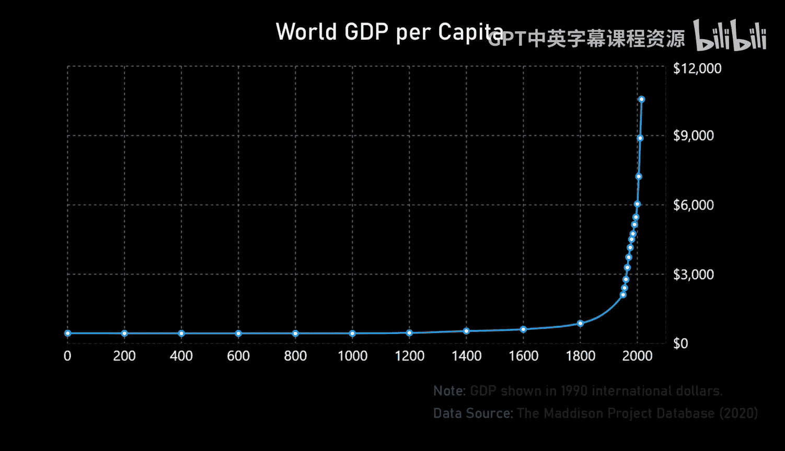

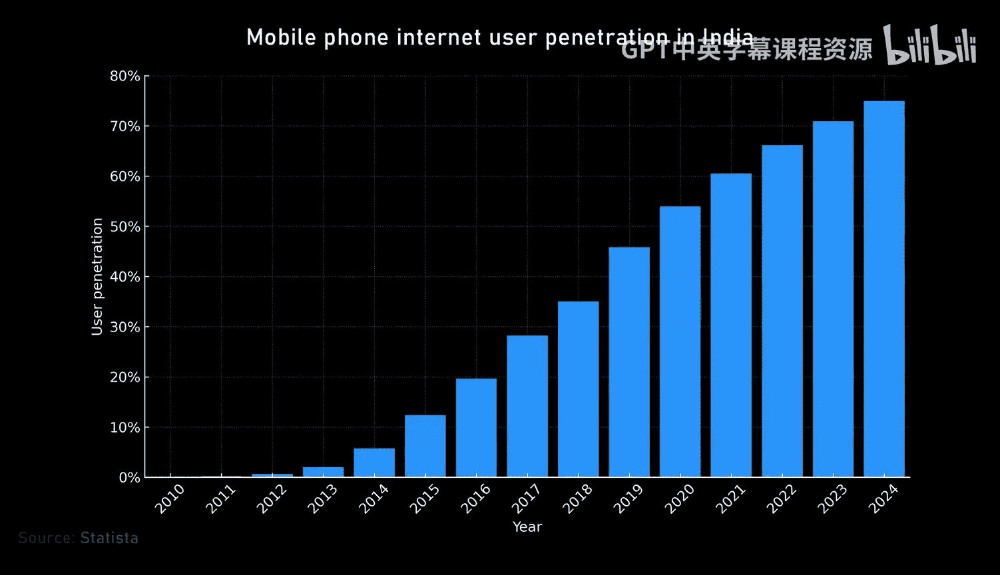

All over the world who look up to you and find your story inspiring。

Who want to be maybe the next onerbai who want to start create companies。

 build something that has a lot of impact in the world Look it's you have a lot of luck along the way。

 but you obviously have to make smart choices you're thinking about what you want to do。

 your brain is telling you something。But when you do things。

 I think it's important to kind of get that listen to your heart and see whether you actually enjoy doing it。

 right that that feeling of。If you love what you do。It's so much easier。

And you're going to see the best version of yourself it's easier said than done。

 I think it's tough to find things you love doing。But I think kind of listening to your heart a bit more than your mind in terms of figuring out what you want to do。

 I think is one of the best things I would tell people。The second thing is， I mean。

 trying to work with people who you feel at various points in my life。

 I worked with people who I felt were better than me。Like kind of like， you know。

 you almost are sitting in a room talking to someone and they're like， wow， like， you know， you know。

 and you want that feeling a few times trying to get yourself in a position。

Where you're working with people who you feel are kind of like stretching your abilities is what helps you grow。

 I think， so putting yourself in uncomfortable situations。And I think often you'll surprise yourself。

 so I think being openmined enough to kind of put yourself in those positions is maybe maybe another thing I would say。

 well， lessons can we learn maybe from an outsider perspective for me looking at your story and gotten to know you a bit you're humble。

 your' kind， usually when I think of somebody who has had a journey like yours and climbs to the very top of leadership。

 they're in a cutthroat world。They're usually going to be a bit of an asshole。

 so what wisdom were we supposed to draw from the fact？

That your general approach is a balance of humility of kindness listening to everybody what's's what's your secret。

 I do get angry， I do get frustrated， I have the same emotions all of us do right in the context of work and everything。

But a few things， right， I think， you know I。Over time I figured out the best way to get the most out of people。

 you know you kind of find mission oriented people who are in the shared journey who have this in their drive to excellence to do the best。

And and you know， you kind of motivate people and you can achieve a lot that way。

 right and so it often tends to work out that way， but have there been times like you know。

 I lose it， yeah， but you know， not maybe less often than others。And maybe over the years。

Less and less so because you know I find it's not needed to achieve what you need to do so losing your shit has not been productive yeah less often than hard I think people respond to that they may do stuff to react to that like what you you actually want them to do the right thing and and and so。

You know maybe there's a bit of like sports， you know。

 you know'm a sports fan in football coaches in soccer， that football。

 you know people people often talk about like man management right great coaches too。

 right I think there is an element of that in our lives。

 how do you get the best out of the people you work with？You know。

 at times you're working with people who who are so committed to achieving。

 if they've done something wrong， they feel it more than you you do right。

 so you treat them differently and you know， occasionally there are people who you need to clearly let them know like that wasn't okay or whatever it is。

But I've often found that not to be the case and sometimes the right words at the right time。

 spoken firmly can reverberate through time， also sometimes the unspoken words， you know。

 people can sometimes see that。Like， you know， you're unhappy without you saying it and so sometimes the silence can deliver that message even more sometimes less is more who's the greatest soccer player of all time Messie Ronnaldo or Pre or Maronna I'm going to make you know。

 in this question this going be a political answer' I will tell the truthful answer which is so it's mess。

 okay， like it is， you know， it's been interesting because my son is a big Christian Ronaldo fan。

And so we've had to watch El Classs together， you know， with that dynamic in there， I so admire CR7s。

 I mean， I've never seen an athlete more committed to that kind of excellence and so he's one of the all time grades。

But， you know， for me messy， is it？Yeah， when I see Leon Messy。

 you just are in awe that humans are able to achieve that level of greatness and genius and artistry when we talk we'll talk about AI maybe robotics and this kind of stuff。

 that level of genius I'm not sure you can possibly match by AI in a long time it's just an example of greatness and you have that kind of greatness and other disciplines。

 but in sport。You get to visually see it unlike anything else。And just the the timing， the movement。

This is genius I had the chance to see him a couple weeks ago he played in San Jose so against the quake so I went to see it。

 see the game， was a fan of the had good seats knew where he would play in the second half hopefully and even at his age just watching him when he gets the ball that movement you know you're right that special quality stuff to describe but you feel it when you see it yeah he still got it。

If we rank all the technological innovations throughout human history。

 let's go back maybe the history of human civilizations 12，000 years ago。And you rank them by the。

How much of a productivity multiplier they've been so we can go to electricity or the labor mechanization of the industrial revolution。

 or we can go back to the first agricultural revolution 1 a，000 years ago。

In that long list of inventions do you think AI when history is written a thousand years from now。

 do you think it has a chance to be the number one productivity multiplier it's a great question。

 look many years ago， I think it might have been 2017 or 2018， you know I said at that time。

 like you know AI is the most profound technology humanity will ever work on it'll be more profound than fire or electricity。

So I have to back myself， I still think that's the case。You know。

 when he asked this question I was thinking well， do we have a recency bias right。

 you know like in sports， it's very tempting to call the current person you're seeing the greatest player right and and so is there a recency bias？

And you know I do think from first principles several would argue AI will be bigger than all of those。

 I didn't live through those moments， you know， two years ago I had to go through surgery and then I processed that there was a point in time people didn't have anesthesia when they went through these procedures at that moment I was like that has got to be the greatest invention in humanity has ever ever done right。

Look， we don't know what it is to have lived through those times。But you know。

 many of what you're talking about were kind of this general。Things。

 which pretty much affected everything， you know， electricity or internet， etc。

But I don't think we have ever dealt with the technology， both which is progressing so fast。

 becoming so capable。It's not clear what the ceiling is。An。

The main unit is recursively self improving， right， it's capable of that。And so the fact it is going。

 it's the first technology will kind of dramatically accelerate creation itself。

 like creating things， building new things。can improve and achieve things on its own right。

 I think like puts it in a different league， right and so different league and so I think。

The impact it will end up having will far surpass everything we' have seen before。

Obviously with that comes a lot of important things to think and wrestle with。

 but I definitely think that'll end up being the case。

 especially if it gets to the point of where we can achieve superhuman performance on the AI research itself so it' the technology that may is's an open question but it may be able to achieve a level to where the technology itself can create itself better than it could yesterday。

 it's like the move 37 off。Alpha research or whatever it is right， like， you know， and when， when。

 yeah， you're right when， when it can do。Novel。Self directed research。

 obviously for a long time we'll have hopefully always humans in the loop and all that stuff and these are complex questions too。

Talk about， but yes， I think the underlying technology， you have said this like if you watched。

See alphaphago。Start from scratch。Be clueless and like， become better。Through the course of a day。

 you know， like， you know， kind of like kind of like， you know。

 really hits you when you see that happen。Even our like the VO3 models。

 if you sample the models when they were like 30% done and。

 60% done and looked at what they were generating。And you kind of see how it all comes together。

It's kind of like， I would say。kind of inspiring a little bit unsettling right as a human so all of that is true。

 I think well the interesting thing of the industrial revolution electricity like you mentioned。

 you can go back to the again the agriculture， the first agricultural revolution there's what's called the Neolithic package of the first agricultural revolution。

 it wasn't just，That the nomads settled down and started planting food。

 but all this other kind of technology。Was born from that and it's included in this package it wasn't in one piece of technology。

 it's there's these ripple effects， second and third order effects that happen everything from something silly like silly。

 profound like pottery that can store liquids and food to something we kind of take for granted。

 but social hierarchies。Uh， and political hierarchy。

 so like early government was formed because it turns out if humans stop moving。

And have some surplus food。They start coming up with they get bored and they start coming up with interesting systems and then trade emerges。

 which turns out to be a really profound thing and like I said， government did I mean there's just。

Second and third order effects from that， including that package is incredible and probably extremely difficult if you'll ask one of the people in the Nemadic tribes to predict that it would be impossible and it's difficult to predict but all that said。

 what do you think are some of the early things we might see in the quote unquote AI package？

I mean， most of it probably we don't know today， but like you know。

 the one thing which we can tangibly start seeing now is。You know。

 obviously with the coding progress you got a sense of it。

 it's going to be so easy to imagine like thoughts in your head translating that into things that exist。

 that'll be part of the package right， like it's going to empower almost all of humanity。

To then express themselves。Maybe in the past he could have expressed with words。But， like。

You could kind of build things into existence， right， you know， maybe not fully today。

We are at the early stages of vi coating。You know， I've been amazed at what people have put out online with V03。

 but it takes a bit of work right， you have to stitch together a set of prompts。

But all this is going to get better。The thing I always think about this is the worst you'll ever be right like at any even moment in die Yes interesting you went theres kind of a first thought sort of exponential increase。

Of access to creativity， software， creation。Are you creating a program。

 a piece of content to be shared with others？Games down the line。

 all of that like just becomes infinitely more possible Well I think the big thing is it。

It makes it accessible， it unlocks the cognitive capabilities of the entire8 billion。

 No I agree look。Think about 40 years ago。Maybe in the US。

 there were five people who could do what you were doing， like go do an interview， you know。

 and you know， but today， think about with YouTube and other other products， etc ceter。

 like how many more people are doing it？So I think this is what technology does， right。

 like when the internet created blogs。You know， you heard from so many more people。So， I think。

But with the AI， I think that number won't be in the few hundreds of thousands。

You'll be tens of millions of people， maybe even a billion people。

Like putting out things into the world in a deeper way and I think it'll change the landscape of creativity and it makes a lot of people nervous like for example。

 whatever Fox MSNBC， CNN are really nervous about this part like you mean this dude in a suit could just do this and and YouTube and thousands of others。

 tens of thousands， millions of other creators can do the same kind of thing that makes them nervous and now you get a podcast from notebookbook Lm that's about five to10 times better than any podcast either'm joking at this time but maybe not and that changes you have to evolve because on the podcasting front I'm a fan of podcast。

Much more than I am a fan of being a host or whatever if there's great podcast there are both AIs I'll just stop doing this podcast I'll listen to that podcast but you have to evolve and you have to change and that makes people really nervous I think but it's also a really exciting future the only thing I may say is I do think like in a world in are to AI I think people value and choose。

Just like in chess。You and I would never watch Stockfish 1 or whatever an alphaphago play against each like it would be boring for us to watch。

But Magnus Carlson and Gush that game would be much more fascinating to watch so it's tough to say like one way to say is you have a lot more content and so you will be listening to AI generated content because sometimes it's efficient。

 etc。But the premium experience is you value。Might be a version of like the human essence wherever it comes through。

 going back to what we talked earlier about watching messsy dribble the ball。

 I don't know one day I'm sure a machine will dribble much better than messy。

But I don't know whether it would evoke that same emotion in us。

 so I think that'll be fascinating to see I think the element of podcasting。or audiobook。

 that is about information gathering， that part might be removed。

 or that might be more efficiently and in a compelling way done by AI。

 but then it'll be just nice to hear humans struggle with the information。

Contend with the information， try to internalize it。

 combine it with the complexity of our own emotions and consciousness and all that kind of stuff。

 but if you actually want to find out about a piece of history。

 you go to Gemini if you want to see Lex struggle that，History， then you look or other humans。

 you look at that， but the point is it's going to change the nature。

Continue to change the nature of how we discover information， how we consume the information。

 how we create that information， the same way that YouTube change everything completely change news and that's something our society is struggling with Yeah YouTube look YouTube enabled I mean you know this better than anyone else it's enabled so many creators。

There is no doubt in me that like we will enable more filmmakers than that I've ever been right。

 going to empower a lot more people。So I think there is an expansionary aspect of this。

 which is underestimated， I think。I think it'll unleash human creativity in a way that hasn't been seen before。

 it's tough to internalize。The only way is if you brought someone from the 50s or 40s and just put them in front of YouTube。

 you know， I think it would blow their mind away， similarly。

 I think we would get blown away by what's possible in a 10 to 20 year timeframe do you think there's a future how many years out is it that let's say let's put a mark on it。

 50% of content？In a good content， 50% of good content is generated by V456。You know。

 I think depends on what it is for like。You know， maybe if you look at movies today with CGI。

There are great filmmakers like you still look at like who the directors are and who use it。

 they're filmmakers who don't use it at all。You value that， there are people who use it incredibly。

 you know， think about somebody like a James Cameron like what he would do with these tools in his hands。

 but I think tell me a lot more content created like just like writers today use Google Docs and not think about the fact that they are using a tool like that。

 if people will be using the future versions of these things。

 like it won't be a big deal at all to them。I've gotten a chance to get to know Darren Arowski， well。

 he's been really leaning in and trying to figure it's fun to watch a genius。

Who came up before any of this was even remotely possible。 He created Pi， one of my favorite movies。

 and from there just continued to create a really interesting variety of movies。 And now he's。

Trying to see how can AI be used to create compelling films？You have people like that。

 you have people have've gotten to just know Edgiier folks， they're AI first， like Do brothers。

Both Erinosski and Do brothers create at the edge of。The overton window society， you know。

 they push whether it's。Uh， sexuality or violence is edgy， like artists are， but it's still classy。

 doesn't cross that line。UWhatever that line is， you know， Hunt S Thompson has this line。

That the only way to find out where the edge where the line is is by crossing it。

And I think for artists that's true， that's kind of their purpose。

 sometimes comedians and artists just cross that line。

I wonder if you can comment on the weird place that puts Google。

Because Google's line is probably different than some of these artists， what what's your。

 how do you think about specifically V and flow？About like how to allow artists to do crazy shit。

 but also like the responsibility of like。Um not for it not to be too crazy I mean it's a great question look part of you mentioned Darren。

 you know， he's a clear visionary right part of the reason we started working with them early on video。

His he's one of those。People who's able to kind of see that future get inspired by it and kind of showing the way for how creative people can express themselves with it。

Look， I think when it comes to allowing artistic free expression。

It's one of the most important values in a society， right， I think you know。

 artists have always been the ones too。Push push boundaries， expand the frontiers of thought。

 and so look I think that's going to be an important value we have。So。I think we will provide。Tos。

And put it in the hands of artists for them to use and put out their work。Those APIs。

 I mean I almost think of that as infrastructure， just like when you provide electricity to people or something you want them to use it and like you're not thinking about the use cases on top of it so it's a paintbrush yeah and so I think that's how obviously that have to be some things and you know society needs to decide at a fundamental level what's okay。

 what's not。We' be responsible with it， but I do think， you know。

 when it comes to artistic free expression， I think that's one of those values we should work out to defend。

I wonder if you can comment。On。Maybe earlier versions Gemini were a little bit careful on the kind of things you would be willing to answer。

 I just want to comment on I was really surprised and pleasantly surprised and enjoy the fact that Gemini 25 Pro is a lot less careful in a good sense。

Don't ask me why but I've been doing a lot of research on Js Khan and the the EstX so there's a lot of violence there in that history it's a very violent history I've also been doing a lot of research on World War I and World War I and earlier versions of Gemini were very。

Um basically this kind of sense， are you sure you want to learn about this and now it's actually very factual objective。

 talks about very difficult parts of human history and does so with nuance and depth。

 it's been really nice， but there's a line there that I guess Google has kind of walk。

 I wonder if it's I mean it's also an engineering challenge。

 how to how to do that at scale across all the weird queries。That people ask。

 what can you just speak to that challenge， how do you allow Je and I to say again。

 forgive pardon my French crazy shit， but not not not too crazy。

Think one of the good insights here has been。As the models are getting more capable？

The models are really good at this stuff right and so I think in some ways maybe a year ago the models weren't fully there。

 so they would also do stupid things more often。And so， you know， you're trying to。

Handle those edge cases， but then you make a mistake in how you handle those edge cases and it compounds。

Ping with 2。5 what we particularly found is once the models。

Cross a certain level of intelligence and sophistication。You know。

 they are they are able to reason through these nuanced issues pretty well and I think users really want that right。

 like you know， you want as much access to their raw model as possible， right？

Ping is a great area to think about like， you know， over time。You know。

 we should allow more and more closer access to it。

Maybe obviously let people custom prompts if they wanted to and like， you know， and you know。

 experiment with it， etc。I think that's an important direction， but look。

 the first principles we want to think about it is。You know， from a scientific standpoint。

Like making sure the models and I'm saying scientific in a sense of like how you would approach math or physics or something like that。

 from first principles having the models's reason about the world be nuanced， etc。

 you know from the ground up is the right way to build these things right not like some subset of humans kind of hard codinging things on top of it。

 so I think it's the direction we've been taking and I think you'll see us continue to push in that direction。

Yeah， I actually asked， I gave these notes， I took extensive notes and I gave to Ge I and said。

 can you ask a novel question that's not in these notes？And it wrote。

 Gemini continues to really surprise me。

Really surprised me， it's been really beautiful， It's an incredible model。

The the question it's it generated was。You， meaning Sundar told the world Geminized churning out 480 trillion tokens a month。

What's the most lifechan five word sentence hiding in that haystack that's a Ge question but it it gave me a sense I don't think you can answer that。

 but it me it woke me up to like all of these tokens are providing little aha moments for people across the globe So that's like learning that those tokens are people are curious they ask a question and they find something out and it truly could be life changing Oh you did say look no。

I had the same feeling about such many， many years ago。 you you know， you definitely。You know。

 this tokens per month has like grown 50 times in the last 12 months is that accurate by the way。

 that it is， you know， it is， it is accurate， I'm glad it got it right。

But you know that number was 9。7 trillion tokens per month 12 months ago right it's gone gone up to 480 you know it's a 50 x increase so there's no limit to human curiosity and I think it's it's one of those moments maybe I don't think it is there today。

 but maybe one day there's a five word phrase。Which says what the actual universe is or something like that and something very meaningful。

 but I don't think we are quite there yet。Do you think the scaling laws are holding strong on？

There's a lot of ways to describe the scaling laws for AI， but on the pre training。

 on the post training fronts。So the flip side of that， do you anticipate AI progress will hit a wall？

Is there a war， you know， it's a cherished micro kitchenitch conversation once in a while， I have it。

 you know， like when Des is visiting or， you know。De is Corri， Jeff， Noam， Sergey。

 a bunch of other people， like we sit and talk about this， right？嗯。😊。

Look we see a lot of headroom ahead， right， I think we've been able to optimize and improve on all front。

 right？Pre training， post training。Testine compute。

tool use right over time making these more agentic so getting these models to be more general world models in that direction like V3。

 you know， the physics understanding is dramatically better than what B1 or something like that was。

So you kind of see on all those dimensions， I feel， you know progress is very obvious to see。

And I feel like there is significant headroom。More importantly， you know。

'm fortunate to work with some of the。Best researchers on the planet。

 right they think there is more headroom to be had here。

 and so I think we have an exciting trajectory ahead。It's tougher to say。You know。

Each year I sit and say， okay， we are going to throw 10 x more compute over the course of next year at it and like will we see progress？

Sitting here today， I feel like the year ahead will have a lot of progress and do you feel any limitations like that the bottlenecks compute limited data limited idea limited。

 do you feel any of those limitations or is it full steam ahead on off fronts？

I think it's compute limited in this sense， right like you know。

 we can all part of the reason you've seen us to flash nano flashlash and pro models。

But not an ultra model， it's like for each generation。

 we feel like we've been able to get the pro model at like。I don't know， 80。

90% of ultrarus capability。But U would be a a lot more。Like slow and a lot more expensive to soap。

But what we've been able to do is to go to the next generation and make the next generations pro as good as the previous generations U but be able to serve it in a way that it's fast and you can use it and so on so I do think scaling loss are working but。

It's tough to get at any given time the models we all use the most。😡。

There's maybe like a few months behind the maximum capability we can deliver。Right。

 because that won't be the fastest easiest to use， etc ceter Also， that's in terms of intelligence。

 it becomes harder and harder to measure。Uh， performance in quotes， because， you know。

 you could argue gem and I flash。Is much more impactful than pro just because of the latency is super intelligent already。

I mean， sometimes like latencies may be more important than intelligence。

Especially when the intelligence is just a little bit less and flash not。

 it's still incredibly smart model and so you have to now start measuring impact and then。

It feels like benchmarks are less and less capable of capturing the intelligence of models。

 the effectiveness of models， the usefulness， the real world usefulness of models。

 another kitchen question， so lots of folks are talking about a timeline for AGI。Or ASI。

 artificial superinligence， so AGI loosely defined is basically human expert level at a lot of the main fields of pursuit for humans。

And ASI is what AGI becomes presumably quickly by being able to self- improve so' becoming far superior in intelligence across all these disciplines in humans when do you think we'll have AGI it's 2030 a possibility there's one other term we should throw in there I don't know who used it first maybe Carpati did AJI have have you heard AJI the artificial jagged intelligence sometimes feels that way right both there are progress and you see what they can do and then like you can trivially find they make numeric letters or like you know counting Rs and strawberry or something which seems to trip up most models or whatever it is right so。

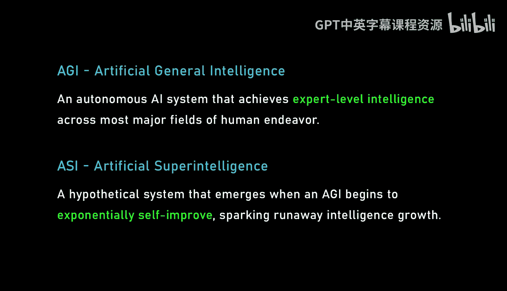

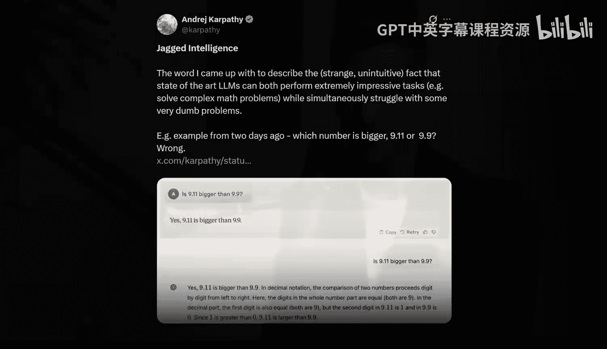

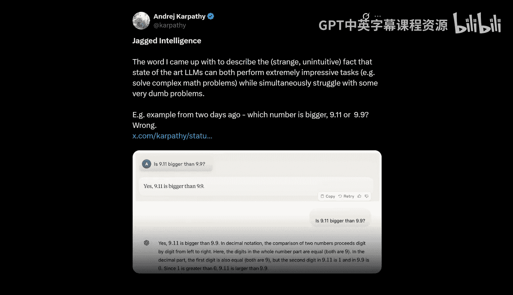

So maybe we should throw that term in there， I feel like we are in the AJI phase where like dramatic progress。

 some things don't work well， but overall， you know you're seeing lots of progress。

But if your question is， will it happen by 2030， look we constantly move the lion of what it means to be AGI。

There are moments today， you know， like sitting in a Wemo in a San Francisco street with all the crowds and the people and kind of work its way through。

I see glimpses of it there the car is sometimes kind of impatient trying to work its way using Astra like in Gemini live or seeing you know asking questions about the world what's a skinny building doing in my neighborhood It's a street light not a building you see glimpses that's why I use the word AjiAI because then you see stuff which obviously you know we are far from AGI too so you have both experience simultaneously happening to you。

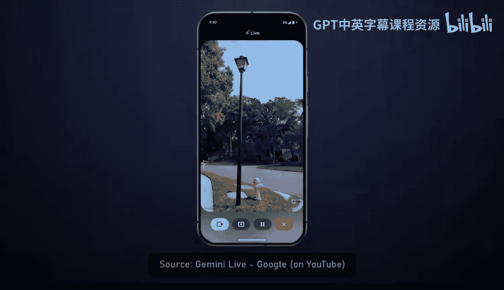

I'll answer a question， but I'll also throw this， I almost feel the term doesn't matter what I know by 2030 there'll be such dramatic progress。

We'll be dealing with the consequences of that progress， both the positives。

 both the positive externalities and the negative externalities that come with it in a big way by 2030 so that I strongly feel right whatever we may be arguing about the term or maybe Ge and I can answer what that moment is in time in 2030。

But I think the progress will be dramatic right so that I believe in will the AI think it has reached AGI by 2030？

I would say we will just fall short of that timeline right so I think it'll take a bit longer。

 it's amazing in the early days of Google Deep in 2010 they talked about a 20 year timeframe to achieve AGI which is kind of fascinating to see。

But。You know， I for me the whole thing seeing what Google Brain did in 2012 and when we acquired DeepM in 2014 right close to where we were sitting in 2012 you know Jeffine showed the image of and the neural networks could recognize a picture of a cat right and identify it you know this is the early versions of brain right and so。

You know， we all talked about a couple decades。I don't think we'll quite get there by 2030。

 so my sense is it slightly after that， but I I would stress it doesn't matter like what that definition is。

Because。You will have mindbing progress on many dimensions maybe AI can create videos。

 we have to figure out as a society how do we we need some system by which we all agree that this is AI generated and we have to disclose it in a certain way because how do you distinguish reality otherwise Yeah there's so many interesting things you said so first I'll just look back at this recent now it feels like distant history。

With Google Bra， I mean that was before Tensorflow。

 before Tensorflow was made public and open sourced， so the tooling matters too。

 combined with GitHub ability to share code。

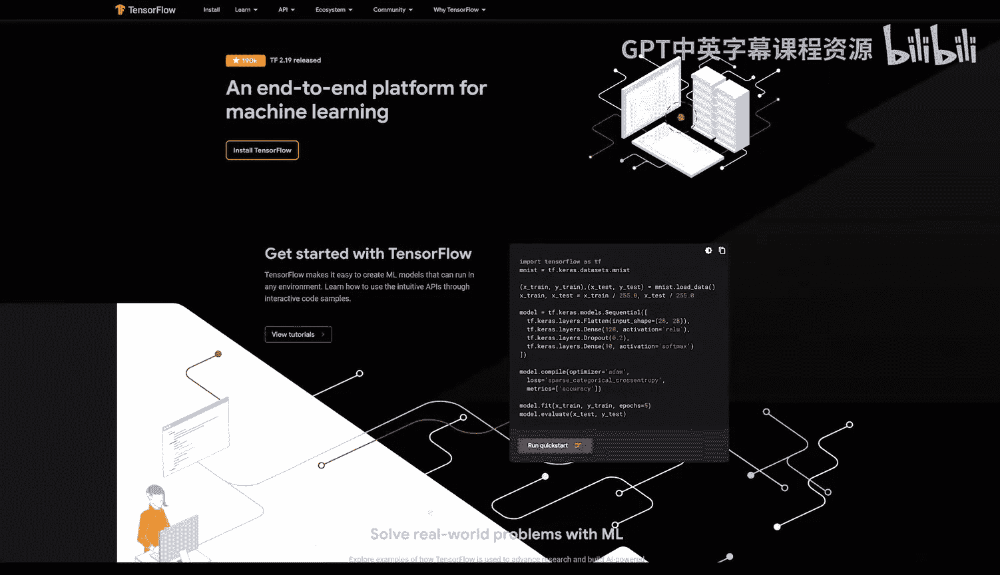

Then you have the ideas of attention transformers and the diffusion now。

 and then there might be a new idea that seems simple in retrospect， but it will change everything。

And that could be the post training， the inference time innovations。

 and I think Shad Sien tweeted that。Google is just one great UI from completely winning the AI race。

 meaning like。

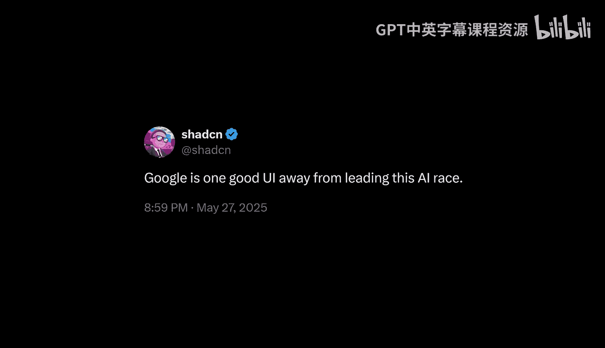

UI is a huge part of it， like how that intelligence。嗯。

I think Logan Co project likes to talk about this right now it's an NLM。

 but it become like when is it going to become a system where you're talking about shipping systems versus shipping the particular model。

Yeah that matters too how the system is manifests itself and how it presents itself to the world that really。

 really matters Oh hugely so there are simple UI innovations which have changed the world right and I absolutely think so we will see a lot more progress in the next couple of years as I think。

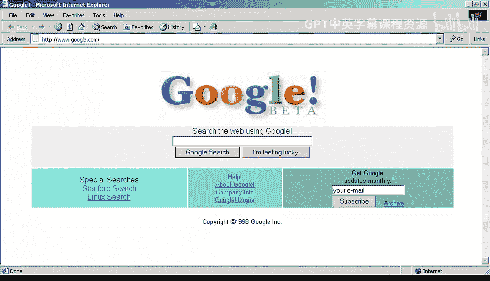

AI itself on a self improving track for UI itself， like you know today。

We are like constraining the models， the models can't quite express themselves in terms of the UI to people。

Um， but that is uh， like， you know， if you think about it， we've kind of boxed them in that way。

But given these models can code， you know they should be able to write the best interfaces to express their ideas over time。

 right that is an incredible idea， so their API is already open so you you create a really nice agent system that continuously improves。

😊，The way you can be talking to an AI Yeah， but a lot of that is the interface and then of course。

 the incredible multimodal aspect of the interface that Google's been pushing these models are natively multimodal。

They can easily take content from any format， put it in any format。

They can write a good user interface， they probably understand your preferences better than over time。

Like， you know， and so so all this is like the evolution ahead right and so that goes back to where we started the conversation like I think there'll be dramatic evolutions in the years ahead。

 maybe one more kitchen question。This even further ridiculous concept。

Of p doom。 So the philosophically minded folks in the AI community think about the probability that AGI and then ASI might destroy all of human civilization。

 I would say my p doom is about 10%。

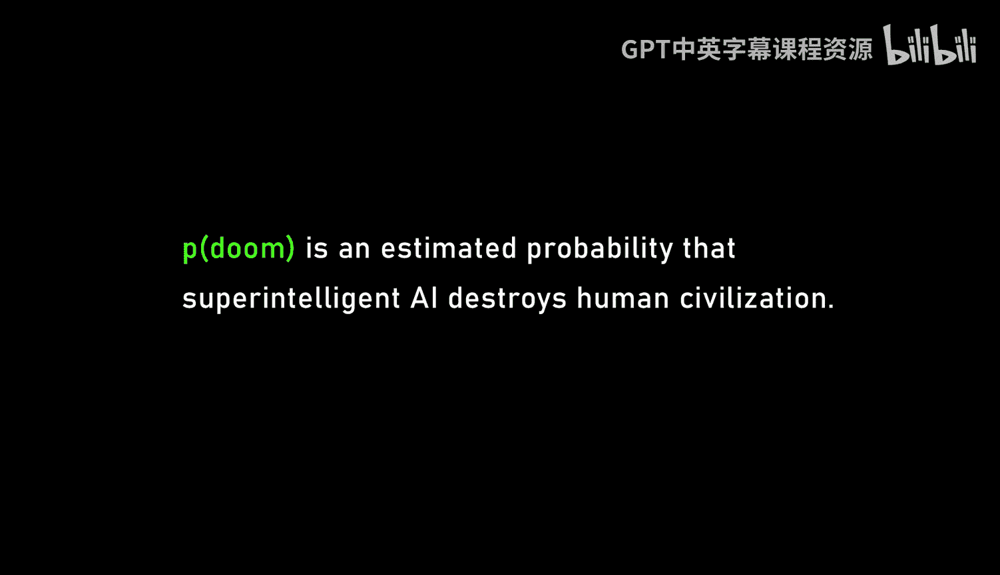

Do you ever think about this kind of？Long term threat of ASI， and what would European doom be？Look。

 I mean， for sure， look， I've both been very excited about AI， but I've always felt。

This is a technology， you know if you have to actively think about the risks and work very。

 very hard to harness it in a way that it all works out well on the p doom question。

 look it you know wouldn't surprise you to say that's probably another micro kitchenitchen conversation that pops up once in a while right。

Given how powerful the technology is， maybe stepping back， you know。

 when you're running a large organization， if you can kind of align the incentives of the organization。

 you can achieve pretty much anything right like you know。

 if you can get kind of people all marching in towards like a goal in a very focused way in a mission driven way。

 you can pretty much achieve anything。But it's very tough to organize all of humanity that way。

 but I think if pdom is actually high at some point all of humanity is like aligned in making sure that's not the case right and so we'll actually make more progress against it I think so the irony is。

So there is a self modulating。Aspect there， like I think if humanity collectively puts their mind to solving a problem。

 whatever it is， I think we can get there。So because of that， you know。

 I think I'm optimistic on the P doom。Scennaris。But that doesn't mean I think the underlying risk is actually pretty high。

But I'm you know， I have a lot of faith and humanity kind of rising up to the to meet that moment that's really。

 really well I put I mean as the threat becomes more concrete and real humans do really come together and get their shit together well the other thing I think people don't often talk about is。

Probability of doom without AI。 So there's all these other ways that humans can destroy themselves and it's very possible。

 I least I believe so， that AI will help us become smarter。Kinder to each other。More efficient。

It'll help more parts of the world flourish where it wouldn't be less resource constrained。

 which is often the source of military conflict， tensions， and so on。

So we also have to load into that what's the p doom without AI with do with doom without AI because it's very possible that AI will be the thing that saves us。

 saves human civilizations from all the other threats。

 I agree with you I think I think it's insightful look I felt。

Like to make progress on some of the toughest problems would be good to have AI like pair helping you right and and like。

 you know， so that resonates with me for sure， yeah， quick pause， Battleberg。

 you know I gets to that。

If Nobook L was the same like what I saw today with Bea。

It it was compelling in the same kind of way。

Blee my mind it was incredible， I didn't think it's possible I didn't think my was like can you imagine like the US president。

 the Chinese president being able to do something like beam with the liveme translation working well so theyre both sitting and talking make progress a bit more yeah just for people listening took a quick bath to break and now we're talking about the demo I did we' probably posted somewhere somehow maybe here the I got a chance to experience beam and it was。

It's hard to describe in words。How real it felt with is just what is it six cameras it's incredible。

 it's incredible it's it's one of the toughest products of you can't quite describe it to people even when we show it in slides。

 etc ceter， like you don't know what it is you have to kind of experience it on the world leaders front on politics。

 geopolitics that there's something really special again with studying World War I。

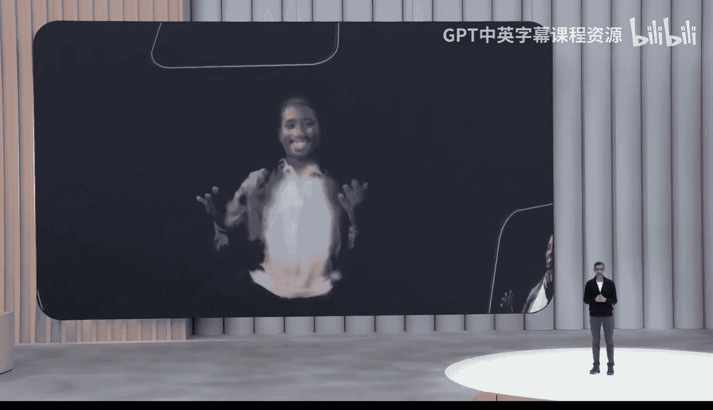

And how much could have been saved if Chamberlain met Stalin in person。

 and I sometimes also struggle explaining to people articulating why I believe meeting in person for world leaders is powerful。

It just seems naive to say that， but there is something there in person。And with beam。

 I felt that same thing and then I'm。Unable to explain all I kept doing is what like a child does。

 you look real， you know， and。I mean， I don't know if that makes meetings more productive or so on。

 but it certainly makes them more。Ah， the same reason you want to show up to work versus remote sometimes that human connection。

 I don't know what that is，' it's hard to put into words。嗯。There's some。

There's something beautiful about great teams collaborating on a that's that's not captured by the productivity of that team or。

By whatever on paper， some of the most beautiful moments you experience in life is at work。

 pursuing a difficult thing together for many months。

There's nothing like it youre on the trenches and yeah you do form bonds that way for sure and to be able to do that like somewhat remotely in that same personal touch I don't know that's a deeply fulfilling thing I know a lot of people I personally hate meetings because。

A significant percent of meetings when done poorly don't serve a clear purpose。

So but that's a meeting problem， that's not a communication problem if you could improve the communication for the meetings that are useful。

This is just incredible so yeah， I was blown away by the great engineering behind it and then we we get to see what impact that has that's really interesting but just incredible engineering really impressive no it is and obviously we'll work hard over the years to make it more and more accessible。

But yeah， even on a personal front outside of work meetings， you know？

A grandmother who's far away from our grandchild and being able to。You know。

 have that kind of an interaction， right， all that I think will end up being very mean。

 nothing substitute being in person。Pno it's not always possible。

 you know it could be a soldier deployed trying to talk to your loved one。

 so I think you know so that's what inspires us。When you and I。Hung out last year and took a walk。

I remember， I don't think we talked about this， but I remember you know outside of that seeing dozens of articles written by analysts and experts and so on that Sun up Patcha should step down。

Because the perception was that Google was definitively losing the AI race has lost its magic touch。

In the rapidly evolving technological landscape and now a year later it's crazy。

 he showed this plot of all the things that were shipped over the past year。

 it's incredible and Gemini Pro is winninging across many benchmarks and products as we sit here today so take me through that experience when there's all these articles saying。

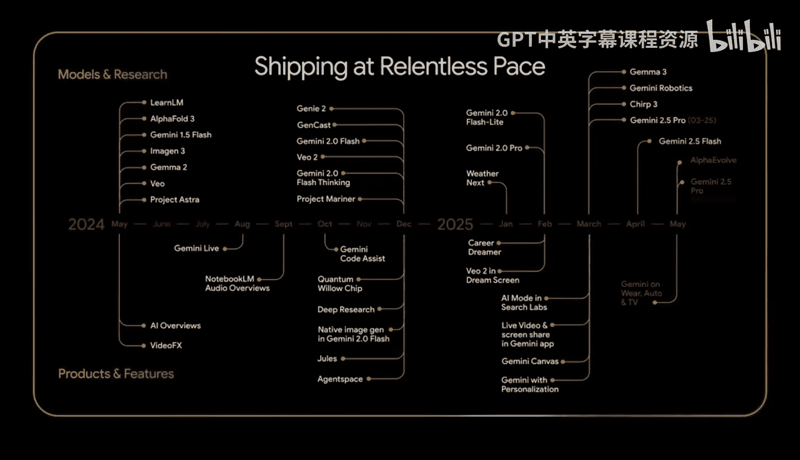

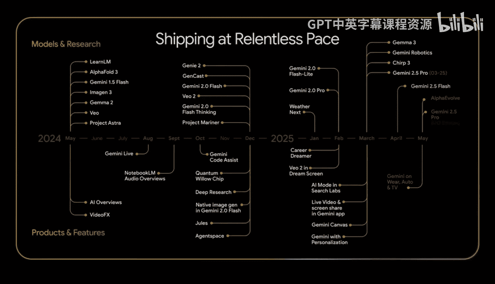

You're the wrong guy to lead Google through this。 Google's lost is done。 It's over。

To today where Google is win you again， what were some low points during that time。Look， I。I mean。

 lots to unpack， you know， obviously。Like， I mean， the main bet I made as a CEO is to really。

know make sure the company was approaching everything in an AI first way。

 really you know setting ourselves up to develop AGI responsibly， right？

And make sure we're putting out products， which embodies that。Things that are very。

 very useful for people。So look， I knew even through moments like that last year。You know。

 I had a good sense of what we were building internally， right？I'd already made you know。

 many important decisions， you know， bringing together them of the caliber of brain and deep mind and setting up cool。

 deep mind。

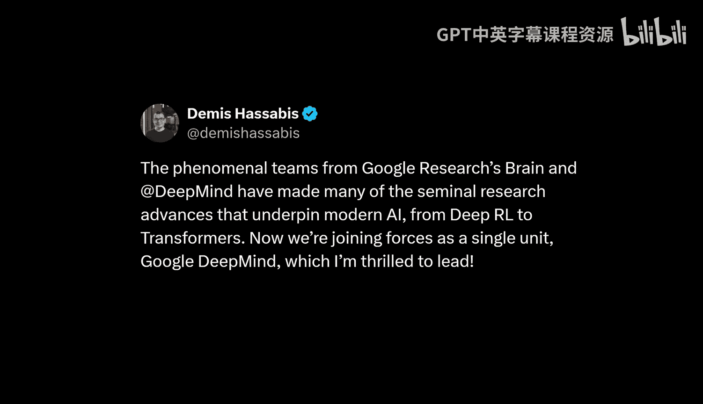

There were things like we made the decision to invest in Tpus 10 years ago。

 so we knew we were scaling up and building big models。

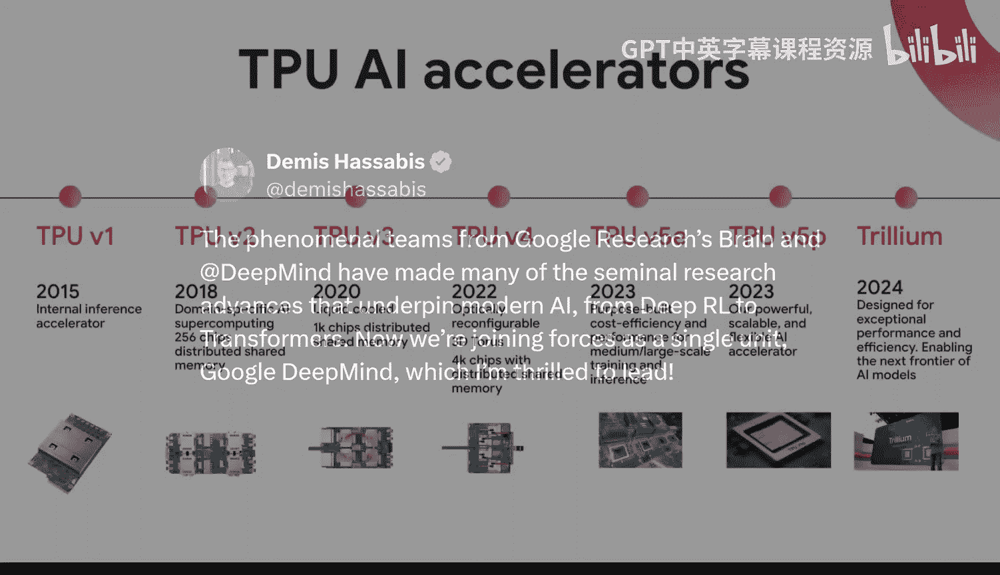

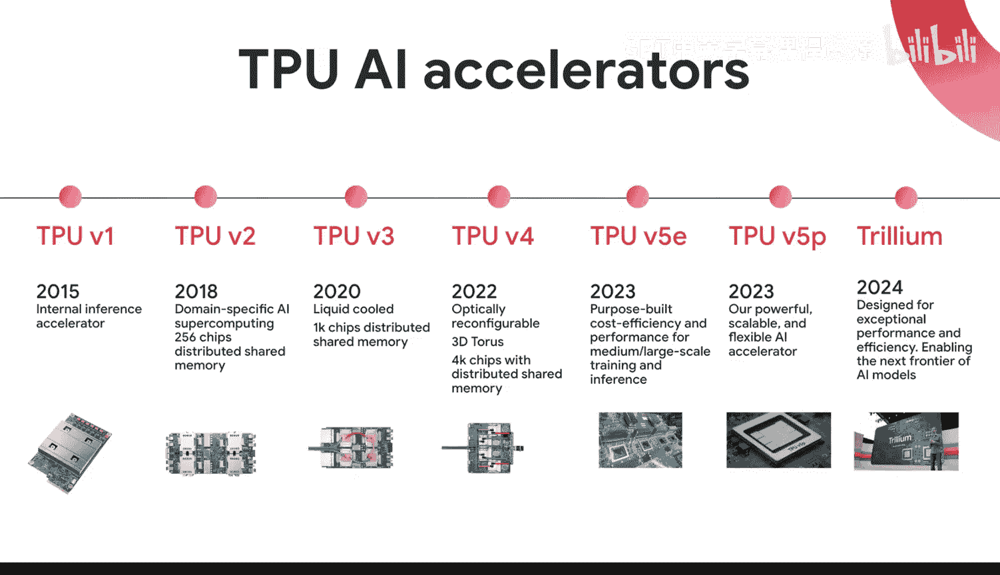

Anytime you're in a situation like that。A few aspects。呃。I'm good at tuning out noise， right。

 separating signal from noise， deuce， Cubaa dive， like have you now？You know。

 it's amazing like I'm not good at it， but I've done it a few times。

But sometimes you jump in the ocean， it's so choppy。But you go down one feet under。

 it's the calmest thing in the entire universe right。

 so there's a version of that right like you know。Rning Google。

You know you may ashole be coaching Barcelona or real Madrid like you know you have a bad season so there are aspects to that but you know like look I'm good at tuning out the noise I do watch out for signals you know it's important to separate the signal from the noise so there are good people sometimes making good points outside so you want to listen to it you want to take that feedback in。

But， you know， internally， like， you know， you're making a set of consequential decisions。

Right as leaders。You're making a lot of decisions。Many of them are like inconsequential。

Like it feels like， but over time you learn that， most of the decisions you're making on a day to day basis doesn't matter。

Like。You have to make them and you're making them just to keep things moving。

But you have to make a few consequential decisions， right。Weird。Set upた。Wite teams， right leaders。

 we had world class researchers。We are training Gemini。Internally， there are factors which are。

 for example outside people may not have appreciated， I mean TPUs are amazing。

 but we have to ramp up TPUs too。That took time， right， and at to scale actually having NFTPUs。

To get the compute needed。But I could see internally the trajectory we were on。And and P， you know。

 I was so excited internally about the possible， to me。

 this moment felt like one of the biggest opportunities ahead for us as a company。

That the opportunity space ahead over the next decade。

 next 20 years is bigger than what has happened in the past。And I thought we were set up。

Like better than most companies in the world to go realize that vision。 I mean， you had to make some。

Consequential bold decisions， like you mentioned the merger of deep mind and brain。啊。

Maybe it's my perspective just knowing humans， I'm sure there's a lot of egos involved。

 it's very difficult to merge teams and I'm sure there were some hard decisions to be made can you take me through your process of how you think through that Do you going to pull the trigger and make that decision？

Maybe what were some painful points， how do you navigate those？

Trbulent waters look we were fortunate to have two world class teams， but you're right。

 like it's like somebody coming and telling to you take Stanford and MIT right and then put them together and create a great department right and and easier said than done。

But we are fortunate in a phenomenal teams， both had their strengths， you know。

 they were run very differently， right like brain。Was kind of a。

Lo of diverse projects bottoms up and out of it came a lot of important research breakthroughs。

 Deep Min at the time had a strong vision of how you want to build AGI and so they were pursuing their direction。

But I think through those moments， luckily tapping into， you know。

 Jeff had expressed a desire to be more to go back to more of a scientific individual contributor roots。

 you know， he felt like management was taking up too much of his time and Des naturally， I think。

 you know， was running deep Min and was a natural choice there。But I think it was， youre right。

 you know， it took us a while to bring the teams together， credit to Des， Jeff， Corai。

 all the great people there。They worked super hard to combine the best of both worlds when you set up that team。

A few sleepless nights here and there as we put that thing together。We were patient in how he did it。

So that it works well for the long term， right and some of that in that moment， I think yes。

 with things moving fast， I think you definitely felt the pressure。

But I think we pulled off that transition well。 And you know， I think， I think， you know。

 they've obviously。doing incredible work and there's a lot more incredible things I had coming from them like we talked about。

 you have a very calm， even tempered， respectful demeanure。During that time。

Whether it's the merger or just dealing。With the noise were their tie or frustration boiled over？

Like， did you have to go a bit more intense on everybody than you usually would， Probably， you know。

 probably， he right， I think， I think in the sense that you there was a moment where we were all driving hard。

 But when you were in the trenches working with passion。You're going to have days， right。

 you disagree， you argue， but like all that I mean just。Part of the course of working intensely。

 right and you know at the end of the day。All of us are doing what we are doing because the impact it can have。

 we're motivated by it， it's like you know for many of us this has been a longter journey and so it's been super exciting the positive moments far outweigh the kind of stressful moments just early this year I had a chance to celebrate back to back over two days like you know Nobel Prize for Jeff Finon and the next day a Nobel Prize for Des and John Jumer。

You know， you worked with people like that all that is super inspiring I there something like with you where you had to like put your foot down。

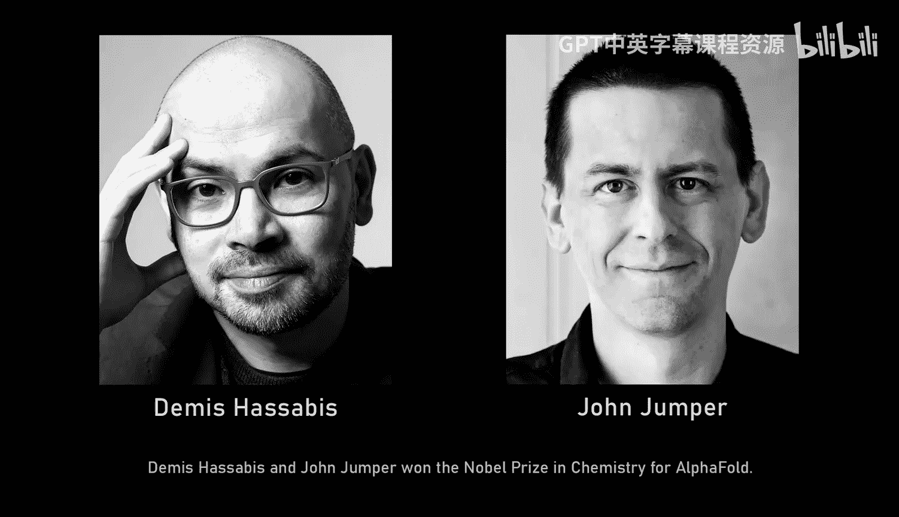

Maybe with less。Versus more orre like I'm the CEO。 and we we're doing this To my earlier point about consequential decisions you make。

 there are decisions you make。 people can disagree pretty vehemently and。But at some point， like。

 you know， you make a clear decision and you just ask people to commit， right， like， you know。

 you can disagree。But it's time to disagree and come so that we can get moving and。

Whether it's putting the foot down or you know like you know it's a natural part of what all of us have to do and you know I think you can do that calmly and be very firm in the direction you're making the decision and I think if you're clear actually people over time respect that right like you know if you can make decisions with clarity。

I find it very effective in meetings where you're making such decisions。To hear everyone out。

 I think it's important when you can， to hear everyone out。

 sometimes what you're hearing actually influences how you think about and you reststling with it and making a decision。

Sometimes you have a clear conviction。And you state so look。I， you know。

 this is how I feel and you know， this is my conviction and you kind of place the bet and you move on other big decisions like that I'm kind of intuitively assumed the merger was the big one。

 I think that was a very important decision， you know for for the company to。

To meet the moment， I think we had to make sure we were doing that and doing that well。

 I think there was a consequential decisions， there were many other things we set up a AI infrastructure team。

Like to really go meet the moment to scale up the compute we needed to and really brought teams from dis parts of the company。

 kind of created it to move forward。嗯。You know， bringing people like getting people to kind of work together physically。

 both in London with deep mind。And what we call gradient Canopy， which is where the Mountain View。

 Google Deepd Teams are， but one of my favorite moments is I routinely walk multiple times per week to the Gring Canopy building where our top。

Researchers are working on the models。Sergey is often there amongst them， right like， you know， just。

 you know， looking at， you know， getting an update on the models， seeing loss curve， so all that。

 I think the cultural part of getting the teams together back。With that energy。

 I didn't ended up playing a big role too what about the decision to？Recently add AI mode。

Google search is the， as they say， the front page on the Internet。 It's like a legendary minimalist。

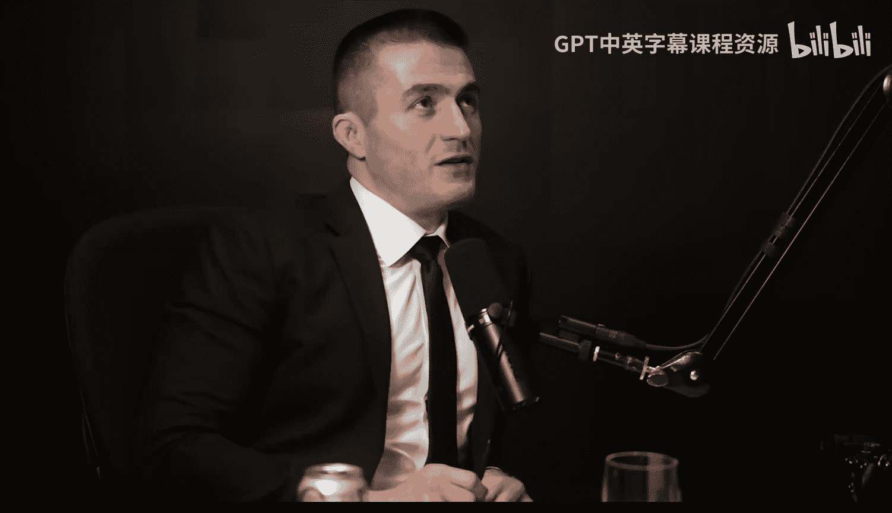

Thing with1 blue links like that's when people think internet they think that page and now you're starting to mess with that so the AI mode which is a separate tab and then integrating AI and the results I'm sure there were some battles in meetings on that one Look you know in some ways when mobile came you know people wanted answers to more questions so we kind of constantly evolving it but you're right this moment you know that evolution because the underlying technologies is becoming much more capable。

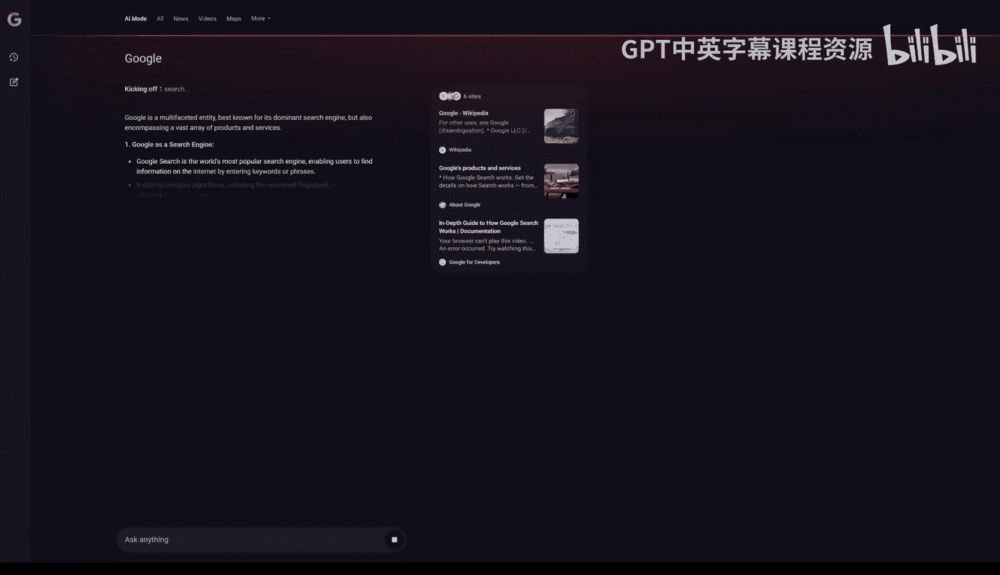

You know， you can have AI give a lot of context， you know。

 but one of our important design goals though is when you come to Google search。

You're going to get a lot of context， but you're going to go and find a lot of things out on the web。

 so that will be true in AI mode in AI overview and so on。Priing to our earlier conversation。

 we are still giving you access to links， but think of the AI as a layer which is giving you context summary。

 maybe in AI mode， you can have a dialogue with it back and forth on your journey。😊。

Right and but through it all you're kind of learning what's out there in the world。

 so those core principles don't change but I think AI mode allows us to push the we have our best models there。

 right， models which are using search as a deep tool really for every query you're asking kind of fanning out doing multiple searches。

Like kind of assembling that knowledge in a way so you can go and consume what you want to right and and and that's how we think about it again it just to listen to a bunch of Elizabeth Liz Reed yeah describe this two things stood out to me as you mentioned one thing is what you were talking about the query fan out。

Which I didn't even think about before。iss the the powerful aspect of integrating a bunch of stuff on the web for you in one place so yes。

 it provides that context so that you can decide which page to then go on to the other really。

 really big thing speaks to the earlier。In terms of productivity multily that we're talking about that she mentioned was language。

So one of the things you don't quite understand is it through AI mode。You make。😔。

For non English speakers， you make sort， let's say， English language websites accessible。By。

In the reasoning process as you've tried to figure out what you're looking for， of course。

 once you show up to a page， you can use a basic translate。

 but that process of figuring it out if you empathize with a large part of the world that doesn't speak English there like web。

Is much smaller in that original language and so it unlocks again。

 unlocks that huge cognitive capacity there we don't， you know。

 you take for granted here with all the bloggers and the journalists writing about AI mode。

 you forget that this now unlocks。嗯。

Because Yemen is really good at translation。No it is， I mean， at the multimodality， the translation。

 its ability to reason。We are dramatically improving tool use like as a putting that power in the flow of search。

I， I think， look， I'm， I'm super excited with the AI overviews。We've seen the product is gotten。

Much better we can be measured using all kinds of user metrics。

 so obviously driven strong growth of the product。And you know， we've been testing AI mode， you know。

 it's now in the hands of millions of people。And the early metrics are very encouraging。

 so look I'm excited about this next chapter of search for people who are not thinking through or aware of this。

 so there's the T links with AI overview on top that provides a nice summar you could expand it and you have sources and links links now yep embedded I believe at least lists said so I actually didn't notice it but there's ads in the AI overview also。

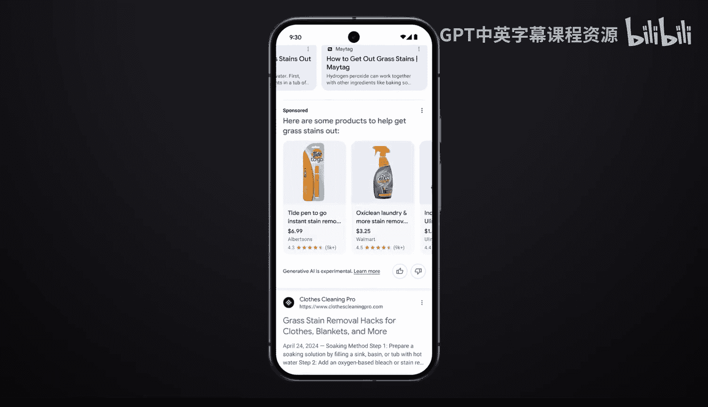

I don't think there's ads in AI mode。Uh， when ads in AI mode， so， when when do you think， I mean。

 it's okay， we should say that。In the 90s， I remember the animated gifts。

Banner gifts that take you to some shady websites that have nothing to do with anything addense revolutionized advertisement is one of the greatest inventions。

In recent history， because it allows us for free。To have access to all these kinds of services。

 so ads fuel a lot of really powerful surface。And at its best， it's showing you relevant ads。

 but also very importantly in a way that's not super annoying right in a classy way so。

When do you think it's possible to add ads into AI mode and what does that look like from a classy。

 not annoying perspective？Two things， early part of AI mode will obviously focus more on the organic experience to make sure we are getting it right。

I think the fundamental value of ads are it enables access to deploy the services to billions of people。

Second is ads are the reason we've always taken ads seriously is we view ads as commercial information。

 but it's still information。😊，And so we bring the same quality metrics to it。

I think with AI mode to our earlier conversation about， I think AI itself itself will help us。

Or time， figure out， you know the best way to do it。

I think given we are giving context around everything。

 I think it'll give us more opportunities to also explain， okay， here's some commercial information。

 like today as a podcaster， you do it at certain sportss and you probably figure out what's best in your podcast。

Um I think so there are aspects of that， but I think， you know。

 I think the underlying need of people value commercial information。

Businesses are trying to connect to users， all that doesn't change in an AI moment。But look。

 we will rethink it， you've seen us in YouTube now do a mixture of subscription and ads。

Like obviously。You know， we are now introducing subscription offerings across everything and so as part of that。

We can optimize the optimization point will end up being a different place as well do you see it rejected in the possible future where AI mode completely replaces？

The Tbl links plus AI overview。Our current plan is AI mode is going to be there as a separate tab for people who really want to experience that。

 but it's not yet at the level there are main search pages。

 but as features work will keep migrating it to the main page。

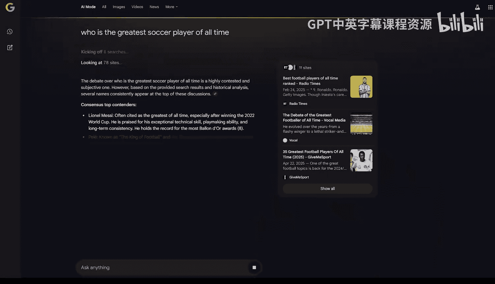

And so you can view it as a continuum AI model offer you the bleeding edge experience。

But it thinks that work will keep all flowing。To AI overview views and the main main experience and the idea that AI mode would still take you to the web to the human created web。

 Yes， that's going to be a core design principle for us。 So really if users decide right。

 they drive this。It's just exciting a little bit scary that it might change the internet。

Because you Google has been dominating with a very specific look and idea of what it means to have the internet。

And as you move to AI mode。I mean it's just a different experience I think Liz was talking about。

 I think you've mentioned that。You ask more questions。You ask longer questions。

 dramatically different types of questions yeah like it actually fuels curiosity like I think is for me。

 I've been asking just a much larger number of questions of this black box machine， let's say。

 whatever it is。And。And with the eye over you， it's interesting because I still value the human。

I still ultimately want to end up on the human created web。But I like you said。

 the context really helps。It helps us deliver higher quality referrals right you know where people are like they have much higher likelihood of finding what they're looking for。

 they're exploring， they're curious， their intent is getting satisfied more so that's what all our metrics show it makes the humans that create the web nervous the journalists are getting nervous they're already been nervous like we mentioned CNN is nervous because the podcasts。

mIt makes people nervous。 look， I think news and journalism。Will play an important role you know。

 in the future， be pretty committed to it right and so I think。Making sure that ecosystem， in fact。

 I think we'll be able to differentiate ourselves as a company over time because of our commitment there。

 so it's something I think I definitely value a lot and as we are designing we'll continue prioritizing approaches。

I'm sure for the people who want that can have a fine tuned AI model that's clickbait hit pieces that will replace current journalism that's the shot of journalism。

 forgive me， but I I find that if you're looking for really strong criticism of things that Gei is very good at providing that absolutely it's better than anything for now I mean people are concerned that there would be bias that's introduced that as the AI systems become more and more powerful。

 there's incentive from sponsors。To roll in and try to control the output。Of the AI models。

 but for now the objective criticism that's provided is way better than journalism Of course the argument is the journalists are still valuable。

 but then I don't know the crowdsource journalism that we get on the open internet is also very very powerful。

 I feel like they're all super important things。 I think it's good that you get a lot of crowdsourced information coming in。

But I feel like there is real value for high quality journalism， right and I think。

These are all complementary， I think， like I viewed as I find myself constantly seeking out also like try to find objective reporting on things too。

 and sometimes you get more context from the crowdfunded sources you read online。

 where I think both end up playing a super important role。

So there's you spoken a little about about this。 Des talked about this is sort of the。

The slice of the web that will increasingly become about providing information for agents。

 so we can think about as like two layers of the web， one is for humans， one is for agents。

 do you see the AI agents do you see？The one that's for AI agents growing over time。

 do you see there're still being long term，5，10 years value for the human created。

Human created for the purpose of human consumption web。

 or will it all be agents in the end yet to day。Like not everyone does， but， you know。

 you go to you go to a big retail store， you love walking the dial， you love shopping。

Or grocery store。Picking out food etc， but they're also online shopping and they're delivering right so both are compliment and like that's true for restaurants。

 etc。So I do feel like over time websites will also get better for humans。They will be better design。

AI might actually design them better for humans。So I expect the web to get a lot richer and more interesting and better to use。

At the same time， I think there'll be an agentic web。Which is also making。A lot of progress。

And you have to solve the business value and the incentives to make that work well， right。

 like for people to participate in it。But I think both will coexist。

And obviously the agents may not need the same may not。

 they won't need the same design and the UI paradigms which humans need to interact with。

 but I think both will be there。I have to ask you about Chrome I have to say for me personally。

 Google Chrome was probably。I don't know， I'd like to see where I would rank it but。

In this temptation， this is not recently biased， although it might be a little bit。

 but I think it's up there。 Top 3 may be the number one piece of software for me of all time。

's incredible。 It's really incredible。 The browser is are window to the web。

 and Chrome really continued for many years。😊，But even initially to push the innovation on that front when it was stale and it continues to challenge。

 it continues to make it more performant， so efficient， just innovate constantly。

And the chromium aspect of it， anyway。You were one of the pioneers of Chrome pushing for it when it was an insane idea。

 probably one of the ideas that was criticized and doubted and so on。

 so can you tell me the story of what it took to push for Chrome， what was your vision？あ it was子。

Such a dynamic time in around 2004， 2005 with AjaX， the web suddenly becoming dynamic。

In a matter of few months。Fickr， Gmail， Google Maps， all kind of came into existence， right。

 like the fact that you have an interactive dynamic web。The web both evolving from simple text pages。

 simple HTMLl to。Rich dynamic applications。But at the same time you could see the browser was never。

Meant for that world right like JavaScript execution was super slow， you know。

 the browser was far away from being an operating system for that rich modern web which was coming into coming into place so that's the opportunity we saw like you know it's an amazing early team。

I still remember the day we got a shell on Webcat running and how fast it was。You know。

 we had a clear vision for building a browser like we wanted to bring core OS principles into the browser。

 right like so we built a secure browser sandbox， each tab was its own not these things are common now but at the time。

Like， it was pretty unique。We found an amazing team in Rhu Denmark with a leader who built a V the JavaScript PM。

 which at the time was 25 times faster than any other JavaScript PM out there and by the way you're right。

 we open source do you know and put it in Chromeium too。

We really thought the web could work much better you know much faster and you could be much safer browsing the web and the name Chrome came was because we literally felt people were like the Chrome of the browser was getting plunkkiier we wanted to minimize it and so that was the origins of the project。

🤢，Definitely， obviously。Highly biased person here talking about Chrome but you know it's the most fun I've had building a product from the ground up and you know it was an extraordinary team had my co-founders on the project were terrific so definite fond memories so for people don't know Sundar it's probably fair to say you're the reason we have Chrome Yes I know there's a lot of incredible engineers but pushing for it inside a company that probably was opposing it。

Because it's a crazy idea because as everybody probably knows it's incredibly difficult to build a browser Yeah look Eric who was a CEO at that time。

 I think it was less that he was opposed to it， he kind of firsthand knew what a crazy thing it is to go build a browser and so he definitely was like this is you know there was a crazy aspect to actually wanting to go build a browser。

But he was very supportive， you know， everyone the founders where I think once we started you know。

 building something and we could use it and see how much better from then on like you know you're really tinkering with the product and making it better it came to life pretty fast what wisdom do you draw from that from。

Pushing through on a crazy idea in the early days that ends up being revolutionary。

 What for future crazy ideas like it。I mean， this， this is something Larry and Sergey articulated clearly。

 I really internalized this early on which is。You know their whole feeling around working on moonshots。

Like as a way， when you work on something very ambitious， first of all， it attracts the best people。

 right， so that's an advantage you get。Number2。Because it's so ambitious you don't have others working on something crazy so you pretty much have the path to yours right it's like waymo and selfdriving number three。

 it is even if you end up quite not accomplishing what you set out to do and you end up doing 60 80% of it。

 you'll end up being a terrific success。So， so you know， that's the advice I would give people right。

 I think like you know， it's just aiming for big ideas has all these advantages。And， and it's risky。

But it also has all these advantages， which people I don't think fully internalize I mean。

 you mentioned one of the craziest biggest moon shots， which is Waymo。

It's when I first saw over a decade ago， a way more vehicle。A go cell driving car vehicle。

It was for me it was an aha moment for robotics， it made me fall in love with robotics even more than before gave me a glimpse into the future。

 so it's incredible， but truly grateful for that project for what it symbolizes。

 but it's also crazy moonshot。It's for for a long time， Waymos been just。

 like you mentioned with scuba diving， just not listening to anybody。

 just calmly improving the system， better and better， more testing。

 just expanding the operation until May more and more， first of all。

 congrats on 10 million paid robotbo taxi rides。What lessons？Do you take from Waymo？

About like the perseverance， the persistence on that project although really proud of the progress we have had with Wemo。

 one of the things I think we were very committed to。

 you know the final 20 person can look like I mean we always say it right the first 80% is easy the final 20% takes 80% of the time I think we had definitely we're working through that phase with Wemo but I was aware of that so but you know we knew we were at that stage。

We knew we were a technology gap between while there were many people many other self driving companies。

 we knew the technology gap was there。In fact， right at the moment when others were doubting way more is when。

I don't know， I made the decision to invest more in Waymo right because so so in some ways it's it's counterintuitive。

 but I think look we've always been a deep technology company and like。😊。

knowVmo is a version of kind of building a AI robot that works well and so we get attracted to problems like that。

 the caliber of the teams there， you know phenomenal teams and so I know you've followed the space super closely。

 you know I'm talking to someone who knows the space well。

But it was very obvious it's going to get there and you know there's still more work to do， but we。

 you know， it's a good example where we always prioritized。

Being ambitious and safety at the same time， right and and equally committed to。

Botht and pushed hard and you know， couldn't be more thrilled with how it's working。

 how much people love the experience。And it this year is definitely we've scaled up a lot and we'll continue scaling up in 26。

That said。The competition is heating up， you've been friendly with Elon。

Even though Technic is a competitor， but you've been friendly with a lot of tech CEOs in that way。

 just showing respect towards them and so on， what do you think about the robotbo taxi efforts that Tesla is doing do you see this competition。

 what do you think do you like the competition？

We are one of the earliest and biggest backers of SpaceX as Google right so you know thrilled with what SpaceX is doing and fortunate to be investors as a company there right and we don't compete with Tesla directly。

 we are not making cars etc right we are building L45 autonomy。

 we're building a Waymo driver which is general purpose and can be used in many settings。

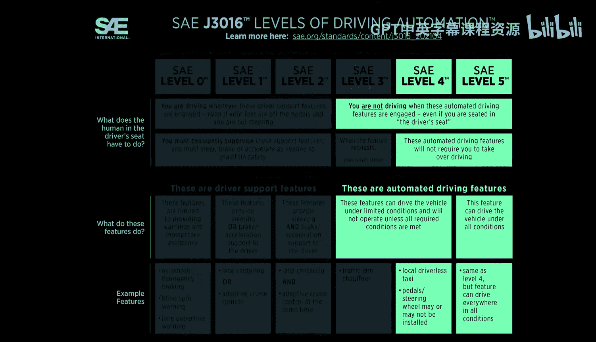

They're obviously working on making Tesla self drivingriving tube。 I've just assumed it's a。

The facto that Elon would succeed in whatever he does so like you know you know that that is not something I question so but I think we are so far from these spaces are。

😊，Such vast spaces， like I It think about。Transportation， the opportunity space。

The way more driver is a gentle purpose technology we can apply in many situations。

So you have a vast green space。U， in all future scenarios， I see Tesla doing well and， you know。

 way more doing well， like we mentioned with the Nelithic package。

 I think it's very possible that in that quote unquote AI package when the history is written。

Autonomous vehicles， self driving cars is like the big thing that changes everything。

 Imagine over a period of。A decade or two， just the complete transition from manually driven into autonomous。

In ways we went we might not predict it might change the way we move about the world completely。

 So that， you know， the possibility of that and then the。Second and third order effects。

 as you're seeing now with Tesla very possibly would see。三。Um， internally with alphabet。

 maybe Waymo maybe some of the Gemini robotics stuff。

 it might lead you into the other domains of robotics because we should remember that Waymo' is a robot。

 it just happens to be out of four wheels。So you said that the next big thing。

We can also throw that into AI package， the big aha moment might be in the space of robotics。

What do you think that would look like？Demis and the Google DeepPoin team is very focused on Gemini Robics。

 right， so we are definitely building。

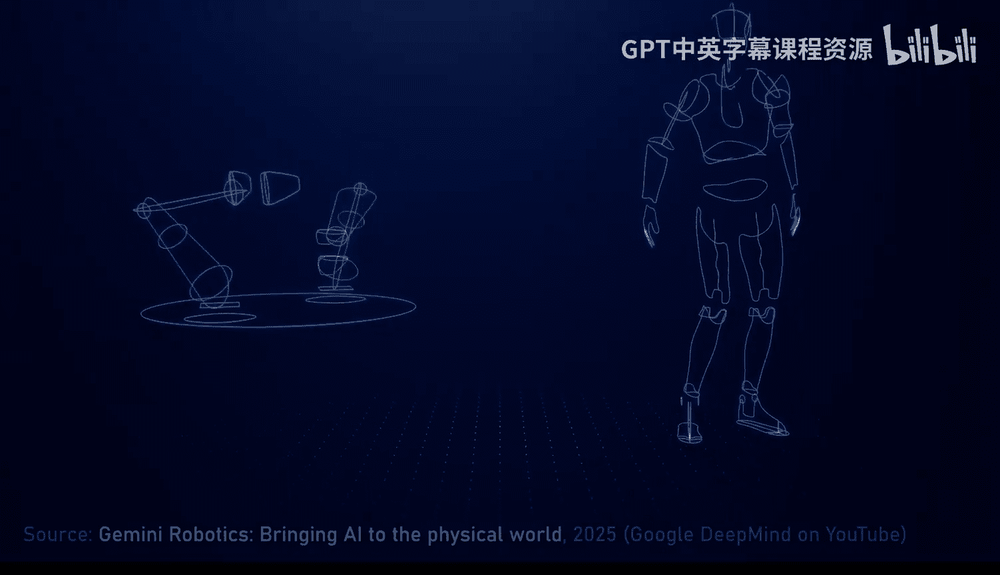

The underlying morals well， so we have a lot of investmentss there。

 and I think we are also pretty cutting edge in our research there。

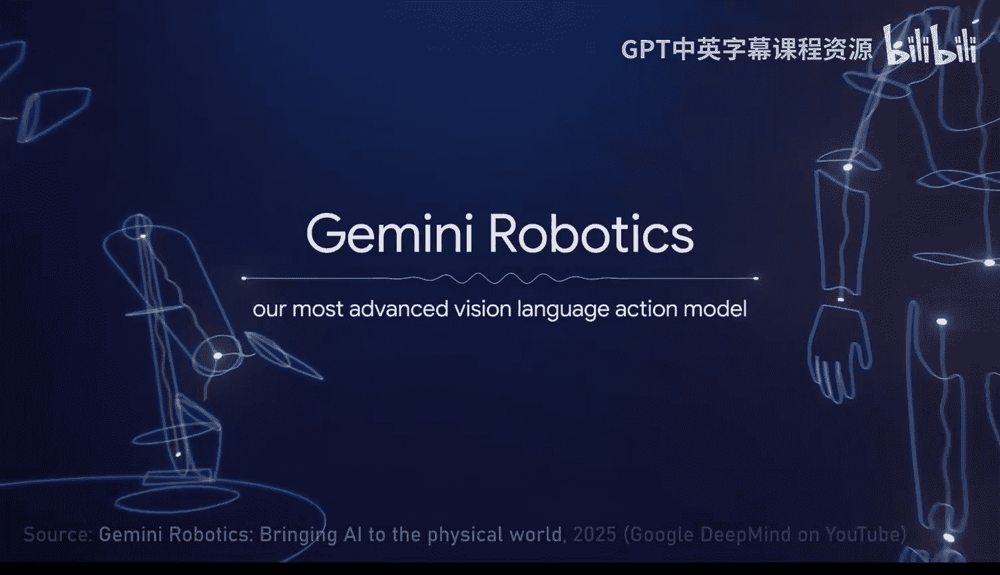

So we are definitely driving that direction。We obviously are thinking about applications in robotics will kind of work Cly we are partnering with a few companies today。

But it's an area I would say stay tuned， we are yet to fully articulate our plans outside。

But it's an area we are definitely committed to driving a lot of progress。

 but I think AI ends up driving that massive progress in robotics。

 the field has been held back for a while， I mean the hardware has made extraordinary progress。

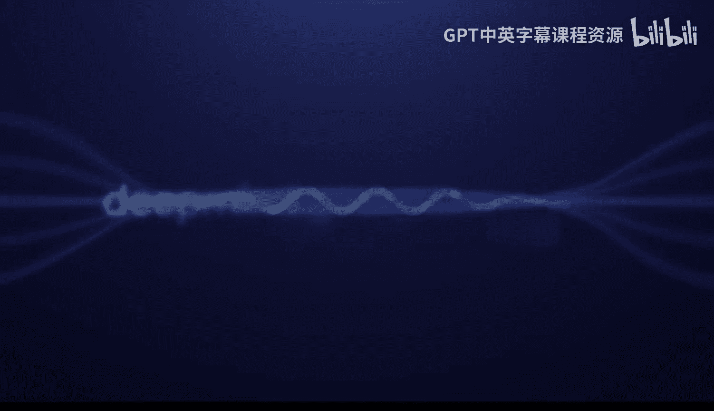

The software had been the challenge， but you know with the AI now and the generalized models we are building。

 you know we are building these models getting them to work in the real world in a safe way in a generalized way is the frontier we are pushing pretty hard well it's really nice to see that the models and the different teams integrated to where all of them are pushing towards one world model that's being built so from all these different angles multimodal。

You're ultimately trying to get。Gemini。The same thing that would make AI mode really effective in answering your questions。

 which requires a kind of world model is the same kind of thing that would help a robot be useful in the physical world so everything' is aligned that is what makes this moment so unique because running a company for the first time you can do one investment in a very deep horizontal way on top of it you can like drive multiple businesses forward right and you know that's effectively what we are doing in Google and alphabet right it's all coming together like it was planned ahead of time but it's not of course it's all distributed I mean if Gmail and sheets and。

All these other incredible services I can sing Gmail praises for years。

 I mean it's just revolutionized email， but the moment you start to integrate AI Gemini into Gmail。

I mean， that's the other thing speaking of productivity multiplier people complained about email。

 but that changed everything email like the invention of email changed everything and it's been ripe there's been a few folks trying to revolutionize email some of them on top of Gmail。

 but that's like ripe for innovation， not just spam filtering。

 but you you the demo a really nice demo of personalized responses personalized responses and it at first I was like。

At first， I felt really bad about that。But then I realized that there's nothing wrong to feel bad about because you。

 the example you gave is when a friend asks， you know， you went to whatever hiking location。

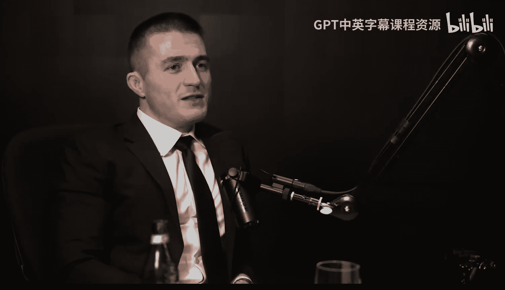

Do you have any advice and they just search us through all your information to give them good advice and then you put the cherry on top。

 maybe some love or whatever camaraderie， but it the informational aspect the knowledge transfer does for you I think it'll be important moments like it should be like today。

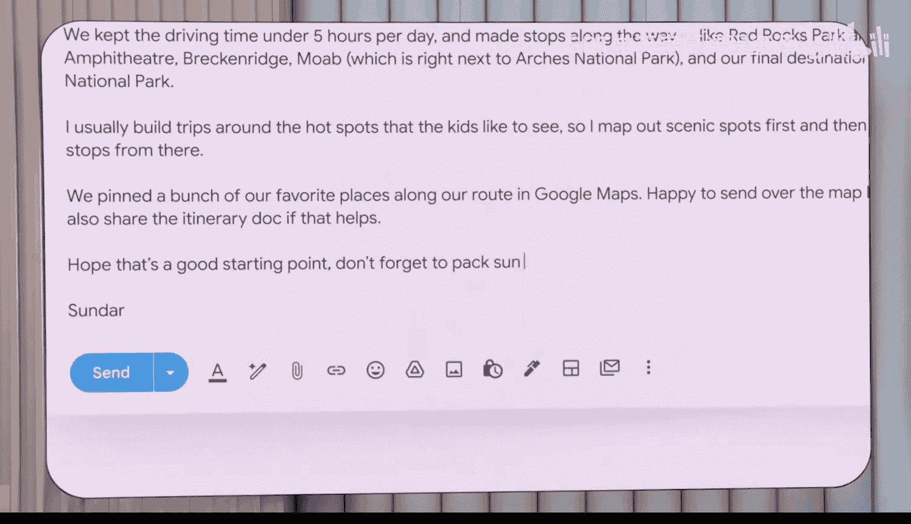

If you write a card in your own handwriting and send it to someone that's a special thing。

 similarly there'll be a time I mean to your friends。

 maybe your friend wrote and said he's not doing well or something you know those are moments you want to save your times for writing something reaching out。

 but you know，Like saying give me all the details of the tripy to you know to me makes a lot of sense for AI assistant to help you right and so I think both are important but I think I think I'm excited about that better Yeah I think ultimately it gives more time for us humans to do the things we humans find meaningful and I think it scares a lot of people because we're going to have to ask ourselves the hard question of like what do we find meaningful and I'm sure there's answers I mean it's the old question of the meaning meaning of existence is you you have to try to figure that out that might be ultimately parenting or being creative and some domains of art or writing and。

It challenges to to like， you know， it's a good question of to ask yourself like in my life。

 what is the thing that brings me most joy and fulfillment and if I'm able to actually focus more time on that。

That's really powerful I think that's you know that's the holy grarail if you get this right。

 I think it allows more people to find that I have to ask you on the programming front AI is getting really good at programming Geman I both the agent and just the L and La has been incredible so a lot of programmers are really worried that their jobs。

They will lose their jobs。How worried should they be and how should they adjust so they can be thriving in this new world where more and more code is written by AI。

 I think a few things， looking at Google。Um，You know， we've given way stats around like。You know。

30% of code now uses like AI generated suggestions or whatever it is。 but the most important metric。

 and we carefully measure is like。How much。As our engineering velocity increased as a company due to AI right and it's like tough to measure and we kind rigorously try to measure it。

And our estimates are that number is now at 10%， right like now across the company。

 we've accomplished a 10% engineering velocity increase。Using AI。But。

We plan to hire engineers more engineers next year， right so because。

The opportunity space of what we can do is expanding too， right and so。I think hopefully。

 for at least the near to midterm。For many engineers。It frees up more and more of。You know。

 even in engineering and coding。There are aspects which are so much fun， you're designing。

 your architecting， you're solving a problem there's a lot of。Grant work。

 which all goes hand in hand。But it hopefully takes a lot of that away。

 makes it even more fun to code freezes you up more time to。😊，Create problem solve。

 brainstorm at you， fellow colly Es and so on， right so that's the opportunity there。And second。

 I think like， you know， it'll attract。It'll put。The creative power in more people's hands。

 which means people create more， that means there'll be more engineers doing more things。

So it's tough to fully predict， but you know， I think in general in this moment。

It feels like people adopt these tools and be better programmers。

LikeThere are more people playing chess now than ever before， right？You know。

 it feels positive that way to me， at least speaking from within a Google context is how I would。

You talk to them about it。 I still， I just know anecdotally， a lot of great programmers。

Are generating a lot of code so their productivity， they're not always using all the code just。

 you know， there's still a lot of editing， but like。Even for me still programming is a side thing。

 I think I'm like 5 x more productive， I don' I think that's even for a large code basis touching a lot of users like Googles does。

I'm imagining like very soon that productivity should be going up even a lot more the big unlock will be as we make the agent capabilities much more robust。

 right， I think that's what unlocks that next big wave。

I think the 10% is like a massive number， like you know， tomorrow like I showed up and said like。

 you can improve like a large organization's productivity by 10%。

When you have tens of thousands of engineers， that's a phenomenal number and you know that's different than what other ci is statistics saying like you know。

 like this percentage of code is now written by AI。

 I'm talking more about like overall actual productivity actual productivity。

 right engineering productivity， which is two different things。

And which is the more important metric。And， but I think it'll get better right and like， you know。

 I think there's no engineer who tomorrow if you magically became 2x more productive。

You' just going to create more things you're gonna create more value added things and so I think you' you'll find more satisfaction in your job right so and there's a lot of aspects。

 I mean the actual Google codebase might just improve because it'll become more standardized more easier for people to move about the codeb because AI will help with that and therefore that will also allow the AI to understand the entire codebase better which makes the engineering aspect so I've been using cursor a lot as a way to program with Gemini and other models is like。

One of its powerful things is it's aware of the entire codeb and that allows you to ask questions of it it allows the agents to move about that codeb in a really powerful way I mean that's a huge analog think about like you know migrations refactoring old codeb refactoring yeah I mean think about like you know once we can do all this in a much better more robust way than very we are today I think in the end everything will be written in JavaScript and running Chrome I think it's all going to that direction I mean just for fun Google has legendary coding interviews like rigorous interviews for the engineers can you comment on how that has changed in the era of AI it's just such a weird you know the whiteboard interview。

I assume is now allowed to have some prompts。 Such a good question。 Look， I do think。You know。

 we're making sure。You know， we'll all introduce。At least one round of in-person interviews for people just to make sure the fundamentals are there。

 I think they'll end up being important but it's an equally important skill look if you can use these tools to generate better code like you know I think I think that's an asset and so you know I think so overall I think it's it's a massive positive vibe coding engineer do you recommend people students interested in programming still get an education in computer science in college education what do you think I do if you have a passion for computer science I would you know computer science is obviously a lot more than programming alone so I would I still don't think I would change。

What do you pursue？I think AI will horizontally allow impact。Every field。

It's pretty tough to predict in what ways？So any education in which you're learning good first principles thinking。

I think it's good education。You've revolutionized web browsing。

 you've revolutionized a lot of things over the years。

Android。Change the game it's an incredible operating system we could talk for hours about Android What does the future of Android look like is it is it possible it becomes more and more AI centric。

Especially now the throw into the mix Android Xr with be able to do augmented reality and mixed reality and virtual reality in the physical world。

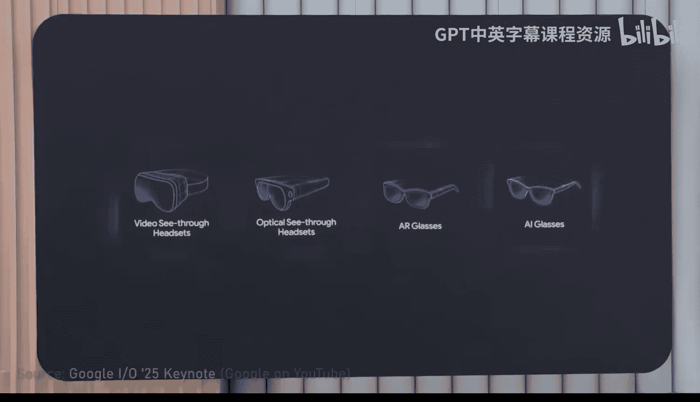

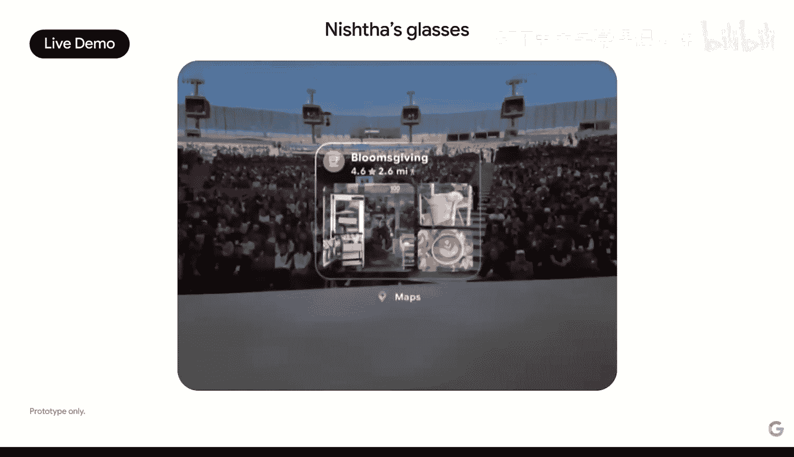

You know， the best innovations in computing have come when you're through a paradigm， Io changed。

 right， like， you know， when when with Gui and then with a graphically user interface and then with。

Multi touchuch in the context of mobile voice later on。Similarly， I feel like， you know。

AR is that next paradigm。I think it was held back Both the system integration challenges of making good AR is very。

 very hard。 The second thing is you need AI to actually kind of。Otherwise。

 the Io is too complicated for you to have a natural， seamless IO to that paradigm。

AI end up being super important。 and so。This is why Project Asters are being super critical for that Android XR world。

Uh， but it is， I think when you use glasses and， you know， always been amazed。

Like how useful these things are going to be， so I look， I think it's a real opportunity for Android。

I think XR is one way to kind of really come to life。

But I think there's an opportunity to rethink the mobile O too， right。

 I think we've been kind of living in this paradigm of like。As and shortcuts all that won't go away。

But again， like if you're trying to get stuff done at an operating system level。You know。

 it needs to be more agent so that you can kind of describe what you want to do or like。

It proactively understands what you're trying to do。

 learns from how you're doing things over and over again and kind of as adapting to you all that is kind of like the unlock we need to go and do with the basic efficient minimalist。

😊，UI， I've gotten a chance to try the glasses and they're incredible。 It's the little stuff。

 it's hard to put into words， but。No latency， it just works。

 even that little map demo where you look down and you look up and there's a very smooth transition between the two。

And useful， very small amount of useful information is shown to you enough not to distract from the world outside。

 but enough to provide a bit of context when you need it and some of that。

In order to bring that into reality， you have to solve a lot of the O problems to make sure it works when you're integrating the AI into the whole thing so every everything you do launches an agent that answers some basic question good moonshot you know its great but but you know。

 I think。We are， you know， but it's。Much closer to reality than other moonshot。

 you know we expect to have。Classesses in the hands of develop later this yearer and and you know in Ko Sand next year so it's an exciting time yeah well extremely well executed beam all that stuff you know because sometimes you don't know like somebody commented on a top comment on one of the demos of BeaM they said this will either be killed off in five weeks or revolutionized all meetings in five years。

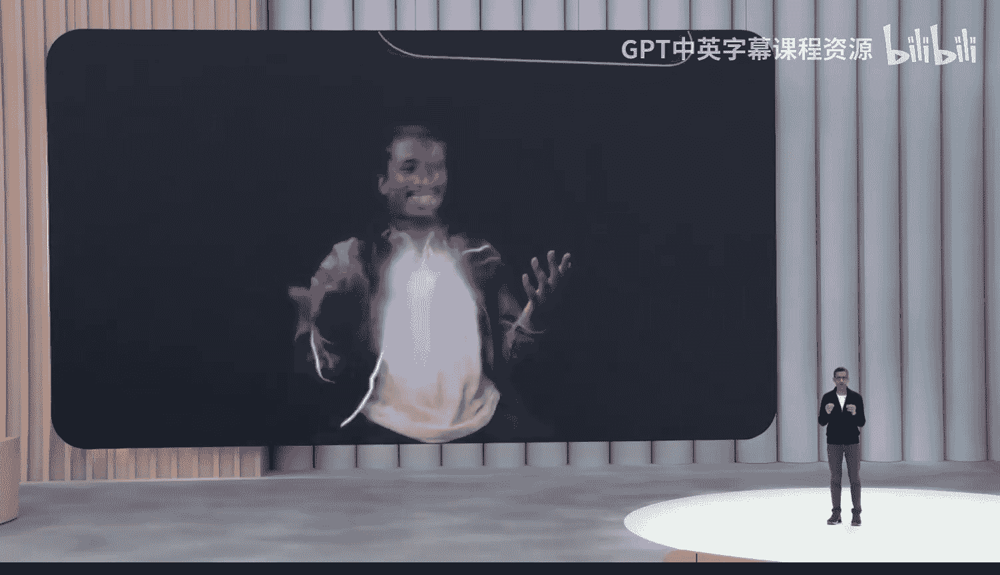

And there's very much Google tries so many things and sometimes sadly kills off very promising projects but because there's so many other things to focus on。

 I use I use so many Google products， Google voice I still use I'm so glad that's not being killed off that's still alive Thank you whoever is defending that because it's awesome and it's great that you keep innovating I just wanted to list off just as a big thank you So search obviously Google revolutionized Chrome and all of these could be multi hour conversations Gmail。

I've been singing Gmail praises forever maps。Incredible technological innovation on revolutionizing mapping。

 Android， like we talked about， YouTube like we talked about， Ad Sense。

 Google Translate for the academic mind to Google Scholar。

It's incredible with and also the scanning of the books。

 so making all the world's knowledge accessible， even when that knowledge is a kind of niche thing。

 which Google Scholar is， and then obviously with deep mind with Al zero alphapha fold Al evolve。

I could talk forever about Apple evolve， that's mind blowing all of that released and as part of that set of things you've released in this year when those brilliant articles were written about Google is done。

U andh like we talked about pioneering self driving cars and quantum computing。

 which could be another thing。That is low key。A scuba diving its way to changing the world forever。

So another pot has slash micro kitchenitch question， if you build AGI。

What kind of question would you ask it？what would you want to talk about？Definitiveively。

 Google has created。AGI， they can basically answer any question what topic are you going to what where's where's it where are you going It's a great question。

Maybe。It's proactive by then and should tell me a few things I should know。

But I think if I were to ask it。I think it'll help us understand ourselves much better。

In a way that'll surprise us， I think。诶。And so maybe that's you already see people do it with the products and so。

 but， you know， in an AGI context， I think that'll be pretty powerful at a personal level or general human nature at a personal level。

 like you something to AGI， Yeah， I think I think， you know。

There is some chance it'll kind of understand you in a very deep way， I think。

 in a profound way that's possibility。I think there is also the obvious thing of like maybe it helps us understand the universe better。

 you know， in a way that。Expse the frontiers of our understanding of the world。

 that is something super exciting。But look， I really don't know， I think， you know。

 haven haven't had access to something that powerful yet。But I think those are all possibilities。

 I think that on the personal level， asking questions about yourself。

Could a sequence of questions like that about what makes me happy？

I think we wouldd be very surprised to learn to those kind of the a sequence of。

Questions and answers we might explore some profound truths in the way that sometimes art reveals to us。

 great books reveal to us， great conversations with loved ones reveal。

Things that are obvious in retrospect， but。Are nice when they're said but for me。

 number one question is about how many alien civilizations are 100% are they going to be a first question number one。

 how many living and dead alien civilizations maybe a bunch of follow ups like how close are they are they dangerous。

If if there's no alien civilizations why， or if there's no advanced alien civilizations but bacteria like life everywhere。

 why what is the barrier preventing it from getting to that is it because that there's when you get sufficiently intelligent you end up destroying ourselves because you need competition in order to develop an advanced civilization and when you have competition is going to lead to military conflict and conflict eventually kills everybody I know I'm gonna to have that kind of get an answer to the foammi paradox yeah exactly and like have a real discussion about it I'm not sure it's I'm realizing now with your answer is it more productive because I'm not sure what I'm going to do with that information but maybe speaks to the general human curiosity that Liz talked about that we're all just really curious。

Making the world's information accessible allows our curiosity to be satiated some with AI even more。

 we can be more and more curious and learn more about the world about ourselves and in so doing。

 I always wonder if I don't know if you can comment on like， is it possible to measure。

Not the GDP productivity increase like we talked about， but maybe。Whatever that increases the。

The breadth and depth of human knowledge。That Google has unlocked a Google search。

 and now with AI mode with Gemini。Is a difficult thing to measure Many years ago， there was。

 I think it was a mighty study。 They just。Estimated the impact of Google search。

And they basically said it's the equivalentto on a per person basis。

 it's few thousands of dollars per year per person， right。

 like is the value that got created per year。Right and and but it's yeah。

 it's tough to capture these things， right like you kind of take it take it for granted as these things come。

hAnd and the frontier keeps mowing， but you know， how do you measure the value of something like alpha fold over time right then and so on so and also the increase in quality of life when you learn more。

 I have to say like，With some of the programming I do done by AI， for some reason。

 I'm more excited to program and so the same with knowledge with discovering things about the world。

It makes you more excited to be alive， it makes you more curious to and it keeps the more curious you are。

The more exciting it is to live and experience the world。 And it's very hard to。

 I don't know if that makes you more productive。 It probably not nearly as much as it makes you happy to be alive。

 And that's a hard thing。😊，To measure the quality of life increases some of these things do。

As AI continues to get better and better at everything that humans do。

 what do you think is the biggest thing that makes us humans special？Look I。I think。😔。

Stuff taught in the essence of humanity。 There's something about。You know。The consciousness we have。

 what makes us uniquely human， maybe the lines will blur over time and it's tough to articulate。

 but I hope hopefully， you know we live in a world where if you make resources more plentiful。

And make the world lesser of a zero sum game over time right which it's not。

 but you know in a resource constrained environment。

 people perceive it to be right and so I hope the values of，What makes us uniquely human， empathy。

 kindness， all that？Surfaces more is the aspirational hope I have。Yeah， it multiplies the compassion。

 but also the curiosity。Just the banter， the debates we'll have about the meaning of it all。

 and I also think of the scientific domains， all the incredible work that Deep Min is doing。

I think we'll still continue to。To play， to explore scientific questions。Mathematical questions。

 physics questions， even as AI。Gets better and better at helping us solve some of the questions sometimes the question itself is a really difficult thing both the right new questions to ask and the answers to them and and and the self discovery process。

 which it'll drive， I think， you know our early work with both co scientists and Al evolve。

Just as super exciting to see。What gives you hope about the future of human civilization？I've always。

 I'm an optimist and you know， I look at。Now， if you were to say you take the journey of human civilization。

 it's been。We've relentlessly made the world better， right in many ways at any given moment in time。

 there are big issues to work through。It may look， but you know， I always ask myself the question。

 would you have been born now or any other time in the past？I most often。Not most of them。

 almost always。Would rather be born now， right you know。

 and so that's the extraordinary thing the human civilization has accomplished right and like。

 you know， and we've kind of constantly made the world a better place。

And so something tells me as humanity， we always rise collectively。To drive that frontier forward。

 so I expect it to be no different in the future。I agree with you totally I'm truly grateful to be alive in this moment and I'm also really excited for the future and the work you and the incredible teams here are doing is one of the big reasons I'm excited for the future so thank you Thank you for all the cool products you've built and please don't kill Google Voice thank you thank you for talking today this was incredible thing real pleasure appreciate it。

Thanks for listening to this conversation with Sunar Pch to support this podcast。

 please check out our sponsors in the description or at Lexfredmen。

com/spons shortly before this conversation I got a chance to get a couple of demos that frankly blew my mind the engineering was really impressive the first demo was Google Beaam and the second demo was the XR glasses and some of it was caught on video so I thought I would include here some of those video clips。

Hey， Alex， my name is Andrew。 I lead the Google Bea team。

 and we're going to be excited to show you a demo。 We're going to show you， I think。

 a glimpse of something new。 So that's the idea， a way to connect。

 a way to feel present from anywhere with anybody you care about。😊，Here is Google Beaam。

 this is a development platform that we've built， so there's a prototype here of Google Beaam。

 there's one right down the hallway， I'm going to go down and turn that on in a second we're going to experience it together。

 we'll be back in the same room wonderful。Whoa， okay。

 here we are All this is real already Wow this is real to this is Google Bea we're trying to make it feel like you and I could be anywhere in the world。

 but when these magic windows open， we're back together I see you exactly the same way you see me it's almost like we're sitting at the table sharing a table together I could learn from you talk to you share a meal with you get to know you so you can feel the depth。

Yeah。Wow， so for people who probably can't even imagine what this looks like， there's a 3D version。

 it looks real。You look real it real you it looks like you're coming out of the screen。

We quickly believe once we're in the that we're just together you settle into it you're naturally attuned to seeing the world like this and you just get used to seeing people this way。

 but literally from anywhere in the world with these magic screens this is incredible neat technology Wow so I saw demos of this。

But they don't come close to the experience of this I think one of the top YouTube comments and one of the demos I saw was like why would I want a high definition I'm trying to turn off the camera but this actually is this feels like the camera has been turned off and we're just in the same room together。

 This is really compelling。That's right。 I know it's kind of late in the day too。

 So I brought you a snack just in case you're a little bit hungry， but。

So can you push it further and it just becomes so let's try to float it between rooms。

 it kind of fades it from my room and the and then you see my hand the depth of my hand。

 course feels like you tried this try give me a high five and there's almost a sensation of human touch almost feel because you're so attuned know that should be a high five。

 It feeling like you could connect with something that way。 So it's kind of a magical experience。

 this is really nice How much is it cost got a lot of companies testing it。

 We just announced that we're gonna be bringing it to offices as a set of products。

 We've got some company screens but eventually I think this will be at most every screen There's nothing I'm not wearing anything。

 I'm wearing a suit tie to clarify Iin'm wearing clothes。 This is not since you。

But outside of that cool and the audio is really good and you see me in the same three dimensionional way Yeah the audio spatialize so if I'm talking from here of course it sounds like I'm talking from here you know if I moved the other side of the room So these little subtle cues these really matter to bring people together all the nonverbals。

 all the emotion the things that are lost today here it is we put it back into the system you pull the off。

Holy shit， they pulled it off。And integrate into this。

 I saw the translation also right this is weve got a bunch of things let me show you a couple kind of cool things。

 let's do a little bit of work together maybe we could。

Citique one of your latestSo you know it's you and I work together so of course we're in the same room but with this superpower I can bring other things in here with me and it's nice you know it's like we could sit together。

 we could watch something， we could work we've shared meals as a team together in the system but once you do the presence aspect of this you want to bring some other superpowers to it。

And so you could do review code together。Yeah， yeah， exactly I've got some slides i'm working on。

 you know maybe you could help me with this， keep your eyes on me for a second。

I'll slide back into the center I didn't really move but the system just kind of puts us in the right spot and knows where we need to Oh so you just turn to your laptop。

 the system moves you and it does the overlay automatically it kind of morphs the room to put things in the spot that they need to be in everything has a place in the room everything has a sense of presence or spatial consistency and that kind of makes it feel like we're together with us another thing I should also say you're not just three dimensionional it feels like you're leaning like out of the screen're like coming out of the screen you're not just in that world three dimensionional yeah exactly holy crap。

We'll back to Okay let me find how this works you probably already have the premise of it。

 but there's two things two really hard things that we put together one is a AI video model so there's a set of cameras you asked kind of about those earlier there' are six color cameras just like webcams that we have today taking video streams and feeding them into our AI model and turning that into a 3D video of you and I it's effectively a light field so it's kind of interactive 3D video that you can see from any perspective。

That's transmitted over to the second thing and that's a light field display and it's happening bidirectly IC you and you see me both in our light field displays。

 these are effectively flat televisions or flat displays， but they have the sense of dimensionality。

 depth sizes correct， you can see shadows and lighting are correct and everything's correct from your vantage point so if you move around ever so slightly and I hold still。

 you see a different perspective you see kind of things that were included become reveal you see shadows that you know move in the way they should move。

All of that's computed and generated using our AI video model for you。

 It's based on your eye position。 Where does the right scene need to be placed in this light field display for you just to feel present。

 It's real time。 no latency。 I'm not seeing late。 You weren't freezing up at all。No no， I hope not。

 I think it's you and I together real time。 That's what you need for real communication and at a quality levels realistic is possible to three people like is that going to move that way also Yeah let me kind show you so if she enters the room with us you can see her you can see me and if we had more people you eventually lose a sense of presence you kind shrink people down。

 you lose a sense of scale So think of it as the window fits a certain number of people if you want to fit a big group of people you want you know the boardroom or the big room。

 you need like a much wider window if you want to see you know just grandma in the kids。

 you can do smaller windows So everybody has a seat at the table or everybody has a sense of where they belong and there's kind of the sense of presence that's obeyed if you have too many people you kind of go back to like 2D metaphors that we're used to people and tiles placed anywhere for the image I'm seeing did you have to get scannedmed I mean I see you without being scanned so it's just so much easier if you don't have to wear anything you don't have to pre you just do it the way it's supposed to happen without anybody have。

I learned anything I put anything on， I thought you have to solve the scanning problem。

 but here you don't， it's just cameras， it's just vision。

It's video yeah we're not trying to kind of make an approximation of you because everything you do every day matters。

 you know I cut myself heaving I put on a pin all the little kind of you know aspects of you those just happen we don't have the time to scan or kind of capture those or dress avatars we kind of appear as we appear and so all that's transmitted truthfully as happening。

Great I don't So as Max expansion got glasses here， we start with the foundation of great glasses。

 something stylish， lightweight wearable。 let me say how can we build great technology experiences on top of that。

 one of the core tenets of the Android XR platform。

 this idea of a multimodal conversational device see what you see what you hear So we've got a camera。

 you've got speakers， multiple microphones for speaker isolation。😊。

I won'll give you a chance to try these yourself， so I woke it up there。Whoa， yeah。

So the first thing you see is a super simple straightforward home screen so you probably see the time the weather calendar appointments there。

 this is designed to be sort of your ones stop shop for quick glance of information throughout the day want to something that's easy to get what you need and then go back to what you're doing so you can imagine you know turning on the display getting that quick glance and then continuing on your way you can be fully conversational this point you can ask questions for example。

 about the paintings you can interrupt， you can ask follow up questions as I mentioned before if you want to at any time pause you just tap there on the right Ge and I how much is this painting costs。

The painting is called the Bridge of Le 1875 by Arman Gilmet it appears to be a print and it would be impossible to know its cost without finding the seller Okay so this is fake I understand why do humans pay so much money for paintings People pay a lot for paintings because of their artistic merit the artist saying its decent verrity and for the appreciation color？

So a few more things that we want to show you just for sake of time。

 if you go ahead and long press on the side again to leave gemni there， there you go。

Did you catch Google I last week by any chance So you might have seen on stage the Google Maps experience very briefly。

 wanted to give you a chance to give a sense of what that feels like today。

 You can imagine you're walking down the street if you look up like you're walking straight ahead。

 you get quick turn by turn directions So you have a sense of the next turn is like taking your phone in your pocket that's so Sometimes you need that quick sense of which one the right way so let's you're coming leg and out of a cab you can just glance down at your feet we have it set up to translate from Russian to English I think I get to wear the glasses and you speak to me if you lines。

あ。I can speak Russian。Previous비도록各自は。I'm doing well。 How are you doing。Tempted to swear。

 tempted to say inappropriate things。I see it transcribed in real time and so obviously you know based on the different languages and sequence of subjects and verbs。

 there's a slight delay sometimes but it's really just like subtitles for the real world you this All right back to me hopefully watching videos of me having my mind blown like the apes in 2001 Space honestly playing with the monolith was somewhat interesting like I said I was very impressed and now I thought if it's okay I could make a few additional comments about the episode and just in general In this conversation with Sunar Prachi I discussed the concept of the Neolithic package which is the set of innovations that came along with the first agricultural revolution about 12000 years ago which included the formation of social hierarchies。

The early primitive forms of government。Labor's specialization， domestication of plants and animals。

Early forms of trade， large scale cooperations of humans。Like that required to build， yes。

 the pyramids and temples like Gobelitepe， I think this may be the right way to actually talk about the inventions that changed human history。

 not just as a single invention， but as a kind of network of innovations and transformations that came along with it。

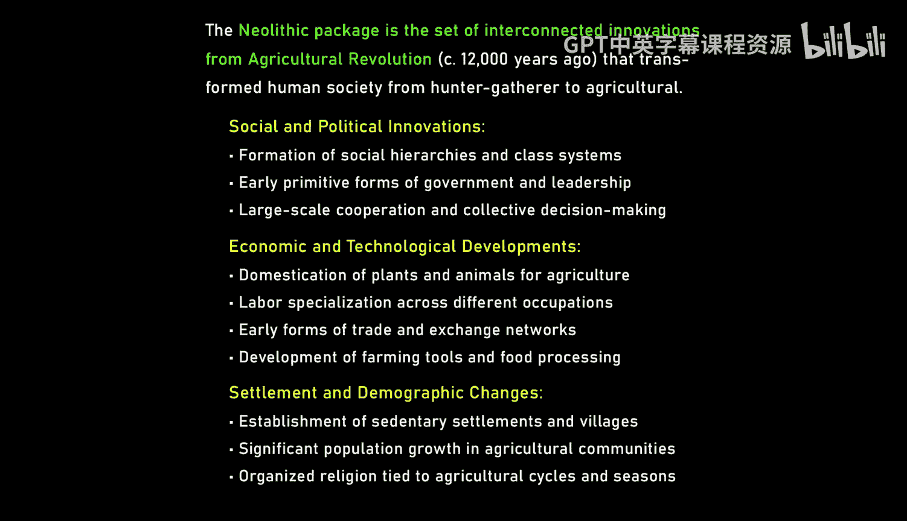

And the productivity multiplier framework that I mentioned in the episode I think is a nice way to try to concretize the impact of each of these inventions under consideration。

 and we have to remember that each node in the network of the sort of fast follow on inventions is in itself a productivity multiplier。

 some are additive， some are multiplicative。

So in some sense， the size of the network in the package is the thing that matters when you're trying to rank the。

Impact of inventions on human history。 The easy picks for the period of biggest transformation。

At least in sort of modern day discourse is the industrial revolution or even in the 20th century。

 the computer or the internet。

I think it's because it's easiest to intuit for modern day humans， the impact。

 the exponential impact of those technologies， but recently， I suppose this changes week to week。

 but I have been doing a lot of reading on ancient human history。

 so recently my pick for the number one invention would have to be the first agricultural revolution。

The Neolithic package that led to the formation of human civilizations。

 that's what enabled the scaling of the collective intelligence machine of humanity and for us to become the early bootloader for the next 10。

000 years of technological progress， which， yes， includes AI and the tech that builds on top of AI。

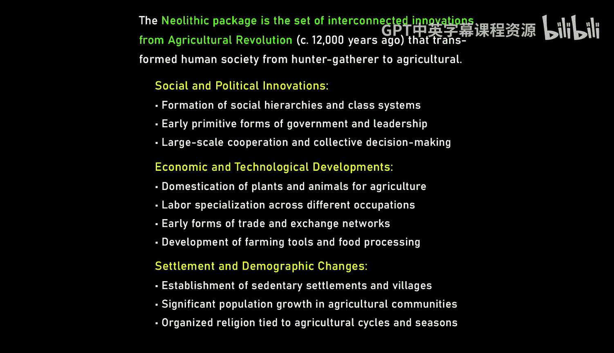

And of course it could be argued that the word invention doesn't properly apply to the agricultural revolution。

 I think actually youval know Harrari argues that it wasn't the humans who were the inventors。

 but a handful of plant species， namely wheat， rice and potatoes。

This is strictly a fair perspective， but I'm having fun， like I said， with this discussion here。

 I just think of the entire earth as a system that continuously transforms and I'm usinging the term invention in that context。

 asking the question of when was the biggest leap on the log scale plot of human progress。

Will AI， AGI， ASI eventually take the number one spot in this ranking。

 I think it has a very good chance to do so， due again to the size of the network of inventions that will come along with it。

I think we discuss in this podcast。The kind of things that would be included in the so called AI package。

But I think there's a lot more possibilities。Including discussed in previous podcasts in many previous podcasts。

 including with Darmaade talking on the biological innovation side。

 the science progress side and in this podcast I think we talk about something that I'm particularly excited about in the near term。

 which is。

Unlocking the cognitive capacity of the entire landscape of brains that is the human species。

makingking it more accessible through education and through machine translation。

 making information knowledge and the rapid learning and innovation process accessible to more humans to the entire8 billion。

 if you will， so I do think language or machine translation apply to all the different methods that we use on the internet to discover knowledge is a big unlock。

But there are a lot of other stuff in the so-called AI package。

 like discuss with Daro curing all major human diseases。

 he really focuses on that in the Mach of love and grace essay。

 I think there will be huge leaps in productivity for human programmers and semi-atonomous human programmers so humans in the loop。

 but most of the programming is done by AI agents and then moving that towards a superhuman AI researcher that's doing the research that develops and programs。

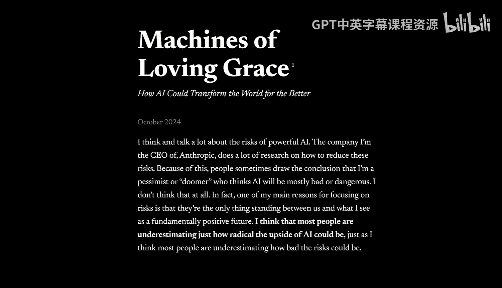

The AI system in itself， I think it would be huge transformative effects from autonomous vehicles。

These are the things that we maybe don't immediately understand or we understand from an economics perspective。

 but there will be a point when AI systems are able to interpret， understand， interact。

With the human world， the sufficient degree to many of the manually controlled human and loop systems we rely on become fully autonomous。

AndI think mobility is such a big part of human civilization that。

There will be effects on that that they're not just economic。But our social cultural and so on。

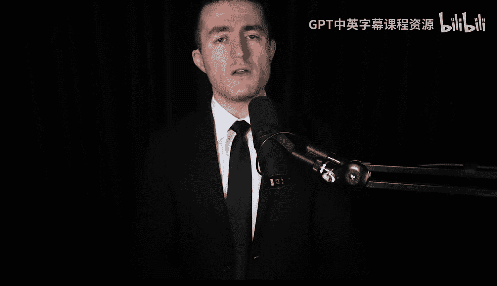

And there's a lot more things I could talk about for a long time。

 so obviously the integration utilization of AI in the creation of art， film， music。

I think the digitalization and automating basic functions of government and then integrating AI into that process。

 thereby decreasing corruption and costs and increasing transparency and efficiency。

I think we as humans， individual humans will continue to transition further and further into cyborgs。

 sort of there's already a。AI in the loop。

of the human condition and that will become increasingly so as AI becomes more powerful。

 the thing I'm obviously really excited about is major breakthroughs in science and not just in the medical front。

 but on physics。

Fundamental physics， which would then lead to energy breakthroughs。

Increasing the chance that we become， we actually become a Kardishev Taiwan1 civilization and then enabling us in so doing to do atellar exploration of space and colonization of space。

 I think they're also in the near term。Much like with the industrial revolution that led to。

Rapid specialization of skills of expertise， there might be a great sort of despecialization。

 so as the AI system become superhuman experts at particular fields。

There might be greater and greater value to being the integrator。Of AIs， for humans to be。

sortrt of generalists。And so the great value of the human mind will come from the generalists。

 not the specialists that's a real possibility that that changes the way we are about the world we want to know a little bit of a lot of things and move about the world in that way that could have when passing a certain threshold a complete shift and who we are as a collective intelligence as a human species。

 Also as an aside when thinking about the invention that was the greatest in human history again for a bit of fun。

 we have to remember that all of them build on top of each other and so we need to look at the delta。

 the step change on the I would say impossibly to perfectly measure plot of exponential human progress really we can go back to the entire history of life on Earth and a previous podcast guest。

 Nick Lane does a great job of this in his book Life ascending listing these 10 major inventions throughout the evolution of life on earth like DNA。

Photoynthesis， complex cells， sex， movement， sight。

 all those kinds of things I forget the full list that's on there。

 but I think that's so far from the human experience that。

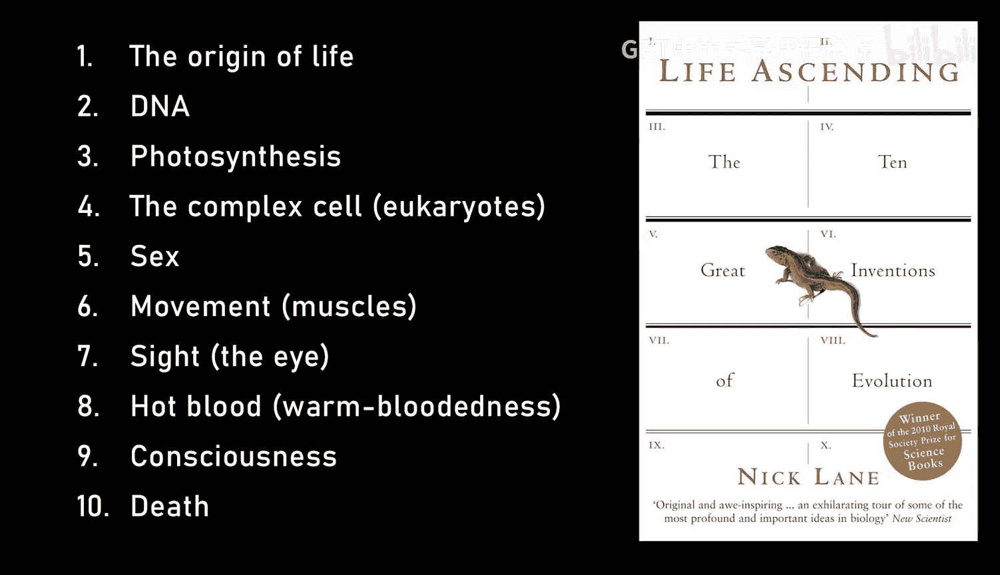

My intuition about。Let's say productivity multipliers of those particular invention completely breaks down and a different framework is needed to understand the impact of these inventions of evolution。

The origin of life on earth。Or even the big B itself， of course， is the O G invention。

That set the stage for all the rest of it。And there are probably many more turtles under that。

 which are yet to be discovered。

So anyway。We live in interesting times， fellow humans。I do believe the set of positive trajectories。

 for humanity outnumber the set of negative trajectories。But not by much。So let's not mess this up。

And now， let me leave you with some words from French philosopher Jean de Brire。

Out of difficulties， grow miracles。Thank you for listening and hope to see you next time。

