# Lex Fridman Podcast #472《陶哲轩：数学与物理中最难的问题及人工智能的未来》中英字幕 - P1：Lex Fridman Podcast #472《数学与物理中最难的问题及人工智能的未来》中英字幕 - GPT中英字幕课程资源 - BV13QkUBcEuT

The following is a conversation with Terreence Tao。

 widely considered to be one of the greatest mathematicians in history。

 often referred to as the Mozart of math。He won the Fields Medal and the Brethrough Prize in mathematics。

 and has contributed groundbreaking work to a truly astonishing range of fields in mathematics and physics。

This was a huge honor for me， for many reasons， including the humility and kindness that Terry showed to me throughout all our interactions。

 It means the world。This is Le Freeman podcast to support it。

 please check out our sponsors in the description or at Lefredman。com sponsors， and now dear friends。

 here's Ternce Tao。What was the first really difficult research level math problem that you encountered。

 one that gave you pause maybe， well I mean， in your undergraduate education you learn about the really hard impossible problems like the human hypothesis between prime conjecture。

You can make problems abitrurly difficult， but that's not really a problem。

 in fact there's even problems that we know to be unsolvable。😊。

What's really interesting are the problems just on the boundary between what we can do both easily and what are hopeless。

 but what are problems where existing techniques can do like 90% of the job and then you just need that remaining 10%。

😊，I think as a PhD student the Kacaya problem certainly caught my eye and it just got solved actually suppose I worked on a lot in my early research historically it came from a little puzzle by the Japanese mathematician Soji kcaya in like 1918 or so so the puzzle is that you you have。

😊，A needle on the plane or think of like like driving on a road or something and you wanted to execute a U turn。

 you want to turn the needle around， but you want to do it in as little space as possible。

 so you want to use as little area in order to turn it around but the needle is infinitely maneuverable。

So you can imagine just spinning it around as the unit noodle， you can spin it around its center。

 and I think that gives you a disc of area， I think pi over4。😊，Or you can do a 3。

 U turn which is what they we teach people in their driving schools to do and that actually takes area pi over8 so it's a little bit more efficient than a rotation and so for a while people thought that was the most efficient way to turn things around。

 but Meszekoch showed that in fact you could actually turn the needle around using as little area as you wanted so 。

0001 there was some really fancy multi back and forth you turn thing that you could do。😊。

That you could turn in needle around and in so doing it it would pass through every intermediate direction is this in the two dimensional plane this is in the two dimensional plane yeah so we understand everything in two dimensions so the next question is what happens in three dimensions so suppose like the Hubble Space telescope is tube in space and you want to observe every single star in the universe so you want to rotate the telescope to reach every single direction and he unrealistic part suppose that space is at a premium which totally is not you want to occupy as little volume as possible in order to rotate your needle around in order to see every single star in the sky。

😊。

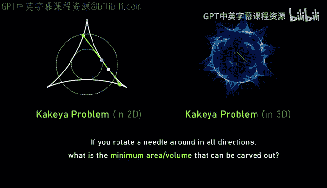

How small volume do you need to do that and so you can modify basicallycopeage as construction and so if your telescope has zero thickness then you can use as little volume as you need that's a simple modification of the twodiional construction but the question is that if your telescope is not zero thickness but just very very thin some thickness delta what is the minimum volume needed to be able to see every single direction as a function of delta so as delta gets smaller as you needle gets thinner the volume should go down but how fast does it go down and the conjecture was it goes down very very slowly like a logically roughly speaking and that would proved after a lot of work。

😊，So this seems like a puzzle why is it interesting。

 so it turns out to be surprisingly connected to a lot of problems in po differential equations in number theory in geometry combinatorics。

 for example in wave propagation， you splash some water around you create water wavess they travel in various directions。

 but waves exhibit both particle and wave type behavior so you can have what's called a wave packet which is like a very localized wave that is localized in space and moving a certain direction in time。

 and so if you plot in space and time it occupies region which looks like a tube and so what can happen is that you can have a wave which initially is very dispersed。

 but it all focuses at a single point later in time。

 you can imagine dropping a pebble into a pond and ripples spread out。

 but then if you time reverse that that scenario and the equations is of wave motion of time reversible。

 you can imagine ripples that are converging to a single point and then a big s occurs maybe even a singularity。

And so it's possible to do that and geometric of what's going on is that there's always sort light rays。

 so like if this wave represents light for example。

 you can imagine this wave as a superposition of photons or traveling at the speed of light。

 they all travel on these light rays and they're all focusing at this one point。

 so you can a very dispersed wave focus into a very concentrated wave at one point in space and time but then it's def focusescuses again and it separates。

😊，But potentially if the Pinjaia had a negative solution。

 so what that meant is that there's a very efficient way to pack tubes pointing in different directions into a very。

 very narrow of very narrow volume， then you would also be able to create waves that start there'll be some arrangement of waves that start out very。

 very dispersed， but they would concentrate not just at a single point。

 but there'll be a lot of concentrations in space and time。😊。

And and you could create what's called a blowup where these waves。

 the amplitude becomes so great that the laws of physics that they're governed by are no longer wave equations but something more complicated and nonlinear and so in mathematical physics we care a lot about whether certain equations in wave equations are stable or not。

 whether they can create these singularities， there's a famous and so problem called the Natooke's regularity problem so the navitos equations。

 equations that govern the fluid flow or incompressible fluids like water。

 the question asks if you start with a smooth velocity field of water。

 can it ever concentrate so much that like the velocity become infinite at some point that's called a singularity。

😊，We don't see that。In real life， you know， if you special around water on the bathtub。

 it won't explode on you or have avoided leaving a speed of light or I。

 but potentially it is possible。And in fact， in recent years the consensus has drifted towards the belief that in fact for certain very special initial configurations of say water that Sgi areas can form。

 but people have not yet been able to actually establish this。

 the Clay Foundation has these seven Millennium prize problems as a million dollar prize for solving one of these problems that this is one of them。

 of least seven only one of them has been solved， the point great conjecture permanent。😊。

So the cocanic conjecture is not directly， directly related to the Na Stokes problem。

 but understanding it would help us understand。😊，Some aspects of things like wave concentration which would indirectly probably help us understand the N stocks problem better Can you speak to the Na stocks so the existence and smoothness like you said millennial price problem right you've made a lot of progress on this one in 2016 you published a paper finite time blowup for an average three dimensionional NS stocks equation。

Right， so so we're trying to figure out if this thing usually doesn't blow up right。

 but can we say for sure it never blows up right， yeah so yeah。

 that is literally the the million another question Yeah。

 so this is what distinguishes mathematicians from pretty much everybody else like it is。

If something holds that 9。99% of the time， that's good enough most you for most things。

 but mathematicians， I want to few people who really care about whether like 100% really 100% of all situations are covered by yeah so most fluid most of the time water does not blow up but could you design a very special initial state that does this and maybe we should say that this this is a set of equations that govern in the field of fluid dynamics trying to understand how fluid behaves and it's actually turns out to be a really complicated fluid is yeah extremely complicated thing to China model yeah so it has practical importance。

 so this clay price problem consume what's called the incompressible nappios sts which governs things like water there's something called the compressible nappios stokes which govern things like air。

And that's particularly important for weather prediction， weather prediction。

 it does a lot of computational fluid dynamics， a lot of it iss actually just trying to solve the dampts equations as best they can。

😊，also gathering a lot of data so that they can get they can initialize the equation。

 there's a lot of moving parts， so it's very important problem practically why is it difficult to prove general things？

😊，About the set of equations like it not not blowing up short answer is Maxwell's demon so Xwell's demon is a concept in thermodynamics。

 like if you have a box or two gases in oxygen and nitrogen and maybe you start with all the oxygen on one side and ni on the other side but there's no barrier between that then they will mix。

And they should stay mixed there's no reason why they should unmixed， but in principle。

 because of all the collisions between them， there could be some sort of weird conspiracy that like maybe there's a microscopic demon called Maxwell's demon that will every time an oxygen and nitrogen atom collide。

 they will bounce up in such a way that the oxygen sort of drifts onto one side and the nitrogen goes to the other and you could have an extremely improbable configuration emerge。

😊，Which we never see and statistically， it extremely unlikely。

But mathematically it's possible that this can happen and we can't roll that out and this is a situation that shows up a lot in mathematics a basic example is the digits of pi 3。

14159 and so forth， the digits look like they have no pattern and we believe they have no pattern on the long term you should see as many ones and twos and threes as fours and06s that there should be no preference in the digits of pi to favors。

 let's say seven over eight。😊，But maybe there's some demon in the digits supply Pi that every time you compute more more digits。

 it of biases one digit to another。If this is a conspiracy that should not happen。

 there's no reason it should happen， but there's no way to prove it。With our current technology。

Okay so getting back to Navi stokes fluid has a certain amount of energy and because the fluid is in motion the energy gets transported around and water is also viscous so if the energy is spread out over many different locations。

 the natural viscosity of the fluid will just damp out the energy and it will go to zero and this is what happens in when we actually experiment of water like you splash around there there's some turbulence and waves and so forth。

 but eventually it settles down and the lower the amplitude。

 the smaller velocity the more calm it gets but potentially there is some sort of demon that keeps pushing the energy of the fluid into a smaller and smaller scale and it will move faster and faster and at faster speed。

 the effect of viscosity is relatively less and so it could happen that it creates some sort of it's got a-s blob scenario where the energy of the fluid starts off at some large scale and then it all sort of transfers energy into a。

smaller region of the fluid， which then at a much faster rate moves into an even smaller region and so forth。

 and each time it does this， it takes maybe half as long as the previous one and then you could actually converge to all the energy concentrating in one point in a finite amount of time。

😊，And'sh that's an always good find of him blew up。

So in practice this doesn't happen so water is what's called turbulent so it is true that if you have a big Eddy of water。

 it will tend to break up into smaller eddies but it won't transfer all the energy from one big E into one smalledddy it will transfer into maybe three or four and then those ones split up into maybe three or four small eddies of their own and so the energy gets dispersed to the point where the viscosity can then keep everything thing under control but if it can somehow concentrate all the energy keep it all together and do it fast enough that the viscous effects don't have enough time to come everything down。

 then this slopeb can occur so there are papers who claimed that oh you just need to take into account concentration of energy and just carefully use the viscosity and you can keep everything under control for not just the heavier sos but for many。

 many types of equations like this。😊，And so in the past。

 there have been many attempts to try to obtain what's called global Regity for Netokes。

 which is the opposite of Phinelo， that if velocity say smooth， and they all failed。

 there was always some sign error or some subtle mistake and it couldn't be salvaged。Um。

So what I was interested in doing was trying to explain why we were not able to。Disprove Pine B。

 I couldn't do it for the actual equations of fluids， which were too complicated。😊。

But if I could average the equations of motion of NeO basically。

 if I could turn off certain types of ways in which water interacts and only keep the ones that I want。

😊，So in particular if there's a fluid and it could transfer energy from a largeed into this small Eddy or this other small  Eddy。

 I would turn off the energy channel that would transfer energy to this one and direct it only into this smaller E while still preserving the lower concentration of energy so try and make a blow up yeah yeah so I basically engineer blow up by changing laws of physics which is one thing that mathematicians are allowed to do we can change the equation。

 how does that help you get closer to the proof of something right so it provides what's called an obstruction in mathematics so what I did was that basically if I turned off the certain parts of the equation which usually when you turn off certain interactions make it less nonlinear it makes it more regular and less likely to blow but I find that by turning off a very well design set of interactions I could force all the energy to blow in finite time。

😊，So what that means is that if you wanted to prove。

global regularity for Naous Stokes for the actual equation you must use some feature of the true equation which my artificial equation does not satisfy so it rules out certain approaches the thing about math is it's not just about finding taking a technique that is going to work in applying it but you need to not take the techniques that don't work and for the problems that are really hard often there are dozens of ways that you might think might apply to solve the problem but it's only have lot of experience that you realize there's no way that these methods are going to work so having these counter examplesamples for nearby problems kind of rules out it saves you a lot of time because you're not wasting energy on things that you now know cannot possibly ever work how deeply connected is that specific problem of fluid dynamics or is just a more general intuition you build up about mathematics right so the key phenomenon。

My technique exploits is what's called supercritity。

So in harsh differential equations often these equations are like a tug of war between different forces。

 so in Navius Stokes there's the dissipation force coming from viscosity and it's very well understood。

 it's linear， it calms things down， if thiscosity was all there was。

 then nothing bad whatever happened。😊，But there's also transport that energy from in one location of space can get transported because the fluid is in motion to other locations。

 and that's a nonlinear effect and that causes all the problems。

 so there are these two competing terms in the NaO equation the dissipation term and the transport term。

😊，If the dis term dominates if it's large then basically you get regularity and if the transport term dominates then we don't know what's going on it's a very non nonlinearious situation is unpredictable it's turbulent so sometimes these forces are in balance at small scales but not in balance at large scales or vice versa so Ne So is what's called supercrit so at smaller and smaller scales the transport terms are much stronger than the viscosity terms so the viscosity termss are the things that calm things down and so this this is why the problem is hard in two dimensions。

 so the Soviet methodthian laishian Sa in the 60s shows in two dimensions there is no blow up and in two dimensions the nascus equations is what's called critical the effect of transport and the effect of viscosity about the same strength even at very very small scales and we have a lot of technology to handle critical and also subcritical equations and prove regularity。

😊，But for supercritical equations， it was not clear what was going on。😊，And。

I did a lot of work and then there's been a lot of followup showing that for many other types of supercritical equations you can create all kinds of blurlo examples once the nonlinear effects dominate the linear effects at small scales。

 you can have all kinds of bad things happen so this is sort of one of the main insights of this line of work is that supercriticality versus criticality and subcritity this makes a big difference I mean that's a key qualitative feature that distinguishes some equations would being sort of nice and predictable and like like planetary motion and I mean there's certain equations that you can predict for millions of years and or thousands at least again it's not really a problem but this reason why we can't predict the weather past two weeks into the future because supercritical equation lots of really strange things are going on at very fine scales so whenever there is some huge source of nonlinearity。

😊，Yeah that can create a huge problem for predicting what's going to happen yeah and if the nonlinearity is somehow more and more featured and interesting at more scales I mean there's many equations that are nonlinear but in many equations you can approximate things by the bulk so for example planetary motion know if you wanted to understand the orbit of the moon or Mars or something you don't really need the microstructure of like the seismology of the moon or like exactly how the mass attribute it you just basically you can almost approximate these planet by point masses and just the aggregate behavior is important。

😊，But if you want to model a fluid like like the weather， you can't just say in Los Angeles。

 the temperature is this， the wind speed is this for supercritical equations。

 the finance confirmation is really important if we can just linger on the Navy stocks equations a little bit。

😊，So you've suggested maybe you can describe it that one of the ways to。

Solve it or to negatively resolve it would be to。Sort of to construct a liquid a kind of liquid computer right and then show that the halting problem from computation theory has consequences for fluid dynamics so show it in that way can you describe this this idea yeah so this came out of this work of constructing this this this average equation that blew up so one。

As part of how I had to do this so this sort naive way to do it。

 you just keep pushing every time you energy at one scale。

 you push it immediately to the next scale as fast as possible。

 this is sort of the naive way to force blow up in turns in five and high dimensions this works but in three dimensions there was this funny phenomenon that I discovered。

😊，That if you keep if you。Change the laws of physics you just always keep trying to push the energy into small and small scales what happens is that the energy is starts getting spread out into many scales at once。

 so you have energy at one scale， you're pushing it into the next scale and then as soon as it enters that scale you also push it to the next scale but there's still some energy left over from the previous scale you're trying to do everything at once and this spreads out the energy too much and then it turns out that it makes it vulnerable for vicosity to come in and actually just damp out everything。

😊，So it turns out this direct doesn't actually work there was a separate paper by some other the authors that actually showed this。

😊，In three dimensions， so what I needed was to program a delay so kind of like airboxs so I needed an equation which would start with a fluid。

😊，Doing something at one scale， it would push this energy into the next scale。

 but it would stay there until all the energy from the larger scale got transferred and only after you pushed all the energy in。

 then you sort of opened the next gate and then you push that in swap so by doing that it kind of the energy inches forward scale by scale in such a way that it's always local like at one scale at a time and then it can resist the effects of a scarity because it's not dispersed。

😊，So in order to make that happen。Yeah， I had to construct a rather complicated non nonlinearity and it was basically like you know。

 like it was constructing like an electronic circuit so I thanked my wife for this because she was trained as an electrical engineer and you know she talked about。

😊，You you had to design circuits and so forth and if you want a circuit that does a certain thing like maybe and have a light that flashes on and then turns off and then on and then off。

 you can build it from more primitive components， capacitors and resistors and so forth and you have to board a diagram and these diagrams you can sort of follow up your eyeballs and say。

 oh yeah the current will build up here and then it will stop and then it will do that。😊。

So I knew how to build the analog of basic electronic components like resistors incapacitities and so forth and I would stack them together in such a way that I would create something that would open one gate and then therell be a clock that then once the clock hits this and threshold it would close it it would become a rub goberg type machine but describe mathematically and this ended up working so what I realized is that if you could pull the same thing off for the actual equations so if。

😊，The equations of water support computation， so like if you can imagine kind of a steampunk。

 but really waterpunk type of thing where you know so modern computers are electronic。

 you know they're powered by electrons。😊，Pass through very tiny wires and interacting with other electrons and so forth。

 but in several electrons， you can imagine these pulses of water moving in a certain velocity and maybe there are two different configurations correspondinging to a bit being upp down。

😊，Probably that if you had two of these moving bodies of water collide。

 they would come out with some new configuration which would be something like an an gate or or gate the output would depend in a very predictable way on the inputs and you could chain these together and maybe create a tuuring machine and then you have computers which made completely out of water and if you have computers then maybe you can do robotics so hydraulicics and so forth and so you could create some machine which is basically a fluid analog vomin machine so vonomin proposed if you want to colonize Mars。

 the sheer cost of transporting people and machines to Mars is just ridiculous but if you could transport one machine to Mars and this machine had the ability to mine the planet。

 create some more materials smelt them and build more copies of the same machine then you could colonize a whole planet over time。

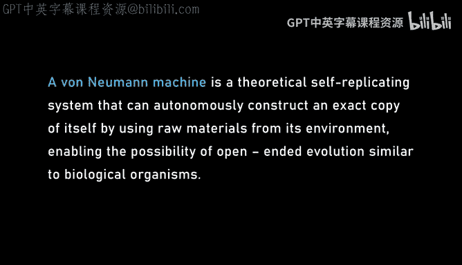

If you could build a fluid machine。Whi yeah so it's a fluid robot and what it would do it's purpose in life it's programmed so that it would create a smaller version of itself in some sort of cold state it wouldn't start just yet once it's ready the big robot configuration water would transform all this energy into the smaller configuration and then power down and then clean itself up and then what's left is this newest state which would then turn on and do the same thing but smaller and faster and then the equation has a certain skating symmetry once you do that it can just keep iterating。

😊，So this in principle would create a blow for the actual navi Stokes and this is what I managed to accomplish for this average Ne Stokes。

 so it provided this sort of roadmap。😊，To solve the problem now this is a pipe dream because there' are so many things that are missing for this to actually be a reality so I can't create these basic logic gates I don't have these in these special cons of water I mean there's candidates that it include vortex rings that might possibly work but but also you know I don't know computing is really nasty compared to digital computing I mean because there's all these errors you you have to lot error correction along the way I don't know how to completely power down the big machines so that it doesn't interfere with the writing of a smaller machine。

😊，But everything in principle can happen like it doesn't contradict any of the laws of physics so it's sort of evidence that this thing is possible there are other groups who are now pursuing ways to make maybe explore up which nowhere near as ridiculously complicated as this they actually are pursuing much closer to the direct self-simil model which can it doesn't quite work as is but there could be some simpler scheme than what to just describe to make this work there's a real leap of genius here to go from various st to this touring machine so it goes from what the self-similar blob scenario that you're trying to get the smaller and smaller blob to now having a liquid touring machine gets smaller and smaller and smaller and somehow seeing how that。

Could be used。😔，To say something about a blow up I mean that's a big leap so this precedent I mean so the thing about mathematics is that it's really good at spotting connections between what you think of what you might think of as completely different problems。

 but if the mathematical form is the same， you can draw a connection。

So there's a lot of previously on what of course cellular autota the most payments of which is Conway's game of life。

 this is infinite discrete grid and any given time the grids is occupied by a cell or it empty and there's a very simple rule that tells you how these cells evolve so sometimes cells live and sometimes they die and when I was a student it was a very popular screen saveer to actually just have these animations going on and they look very chaotic in fact they look a little bit like to flow sometimes but at some point people discovered more and more interesting structures within this game of life so for example they discovered this single of a glider so glid is a very tiny configuration of like four or five cells which evolves and it just moves at a certain direction and that's like this vortex rings so this is an analogy the game of life is kind of like a discrete equation and the Navi So is a continuous equation but mathematically they have some similar features。

😊。

U。And so over the time people discovered more and more interesting things that you could build within the game of life。

 thinking life is a very simple system， it only has like three or four rules to do it but you can design all kinds of interesting configurations inside it。

 there's called a glider gun that does nothing to spit out gliders one at a time。😊。

And then opt up a lot of effort people managed to create。

and gates and all gates for gliders like theres this massive ridiculous structure which if you have a stream of gliders coming in here and a stream of lighters coming in here then you may produce extreme gliders coming out if maybe if both of the streams have gliders then there be an output stream but if only one of them does then nothing comes out so they could build something like that and once you could build and these basic gates。

 then just from software engineering you can build almost anything you can build to tuuring machine I means an enormous steampunk type things。

 they look ridiculous but then people also generate self-repllicating objects in the game of life。

 a massive machine upon normal machine which over a huge period of time and glider guns inside doing these steampunk calculations it would create another version of itself。

😊，Wwhich could replicate it's so incredible A lot of this was like community crowdsource by like amateur mathematicians actually so I knew about that that work and so that is part of what inspired me to propose the same thing but heavierous stokes if you're just a much I to say analog is much worse than digital like it's going to be it can't just directly take the constructions in the game of life and plum them in but again it shows it possible you know there's a kind of emergence that happens with these cellulart local rules maybe a similar to fluids I don't know but local rules operating at scale can create these incredibly complex dynamic structures do you think any of that is amenable to mathematical analysis。

Do we have the tools to say something profound about that The thing is you can get this emergent very complicated structures but only with very carefully prepared initial conditions so these glider guns and gates and self machines if you just plunk on randomly some cells and that you not see any of these and that's the analogous situation of navi dos that with typical initial conditions you would not have any of this weird computation going on but basically through engineering by especiallyly designing things in a very special way you can pick clever constructions and wonder if it's possible to prove the sort of the negative of like basically prove that only through engineering can you ever create yeah something interesting this is an recurring challenge in mathematics that I call the dichotomy between structure and randomness that most objects that you can generate in mathematics are random they look like the digital pi well we believe is a good example。

But there's a very small number of things that have patents。

 but now you can prove something as a patent by just constructing you like if something has a simple pattern and you have a proof that it does something like repeat itself every so often you can do that。

😊，And you can prove that that for example， you can prove that most sequences of digits have no pattern。

 so like if you just pick digits randomly， there's some little large numbers that tells you you're going to get as many ones as twos in the long run。

😊，We have a lot fewer tools to if I give you a specific pattern like the Dtits of Pi。

 how can I show that this doesn't have some weird pattern to it some other work that I spend a lot of time on is to prove vertical structure theorems or inverse theorems。

😊，That give tests for when something is very structured so some functions are what's called additive。

 like if you function that must the natural numbers of the natural numbers so so maybe two maps to4 three maps to6 and so forth。

 some functions are what's called additive， which means that if if you add two inputs together the output gets added as well for example multiply by a constant if you multiply a number by 10。

 if you multip a plus B by 10， that's the same as multi thing a by 10 and B by 10 and then adding them together。

😊，So some tongue say additive。😊，Some of images are kind of additive but not completely additive。

 so for example， if I take a number n， I' multi up by the square root of two。😊。

And I take the integer part of that， so 10 my sc to two is like 14 point something， so 10 up to 14。

 20 them up to 28。😊，So in that case， additively is true then。

 so 10 plus 10 is 20 and 14 plus 40 is 28， but because of this rounding。

 sometimes there's round of errors and sometimes when you add a plus B。

 this function doesn't quite give you the sum of the two individual outputs， but the sum plus minus1。

😊，So it's almost additive but not quite additive。😊。

So there's a lot of useful results in mathematics and I've worked a lot in developing things like this to the effect that if a function exhibits some structure like this。

 then it's basically there's a reason for why it's true and the reason is because there's thiss some other nearby function which is actually completely structured which is explaining this sort of partial pattern that you have and so if you have these little in thems it creates this of dichotomy that either。

😊，The objects that you study are either I have no structure at all or they are somehow related to something that is structured。

 and in either way in either in either case you can make progress。

 a good example of this is that there's this old theorem and Mamatics called similarer's theorem proven in the 1970s。

😊，It concerns trying to find a certain type of pattern in a set of numbers and that the patterns have made progression。

 things like35 and 7 or 10， 15 and 20。😊，And Mer Andreaserti proved that any set of numbers that are sufficiently big。

's called positive density has amic progressions in it of any lengthy wish。

 so for example the odd numbers have set of density1 half and they contain asthmathmic progressions of any length。

 so in that case it's obvious because the odd numbers are really really structured。

 I can just take 11 13， 15 17 I can easily find asthmathmic progressions in that set。😊。

Um but Z system also applies to random sets if I take the set of old numbers and I flip a coin and for each number and I only keep the numbers for which I got a heads because I just flip coins。

 I just randomly take out half the numbers I keep on half， so that's a set that has no patent at all。

😊，But just from random fluctuations， you will still get a lot of。Of ethnic progressions in that set。

 can you prove that？There's arithmetic progressions of arbitrary length within Iranan Yes have you heard of the infinite monkey theorem usually mathematicians give boring names to theoremists。

 but occasionally they give colorful names yes， the popular version of the infinite monkey theorem is that if you have an infinite number of monkeys in a room of each of a typewriter they type out text randomly almost surely one of them is going to generate the highest group of Hamlet or any other finite swing of text it will just take some time quite a lot of time actually。

 but if you have an infinite number then it happens。

Um soum basically the theorem is that if you take an infinite string of of digits or whatever。

 eventually any finite pattern you wish will emerge， it may take a long time。

 but it will eventually happen in particular ethnic progressions of any lens will eventually happen okay。

 but you but you need an extremely long random sequence for this to happen I suppose that's intuitive。

😊，It's just infinity yeah infinity absorbs a lot of sins yeah。

 how are we humans supposed to deal with infinity well you can think of infinity as as such an abstraction of a finite number of which you do not have a boful that you know。

 I mean so nothing in real life is truly infinite but you know you can。

You you can ask those questions what if I had as much money as I wanted know what if I could go as fast as I wanted and a way in which mathematicians formalize that is mathematics has found a formalism to idealize instead of something being extremely large extremely small to actually be exactly infinite or zero and often the mathematics becomes a lot cleaner when you do that I mean in physics we joke about assuming spherical cows you know like reward problems have' got all kinds of reward effects but you can idealize。

 send some to infinity， send some things to zero。😊，And。

 and the maths becomes a lot simpler to work with it。 I wonder how often。Using infinity。

Forces us to deviate from the physics of reality Yeah so there's a lot of pitfalls so you know we spend a lot of time in undergraduate math classes teaching analysis and analysis it's often about how to take limits and whether you you know so for example a plus B is always B+ a so when you have a finite number of terms and you add them you can swap them and there's no problem but when you have an infinite number of terms these sort show games you can play where you can have a series which converts to one value but you rearrange it and suddenly converts to another value and so you can make mistakes you have to know what you're doing when you allow infinity you have to introduce these epsilons and deltas and there's a certain type of way of reasoning that helps you avoid mistakes。

In more recent years people have started taking results that are true in infinite limits and also sort finalizing them。

 so you know that something's true eventually， but you don't know when now give me a rate so such if I don't have an infinite number of monkeys but a large finite animal monkeys。

 how long do I have to wait for Ham to come out and that's a more quantitative question？😊。

And this is something that you can attack by purely finite methods and you can use your finite intuition and in this case it turns out to be exponential in the length of the text that you're trying to generate and so this is why you never see the monkeys create Hamlet you can maybe see them create a four letter of word but nothing that big and so I personally find once you finalize an infinite statement it does come much more intuitive and it's no longer so so weird so even if you're working with infinity it's good to finalitize so that you can。

😊，Have some intuition。 Yeah， the downside is that the fine groups are just much。

 much messier and and yeah， so so the infinite ones I found first。

 usually like decades earlier and then later on people finalize them So since we mentioned a lot of math and a lot of physics。

 what do use the difference between mathematics and physics as disciplines as ways of understanding of seeing the world。

 maybe we can throw an engineering in there you mentioned your wife as an engineer。

 give it new perspective on circuits So this different way of looking at the world。

 given that you've done mathematical physics So you've worn all the hats。

Right so I think science in general is interaction between three things， there's the real world。

 there's what we observe all the real observations and then our mental models as to how we think the world works so we can't directly access reality all we have are the observations which are incomplete and they have errors and there are many。

 many cases where would we want to know， for example what is the weather like tomorrow and we don't yet have the observation that we'd like to predict。

😊，and then we have these simplified models， sometimes making unrealistic assumptions。

 you know itspher type things， those are the mathematical models。

 mathematics is concerned with the models， science collects the observations and it proposes the models that might explain these observations。

😊，What mathematics says， we stay within the model and we ask what are the consequences of that model。

 observations what predictions would the model make of future observations or past observations does it fit observed data？

😊，So there's definitely a symbiosis。It's I guess mathematics is unusual among other disciplines is that we start from hypotheses like the axioms of a model and ask what conclusions come up from that model in almost any other discipline。

 you start with the conclusions， you know I want to do this， I want to build a bridge。

 you know I want to make money I want to do this okay， and then you find the path to get there。

A lot there's a lot less sort of speculation about suppose I did this what would happen you know planning and modeling speculative fiction maybe is one other place that that's about it actually most of the things we do in life is conclusion driven including physics and science I mean they want to know you know where is this asteroid going to go you know what is the weather they going to be tomorrow but。

😊，Bs also has this other direction of going from the axioms what do you think there is this tension in physics between theory and experiment what do you think is a more powerful way of discovering truly novel ideas about reality well you need both top down and bottom up it's a really an interaction between all these so over time the observations and the theory and the modeling should both get closer to reality but initially I mean this is always the case out there they're always far apart to begin with but you need one to figure out where to push the other you know so if your model is predicting anomalies that are not picked by experiment that tells experiment is where to look to find more data to refine the models so it goes back and forth within mathne itself there's also a theory and experimental component it's just that until very recently theory。

Has dominated almost completely like 99% of mathematics is theoretical mathematics。

 and there's a very tiny amount of experimental mathematics。😊，I mean， people do do it， you know。

 like if they want to study prime numbers or whatever。

 they can just generate large data sets and with a so once we had to computers。

 we'd be able to do it a little bit， although even before， well， like Gaus， for example。

 he discovered he conjectured the most basic theorem in number theorem to call the prime number theorem。

😊，which predicts how many primes that up to a million up to a trillion。

 it's not obvious question and basically what he did was that he computed， I mean。

 mostly by himself but also hired human computers， people whose professional job it was to do athletic。

😊，To compute the first 100，000 framebes or something and made tables and made a prediction。

 that's an early example of experimental mathematics。😊。

But until very recently it was not I mean theoretical mathematics was just much more successful I mean because doing complicated mathematical computations was just not feasible until very recently and even nowadays you know even though we have powerful computers only some mathematical things can be explored numerical the' some called the comb explosion if you want us to study for example Z the you want to study all possible subsets of the numbers one to 1000 there's only 1000 numbers how bad could it be it turns out the number of different subsets of one to 1000 is two for power 1000。

😊，Which is way bigger than that any computer currently can in inect any computer ever who enumate。😊。

So you have to be there are certain math problems that very quickly become just intractable to attack by direct brute force computation chess is another famous example and the number of chess positions we can't get a computer to fully explore。

😊，But now we have AI， we have tools to explore this space not with 100% guaranteeities of success。

 but with experiment， you know so like we can empirically solve chess now for example。

 we we have a very very good AIs that they don't explore every single position in the game tree but they have found some very good approximation and people are using actually these chess engines to make to do experimental chess that they're revisiting old chess theories about oh you know when this type of opening this is a good type of move this is not and they can use these chess engines to actually refine in some cases overturn commercial wisdom about chess and I do hope that mathematics will have a larger experimental component in the future perhaps powered by AI will of course talk about them and in the case it chess and there's a similar thing in mathematics I don't believe it's providing a kind of。

😊，Formal explanation of the different positions is just saying which position is better or not that you can intuit as a human being。

 and then from that we humans can construct a theory of the matter。

You've mentioned the Plato's cave Algoory so I case people don't know it's where people are observing shadows of reality。

 not reality itself and they believe what they're observing to be reality is that in some sense what mathematicians and maybe all humans are doing is。

Looking at shadows。Of reality is it possible for us to truly access？😔，Reality， well。

 there are these three ontological things， there's actual reality。

 there's observations and our models and technically they are distinct and I think they will always be distinct but they can get closer。

😊，Over time。You know and the process of getting closer often means that you have to discard your initial intuitions so astronomy provides great examples you know like you know an initial model of the world is flat because it looks flat and is big you know and the rest of the universe of the skies is not you like the sun for example looks really tiny and so you start off with a model which is actually really far from reality but it fits kind of the observations that you have know so things look good you know but but over time as you make more and more observations bring it closer to reality。

 the model gets dragged along with it know and so over time we have to realize that the Earth is around that it spins it goes around the solar system。

 solar system goes around the galaxy and so on and so and part of universe is expanding the expansion is self expanding accelerating and in fact very recently this year or so even the acceleration of the universe itself this evidence that is nonconstant。

The explanation behind why that is it catching up it' catch you know I mean it's still you know the dark matter of dark energy this kind of thing we have a model that sort of explains that fits the data really well it just has a few parameters that you have to specify but so people say oh that fudge factors with enough fudge factors you can explain anything but the mathematical point with the model is that you want to have fewer parameters in your model and data points in your observational set so if you have a model with 10 parameters that explains 10 up 1 observations that is completely useless model it's what's called overfitted but if you have a model with you know two parameters and it explains a trillion observations which is basically so the dark matter model I think it has like 14 parameters and it explains petabytes of data that the astronomerists have。

😊，You can think of a theory， like one way to think about a physical method theory。

 a theory is it's a compression of the universe and a data compression。

 so you have these petabytes or observations， youd like to compress it to a model which you can describe in five pages and specify a certain number of parameters and it can fit to reasonable accuracy。

😊，You know， almost all of your observations， I mean， the more compression that you make。

 the better your theory， in fact， one of the great surprises of our universe and of everything in it is that it's compressible at all。

 the unreasonable effectiveness of mathematics， Einstein and a quote like that。

 the most incomprehensible thing about the universe is that it is comprehensible。

Right and not just comprehensible you can do an equation like e equals MC squared there is actually some mathematical possible voice explanation for that so there's this phenomenon in mathematics called universality so many complex systems at the macro scale are coming out of lots of tiny new interactions at the macro scale。

😊，And normally because of the comm explosion， you would think that the macroscale equations must be like infinitely exponentially more complicated than the macroscale once。

 and they are if you want to solve them completely exactly like if you want to model，😊，Um。

 or the atoms in a box of air， that's like avogadros number humongous like there's a huge number of particles。

 if you actually to have to track each one， it'll be ridiculous。😊。

But certain laws emerge at the microscopic scale that almost don't depend on what's going on on the macroscale or only depend on a very small number of parameters。

 so if you want to model a gas of frontntilillian particles in a box。

 you just need to know is temperature and pressure and volume a few parameters like506 and it models almost everything you need to know about these 10th to 23 or whatever particles。

😊，We， we have。We don't understand universality anywhere as we would like mathematically。

 but there are much simpler toy models where we do have a good understanding of why universality occurs most basic one is the central limit through them that explains why the bell curve shows up everywhere in nature that so many things are distributed by what's called a Gaussian distribution famous bell curve there's not even a meme with this curve and even the meme applies broadly the universality to the meme yes you can go if you like but there are many。

 many processes， for example you can take lots of independent random variables and average them together in various ways you can take a simple average or more complicated average and we can prove in various cases that these bell curves。

 these Gaussians emerge and it is a satisfying explanation sometimes they don't so if you have many inputs and they're all correlated in some systemic way then you can get something very far from the bowll curve show up and this is also important to know when there such system limit fails so universality is not。

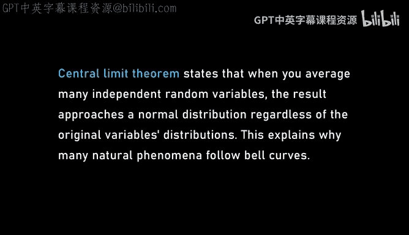

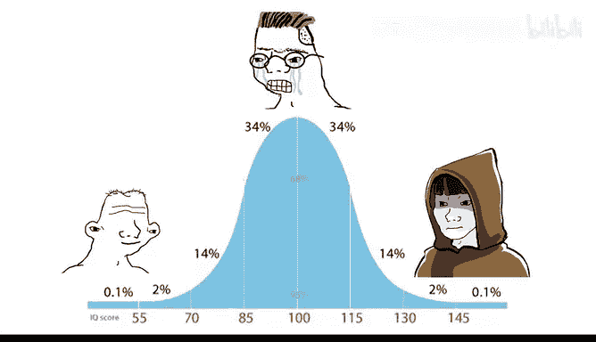

100% reliable thing to rely on that。The global financial crisis was a famous example of this。

 people thought that mortgage defaults had this sort of Gaussian type behavior that if you ask if a population of 100000 Americans with mortgages ask what proportion them will default in the mortgages if everything was de correlatedrelated。

 it could would be an nice spill curve and you can manage risk of options and derivatives and so forth and it is a very beautiful theory but if there are systemic shocks in the economy that can push everybody to default the same time。

 that's very non-gaussian behavior， and this wasn't fully accountable in 2008 now I think there's some more awareness this is a systemic risk is like a much bigger issue and just because the model is pretty and it may not you match reality。

The mathematics of working out what models do。😊，It's really important but also the science are validating when the models fit reality and when they don't I mean you need both but mathmatics can help because for example these central limitthes it tells you that if you have certain axioms like non-correlation that if all the inputs were all correlatedrelate to each other then you have these Gaussian behaviors that things are fine it tells you where to look for weaknesses in the model so if you have a mathematical understanding of central limit them and someone proposes to use these Gaussian cops or whatever to model defaultport risk if youre mathematically trained you would say okay well what are this systemic correlation between all your inputs and so then you can ask the economists how much of a risk is that and you can co for that so there's always this synergy between science and mathematics a little bit on the topic of universality。

😊，You're known and celebrated for working across an incredible breadth of mathematics。

 reminiscent of Hilbert a century ago， In fact， the great Field medal winning mathematician Tim Gowawers has said that you are。

The closest thing we get to Hilbert he's a colleague of yours but anyway。

 so you are known for this ability to go both deep and broad in mathematics so you're the perfect person to ask。

 do you think there are threads that connect all the disparate areas of mathematics is there kind of deep underlying structure？

To all of mathematics there's certainly a lot of connecting threads and a lot of the progress of mathematics has can be represented by taking by stories of two fieldss of mathematics that were previously not connected and finding connections an ancient example is geometry and number theory you know so so in the times of the ancient Greeks these were considered different subjects I mean mathematicians worked on both you know Euclid。

Work both on geometry most famously， but also on numbers。

 but they were not really considered related。I mean a little bit like know you could say that this length was five times this length because you could take five copies of this length and so forth。

 but it wasn't until Descarte you really realized that you develop now about analytic geometry that you can parameterize the plane a geometric object by two real numbers every point can be and so geometric problems can be turned into into problems about numbers and today this feels almost trivial like there's no content to this like of course a plane is Xx and Y because that's what we teach and it's internalized but it was an important development that these two fields were unified and suppose this has just gone on throughout mathematics over and over again algebra and geometry were separated and now we have this algebra geometry that connects them and over and over again and that's certainly the type of mathematics that I enjoy the most so I think there's sort of different styles to being a mathematician I think hedgex and f。

A fox knows many things a little bit， but a hedgehog knows one thing very， very well。😊。

And in mathematics there's definitely both hedgehogs and foxes and then there's people who are kind of who can play both roles and I think ideal collaboration between mathematicians involves a very you need some diversity like a fox working with many hedgehogs or vice versa。

 so but I identify mostly as a fox， certainly I like。😊，Arbitrage somehow。

 like learning how one field works， learning the tricks of that weird or thing。

 going to another field which。😊，People don't think it is related。

 but I can adapt the tricks so see the connections between the fields Yeah so there are other mathematicians who are far deeper but I am they have really hedgehogs they know everything about one field they're much faster and more effective and I but I can I can give them these extra tools I mean you said that you can be both the hedgehog and the f depending on the context depending on the collaboration so what can you if it's at all possible speak to the difference between those two ways of thinking about a problem say you're in encountering a new problem。

you know， searching for the connections versus like very singular focus。

 I'm much more comfortable with the the Fox paradigm yeah so yeah I like looking for analogies。

 narratives， I spend a lot of time if there's a result I see it in one field and I like the result it's a cool result but I don't like the proof it uses。

Types of mathematics that I'm not super familiar with。

 I often try to reprove it myself using the tools that I favor。Of my proof is worse。

 but by the exercise of doing so I can say oh now I can see what the other proof was trying to do and from that I can guess some my understanding of the tools that are used in that field so it's very exploratory。

 very doing crazy things in crazy fields and like reinventing the wheel a lot whereas the hedgehog style is I think much more scholarly。

 very knowledge based you stay up to speed on like all the developments in this field you know all the history you have a very good understanding of exactly the strengths and weaknesses of each particular technique。

😊，Yeah， I think youd rely a lot more on sort of calculation than sort of trying to find narratives。😊。

嗯。So yeah， I mean， I could do that too， but there are other people who are extremely good at that。

Let's step back in。Maybe look at the a bit of a romanticized version of mathematics。

 so I think you've said that early on in your life。

Math was more like a puzzle solving activity when you were young。

 when did you first encounter a problem or proof where you realize math can have a kind of elegance and beauty to it？

That's a good question when I came to graduate school in Princeton so John Conway was there the time he passed away a few years ago。

 but I remember one of the very first research talks I went to was a talk by Conway on what he called extreme proof so Conway just had this amazing way of thinking about all kinds of things in a way that you wouldn't normally think of he thought of proofs themselves as occupying some sort of space know so if you want to prove something let's say that there's infinitefaee primes you've all different proofs but you could rank them in different axes like some proofs are elegant who are long。

 some proofs elementary and so forth and so this is cloud so this space of all proofs itself has some sort of shape。

😊，And so he was interested in extreme points of this shape， like out of all these proofs。

 what is one of those the shortest the of everything else or the most elementary or whatever。

 and so he gave some examples of well-know theorems and then he would give what he thought was the extreme proof in these different aspects I understand that really eye- opening that you know it's not just getting a proof was interesting but once you have that proof trying to to optimize it in various ways that that proof proofing itself had some craftsmanship to it。

😊，It's something for my writing style but like when you do your math assignments and as your undergraduate。

 your homework and so forth you're sort of encouraged to just write down any proof that works and they hand it as long as it's a tick mark you move on but if you want the results to actually be influential and be read by people it can just be correct。

 it should also be a pleasure to read motivated， be adaptable to generalize other things it's same in many other disciplines like like coding there's a lot of analoggieies between math and coding。

 I like analogergies if you haven't noticed but you can code something spaghetti code that works for a certain task and it's quick and dirty and it works but there's lots of good principles for writing code well so that other people can use it brought upon it and so on as fewer bugs and whatever and similar things with mathematics。

 so yeah first of all。So many beautiful things there and call is one of the great minds。

In mathematics， ever in computer science。U just even considering the space of proofs and saying。

 okay， what does the space look like and what are the extremes？Like you mentioned。

 coding is an analogy's interesting because there's also this activity called the Code golf， Oh yeah。

 yeah， yeah， which I also find beautiful and fun。where people use different programming languages to try to write the shortest possible program that accomplishes a particular task。

 and I believe there's even competitions on this and it's also a nice way to stress test。

Not just the。So of the programs are in this case the proofs。

 but also the different languages maybe that's a different notation or whatever to use the couldtail accomplish a different task Yeah you learn a lot I mean it may seem like a frivolous exercise but it can generate all these insights which if you didn't have this artificial objective to pursue you might not see what to use the most beautiful or elegant equation in mathematics I mean one of the things that people often look to in beauty is this simplicity so if you look at E equals MC squared so when a few concepts come together that's why the oiler identity is often considered the most beautiful equation mathematics do you find beauty in that one and the oil identity Yeah well as I said I mean what I find most appeal is connections between different things that so e the pi I equals minus one so uses all the fundamental constant I mean that's cute。

But to me， so the exponential function was interesting by to measure exponential growth compound interest or decay or anything which is continuously growing continuously decreasing growth in decay or dilation or contraction this model by the exponential function whereas pi comes around from circles and rotation if you want to rotate a needle for example 100 degrees indeed rotate by pi radiance and I complex numbers represents this swapping machine you wont imagine a of a 90 degree rotation。

 so a change in direction so the exponential function represents growth and decay in the direction that you already are when you stick an eye in the exponential now it's instead of motion in the same direction as your kind of position is motion as a right angle to kind of position of rotation。

😊。

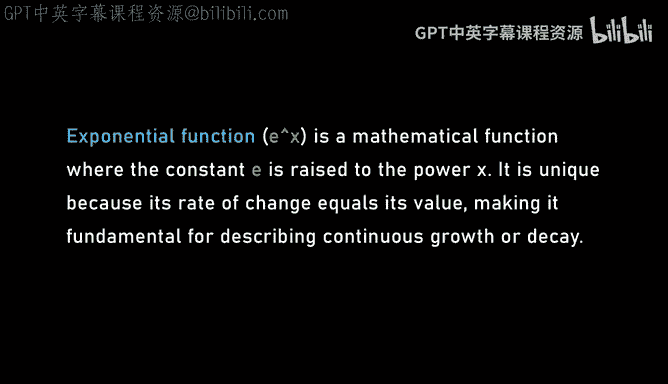

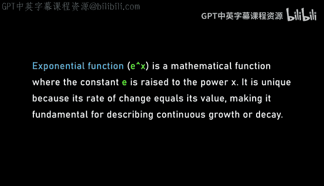

Um and then so each the pi equals minus1 tells you that if you rotate for time pipe。

 you end up at the other direction， so it unifies geometry through dilation and exponential growth dynamics。

😊。

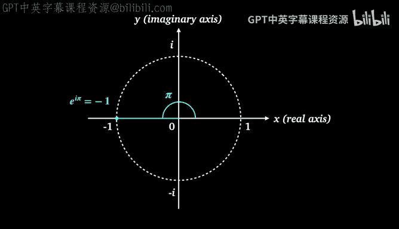

Through this act of complexification rotation by by by so it connects together all these two mathematics yeah the time was strange complex and complex and the complex numbers they all considered almost yeah their own external door neighbors in mathematics because of his identity Do you think the thing you mentioned is cute the collisional notations from these disparate fields。

😊，It's just a frivolous side effect or do you think there is legitimate like value in notation although our old friends come together right Well it's confirmation that you have the right concepts so when you first study anything you have to measure things and give them names and initially sometimes because your model is again too far off from reality you give the wrong things the best names and you only find out later what's really important physicists can do this sometimes I mean but it turns out okay so actually when physics E equal was absolutely so one of the big things was the E so when Aristotle first came up with his laws of motion and then Galileo and Newton and so forth they thought the things they could measure they could measure mass and acceleration and force and so forth and so newtonium mechanics for example ethic was MA was a famous and Newton second of motion so those were the primary objects they gave them the central building in the theory。

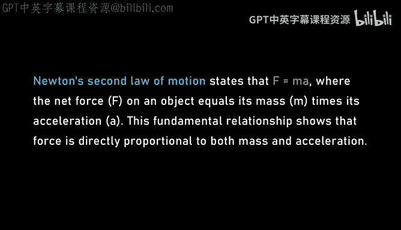

で？It was only later after people started analyzing these equations that there always seemed to be these quantities that were conserved。

 so particular momentum and energy。😊，And it's not obvious that things happen energy like it's not something you can directly measure the same way you can measure mass and velocity but over time people realize that this was actually a really fundamental concept Hamilton eventually in 19th century reformulated New's laws of physics into what's called Hamiltonian mechanics where the energy which is now called the Hamiltonian was the dominant object once you know how to measure the Hamiltonian of any system。

 you can describe completely the dynamics like what happens to other the states like it really was a central actor which was not obvious initially。

😊，And this helped actually， this change of perspective really helped when quantum mechanics came along because the early physicists who studied quantum mechanics they had a lot of trouble trying to。

😊，Apt in Newtonian thinking because yeah everything was a particle and so forth to quantum mechanics because I think because there was a wave。

 but it just looked really， really weird like what is the quantum vision of ethic was MA and it's really really hard to give an artificial that。

 but it' just that the Hamiltonian which was so，Secretly behind the scenes in classical mechanics also is the key object in quantum mechanics that there's also an optical in Hamiltontonian it did a different type of object iss whats couldn't operator rather than a function but again once you specify it you specify the high dynamics so this showing in this equation that tells you exactly how quantum systems evolve once you have a Hamiltontonian so side by side they look completely different objects here like one involves particles one involves waves and so forth but with this centrality you could start actually transferring a lot of intuition and facts from classical mechanics to quantum mechanics so for example in classical mechanics there's a single notice theorem every time there's a symmetry in a physical system there is a conservation law so the laws of physics I translation invariant like if I move ten steps to the left I experience the same laws of physics as I was here that corresponds to conservation momentum if I turn around by some angle again I experience the same laws of physics this corresponds to conservation anglengular momentum。

😊，If I wait for 10 minutes， I still have the same all laws of physics。

 so this time transition variance， this corresponds to the low consortium energy。😊。

So there's this fundamental connection between symmetry and conservation。

 and that's also true in quantum mechanics， even though the equations are completely different。

 but because they're both coming from the Hamiltonian the Hamilton controls everything。

 every time the Hamiltonian has symmetry， the equations will have a conservation law。

 so it's once you have the right language it actually makes a lot cleaner。😊。

One of the problems why we can't unify quantum mechanics and general activityivity yet。

 we haven't figured out what the fundamental objects are， like， for example。

 we have to give up the notion of space and time being these almost euclidean type spaces and it has to be you and we kind of know that at very tiny scales there's going to be quantum fluctuations as a spacetime foam and trying to use Cartesian called as XYz is it's a nonstarta but we don't know how what to replace it with。

😊，We don't actually have a mathematical width。Concepts the analog of Hamiltonian that sort of organized everything does your gut say that there is a theory of everything so this is even possible to unify to find this language that unifies neuro relativity in quantum mechanics I believe so I mean the history of physics has been out of unification。

Much like mathematics over the years， you know electricity and magnetism were separate theories and then Maxxwell unified them。

 you Newton unified the motions of heavens for the motions of objects on the earth and so forth。😊。

So it should happen it's just that the。Again， to go back to this model of the observations and theory。

😊，Part of our problem is that physics is a victim's own success that our two big theories of physics。

 genenativity and quantum mechanics are so good now that together they cover 99。

9% of sort of all the observations we can make and you have to either go to extremely insane particle accelerations or the early universe or things that are really hard to measure in order to get any deviation from either of these two theories to the point where you can actually figure out how to combine them together but I have faith that we've been doing this for centuries and we've made progress before there's no reason why we should stop do you think you'll be a mathematician that develops theory of everything what often happens is that。

😊，When the physicists need some of mathematics， there's often some precursor that the mathematicians。

😊，workeded out earlier so when Einstein started realizing that space was curvebed he went to some mathematician and asked you know is there some theory of curved space that the Westerntroians already came up with that could be useful and he said yeah there's I think Riman came up with something and so yeah Riman had developed remaining geometry which is precisely a theory of spaces that are curvebed in various general ways which turn out almost exactly what was needed for Einstein's theory。

 this is gone back to unreasonable effectiveness on mathematics I think the theories that work well to explain the universe tend to also involve the same mathematical objects that work well to solve mathematical problems they're just both ways of organizing data in useful ways。

😊，It just feels like you might need to go some weird land that's very hard to。

To intuit like you know you have like string theory yeah that that's that was that was a leading candidate for many decades it I think it's slowly pulling out of fashion because it's it's not matching experiment so one of the big challenges of course。

 like you said is experiment is very tough Yes because of the how effective both theories are but the other is like。

Just， you know， you're talking about。You're not just deviating from spacetime。

 you're going into like some crazy number of dimensions you're doing all kinds of weird stuff that to us we've gone so far from this flat earth that we start is that like you yeah yeah our we're just it very hard to use our limited ape descendants of cognition to intuit what that reality really is like this is why analogies are so important。

 I mean so yeah around earth is not intuitive。Because we're stuck on it but you know you know but round objects in general we have pretty good intuition a little and we have interest about light works and so forth and like it's actually a good exercise to actually work out how eclipses and phases of the sun and the moon and so forth that can be really easily explained by round earth and roundro and models and you can just take you know a basketball and a golf ball and a light source and actually do these things yourself so the intuition is there but you have to transfer it that is a big leap into for us to go from flat to round earth because you know our life is mostly lived in flat land yeah to load that information and we're all like take it for granted we take so many things for granted because。

Science has established a lot of evidence for this kind of thing。You know。

 we're in a round rock flying through space and it's a big leap and you have to take a chain of those leaps the more and more and more we progress right yeah so modern science is maybe again a victim of its own success is that in order to be more accurate it has to to move further and further away from your initial tuition and so。

For someone who hasn't gone through the whole process of science education it looks almost suspicious because of that so you know we we need more grounding I mean I think I mean know there are scientists who do excellent outreach but there's lots of science things that you can do at home lots of YouTube videos I did a YouTube video reason of Gr Sandersen we talked this earlier that how the ancient Greek were able to measure things like the distance of the moon of the Earth and you know using techniques that you could also replicate yourself it doesn't all have to be like fancy space telescopes and very the intimidating mathematics yeah I highly recommend that I believe you give a lecture and you also did an incredible video with Grant it's a beautiful experience to try to put yourself in the mind of a person from that time。

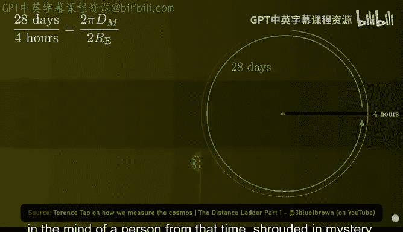

Shroud in a mystery right you know you're like on this planet， you don't know the shape of it。

 the size of it， you see some stars you see some you see some things and you try to like localize yourself in this world and try to make some kind of general statements about distance places change of perspective is really important say travel broadens the mind this is intellectual travel put yourself in the mind of the ancient Greeks or some other some other time period make hypotheses。

 historicalpher cows， whatever speculate and this is what mathematicians do and some other artists do actually it's just incredible that given the extreme constraints you can still say very powerful things that's why it's inspiring looking back in the history how much can be figured out when you don't have much out how propose axioms then the mathematics tests you follow those axioms to their conclusions and sometimes you can get quite a long way from initial hypotheses if we can stay in the land of the weird。

 you mention general relativity。

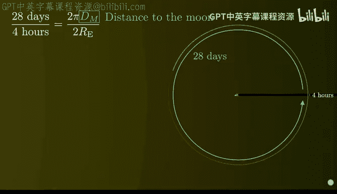

You've contributed to the mathematical understanding of Einstein's field equations。

 can you explain this work and from a sort of mathematical standpoint？

What aspects of general relativity are intriguing to you challenging to you I have worked on some equations there' something called the wave mapps equation or the sigma field model which is not quite the equation of spacetime gravity itself。

 but of certain fields that might exist on top of spacetime so I science equations of relativity just describe space and time itself。

 but then there's other fields that live on top of that there's the electromagnetic field this things called young noise fields。

😔。

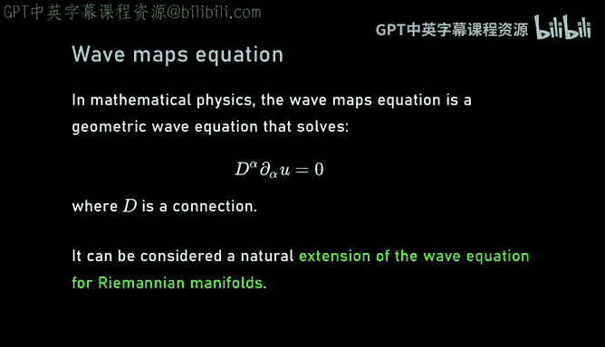

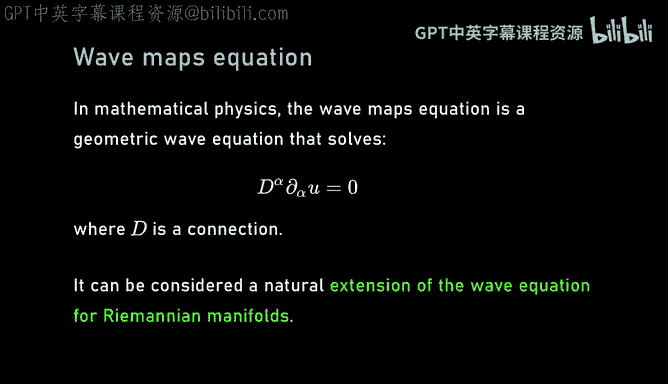

And this is whole hierarchy of different equations。

 of which our scientists considered one of the most no nonlinear and difficult。

But relatively low in a hierarchy was this thing called the Waapps equation。

So it's a wave which at any given point is fixed to be like on a sphere。

 so I think of a bunch of arrows in space and time and yeah it's pointing in different directions。

 but they propagate like waves， if you wiggle an arrow it would propagate and make all the arrows move kind of like sheavs of wheat in the wheat field。

😊，And I was interested in the global cloud problem again for this question。

 like is it possible for all the energy here to collect at a point？😊。

So equation I considered what actually was called a critical equation where it's actually the behavior at all scales is roughly the same。

 and I was able barely to show that you couldn't actually force a scenario all the energy cons at one point that at the end you had to dismiss a little bit and the moment it a little bit it would stay regular。

😊，Yeah， this was back in 2000， that was part of why I got interested in Larry So afterwards。

 actually。😊，Yeah so I developed have some techniques to solve that problem so part of it is this problem is really nonlinear because of the curvaage of the sphere there was a certain nonlinear effect which was a nonperturbt effect。

 it was when you sort of looked at it normally it looked larger than the linear effects of the wavever equation。

😊，Um，And so it was hard to to keep things under control， even when the energy was small。

But I developed what's called a gaze transformation so the equation is kind of like an evolution of heaves of wheat and they're all bending back and forth and so there's a lot of motion but like if you imagine like stabilizing the flow by attaching little cameras at different points in space which I trying to move in a way that captures most of the motion and under this little stabilized flow the flow becomes a lot more linear I discovered a way to transform the equation to reduce the amount of no nonlinear effects and then I was able to solve the equation I found the transformation while visiting my art in Australia and I was trying to understand the dynamics of all these fields and I couldn't do a pen and paper and I had notoffacative computers to do any computer simulations so I ended up。

😊，Csing my eyes being on the floor and just imagining myself to actually be this specfield and rolling around to try to see how to change coordinates in such a way that somehow things in all directions would behave in a reasonably linear fashion and yeah my aunt walked in on me while I was doing that and she was asking what are that what am I doing doing this it's complicated answer yeah and okay fine you know you're a young man I don't ask questions？

😊，II have to ask about that， you know， how do you approach solving difficult problems。

 what if it's possible？To go inside your mind when you're thinking， are you visualizing。In your mind。

 the mathematical object symbols maybe what are you visualizing in your mind usually when you're thinking a lot of pen and paper one thing you pick up as a mathematician is sort of I call cheating strategically so if the beauty of mathematics is that is that you get to change the change the problem and change the rules as you wish you don't get to any other like know if you're an engineer and someone put a bridge over this river you can say I want to build this bridge over here instead or I want to put out of paper instead of steel but a mathematician you can do whatever you want it's like trying to solve a computer game where you this unlimited cheat code is available and so you can you can set there's a dimension that's large I've set it to one solve the one dimensional problem first or there's a main term and an error term I'm going to make a spherical car assumption I've assume the error term is zero。

And so the way you should solve these problems is not in solve this I Man mode where you make things maximally difficult。

 but actually the way you should approach any reasonable math problem is that there are 10 things that are making your life difficult。

😊，Find a version of the problem that turns off in nine the difficulties but only keeps one of them and solve that and then that just so you install nine sheets okay you sort 1 cheats then the game is trivial but you saw nine sheets。

 you solve one problem them that teaches you how to deal with that particular difficulty and then you turn that one off and you turn someone else something else on and then you solve that one and after you know how to solve the 10 problems 10 difficulties separately。

 then you have to start merg them if you at a time。😊。

as a kid I watched a lot of these Hong Kong action movies from my culture and one thing is that every time it's a fight scene maybe the hero gets swarmed by 100 bad guyoonons whatever but it will always be choreographed so that he would always be only fighting one person at a time and it would defeat that person to move on and because of that he could defeat all of them but whereas if they had fought a bit more intelligently and just swarmed the guy at once it would make much worse cinema but but they would win are you usually pen and paper or you working with computer and latex mostly pen and paper actually in my office I have four giant blackboards and sometimes I just have to write everything I know about the problem on the full blackboards and instead my couch and just sort of see the whole thing is it all symbols like notation or is there from drawings。

 there's a lot of drawing and a lot of bespoke doodles that only make sense to me。

I mean the bit of a blackboard you raise and it's a very organic thing I'm beginning to use more and more computers partly because AI makes it much easier to do simple coding things that you know if I wanted to plot a function before which is more complicated as some iteration or something you I'd had to remember how to set up a Python program and how does it full loop work and debug it and it take two hours and so forth and now I can do it in 1015 minutes as much I'm using a more and more computers to do simple explorations let's talk about AI a little bit if we could so。

😊，Maybe a good entry point is just talking about computer assisted proofs in general。

 can you describe the lean formal proof programming language？

How it can help as a proof assistant and maybe how you started using it and how it has helped you so W is a computer language much like sort of standard languages like Python and C and so forth except that in most languages the focus is on producing executable code。

 lines of code do things they flip bits or they make a robot move or they deliver you text on the internet or something so leanan is a language that can also do that。

 it can also be run as a static traditional language but it can also produce certificates so a software language like Python might do a computation and give you the answer is seven does the sum of3+ as equal go to7 but lean can produce not just the answer but but a proof that how it the answer of seven as+ and all the steps involved so increase these more complicated objects。

 not just statements but statements were proofs attached to them。

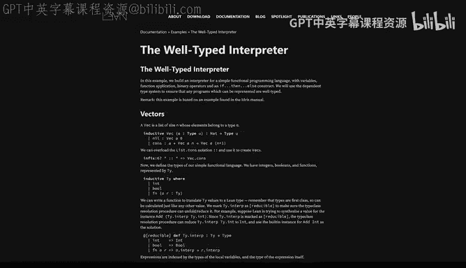

And every line of code is just a way of piecing together previous statements to create new ones so the idea is not new。

 these things are called proof assistance and so they provide languages for which you can create quite complicated intricate mathematical proofs and they produce these certificates that give 100% guarantee that your arguments are correct if you trust the compiler of lean but they made the compiler really small and you can several different compilers available for the same fault you can give people some intuition about the difference routine writing and pen and paper versus using lean programming language how hard is it to formalize statement so leanan a lot of mathematicians were involved in the design of lean so it's designed so that individual lines of code resemble individual lines of mathematical argument you might want to introduce a variable want to proof that contradiction they are various standard things that you can do and it's written so ideally issue like a one。

😊，spondence in practice it isn't because lean is like explaining a proof to an extremely pedantic colleague who will point out。

 okay did you really mean this like what happens if this is zero okay how do you justify this so lean has a lot of automation in it to try to be less annoying so for example every mathematical object has to come with a type like if I talk on x is x a rule number a natural number or function or something if you write things informally it's up context。

 you say clearly x is equal to let x be the sum of y and z and y and z where every real number so x should also be a rule number so lean can do a lot of that but every it says wait a minute can you tell me more about what this object is what type of object it is you have to think more the philosophical level not just sort of computations that you're doing but sort of what each object actually。

😊，Is in some sense is it using something like LLMs to do the type inference or like you the real it's using much more traditional what called good old fashioned AI you can represent all these things as trees and there's always algorithm to match one tree to another tree so it's actually doable to figure out if something is a。

A real number or a natural number every object of comes with a history of where it came from and you can kind of trace oh I see yeah so it's designed for reliability so modern As are not used in it's a just technology。

😊，People are begin to use AIs on top of lean so when a mathematician tries to program proof in lean often there's a step okay now I want to use the fundamental human calculus say okay to do the next step so the lean developers have built this massive project called Methyllibbe a collection of tens of thousands of useful facts about method objects and somewhere in there is the fundamental thermoal calculus but you need to find it so a lot the bottomneck now is actually Lemma search know there's a tool that you know is in there somewhere and you need to find it and so can there are various search engine specialized for mathlib that you can do but there's now these large language models that you can say I need the fundamentallyal cculus at this point and it was like okay for example when I code I have Gitthub Copilot install as a plug into my IDE and it scans my text and it sees what I need says I might even type here now I need to use the fundamental calculus and it might suggest okay try this and I maybe 25 of the time it works。

Exactly and then another。105 in the time it doesn't quite work but it's close enough that I can oh yeah if I just change it here and here it will work and then like half the time it gives me complete rubbish so but people are beginning to use AIs a little bit on top mostly on the level of basically fancy autocomplete that you can type half of one line of proof and it will find it will tell you but if fancy especially fans with the sort of capital letter F is。

😊，Remove some of the friction mathematician might feel when they move from pen and paper to formalizing yes yeah。

 so right now I estimate that the time and effort taken to formalize a proof is about 10 times the amount taken to write it out yeah so it's doable but you don't it's it's annoying but doesn't it like kill the whole vibe of being a mathematician so I mean having a pedantic co right yeah if that was the only aspect of it okay but。

there some cases it was actually more pleasant to do things formally so theres a theorem formalized and theres a certain constant 12 that came out in the final statement and so this2 had be carried all through the proof and everything had to be checked that it goes all these other numbers that had to be consistent with this final number 12 and so we wrote a paper through this theorem with number 12 and then a few weeks later so I said oh we can actually improve this 12 to an 11 but we working some of these steps and when this happens with pen and paper every time you change a parameter you have to check line by line that every single line of your proof still works and it can be subtle things that you didn't quite realize some properties number 12 that you didn't even realize that you were taking advantage of so a proof can breakdown at a subtle place so we had formalized the proof with this constant 12 and then when this new paper came out we said oh so that took like three weeks to formalize and like 20 people to formalize this original proof I said nows this update 12 to 11。

What you can do with lean you just in your headline theem you change a 12 to 11 you run the compiler and like of the thousands of lines of code you have 90% of them still work and there's a couple that are line and red now I can't justify these steps but need to isolate which steps you need to change but you can skip over everything which works just fine and if you program things correctly with good programming practices。

 most of your lines will not be read and there' just be a few places where I mean if you don't hardcode your constants but you sort use smart tactics and so forth you can localize the things you need to change to a very small period of time so like within a day or two we had updated our proof of course this is very quick process you make a change。

 10 things now that don't work for each one you make a change and now there's five more things that don't work but the process converges much more smoothly then with pen and paper so that's for writing able to read it like if somebody else doesn proof are you' able to how what's。

h versus paper and yeah， so the pools are longer， but each。

individual piece is easier to read so if you take a math paper and you jump to page 27 and you look at paragraph six and you have a line of text of math。

😊，I often can't read it immediately because it assumes various definitions which I have to go back and maybe on 10 pages earlier this was defined and the proof is scattered all over the place and you basically are forced to read fairly sequentially it's not like say a novel where in a theory you could open up a novel halfway through it and start reading there's all a context but when I from lean if you put your cursor on a line code every single object there you can hover over it and it would say what it is where it came from where that was justified you can trace things back much easier than of flipping through a math paper so one thing that lean really enables is actually collaborating on proofs at a really atomic scale that you really couldn't do in the past so traditional pen and paper when you want to collaborate with another mathematician either you do it at a blackboard where you can really interact but if you're doing it sort of by email or something basically you have to segment it I'm going to finish section3 you do section4 but you can't really sort of work on the same thing collllaboorrate。

AtThe same time。But with lean you can be trying to formalize some portion of the proof and say I got stuck at atY 67 here。

 I need to prove this thing that it doesn't quite work here is that the free lines of code I'm having in trouble with。

 but because all the context is there， someone else can say oh okay I recognize what you need to do you need apply this trick or this tool and you can do extremely atomic level conversations so because of lean I can collaborate with dozens of people across the world。

 most of whom I don't have never met in person and I may not know actually even whether they're how reliable there are in there in the proof certificate but leanan gives me a certificate of trust so I can do trustless mathematics so there's so many interesting questions theres one you're known for being a great collaborator so what is the right way to approach。

😊，Solving a difficult problem in mathematics when you're collaborating are you doing a divide and conquer type of thing or are brain are you focused on a particular part and you're brainstorming There's always a brainstorming process first so math research projects sort of by their nature when you start you don't really know how to do the problem it's not like an engineering project where somehow the theory has been established for decades and it's implementation is the main difficulty you have to figure out even what is the right path so this what I said about cheating first it's like to go back to the bridge building analogy first assume you have infinite budget and like unlimited amount of workforce and so forth now can you can you build this bridge now have infinite budget but only finite that workforce now can you do that and so forth so I mean of course no engineer can actually do this have fixed requirements there's this sort of jam sessions always at the beginning where you has a crazy things and you make all these assumptions that are。

Realistic， but you plan to fix later and you try to see if there's even some。

skeleton of an approach that might work and then hopefully that breaks up the problem into smaller subprom which you don't know how to do but then you focus on the sub ones and sometimes different collaborators are better at working on certain things so one of my thememes I'm known for is the themeem Ben Green we now called the green Ta theorem it's a statement that the primes contain asthma progressions of anything so it was a modification of this theem as somewhere already。

😊。

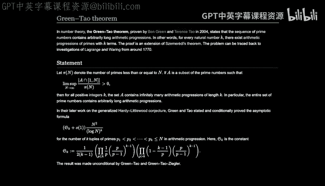

And the way we collaborated was that Ben had already proven a similar result for progressions of length3。

 he showed that sets like the primes contain lossance progressionions of length3。

 even and even subset of the primes， certain subsets do。

 but his techniques only worked for length three progressions。

 they didn't work for longer progressions but I had these techniques coming from a goic theory which is something that I had been playing with and I knew better than Ben at the time。

 and so if I could justify certain random properties of subset relating to the primes。

 like there's a certain。😊，Technical condition， which if I could。

Haveavt if Ben could supply me that this fact I could I could conclude the theorem but what I asked was a really difficult question in number theory which he said there's no way we can prove this so he said can you prove your part of the theorem using a weaker hypothesis that I have a chance to prove it and he proposed something which he could prove but it was too weak for me I can't use this so there's this conversation going back and forth still a hackron sheets yeah I want to cheat more was to cheat less but eventually we found a property which A he could prove and B I could use and then we could prove out the and so's all kinds of dynamics I mean every every collaboration has some story no two of the same and then on the flip side of that like you mentioned would lean programming that's almost like a different story because you can do。

You can create， I think you've mentioned a kind of a blueprint right for a problem。

 and then you can really do a divide and conquer with lean。

where you're working on separate parts right and they're using the computer system proof checker essentially yeah to make sure that everything is correct along yeah so it makes everythingcomp and yeah and trustable yeah so currently only a few mathematical projects can be cut up in this way at the current state of the art most of the lean activity is on formalizing boost that have already been proven by humans math paper basically is。

😊，A a bfin， in a sense， it is taking a difficult statement。

 like a big theorem amount of breaking up into me 100 little les。😊。

But often not all written with enough detail that each one can be sort of directly formalized。

 a blueprint is like a really pedantically written version of a paper where every step is explained as much detail as possible and to try to make each step kind of self-contained and or depending on only a very specific number of previous statements that been proven so that each node of this blueprint graph that gets generated can be tackled independently of the others and you don't even need to know how the whole thing works so it's like a modern supply chain know and if you want to create an iPhone or some other complicated object no one person can can build up a single object but you can a specialist to just if they're given some widgets from some other company they can combine them together to form a slightly bigger widget I think there's a really exciting possibility because you can have。

😊，If you can find problems， that could be。broken down this way then you can have you know thousands of contributors right distributed So I told you before about the split between theoretical and experimental mathematics and right now most mathematics is theoretical and when you tiny it's experimental I think the platform that lean and other software tools Github and things like that allow allow experimental mathematics to be to scale up to a much greater degree then we can do now so right now if you want to do any mathematical exploration of some mathematical pattern or something you need some code to write out the pattern and I mean sometimes there are some computer algebra packages that could help but often it's just one mathematician coding lots and not Python or whatever and because coding is such an error productivity。

 it's not practical to allow other people to collaborate with you on writing a modules for your code because if one of the modules has a bug in it the whole things is unreliable so these so you get these bespoke。

Spaghetti code written by non professional programmers but mathematicians and they're clunky and slow and so because of that it's hard to really mass reduce experimental results。

😊，But。Yeah， but I think with lean， I mean， I'm already starting some projects where we are。

Not just experimenting with data but experimenting with proofs so I have this project called the Eal theories project basically we generated about 22 million little problems at abstract algebra me should back up and tell you what the project is okay so abstract algebra studies operations like multiplication addition and the abstract properties so multiplication for example is commutative x times y is always y times x these for numbers and it's also associative x times y times Z is the same as x times y times Z。

😊，So these operations obey some laws that don't obey others because example x times x is not always equal to x。

 so that law is not always true。😊，So given any operation it obey some laws and not others and so we generated about 4。

000 of these possible laws of algebra that certain operations can satisfy and our question is which laws imply which other ones so for example。

 does commutic imply socialciivity？😊，And the answer is no because it turns that you can describe an operation which obeys the cognitive law。

 but doesn't obey the assertsortion of law， so by producing an example。

 you can show that community does not imply as sociivity。😊。

But some other laws do imply other laws by substitution and so forth and you can write down some some algebra proof。

 so we look at all the pairs between these 4000 laws and there upper  22 million of these pairs。😊。

And for each pairer we ask does this law imp this ball， if so give a proof。

 if not give a counter example， so 22 million problems each one of which you could give to like an undergraduate algebra student and they had a decent chance of solving the problem。

 although there are a few， at least 22 million there are like 100 or so that are really quite hard。

 okay but a lot of easy。😊，And the project was just to work out to determine the entire graph like which ones implied which other ones。

 that's an incredible project， by the way， such a good idea such a good test of the very thing we've been talking about at a scale that's remarkable yeah so it would not have been feasible I mean the state of the art in the literature was like you know 15 equations and sort of how they implied that's at the limit of what a human repentent people can do so you need to scale it up so you need to crowdsource but you also need to trust or the I mean no one person can check 22 million of these proofs you need to be computerized。

And so it only became possible with Lean， we were hoping to use a lot of AI as well。

 so the project is almost complete， so at least 20 million orbit two have been settled actually and of those two we have a pen and paper proof of the two and we're formalizing it in fact this morning I was working on finishing it。

😊，U so we're almost done on this it's incredible its yeah how many people were able to talk which in mathematics is considered a huge number it's a huge number yeah crazy yeah so we got have a paper 50 authorss and a big appendix of food contributor what here's an interesting question not to maybe speak even more generally about it。

😊，we have this pool of people。Is there a way to organize the contributions by level of expertise of the people of the contributors now okay。

 I'm asking a lot of podcasthead questions here， but I'm imagining a bunch of humans and maybe in the future some AI is。

Can there be like an elo rating type of situation where like a gamification of this。

 the beauty of these leanme projects is like automatically you get all this data， yeah。

 so like like everything this we uploaded this Github and GiHub tracks who contributed what？😊。

So you could generate statistics from at any later point in time you could say oh this person contributed this this many lines of code or whatever I mean these are very crude metrics I would definitely not want this to become like you part of your tenure review or something but I mean I think already in enterprise computing right people do use some of these metrics as part of the assessment of performance of an employee again this is a direction which is a bit scary for academics to go down we don't like metrics so much and yet academics use metrics they just use。

😊，Old ones， number of papers。 Yeah， it's true it's true that yeah， I mean。

 it feels like this is a metric while flawed。I is going in the more in the right direction right yeah it's interesting at least it's a very interesting metric yeah I think it's interesting to study I mean I think you can do studies of whether these are better predictors there's this problem called goodhars law if a statistic is actually used to incentivize performance it becomes gamed and then it is no longer a useful measure humans yeah yeah know mean rational so what we've done for this project is self-report so there are actually these standard categories from the sciences of what types of contributions people give so this concept and validation and resources and coding and so forth so there's a standard list of troll or or categories and we just ask each contributor to there a big matrix of of all the authors in all the categories just to tick the boxes where they think that it contributed and just a rough idea you know like you disemcod and you provided some compute but you didn't do any for pen and paper verification or whatever。

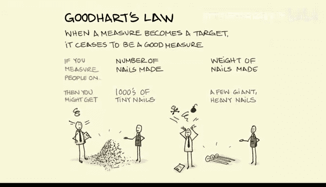

And I think that works out traditionally mathematicians just order alphabetically by surname。

 so we don't have this tradition as in the sciences of lead author and second author and so forth which we're proud of。

 we make all the authors equal status but it doesn't quite scale to this size。

 so a decade ago I was involved in these things called polyme projects。😊。

It was the crowdsourcing mathematics but without the lean component。

 so it was limited by you needed a human moderator to actually check that all the contributions coming in where IQva and this was a huge bottleneck actually。

 but still we had projects say well10 authors or so but we had decided at the time not to try to decide who did what but to have a single pseudonym so we created this fictional character called DHJ polymath in the spirit of Bovaki wonkeus is the pseudonym for a famous group of mathematicians in the 20th century and so the paper was author on the pseudonym so none of us got the author credit this actually turned out to be not so great for a couple of reasons so one is that if you actually wanted to be considered a ten year or whatever you could not use this paper in as you were submitted as one of your publications because it you didn't have the formal author credit but the other thing that we recognized much later。

😊，I that when people referred to these projects， they naturally refer to the most famous person who was involved in the project oh so this was Tim Galer' project this was Tims Ta's Pmouth project and not mention the other 19 or whatever people that were involved so we're trying something different this time around where we have everyone's an author but we will have an appendix with this matrix and we'll see how that works I so both projects is incredible just the fact that you're involved in such huge collaborations but。

😊，I think I saw a talk from Kevin Buzzard about the lean program in languages a few years ago and you're saying that this might be the future of mathematics and so it's also exciting that you're embracing one of the greatest mathematicians in the world embracing this。

What seems like the paving of the future of mathematics？So I have to ask you here about。

The integration of AI into this whole process so deepmined alpha proof was trained using reinforcement learning on both failed and successful formal lean proofs of imMO problems so this is sort of highle high school of very high level very high level high school level mathematics problems what do you think about the system and maybe what is the gap between this system that is able to prove the high school level problems versus gradual level problems yeah the difficulty increases exponentially with the the number of steps involved in the proof is the combinatorial explosion so the thing of large language models is that they make mistakes and so if a proof has got 20 steps and large language4 has a 10% failure rate at each step of going in the wrong direction like it's extremely unlikely to actually reach the end actually just to take a small tang here。

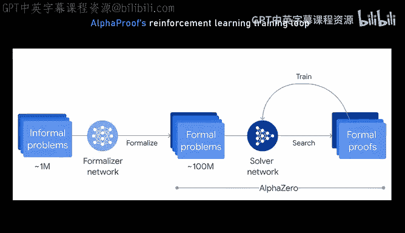

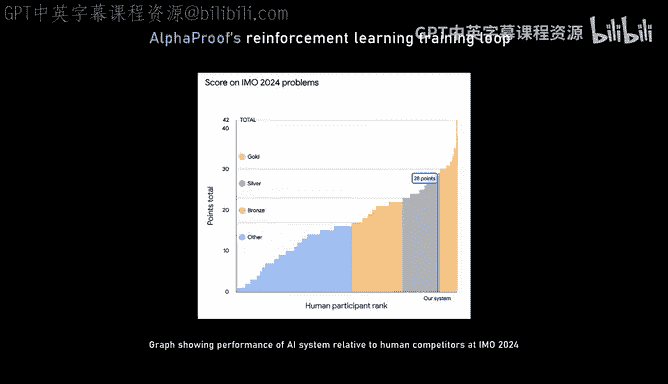

I how hard is the problem of mapping from natural language to the formal program Oh yeah。

 it's extremely hard actually natural language， you know。

 it's very full tolerant like you can make a few minor grammatical errors and speak in the second language can get some idea of what you're saying。

Yeah， but but formal language， yeah if you get one little thing wrong。

 I think that the whole thing is nonsense even formal to formal is very hard though there are different incompatible prefaces in languages there's lean。

 but also Coch and Isabel and so forth and I keep even converting from a formal language to formal language its an basically uns problem that is fascinating okay so but once you have an informal language。

😊，They're using their RL trained model so something akin to alpha zero or that they use this go。

To then try to come up with proofs， they also have a model， I believe。

 is a separate model for geometric problems。So what impresses you about the system and？

What do you think is the gap we talked earlier about things that are amazing over time become kind of normalized so now somehow of course geometryries is a silver right that's true that's true。

 I mean it's still beautiful these are great works that shows what's possible I mean the push doesn't scale currently yeah three days of Google's server server time do so one high school math for this is not a scalable prospect especially with the exponential increase in as the complexity increases which mention that they got a server performance the equivalent of I mean equivalent of I mean so of all they took way more time than audit and they have this assistance where the humans started helped by formalizing but also they're giving them full marks for the solution which I guess is' formally verified so I guess that' fair。

Yeah there are efforts， there will be a proposal at some point to actually have an AI mathth Olympia where at the same time as the human contestants gets the actual olympia problems As will also be given the same problems with the same time period and the outputpost will have to be created about the same judges and which means it will have to be written in natural language rather than formal language I hope that happens I hope this imMO happens I hope it won't happen this imMO the performance is not good enough in the time period but there are smaller competitions there are competitions where the answer is a number rather than a long form proof and AI is actually a lot better at problems where there a specific numerical answer because it's easy to to reinforce to reinforce and learning on it。

 yeah youve got the right answer you've got the wrong answer it's a very clear signal。😊。

But long from proof either has to be formal and then the lean can give it thumbs up。

 thumbs down or it's informal， but then you need a human to create it to tell and if you're trying to do billions of reinforcement learning。

😊，You know runs youre not you can't hire enough humans to tograde those mean it's already hard enough for the last time Cr to do reinforce some learning on just the regular text that people get。

 but nowvi hire people and not just give thumbs up thumbs down but actually check the output mathematically yeah that's too expensive so if we just explore this possible future。

😊，What what is the thing that humans do that's most special in mathematics so that you could see AI。

Not cracking for a while， so inventing new theories to coming up with new conjectures versus proving the conjectures。

Building new abstractions， new representations， maybe。

An AI turns style with seeing new connections between disparate fields that's a good question I think the nature of what mathematicians do over time has changed a lot you know so1 thousand years ago mathematicians had to compute the data of Easter and there really complicated calculations you know but it's all automated automated centuries we don't need that anymore you know they used to navigate to dopher navigation s trigontry to navigate how to get from the old port of the new or something a very complicated calculations again we'd been automated。

😊，You know even a lot of undergraduate mathematics， even before AI， like move from alphapha。

 for example， it's not a language modelna be it can solve a lot of undergraduate level math tasks。

 so on the computational side verifying routine things like having a problem and say here's a problem in past equations could you solve it using any of the 20 standard techniques and AS I've tried all 20 and here that 100 different permutations and tos my results and that type of thing I think it will work very well type of scaling to once you solve one problem to make the AI attack 100 adjacent problems。

😊。

The things that humans do。So so where the AI really struggles right now is knowing when it's made a wrong turn it can say oh I'm going to solve this problem。

 I'm going to split up this woman into into these two cases I'm going to try this technique and sometimes if you're lucky and it's a simple problem it's the right technique and you solve the problem and sometimes it will have a problem it would propose an approach which is just complete nonsense but like it looks like a proof so this is one annoying thing about LLM generated mathematics so we've had humangenative maths that's very low quality like know somes who don't have the formal training and so forth but if a human proof is bad you can tell this bad pretty quickly it makes really basic mistakes but the AI generated proofs。

 they can look superficially flawless and it's partly because that's what the reinforcement learning has like you train them to do to make things to produce textnet looks like。

😊，What is correct which for many applications is good enough so the air is often really subtle and then when you spot them they're really stupid like you know like no human would have actually made that mistake Yeah it's actually really frustrating in the programming context because I programd a lot。

😊，Yeah， when a human makes a low quality code， there's something called code smell right you you can tell you can tell immediately like okay there's signs but with with the a generate code o of us and then you're right eventually you find an obvious dumb thing that just looks like good code so's very tricky to and frustrating for some reason to yeah so to work yeah so the sense of smell is this is one thing that humans have and this's a metaphorical mathematical smell that。

This is not clear how to get the A has to duplicate that eventually， I mean， so the way。

Helppha zero and so how to make progressom go and chess and so forth this is in some sense they have developed a sense of smell for go and test positions that this position is good for white。

 thiss good for black they can't enciiate why but just having that sense of smell lets them strategize so if AIs gain that ability to sort of a sense of viability of certain proof strategies so you can I'm going to try to break up this problem into two small subtasks and it can say oh this looks good two tasks look like they's simpler tasks than your main tasks and they still got a good chance of being true this is good to try or no you made the problem worse because each of the two sub problems is actually harder than your original problem which is actually what normally happens if you try a random thing to try normally it's very easy to transform a problem into even harder problem very rarely transform a simpler problem。

嗯。Yeah so if they can pick up a sense of smell then they could maybe start competing with a human level mathematicians so this is a hard question。

 but not competing but collaborating if okay， hypothetical， if I gave you an oracle。

That was able to do some aspect of what you do and you could just collaborate with it Yeah， yeah。

 yeah， what would that oracle What would you like that oracle to be able to do Would you like it to maybe be a verifier like check do the code like you're yes。

 a professoror Ta， This is the correct This is a good this is a promising fruitful direction Yeah。

 yeah， yeah or or would you like it to。Generate possible proofs and then you see which one is the right one or would you like it to maybe generate different representation different totally different ways of seeing this problem I think all of the above a lot of it is we don't know how to use these tools because it's a paradigm that it's not。

Yeah， we have not had in the past systemss that are competent enough to understand complex instructions that can work at massive scale。

But also unreliable it's an interesting unreliable in subtle ways whilst we was providing sufficiently good output。

 it's an interesting combination you know， I mean you have graduate students you work with who kind of like this but not at scale know and we had previous software tools that can work at scale but very now。

😊，So we have to figure out how to use。😊，I mean， so Tim Co actually imagine Yaki's foresaw like in 2000。

 he was envisioning what mathematics would look like in actually two and a half decades yeah he wrote in his article a hypothetical conversation between a mathematical assistant of the future and if hes trying to solve a problem and would have a conversation that sometimes the human would propose an idea and the AI would evaluate it and sometimes the AI would pose an idea sometimes a conversation was required and A would just go and say。

 okay， I've checked the 100 cases needed here or the first you said this is true for all N' checked to put N up to 100 and it looks good so far or hang on there' was a problem at N equals 46。

😊，And so just a free form conversation where you don't know in advance where things are going to go。

 but just based on， I think ideas good proposed on both sides。

 calculations get proposed on both sides。😊，I've had conversations with AI where I say okay we're going to collaborate to solve this math problem and it's a problem that I already know the solution to so I try to prompt it okay so here's a problem I suggest using this tool and this love the argument using it completely different tool which eventually goes into theig and say no no。

 no if' using this and am I start using this and then itll go back to the tool that I wanted do before and you had to keep railroading it onto the path you want and I could eventually force it to give the proof I wanted it but it was like hurting cats and we might a personal effort I had to take to not just sort of prompt it but also check its output because a lot of what it looks like it's going to work and I don't know there's a problem on online 17 and basically arguing with it。

Um like it was more exhausting than doing it unassisted， so like it。

 but that's the current state of the art I wonder if there's。😊。

There's a face shift that happens to where it no longer feels like hurting cats in。

Maybe you'll surprise us how quickly that comes I believe so， so in formalization。

 I mentioned before that it takes 10 times longer to formalize improvement about it by hand。

With these modern AI tools and also just better tooling the lean developers are doing a great job adding more more features and making it user friendly。

 it's going from nine to eight to seven okay no big deal。

 but one day it will drop a little one and that's the space shift because suddenly it makes sense。😊。

When you write a paper to provide it in leanan first or through a conversation with AI which is generally on the file with you and it becomes natural for journals to accept maybe theyll offer expedite referee if a paper has really been formalized in lean they will just ask the referee to comment on significance of the results than how it connects the literature and not worry so much about the correctness because that's been certified papers is getting longer and longer in mathematics and I it's harder and harder to get good refereeing for the long words unless really important it is actually an issue which the formalization is coming in just the right time for this to be and the easier and easier to guess because of the tooling and all the other factors then you're going to see much more like math lib will grow potentially exponential it''s a virtuous cycle I mean one face or this type that happened in the past was the etion Ftech so they take this typet language that all math use now so in the。

As people use all kinds of word processors and typewriters and whatever。

 but at some point lateEX became easier to use than all other competitors and if people would switch within it a few years like it was just a dramatic payship it's a wild out there question but。

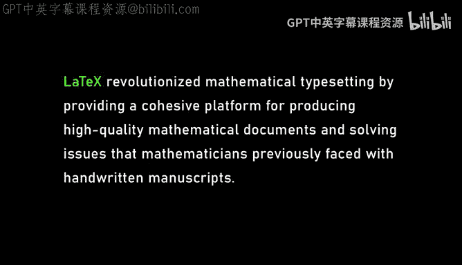

What year， How far away are we from？A AI system being a collaborator。

On a proof that wins the field medal of that level。Okay。

 well it depends on the level of collaboration， I mean。

 no like it deserves to be to get the fields model like so half and half already like I can imagine if first were metal winning paper having some AI assistance in writing it。

 you know， I just you know， like the old complete alone is already I use it like it speeds up my own writing。

Like you know you can have a theorem and you have a proof and the proof of three cases and I write down the proof of first case and the order complete just suggests that now here's how the proof of second could work and that it was exactly correct and that was great。

 saved me like 15 minutes of typing， but in that case the AI system doesn't get the fields me。😊，Yeah。

I was talking 20 years， 50 years， 100 years， what do you think Okay。

 so I gave a particular in print post by 2026， which is now next year there will be。

math collaborations with AI so not fuel metal but actual research level published ideas yeah generated by AI。

 maybe not the ideas but at least some of the computations the verifications I mean that already happened has it already happened yeah there are problems that were solved by a complicated process conversing with AI to propose things and the human codes and transit and that doesn't work but might pose a different idea it's hard to disentangle exactly there're certainly math results which could only have been accomplished because there was a human mathian and an AI involved but it's hard to sort of disentangle credit。

I mean these tools， they do not replicate all the skills needed to do mathematics。

 but they can replicate sort of some nontrivi percentage of them。

 3040 business so they can fill in gaps， you know so coding is a good example you know。😊。

It's annoying for me to code and Python， I'm not a native professional programmer。

 but with AI that the friction cost of doing it is much reduced。

 so it fills in that gap for me AI is getting quite good at literature review。

 I mean it's still a problem with hallucinating references that don't exist。😊，But this I think。

 is a civilable problem if you train in the right way and so forth。

 you can you can and verify you know using the internet you know in a few years get the point where you have a。

😊，Alemma that you need and say has anyone proven this lelemma before and it will do basically a fancy web search AI assistant and say yeah yeah。

 there are these six papers where something similar has happened and I mean you can ask you right now and it will give you six papers of which maybe one is legitimate and relevant one exists but is not relevant for a hosena it has a nonze success array right now but there's so much garbage so much the signal noise ratio so poor that it's。

😊，It's most helpful when you already somewhat know the relationship and you just need to be prompted to be reminded of a paper that was very subconsciously in your memory or its just helping you discovering you you were not even aware of but it is a correct citation Yeahs yeah it can sometimes do but but when it does it's buried in a list of options to which the other are bad yeah I mean being able to automatically generate a related work section that is correct it's actually a beautiful thing that might be another phase shift because its a science credit correctly it breaks you out of the silos of yeah yeah yeah you know yeah there's a big hump to overcome right now I mean it's like self-triiving cause the safety margin it has to be really high to be feasible so yeah so there's a last moral problem with a lot of AI applications that tools that work 20% 80% of the time but it's still not good enough。

And in fact， even worse than good some ways， I mean。

 another way of asking the field mental question is。

What year do you think you'll wake up and be like real surprised and you read the headline。

 the news of something happened that AI did？Like， you know， a real breakthrough something it doesn't。

 you know， like feels metal even hypothesis， it could be like really just。

This alpha zero moment would go that right yeah， this this decade I can I can see it like making a conjecture。

Between two unrelated two two things that people would thought was unrelated oh interesting generating a conjecture that's a beautiful conjecture yeah and and actually has a real chance of been correct and meaningful。

Because that's actually kind of doable， I suppose， but the word the data is no that would be truly amazing the current models struggle a lot。

 I mean so a version of this is I mean the physicists have a dream of getting the AI is to discover new laws of physics the dreams you just feed all this data and he was a new patent that we didn't see before but it actually even struggle the current state of the art even struggles to discover old laws of physics from the data I mean or if it does there's a big concern contamination that it did it only because like somewhere in his training it someone knew you know。

 Boy's law or whatever ball trying to reconstruct。U。

Part of it is we don't have the right type of training data for this， so the laws of physics。

 like we don't have like a million different universes with a million different laws of nature。And。

A lot of what we're missing in math is actually the negative space of so we have published things of things that people have been able to prove and conjectures that end up up being verified or maybe counter examples produced。

 but we don't have data on things that were proposed and they're kind of a good thing to try but then people quickly realized that it was the wrong conjecture and then they they said oh but we should actually change。

😊，Ourll claim to modify it in this way to actually make it more plausible。

 there's a trial and error process， which is a real integral part of human mathematical discovery which we don't record because it's embarrassing we you make mistakes and we only like to publish our wins and the AI has no access to those data to train on and I sometimes joke that basically we get AI has to go through a grad school and actually go to grad courses。

 do the assignments， put office hours， make mistakes。

 get advice on how to correct the mistakes and learn from that。😊。

Let me ask you if I may about Gregigory Pelman， you mentioned that you try to be careful in your work and not let a problem completely consume you。

Just you really fall in love with the problem and really cannot rest until you solve it。

 but you also hased to add that sometimes this approach actually can be very successful and the example you gave is G Perilman who proved the poem care conjecture and did so by working alone for seven years with basically little contact with the outside world。

Can you explain this one millennial prize problem that' been solved onek conjecture and maybe speak to the journey that Gugo Perman' has been on All right so it's the question about curb spaces Earth is good example so thinking there was a 2D surface ining round view that could maybe be a hip a tous or the hole in it or can have many holes and there are many different topologies a priori that a surface could have even if you assume that it's bounded and smooth and so forth So we have figured out how to classify surfaces as a first approximation everythings to term uncle called the genus how many holes it has so apher has genus zero a donut has genus1 and so forth。

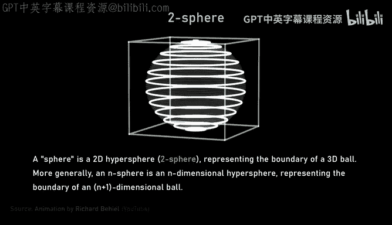

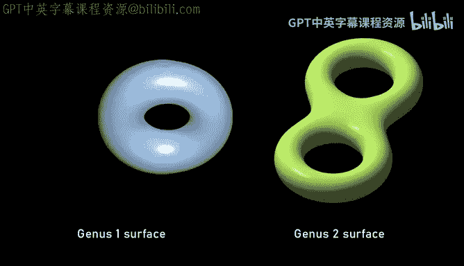

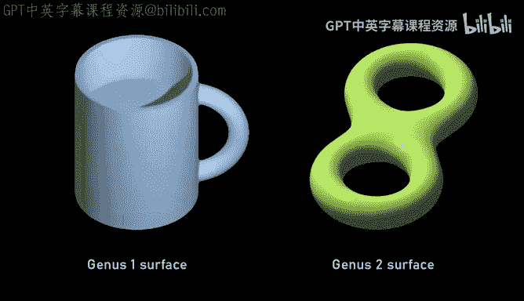

And one way you can tell these surface apart， probably the sphere has which is goes simply connected。

 if you take any closed loop on the sphere like a big closed loop rope you can contract it to a point and while staying on the surface and the sphere has this property but a doesn't if you're on a touristus and you take a rope that goes around say the outer diameterus theres no way it can't get through the hole there's no way to contract it to a point so it turns out that the sphere is the only surface with this property of contractability I mean up to like continuous defformations of the sphere so things that are what to called topologically equivalent of the sphere。

😊。

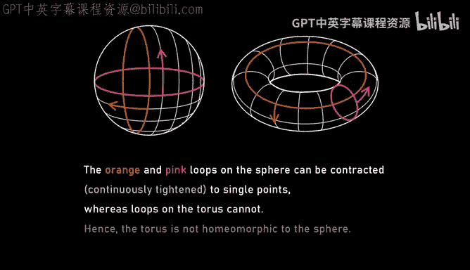

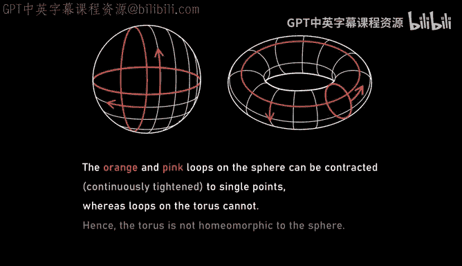

So point query asks the same question higher dimensions so it becomes hard to visualize because surface you can think of as embedded in three dimensions。

 but as a curved three space we don't have good intuition of 4D space deliver and then there are also 3D space that kindt even fit into four dimensions you need five or six or higher but anyway mathematically you can still pose this question that if you have a bounded three dimensional space now which also has this simply connected property that every loop can be contracted can you turn it into a three dimensional version of a sphere and so this is the point query conjecture weirdly in higher dimensions4 and five without was actually easier so it was solved first in higher dimensions。

 there's somehow more room to do the defformation， it is easier to move things around a sphere。😊。

But three was really hard， so people tried many approaches there sort commentary approaches where you chop up the surface into little triangles or tetrahsro and you just try to argue based on how the faces interact each other。

 there were algebraic approaches this's various algebraic objects like things called the fundamental group that you can attach to these。

😊，Homology and comology and all these very fancy tools， they also didn't quite work。😊。

Ricdget Hamilton's proposed a partial differential venture equations approach。

 you so the problem is that so you have this object which is so secretly the sphere。

 but it's given to you in a really in a weird way， so I think of a ball that's been kind of crumpled up and twisted and it's not obvious that it is the ball。

😊，But like if you have some sort of surface is which is a deformed sphere， you you could。

 for example think of that as the surface of a balloon， you could try to inflate it。

 you blow it up and naturally as you filler of air。

 the wrinkles will so smooth out and it will turn into a nice round sphere unless of course it was a tous or something in which in case it would get stuck at some point like if you inflate a tous there will be a point in the middle when the inner ring shrinks to zero。

 you get a singular and you can't blow any further。😊，He can't flow any further， so he created this F。

 which is now called Ricky flowlow。Which is a way of taking an arbitrary surface or space and smoothing it out to make it rounder and rounder to make it look like a sphere。

😊，And he wanted to show that either this process would give you a sphere or it would create a singularity。

 I very much like how PDs either they have global regularity or Phim blog basically it's almost exactly the same thing。

 it's all connected。😊，And he showed that for two dimensions， two dimension surface。

 if you started some clinic， no singularities ever formed。

 you never ran into trouble and you could flow and it will give you a sp so he got a new proof of the two dimensionalism。

 but by the way that's a beautiful explanation of reach you flow in its application in this context。

 how difficult is the mathematics here like for the 2DK is that yeah these are quite sophisticated equations on par with the Einstein equations slightly simpler but yeah。

 but but they will consider hard non nonlinear equations to solve and there's lots of special tricks in 2D that helped？

😊，But in 3D， the problem was that this equation was actually supercritical has the same problem as Navia talks as you blow up maybe the curvature sugar could get concentrated in fine small and smaller regions and it looked more and more nonlinear and things just look worse and worse and all kinds of singularities that that showed up some singularities there's these things called neck pinches where the surface sort of behaves like a barbell and it pinches at a point。

 some singularities are simple enough that you can sort of see what to do next you justt make a snip and then you can turn one surface into two and it evolve them separately but those the prospect that there's from really nasty like knotaughtted singularities short up that you couldn't see how to resolve in any way that you couldn't do any surgery to so you need to classify all the singularities like what are all the possibilities that things can go wrong。

😊，So what Permman did was first of all he made the you turned the problem with a supercrit problem to a critical problem。

 I said before about how the invention of energy， the Hamiltonian like really clarified newtonian mechanics so he introduced something which is now called pers reduced to volume and perman's entropy he introduced new quantities kind of like energy that looked the same at every single scale and turned the problem into a critical one where the non nonlinearities he suddenly looked a lot less scary than they did before and then he had to solve he still had to analyze the singularities of this critical problem and that itself was a problem similar to this wake uping had worked on actually so on the level of difficulty of that so he managed to classify all the singularities of this problem and show how to apply surgery to each of these and through that was able to resolve the point query injectionge so quite like a lot of really ambitious steps and like nothing that a large language model today for example could I mean。

😊，At best I could imagine not proposing this idea as one of hundreds of different things to try。

 but the other 99 would be complete dead ends， but you'd only find out after months of work you must have had some sense that this was the right track to pursue because it takes years to get them from A to B so you've done like you said actually you see even strictly mathematically but。

More broadly。😔，In terms of the process， you've done similarly difficult。

Things what what can you infer from the process he was going through because he was doing it alone What are some low points in a process like that when you start to like you've mentioned hardship like A I doesn't know when it's failing what happens to you you're sitting in your office when you realize the thing you did for the last few days。

 maybe weeks is a failure Well for me I switch for different problem So as says I'm a f I'm not a hedgehog but you generally that is a break that you can take it's to step away and look at a problem you can modify the problem too I mean you can ask them cheatt if this' is a specific thing that's blocking you just。

Some bad case keeps showing up that for which your tour doesn't work。

 you can just assume by fiat this bad case doesn't occur so you do some magical thinking the but strategically okay for the point to see if the rest of the argument goes through。

 if it's multiple problems with your approach maybe you just give up but if this is the only problem then everything else checks out。

 then it's still worth fighting。😊，Um。So yeah you have to do some some so forward reconnaissance sometimes you know and that is sometimes productive to assume like okay we'll figure it out oh yeah eventually sometimes actually it's even productive to make mistakes so one of the I mean those are project which actually we wanted some prizes for over four other people we worked on the PD problem again actually this blow of regularity type problem and it was considered very hard。

😊，Sean Bougain was another fuel methodist he worked us on a special case of this。

 but he could not solve the general case and we worked on this problem for two months and we thought we solved it we had this cute argument that E fitten we were excited we were planning celebrationary we'll get together and have champagne or something and we started writing it up and one of us not me actually but another core of said oh in thisle here we have to estimate these 13 terms that show up in this expansion and estimate 12 of them but in our notes I can't find the estimation of the 13th can you and someone supply that and I said sure look at this and yeah。

 we didn't cover we completely omitted this term and this term turned to be worsened the other12 terms put together in fact we could not estimate this term and we tried for a few more months and all different permutations and there was always this one thing。

 one term that we could not control and so like。This was very frustrating。

 but because we had already invested months and months of evidence was already， we stuck at this。

 we tried increasingly desperate things and crazy things and after two years we found an approach which somewhat different but quite a bit from our initial strategy which actually didn't generate these problematic terms and actually solved the problem so we solved a problem after two years。

😊，But if we hadn't had that initial full storm of nearly solving a problem。

 we would have given up by month two or something and worked on an easier problem if we hadn't known it would take two years。

😊，Not sure we have started the project。😊，Yeah， sometimes actually having the incorrect， you know。

 it's like Columbus ching into knew where they had an incorrect version measurement of the earth the size of the earth。

😊，He thought he was going to find a new trade route to India。

 or at least that was how he sold it in his prospectus， I mean。

 it could be that he actually secretly knew， but just on the psychological element，😊，Dive like。

 emotional or。Like self doubt that just overwhelms you moments like that， you know。

 because this stuff， it feels like math is so engrossing。

That like it can break you when you like invest so much yourself in the problem and then it turns out wrong。

 you could start to。Similar way， chess has broken some people Yeah。

 I think different mathers have different levels of emotional investment in what they do I mean。

 I think for some people it's just a job， you know。

 you have a problem and if it doesn't work out you you on the next one yeah so the fact that you can always move on to another problem。

 it reduces the emotional connection I。There are cases。

 you know so there are certain problems that are what are call mathematical diseases where just latch onto that one problem and they spend years and years thinking about nothing but that one problem and you know maybe the career suffers and so forth they say。

 but Ill get this big win this you know once I once I finish this problem I will make up for all the years of lost opportunity that that's。

😊，I mean， occasionally， occasionally it works， but I really don't recommend it。

For people who've the right fortitude Yeah so I've never been super invested in any one problem one thing that helps is that we don't need to call up problemss in advance well when we do cloud proposals we sort of say we will study this set of problems but even though we don't promise definitely by five years we supply a proof of all these things you promise to make some progress or discover some interesting phenomena and maybe you don't solve the problem but you find some related problem that you can say something new about and that's a much more feasible task but I'm sure for you there's problems like this you have。

嗯。made so much progress towards the hardest problems in the history of mathematics So is there is there a problem that just haunts you it sits there in the dark corners。

 you know twin prime conjecture reman hypothesis goba conjecture twin prime that again。

 so I mean the poem is like Riman a hypothesis those are so far of reach I do you think so Yeah。

 there's no even Bible strip like even if I actually all the cheats that I know of in this like this is still no way to get made to be like it's。

I think it needs a breakthrough in another area of mathematics to happen first and for someone to recognize that it would be a useful thing to transport into this problem so we should maybe step back for a little bit and just talk about prime numbers so they're often referred to as the atoms of mathematics can you just speak to the structure that these atoms the natural numbers have two basic operations attached to addition and multiplication？

😊。

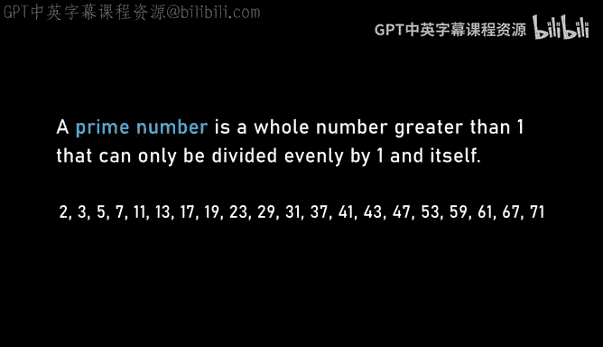

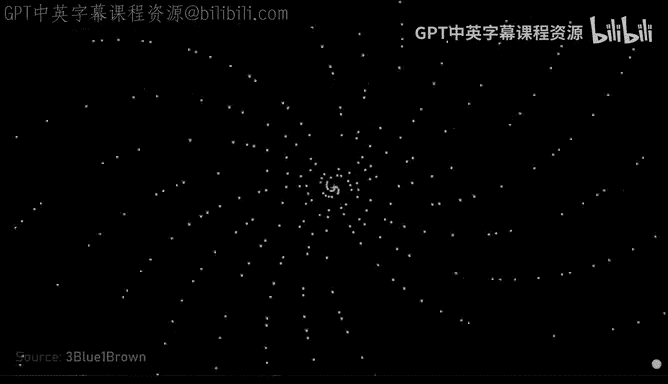

If you want to generate the national numbers， you can do one of two things just start with one and add one to itself over and over again。

 and that generates you the national numbers so additively they're very easy to generate one， two。

 through5。😊，Or you can take the prime number if you want to generate multiplative you can take all the prime numbers two。

3，57 and multiply them more together and together gives you all the natural enormousoma except maybe for one。

 so there are these two separate ways of thinking about the national norm something added to point of view and a multipl point of view。

😊，And separately they're not so bad， so any question about that only was addition is relatively easy to solve and any question that only involves multiplication is relatively easy to solve but what has been frustrating is that you combine the two together and suddenly you get this extremely rich。

 I mean we know that there are statements in number3 that are actually as undecidable。

 there are certain polynomials in some number of variables is there a solution in the national numbers and the answer depends on an undecidable statement like like whether the axioms of mathematics are consistent or not。

😊，But。Yeah， but even the simplest problems that combine something more multiliative such as the primes with something additive such as chiping by two separately we un both them well。

 but if you ask when you shift the prime by two， do you can you get up how often can you get another prime it's been amazingly hard to relate the two and we should say that the twin prime conjecture is just there。

😊，It poits that there are infinitely many pairs of prime numbers that differ by two。

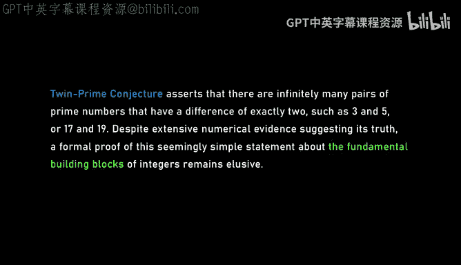

The interesting thing is that you have been very successful at pushing forward the field in answering these complicated questions of this variety。

 like you mentioned the green tile theorem， it proves that prime numbers contain arithmatictic progressions of any length right shes mind blowning that you can prove something like that right Yeah so what you've realized because of this type of research is that this different patterns have different levels of。

Interstructibility so so what makes the twin prime problem hard is that if you take all the primes in the book you know3。

5，7，11 so forth there are some twins in there， 11 and 13 is a twin prime pair have twin primes and so forth but you could easily if you wanted to redact to the primes to get rid to get rid of the these twins like the twins they show up and they infinitely many of them but actually recently sparse not there's not I initially there's quite a few but once you go out to the millions trillions they become rarer and rarer and you could actually just if someone was given access to the database of primes you just edit out a few primes you in there they could make the twin prime architecture false by just removing like 0。

01% of the primes or something just well chosen to。😊，To， to do this。And so you could present a。

Censor database of the prime which passes all of the statistical tests of the primes。

 you know it'll basically things like the prime number theorem and other text about the primes。😊。

But doesn't contain any trim problems anymore， and this is a real obstacle flu prime conjecture it means that any。

😊，Proof strategy to actually find twin primes in the actualpris must fail when applied to these slightlyeded primes and so it must be some very subtle delicate feature of the primes that you can't just get from like like agreg statistical analysis so that's all yeah on the other hand amic progressions has turned out to be much more robust like you can take the primes and you can eliminate 99% of the primes actually know and you can take any 90 than you want and it turns out and another thing we prove is you still get asthma progressions A progressions are much know theyre like cockroaches of arbitrary length yes that's crazy and so for people don no athmetic progressions is a sequence of numbers that differ by some fixed amount it's again it's an infinite monkey type phenomenon for any fixed length of your set you don't get arbitrary progressions you only to get quite short progressions but you're saying twin primes not an infinite monkey。

A phenomena I mean， it's a very subtle monk， it's still an infinite monkey phenomenon if the primes were really genuinely random。

 if the primes were generated by monkeys， then yes， in fact。

 the infinite monkey theorem would all but you're saying that twin prime。😊。

Is it doesn't you can't use the same tools like it doesn't appear random almost well we don't know yeah we believe the prime has behave like a random set and so the reason why we care about the premium conjecture it's a test case for whether we can genuinely confident say with zero% chance or error that the prime has behave like a random set okay random yeah random versions of the primes we know contain twins at least with 100% probability we're probably  tending to 100% as you go out for them further。

Yeah， so the prim we believe that they're random， the reason why ethnic progressions are indestructible is that regardless of whether it looks random or looks structured like periodic。

 in both cases， asthma progressions appear。😊，But for different reasons and this is basically all the ways in which the there are many proofs of these sort of pathic progression epiems and they're all proven by some sort of dichotomy where your set is either structured or random and in both cases you can say something and then you put the two together but in twin times if the parents are random。

 then you're happy you win but if your parents are structured they could be structured in a specific way that eliminates the twins and we can't rule out that one conspiracy and yet you're able to make as vanish term progress and the K toable version right yeah so the fun funny thing about conspiracies is that any one conspiracy theory is really hard to disprove that if you believe the word is won by lizards is say here's some evidence that it not by liz but that episode was taught about the lizards you might have encountered this kind of phenomenon there's almost no way to definitely rule out and the same is true in mathematics that。

A consumer has solelyre devoted to learning twin primes， you。

 you have to also infiltrate other areas of mathematics through sort of。

 but it could be made consistent at least as far as we don。😊。

But there's a weird phenomenon that you can make one one conspiracy rule at other conspiracies so you know if the world is won by this is。

 they can't also be won by aliens so one unreasonable thing is hard to dispute but but more than one there are tools so yeah so for example we know this inf primes that no two of which so the Pe prime which differ by most 246 actually is the code there's like a yes so there twin primes thing called cousin primes that differ by by four this thing called sexy primes that differ by six there's sexy primes that differ by six the name is it course is much of less exciting than the name suggests。

So you can make a conspiracy rule out one of these， but like once you have like5 of them。

 it turns out that you can't rule out all of them at once it just it requires too much energy somehow in this conspiracy space。

 how do you do the bound part how do how do you develop a bound for the different between the prize it okay so that there's an infinite number of so it's ultimately based on what's called the pigeonhole principle so the pigeonhole principle it's statement that if you have a number of pigeons and they will have to go into pigeonhole and you have more pigeons than the pigeonhole then one of the pigeonhole has to have at least two pigeons in so there has to be two pigeons that that close together。

😊，So for instance， if you have 100 numbers and they all range from  one to 1000。

 two of them have to be at most 10 apart because you can divide up the numbers from 1 to 100 into 100 pigeon holes let's say they if they have 101 numbers。

 11 numbers then two of them have to be distance less than 10 apart because two of them have to blown to the same pigeonhole。

 so it's a basic basic feature of a basic principle in mathematics so it doesn't quite work with the prim already because the prim gets sparsa and sparsa as you go out that fewer and fewer numbers a prior。

😊，But it turns out that there's a way to assign weights to numbers like so there are numbers that are kind of almost prime butre they don't have no factors at all other than themselves in one but they have very few factors and it turns out that we understand almost primes a lot better than less than primes and so for example。

 it was known for a long time that they were trained almost primes this has been worked out so almost primes are things we can of understand so you can actually restrict attention to a suitable set of almost primes。

😊，And whereas the primes are very sparse？Overall， relative to the almost primes are actually much less spa。

 you can set up almost prime where the primes of density like say 1%。😊，Um。

 and that gives you a shot at proving by applying some of a original principle that that there's pes of problems that are just only 10000 apart。

😊，But in order to with the treatment conjecture， you need to get the density of privacy at the all is up up to a threshold or 50%。

😊，Once you come up to 50% you would get trend drives， but unfortunately there are barriers。

 we know that no matter what kind of goods that are almost products you pick。

 the density price can never get up above 50% is's called the parodity barrier。😊。

And I would love to find， yeah， so one of my long term dreams is to find a way to breach that barrier。

Because it would open up not only to trim up conjecture with the go back conjecture and many other problems in number theory are commonly blocked。

😊，Because our current techniques would require going beyond this theoretical parodity barrier。

 it's like it's like pulling positive speed of light Yeah， so we should say a twin prime conjecture。

 one of the biggest problems in the history of mathematics goba conjecture also。

They feel like next door neighbors， is there been days when you felt you saw the path Oh yeahm。Yeah。

 sometimes you try something and it works super well， you again。

 again the sense of method smell we talked about earlier。

 you learn from experience when things are going too well because there are certain difficulties that you sort of have to encounter。

 I think the way a colleague might put it is that you know like if you on the streets of New York and you put in a blindfold and you put in a car and after some hours the bi is off and you're in Beijing。

😊，You know， I mean that was too easy somehow there was no ocean being crossed。

 even if you don't know exactly how what was done， you're suspecting that there' something wasn't right but is that still in the back of your head to do you return to the prime do you return to the prime numbers every once in a while to see yeah when I have nothing better to do which is less than less than1 times which is busy so many things these days but yeah when I have free time and I'm not and I'm too frustrated to work on my sort of real research projects and I also don't want to do my administrative stuff I don't want to do some errand for my family I can play with these these things for fun and usually you get nowhere you have to learn just say okay fine once again nothing happened I will move on very occasionally one of these problems actually solved well sometimes as you say you think you solved it and then you forward for maybe 15 minutes and then you think I should check this because this is too easy to could be true and usually is。

What's your gut say about when these problems would be solved prime and Go Prime I think we will keep getting more partial results it does need at least one this parodity barrier is the biggest remaining obstacle There are simpler versions of the conjecture where we are getting really close so I think we will in10 years we will have it。

Many more much closer results may not have the whole thing。Yeah。

 so trend primes is somewhat close Ri hypothesis I have no I mean it has happened by accident。

 I think so the re hypothesis is kind of more general conjecture about the distribution of prime number right yeah it safe that sort of viewed more app clickicatively like for questions only involving multi no addition the primes really do behave as randomly as you could hope so there's a phenomenon in probably called square root cancellation that if you want to poll say America on some issue and you ask one or two voters and you may have sampled a bad sample and you get a really imprecise measurement of the full average but if you sample more and more people。

 the accuracy gets better and better and actually improves like the square root of the number of people you you sample so if you sample 1000 people you can get like a two3% margin of error。

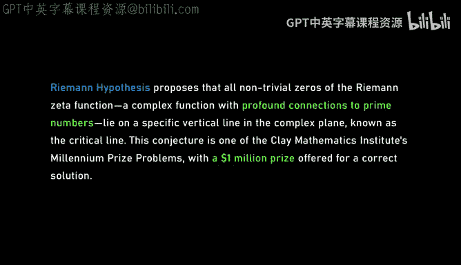

So in the same sense， if you measure the primes in a certain opative sense。

 there's a certain type of statisticsistic you can measure and it's called the Ris data function and it fluctuates up and down。

 but in some sense as you keep averaging more and more， if you sample more more。

 the fluctuation should go down as if they were random and there's a very precise way to quantify that and the Ri hypothesis is a very elegant。

😊，Way that capturees this。But。As with many other ways in mathematics。

 we have very few tools to show that something really genuine behaves like really random。

 and this not just a little bit random， but is asking that it behaves as random as it actually random set。

 it's the square root cancellation。😊，And we know here because of things related to the parodity problem actually that most of us usual techniques cannot hope to settle this question。

😊，The proof has to come on of left field。Yeah， but what that is。

Yeah no one has any serious proposal yeah and's there's various ways to sort as I said you can modify the primes a little bit and you can destroy the human hypothesis so like it has to be very delicate you can't apply something that has huge margins of error it has to just barely work and like there's like all these pits pitfalls that like dodge very adeptly to and prime numbers is just fascinating yeah yeah what to use。

😊，Most mysterious about the prime numbers。😔，SoThat's a good question so like conjectualurly we have a good model of them I mean like as I said。

 I mean they have certain patterns like the primes are usually odd for instance。

 but apart of obvious patterns they behave very randomly and just assuming that they behave so there's something called the cream or random model of the primes that after a certain point prims just behave like a random set and there various flight modifications this model but this has been a very good model it matches the numerics it tells us what to predict like I can tell you of complete certainty the trim my contextject is true the random model it overwhelming odds it is true I just can't prove it。

Most of our mathematics is。Optimized for solving things with patterns in them and the prime itself is anti pattern。

😊，As doom almost everything， really。But we can't prove that。Yeah。

 I guess it's not mysterious at the primary League called of random because there's also no reason for them to be to have any kind of secret pattern。

 but what is mysterious is what is the mechanism that really forces the randomness to happen and this is just absent。

😊，Another incredibly surprisingly difficult problem is the Colattz conjecture Oh yes。

 simple to state beautiful to visualize in this simplicity and yet extremely difficult to solve and yet you have been able to make progress Pauladar said about the cos conjecture that mathematics may not be ready for such problems others have stated that it is an extraordinarily difficult problem completely out of reach this is in 2010 out of reach of present day mathematics and yet have made some progress why is it so difficult to make Can you actually even explain what it is yeah so it's a that you can explain it helps with some visual aids but yeah so you take any natural number like say 3 and you apply the following procedure to it so if it's even you divide it by two and if it's odd you apply by3 and add one so even numbers get smaller or numbers get bigger So 13 would become 40 course30。

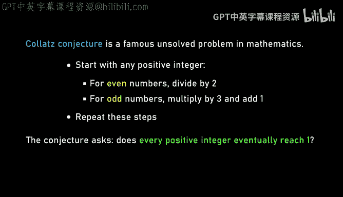

Times 3， 39， I1 to get 40。So it's a simple process for art numberss and even numbers that both very easy operations and then you put together it's still reasonably simple。

 but then you ask what happens when you itvate it， you take the output that you just got and feed it back in so 13 becomes 40。

 40 is now even5 by 2 is 20， 20 is still even5 by 102， 10，5 and then five times3 plus 116 and then 8。

421 and then from one it goes 1421421 is cycles forever。😊，So the sequence I just described 13， 40。

 20，10 so both， these are also called hairilstone sequences。😊。

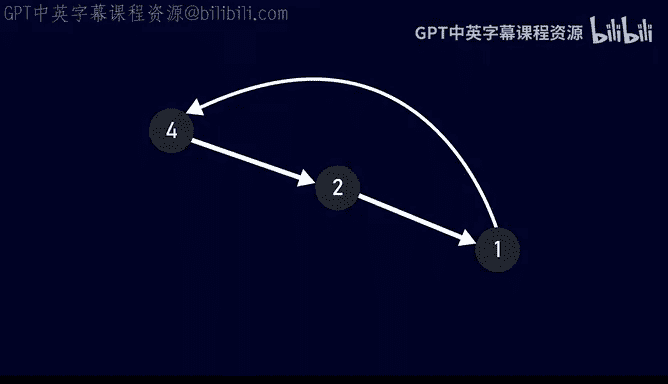

Because there's an oversimplified model of hailstone formation which is not actually quite correct but it's somehow taught to high school students as a first approximation is that like a little nugget of ice gets a ice crystal forms and clouded it goes up and down because of the wind and sometimes it's cold it requires a bit more mass and maybe it mo a little bit and this process is going up and down creates this partially meltted ice which eventually getses hailstone and eventually it falls out the earth so the conjecture is that no matter how high you start up like you take a number which is in the millions of billions this process that goes up if you're odd and down if you even it eventually goes up to earth all the time no matter where you start with very simple algorithm you end up but one and you might climb for a while right yeah so yeah if you plot it these sequences。

 they look like brown in motion they look like the stock market up and down in a seemingly random pattern and in fact usually that's what happens。

😊。

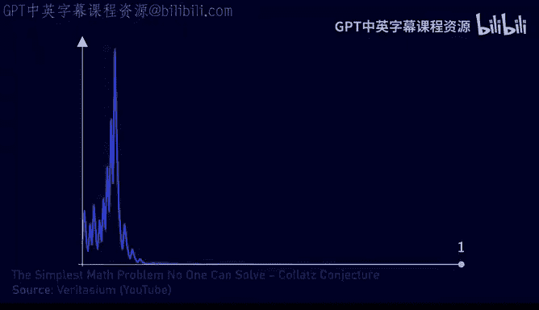

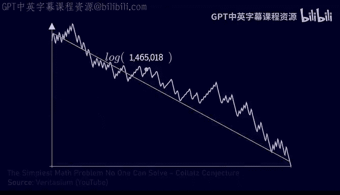

that if you plug in a random number you can actually prove at least initially that it would look like random walk and actually a random walk with a downward drift it's like if you're always gambling on a roette at the casino with art slightly weighted against you so sometimes you win sometimes you lose but over in the long run you lose a bit more than you win and so normally your wallet will go to zero if you just keep playing over and over again so statistically it makes sense so so the result that I proved roughly speaking assert that statistically like 99% of all inputs would drift down to maybe not all the way to one but to be much much smaller than what you started it's like if I told you that if you go to a casino most of the time up if you keep playing long enough you end up with a smaller amount in your wallet when you started that's kind of like the result that I proved so why is that result like can you continue down that thread？

😊，To prove the full conjecture well the problem is that I used argumentsist from probability theory and there's always this exceptional event so in probability we have this low large numbers which tells you things like if you play a casino with a game at a casino over losing expectation over time you are guaranteed almost surely with probability as close to 100% as you wish you're guaranteed to lose money but there's always this exceptional outlier like it is mathematically possible that even in the game is the odds are not in favor you could just keep winning slightly more often than you lose。

😊，Very much like how in Navi Stokes it could be， you know， most of the time your waves can disperse。

 there could be just one outlier choice of initial conditions that would lead you to blur。😊。

And there could be one out by a choice of special number that these stick in that shoot off infinity while all other numbers crash to earth crash to one In fact。

 there's some mathematicians who Alex Ktorvich for instance who've proposed that that actually these collapse its are like these similar ordermeter actually if you look at what they happen in binary they do actually look a little bit like like these game of life type patent scene and in an analogy to how the game of life can create these massive self-oplicating objects and so forth。

😊，Possibly you could create some sort of heavier than air flying machine。

 a number which is actually encoding this machine， which is just whose job it is is to encode is to create a version of which is larger。

😊，Heavier than air machine encoded in a number that flies forever yeah so conway in fact worked worked on this problem as well so Conway so similar in fact that was more wrong inspirations for the having Ne Stokes project Conway studied generalizations of the collapse problem where instead of。

😊，Moformware3 and adding one or De by2 you have a more complicated branch bullet but but instead of having two cases maybe you have 17 cases and you go up and down and he showed that once your it gets complicated enough。

 you can actually encode twoing machines and you can actually make these problems undecidable and do things like this In fact he invented programming language for these kind of factional linear transformations it sort fact track play on fullt and he showed that that you can program it was too incomplete you you you could make a program that if your number you insert in was encoded as a prime。

 it would it would go down otherwise it would go up and things like that so the general cluster of problems is really as complicated as all the mathematics some of the mystery is the cellularomic that we talked about。

having a mathematical framework to say anything about cellular T maybe the same kind of framework is required yeah yeah Gs injector yeah if you want to do it not statistically but you really want 1 100% or whats two to4 the Earth yeah so what might be feasible is statistical 99% you know wouldnt go to one but like everything yeah that book's hard what would you say。

Out of these within reach， famous problems is the hardest problem we have today is ari hypothesis。

We want to is up there。😊，P equals NP is a good one because that's a meta problem like if you solve that in the positive sense that you can find a P equals NP algorithm then potentially this solves a lot of other problems as well and we should mention some of the conjectures we've been talking about you a lot of stuff is built on top of them low rip effects P equals NP has more rip effects than basically any other right if the repo is disproven that would be a big mental shock to the number theorists but it would have follow on effects for cryptography because a lot of cryptography uses number theory uses number theory constructions involving primes and so forth and it relies very much on the intuition that number theories are built over many many years of what operations evolving prims behave randomly and what ones don't and in particular encryption。

😊，Methods are designed to turn。Text would information on it into text which is indistinguishable from random noise and hence we believe to be almost impossible to crack at least mathematically but if something as core to our beliefs human hypothesis is wrong。

 it means that there are actual patterns of the primes that we' not aware of and if there's one there's probably going be more。

😊，And suddenly， a lot of our crypto systemsts are in doubt。

But then how do you then say stuff about the primes？

Yeah like you go towards complexex conjecture again because if you want it to be random right you want it to be randomly so more broadly I'm just looking for more tools more ways to show that that yeah that things are random how do you prove a conspiracy doesn't happen right I there any chance to you that P equals NPp is there some can you imagine a possible universe it is possible I mean there's various scenarios I mean there's one way it is technical P possible but in fact is never actually implementable the evidence is sort of slightly pushing in favor of no that we probably P is not equal NP I mean it seems like it's one of those cases similar to rum hypothesis I think the evidence is。

LeLeaning pretty heavily on the no， certainly more on the no than on the yes。

 the funny thing like Pco example that we have also a lot more obstructions than we do for almost any other problem so while there's evidence we also have a lot of results ruling out many。

 many types of approaches to the problem this is the one thing that the computer scientists actually be very good at it's actually saying that certain approaches cannot work no go theorems it could be undeciable。

 we don't yeah we don't know。😊，There's a funny story I read that when you won the Field medal。

 somebody from the Internet wrote you。And asked the， you know。

 what are you going to do now that you've won this pretigious award and then you just quickly very humbly said that。

 you know， this shiny metal is not going to solve any of the problems I'm currently working on something。

I'm going keep I'm going to keep working on them it's just first of all its funny to me that you would answer an email in that context and second of all itum it just shows your humility but anyway maybe you could speak to the fields metal but it's another way for me to ask。

About Gregoria Perlman， what do you think about him famously declining the Field medal in the Millennial Prize？

Wwhich came with a $1 million of prize money he stated that I'm not interested in money or fame。

 the prize is completely irrelevant for me if the proof is correct and no other recognition is needed Yeah no he's somewhat of an outlier even among mathians who tend to to have somewhat idealistic views I've never met him I think I'd be interested in me him one day but I never had a chance I know people who met him he's always had strong views about certain things you know I mean。

It's not like he was completely isolated from the math community。

 I mean he would give talks and write papers and so forth。

 but at some he just decided not to engage with the wrestling the community he was disillusioned or something I don't know。

😊，And he decided to piece out and collect mushrooms in St Peter's or something and that's fine you know and you can do that I mean that's another sort of flip side I mean we are not a lot of problems that we solve you know some of them do have practical application that's great。

😊，But like if you stop thinking about a problem， you know。

 so he he hasn't published since in this field， but that's fine there's many。

 many other people who've done so as well。Yeah， so I guess one thing I didn't realize initially with the Fields M is that it sort of makes you part of the establishment。

You know， most mathematicians， you know， they' youre just career mathematicians， you know。

 you just focus on publishing next paper， maybe getting one tester promoter one one rank， you know。

 and starting a few projects may have taking some students or something。😊。

Yeah but then suddenly people want your opinion on things and you have to think a little bit you know things that you might just foolishly say because you know no one's going to listen to you so it's more important now is it constraining to you able to still have fun and be a rebel and try crazy stuff and well I play with ideas I have a lot less free time than previously I mean mostly by choice I mean always I have the option to sort of decline so I a lot of things I could decline even more or I could acquire a reputation of being so unreliable that people don't even ask anymore is I love the different algorithm here is it's always an option but you know there are things that I mean I mean I don't spend as much time as I do as a postdoc you know just just working in one problem at a time or fooling around I still do that a little bit but as you advance in your career some。

The most soft skills so math somehow frontloads all the technical skills to the early stages of a career so yeah so as a postdoc is published or parish you're incentivized to basically focus on proving very technical film to so prove yourself as well as proof the fields but then as you get more senior you have to start mentoring and and giving interviews and trying to shape direction of the field both research wise and sometimes you have to various administrative things and it's kind of the right social contract because you need to work in the trenches to see what can help mathematicians the other side of the establishment sort of the really positive thing is that you get to be a light that's an inspiration to a lot of young mathematicians and young people that are just interested in mathematics it's like it's just how the human mind works this is where I would probably say that I like the fields metal。

That it does inspire a lot of young people somehow。 I don't this is just called human brains work。

 Yeah， at the same time， I also want to give sort of respect to somebody like Gregia Perlman who。

Is critical of awards in his mind， those are his principles and any human is able for their principles to like do the thing that most humans would not be able to do。

It's beautiful to see some recognition is necessarily important， but yeah it's。😊。

It's also important to not that these things take over your life and like only be concerned about getting the next big award or whatever。

 I mean yeah， so again， you see these people try to only solve like a really big math problems and not work on things that are less sexy。

 if you wish but actually so interesting and instructive。😊。

As you say like the way the human right works， we understand things better when they're attached to humans and also if they're attached to a small number of humans like the way our humans minus is wire we can comprehend the relationships between 10 or 20 people but once you get beyond like 100 people there's a limit I think there's a name for it beyond which it just becomes the other and so we you have to simplify the polemas 99。

9% of humanity becomes the other and often these models are incorrect and this causes all kinds of problems but so yeah so to humanize a subject if you identify a small number of people I say these are representative people of a subject role models for example。

😊，That has some role， but it can also be too much of it can be harmful because it。

I'll be the first to say that my own career path is not that of a typical mathematician。

 the very accelerated education， I skipped a lot of classes。

 I think I was had very fortunate mentoring opportunities and I think I was at the right place at the right time。

😊，Just because someone doesn't have my trajectory， it doesn't mean that they can't be good mathematicians。

 I mean they might be matheian in a very different style， and we need people with a different style。

Um， and， you know， even if and sometimes too much focus is given on the person who does the last step to complete。

A project in mathematics or elsewhere that's really taken centuries or decades with lots and lots of building lot of previous work。

 but that's a story that's difficult to tell if you're not an expert because it's easier to just say one person did this one thing。

 you know it makes it a much simpler history。😊，I think on the whole。

 it is a hugely positive thing to talk about Steve Jobs as a representative of Apple when I personally know and of course everybody knows the incredible design。

 the incredible engineering teams， just the individual humans and those teams theyre not。A team。

 they're individual humans on a team， and there's a lot of brilliance there。

 but it's just a nice shorthand like a very like pie Yeah Steve Jobs Yeah。

 yeah pie as a starting point as a first approximation and then read some biographies and then look into much deeper first approximation Yeah that's right so you mentioned you were a person to Andrew Wies at that time Oh a professor there it's a funny moment how history is just all interconnected and at that time he announced that he proved fromaz last year what did you think maybe looking back now with more context about that moment。

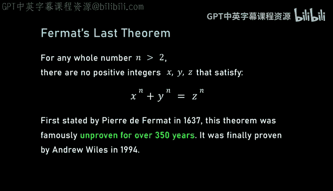

In math history yeah so I was a graduate student at the time I mean I vaguely remember you know there was press attention and we all had the same we heard pigeonhole in the same mail room you know so we out and like suddenly Andrew wes's mailbox explosion to be overflowing's a good that's a good metric Yeah know so yeah we all talked about it at at T and so forth I mean we didn't understand most of us understand the proof we understand sort of high levell details like there's an ongoing project to formalize it in lean Kevin Buit can we take that small tangent is it how difficult does that because as I understand from as the proof from as last theorem has like super complicated objects really difficult to formalize I guess you' the objects that they use you can define them so they've been defined in lean so so just defining what they are can be done that's really not trivial but it' done but there's a lot of。

Basic facts about these objects that have taken decades to prove that in all these different math papers and so lots of these have to reform formalized as well Kevin Bauzzard's goal actually he has a five-year graph to formalize from last theory and his aim is that he doesn't think he will be able to get all the way down to the basic axioms but he wants to formalize it to the point where the only things that he needs to rely on his black boxes are things that were known by 1980 to number theories at the time and then some other person with some other work what have he done to get from there so it's a different area of mathematics than the type of mathematics I'm used to in analysis which is kind of my area the objects we study are kind of much closer to the ground I studied things like prime numbers and。

😊，and functions and things that are within scope of a high school math education to at least define yeah。

 but then this is very advanced algebraic side of number theory where people have been building structures more structures for quite a while and it's a very sturdy structure it's been very at the base。

 and at least it's extremely well developed in with textbooks and so forth。😊。

But it does get to the point where if you haven't taken these years of study and you want to ask about what is going on at level six of this tower。

 you have to spend quite a bit of time before they can even get to the point where you see someone you recognise。

😊，What inspires you about his journey that we simulateimd as we talked about seven years。

Mostly working in secret。 Yeah， as that is a a romantic。 Yeah。

 So it kind of fits with the sort of the。The romantic image I think people have of mathematicians to the extent they think of thing of it at all as these kind of eccentric wizards or something。

 so that certainly kind of accentuated that perspective。😊，You know， I mean， it's。

 it is a great achievement， a his style of soing formss is so different from my。But which is great。

 I mean we need people be good like what in terms of like you like the collaborative。

 I like moving on from a problem if it's giving too much a。

But you need the people who have the tenacity and the fearlessness。

 I've collaborated with people like that where I want to give up because the first approach that which I didn't work and the second one didn't approach that they're convinced and they have third。

 fourth and the fifth of word works and I'd have to read my words， okay。

 I didn't think this was going to work， but yes you right all along。😊。

And we should say for people who don't know， not only are you known for the brilliance of your work。

 but the incredible productivity， just the number of papers， which are all of very high quality。

 So there's something to be said about being able to jump from topic to topic。Yeah， it works for me。

 yeah， I mean， but there are also people who are very productive and they focus very deeply on yeah。

😊，I think everyone has to find their own workflow like one thing which is a shame in mathematics is that we have mathematics there's sort of a one-s personal approach to teaching mathematics and so we have a certain curriculum and so forth。

 I mean you know maybe like if you do with math competitions or something you get a slightly different experience but I think many people they don't find their native math language until very late usually too so they stop doing mathematics and they have a bad experience with a teacher who's trying to teach them one way to do mathematics that they don't like it my theory is that humans don't come evolution has not given us a math center of a brain directly we have a vision center and a language center and some other centers which have evolution is honed but we don't have innate sense of mathematics。

😊，But our other centers are sophisticated enough that different people we can repurpose other areas of our brain to do mathematics。

 so some people have figured out how to use the visual center to do mathematics and so they think very visually when they do mathematics。

 some people have repurpose the language center and they think very symbolically some people like if they are very competitive and they're like gaming there's a type this part of your brain that's very good at solving puzzles and games and that can be repurposed。

 but when I talk to other mathematicians you they don't quite think I can tell that they're using some different styles of thinking than I mean not disjoint but they may prefer visual I don't like prefer visual so much I need also of visual aids myself。

Um， you know， mathmatic explifies a common language。

 but we can still talk to each other even if we are thinking in different ways。

 but you can tell there's a difference。😊，Set of subsystems being used in the thinking process like they take it in path。

 they're very quick at things that I struggle with and vice versa and yet they still get to the same goal that's beautiful and yeah but I mean the way we educate unless you have like a personalized tutor or something I mean education sort of just by scale has to be mass produced。

 you know， you have to teach the 30 kids。you know， they have 30 different styles。

 you can't you can't teach 30 different ways on that topic， what advice would you give to students。

 young students who are struggling with math？But are interested in it no would like to get better is there something in this yeah in this complicated educational context would you yeah it's a tricky problem one nice thing is that there are now lots of sources for math enrichment outside the classroom so in my day there early there were math competitions and you know they're also like popular math books in the library but now you have you know YouTube there are forums just devoted to solving math puzzles and and math shows up in other places you know like for example。

 there are hobbyists to play poker for fun you know for very specific reasons interested in very specific probability questions and and they actually know in this community of amateur。

Toulists in Poka。In chess in baseball， I mean there's's this yeah there's math all over place and I'm hoping actually with these new sort of tools for lean and so forth that actually we can incorporate the broader public into math research projects like this is almost it doesn't happen at all currently so in the sciences there's some scope for citizen science like astronomers the amateurs who discover comets and there biologists there people who could identify butterflies and so forth。

😊，And there are a small number of activities where amateur mathematicians can discover new primes and so forth。

😊，But previously because we have to verify every single contribution like most math research projects。

 it would not help to have input from the general public in fact it would just be time consuming because just errorche and everything but one thing about these formalization projects is that they are bringing together more bringing in more people so I'm sure the high school students who've already contributed to some of these formalizing projects to contributed to mathlib you know we don't need to be a PhD holder to just work on one atomic thing there's something about the formalization here that also as a very first step opens it up to the programming community too the people who are already comfortable the program it seems like programming is somehow maybe just the feeling but it feels more accessible to folks than math。

M is seen as this like extreme， especially modern mathematics， seen as this extremely difficult。

To enter area and programming is not so that could be just an entry point you can execute code and you can get results you know you can print out the world pretty quickly like if if programming was taught as almost entirely theoretical subject where you just talk there could be just science the theory of functions and routines and so forth and outside of some very specialized homework assignments you would not actually program like on the weekend for fun or yeah it would be as considered as hard as math。

😊，Yeah， so as I said， there are communities of non mathematicians where they're deploying math for some very specific purpose。

 you， like optimizing their poker game。😊，And for them。

 then I comes fun for them what advice would you give general to young people how to pick a career。

 how to find themselves like that that's a tough， tough， tough question yeah so。

There's a lot of certainty now in the world you know。

 I mean there was this period after the war where at least in the West。

 you know if you came from a good demographic you you know like there was a very stable path to a good creative you go to college you get an education you pick one profession and you stick to it it's becoming much more thing of the past so I think you just have to be adaptable and flexible I think people have to get skills out of transferable you know like like learning one specific programming of language or one specific subject of mathematics or something that itself is not a super transferable skill but sort of knowing how to。

Reason with abstract concepts or how to problem solving things go along as so anyway。

 these are things which I think we will still need。

 even as our tools get better and you know you'll be working with AI support and so forth but actually you're an interesting case study I mean you're like。

😊，One of the great living mathematicians。Right， and then you had a way of doing things and then all of a sudden you start learning。

I mean first of all， you kept learning new fields but you learn lean that' that's a nontrivial thing to learn like that' yeah thats for a lot of people that's an extremely uncomfortable leap to take right yeah。

 some mathematicians first of all I've always been interested in new ways due to mathematics I feel like a lot of the ways we do things right now inefficient maybe my colleagues who spend a lot of time doing very routine computations or doing things that other mathematicians would instantly know how to do and we don't know how to do and why can't we search and get quick response and so so that's why I've always been interested in exploring new workflows。

About four or five years ago， I was on a committee where we had to ask for ideas for interesting workshops to provide at a Math Institute。

😊，And at the time Peter Schultzer had just formalized one of his new theorems and though some other developments in computer assisted proof。

😊，quiteite interesting and I said oh we should run a workshop on this's for a good idea and then I was a bit too enthusiastic about this idea and so I gotvol told to actually run it so I did with a bunch of other people Kevin Baer and Jordan Elenberg and a bunch of other people and it wasn a nice success we brought together a bunch of mathematicians and computer scientists and other people and we got up spin on state the out。

😊，And it was really interesting development that most mathematicians didn't know wass going on that lots of nice proof of concept。

 it' just so hints of what was going to happen， this was just before chatTT。

 but there even then there was one talk about language models and the potential capability of those in the future。

😊，So that got me excited about the subject， so I started giving talks about this is something we more of us to start looking at。

😊，Now arranged run this conference and then chat GT came out and suddenly AI was everywhere and so I got interviewed a lot about this topic and in particular the interaction between AI and formal proof assistance and I said yeah they should be combined this is this is a perfect synergy to happen here and at some point I realized that I have to actually not just talk the talk but walk the walk like I don't work in machine learning and I don't work in proof formalization and there's a limit to how much I can just rely on authority and saying。

 you know I'm a war of mathematician just trust me when I say that this is going to change mathes and I'm not doing it any when I don't do anywhere myself。

😊，I felt like I had to actually justify it a lot of what I get into actually I don't quite see an advise as how much time I'm going to spend on it and it's only oftentime I'm sort of voice deep in a project that I realized by that point I'm committed well that's deeply admirable that you're willing to go into the fray be in some small way beginner right or have some of the。

Sort of challenges that a beginner would right and new concepts。

 new ways of thinking also you know sucking at a thing that others。

 I I think in that talk you could be a field medalwinning mathematician and undergrad knows something better yeah I think mathematics inherently I mean mathematics is so huge these say that nobody knows all of modern mathematics and inevitably we make mistakes and you know you can't cover up your mistakes with just sort of bravado I mean because people who ask for your proofs and if you don't have the proofs you knowt the proof don't love math Yeah so it does keep us honest I mean I mean you can still it's not a perfect panacea but I think we do have more of a culture of admitting era because we're forced to all the time big ridiculous question I'm sorry for it once again who is the greatest mathematician of all time。

Maybe one who's no longer with us who are the candidates， Ziler， Gaus， Newton， Ramann。

 Hilbert so first of all as mentioned before， like there there's some time dependence but on the day if you talk cumully over time for example euclid like like like is one of the contenders and then maybe some unnamed anonymous matheians before that you know it came up with the concept of numbers you know you know do mathematicians today still feel the impact of Hilbert just oh yeah directly of what everything has happened in the 20th century。

 Hbert spaces we have lots of things that are named after of course just the arrangement of mathematics and just the introduction of certain concepts I mean 23 problems have been extremely influential。

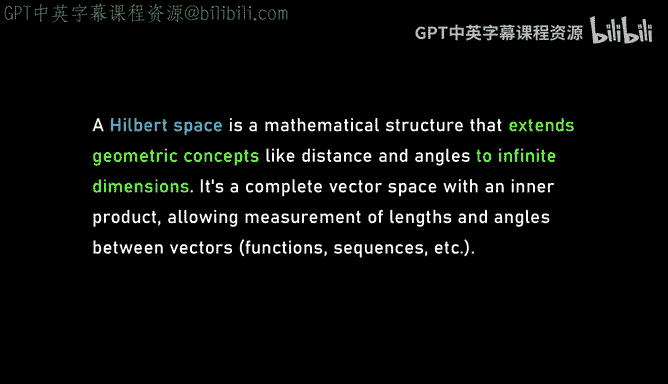

There's some strange power to the declaring which problems yeah hard to solve the statement of the open problems Yeah I mean this is bystander effect everywhere like if no one says you should do X and I will mills around waiting for somebody else to do something and like nothing gets done so and it's one thing that actually you have to teach undergraduates in mathematics is that you should always try something so you see a lot of paralysis in an undergraduate a math problem if they recognize that there's a certain technique that can be applied。

 they will try it but there are problems for which they see none of their standard techniques obviously applies and the common reaction is then just paralysis I don't know what to I think is's a quote from the Simpson I've tried nothing and I'm all lot of ideas。

U。😊，So， you know， like the next step then is to try anything like no matter how stupid and in fact。

 almost the stupid or the better。Which you know I think which is almost guaranteed to fail but the way it fails is's gonna be instructive like it fails because you're not at all taking into account this hypothesis oh。

 this hypothesis must be useful that's a clue I think you also suggest somewhere this fascinating approach which really stuck with me as they're using it it really works I think you said it's called structured procrastination No yes it when you really don't want to do a thing then imagine a thing you don't want to do more yes that's worse than that and then in that way you procrastinate by not doing the thing that's worse Yeah it's a nice it's a nice hack it actually works Yeah yeah。

 I mean with anything like you know I mean like。Psychology is really important。

 you talk to athletes like marathon runners and so forth and they talk about what's the most important is it theyre training regimen or the diet and so forth so much of it like a psychology you just tricking yourself to think that the problem is feasible so that you're motivated to do it。

 is there something our human mind will never be able to comprehend。

Well I sort of guess as a matheian， I mean， you know reduction and it's a there must be some it's a very large number that you can just add that was the first thing I came to mind so that but even broadly is there。

😊，Are weIs there something about our mind that we're going to be limited？

Even with the help of mathematics， well， okay， I mean。

 it's like how much augmentation are you willing， like like look at if I didn't even a pen and paper。

Um， if I had no technology whatsoever， Okay， so I'm not allowed Blackboard to pin a paper already。😊。

Much more limited than you would be incredibly limited even language the English language is the technologys it's one that's been very internalized so you're right they're really the formulation of the problem is incorrect because there really is no longer a just a solo human already augmented and extremely complicated intricate ways right so we' already like a collective intelligence Yes yeah yes so humanity plural has much more intelligence in principlely on is good days then the individual humans put together it can all have less okay but yeah so yeah the mathematical community plural is incredibly super intelligent entity。

😊，That no single human matheian can can come closer to to replicating you see it a little bit on these like question analysis sites so this method willflow which is the math version of stack of willflow and like sometimes you get like this very quick responses to very difficult questions from the community and it's a pleasure to watch actually as an expert I'm a fan spectator of that of that site just seeing the brilliance of the different people they。

😊，The depth and knowledge that people have and the willingness to engage in the rigor and the nuance over the particular question it's pretty cool to watch it's almost just fun to watch。

What gives you hope about this whole thing we have going on human civilization？

I think yeah the younger generation is always really creative and enthusiastic and inventive。

 it's a pleasure working with young students。😊，You know。

 the progress of science tells us that the problems that used to be really difficult can become extremely you know can become like trivial to solve。

 you know， I mean like it was like navigation， you know。

 just just knowing where you were on the planet was this horrendous problem people people died you know。

 or lost fortunes because they couldn't navigate， you know。

 and we have devices in our pockets that do this automatically for us like it a completely solved problem。

You know so things that have seem unfeasable for us now could be maybe just homework exercises with。

 one of the things I find really sad about the finiteness of life is I won't get to see all the cool things would create as a civilization you know because in the next 10 years 200 years just imagine showing up in 200 years well already plentys happen。

 you know like if you could go back in time and talk to you if you're teenage self or something you know I mean just the internet and how AI I mean the opinion getting you be internalize and say yeah of course and AI can understand how voice and give reason slightly incorrect answers to any question but this was mind-blowing even two years ago and in the moment it's hilarious to watch on the internet and so on the drama people take everything for granted very quickly and then we humans seem to entertain ourselves with drama out of anything that's created somebody needs to take one opinion。

Another person needs to take an opposite opinion， argue with each other about it。

 but when you look at the arc of things， I mean's just even in progress of robotics。

 just to take a step back and be like， wow， this is beautiful the way humans are able to create this Yeah when the infrastructure and the culture is is healthy。

 the community of humans can be so much，More intelligent and mature and rational than the individuals within it Well。

 one place I can always count on rationality is the comment section of your blog， which I'm a fan of。

 there's a lot of really smart people there and thank you of course for for putting those ideas out on the blog and it's I can't tell you how。

Honored I am that you would spend your time with me today。

 I was looking forward this for a long time， Tary I'm a huge fan， you inspire me。

 you inspire millions of people thank you so much for time thank you， it was a pleasure。

Thanks for listening to this conversation with Ternce Tao to support this podcast。

 please check out our sponsors in the description or at Lexfredmen。com sponsors。And now。

 let me leave you some words from Galileo Galilei。Mathematics is a language with which God has written the universe。

Thank you for listening， and hope to see you。Next time。

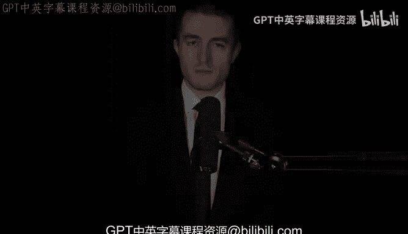

