# Lex Fridman Podcast #474《DHH：编程的未来、人工智能、Ruby on Rails、生产力与育儿》中英字幕 - P1 - GPT中英字幕课程资源 - BV1jHkSB6EPi

No one anywhere who's serious believes that cookie banners does anything good for anyone。

 yet we've been unable to get rid of it。 This is the thing that really gets me about cookie banners。

 too。 It's not just the E。 It's the entire world。 You can't hide from cookie banners anywhere on this planet。

 If you go to God themam Mars on one of Elon's rockets and you try to access a web page。

 you still see a cookie banner。 No one in the universe is safe from this nonsense。

 It sometimes feels like we're barely better off。 Like web pages aren't that different from what they were in the late 90s。

 early 2000s。 They're still just forms。 They still just right to databases。

 A lot of people I think are very uncomfortable with the fact that they are essentially crud monkeys。

 They just make systems that create， read， update or delete row in a database。

 and they have to compensate for that。Existential dread by overcomplicating things。

 That's a huge part of the satisfaction of driving a race car， is driving in at the edge of adhesion。

 as we call it， where you're essentially just a tiny movement away from spinning out。

 doesnn't take much， then the car starts rotating。 Once it starts rotating。

 you lose grip and you're going for the wall。That。😡。

Balance of danger and skill is what's so intoxicating。

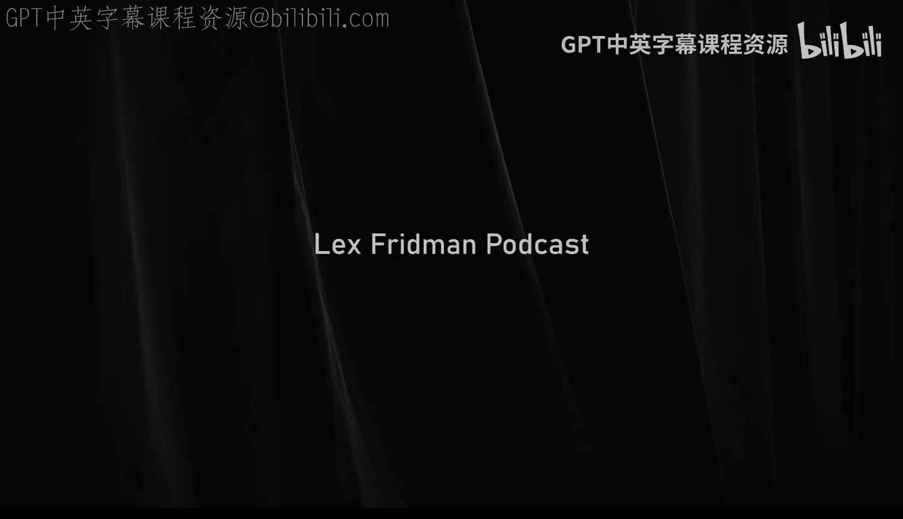

The following is a conversation with David Heinenemeer Hanen， also known as DHH。

 he is a legend in the programming and tech world， brilliant and insightful。

 sometimes controversial and always fun to talk to， He's the creator of Rubyion Rails。

 which is an influential web development framework behind many websites used by millions of people。

 including Shopify， GitHub and Airbnb。He is the co owner and CTO of 37 signals that created basecamp。

 hay， and once。He is a New York Times bestsling author together with his co author。

 Jason Fried of four books， rework， remote， getting real， and it doesn't have to be crazy at work。

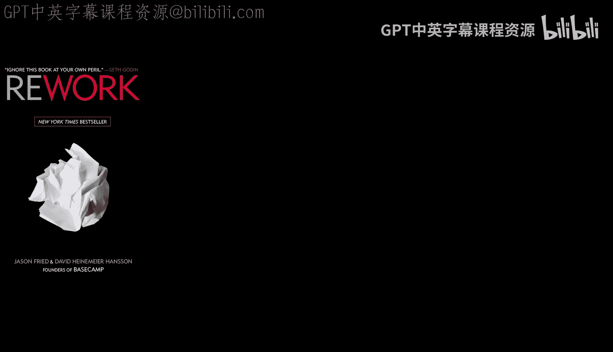

And on top of that， he's also a race car driver， including being a class winner at the legendary 24 hour Lemon race。

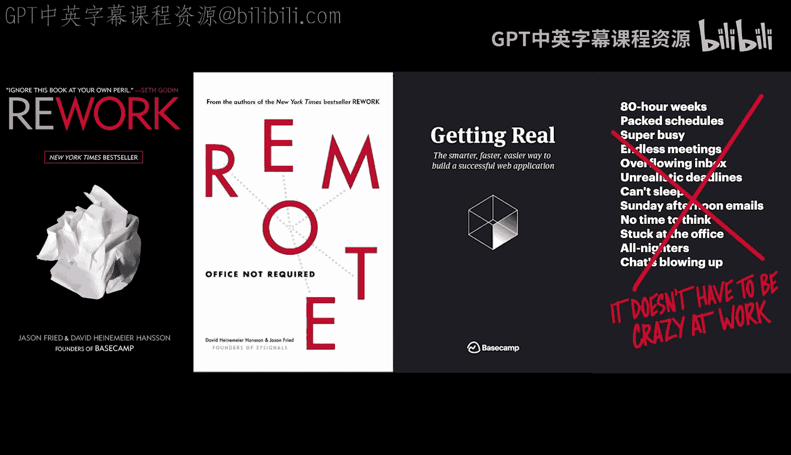

This is Alex Ruen podcast to support it， please check out our sponsors in the description and consider subscribing to this channel。

And now， dear friends。Here's DH H。

For someone who became a legendary programmer， you officially got into programming late in life。

 and I guess that's because you tried to learn how to program a few times and you failed。

 So can you tell me the the full story the saga of your failures to learn programming Was Commodore 64 involved。

Commodore 64 was the inspiration I really wanted a Commodore 64。

 That was the first computer I ever sat down in front and the way I sat down in front of it was I was five years old and there was this one kid on my street who had a Commodore 64 No one else at a computer So we were all the kids just getting over there and we were all playing year kungfu I don't know if you've ever seen that game It was one of the original fighting games It's really a great game and I was playing that for the first time at five years old and we were like seven kids sitting up in this one kid's bedroom all taking our turn to play the game and I just found that unbelievably interesting and I begged and I begged and I begged my dad could I get a computer and he finally comes home like I got your computer I was like yes。

 my own Comodore 64 and he pulls out this black green and blue keyboard That's an armsstr464 I was like。

Dad， what's this？The disappointment this is not a commmodore 64， but it was a computer。

 so I got my first computer at essentially six years old that Amstrud 464 and of course the first thing I wanted to do I wanted to play video games。

And I think the computer which he by the way， had traded for a TV and a sto recorder or something like that came with like two games。

 one was this frogger game where you had to escape from underground。

 it was actually kind of dark like this frog you're trying to get it out from underground and it was just。

 I was pretty bad at it。

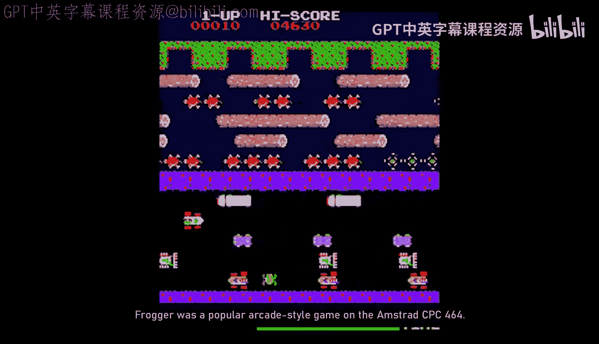

And I only had those two games and then。I wanted more games and one way to get more games when you're a kid who don't have a lot of money。

 I can't just buy a bunch of games is to type them in yourself back in 84-85 magazines would literally print source code at the back of their magazines and you could just sit and type it in so I tried to do that and it would take like two hours to print this game into the Amstrad and of course I'd make some spelling mistake along the way and something wouldn't work and the whole thing I wasn't that good of English。

 I was born in Denmark so I was really trying to get into it because I wanted all these games and didn't have the money to buy him and I tried quite hard for quite a while to get into it but it just never clicked and then I discovered the magic of piracy and after that I he just took some time off from learning to program because well now suddenly I have access to all sorts of games。

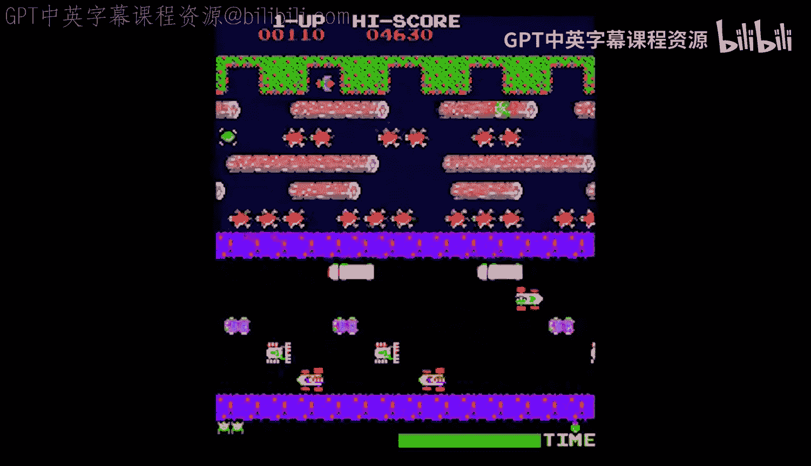

So that was the first attempt like around six， seven years old。

And what's funny is I remembered these fragments， I remember not understanding the purpose of a variable。

If if there's a thing and you sign something， why would you assign another thing to it。

 so for some reason I understand it Constance， a constance made sense to me， but variabless didn't。

Then maybe I'm 11 to 12 I've gotten into the Amiga at this point， the Amiga by the way。

 still perhaps my favorite computer of all time， I mean this is one of those things where yous like people get older and they're like all the music from the 80s was amazing to me even as someone who loves computers loved new computers。

 the Amiga was this magical machine that was made by the same company that produced to Commodore 64 and I got the Amiga 500 I think in 87 little bit the sexy thing as a sexy machine right there This is from an age by the way where computing wasn't global in the same sense that different territories had different computers that were popular the Amiga was really popular in Europe but it wasn't very popular at all in the US as far as I understand it wasn't popular in Japan there were just different machines。

 the Apple I was a big thing in the US I'd never even heard of Apple in the 80s in Copenhagen but the。

500 was the machine that brought me to want to try it again and you know what's funny。

 the reason I wanted to try it again was I remembered the first time time to learn and then there was this programming language that was literally called E Amos like the easy version of Amos。

 I'm like if it's if it's easy Amos， how hard can it be I gotta be able to figure this out。

And this time I tried harder， I got into conditionals， I got into loops， I got into all these things。

 and I still， I couldn't do it。And on the second attempt， I really got to the point of like。

 maybe this is maybe I'm not smart enough。Maybe programming is just enough， maybe it's too much math。

I like math in this sort of superficial way， I don't like it in the deep way that some of my perhaps slightly nerier friends did who I had tremendous respect for like。

 I'm not that person， I'm not the math geek who's going to figure it all out。So after that。

Attempt with ECmos and failing to even get， I don't even think I completed one even very basic game。

I thought program just not for me， I'm going to have to do something else， I still love computers。

 I still love video games， I actually at that time had already begun making friends with people who knew how to program who weren't even programming in easy Amos。

 they were programming freaking as simpler。And I would sit down and just go I how do you the moves and the memories and the copies。

 how do you even do this， I don't even understand how you go from this to Amega demos， for example。

 that was the big thing with the Amiga。 It had this wonderful demo scene in Europe。

It's this really interesting period of time in the Amigas history where you had all these programmers spread out mostly all over Europe。

 who would compete on。

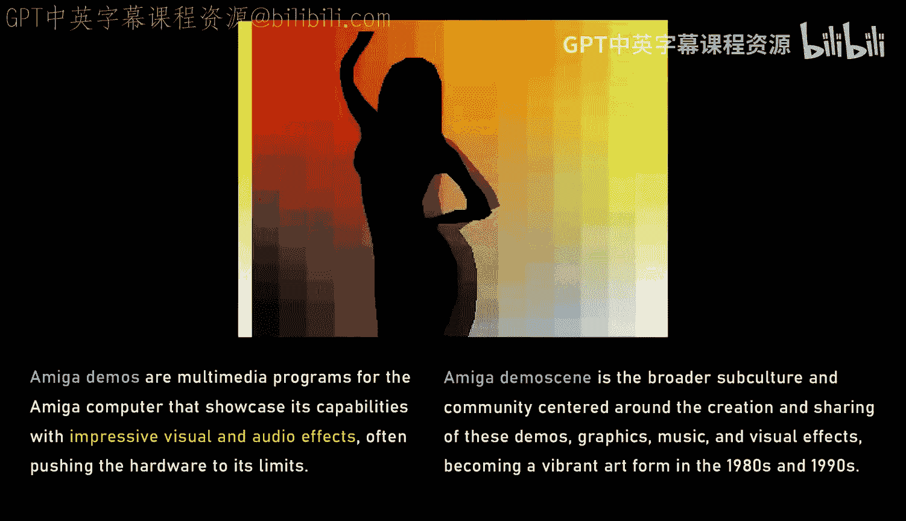

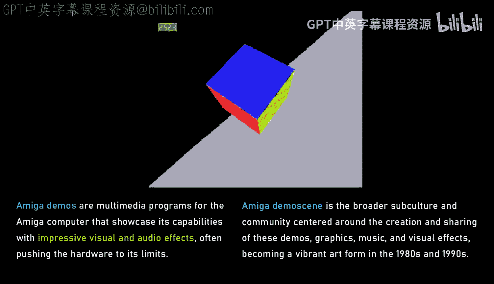

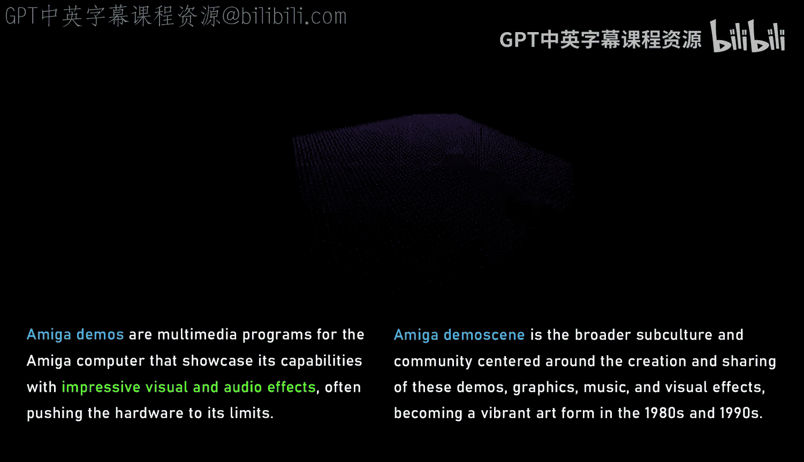

Graphic competitions where you could probably bring one of these in you on this thing。

 they would make these little。Almost like music videos， combining some Mii music。

 combining some cool graphics， and they would do all of it in like 4K4 kilobytes。

 that is not four days of revolution，4 kilobytes of memory。

 and I just thought that was such a cool scene this was obviously pre internet it was even pre BBS bulletinboard systems to some extent it was you swap your demo software with someone else by sending them a disc in the mail like the 3。

5s。And I just， I was enamored with that whole scene。

 I was enamored with what they were able to create。 and I just wanted to be a part of it。

 even though I kind of didn't have any skills to contribute。 And that's how I got into running BbsSs。

 I didn't learn programming then and I wouldn't learn programming until much later until I was almost 20 years old the bulletin board systems existed in this funny space where they were partly a service to the demo scenes。

 allowing all these demo groups to distribute their amazing demos and then it was also a place to trade piracy software。

 pirated software。 and I ended up starting one of those when I was 14 years old in my tiny little bedroom in Copenhagen。

 I had my at that point， A Miga 4000。I had three telephone lines coming in to make tiny room nice which was funny because again。

 I'm 14 years old by the time I wasn't sterling my third line。

 you had to get someone from the telephone company to come do it。

 I get this guy and he's just looking around Like what is this Why the hell is a 14 year old having three phone lines into their tiny little bedroom。

 What are what's going on here。 Why are all these modems blinking red and black and making funny sounds Did you pair though Dave。

Did and they didn't They knew I had the phone lines。 They knew had the computer。

 I don't think they really understood that I was trading pirated software that was both illegal and whatever else was going on。

 I wish should probably say that in Europe， maybe you can comment on this in especially in Eastern Europe。

 but Europe in general， piracy， I think was more acceptable than it was in the United States。

 I don't know。Maybe maybe it's just my even that conversation wasn't present I never spoke to anyone growing up in Denmark any moral qualms whatsoever about privacy it was just completely accepted that。

You're a kid， you want a lot of games， you don't have a lot of money。

 What do you do you trade some people would occasionally buy a game。

 I mean I once bought a second master system。And the I bought one game because that was what I could afford I got after Ber two。

 I don't know if you've ever played that game it's pretty bad implementation on the second master system。

 but it was like 600 crowns and I was making money at that time doing newspaper delivery I had to do that for a month to afford one game I like video games way too much to wait a month just to get one game so piracy was just the way you did it。

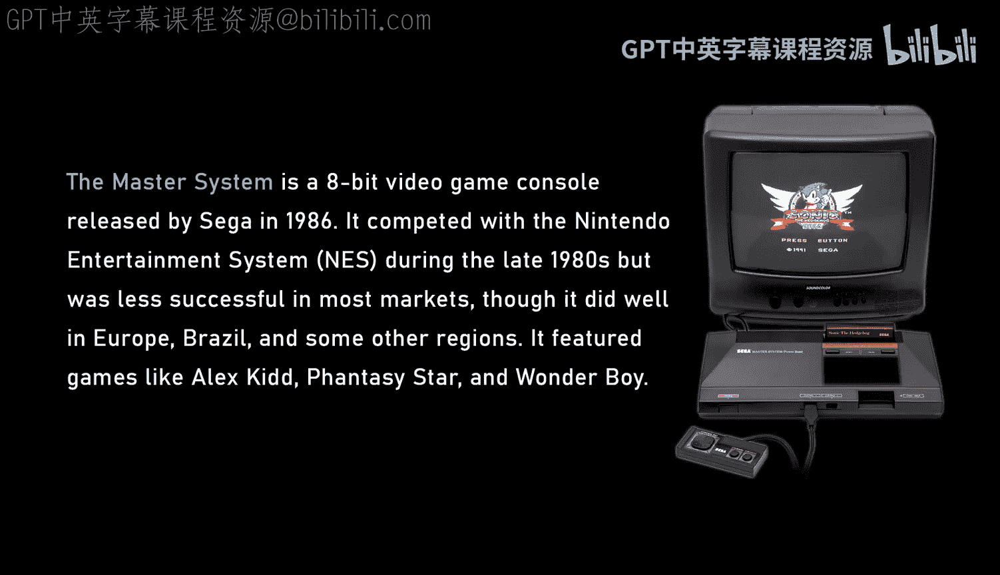

And that was how I got into running this bulletin board system， being part of the demo scene。

 being part of the piracy scene to some extent and then also at some point realizing oh。

 you can actually also make money on this and this can buying more phone lines and buying more modems and buying moremigas Oh yeah。

 that was one of the demo parties these were amazing things what am I looking at isn't that Look at all those CRT monitors all these CRT monitors again when I was 14 I don't understand fully why my parents allowed this but I traveled from Copenhagen。

The capital of Denmark to us this tiny little town in Judlin on the train with a bunch of dudes who were like late teens in their 2s。

 I'm14 years old。 I'm lugging my 14 inch sharet monitor with my computer in the back to go to the party That was what it was called that was the biggest demo scene party at that time and it was exactly as you see in that picture thousands of people just lining up with the computers programming demos all day long and trading these things back and forth。

That's kind of awesome。 not gonna lie。 It's a little ridiculous。 It's totally awesome。

 And I miss it in ways where the Internet has connected people in some ways。

 but the connection you get from sitting right next to someone else who has their own CRt monitor who lugged it halfway around the country to get there is truly special because it was also just this burst of creativity。

 You're constantly running around。 you're constantly surrounded by people who are really good at what they could do。

 they're really good at programming computers， it's infectious。 It was part of that。Pang。

 I felt then going like， a man， why can't I figure this out， I mean。

 why can't I even figure out E Amos， I is kind of frustrating。 But on your third attempt。

 you'll be more successful。 So third attempt is when I start getting it。 This is when I start。

Helping out， let's say， building things for the internet。So around 95， I think it is， or 96。

 I discovered the Internet actually ninth grade， that was my first experience。

 I went to some university in in Denmark。And in ninth grade， we had this excursion。

 and they sat us down in front of a computer and the computer had Netscape navigated the first version。

 or maybe it was even the precursor to that。

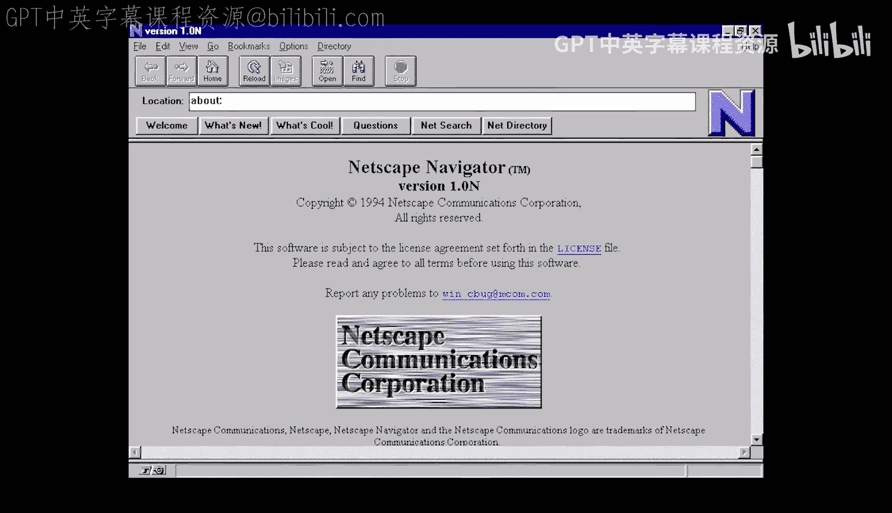

And they had a text editor and us kids just got like， hey， built something on the internet。

 and it was just HTMLl。 And the first thing you do is like， oh。

 I can make the text blink by just putting in this tag and saving it。

 That was that moment that was actually when I reawakened the urge to want to learn the program because I got a positive experience。

 All the other experiences that I had with programming was I spent hours typing something in。

 I click run and it wouldn't work。 And I get an error message that made no sense to me as a kid either at 6 or 7 or at 12。

 And here I am sitting in front of a computer connected to the internet。 and I'm making text blink。

 I'm making it larger I'm turning it into an H1 or an H2。And these guys out here。

 we just did it for like an hour and a half。 and suddenly I go， oh。

 I can make things for the Internet that someone in Germany can be able to access and see and I don't have to ask anyone for permission。

 This is super cool。 I got to do more of this。 So I got into the Internet。

 I got into working with H and I still had all these friends from these demo parties and I started working with them on creating gaming websites I'd rather about the video games I'd review him。

 this was another good way of getting new video games was to walk down to some store and say like hey I'm a journalist。

 I'm like this 15 year old kid and they're looking at your journalist Yeah can I borrow some games because this was when games moved on to the Playtation and these other things you couldn't just as easily pirate at least not at first So I went down there did all that and that started the journey of the Internet for me It started working on these gaming websites working with programmers figuring out that I could do something。

 I could work on the HTML parties not really programming but it。l like it。

 you're talking to a computer， you're making it put text on the screen and you're communicating with someone halfway around the world。

 so that became my pathway back into programming and then slowly I picked up more and more of it first。

Website I did with someone， one of these programs from the demo scene that was dynamic was ASP。netap。

I wasn't even actually called that ni。 That was what we started on and then we moved on to PhP and PhP was when I finally got it when it finally clicked when conditionals and loops and variables and all that stuff started to make sense enough to me that I thought I can do this So would it be fair to say that we wouldn't have DHH without PhP and therefore you owe all your success to PhP 100% that's true and it's even better than that because it PhP to me didn't just give me a start in terms of making my own web applications it actually gave me a bar in many ways。

 I think the pinnacle of developer web developer ergonomics is late 90s PhP you write this script you FTP to a server and instantly it's deployed instantly it's available you change anything in that file and you reload boom it's right there there's no web servers。

 there's no setup up there's just in a。That runs modD PhP and it was essentially the easiest way to get a dynamic web page up and going and this is one of the things I've been chasing that high for basically the rest of my career that it was so easy to make things for the internet in the mid to late 90s how did we lose the sensibilities that allowed us to not just work this way but get new people into the industry to give them there was success experiences that I had？

Adding a frequent blink tag to an HTML page， FTP a PhP page to an Napache web server without knowing really anything about anything without knowing anything about frameworks。

 without knowing anything about setup。😡，All of that stuff have really taken us to a place where it sometimes feels like we're barely better off。

 like web pages aren't that different from what they were in the late 90s， early 2000s。

 They're still just forms。 They still just write to databases。

 A lot of people I think are very uncomfortable with the fact that they are essentially crud monkeys。

 They just make systems that create， read， update or delete rows in a database。

 and they have to compensate for that。Existential dread by overcomplicating things。 Now。

 that's a bit of a character。 There's more to it。 And there's things you can learn for more sophisticated ways of thinking about this。

 but there's still an ideal here， which is why I was so happy you had Peteral levels on because he's still basically works like this。

 Yeah and I look at that and go like， man， that's amazing。 Yeah， you're chasing that high。

 He's been high all along。 Yes， using PhP Jquery and SqA。

 I think it's amazing because he's proving that this isn't just a nostalgic dream。

 He's actually doing it。 He's running all these businesses。 Now， some of that is as he would admit。

Up first， up front is that he's just one guy and you can do different things when you're just one guy when you're working in a team。

When I started working on the team， when I started working with Jason Fried on baseca。

We at first didn't use version control together I used version control for myself and then I thought do you know what designers。

re probably not smart enough to figure out CBS and therefore I just like no， no， no。

 you just FTP it up， you just FTP it I knew they knew how to do FTP and then after the third time I had overriden or changes I was like God damn it。

 I guess I got to teach Jason CBS to not do that again， but。I think there's。

Still way more truth to the fact that we can work the way we did in the 90s worked the way Peter worked today even in the team context and that we've been far too willing to hand over far too much of our developer ergonomics to the merchants of complexity and you've been chasing that with rails8 so how do you bring all the cool features of a modern framework and making no build make it as easy to create something and to ship it as it was in the 90s with just PhB it's very difficult for me to beat the Peter levels approach of just just is so easy to just ship some PhB and it should be why should it be harder than that our computers today are almost infinitely faster than what they were in the 90s so shouldn't we be able to work in even easier ways we should be looking back on the 90s and go like oh that was way too complicated now we have more sophisticated technology that's way faster。

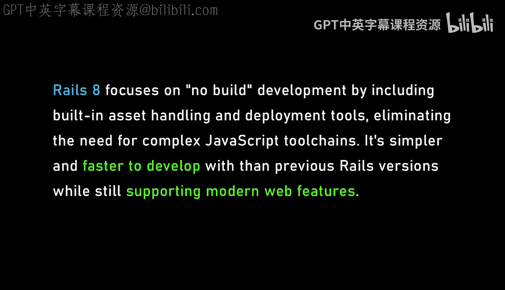

It allows us to work in these easier to use ways， but that's not true。

But now you can see the line I draw in my work with Rubyian Ras， and especially with Rails 8。

 No built to me is reaching back to that 90s feeling and going now we can do some of those things without giving up on all the progress because I do think you can get too nostalgic。

 I do think you can start。Just fantasizing that everything was better in the 90s it wasn't I mean。

 I was there， there was a lot of things that sucked and if we can somehow find a way to combine。

The advantages and advances we've had over the past 20 years with that ease of developer ergonomics。

 we can win No build is a rejection of the part of web development I've hated the most in the past 1015 years which is the JavaScript scene and I don't say that as someone who hate JavaScript I mean I often joke that JavaScript is my second favorite programr language it's a very distant second Ruby is by far and away number one。

 but I actually like JavaScript I don't think it's a bad language it gets a lot of。

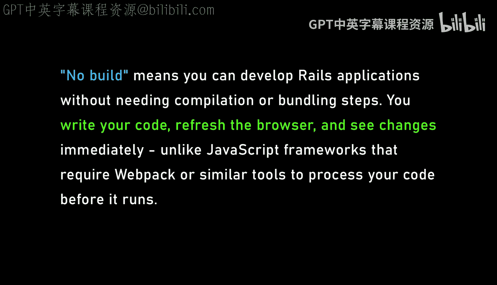

Flack people add a string of two plus a one and give something nonsense and I just go like yeah。

 but why why would you do that just don't do that the language is actually quite lovely。

 especially the modern version ESS6 that really introduced a proper class and text to it so I could work with JavaScript in many of the same ways that I love working with Ruby make things so much better。

But in the early 2010s， until quite recently， all of that advancement happened in preprocessing。

 happened in build pipelines， the browsers couldn't speak a dialect of JavaScript that was pleasant to work with。

 so everyone started to precompiling their JavaScript to be able to use more modern ways of programming with a browser that was seen as stuck with an ancient version of JavaScript that no one actually wanted to work with。

 and that made sense to me but it was also deeply unpleasant。😡。

And I remember thinking during that time to Dark Ages as I referred to them with Java。

This cannot be the final destination。 There's no way that we have managed to turn the Internet into such an unpleasant place to work。

 where I would start working on a project in jascript， using webpack and all these dependencies。

 and I would put it down for literally five minutes， and the thing wouldn't compile any more。

 The amount of churn that the jascript community， especially with its frameworks and its tooling went through in the decade from 2010 to 2020。

 was absurd。😡，And you had to be。Trapped inside of that asylum to not realize what an utterly。

Perverse situation we had landed ourselves in。 Why does everything break all the time， I mean。

 the joke wouldn't be just that the software would break。 that would annoy me personally。

 but then I'd go and hacker news。 and I'd see some thread on the latest jascript release of some framework。

 and the thread would be like。Um， someone would ask， well。

 aren't we using the thing we just used three months ago and people would be like。

 that thing is so outdated， that's so three months ago。You gotta get with the new program。

 we're completely rewriting everything for the O team time and anything you've learned in the framework you've been spending the last amount of time on it's all useless you got to throw everything out and you got to start over why aren't you doing it stupid idiot Is that a kind of mass hysteria that took over the developer community you think like where you have to keep creating new frameworks in new frameworks and are we past that dark age I think we're getting out of it and we're getting out of it because browsers have gotten so much better there was a stagnation in browser technology。

 some of it was an overhang all the way back from ie5 So i。

e5 essentially put the whole Internet development experience into a deep freeze because Microsoft one the browser wars in the mid200s and then they basically thebanded their browser development team because they're all right job done we don't need any more innovation on the internet Can we just go back to writing Windows forms or something now。

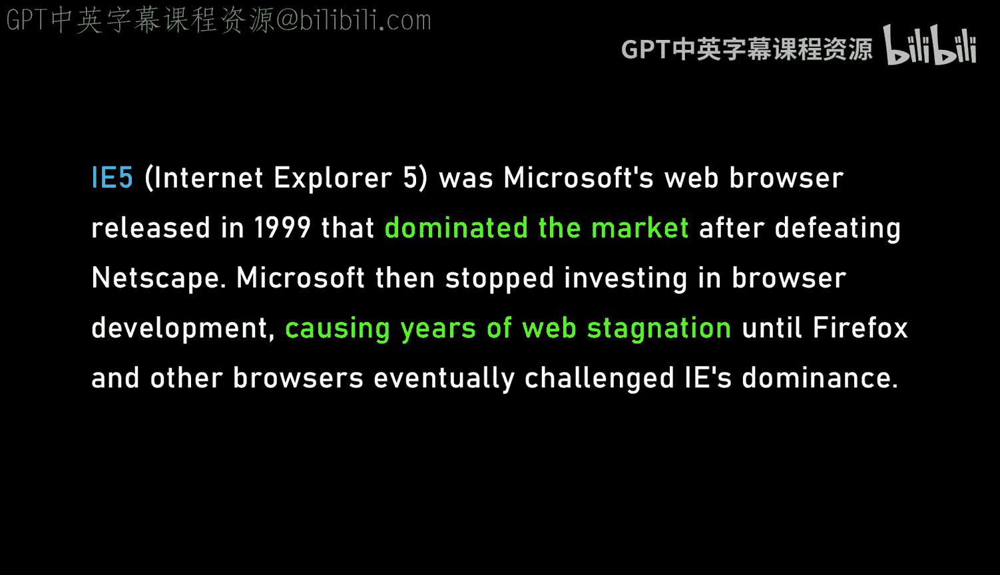

That we control everything and it really wasn't until obviously Firefox kind of kindled a little bit of something and Chrome got into the scene and Google got serious about moving the web forward that。

You had a kindling of maybe the browser could be better。

 Maybe the browser wasn't frozen in time in 2005。 maybe the browser could actually evolve like the development platform that it is。

 But then what happened was，😡，You had a lot of smart people who poured in to the Web because the Web turned out to be the greatest application development platform of all time。

 This was where all the money was being made。 This were。

 this was where all the billionaires were being minted。

 This was where the Facebooks and whatever of the world came to be。 So you had all of this。😊。

Brain power applied to the problem of how to work with the web。And there were some very smart people。

With some， I'm sure very good ideas who did not have programmer happiness as their motivation number one。

 They had other priorities and those priorities allowed them to discount and even rationalize complexity they were injecting everywhere。

 Some of that complexity came from organizational structure。 When you have a company like Facebook。

 for example， that does depend on the web and want to push it forward。

 but have sliced the development role， job into these tiny little niches。

 I'm a front end Gob pipeline configurator。 Oh yeah， well， I'm a front end。

 whatever engineer and suddenly the web developer was no longer one person。

 It was 15 different roles。 that in itself injected a ton of complexity。 but I also want to give it。

The bold case here， which was that some of that complexity was necessary to get to where we are today。

 that the complexity was a bridge it wasn't the destination。

 but we had to cross that bridge to get to where we are today where browsers are frankly incredible the jascript you can write in a text file and then serve on a web server for a browser to ingest is amazing。

 It's actually a really good experience。 you don't need any pre-processing。

 you can just write text files send them to a browser and you have an incredible development we should also say that it can kind of be broken at least the HTML but even the ja could be a little bit broken and it kind of still works like maybe halfas works but like just the amount of mess of smelly code that a browser has to deal with is insane This is one of the hardest problems in computing today is to parse the entire internet because thankfully for us as web developers。

Perhaps not so much for the browser developers， every web page that has ever been created minus the brief period with flashlash still runs today。

😡，The web page I did in ninth grade would render on a modern browser today30 years later。

 A that is completely crazy when you think about the amount of evolution we've had with the Web how much better we've made it。

 how many more standards browsers have adopted。 It's essentially an Apollo project today to create a new browser。

 which is why it doesn't happen very often， which is why even companies like Microsoft had to throw into towel and say we can't do it。

 Now I actually don't think that's good for the web。

 there is the danger of the monoculture if we just get a single browser engine that runs everything and we are in danger of that。

 I love the fact that the Ladybird project， for example。

 it trying to make a new browser engine from scratch I've supported that project I would encourage people to look into that It's really a wonderful thing it's staffed by a bunch of people who worked on other browser projects in the past truly independent web browser We really need that。

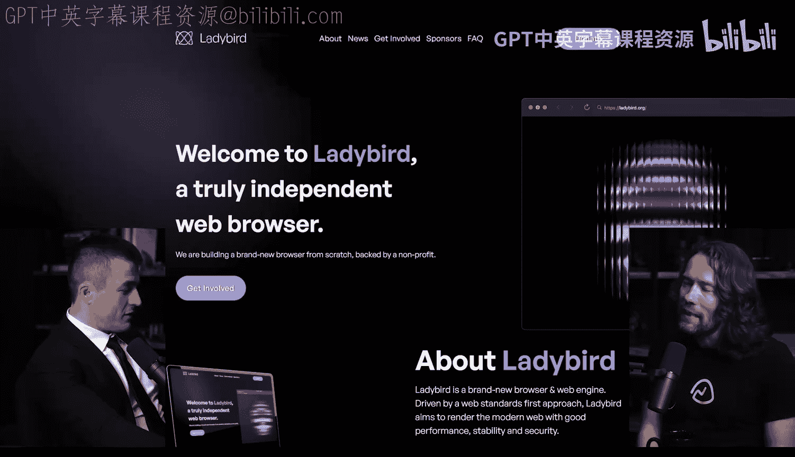

But I can hold that thought in my head at the same time。

 I hold the thought in my head that Google's Chrome was pivotal to the web surviving as the premier web development platform if it had not been for Google and their entire business depending on a thriving open web。

Apple， Microsoft， I think would have been just as fine to see the web go away to disappear into being something that's just served native web or native mobile applications and native desktop applications that they could completely control so。

😡，I have all sorts of problems with Google， but it's not Chrome Chrome is a complete gift to web developers everywhere to the web as a development platform and。

😡，They deserve an enormous amount of credit， I think for that。

 even if it's entangled with their business model and half of Chrome is code that spies on you or informs targeted ads and a bunch of things I'm not a big fan of I can divorce that from the fact we need champions in the corner of the web who have trillions of dollars of market cap value riding on the Open web we're going take tangents upon a tangents upon a tangents。

 So let's go to Chrome I think。Chrome positive impact on humanities is immeasurable for reasons that you just described。

On the technology front， the features they present the competition they created。

 it spurred on this wonderful flourishing of web technologies。

 but anyway I have to ask you about the recent stuff with the DOJ trying to split up Chrome and Google。

 do you think this is a good idea， do you think this does harm？Is a disaster。

And I say that as someone who's been very sympathetic to the antitrust fight。

 because I do think we have antitrust problems in technology。

 But the one place where we don't have them by and large is with browsers is with。

The tools we use to access the open web first of all。

 we have Firefox now Firefox is not doing all that great and Firefox has been propped up by Google for many years to deter from exactly what's going on with the DOj that they were the only game in town。

Apple has safari， I have a bunch of problems with Apple2， but I love Safari。

 I love the fact that we have a premier browser running on a premier operating system that people can't turn the web into just a Chrome experience。

But I also think that the Open web needs this trillion dollar champion or at least benefits from it。

 maybe doesn't need it， but it certainly benefits from it and of all the things that are wrong with monooly formation in technology Chrome is the last thing and this is why it get so frustrated sometimes about the anti or the monopoly fight that there are real problems and we should be focusing on the premier problems first like the to booths on our mobile phones there are far bigger problems。

 it's not the open web， it's not the tools that we use to access the OpenWe if I don't want to use Chrome if my customers of my businesses that run on the internet don't want to use Chrome。

 they don't have to we're never forced to go through it the open internet is still open so I think it's a real shame that the DOJ has chosen to pursue Google in this way I do think there are other things you can nail Google for and they're ad monoopoly maybe。

Or the shenanigans they've done in controlling both sides of the ad ledger that they both control the supply and the demand their problems。

 Chrome is it and you end up making。The web much worse。

 and this is the thing we always got to remember when we think about legislation。

 when we think about monopoly fights is you may not like how things look today。

And you may want to do something about it。But you may also make it worse。

The good intentions behind the GDPR in Europe currently has amounted to what cookie banners that everyone on the Internet hates that helps no one do anything better。

 anything more efficient that saves no privacy in any way。

 shape or form has been a complete boondoggle that has only enriched lawyers and accountants and。

Beurecrat， yeah， you said that the cookie banner is a monument for why Europe is losing is is doing the worst。

Of all the regions in tech it。It's a monument to good intentions leading straight to hell。

And the Europe is actually world class in good intentions leading straight to hell So hell is the cookie accept button。

 they have to accept all cookies， that's what hell looks like over and over you don't actually ever get to the website on a human scale。

 try to imagine how many hours every day are wasted clicking that away and how much harm we've done to the web as a platform that people enjoy because of them the internet is ugly in part because of cookie banners。

Cookie banners were supposed to save us from advertisement and advertisement can make the web ugly。

 there's plenty examples of that， but cookie banners made the entire internet ugly in one felt swoop and that's a complete tragedy but what's even worse and this is why I call it out as a monument to everything the EUu gets wrong is that we have known this for a decade no one anywhere who's serious believes that cookie banners does anything good for anyone yet we've been unable to get rid of it There's this one piece of legislation that's now I think 10 or 12 years old iss complete failure on every conceivable metric everyone hates it universally yet we can't seem to do anything about it。

That's a bankruptcy declaration for any。Body of bureaucrats who pretend or pretend to make things better for。

Not just citizens， but people around the world。This is the thing that really gets me about cookie banners too It's not just the E。

 It's the entire world。 You can't hide from cookie banners anywhere on this planet。

 If you go to Godam Mars on one of Elon's rockets and you try to access the web page you still see a cookie banner No one in the universe is safe from this nonsense Probably the interface on on the rocket floor you would have basically150 second ping time so it'll take you 45 seconds just to get through the cookie banners from Mars All right。

 let's walk back up the stack of this recursive tangents we've been taking So Chrome we should say at least in my opinion。

Is not winning unfairly。 It's winning。In the fair way， by just being better。

It is if I was going to steal man the other side just for a half second。People would say， well。

 maybe yes， most people do sort of begrudgingly agree that Chrome is a pretty good browser。

 but then they'll say the reason they got dominance was distribution and the reason they got distribution was because Google also control to Android and therefore can make Chrome the default browser on all these phones now。

I don't buy that and the reason I don't buy that is because on Android。

 you're actually allowed to ship a different browser that has a browser engine that's not the same as Chrome unlike an iOS。

 where if you want to ship a browser， Chrome， for example， ships for iOS， but it's not Chrome。

 it's safari you wrapped in a dress。😡，And every single alternative browser on iOS have to use the safari web engine。

 that's not competition。 That's not what happened on Android again I think there are some nuances to it。

 but if you zoom out and you look at all the problems we have with big tech Chrome is not it Chrome1 on merits I the gringly have switched to Chrome on that realization alone as a web developer I just prefer it I like Firefox in many ways I like the ethos of it but Chrome is a better browser than Firefox full stop and by the way。

 we've never mentioned edge edge is also a good browser because it's also Chrome in address but it never gets the love I don't think I've ever used Bing and I'm sure Bing is really nice Maybe you have because you know what is Bing in address duck go which is actually the search engine that I use go gets its search results from Bing or at least it used to if they changed that that would be news to me well。

Everything is just a wrap or a dress。 Everything is wearing a dress underneath there's some other there's some turtles。

 it turtles all the dresses all the way down。 Okay， what were we talking about。

 they we got there from jascript and from you learning how to program so eventually。

The big success stories when you build a bunch of stuff with PhP。

And you're like actually shipping things， and that's when the Ruy story came so what？

Your big love affair with programming began there。 So can you take me there， What， what is Ruby。

 Tell the story of Ruby， Explain Ruby to me。 PP was what converted me from just being able to。

Fdle HTML and turn out some web pages to actually being able to produce web applications myself。

So I owe a tremendous gratitude to PhP in that regard。

 but I never thought of PhP as a calling I never thought I'm a professional programmer who writes PhP。

 that's who I am and that's what I do I thought of PhP as a tool I needed to smack the computer with until it produced web applications I wanted It was very much a means to an end。

😡，I didn't fall in love with PhHP。I'm very grateful that it taught me the basics of programming and I'm very grateful that it set the bar for the economics。

 but it really wasn't until Ruby that I started thinking of myself as a programmer and the way that came about was that the first time I ever got a hired as a professional programmer to write code was actually by Jason Fried。

 my business partner still all the way back in 2001。

 I had been working on these gaming websites in PhP for essentially 18 months at that point no one had been paying me to do code in that regard。

 and I connect with Jason Freeed， over an email sent from Copenhagen Denmark to Chicago。

 Illinois to a person who didn't know who I was I was just offering solicited advice Jason had asked a question on the internet and I had sent the answer and he was asking in PhP and Id sent him the answer to that question and we started talking and then we started working。

 which by the way is a miracle of what the internet。

Can allow how can a kid in Copenhagen who's never met this guy in Chicago connect just over email and start working together and by the way。

 we're still working together now 24 years later， that's incredible。

 but we started working together and we started working together on some client projects Jason would do the design 37 signals would do design。

 I would bring the programming PhP and effort we work on。

 I think two or three client projects together in PhP。

We kept hitting the same problem that whenever you work with a client。

 you start that project off an email。 Oh yeah， let's work together。

 Here's what we're building and you start trading more and more emails and。

Before a few weeks have passed， you got to add someone to the project。They don't have the emails。

 They don't have the context。 You send it where' the latest file。 Oh， I've uploaded on the FTp。

 it's like final final V062。0 right that's the one to get。 It's just a mess。

 a beautiful mess in some ways， a mess that still runs the vast majority of projects to this day email is the lowest common denominator that's wonderful but we had dropped the ball a couple times in serious ways with customers and we thought。

We can do better。 We know how to make web applications。

 Cant we just make a system that's better than email for managing projects， It can't be that hard。

 we've been doing blogs， we've been doing to do lists。

 Let's put some of these things together and just make a system where everything that anyone involved in the project needs is on one page and it has to be simple enough that。

I'm not going to run a seminar teaching you how to use the system。

 I'm just going to give you the login code you're going to jump into it so。😡，That's space camp。

And when we started working on base camp。I， for the first time in the experience I had with Jason had the freedom of technology choice。

 there was no client telling me， yeah， PhP， that sounds good， We know PhP。 Can you build it in PhP。

 I had free reins。And at that time， I'd been reading IAE magazine and a couple of other magazines back from the early 2000s where Dave Thomas and Martin Fowler had been writing about programming patterns and。

How to write better code and these two guys in particular were both using Ruby to explain their concepts because Ruby looked like pseudocode whether you were programming in C or Java or PhP all three constituencies could understand Ruby because it basically just read language English So these guys were using Ruby to describe their concepts and first of all I would read these articles for just the concept they were explaining and I'd be like what is this programming language I mean I like the concept you' were explaining but I also want to see the programming language why haven't I heard of this So I started looking into Ruby。

And I realized。At that time， Ruby might not be known by anyone。

 but it's actually been around for a long time。 Mas， the Japanese creative Ruby。

 had started working on Ruby back in '93 before the internet was even a thing。And here I am in 2003。

10 years later， picking up what seems like this hidden gem that's just laying in obscurity in plain sight。

 But Dave Thomas and Martin Fowler， I think。Successfully put me and a handful of other people on the trail of a programming language that hadn't been used much in the West。

 but could be so I picked up Ruby and I thought，This is， this is very different。First of all。

 we're all the semicolonons， I'd been programming in PhP and ASP， I'd even done some Pascal。

 I'd looked at some C， there are semicolonons everywhere。

And that was the first thing that struck me as we're the damn semicollins。And I started thinking。

 actually， why do we have semicolants in programming？

They're to tell the interpreter that there's a new line of instructions。

But I don't need him as a human， how oh？Someone is looking out for the human here。

 not for the machine。So that really got me interested and then。I thought to myself， you know what。

 I know PhP quite well， I'm not。An amazing programmer。

 I haven't been working in programming for all that long。But maybe I can figure it out。

 I'm going to give myself two weeks， I'm going to write a proof of concept where I talk to a database。

😡，I pulled some records， I format them a bit and I dis on an HTML page。

 can I figure that out in a couple weeks？It took about one weekend， and I was completely mesmerized。

 I was completely mind blown because Ruby。Was made from my brain like a perfect tailored glove。

Why someone I'd never met like how is this even possible。

 We should say maybe like paint the picture of the certain qualities that Ruby has maybe even compared to P。

 we should also say that there's a ridiculous thing that I'm used to that I forget about that there's dollar signs everywhere。

 PhB I mean there's line noise I like to call line noise line noise。 Thats such a beautiful phrase。

 Yeah， so there's all this things that look like programs。 and with Ruby， I mean。

 there's some similarities in Python there。 it just looks kind of like natural language。

 you can read it normally。 here's a wild loop that does five iterations you can literally type the number five。

 dot。 Now I'm calling a method under number five， by the way。

 that's one of the beautiful aspects of Ruby that primitives like integers are also objects and you can call five dot。

Times。Start brackets， now you're iterating over the code in that bracket five times that's it， okay。

 that's nice。That's not just nice that's exceptional There is literally no other programming language that I know of that has managed to boil away the line noise that almost every other programming language would inject into a five time iteration over a block of code to that extent That's a really nice Oh thank you for giving that example That's a beautiful example。

Wow， I don't think I know a programming language that does that that's really nice Ruy's full of that。

And there's so let me dive into a couple of examples because I really think it helped paint the picture and let me preface this by saying I actually I like the ethos of Python I think the Ruby and the Python community share a lot of similarities they're both dynamic interpreted languages they're both focused on。

Immediacy and productivity and ease of use in a bunch of ways。

 but then they're also very different in many other ways and one of the one ways they are very different is aesthetically。

Python to me， I hope I don't offend people too much， I've said this before， it's just。

 it's ugly and it's ugly in its base because it's full of superflous instructions that are necessary for legacy reasons。

Of when Guido made Python bag in '87。That are still here in 2025， and my brain can't cope with that。

 Let me give you a basic example。 When you make a class in Python， the initializer method。

 the starting method is de。 Okay， fair enough， that's actually the same as Ruby DEF definition of a method。

Then it is underscore。Not one。Underscore2。In it， underscore or underscore。

 parentheses start self comma and then the first argument Yeah the whole self thing， yeah。

I look at that and go， I'm sorry， I'm out， I can't do it。

It's just it's everything about it offends my sensibilities to the core here you have the most important method that all new objects or classes have to implement。

 and it is one of the most aesthetically offensive ways of typing initialized that I've ever seen anywhere。

And you guys are okay with this。 you're making me you know you're like talking about my marriage or something like this。

 and I'm not realizing I've been in a toxic relationship all along。

 Yeah I just get used to it that to me， by the way， with the magic of Ruby。

 It opened my eyes to how beautiful programs could be I didn't know I'd been working at ASP。

 I'd been working PhP。 I didn't even have the concept that aesthetics beautiful code was something we could optimize for that something we could pursue and even more than that that we could pursue it above other objectives that Ruby is as beautiful as it is is not an accident and it's not easy Ruby itself is implemented than C It's very difficult to parse Ruby code because Ruby is written for humans and humans are messy creatures。

 They like things in just the right way。 I can't fully explain why the underscore underscore in it underscore underscore make me。

Reulse， but it does， and when I look at the Ruy alternative， it's really instructive， so it's de。

 same part， DF， space initialize。😡，Pheses， not even parentheses。

 if you don't need to call it within the arguments or's not even a parentheses。

 then in itself is actually also a major part if the human doesn't need the additional characters。

 we're not just going to put them in because it'd be nicer to parse for the computer。

We're going to get rid of the semicollons， we're going to get rid of the parentheses we're going to get rid of。

The underscores， we're going to get rid of all that ugliness， all the line noise。

 and boil it down to its pure essentials。And at the same time， we're not going to abbreviate。

This is a key difference in the aesthetics between Ruby and Python as well。😡，In it is short to type。

 it's only five characters。 initialize is a lot longer， but it looks a lot better。

 and you don't type it very often， So you should look at something pretty。

 If you don't have to do it all the time， it's okay that it's long。

Those kinds of aesthetic evaluations are rife all over the rubby language。

 but let me give you an even better example。The if conditional。

 that's the bedrog of all programming languages。 They have the if conditional。

 If you take most programming languages， they all have if。

 that's basically the same in almost every language， space start parentheses。 We all do that。

 And then you have。Perhaps let's say you're calling a object called user。😡，Dot。

Is admin close parentheses， close parentheses， start brackets。

And here's what we're going to do if the users an admin， right。

 That would be a normal programmingr language。 Ruby doesn't do it like that。

 Ruby boils almost all of it away。 We start with the F。 okay， that's the same。

 No parentheesis is necessary because there's no ambiguity for the human to distinguish that the next part is just a single statement。

 So you do if space user dot。Admin， question mark。YeahNo open brackets， no parentheses。

 no nothing next open line， here's unconditional that。Question mark means nothing to the computer。

But it meanss something to the human。 Ruby put in the predicate method style purely as a communication tool between humans。

 It's actually more work for the interpreter to be able to see that this question mark is here Why is this question mark in here。

 Because it just reads so nicely。 If user admin question mark。 That's a very human phrase。

 but it gets better。You can turn this around， you can have your statement you want to execute before the conditional。

 you can do user。 upgrade， say you're calling an upgrade method on a user。

Space if space user dot admin question mark we do the thing if the thing is true instead of saying if the thing is true。

 do the thing， but it gets even better。 this is why I love this example with the conditional because you can keep diving into it so let's flip it around user dot downgrade if。

😡，Exclamation point， not。User dot admin， right， that'd be a typical way of writing it。Ruby goes。

That exclamation point is light noise。 Why do we have if and then an exclamation point。 That's ugly。

 We could do user dot downgrade， unless。User admin question mark。That to me。

 is an encapsulation of the incredible。Beauty。That Ruby affords the programmer through ambiguity。

 That is only to serve the human reader and writer。 All of these statements we've just discussed。

 They're the same for the computer。 It'll compile down to the same C code that'll compile down to the same assembly code。

 It makes no difference whatsoever。 In fact， it just makes it harder to write an interpreter。

 But for the human who gets to choose whether the statement comes before the conditional or the predicate method has it's just incredible。

 It reads like poetry at some point。 it's also incredible that， you know。

 one language designer is creating that。You know， Guiddo and Rossom also。

 it's like one person gets to make these extremely difficult decisions because it's you have to think about how does that all get parsed。

And you have to think about the thousands if it's a popular language of millions of people that end up using this and what they feel what that question mark on the for the if statement。

 what what does that feel like that's what Matts thought about because he started his entire mission off a different premise that almost every programming language designer that I'd heard at least articulate the vision that his number one goal was programmer happiness that his number one goal was the。

Affordances that would allow programmers to articulate code in ways that not just。Executed correctly。

But we're a joy to write and we're joy to read and that。Vision is based on a fundamentally different。

View of humanity。There's no greater contrast between Matts and James Gosin， the designer of Java。

 I wanted to listen to James' talk about the design of Java。 Why was it the way it was。

 why was it so rigid and he was very blunt about it， which I by the way， I really appreciate。

 and I think Goslin' has done a tremendous job with Java。

 but his view of humanity rather than dark His view of humanity was programmers。

At the average or stupid creatures。They cannot be trusted。

With sophisticated programming languages because they're going to shoot their foot off or their handoff。

 and that would be kind of inconvenient to the regional development Office of a MITer insurance company writing code that has to last for 20 years。

Now。It's actually a very Thomas Sowell view of constrained capacity in humans that I've come to appreciate much later in life。

 but it's also a very depressing view of programmers that there are just certain programmers who are too dumb to appreciate。

Code poetry they're too ignorant to learn how to write it well。

 we need to give them a sandbox where they just won't hurt themselves too much。Mats。

 when the complete opposite direction， he believes in humanity。

 he believes in the unlimited capacity of programmers to learn and become better， so much so。

That he's willing to put the stranger at his own level。

 this is the second part I truly appreciate about Ruby Ruby allows you to extend base classes you know how we just talked about five dot times is a way to iterate over a statement five times that five is obviously a base class it's a number Do you know what you can add your own methods to that。

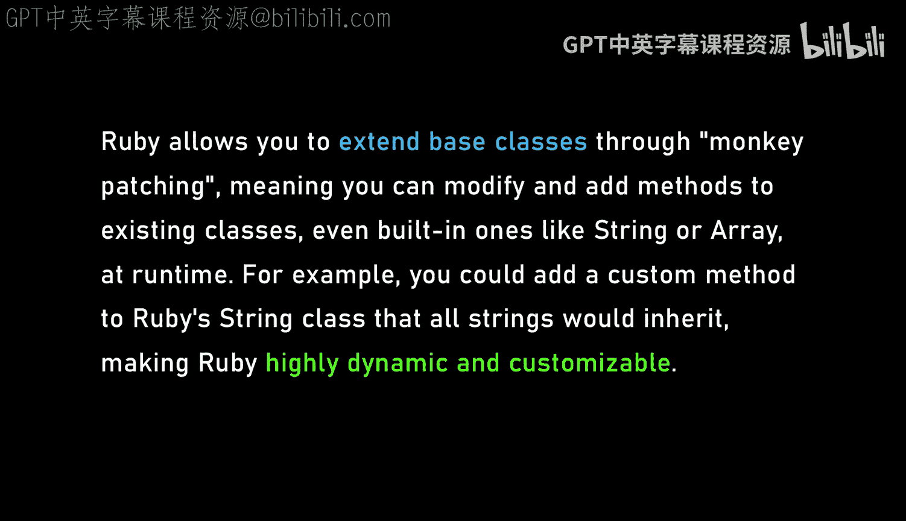

I did extensively in Rails， we have something called active support。

 which is essentially my dialect of Ruby for programming web applications。😡。

And I'll give you one example， I've added a method called。Days to the number。

 So if you do five dot days you get five days in seconds because seconds is the way we set cash expiration times and other things like that so you can say Ca expires in five dot days and you're gonna get whatever five times 24 times 60 times 60 is or whatever the math is right very humanly readable in a novel programmer language。

 you would type out the seconds and then you would have a little comment above it saying this represents five days in Ruby。

 you get to write five days， but even better than that Matts didn't come up with it。

 Matts didn't need the five days。 I needed that because I needed to expire caches I was allowed by mats to extend his story with my own chapters。

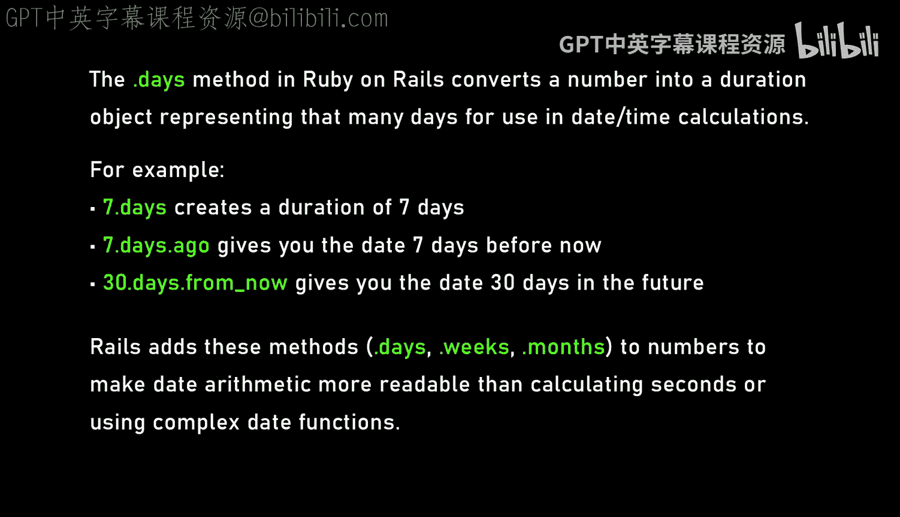

Anequal footing such that a reader of Ruby could not tell the difference between the code Matt wrote and the code that I wrote。

 He trusted me as a complete stranger from Denmark who had never met to mess with his beautiful story that level of trust is essentially unheard of。

 I know there are other program languages that allow things with macros and so forth。

 but none do it in a way like Ruby does it， None does it with an articulated vision of humanity。

 a trust in humanity like Matts does。That is the opposite end of the spectrum of Java。 Yeah， I mean。

 for my aesthetic sensibilities just the way you describe five dot days。

That's really pleasant to me Like I could see myself sitting alone。

Sleep deprived and just writing that it's just an easy thing you can write it in a long way with a comment。

 you can you can write in multiple lines you could do and now with AI I'm sure it's going to generate it correctly。

 but there's something really pleasant about the simplicity of that I'm not sure what that is。

 but you're right， there is a good feeling there。And I'm sure we'll talk about happiness from all kinds of philosophical angles。

 but。You know， that is what happiness is made of that little exactly good feeling there it's the good feeling that come out of a concept compressed to its pure essence there's nothing you can take away from that statement that's aflful。

 but see I also want to push back a little bit excuse because it's not。

Because I also programme in Pearl a bunch。But just just to be cool so like it's not all about compression No。

 you can compress it too far right Pearl golf is a thing where you can turn programs into something that's unreadable for humans Now the great thing about Pearl was that it came out before Ruby Matts was a great student of wall。

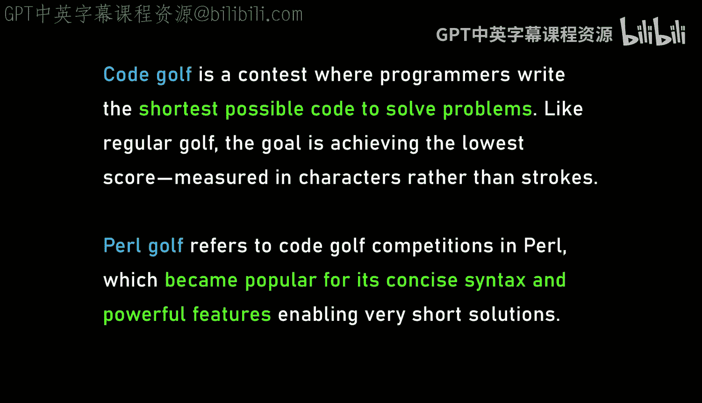

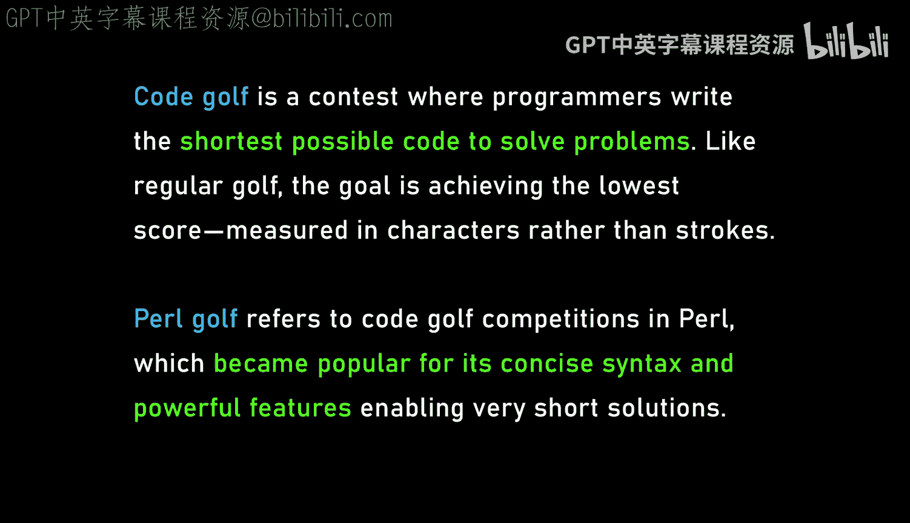

Was a great student of Pearl， was a great student of Python and small talkg and Lisp。

 he took inspiration from all of these prior attempts at creating good programming languages and really edited down the very best bits into this so he was able to learn from his lessons。

 but what I found incredible about Ruby is that here we are 2025。

Ruby has been worked on for over 30 years and essentially the first draft。

Is 90% of what we're still using。 There was almost a sense of divine inspiration possible in wherever Matts was writing that initial version of Ruby that transcended time to such a degree that no one has still even begun to reach it。

 This is the other thing I always find fascinating。

I generally believe in the efficient market theory that if someone comes up with a better mousetrap or better idea。

 otherss will eventually copy them to such an extent that perhaps the original mousetrap is no longer even remembered No one has been able to copy that essence of Ruby。

 They borrowed elements。 that's totally fine。 but Ruby still stands taller than everyone else on these metrics on this trust in humanity and programmers。

 And we should also say like。You know， maybe the perfect programming language that metric。

 and then there's the successful language and those are often different。

 there's something wonderful about the Brendan Icks story of creating jascript there's something truly beautiful about the way jascript took over the world I've recently got to visit the Amazon jungle and just one of my favorite things to do is just to watch the ants take over anything everything and it's just like it's a nice distributed system。

 It's a messy thing that doesn't seem to be order but it just works and the machinery of it worse is better I mean。

 that's actually the name of a pattern for in software development and other ways of how do it's the pattern Linux Linux was quantifiably worse than I think it was Min at the time other ways of it that were more cathedral less baar and。

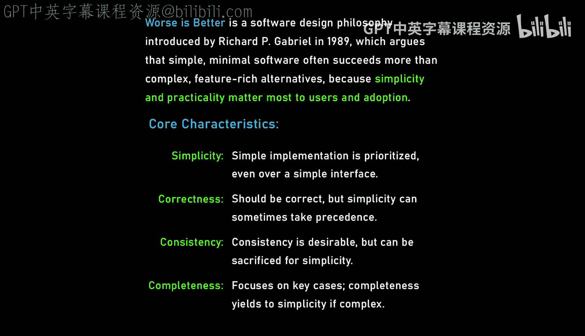

Is still one that there's something to it that the imperfections can help something go forward。

 It's actually a trick I've studied to the degree that I now incorporated in almost all open source that I do I make sure that when I release the first version of any new thing I work on。

 it's a little broken it's a little busted in ways that invite people to come in and help me because there's no easier way to get the collaboration of other programmers than to put something out that they know how to fix and improve Yeah that's but Ruby is somehow or was at least a little bit different that regard not in all regards。

 Matt Scott， the ethos of the language， the design of language just right。

 but the first versions of Ruby were terribly slow It's taken。

I mean hundreds of man years to get Ruby to be both this beautiful yet also highly efficient and really fast and we should say that the thing that made you fall in love with this particular programming language is meta programming Yes。

 so that takes all of these elements we've just talked about and turn them up to 11 I'll explain in meta programminggram real meta programming is essentially a version of the five do days you get to add keywords to the language。

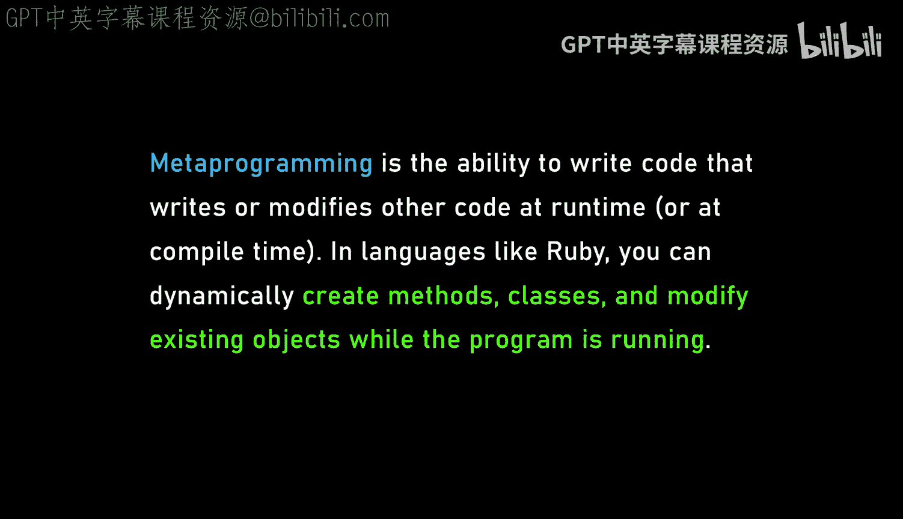

Active Record is the part of rails that communicate with the database。

This is a system where every table in the database is represented by a class。

 so if we take the user example again， you do class user descends from active record base。😡。

And then the first line you can write is this。 I want my users to have many posts or have many comments。

 Let's do that。 We're making some system where users can make comments。 The very next line is has。

 underscore many space。Colon comments Now you've set up a dependency between users and comments that will give your whole host of access and factory methods for user to be able to own commentss to create commentss to update comments in that line alone has many looks like a keyword。

 it looks like it's part of the rubby language that's meta programminggramm when Rails is able to add these elements to how you define a class。

 and then that runs code that adds a bunch of methods to the user class that's meta programminggramm。

And when meta programminggramm is used in this way， we call it domain specific languages。

 you take a generic language like Ruby and you tailor it to a certain domain like describing relationships in a database at a object level and。

😡，This is one of those early examples where you can do user has many commons， belongs。

 underscore two space， colon account Now you've set up a one to one relationship before we had a one to many relationship。

Rails is rife with all this kind of domain specific languages where。😡。

At sometimes it doesn't even look like Ruby。 You can't identify Ruby keywords。

 You can just identify what looks like keywords in its own programming language。 Now， again。

 I know that Lisp and others also do this stuff they just do it with the maximum amount of line noise that can ever be crammed into a programming language and Ruby does it at a level where you cannot tell my meta programminggram from Matt's keywords and with zero line noise。

 Yeah， I should say that my first love was lisp。 So there's a slow tier that you can't see I've actually never written any real lisp myself。

 Well， how can you judge it so harshly then because I have two eyes and I can look at code and my aesthetic sensibilities forbid me to even go much further。

 which is a limitation I know I should actually dive into Lisp because I found that I've learned a lot just diving into。

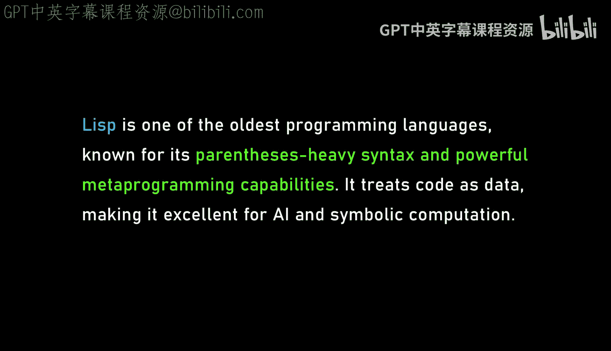

Maybe i'm insulting list again here， but the past of programming languages with small talk for example。

 I think small talk is a incredible experiment that also worked but isn't suitable for today's programming environments I love that we're talking about Ruby so much and what beautiful code is what a beautiful programming language is one of the things。

That is， I think， implied， maybe you made explicit in your descriptions there is that Ruby is dynamic typing versus strict typing。

 and you have been not just saying that it's a nice thing。

But that you will defend dynamic typing to the death like that freedom is a powerful freedom to preserve。

 It's the essence of what makes Ruby Ruby。 This is why I don't fully understand when people call for Ruby to add static typing。

 cause to me， is the bedrock of what this is。 why would you want to turn one of the most beautiful languages into something far uglier。

 This is one of my primary objections to static typing。

 It's not just that it limits you in certain ways It makes metaprogramm harder。

I write a bunch of meta programming I've seen what it takes to do meta programminggramm in Typecr and was actually one of the things that just really sent me on a tear of getting meta or getting Typescript out of some of the projects that I'm involved with。

 we pulled Typecr out of Tbo， one of the frontend frameworks that we have because I tried to write to meta programming in Tpecr and I was just infuriated。

 I don't want that experience。But I also don't want it from an aesthetic point of view。

 I hate repetition。 we've just talked about how much I love that Ruby boils all of these expressions down to its。

Esence you can't remove one dot， you can't remove one character without losing something this moment you go for static typing that you declare at least I know there are ways to do implied typing and so forth。

 but let's just take the stereotypical case of the of example for example capital U user I'm declaring the type of the variable lowercase user I'm now naming my variable equals uppercase user or new uppercase user I've repeated user three times。

😡，I don't have time for this。 I don't have sensibilities for this。

 I don't want my rubby polluted with this Now I understand all the arguments for why people like static typing one of the primary arguments is that it makes tooling easier it makes it easier to do autocomplete in editors。

 for example， it makes it easier to find certain kinds of bugs because maybe you're calling methods that don't exist on an object and the editor can actually catch that bug before you even run it。

I don't care。1st of all， I don't write code with tools。 I write them with text editors。

 I chisel them out of the screen with my bare hands。 I don't autocomple。

 And this is why I love Ruby so much。 And this is why I continue to。

Be in love with the text editor rather than the IDdeE。 I don't want an IDdeE。

 I want my fingers to have to individually type out every element of it because it will force me to stay in the world where ruby is beautiful because as soon as it gets easier to type a lot of boilerplate。

 Well， guess what， you can have a lot of boilerplate， every single language basically。

 that has great tooling support has a much higher tolerance for boilerplate because the thinking is。

 well， you're not typing it anyway。 You're just auto completing it。 I don't want that at all。

 I want something where。The fabric I'm working in is just a text file， there's nothing else to it。😡。

These things play together。 There's the aesthetic part。 There's the tooling part。

 There's the meta programminggram part。 There's the fact that rubs。Eths of duck typing。

 I don't know if you've heard that term before。 It's essentially not about can I call this method if a。

Object is of a certain class it is can I call this method if the method respond it's very out of small talk in that regard。

 you don't actually check of whether that class has the method。

 which allows you to dynamically add methods at runtime and do all sorts of really interesting things that underpin all the beautiful meta programminggramm that we do in Ruby。

 I don't want to lose any of that。😡，And I don't care for the benefits。

 One of the benefits I've see touted over and over again is that it's much easier to write correct software。

 you're gonna have fewer bugs。 you're gonna have less null pointer exceptions you're having less all of this stuff。

 Yeah， I don't have any of that。 It's just not something that occurs in my standard mode of a。

 I'm not saying I don't have bugs Of course I do but I catch those bugs with unit testing with integration testing Those are the kinds of。

😡，Precautions that'll catch logical bugs， things that compile but are wrong along with the uncompilable stuff。

 So I've never been drawn into this world。 And part of it is because I work on a certain class of systems。

 I fully accept that if you're writing systems that have 5，1050 million lines of code with hundreds。

 thousands or tens of thousands of programmers。 I fully accept that you need different methods。

 What I object to is the idea that what's right for a codeb of 10 million lines of code with 100000 programmers working on it is also the same thing I should be using in my bedroom to create basecamp because I'm just a single individual That's complete nonsense in the real world。

 we would know that that makes no sense at all that you don't， I don't know。

 you sure paganni to go pick up groceries at Costco。 It's a bad vehicle for that。

 It just doesn't have the space。 You don't want to muddy the beautiful seats。

 you don't want to do any of those things。 We know。

That certain things that are very good in certain domains don't apply to all in programming languages。

 it seems like we forget that。 Now， to be fair， I also had a little bit perhaps of a reputation of forgetting that when I first learned Ruby。

 I was so head over heels in love with this programming language that I almost found it unconceivable that anyone would choose any other programming language at all to write web applications。

 and I kind of engaged the evangelism of Ruby and Rails in that spirit as a crusade as I just need to teach you at the gospel。

 I just need to show you this conditional code that we just talked about and you will convert at the。

Point of a sharp argument。 Now， I learned that that's not the way。

 And part of the reason it's not the way is the programmers think differently。

 Our brains are configured differently。 My brain is configured perfectly for Ruby。

 perfectly for a dynamically。Duck typed language that I can chisel code out of a text editor with and other people need the security of an IDE。

 they want the security of classes that won't compile unless you call the methods on it。

 I have come to accept that but most programmers don't they're still stuck in essentially I like static typing。

 therefore static typing is the only way to create reliable correct systems which is just just a mindbing。

😡，To be blunt， idiotic thing to say in the face of evidence， mountains of evidence to the contrary。

This is one of the reasons I'm so in love with Shopify as the flagship application for Ruian Ras Shopify exists at a scale that most programmers will never touch on Black Friday。

 I think Shopify did1 million requests per second。That's not one million requests of images that's of dynamic requests that are funneling through the pipeline of commerce。

 I mean Shopify runs something like 30% of all e-commerce stores on the damn Internet。

A huge portion of all commerce in total runs through Shopify and that runs on ruben rails。

Rubian Rails is able to scale up to that level without using。Static typing in all of what it does。

 now I know they've done certain experiments in certain ways because they are hitting some of the limits that you will hit with dynamic typing。

And some of those limits you hit with dynamic typing are actually by the way。

 just limits you hit when you write 5 million lines of code。

 I think the Shop5 monolith is about 5 million lines of code at that scale everything breaks because you're at the frontier of what humans are capable of doing with programming languages。

 the difference in part is that Ruby is such a succinct language that those5 million if they've been written in let's just say go or Java would have been 50 or 25 Now that might have alleviated some of the problems that you have when you work on huge systems with many programmers but it certainly would also have compounded them。

 try to understand 25 million lines of code。So the thing does scale that's the persistent myth that it doesn't scale Shopify and others but Shopify think is a great example by the way。

 I love Shopify and I love Toby You got this morning for sure he's a brilliant I got to hang out with him in the desert somewhere forget getting in Utah he's just a brilliant human。

And and Shop Shopify。x has been supporting this podcast the longest time I I don't think actually Toby knows that they sponsor this podcast。

 I mean it's a big company right it's a huge company。

 I think just under 10000 employees market cap of 120 billion GMV of a quarter of a trillion every quarter and he's involved with the details still Yes。

 very much so a funny story about Toby。Toby was on the Rails core team back in the mid 2000s Toby himself wrote Act merchantchant。

 which is one of the frameworks for creating shops he wrote the liquid templating language that Shopify still uses to this day he has a huge list of contributions to the Rails ecosystem and he's the CEO of the company I think it's just it's very inspiring to me because it's such at the opposite end of what I like to do I like to chissel code with my own hands most of the he runs a company of almost 10。

000 people that is literally。Like world commerce depends on it a level of criticality I can't even begin to understand。

 and yet we can see eye to eye on so many of these fundamental questions in computer science and program development。

That is a dynamic range to be able to encompass railils being a great tool for the one developer who's just starting out with an idea who don't even fully know everything who is right at the level where PhP would have been a good fit in those late 90s because yeah I can probably upload something to an FTP server so on Rails does have more complexity than that。

 but it also has so much longer runway the runway goes all the way to gotdam Shopify that is about the most convincing argument I can make for sort of dynamic range that we can do a lot of it。

Even having said that， Shopify is the outlier， of course。

 I don't think about Shopify as the primary target when I write rails。 I think of the single beer。

 Actually， I do think about Shopify， but I don't think about Shopify Now。

 I think of Shopify when Toby was writing Snow Devil。

 which was the first e-commerce store to sell snowboards that he created。

 That was the pre Shopify Shopify he created all by himself。 And that was possible because。

Ruby and Rails isn't just about beautiful code， it's just as much about productivity。

 it's just as much about the impact that an individual programmer is able to have that they can build system where they can keep the whole thing in their head and be able to move it forward such that you can go from one developer sitting and working on something。

And that something is Shopify and turns into what it is today。

When we talk about programming languages and we compare them。

 we often compare them at a very late stage like what is the better programming language for let's say Twitter in 2009 when it's already a huge success Twitter was started on ruben rails。

 they then hit some scaling problems it was a big debacle at the time they end up。

Then I think writing it in some other language， which by the way。

 I think is the best advertisement ever for Ruen railils because nothing fucking happened for 10 years after they switched over right essentially zero innovation Some of that was because they were doing a long conversion and all of the early success in part came because they had the agility quickly change and adopt and so forth that's what startups needs that's what Shopify needed that's what Twitter needed that's what everyone needs and that's the number one priority for Ruen rails to make sure that we don't lose that because what happened so often when。

Development tools and programming language driven by huge companies is that they mirror their orc chartt。

React and everything else needed to use that is in some ways a reflection of how Mebus Facebook because of course it is because of course it's the distraction of that I'm not saying Re isn't a great tool and that can't be used by smaller teams of course it can't but it's born in a very different context than something like Rubyian Rails let me say it's the smallest side because I think we might return to Shopify and celebrate it often just a sort of personal note this particular podcast has way more sponsors and sponsors that want to be sponsors that I can possibly ever have it's really really important for me。

To not give a share。And to be able to celebrate people， like I celebrate people。

 I celebrate companies。And it has I don't care that they're sponsoring， I really don't care。

I just want to make that very explicit because were good at continuous positive things about Shopify I don't care stop sponsoring it doesn't really matter to me but yeah。

 I just want to make that explicit but to linger on the scaling thing with the Twitter and the Shopify can you just explain to me what Shopify is doing with with the Jt what did they have to try to do to scale this thing because that's kind of an incredible story right yeah。

 so one of the great contributions that Shopify has made to the entire Ruby ecosystem not just rails but in particular rails is Wijet so Wijet is their compiler for Ruby that just makes everything a lot more efficient and at Shopify scale eking out even a510% improvement in Ruby's overhead and execution time is a huge deal Now Shopify didn't need Wijet？

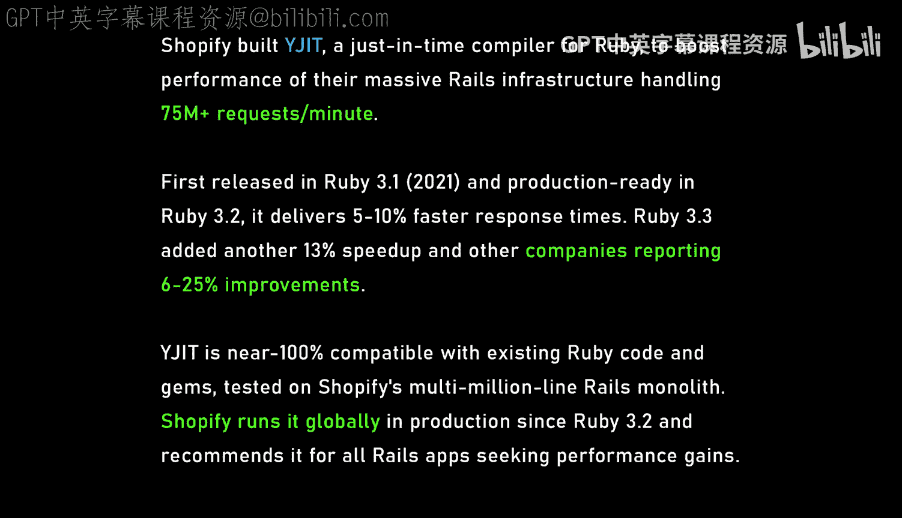

Shoify was already running on the initial version of Ruby that was。

 I think 10 times slower than what we have today， if you look back upon the Ruby 186 that Topi probably started on just as I started on。

 and that was enough to propel Shopify to the scale that it has today。

 a lot of the scaling conversation is lost in a failure to distinguish two things。

Scale is kind of one package we talk about when there are really multiple packages inside of it one is runtime performance latency。

 how fast can you execute a single request， can it happen fast enough that the user will not notice if your rails request takes a second and a half to execute the user is gonna notice your app is going to feel slow and sluggish。

 you have to get that response time down below， let's say at least 300 milliseconds I like to target 100 milliseconds as my latency That's kind of performance how much performance of that kind of latency can you squeeze out of a single CPU core that tells you something about what the price of a single requests will be but then whether you can deal with1 million requests a second like Shopify is doing right now if you have one box that can do a0 requests a second you just need Xboxes to get up to a million and what you'll actually find is that when it comes to programming languages。

They're all the same in this way。 They all scale largely beautifully horizontally。

 you just add more boxes。 The hard parts of scaling a Shopify is typically not the programming language It's the database。

 and that's actually one of the。Challenges that Shopify has now is how do you deal with MySQL at the scale that they're operating at when do you need to move to other databases to get worldwide performance。

 all of these things the questions about scaling Ruy are economic questions if we're spending so and so much on application servers if we can get just 5% more performance out of Ruy well we could save 5% of those servers and that could filter down into the budget now that analysis concludes into basically one thing。

😡，Ruby。Is a luxury language。It's a luxury， the highest luxury， in my opinion。

 it is the Cogo Chanel of programming languages， something that not everyone can afford。

 and I mean this in the best possible way， there are some applications on the internet where each request has so little value you can't afford to use a luxurious language like Ruby to programming it。

 you simply have to slum it with a C or a go or some other lowlevel language or a rust talk about line noise there the thrift store of languages exactly where you need kind of just you need a very low levell to do it。

 you can't afford to use a luxury language to you to build it with。

That's not true of Shopify it wasn't true of baseCamp even back in 2004。

 it's not been true of 99% of all web applications ever created because the main cost component of 99% of web applications。

 it's not CPU course， it's wet course， it's human course it's human capacity to understand and involve systems。

 it's their personal productivity， I did a calculation once when someone had for the 400th time said that oh if you switch from Ruby to some faster language you could save a bunch of money and I calculated it out that at the time and I think the last time I did this calculation was almost a decade ago。

 we were spending about 15% of our operating budget on Ruby application server so。

For me to improve my cost profile of the business。By7 percentage points。

 I'd have to pick something twice as fast That's quite hard versus if Ruby and Ruby on railils was even 10% more productive than something else I would move the needle far more because making individual programmers more productive actually matters a lot more This is why people are so excited about AI This is why they're freaking out over the fact that a single programmer in silicon value makes $300000 a year can now do the work of three or five。

 at least in theory。 I haven't actually seen that fully in practice。

 but let's just assume the theory is correct if not now than in six months That's a huge deal that matters so much more than whether you can squeeze a few more cycles out of the CPU when it comes to these kinds of business applications if you're making on real engine rendering stuff like Tim Sweeney you had on Yeah。

 he needs to really sweat all those details than naide engine can't run on Ruy's never going to it would not meant for that fine。

A business applications absolutely can。Everything that people are excited about AI for right now。

 that extra capacity to just do more， that was why we were excited about Ruby back in the early 2000s。

 that was because I saw that if we could even squeeze out a 10% improvement of the human programmer。

 we'd be able to do so much more for so much less， probably argue about this but。

I really like working together with AI collaborating with AI。

 and I would argue that the kind of code you want AI to generate is human readable。

 human interpretable， Yes， if it's generating pear golf code。

It's just it's not a collaboration so it has to be speaking the human it's not just you're writing the prompts in English you also want to read the responses in the human interpretable language like Ruby right so that's actually is beneficial for AI too because you kind of said that for you the sculptor the sort of the elitist coca Chanel sculptor。

 you want to on your fancy keyboard to type every single letter yourself or your own fingers。

 but it's also that the benefit of Ruby also applies in once that is written by AI and you're actually doing with your own fingers the editing Yes because you can interact with it because it's human interpretable The paradigm I really love with this with something Elon actually said on one of your shows when you guys were talking about neurallink that neurallink allows the bandwidth。

Between you and the machine to increase that language either spoken or written is very low bandwidth。

 If you are to calculate just how many bits we can exchange as we're sitting here。It's very slow。

Ruby。Has a much higher bandwidth of communication revealed conveys so much more concept per character than most of programming languages do So when you are collaborating with AI。

 you want really high bandwidth。 You want it to be able to produce programs with you。

 whether you're letting it write the code or not， that both of you can actually understand really quickly and that you can compress a or a grand concept。

 a grand system into far fewer parts that both of you can understand。 No。

 I actually love collaborating with AI too， I love chiseling my code and the way I use AI is in a separate window。

 I don't let it drive my code。 I've tried that。 I tried the cursors and the windsur and I don't enjoy that way of writing。

 and one of the reasons I don't enjoy that way of writing is I can literally feel competence draining out of my fingers like that。

Level of immediacy with the material disappears and where I felt this the most was I did this remakeix of Uuntu called Ammacube when I switched to Linux and it's all written in bash I'd never written a serious amount of code in bash before so I was using AI to collaborate to write a bunch of bash with me because I needed all this I knew what I wanted I could express it in Ruby but I thought it was an interesting challenge to filter it through bash because what I was doing was setting up a Linux machine that's basically what bash was designed for it's a great constraint。

But what I found myself doing was asking AI for the same way of expressing a conditional。

 for example， in bash over and over again。That by not typing it， I wasn't learning it。

 I was using it。 I was getting the expression I wanted， but I wasn't learning it。

 And I got a little scared。 I got a little scared。 I this the end of learning。

 Am I no longer learning if I'm not typing。 And the way I。

For me recast that was I don't want to give up on the AI It is such a better experience as a programmer to look up APIs to get a second opinion on something to do a draft but I have to do the typing myself because you learn with your fingers if you're learning how to play the guitar you can watch as many YouTube videos as you want you're not gonna learn the guitar you have to put your fingers on the strings to actually learn the motion and I think there is a parallel here to programming where programming has to be learned in part by the actual typing I' just really this is this is fascinating Listen part of my brain agrees with the 100% part doesn't。

I think AI should be in the loop of learning。 Now， current systems don't do that。

 but I think it's very possible for cursor to say。Could basically force you to type certain things。

 So like if you set the mode of learning， I just， I don't want to be this。

Sort of give up on AI I really I think I think vibe coding is a skill so for an experienced programmer it's too easy to dismiss vibe coding as a thing I agree I wouldn't dismiss it。

 but I think you need to start building that skill。

And start to figure out how do you prevent the competency from slipping away from your fingers and brain Like how do you develop that skill in parallel to the other to the other skill。

 I don't know。 I just， it's， I think it's a fascinating puzzle。

 though I know too many really strong programmers and just kind of avoid A because it's currently a little too dumb。

 Yes， it's a little too slow。 It's actually my main problem。 It's a little too dumb in some ways。

 but it's a little too slow in other ways。 When I use。

Clas code the terminal version of a clause which is actually my preferred way of using it。

 I just I get too impatient。 It feels like I'm going back to a time where code had to compile and I had to go do something else boil some tea while the code is compiling Well I've been working in Ruy for 20 years I don't have compile weight in me anymore。

 So there's that aspect of it， but I think the more crucial aspect for me is I really care about the competence and I seen what happens to even great programmers。

 the moment they put away the keyboard because even before AI。

 this would happen as soon as people would get promoted Most great programmers who work in large businesses stop writing code on a daily basis because they simply have too many meetings to attend to。

 they have too many other things to do and invariably theylus touch with programming that doesn't mean they forget everything but if you don't have your fingers in the sauce。

The source you are going to lose touch with it。 There's just no other way。

 I don't want that because I enjoy it too much。 This is not just about outcomes。

 This is what's crucial to understand programming for programmers who like to code is not just about the programs they get out of it。

 That may be the economic value。 It's not the only human value。

 The human value is just much in the expression。😡，When someone who sits down on a guitar and plays stairways to heaven。

 there's a perfect recording of that that will last in eternity。 You can just put it on Spotify。

 You don't actually need to do it。 The joy is to command the guitar yourself。

 The joy of a programmer of me as a programmer is to type the code myself。

 if I elevate myself if I promote myself out of programming。

 I turned myself into a project manager a project manager of a murder of AI crows。

 as I wrote the other day， I could have been become a project manager my whole career。

 I could have become a project manager 20 years ago。

 if I didn't care to write code myself and I just wanted outcomes。

 That's how I got started in programming， I just wanted outcomes。

 then I fell in love with programming， and now I'd rather retire than giving it up。 Now。

 that doesn't mean you can't have your cake and needed to。

 I've done some vibe coding where I didn't care that I wasn't playing myself。

 I just want to see something。 There was an idea。😊。

had I wanted to see something that's fine I also use AI all day long In fact。

 I'm already at the point where if you took it away from me I'd be like oh my God。

 how do we even look things up on the internet anymore is is stack overflow still around or I'm still a thing like how do I even find answers to some of these questions I have all day long I don't want to give up AI In fact I'd say the way I like to use AI I'm getting smarter every day because of AI because I'm using AI。

To have it explain things to me even stupid questions。

 I would be a little embarrassed to even enter into Google。

AI is perfectly willing to give me the EI 5 explanation of some Unix command I should have known already。

 but I don't。 I'm sorry。 can you just explain it to me And now I know the thing So at the end of the day of me working with AI all day long。

 I'm a little bit smarter5% sorry， not5% half a percent maybe that compounds over time but what I've also seen when I worked on the Yamakuup project and I tried to let AI drive for me。

 I felt I was maybe half a percent dumber at the end of the day you said a lot interesting things first of all。

 let's just start the very fact that asking dumb questions to go to stack overflow and ask a dumb question or read somebody else's dumb question and the answer to it。

 there's a lot of judgment there AI sometimes an excessive degree has no judgment It usually says oh that's a great question。

 oh， that's wonderful。Yeah， I mean， it's it's such a it's so conducive to learning。

 it's such a wonderful tool of learning and I would I too would miss it and it's a great basically search engine into all kinds of nuances of a particular programming language。

 especially if you don't know it that well or like APIs you can load it in documentation。

 it's just so great for learning for me personally。It。I mean， on the happiness scale。

 it makes me more excited to program。I don't know what that is exactly Part of that is the I'm really sorry stackwell flow incredible website but there is a negativity there there's a judgment there there's it's just exciting to be like with a hype man next to me just like say yeah that's a great idea and I'll say no that's wrong I'll correct the AI and I will say you absolutely right how did I not think about that write the code'm like holy shit I'm having it's like a buddy that's like really being positive and it's very smart and it's challenging me to think and even if I never use the code to generates I'm already a better programmer but actually the deeper thing is for some reason I'm having more fun that's a really really important thing I like to think of it as a pair programmer for exactly that reason。

Pair programming camevogue in like the 2000s where you'd have two programmers in front of one machine and you'd push the keyboard between you。

 one program would be driving， they'd be typing in。

 the other programmer would essentially sit and watch the code suggest improvements。

 look something up。That was a really interesting dynamic Now unfortunately I'm an introvert so I can do that for about five minutes before I want to jump off a bridge。

 so it doesn't work for me as a fulltime occupation。

 but AI allows me to have all the best of that experience all the time Now I think what's really interesting when you said about it makes it more fun I hadn't actually thought about that but。

What it's made more fun to me is to be a beginner again It's made me it's made it more fun to learn bash successfully for the first time Now I had to do the detour where I let it write all the code for me and I realized I wasn't learning nearly as much as I hoped I would and that I started doing once I typed it out myself。

But it gave me the confidence that you know what， if I need to do some i programming myself。

 I haven't done that in probably six years was the last time I dabbled in it。

 I never really build anything for real。 I feel highly confident now that I could sit down with AI and I could have something in the app store by the end of the week。

 I would not have that confidence unless I had a pair programming body like AI I don't actually use it very much for Ruby code。

 I'm occasionally impressed whenever I try it like oh， it've got this one thing right。

 that is truly remarkable。 and it's actually pretty good。

 And then I'll ask two more questions and I go like yeah okay if you were my junior programmer。

 I'd start tapping my fingers and going like you got you gotta shape up。 Now， the great thing。

 of course， is we can just wait five minutes。 the anthropic CEO seems to think that 90% of all code by the end of the year gonna be written by AI。

 I'm more than a little bit skeptical about that。 but I'm openmind it about the prospect that programming。

Potentially will turn into a horse when done manually。

 something we do recreationally is no longer a mode of transportation to get around LA。

 You're not going to saddle up and go to the grocery store and pick up stuff from Whole Foods in your saddlebacks。

 that's just not a thing anymore。 That could be the future for programming for manual programming entirely possible。

I also don't care。 even though we have great renditions of all the best songs， As I said。

 there are millions of people who love to play the guitar。

 It may no longer have as much economic value as it once did。 I think that。

I'm quite convinced is true that we perhaps have seen the peak now I understand the paradox when the price of something goes down。

 actually the overall usage goes up and total spend on that activity goes up that could also happen maybe but what we're seeing right now is that a lot of the big shops a lot of big companies are not hiring like they were five years ago they're not anticipating they're gonna need tons more programmers controversially Toby actually put out a memo inside of Shopify asking everyone who's considering hiring someone to ask the question could this be done by AI Now he's further ahead on this question than I am I look at some of the trenches and I go like I'd love to use AI more and I see how it's making us more productive but if not yet at the level where I just go like oh we have this project let me just give it to the AI agent and it's gonna to go off and do it but let's let's just be honest you're like a Clwood type character cowboy on a horse at seeing seeing cars going around and you're like well that's part of it。

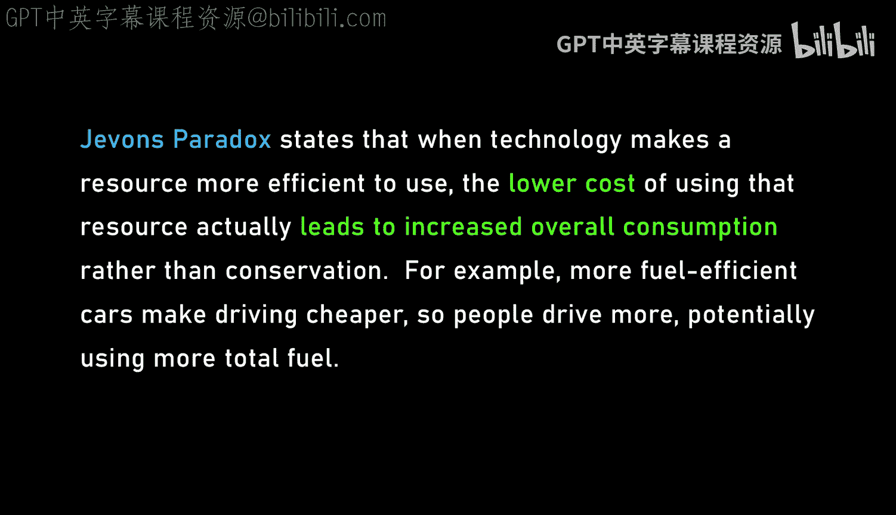

And I think that's it is important to have that humility that what you are good at may no longer be what society values This has happened a million times in history that you could have been exceptionally good at saddle making。

 for example， that's something that a lot of people used to care about because everyone rode a horse and suddenly riding a horse became this niche。

Hoppy that there's so people care about it， but not nearly as many that's okay。

 Now the other thing of this is I've had the good fortune to I've been a programmer for nearly 30 years thats a great run I try to look at life in this way that I've already been blessed with decades of economically viable。

 highly valuable ways of translating what I like best in the working world to write Ruby code that that was so valuable that I could make millions and millions of dollars doing it。

 and if that's over tomorrow I shouldn't look at that with regret。

 I should look at it with gratitude but you're also highly experienced。

 brilliant and opinionated human beings so it's really interesting to get your opinion on the future of the horse。

Because it。You know， there's a lot of young people listening to this who love programming or who are excited by the possibility of building stuff with software with it Ruby with Ruby。

 with Ruby on Ras， that kind of language， and now the possibility， it a career， I it a career and。

How。If indeed， a single person can build more and more and more with the hub of a eye。Like。

 how do they learn that skill， Is this a good skill to learn。 I mean， that， to me， is the real。

Mystery here， because I think it's still absolutely true that you have to learn how to program from scratch currently。

 Yes， but how do you balance those two skills， Because I too， as I'm thinking now。

 there is a scary slipping away of skill that happens in a matter of like really minutes。

On a particular piece of code， it's just， it's， it's， it's scary not the way。Driving， you know。

 when you have。A car drive for you doesn't quite slip away that fast。

So that really scares me so when somebody comes up to me and asks me like， how do I learn to program。

 I don't know what the advice is because。I think it's not enough to just use cursor。

Or copa to generate code It's absolutely not enough。

 not if you want to learn none of you want to become better at it， if you just become a tap monkey。

 maybe you're productive in a second， but then you have to realize， well。

 can anyone just tap if that's all we're doing is just sitting around all day long tapping Yes， yes。

 yes， yes， yes， that's not a marketable skill now。I always preface this both to myself and when I speak to others about it is rule number note one。

 nobody fucking knows anything。 no one can predict even six months ahead right now。

 we're probably at peak AI future hype because we see all the promise because so much of it is real and so many people have experienced it themselves this mind boggling thing that the silicon is thinking in some way that feels eerily reminiscent of humans。

 I'd actually say，😡，The big thing for me wasn't even Chat GPT。 It wasn't even Claed。 It was deepse。

 running deepse locally and seeing the think box where it converses with itself about how to formulate the response。

 I almost want to think， is this a gimmick， Is it doing this as a performance for my benefit。

 but this's not actually how it thinks。 if this is how it actually thinks， okay， I'm a little scared。

 This is incredibly human， how it thinks in this way。But where does that go？In 95。

 one of my favorite movies， one of my favorite B movies came out the lawn Mower man， great movie。

 incredibleible movie about virtual reality， being an avatar and living in VR。

 like the story was a mess， but the aesthetics the world had build up was incredible and I thought。

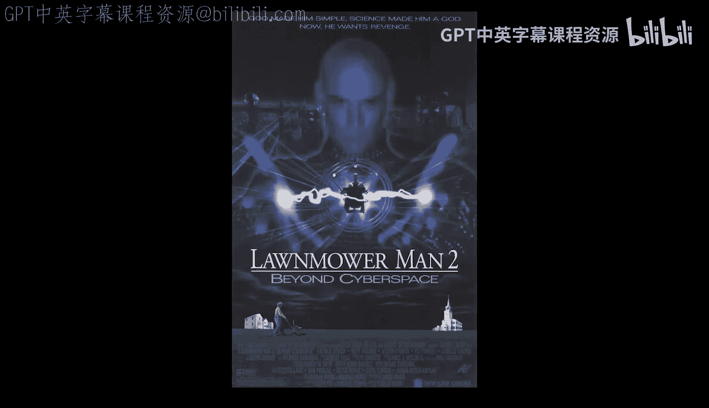

We're five years away。 I'm going to be living in Vr now。 I'm just going to be floating around。

 I'm going to be an avatar。 This is where most humans can spend most of the day。

That didn't happen we're 30 years later VR is still not here， it's here for gaming。

 it's here for some specialized applications my oldest loves playing gorilla tag I don't know if you've tried that that's basically the hottest VR game Wo that's great。

It's really hard to predict the future because we just don't know。

 And then when you factor in AI and you have。Even the smartest people go like。

 I don't think we fully understand how this works。 but then on the flip side。

 you have Moore's law that。Seems to have worked for many， many， many years。

And decreasing the size of transistor for example， so like you know。

 flash didn't take over the internet but Moore's law worked so yes we don't know which one AI is it is and this is what I find so fascinating to I forget who did this presentation but someone in the web community this great presentation on the history of the airplane so you go from the Wright brothers flying in one of 1903 or something like that and 40 years later you have Jeff F just an unbelievable amount of progress in four decades then in 56 I think it was the Hu design for the Boeing 747 essentially precursor was designed and basically nothing has happened since just minor tweaks and improvements on the flying experience since the 50s somehow if you were to predict where flying was going to go and you were sitting in 42 and you'd see。

Youd remember the Wright brothers flying in 03 and you were seeing that jettings coming。

 you're like we're gonna to fly to the stars in another two decades。

 we're going to invent super mega hypersonic flights that's going traverse the earth in two hours and then that didn't happen It tapped out This is what's so hard to predict about predict the future we can be so excited in the moment because we're drawing a line through early dots on a chart and it looks like those early dos just going up into the right and sometimes it's just flattened out This is also one of those things where。

We have so much critical infrastructure， for example that still runs on Cobalt that about five humans around the world really understand truly deeply that there's a it's possible for society to lose a competence it still needs because it's chasing the future Cobalt is still with us This is one of the things I think about with programming Ruy and rails is at such a level now that in 50 years from now it's exceedingly likely that there's still a ton of ruban rail systems running around and very hard to predict what that exact world is going to be like but yesterday's weather tells us that if there's still cobalt code from the 70s operating Social Security today and we haven't figured out a clean way to convert that let alone understand it we should certainly be humble about predicting the future I don't think any of the programmers who wrote that Cobalt code back in the 70s had any damn idea that in 2025 checks were still being cut off the business logic that they had encoded back then but that just brings me。

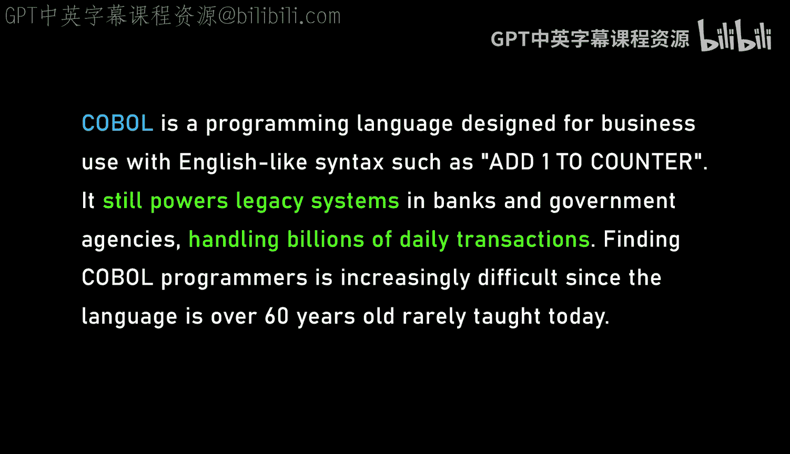

ToThe conclusion on the question for what should a young programmer do you're not gonna to be able to predict the future no one's going to be able to predict the future if you like programming。

 you should learn programming Now is that going to be a career forever I don't know but what's gonna be a career forever Who knows like a second ago we thought that it was the bluecol labor that was gonna to be abstracted first it was a robots that we're gonna take over then GenI comes out and then all the artists suddenly look like holy shit is this gonna do all animation now is gonna do all music now theyre gonna real scared and now I see the latest Tesla robot going like oh maybe we're back now to bluecol being in trouble because if it can dance like that it can probably fix a toilet。

So no one knows anything and you have to then position yourself for the future in such a way that。

It doesn't matter that you pick a professional path where if it turns out that you have to retool and reskill。

 you're not gonna regret the path you took。 That's a general life principle for me。

 how I look at all endeavors I involve myself in is I want to be content with all outcomes。

 when we start working on a new product at 37 signals， I set up my mental model for its success。

 And I go， Do you know what， if no one wants this， I will have had another opportunity to write beautiful rubby code to explore greenfield domain to learn something new to build a system I want。

 even if no one else wants it。 What a blessing。 What a privilege if a bunch of people want it。

 that's great， we can pay some salaries， we can keep the business running。

 And if it's a blowweight success。 Wo， I get to impact a bunch of people。

 I think one of the big open questions to me。Is。How far you can get with vibe coding。

 whether an approach for a young developer to invest most of the time into vibe coding or into writing code from scratch。

So vibe coding meaning I'm leaning into the meme a little bit， but the vibe coding。

 meaning you generate code。You have this idea of a thing you want to create。

 you generate the code and then you fix it with both natural language to the prompts and manually you learn enough to manually fix it so that's the learning process how you fix code that's generated or you write code from scratch and have the LLM's kind of tab tab tab tab add extra code like which part do you lean on I think to be safe you should find the beauty in the artistry and the skill in both right from scratch like there should be some percent of your time just writing from scratch and some percent Viconning there should be more。

Of the time writing from scratch， if you are interested in learning how to program。Unfortunately。

 you're not going to get fit by watching fitness videos。

 you're not going to learn how to play the guitar by watching YouTube guitar videos。

 you have to actually play yourself， you have to do the setups。Programming， understanding。

 learning almost anything requires you to do Human are not built to absorb information in a way that transforms into skills by just watching others from afar。

 Now， ironically， it seems AI is actually quite good at that。

 but humans are not if you want to learn how to become a competent programmer。

You have to program It's really not that difficult to understand now understand the temptation and the temptation is there because vibe coding can produce things perhaps in this moment。

 especially in new domain you're not familiar with with tools you don't know perfectly well that's better than what you could do or that you would take much longer to get at but you're not gonna to learn anything you're going to learn in this superficial way that feels like learning。

 but it's completely empty calories， and secondly， if you can just vibe code it。

 you're not a programmer， then anyone could do it， which may be wonderful that's essentially what happened with the access database that's what happened with Excel。

 it took the capacity of accountants to become software developers because the tools became so accessible to them that they could build a model for how the business was going to do next week that required a programmer prior to Excel。

😡，Now it didn't because they could do it themselves。

 vi coding enables non programmers to explore their ideas in a way that I find absolutely wonderful。

But it doesn't make your programmer。I agree with you。

 but I want to allow for room for both of us be wrong， for example。

 there could be vibe coding could actually be a skill that if you train it and by vibe coding let's include the step of correction。

 the iterative correction。It's possible if you get really good at that that you're outperforming the people that right from scratch。

 that you can come up with truly innovative things。

 especially at this moment in history while the LLMs are a little bit too dumb to create super novel things in a complete product。

 but they're starting to creep close to that so if you're investing time now into becoming a really good vibecoder。

 maybe this is the right thing to do if it's indeed a skill we kind of meme about vibeco just like sitting back and it's in the name。

 but if you treat it seriously a competitive vibecor and get good at writing the wave of AI and get good at the skill of editing。

Code versus writing code from scratch。 It's possible that you can actually get farther in the long term。

 Maybe editing is a fundamentally different task than writing from scratch。

 If you take that seriously as a skill you develop。 I see， I don't to me， that's an open question。

I just think I'm I personally， know you're on another level， but just me just just personally。

I'm not as good at editing。The code that I didn't write is a different。No one is of this generation。

But but maybe that's a skill， maybe if you get on the same page as the AI because there's a consistency to the AI。

 it's like。It really is a pair programmer with a consistent style and structure and so on。

 Plus with your own prompt， you can control the kind of work code you write。

 and it could legitimate be a skill。 that's the dream of the prompt engineer。

 I think it's complete pipe dream。 I don't think editors exist that aren't good at writing。

 I've written a number of books I've had a number of professional editors。

Not all of them wrote their own great books， but all of them were great writers in some regard。

 You cannot give someone pointers if you don't know how to do it。 It's very difficult for。

An editor to be able to spot what's wrong with a problem if you couldn't make the solution themselves editing。

 in my opinion， is the reward the capacity to be a good editor is the reward you get from being a good doer you have to be a doer first now that's not the same as saying that。

Bbeco， prompt engineering won't be able to produce fully formed amazing systems even shortly。

 I think that's entirely possible， but then there's no skill left。

 which maybe is the greatest payoff at all， wasnn't that the whole promise of AI anyway。

 that it was just all natural language that even my clumsy way of formulating a question could result in a beautiful succinct answer。

 that actually， to me， is a much more appealing vision that there's going to be these special prompt engineering wizards who know how to tickle the AI just right to produce what they want the beauty of AI is to think that someone who doesn't know the first thing about how AI actually works。

 is able to formulate their idea and their aspirations for what they want and the AI could somehow take that messy clump of ideas and produce something that someone wants。

That's actually what programming has always been There's very often been people who didn't know how to program。

 who wanted programs who then hired programmers who gave them messy descriptions of what they wanted and then when the programmers delivered that back said oh no actually that's not what I meant I want something else。

AI may be able to provide that cycle if that happens to the fullest extent of it， yeah。

 there's not going to be as many programmers around right。

 but hopefully presumably someone still at least for the foreseeable future have to understand whether what the AI is producing actually。

Works or not as an interesting case study， maybe a thought experiment if I went to vibe code basecam。

Or hey， some of some of the products you've built like what would be the bottlenecks， what。

 where would I fail along the way？What I've seen when I've been trying to do this。

 trying to use Vibe coding to build something real is you actually fail really early。

The vibe coding is able to build a veneer at the current present moment of something that looks like it works。

 but it's flawed in all sorts of ways there are the obvious ways the meme ways that it's leaking all your API keys it's storing your password in plain text I think that's ultimately solvable like it's gonna to figure that out or at least it's gonna to get better at that。

 but its capacity to get lost in its own labyrinth is very great right now you let。

It codes something， and then you want to change something。

 and it becomes a game of wackamole real quick。 Peter the Loves who've been doing this wonderful flight simulator was talking to that where at a certain scale。

 the thing just keeps biting its own tail。 You want to fix something and breaks five other things。

 which I think is actually uniquely human because that's how most bad programmers are at a certain level of complexity with the domain。

 They can't fix one thing without breaking three other things。 So in that way， I'm actually。

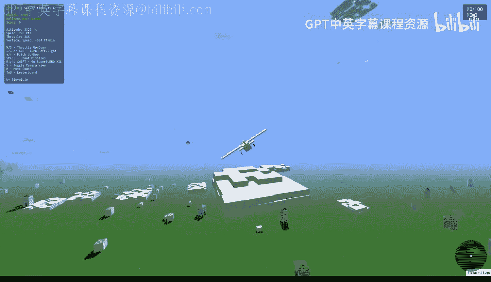

In some ways， it's almost a positive signal for that the AI is going to figure this out because it's done an extremely human trajectory right now。

 the kind of mistakes it's making are the kind of mistakes that junior programmers make all the time。

Can we zoom out？And look at the vision， the manifesto， the doctrine of rails。

 what are some of the things that make a programming language a framework great。

 especially for web development， so we talked about happiness Yes the underlying objective of Ruby what else So you're looking at the nine points I wrote out and I think 2012 and first before we dive into them I want to say the reason I wrote it down is that if you want a community to endure you have to record its values and you have to record its practices if you don't eventually you're going to get enough new people come in who have their own ideas of where this thing should go and if we don't have a guiding light？

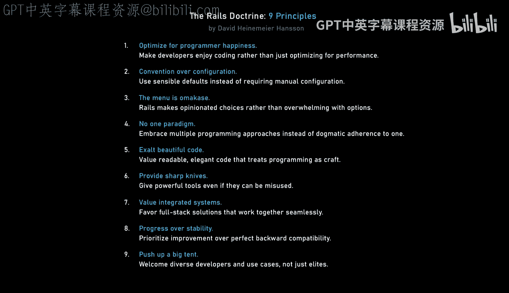

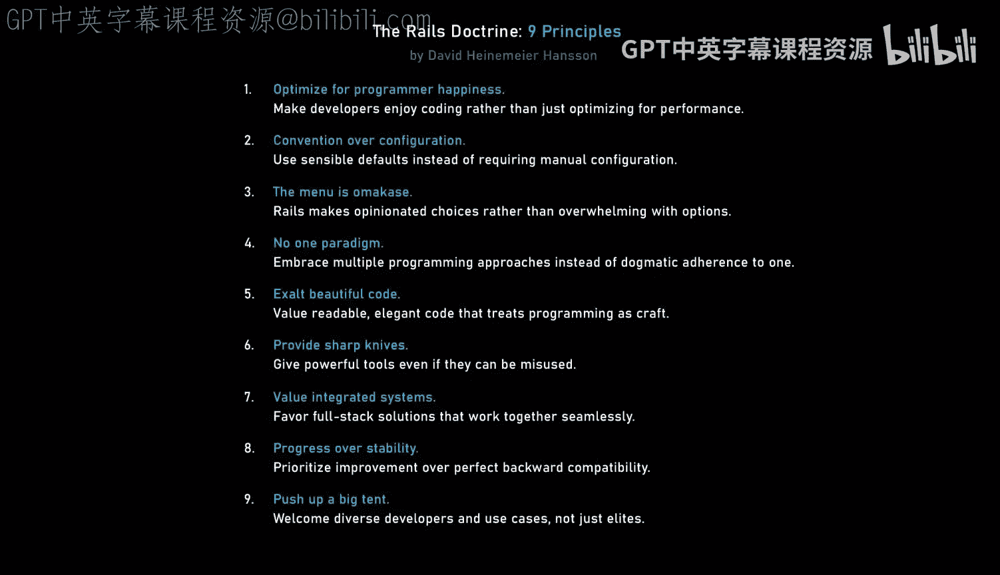

Helping us to make decisions。 We're going to start flailing。

 We're gonna start actually falling apart。 I think this is one of the key reasons that institutions of all kinds start falling apart。

 We forget why chester tons fence is there。 We just go like why is that fence there。

 Let's yank it out Oh， it was to keep the wolves out。 Now we're all dead oops。

 So I wanted to write these things down。 And if we just take them quick one by one。

 you talked about optimizing for program happiness I put that at number one in homage of mats。

 And that's a lot about accepting that there is occasionally a trade off。

 between writing beautiful code and other things we want out of systems。

 There can be a runtime trade off， there can be a performance trade off。

 but we're going to do it nonetheless， We're also going to。

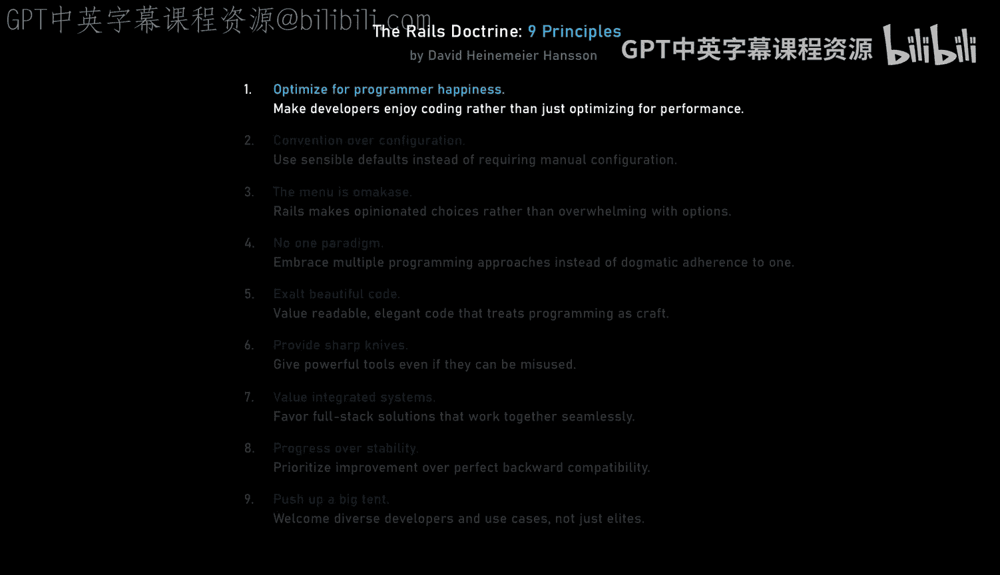

Allow ambiguity in a way that many programmers by default are uncomfortable with。

 I give the example actually here of in the interactive ruby shell where you can play with the language or even interact with your domain model。

 you can quit it in two ways， at least that I' found you can write exit。😡，Boom。

 you're out of the program。 You can write quit boom， you're out of the program。

 They do the same thing。 We just wrote both exit or the people built that wrote both exit and quit because they knew humans were likely to pick one of the other。

 Python is the perfect。TheContrat to this in the Python interactive protocol， if you write exit。

It won't exit， it'll give you a fucking lesson。It'll basically tell you to read the fucking manual it says use exit parentheses or control D i。

e and the file to exit I'm like。

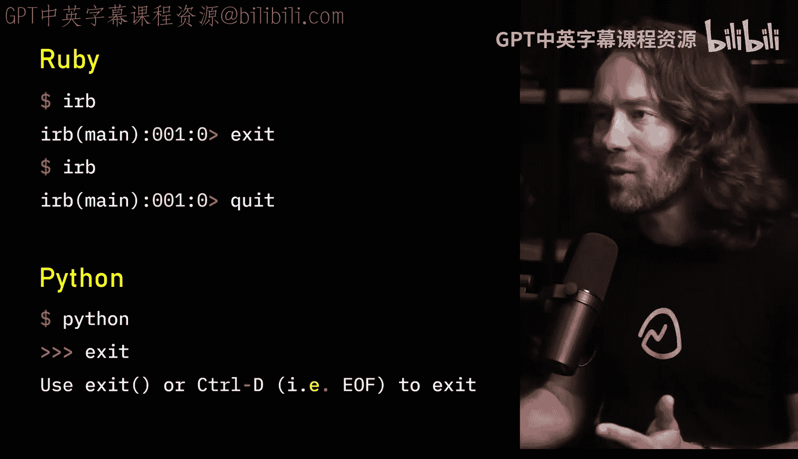

One is very human and another is very engineer， and I mean that both of them in the best possible way。

Python is pedantic， Pythons。The value from the start stated is that there should be preferably one and only one way to do a certain thing。

 Ruby goes the completely opposite。 No， we want the full expression that fits。

Different human brains such that it seems like the language is guessing just what they want。

And part of that is also you describe the principle of Lisa Prize。

 which is a difficult thing to engineer into a language。

Cause you have to kind of it's a subjective thing what is which is why you can't do it in one way。

 which is why you use the example of both exit and quit the principle of Lisa surprise for some people would be like。

 oh， exit， that's how I get out of the prompt for other people would be quit Why don't we just do both。

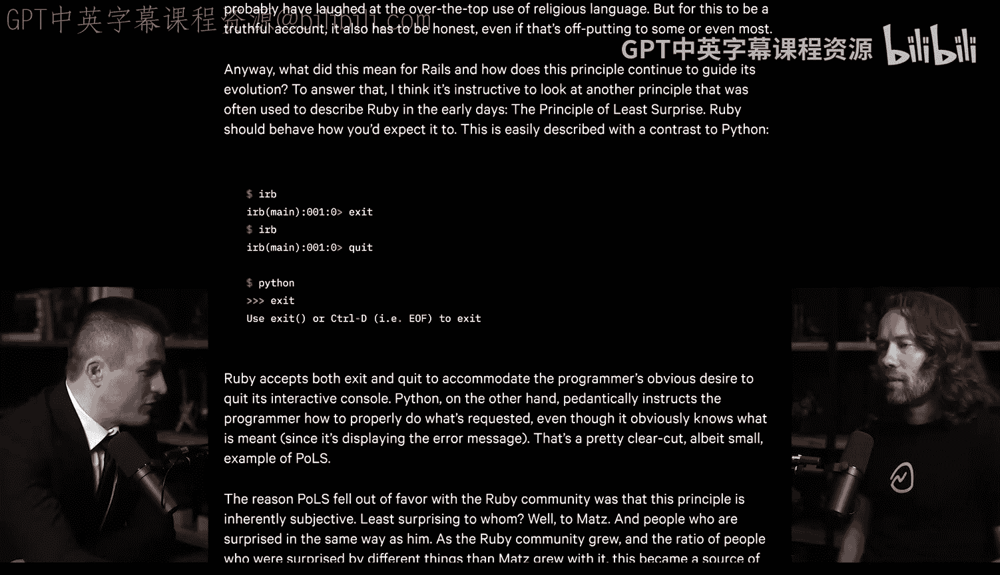

Okay， so what's the convention of a configuration that's a big one That's a big one that's a huge one and it was born out of a frustration I had in the early days with especially Java frameworks where when you were setting up a web application framework for Java back in the day it was not uncommon to literally write hundreds if not thousands of lines of XML configuration files and it is I want the database to use the foreign keys as post underscore ID no no no I wanted as post capital I oh no no no you have to do a capital P there are all these ways where you can configure how foreign relation keys should work in a database and none of the matter we just need to pick one and then that's fine and if we pick one and we can depend on it it becomes a convention and if it's a convention we don't have to configure it and if we don't have to configure it you can get started with you actually care about much quicker so convention of a configuration is essentially to take that idea。

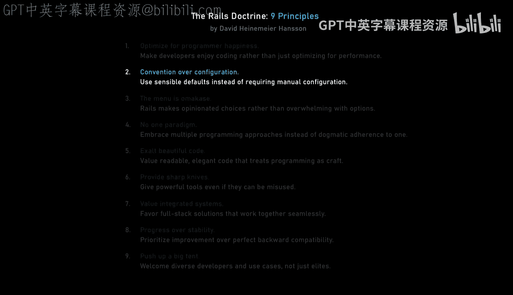

That the system should come preassembled。 I'm not just handing you a box of fucking Legos and asking you to build the millennium falcon。

 I'm giving you a finished toy。 you can edit you can change it。 It still build out a Les。

 you can still take some pieces off and put in some other pieces but I'm giving you the final product and this cuts against the grain of what most programmers love They love a box of Legos。

 they love to put everything together from scratchs。

 they love to make all these detailed little decisions that just don't matter at all and I want to elevate that up so that hey。

 I'm not trying to take the away from you I just want you to focus on decisions that actually matter that you truly care about no one cares about whether post underscore ID or post I or pit Yeah great defaults。

 Yeah it's just a wonderful thing。 You have all these aspirations they're going do some kind of custom most beautiful Legos castle that nobody's ever built from these pieces but in reality to be productive in most situations just need to。

Build the basic thing。 And and then on top of that is where your creativity comes。 Absutely。

 and I think this is one of those part of the doctrine that a lot of programmers who。

Get to use Ruan rails Begrudgingly will acknowledge is' a nice thing。

 even if they don't really like it， like it's hard to beat the。

Sort of attraction to building with Legos from scratch out of programmers that's just what we like this is why we're programme in the first place because we'd like to put these little pieces together。

 but we can direct that instinct towards a more productive end of the stack Okay。

 what are some of the other ones。

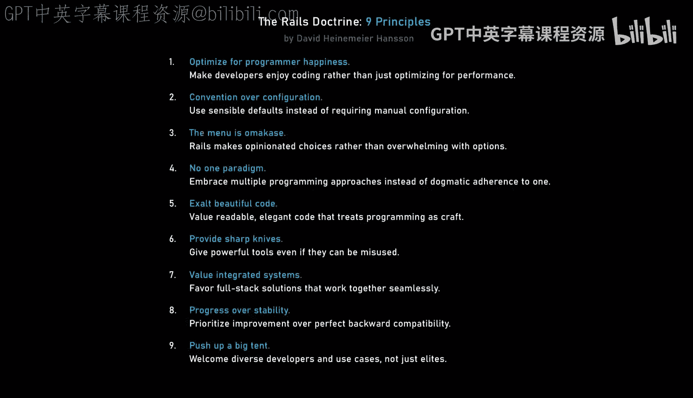

The menu is amacasa It actually comes out of the same principle that great defaults really matter If you look at everything that's wrong with the ja ecosystem right now for example。

 it is that no one is in charge of the menu there are a billion different dishes and you can configure just your tailored specific configuration of it but no one done the work to make sure it all fits together so you have all these unique problems in the ja ecosystem for example。

 there's probably 25 major ways of just doing the controller layer and then as many of how to talk to the database so you get this permutation of n times n times n of no one is using the same thing and if they are using the same thing they're only using the same thing for about five minutes so we have no retained wisdom we build up no durable skills Rails goes the complete opposite way of saying do you know what railils is not just a web framework it is a complete attempt at solving the web problem。

😡，It's complete attempt at solving everything you need to build a great web application and every piece of that puzzle should ideally be in the box preconfigured。

 preassembled if you want to change some of those pieces later that's wonderful but on day one you'll get a full menu designed by a chef really cared about every piece of the ingredient and you're going enjoy it。

😡，And that's again， one of those things where many programmers think like I know better and they do in some hyper local sense of it。

 every programmer knows better。 This is what Ruby is built on that every programmer knows better in their specific situation。

 maybe they can do something dangerous。Maybe they think they know better and then they blow their foot off and then they truly will know better because they blown their foot off once and won't do it again。

 but the menus on Mac is that So you in general see the value in in the monolith Yes the integrated system integrated someone thought of the whole problem This is one of the reasons why I've been on a crusade against microservices since the term was coined microservices was born out of essentially a good idea what do you do at Netflix scale when you have thousands of engineers working on millions of lines of code no one can keep that entire system in their head at one time you have to break it down。

 microservices can be a reasonable way to do that when you are Netflix scale when you apply that pattern to a team of 20 programmers working on a codeb of half a million lines of code you're idiot。

You just don't need to turn method invocations into network calls。

 it is the first rule of distributed programming， do not distribute your programming。

 it is makes everything harder， all the failure conditions you have to consider as a programmer just becomes infinitely harder when there's a network cable involved so。

😡，I hate the idea of premature decomposition and microservicess is exactly that the monolith says let's try to focus on building a whole system that a single human can actually understand and push that paradigm as far as possible by compressing all the concepts system more of it will fit into memory of a single operating human and then we can have a system where I can actually understand all of basecamp I can actually understand all of hay both of those systems are just over 100 thousand00 lines of code I've seen people do this that maybe twice。

 maybe three times that scale and then start breakinging down once you get north of certainly half a million lines of code。

 no individual human can do it and that's when you get into maybe some degree of microservices can make sense basecamp and hay both 10000010000 lines of code theyre small it is considering the fact that basecamp I think has something like 420 screens different ways and configuration the front end No that's the ruby code well it's front end in the sense that some of that ruby codes。

Beeficial to the front， but it's not JavaScript for example now the other thing we might talk about later is we write very little JavaScript actually for all of our applications hey。

 which is a Gmail competitor Gmail ships I think 28 megabytes of uncompressed JavaScript if you compress it I think it's about 6 megabytes。

 28 mebytes think about how many lines of code that is when hey launched we shipped 40 kilobytes。

It's trying to solve the same problem You can solve the email client problem with either 28 megabytes of uncompressed JavaScript or with 40 kilobytes if you do things differently。

 but that comes to the same problem， essentially， this is why I have fiercely fought splitting front in and backend apart that in my opinion。

 this is one of the great crimes against West。That we are still attoning for。

 that we separated and divided what was and should be a unified problem solving mechanism when you are working both on front end and back end you understand the hold system and you're not going to get into these camps to decompose and eventually you end up with shit like GraphQL。

Okay let's fly through the rest of the doctrine no one paradigm No one paradigm goes to the fact that Ruby is a fiercely optic oriented programming language at its core。

 but it's also a functional programming language this five times I told you about you can essentially do these anonymous functional calls and you can chain him together very much in the spirit of how true functional programming languages work Ruby has even moved closer towards the functional programming and of the scale by making strings immutable。

Um，There are ideas from all different disciplines of and all different paradigms of software development that can fit together。

😡，Small talk， for example was only object oriented and that was just it Ruby tries to be mainly objectic oriented but borrow a little bit of functional programming。

 a little bit of imperative programming be able to do all of that Ras tries to do the same thing we're not just going pick one paradigm and run it through everything Obic Or is at the center of it but it's okay to invite all these other disciplines and it's okay to be inspired it's okay to remix it I actually think。

😡，One of the main benefits of rails is that it's a remix。 I didn't invent all these ideas。

 I didn't come up with active record。 I didn't come up with the NVC way of dividing an application。

 I took all the great ideas that I had learned and picked up from every different camp。

 And I put it together， not because it was going to be just one single overarching theory of everything。

 But I was going to have a cohesive unit that incorporated the best from everywhere。

 Is that idea a bit attention with the beauty of the monolith system。 I think the monolith。

can be thought of as quite roomy， quite as a big tent that the monolith needs actually to borrow a little bit of functional programming for the kinds of problems that that excels。

 that discipline excels at solving and that paradigm excels at solving。

If you also want opt orientation at its core， I actually think when I've looked at functional programming languages。

 there's a lot to love and then I see some of the crazy contortions they have to go through when part of the problem they're solving calls for mutating something and you go like holy shit this is a great paradigm for 90% of the problem and then you're twisting yourself completely out of shape when you try to solve the last 10 exalt beautiful code is the next one we've talked about that at length and here's a great example that really summarizes the domainspecific language quality of Ruian railils that you can make code actually pleasant to write and read which is really funny to me because as we talked about when I started learning programming it wasn't even a consideration I didn't even know that that could be part of the premise that that could be part of the solution that writing code could feel as good as writing a poem class project。

Lo record belongs to account has many participants， class name person validates presence of name See。

 you could read it out。 You didn't even change anything to haiku or something right。

 Isn't that beautiful Yes。It's really it's really it's really nice' there's an intuitive nature to it Okay so I have specific questions there I mean active record just to take that tangent that has to be your favorite feature it's the Cr jewel of rails it really is It is the defining characteristic of how to work with Ruen Ras and it's born in an interesting level of controversy because it actually uses a pattern that have been described by Martin Fowler in the patterns of enterprise application architecture。

 one of the greatest books for anyone working on business systems and if you had not read it you must pick it up immediately patterns of enterprise application architecture I think it was published in 2001 it is one of the very few programming books that I have read many times over it's incredible in it。

😊，Martin describes a bunch of different patterns of how to build business systems essentially an active record is a little bit of a footnote in there The pattern is literally called active record you can look it up in called active record I wasn't even creative enough to come up with a name of my own but it allows the creation the marriage of database and object orientation in a way that a lot of programmers find a little offputdding they don't actually want to pollute the beautiful objectoriented nature of that kind of programming with SQL there was a rant by Uncle Bob the other day about how SQL is the worst thing ever b okay whatever I don't care this is practical we are making crowd applications you're taking things out of an HTML form and you're sticking them into a damn database it's not more complicated than that the more abstraction you put in between those two ends of the spectrum the more you're just fooling yourself this is what we're doing we're talking。

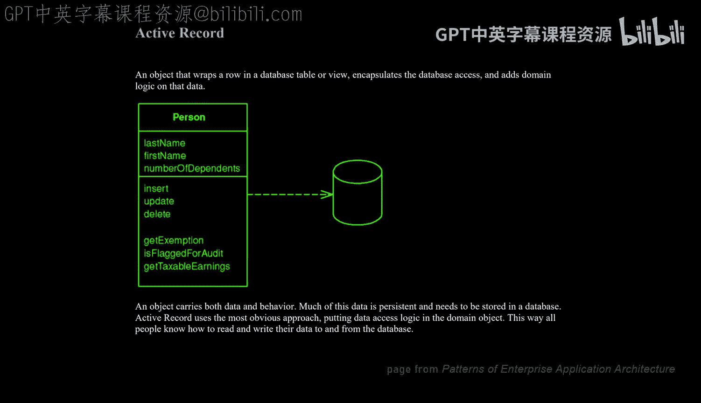

ToSQL databases by the way， quick aside， SQL was one of those things that have endured the onslaught of no SQL databases。

 structured list data for a better part of a decade and still reigned supre SQL was a good thing to invest your time in learning Every program and working with the web should know SQL to a fair degree even if they're working with an orM and object relational map or as a record you still need to understand SQL。

What Act record does is not so much try to abstract the SQL away behind a different kind of paradigm it just making less cumbersome to write。

 making it moremenable to build domain models on top of other domain models in a waysis you don't have to write every damn SQL statement by hand。

 just say the active record is an OM which is a layer that makes it intuitive and human interpretable to communicate with a database。

 even simpler than that， it turns tables into classes and rows into objects。😡。

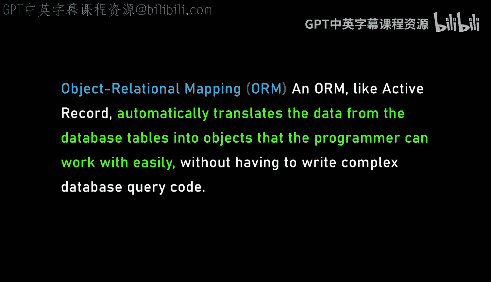

I actually think SQL is very easy to understand most of it you can write some SQL golf to that's very hard to understand。

 but SQL at its base and much of the criticism in SequL was it was written for human consumption it's actually quite rebose。

 especially if you're doing things like inserts over and over again。

 it's quite rebose insert into table parentheses， enumerate every column you want to insert values。

 parentheses， every value that fits with that column it gets tedious to write SQL by hand。

 but it's actually very humanly readable。Active record just takes that tediousness away。

 It makes it possible to combine things in a way that a humanly decribable language just doesn't。

 It composes things into methods and you can combine these methods and you can build structures around them so I don't dislike SQL I dislike a lot of things in programming I try to get rid of them SQL wasn't really one of them It was just a sense of I don't want to write the same thing over and over again can we be a little more succinct Can we match it just slightly better to the object orientation without trying to hide a way the fact that we're persisting these objects into a database That's where I think a lot of orMs went wrong They tried to live in the pure world of objects never to consider that those objects had to be consistented into a SQL database and then they came up with convoluted way of translating back and forth Act record says do you know what just accept this record this object is not going to get saved into some NosQL database is' not going it's gonna to be saved into SQL database。

So it's just structured the whole thing around that， it's going to have attributes。

 those attributes are going to respond to columns in the database。

 it's not more complicated than that stuff making it so。Yeah。

 but I should say so I personally love SQL because I'm an algorithmist person and so I love optimization I love to know how the databases actually work so I can match the SQL queries and the design of the tables such that there is。

You know， optimal squeeze the optimal performance out of the table， Okay。

 based on the actual way that that table is used， so I mean I think that pushes to the point that like there is value in learning in understanding SequL。

I wonder because I started looking at active record and it looks really awesome。

 does that make you lazy， not you， but a person that rolls in and starts using rails？

You can probably get away with never really learning sequel。

 right As long as you want to stay at the entry level of competence。

 And this is actually my overarching mission with rails is to lower the barrier of entry so far down that someone can start seeing stuff on that browser without basically understanding anything they can run rails new。

Blog run a couple of generators， they have a whole system。

 they don't understand anything but it's an invitation to learn more where I get fired up and this ties back to the AI discussion is when that's turned into this meme that programmers no longer have to be competent they can just。

 I mean the AI is gonna to figure it out the generators is going figure it out I don't need to know sequel。

 Act record is going to abstracted away from me no no no， dude。Hold up。The path here is competence。

 I'm trying to teach you things。 I understand I can't teach you everything in five minutes。

 No one who's ever become good at anything worthwhile could be taught everything in five minutes。

 if you want to be a fully wellrounded web application developer that takes years but you can actually become somewhat productive in a few days you can have fun in a few days for sure you're gonna in a few minutes in a few hours and over time I can teach you a little more active record says like yeah yeah all right start to hear And then like next week willll do a class on SQL and actually you have this beautiful expression that I love a great programming language like Ruby has a soft ramp ramp ghost infinity that's exactly right。

 So yeah it's super accessible， super easy to get started and it never stop there's always more to learn。

 this is one of the reason I'm still having fun programming that I'm still learning new things。

 I can still incorporate new things。 the Web is deep enough as a domain you're never gonna。

And all of it provides sharp knives this is a good one because another way of saying this。

 the opposite way of saying this， the Java way of saying is do not provide foot guns right I don't want to give you sharpnive。

 your child， you can't handle a sharp knife here's a dull butter knife。

 cut your damn steak right that's a very frustrating experience。

 you want a sharp knife even though you might be able to cut yourself。

I trust humans in the same way that Mas trust humans。Maybe you cut off a finger。 All right。

 you're not gonna do that again。 thankfully there's a virtual finger。 it's gonna grow back out。

 your competence is gonna grow。 It's more fun to work with sharp tools。

 and that actually contributes to the the ra that goes in Yes to the learning value integrated systems We kind of hit on that one。

 This is rails is trying to solve the whole problem of the web not just one little component is not leaving you a bunch of pieces you have to put together yourself。

 progress over stability。 No what if there's one that's dated， it's probably that one At this stage。

 railils has been incredibly stable over many， many generations。

 The last major release railils 8 was basically a no up upgrade for anyone running rail7 Ra 7 was almost a no up upgrade for anyone running rail 6。

 I used to think it required more churn to get。

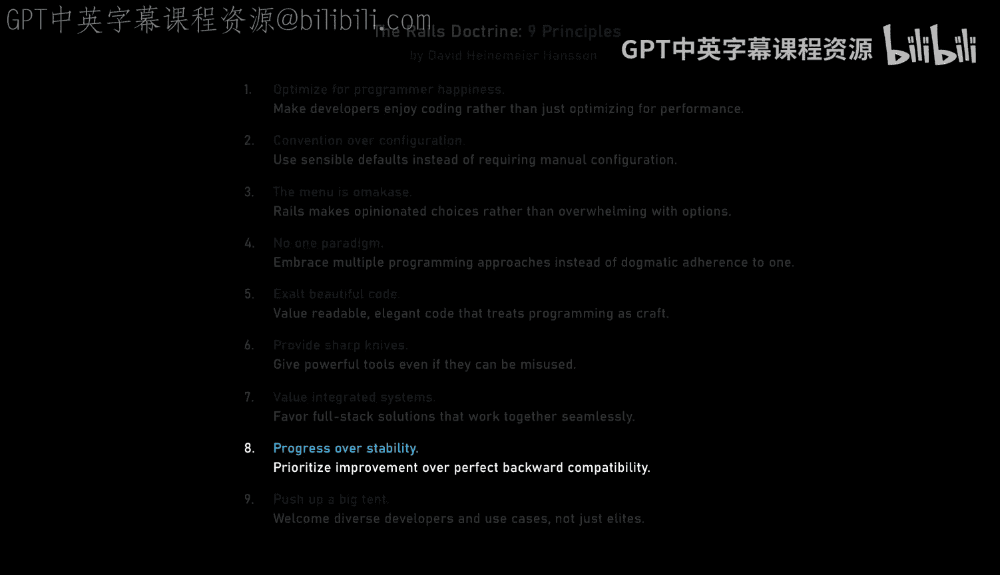

Progress to stay on the leading edge of new stuff。And I wrote this before I experienced the indignity of the 2010s in the JavaScript community。

 where it seemed like stability was not just unvalued。

 it was actually despised that churn in and of itself was a value we should be pursuing that you were still working with the same framework three months later。

 you were an idiot and I saw that and I actually recoiled。

 and if I was going to write the doctrine today， I'd write that differently。

 I wouldn't say progress over stability。Or maybe there it be a function of the age of the programming language also maybe or a deeper understanding of the problem。

 I think part of what's so fascinating about technology is that we have this perception that everything constantly moves so fast。

 No it doesn't Everything moves at a glacial pace There is occasion a paradigm shift like what's happened with AI right now。

 like what happened with the introduction of the iPhone in 2007 like what happened with the Internet in 95。

 That's basically the total sum of my career， three things changed Everything else in between was incremental small improvements you can recognize a rails application written in 2003 I know because the basec I wrote back then is still operating。

 making millions of dollars in ARR surveys and customers on the initial version that was launched back then and it looks like the rails code if I squinned a little that I would write today So most things don't change。

Even in computing and that's actually a good thing we saw with the JavaScript ecosystem。

 what happens when everyone gets just mad about constant churn think don't change that often。

 by the way， on that small tangent， you just sort of visibly verbally changed your mind with the U of 15 years ago。

 Yes， that's interesting， have you have you noticed yourself changing your mind？

Quite a bit over the years。I would say。Oh， yes。 And then also， oh， no。

 in the sense that there are absolutely fundamental things， both about human nature。

 about institutions， about programming， about business that I've changed my mind on。

 And then I've also had experiences that are almost even more interesting where I thought I had changed my mind。

 And I tried it a new way， realized why I had the original opinion in the first place and then gone back to it。

So it happens both ways an example of the later part， for example。

 was managers at 37 signals for the longest time I would rail against engineering managers as。

Unnecessary burden on a smaller even median sized company。 And at one point。

 I actually started doubting myself a little bit。 I started thinking like， you know what。

 maybe all programmers do need a one on one therapy session every week with their engineering manager to be a whole individual。

 So we tried that for a couple of years where we hired some very good engineering managers who did engineering management the way you're supposed to do it the way it's done all over the place。

And after that， I thought like no， no， I was right。 this was correct。

 we should not have had managers， not every programmer needs a therapy session with an engineering manager every week。

 we don't need these endlessly scheduled huddles we don't need all these meetings we just need to lead people the hell alone to work on problems that they enjoy for long stretches of uninterrupted time that is where happiness is found。

 that's where productivity is found。 And if you can get away with it。 you absolutely should。

 engineering management is a necessary evil when that breaks down what's the case for managers then the case for managers is that if you do have a lot of people there's a bunch of work that kind of just crops up the one on one is one example。

 that programmers need someone to check in with there's another idealized version that someone needs to guide the career of juniors for example。

 to give them redirecting feedback and all this other stuff and it's not that in the abstract I don't agree with some of those things but。

Practice I've found that they often create more problems that they solve。And。A good example here is。

 can you get feedback from someone who's not better at your job than you are？You get some feedback。

 you get feedback on how you show up at work。 Are you being courteous to others are you being a good communicator？

 Okay， yes， but you can't get feedback on your work。 and that's more important。

 It's more important that you work under and with someone who's better at your job than you are if you wish to progress in your career and every single programmer I've ever worked with was far more interested in progressing in their career on that metric getting better at their craft than they were in picking up pointers that。

A middle manager could teach them that's not saying that there isn't value in it。

 it's not saying there isn't value in being a better person or a better communicator。

 of course there is all those things， but if I have to choose one of the other。

 I value competence higher like that's again。A caVd this a million times because I know what people sometimes hear。

 They hear the genius ashole is just fine。 And that's great。

 And you should excuse all sorts of malicious behavior someone just really good at what they do。

 I'm not saying that at all。 What I am saying is that the history of competence is a history of learning from people who are better than you And that relationship should take precedence over all else。

 And that relationship gets put aside a bit when engineering managerss introduced Now。

 the funny thing is。This conversation ties back to the early things we were talking about。

 Most engineering managers are actually former programmers。 They at least no program to some extent。

 but what I've seen time and again is that they lose or touch their feel with it very very quickly and turn into pointy- haired bosses very。

 very quickly who are really good at checking for updates to seeing where we are on Project a here if you need anything or we really need to deliver to okay yes。

 and also no shut up leave me the hell alone let me program and then I'll come up for。

 I'll talk with other programmers who I can spa with that we can learn something with I can turn the problems over with and we can move forward if you look back on the history of computer industry all the great innovation that's happened。

It's all been done by tiny teams。With no engineering managerss。

 just full of highly skilled individuals， you've had John Carmeagon here。

I used to look up to its software so much， not just because I loved Quick。

 not just because I loved what they were doing， but because he shared a bit about how the company worked。

 There were no managers， or maybe they had one business guy doing some business stuff。

 But that was just to get paid。 Everything else was basically just designers and programmers。

 And there were about eight of them。 And they created goddamn quick too So why do you need all these people again。

 Why do you need all these managers again， I think again， at a certain scale， it does。Break down。

 it's hard to just have10，000 programmers running around wild without any product mommies or dadies telling them what to do。

 I understand that。 And then even as I say that I also don't understand it because if you look at something like Gmail for example there was like a side project done by Bot at Google at the time so much of the enduring longterm value of even all these huge companies were created by people who didn't have a gotta manager and that's not an accident that's a direct cause and effect so I've turned in some way even more militant over the years against this notion of management。

 at least for myself and knowing who I am and how I want to work because the other part of this is I don't want to be manager and maybe this is just me projecting the fact that I'm an introvert who don't like to talk to people in one on one calls every week。

But it also encapsulates how I was able to progress my career。

 I did not really go to the next level with Ruby or otherwise until I had a door I could close and no one could bother me for six hours straight。

So in companies， probably one of the reasons is it's very easy to hire managers。And managers also。

Deelegate responsibility from you。So if you just have a bunch of programmers running around your kind of response like it's it's it's work。

 it's intellectual work to have to deal with the the first principles of every problem that's going on so managers like you can like relax oh be taken care of but they then hire their own managers and it just multiplies and multiplies and multiplies I would love it if。

Some of the great companies we have。In the United States。

 if there was like an extra side branch that we could always run。

Maybe physicists can come out how to split the simulation to where just all the managers are removed Also just with it just in that branch it's just the PR and the comms people also and even the lawyers just the engineers and let's just see and then we merge it back I've essentially run that branch at 37 signals for 20 years and I've experimented with forking back on the other side。

 I've experimented with having a fulltime lawyer on staff。

 I've experimented with having engineering managers and I can tell you life is much better at 50-60 people when none of those individuals or none of those roles it's never about the individuals。

 it's about the roles none of those roles are in your organization full time。

Occasionally you need a manager occasionallyccaion。

 you need a lawyer I can play the role of manager occasionally fine。

 and then I can set it back down to zero， it's almost like the like a cloud surface I want to manage your service I can call on for seven hours this week and then I want to take it down to zero for the next three months Yeah I read I don't know if this is still the case that base camp was an LLC and doesn't have a CFO like a fulltime accountant is that was that the funniest these days we do have a head of finance we did not for the first 19 years of life。

 I think we got away with basically just having an accountant do our books in the same way you'd do a small ice cream shop except we would over time。

 I've done hundreds of millions of dollars in revenue。The scale seemed quirky and at some point。

 you can also fall in love with your own quirkiness to a degree that isn't actually healthy。

 and I've certainly done that over time。 and we should have had someone mount or count beans a little more diligently a little earlier It was part of a。

Blessing of just being wildly profitable and selling software that can have infinite margins basically then you kind of can get away with a bunch of stuff that you perhaps shouldn't what partially taught me this lesson was when we realized we had not been collecting sales tax in different US states where we had nexus and it took us about two years and5 million in settlements and cleanups to get out of that mess and after that I went like okay fine we can hire a finance person and we now have a wonderful finance person Ron who actually ended up。

Replacing something else we used to have， we used to have a full time data analytics person who would do all sorts of。

Insight mining for why people signing off for this and we ran that for 10 years and realized you know what。

 if I can have either a data analytics person or an accountant。

 I'm picking the accountant I love this so much on so many levels Can we just link on that advice that you've given that small teams are better。

I think that's really less。Less is more what you say before， worse is better？

Because we're better on adoption with technology a lot of time and I think it actually comes out of the same thing。

 it comes out of the fact that many of the great breakthroughs are created by not even just tiny teams but individuals individuals writing something and in individuals writing something on some parameter what they do is worse Of course it's worse when one person has to make something that a huge company have hundreds。

 if not thousands of developers that they can have work on that problem。

 but in so many otherpar that worseness is the value that less is the value in getting real which we wrote back in 2006 we talk about this notion of less software。

When we first got started with baseaseCamp back in 2004， people would ask us all the time。

 aren't you petrified of Microsoft they have so many more resources。

 they have so many more programmers what if they take a liking to your little niche here and they show up and they just throw a thousand programmers at the problem and my answer perhaps partly because I was like 24 whereas first of all。

 no no care in the world but the real answer was they're not going to produce the same thing you cannot produce the kind of software that basecamp is with a team of a thousand0 people you will build the kind of software that a thousand people builds and that's not the same thing at all so so much of the main breakthrough in both end user systems but also in open source systems and fundamental systems they're done by individuals or very small teams even all these classical histories of Apple has always been like well there's a big organization but then you had the team that was actually working on the breakthrough it was four。

People it was eight people。 It was never 200。 and large team seems to slow things down。 Yes。

 it's so fascinating。 It part of is the manager thingca humans don't scale communication between humans certainly don't scale。

 You basically get the network cost effect every time you add a new node。 it goes up exponentially。

This is perhaps the key thing of why I get to be so fond of having no managers at basecamp because our default team size is two。

 one programmer， one designer， one feature。When you're operating at that level of scale。

 you don't need sophistication。 you don't need advanced methodologies。

 you don't need multiple layers of management because you can just do the magic of small teams is that they just do they don't have to argue because we don't have to set direction we have to to worry about the roadmap。

 we can just sit down and make something and then see if it's good when you can get away with just making things。

 you don't have to plan And if you can get out of planning， you can follow。

The truth that emerges from the code from the product from the thing you're working on in the moment。

 you know far more about what the great next step is when you're one step behind。

 rather than if you try 18 months in advance to map out all the steps。

 How do we get from here to very far away。 you know what that's difficult to imagine in advance because humans are very poor at that。

 maybe AI one day will be much better than than us。

 but humans can take one f or put one foot in front of each other。 That's not that hard。

 and that allows you to get away with all that sophistication。

 So the process has become much simpler。 You need far fewer people。 It compound。

 you need much less process， you need to waste less time in meetings。

 you can just spend these long glorious days and weeks of uninterrupted time solving real problems you care about and then are valuable。

And you're going to find that that's what the market actually wants。

 No one is buying something because there's a huge company behind it。 most of the time。

 they're buying something because it's good。 And the way you get something good is。

You don't sit around to have a meal about it。 You try stuff。 You build stuff。

 It really is kind of incredible what one person， honestly。

 one person can do in$100 hours of deep work of focused work even less so I'll tell you this I tracked exactly the number of hours I spent on the first version of basecamp and I was doing this because at the time I was working on a contract basis for Jason。

 he was paying me I was gonna say $15 an hour， that's what I got paid when we first got started I think he had bumped my pay to a glorious 25 but I was billing him and I know that the invoice for the first version of basecamp was 400 hours。

 That's what it took for one sole individual in 2004 to create an entire system that has then gone on to gross hundreds of millions of dollars and continues to do extremely well one person just me setting up everything。

 part of that story is Ruby part of that story rails， but a lot of it is also just me。

Plus Jason plus Ryan plus Matt， that was the entire company at the time and we could create something。

Of sheer sustaining value with such a tiny team because we were a tiny team。

 not despite of small is not a stepping stone。 This is the other thing that people get into their head。

 This is one of the big topics a rework that it gave entrepreneurs the permission to embrace being a small team not as a way point Not as like I'm trying to become1 thousand people。

 No I actually like being a small team small teams are more fun if you ask almost anyone I'm sure Toby would say this too even at his scale。

 the sheer enjoyment of building something is in the enjoyment of building it with a tiny team。

 Now you can have impact at a different scale when you have a huge company， I fully recognize that。

 and I see the appeal of it。 but in the actual building of things。

 it's always small teams always how do you protect a small team basically has successfully stayed small。

 Its been the dragon ins you had to fight off。That like basically， you make a lot of money。

There's a temptation to grow。So how do you not grow？Don't take venture capital， Okay。

 that is that point point number one， first of all， everybody takes venture capital yearre already。

 you're already what。I mean， that's been the answer for the longest time because the problem isn't just venture capital。

 it's other people's money once you take other people's money completely understandably they want a return and they would prefer to have the largest return possible because not them sitting in the code not them getting the daily satisfaction out of building something chiseling beautiful code poems out of the editor right they don't get that satisfaction。

 they get the satisfaction maybe of seeing something nice put into the world that's fair but they certainly also get a satisfaction of a higher return and there is this sense certainly in venture capital stated in venture capital that the whole point of you taking the money is to get to a billion dollars or more now the path to that usually does go through running established playbooks and when it comes to software the enterprise sales playbook is that playbook if you're doing B2B software Sa you will try to find product market fit and the second you have it you will abandon your small and mediumsized accounts to chase the big whale。

With a huge sales force and by then you're a thousand people in life sucks that said you， I mean。

 people are just curious about this， I've gotten the chance to get to knowja Bezos。

 he invested in basecamp。Not controlling he bought secondaries So this was the funny thing is that when investing have these two dual meanings。

 normally when people think about investing， they think you're putting in growth growth capital because you want the business to hire more people to do more R andD just they can grow bigger。

Basis didn't do that actually he bought a ownership stake directly from Jason and I and 100% of the proceeds of that purchase went into my and Jason's bank account personal bank account。

 not a single cent went into the account of the company because we didn't need the money to grow well we needed or what we certainly enjoyed was。

To some extent， maybe the vote of confidence， but more so。

The security of taking a little bit off the tables is that we dare turn down the big bucks from venture capitals。

 It was essentially a vaccine against wanting to take a larger check from people who then wanted to take the company to something enormous that we didn't want to go with it。

 So Jeff。😡，Gave Jason and I just enough money that we were comfortable turning all these people down in a way where if it had turned belly up like six months later。

 we wouldn't have been kicking ourselves and gone。 We had something here that was worth millions。

 And now we have nothing。 And I have to worry about rent and groceries again。

 it is a vote of confidence。 I wonder from I'd love to hear just side of the story of like， why。

Because he doesn't need like the money。So it's really。

 I think it probably is just believing in people and wanting to have cool stuff be great in the world and make money off of it。

 but not like 10% the motivation for Jeff wasn't a return。Because he actually has a team。

He just private office that runs these investments who did the calculus on the investment pitch we gave him。

 which was so ridiculous that Jason and I were laughing our asses off when we were writing down our metrics。

 I was like， no one's going to pay this。 No one is going to give us this multiple of this amount of revenue。

 And that's fine。 I mean， we took the call essentially out of。😊。

Kind of an awe that Jeff Bezos even wanted to look at us。 And like， do you know what。

 we don't want venture capital。 We don't need other people's money But like let's just give him a bullshit number。

 The no sane person would actually say yes to。 And then， I mean。

 we can we can each go our own way and his investment team said， like Jeff， no way。

 this makes no economic sense at all， They're asking for way too much money with way too little revenue。

 And Jeff just went like I don't care。 I want to invest in these guy。 because to him at the time。

 it was ch change， right， like Jason and I each got a few million dollars。 I mean。

 whatever the currency swing between the yen and the dollar that day probably moved 10 x that for his net than our investment did。

 Jeff seemed genuinely interested in。Being around interesting people， interesting companies。

 helping someone go to distance and。I actually look back on that relationship with some degree of regret because I took that vote of confidence for granted in ways that I'm a little bit ashamed of over the years。

 I've been more critical about some of the things that Amazon had done that I feel now is sort of justified。

So that's just sort of part of that processing of it， but on the economic sense。

 he gave us that confidence， he gave us the economic confidence。

 but then he also gave us the confidence of a CEO running perhaps at the time the most important internet business in the US showing up to our calls which we would have with him like once a year and basically just going like yeah you guys are doing awesome stuff you should just keep doing awesome stuff I read your book it's awesome you launched this thing it's awesome you should just do more of that I don't actually know how to run your business you guys know so the book goes out because I'm just sort of from a fan perspective。

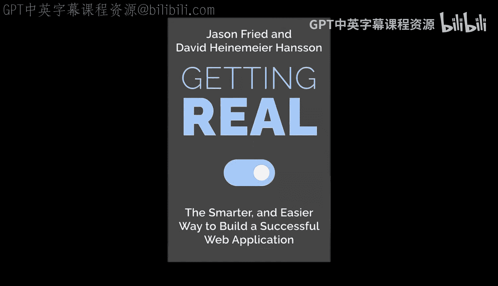

I'm curious about how Jeff Paszos is able to see because to me。

 you and Jason are like special humans in the space of tech。 The fact that Jeff was able to see that。

 how hard is it to see that， He certainly saw it very early。

 And I think this is something that Jeff does better than almost anyone else。

 He spots that opportunity so far in advance of anyone else even opened their eyes to it。

 or certainly is willing to bet on it far early and far harder than anyone else is。

 And he's just right time and again。 I mean， we were not the only investment that he made。

 And certainly Amazon had a extremely long term vision。

 So far longer than I have ever had the gumption to keep。 Like。

 I think of myself as a long term thinker。 I'm playing a child's game compared to the game that Jeff is playing。

 Like when I looked at。Amazon's economics around the dot com boom and bust。 They looked ridiculous。

 like they were losing so much money。 They were so hated by the market。 They were。

 no one believed that it was going to turn into what it is。

 But Jeff did in a way that that level of conviction， I really aspire to。 And I think that's。

One of the main things I've taken away from that relationship is that。

You can just believe in yourself to that degree against those odds。

 that's ridiculous he did that at so many times a hour level that it's pathetic if I'm doubting myself Yeah I think Amazon is one of those companies。

I mean， it's coming under a bunch of criticism over the years。

This is something about humans that don't appreciate so much that we take for granted the positive that a thing brings real quick and then we just start criticizing the thing it's the wfi and the airplanes that's exactly but I think I think Amazon there could be a case made。

That Amazon is。One of the greatest companies in the last1 hundred years Oh for sure。

 I think it's an easy case to make What I also think is that the price you pay to be one of the greatest companies in the last hundred years is a lot of detractors。

 a lot of pushback， a lot of criticism that this is actually order restored in the universe。

 one of my favorite teachers in all the time I've been on the Internet is Kathy Sierra I don't know if you know her work。

 but she was active burned a few short years before the cruel Internet ran her off。

 but she wrote a blog called Creating passionateion users and she carved into my brain this notion of balance in the universe If you're creating something of value that a lot of people love you must create an equal。

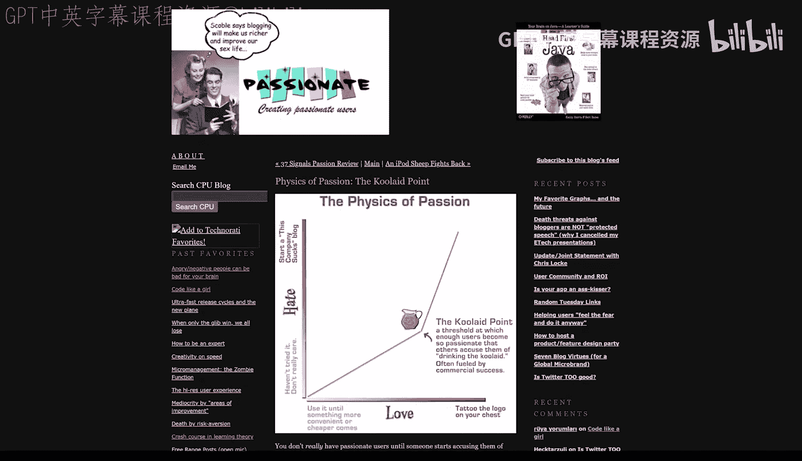

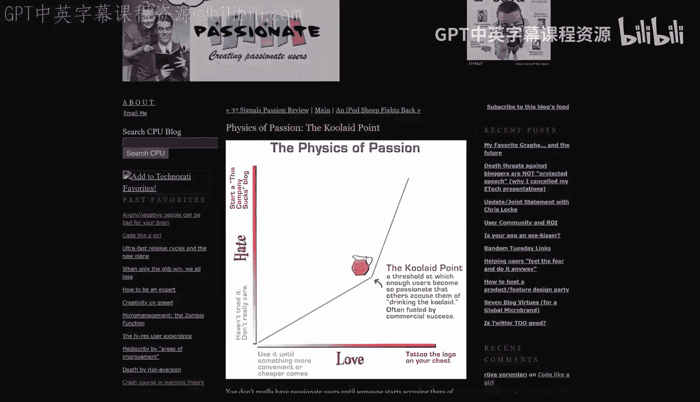

An opposite force of haters。 You cannot have people who love what you do without also having people who hate what you do。

 The only escape from that is mediocrity。 If you are so boring and so uninteresting that no one gives a damn whether you exist or not。

 Yeah， you don't get the haters。 But you also don't get the impact of people who really enjoy your work。

 And I think Amazon is that just at the massive scale。 right。

 They brought so much value and change to technology to commerce that they must simply have a black hole size of haters。

 Otherwise， the universe is simply gonna tip over。 Let me ask you about small teams。

 So you mentioned Jason a bunch of timess Jason Fried， you have been partners for a long， long time。

 Perhaps it's fair to say he's more in the sort of the design business side。 you're like the tech。

 the engineering wizard。

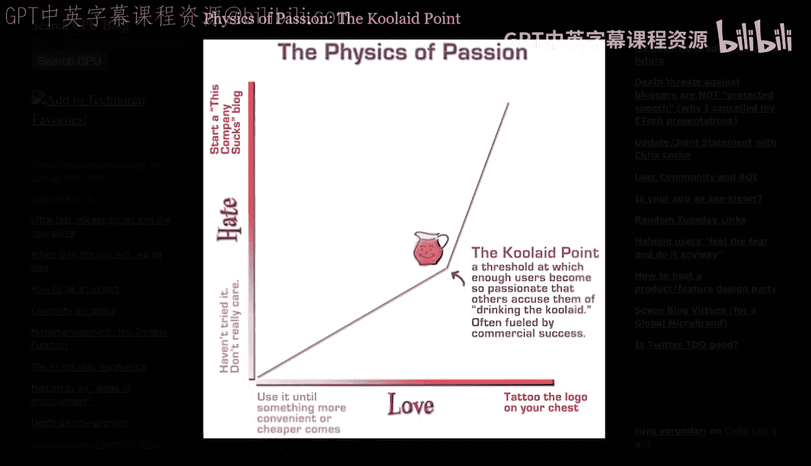

How have you guys over all these years creating so many amazing products not murder each other it's a great story of like partnership。

 What's what can you say about collaboration， what can you say about Jason that you love that you've learned from why does this work So first I'll say we have tried to murder each other several times over the years。

 but far less， I think in the last decade in the early days。Our product。Discussions were so fierce。

Then when we were having them in the office and there were other employees around。

 some of them were legitimately worried that the company was about to fall apart because the volume coming out of the room would be so high and sounds so acrimonious that they were legitimately worried the whole thing was going to fall apart。

 but you know what's funny is that it never felt like that in the moment。

 it always felt like just a peak vigorous search for something better。And that。

We were able to stomach that level of adversity on the merits of an idea because it was about the idea。

 It wasn't about the person。 And it never really got personal， not even never really。

 it didn't get personal。 It wasn't like Jason， you're an ashole。 It was like Jason。

 you're an idiot and you're an idiot because you're looking at this problem the wrong way。

 And let me tell you the right way to do it as a small tangent。

 let me say that some some people have said itll probably return to this that you're sometimes。

can have flights of temper on the internet and so on I never take it that way because it is the same kind of Ilk maybe I haven't seen the right kind of traces of temper。

 but usually it's about the idea and it's just excited passionate human that's exactly what I like to think of it it doesn't always come across as that and I can see why spectators in particular sometimes。

Would see something that looks like I'm going after the man rather than the ball。

 and I do think I've tried to get better at that。 But in my relationship with Jason。

 I think it's worked so well because we have our own distinct areas of competence where we fully trust each other。

 Jason trust me to make the correct technical decisions。

 I trust him to make the correct design and product direction decisions and then we can overlap and share on the business on marketing on writing on other aspects of it。

 So that's one thing is that if you're starting a business with someone where you do exactly the same as they do and you're constantly contesting who's the more competent person。

 I think that's far more difficult and far more volatile。

 So if you're starting a business and you're both programmers and you both work on the same kind of programming。

Good luck。 I think that's hard。 I tried to pick an easier path working with a designer where I knew that at least half of the time。

 I could just delegate to his experience and competence and say， like， you know what。

 I may have an opinion。 I have an opinion all the time on design。

But I don't have to win the argument because I trust you Now， occasionally。

 we would have overlaps on business or direction where we'd both feel like we had a strong stake in the game。

 and we both had a claim to competence in that area。

 but then for whatever reason we also both had a long term vision where I would go， do you know what。

 I think we're wrong here。 But as I learned from Jeff Fas， by the way。

 I'm going to disagree and commit that was one of those early lessons he gave us。

 that was absolutely crucial， perhaps even instrumental in ensuring that Jason and I have been working together for a quarter of a century。

Disagree and commit is one of the old time Je Bezo's greats。

 I'm just surprised that Yokoono hasn't come along。 You know what I mean。

 like there there's's so many yokos in this world。 It might have happened， If not in part。

 because we don't sit on each other's lap all the time。 Most of our careers。

 We haven't even lived in the same city。 Like I lived in Chicago for a couple of years while we were getting going after Id moved to the US in 2005。

 but then I moved to Malibu， and then I lived in Spain and then I lived in Copenhagen and Jason and I from the foundation of our relationship learned how to work together。

In a remarkably efficient way where we didn't have to actually talk that much on any given week。

 I'd be surprised if Jason and I spent more than。Two hours of direct exchange and communication yeah。

 sometimes it's the the basic human frictions yes I think you rub up against another person。

That person damn will better be your spouse if it's too much for too long。 Yeah。

 but even there even there Covid Covid has really test the relationship is fascinating to watch it has。

 And I do think that having some separation， which is kind of counterintuitive because I think a lot of people think the more collaboration you can have the better。

 the more ideas that can bounce back and forth the better。

 And both Jasonson and I for whatever reason came to the conclusion early on in careers absolutely not。

 that's completely boloy。 This is why we were huge proponents of remote work。

 This is why I enjoy working in my home office where I can close the door not see another human for like six hours at the time。

 I don't want to bounce ideas off you all the time。 I want to bounce ideas off you occasionally。

 and then I want to go off and implement those ideas。

 There's way too much bouncing going off and not enough scoring， not enough dunking。

 And I think this is one of the。Great traps of。Executive rule。

Once a founder elevates themselves all the way up to an executive。

 where what they're doing is just telling other people what to do。 That's the realm they live in 24。

7。 They just live in the idea realm。 Oh， I can just tell more people more things what to do。

 and we can just see it happen。 If you actually have to be part of implementing that。

 You slow your horse。 You think， like， you know what， I had a good idea last week。

 I'm going to save the rest of my good ideas until next month。

 And there is a temptation for the managers and for the for the people in the executive。

Layer to do to do something which that' something usually means a meeting yes and so that's why you say their job is telling other people what to do Yeah。

 and the meeting so this is one of the big things you're against is meetings are toxic Yeah and this really。

 I think ties into this with Jason R。If I had to count out the total number of meetings we've had in 24 years of collaborations where we in person sat in front of each other and discussed a topic。

 I probably it'd be less than whatever three months out of fan company。

We just haven't done that that much， but we haven't worn it out one of this funny metaphors that。

Trump came up with at one point was a human has like a limited number of steps in their life right like that's the longevity argument here you can do you can do so much activity and then you run out。

There's some kernel in that idea that can be applied to relationship。

 There's some amount of exchange we can have。 There's some amount of time we can spend together where you can wear it out。

 Jason and I were。Diligent about not wearing each other out。

 And I think that is absolutely key to the longevity of the relationship。

 Com with that level of trust。 and then just combining with the level that we really like the work itself。

 We don't just like the brainstorming。 This says where we just come up with good ideas。

 No we'd like to do the ideas。 And we like to be part of that process directly ourselves。

 I like to program。 He likes to do design。 We could go off and do our little things for long stretches of time。

 Okay， shed come together and go like， hey， let's launch a great product。

 This might sound like I'm asking you to do therapy。😊。

But I find myself to sometimes want or long for a meaning。Because I'm lonely。

Like because remote work is just sitting by yourself。I don't know。

 it can get really lonely for long stretches of time， let me give you a tiphu。Get a wife。

Go get a couple kids family really is the great antidote to loneliness and I mean that as sincerely as I can possibly say it I certainly had exactly that feeling you describe early in my career when I was working remotely and I was just like me living in an apartment total stereotype where for the longest time when I first moved to Chicago all I had on the floor was a mattress and then I bought this big TV and I didn't even moed and then I had a sta at DVDs and I was basically I was working a lot of time and then I would just go home and I' do that and it wasn't great it really wasn't like I do think that humans need humans and if you can't get them at work and I actually sort of kind of don't want them at work at least I don't want for 40 hours a week that's not what I prefer you need something else you need other relationships in your life and there was no greater depth of relationship if you can find someone that you actually just want to spend a lot of time with that's key to it and I think it's key。

For both Jasonse and I that。We've had families for quite a long time and it grounds you to in a way where the sprint of a startup can get traded in for the marathon of an enduring company and you get settled in a way we talk briefly about sometimes I get fired up I mean。

 a lot of times maybe even most of the times I get fired up about topics。

But I don't get fired up in the same way now as I used to when I was 24。

 I'm still like extremely passionate about ideas and trying to find the right things。

 But having a family meeting my wife。Building a life around that has just mellowed everything out in a completely cliche way。

But it， I think it's actually key， I think if we could get more。

Even younger people not to wait until they were in their lit got them 30s or early 40s to hitch up with someone。

 We'd be better off we'd have more stable business relationships as well。

 because folks would get that nurturing human relation somewhere else。 Now when I say all of that。

 I also accept that there are plenty of great businesses that's been built over the years that have not been built remote that have been built by a gang of hooligans sitting in an office for immense hours of time。

 I mean， both John Carmack and Tim Swweeeney talked about that in the 90s with their careers that that was just basically work S hangout with the guys at the office right。

 I totally fair。That never appealed to me， both Jason and I saw eye to eye on the idea that 40 hours a week dedicated to work was enough。

That if we were going to go to distance for not just the five to seven years。

 it takes to build a VC case up to an exit， but for potentially 10 years， 20 years or further。

 we needed to become whole humans， because only that whole humanness was going to go to distance。

 which included building up friendships outside of work having hobbies。

Finding a mate and having a family。And that。Entire。Existence。

 those legs of the stool that work is not the only thing in life is completely related to the fact that we've been around for 25 years。

There's way too much， especially in America of false tradeoffs。

 oh you want to build a successful business， well you can either have money。

 enjoyment or family or health pick one what why do we have to give up all of this now？

I'm not saying and there are moments payers in life where you can sprint。

 but I am saying if that sprint turns into a decade。

 you're gonna pay for it and you're going to pay for it in ways I've seen time and again seemed like a very bad trade that even if it works and by the way。

 most of the time it does not most of the time startups go bust most of the time people spend five。

 seven years or something that does not pan out and they don't get to pay out and then they just sit with regret of like what the fuck happened to my 20s。

Early on， Jason and I basically made the pact。That working together was not going to lead to that kind of regret。

 that we were going to allow ourselves and each other to build a whole life outside of work。And。

The fact that that worked？Is something I feel。Is almost like forbidden knowledge certainly in technology circles in the US it's something that we've tried to champion for 20 years and we still get slack for just two days ago。

 I had another Twitter beef with someone saying like oh well， okay。

 maybe it worked but you didn't turn into it last year so your failure base camp isn't Jra So why you' even bothering and it's such a。

Fascinating winner takes all mentality that unless you dominate everyone else in all the ways you've lost when so much of life is far more open to multiple winners where we can end up with a business that have made hundreds of millions of dollars over the years and we've kept much of that to do whatever we want and that that's enough。

That's good， that's great， that's actually。Something worth aspiring to certainly it should be a path for someone to consider choosing rather than the VC unicorn of bust mentality that dominates everything I'd love to ask you about this exchange so you can explain to me the whole saga。

 but so just a link on that a little bit is I think there's a notion that success。

For tech founder is like。Work for a few years， All out。And then exit。

 sort of sell you a company for it， I don't know， hundreds of millions of dollars。

 that's success when it seems in reality， when you look at who the。People like you。

 like really smart， creative humans， who they actually are and what happiness entails。

It actually entails working your whole life a little bit， just like。

 because you actually love the programming， you love the building， you love the designer。

And you don't want to exit and that's something you've talked about really really eloquently about。

 So like you actually want to create a life where you're always doing the building and doing it in a way that's not completely taken over your life Mojito Island is a mirage It always was there is no retirement for ambitious people There is no just sitting back on the beach and sipping a mojito for what for two weeks before you go damn crazy and want to get back into the action that's exactly what happens to most people who have the capacity to build those kinds of exits。

 I've never seen， I shouldn't say never I've almost never seen anyone be able to pull that off yet so many think that that's why they're doing it that's why they're sacrificing everything because once I get to the finish line I'm golden I've won。

 I can retire， I can sit back I can just relax and you find out that that kind of relaxation is actually hell It's hell for creative people。

To squander。They're God given creative juices and capacities。

I was really lucky to read the book F by Mihai Chicks and Mihai early on。

 the pronunciations you know what I had to practice that with AI over the last few days because I knew I was going to cite him and I butchered his name several times。

 so AI taught me how to pronounce that at least somewhat correctly。But his。Main。

Work over his career was essentially the concept of flow that came out of a search for understanding happiness。

 Why are some people happy， when are they happy and what he learned was quite illuminating he learned that people aren't happy when they sit on Mojito Island。

 they're not happy when they're free of all obligations and responsibilities No。

 they're happy in these moments where they're reaching and stretching their capacities just beyond what they can currently do。

In those moments of flow， they can forget time and space。

 they can sit in front of the keyboard program a hard problem， think 20 minutes of past。

 and suddenly it's been three hours。 They look back upon those moments with the greatest amount of joy and that is what peak happiness is if you take away the pursuit of those kinds of problems if you eliminate all the problems from your plate。

 You're going to get depressed。 You are not going to have a good time。

 Now there are people who can do that， but they're not the same kind of people who built these kinds of companies So you have to accept the kind of individual you are if you are on this path。

Don't bullshit yourself， don't bullshit yourself into thinking I'm just going to sacrifice everything my health。

 my family， my hobbies， my friends。But in 10 years， I'm gonna make it all up because in 10 years。

 I can do it。 It never works out like that。 It doesn't even work。

 it doesn't work out on both ends of it。 It does not work out if you're successful and you sell your company because you'll get bored out of your mind up two weeks on retirement。

 It doesn't work out if the company is a failure and you regret the last 10 years spent for nothing。

 it doesn't work out if it all works and you stay in the business because it never gets any easier。

 So you're gonna fail on all metrics if you just go， there's only work and nothing else and。

I didn't want that。 I wanted the happiness of flow。 I understood that insight was true。

 but I wanted to do it in a way where I could sustain the journey for 40 or 50 years。

 And there's another other interesting caveat that Ive heard you say is that。

If you do exit and you sell your company and you want to stay in， you want to do another company。

That's going to usually not be as fulfilling。 Yes， because really your first baby。

 like you can't do it again， or most people can't do it again。 A。

 because their second idea is not going to be as good as the first one。

 It is so rare to capture lightning in the bottle like we have， for example， with basecamp。

 I know this from experience because I've been trying to build a lot of other businesses since。

 and some of them have been moderate successes， even good successes， none of them have been basecamp。

It's really difficult to do that twice， but founders are arrogant pricks。

 including myself and we like to think that you know what we succeeded in large part because we're just awesome。

 were just so much better than everyone else and in some ways that's true some of the time。

 but you can also be really good at something that matters for a hot moment that that door is open。

 the door close now you're still good at the thing but it doesn't matter no one cares。

There's that part of it， and then there's the part of it that。

Going back to experience things for the first time only happens the first time。

 you can't do it again。 I don't know if I have it in me to go through the bullshit of the early days again。

 And I say bullshit in the sense of the most endearing sense， It's all great to do it。

 I know too much， This is one of the reasons why whenever I' asked the questions。

 if you could tell your younger self， something that would really。

 what would you say to your younger self， I would fucking not say a thing I would not rob my younger self of all the life experiences that I've been blessed with due to the ignorance of how the world works。

😡，Building up the wisdom about how the world works is。A joy。

 And you gotta build it one break at a time。 If you just hand it all the results。 It's like， oh。

 should we watch your movie， here's how it ends。 I don't want to watch the movie now， you spoiled it。

 I don't want you to spoil my business experience。 I don't want to spoil any of my ignorance。

 the greatest blessing half the time when you're starting something new is a。

 you don't know how hard it's going to be B， you don't know when you don't know。

 like the adventure is to pay off。 The responsibility is to pay off。

 This is something Jordan Peterson is really taught me to articulate this notion that responsibility is actually key to meaning。

嗯。Man's search for meaning Victor Frankel talked about this as well。

 that we can endure any hardship if there is a reason why now he talked about it in truly life altering concentration camp ways。

 but you can also apply at a smaller scale with less criticality。Of even just your daily life。

 that all that hardship in building the original business。

 that is responsibility you take upon yourself。The appeal。

 the reason you take that on you is in part because you don't know fully what it entails if you'd known upfront。

 if I' had known upfront， how hard it would be， how much。

Frustration there'd be along the way if you just told me that in a narrative before I got started。

 I would have been like， eh， maybe I should just go get a job。

You said so many smart things there just to pick one。It's funny that sometimes。The advice givers。

 the wisdom givers are have gone through all the bullshit。

 And so there is a degree to which you want to make the mistake。

 So I think I think I would still give the advice of you want to have a stretch of your life or you work too hard。

Including a that fails。 I don't think you can learn the lessons why that's a bad idea in any other way。

 except by doing it。 there is a degree but of course， you don't。

 I think you should stretch should you have to stretch for a decade， I'm not so sure。

 the decade thing is 20s is a special talk。 It's a lot to trade， you don't get your 20s back。

 you don't get your 30s back， you don't get your 40s back。 you really。

 I would have regret it personally， if I hadn't done the other things I did in my 20s if I hadn't had the fun I had。

 if I hadn't have the friends I had if I hadn't build up the hobbies that I did if I hadn't started driving race cars at an early enough age to actually get really good I it。

 if I just gone all in on business。Because I would have got the same out in the end。

 This is something Deerk Svers really taught me is he has this great essay about how when he went for a bike ride。

 he could go really hard all out， and he could do the ride， I think， in whatever 19 minutes。

 or he could enjoy the ride， go 5% slower， do the ride in 21 minutes。😊。

And realize there's only two minutes apart Either I go all in all the time。 there's nothing else。

 I'm completely exhausted at the et and or I travel the same distance。

 and I arrived maybe two minutes later， but I got to enjoy the scenery， listen to the birds。

 smell the flowers， that journey。Is also valuable now。

I say that while accepting and celebrating that if you want to be the best at one thing in the world。

 No， you have to sacrifice everything。 you have to be obsessed with just that thing。

 there is no instant of someone who's the best in the world at something who's not completely obsessed。

 I didn't need the best at anything。 This was a blessing a rare blessing of humility I had early on is like。

 you know what， I am not that smart。 I'm not that good。 I'm not that talented。

 I can do interesting things by combining different aspects and elements that I know。

 but I'm not gonna to be the best at anything。 And that released me from this single obsession which is going on。

 I'm gonna to be the best programmer in the world。 And I know I'm not。

 I fucking fail at it twice before I even got how conditionals work。

 I'm not smart enough to be the best at anything。 I'm not dedicated enough to do that。

 That's a bit of a blessing。 And I think as a society， we have to straddle both celebrating。

Excellence， which we do all the time and celebrating the peak intensity of mission it takes to become that and then also going like do you know what we don't all need to be yeah Michael Jordan is only going to be one of those Well we should say that there's certain pursuits where a singular obsession is required basketball is one of them by the way。

 probably racing if you want to be the best F one in the world if you want to be s you got to be a maniac but I would argue that there's most disciplines like programming。

Allows if you want to be quote unquote the best whatever that means。

 I think that's judged at the end of your life。 And usually if you look at that path。

 it's going to be a nonlinearar one， you're not going to look like the life of an Olympic athlete whose singular focus。

 you're going there's going to be some acid there in the 20s or there's going to be a several detours。

 which should the true greats that's going to be detours。

 and sometimes they're not going to be Steve Jobs asset type of situation。

 there'll be just different companies you've worked for different careers or different。sortrt of。

Efforts you allocated your life to but it's going to be nonlinear。 It's not。

 it's not going to be a singular focus。 The way I think about this sometimes is I want a good bargain on learning。

 I can become。In the top 5% of whatever I defined as good at something。Much， much easier。

 perhaps it's 20 times easier 100 times easier to get into the top 5% than it is to get into the top 0。

1%。 That's almost impossibly hard to get into that。

 But if I'm content just being in the top 5% I can be at the top 5% on like five things at once I can get really good at writing I can get decent at driving a race car I can become pretty good at programming。

 I can run a company， I can have a family， I can do a lot of things at the same time that gives me sort of that variety that almost was idealize called Marx has this idea I'm going to fish in the morning and hammer in the evening and paint on the weekends that there's a sense for me at least where his diagnosis of alienation was true that just that tunnel vision。

 there's just this one thing I'm just gonna focus on that gives me a sense of alienation I can't stomach when I'm really deep on programming and sometimes I go deep for weeks maybe even in a few cases months。

have to come up for air and I have to go do something else all right。

 that was programming for this year I've done my part I'm gonna to go up riding or annoy people on the internet or drive some race cars to do something else and then I can do the programming thing with full intensity again next year speaking of of annoying people on the internet you got to explain to me this drama Okay so what is this guy that said imagine losing tojira but boasting they have a couple million dollars per year so this had to do with this almost now a meme decision to leave the cloud DHH left the cloud。

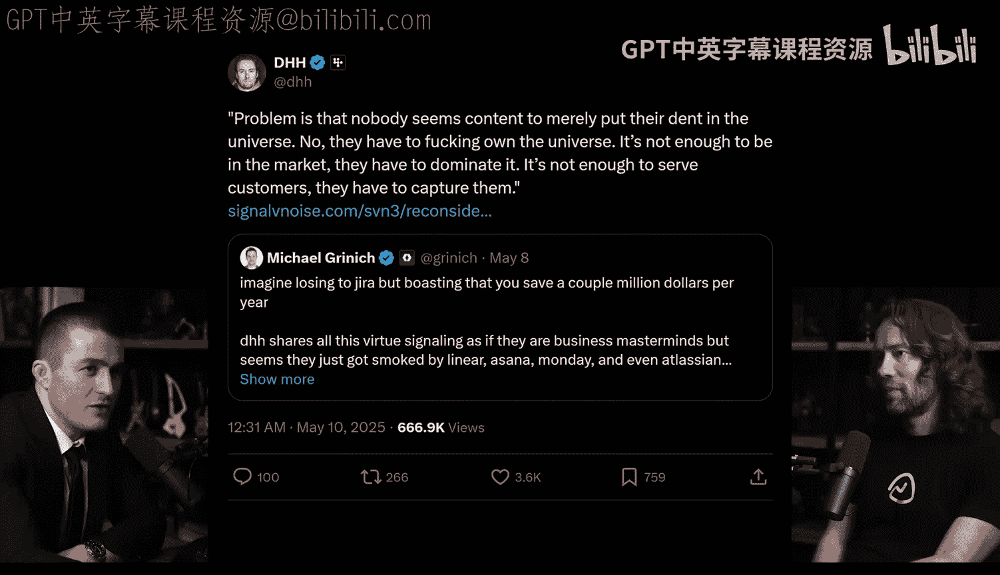

I think that's literally a meme， but it's also fascinating。

Decision Can you talk to the full saga of Tj leaves the cloud Yes。

 leaving AWS saving money and I guess the case this person is making now is that we wasted our time optimizing a business that could have been10 times bigger if we'd just gone for the moon and for the moon includes venture capital but also other things prove not caring about cost。

 but also because AGs around the corner， you should have been investing it into AI right is this this part of sort of tank。

 I think it's a bit of a muddy argument， but if we just take it at it it's。Peak ideal。

 which I actually think is a reasonable point is that you can get myopically focused on counting pennies when you should be focused on getting pounds。

 right that。I've optimized our spend on infrastructure by getting out of the cloud。

 and that took some time。 and I could have taken that time and spend it on making more features that would attracted more customers or spend even more time with AI or done other thing。

 Opun costs is real。 I'm not denying that。 I am pushing back on the idea that for a company of our size。

 saving $2 million a year on our infrastructure bill。

 which is about somewhere between half to two thirds Go directly to the bottom line。

 which means its's return to Jason or I as owners and our employees part of our profit sharing plant。

 is' totally worth doing This idea that costs don't matter is a very Silicon Valley way of thinking that I again。

 understand at the scale of something maybe， but I also actually think it's。

It's aesthetically unpleasing。 I find an inefficient business as I find an inefficient program full of line noise to just be a splinter in my brain。

 I hate looking at an expense report and just seeing disproportionate waste。

 And when I was looking at our spend at 37 signals a while back a few years back。

 I saw bills that did not pass my smell test。 I remembered how much we used to spend on infrastructure before the cloud。

 and I saw numbers I could not recognize in proportion to what we needed。

 The fact that computers had gotten so much faster over time， shouldn't things be getting cheaper。

 Why we spending more and more money servicing more customers， Yes， but with much faster computers。

 Moore's law should be lowering the cost and the opposite is happening， Why is that happening。

 and that started a journey of unwinding why the cloud isn't as great as。

Deal as people like to think that， Yeah， can we look at the specifics just for people who don't know the story and then generalize。

To what it means about the role of the cloud and tech business so the specifics is you were using AWSS3 we were using AWS for everything Okay hey do co launches an entirely cloud app it was completely on AWS for compute for databases for all of it we were using all the systems as they are best prescribed that we should our total cloud bill for。

Basecam， our total spend with AW S was， I think 3。2 million or 3。4 million at its peak。

 That's kind of a lot of mine。3。4 million。 I mean， we have a ton of users and customers。

 but still that just struck me as unreasonable。 And the reason why I was so unreasonable was because I had the pitch for the cloud ringing in my ears。

 Hey， this is gonna be faster。 This is gonna be easier。 This is gonna be cheaper。

 Why are you trying to produce your own power。 Like do you have you on power plant。

 Why would you' leave the computers to the hyperscaleers， They're much better at it anyway。

 I actually thought that was a compelling pitch。 I bought in on that pitch for several years and thought。

 do you know what I'm done ever owning a server again。 We're just going render our capacity。

 And Amazon is going to be able to offer us services much cheaper。

 Then we could buy them themselves because they're gonna have these economies of scale。

 And I was thinking。Jeff's word ring my competitor's margin is my opportunity that was something he used to drive Amazon。

com with that if you could just make 2% when the other guy was trying to make 4% he would end up with all the money and on volume he would still win so I thought that was the operating ethos for AWS it turns out that's not true at all AWS by the way operates it's almost 40% margin so just in that there's a clue that competitors are not able to do the competitive thing we like about capitalism which is to lower costs and so forth。

So the cloud pitch。In my optics is a fundamentally false。 It did not。Get easier， first of all。

 I don't know if you've used AWS recently It is hella complicated。 If you think Linux is hard。

 you've never tried to set up I am rules or access parameters or whatever AW AWS is always difficult。

 it was always。 but I think it's gotten even more difficult。 But yes。

 now some of that is it's difficult because it's very capable and you have a bunch of capacity on tap and there are reasons。

I don't think they're good enough to justify how complicated the whole Jing and Jing has become。

 but what's certainly true is that it's no longer easier is's not easier to use AWS than it is to run your own machines。

 which we learned when we pulled out the cloud and didn't hire a single extra person even though we operate all our own hardware the team stayed exactly the same So you have this threeway pitch right it's going to be easier。

 It's going to be cheaper， certainly wasn't cheaper We've just proved that by cutting our spend on infrastructure by half to two thirds and it's going to be faster the last bit was true。

But way too many people overestimated the value of that speed if you need 1 thousand0 computers online in the next 15 minutes。

 nothing beats the cloud， how would you even procure that if we just need another 20 servers it's going to take a week or two to get boxes shipped on pallets delivered to a data center or unwrapped than racked and all that stuff but how often do we need to do that and how often do we need to do that if buying those servers is way。

 way cheaper so we get vastly more compute for the same amount of money could we just buy more servers and not even care about the fact that we're not hyper optimizeimized on the compute utility that we don't have to use things like automatic scaling to figure things out because we have to reduce cost Yes we can so。

We went through this journey over。A realization in early 2023 when I had finally had enough with our bills。

 I wanted to get rid of them， I wanted to spend less money。

 I wanted to keep more of the money ourselves and in just over six months。

 we moved seven major applications out of the cloud in terms of compute caching databases to works onto our own servers。

 a glorious beautiful new fleet bought from the king of servers Michael Dell who really， by the way。

 it another icon of I saw he just celebrated 41 years in business 41 years this man has been selling awesome servers that we've been using for our entire existence。

 but anyway these pallets arrive in a couple weeks and we rack them up and get everything going and we were out。

At least with the compute part， we then had a long multi year commitment to S3 because the only way to get decent pricing in the cloud。

 by the way， is not to buy。On a day to day basis， not to rent on database basis。

 but to bind yourself up to multiyear contracts with compute。

 it's often a year that was in our case and with storageies was four years。

 we signed a foury contract to store our petabytes of customer files in the cloud to be able to get something just halfway decent affordable。

So。All of these projects came together to the sense that we're now saving literally millions of dollars projected about 10 million over five years。

 it's always hard， how do you do the accounting exactly and TOC， this that and the other thing。

 but it's millions of dollars。But it's not just that it's also the fact that getting out of the cloud mean meant returning to more of an original idea of the internet that the internet was not designed such that three computers should run everything it was a distributed network such that the individual nodes could disappear and the whole thing would still carry on DARPpa designed this such that the Russians could take out Washington and they could still fight back from New York that the entire communication infrastructure wouldn't disappear because there was no hub and spoke。

 it was a network I always found that an immensely beautiful vision that you could have this glorious Internet and no single node was in control of everything and we've returned to much more of a single node controlling everything idea with these hyperscaleers when US East1 the main and original region for AWS goes offline which just happened more than a few times over the years seemingly a third of the Internet is offline like that。

itselfself is just an insult to DRPpa design I it does detract from the fact that what AWs built was marvelous。

 I think the cloud has moved so many things so far forward， especially around virtualization。

 automation setup， it's all those。Giant leaps forward for system administration that's allowing us now to be able to run things onprem in a way that smells and feels much like the cloud just at half to cost or less。

 And with the autonomy and the satisfaction of owning hardware。

 I don't know what the last time you looked at like an actual server and took it apart and looked inside of these things are gorgeous。

 I mean， I pose a couple of pictures of our racks out in the data center and people always go crazy for because we've gotten so abstract it from what the underlying metal looks like in this cloud age that most people have no idea They have no idea how powerful a modern CPU is。

 they have no idea。How much ra you can fit into a one U rack？

Progress in computing has been really exciting， especially I'd say in the last four to five years after TSMC with Apple's help really pushed the envelope I mean we kind of。

SAT still there for a while while Intel was spinning their wheels going nowhere and then TsMC with Apple propelling them really moved things forward。

 And now servers are exciting again。 like you're getting jumps year over year in the 15。

20% rather than the single digit we were stuck with for a while。

 And that all means that owning your own hardware is a more feasible proposition than it's ever been that you need fewer machines to run ever more and that more people should do it because。

As much as I love Jeff and Amazon， like he doesn't need another， whatever。

 40% margin on all the tech stuff that I buy to run our business。And。

This is just something I've been focused on both because of the ideology around honoring DARPA's original design。

 the practicality of running our own hardware， seeing how fast we can push things with the latest machines and then saving the money and。

That has all been so enjoyable to do but also so counterintuitive for a lot of people because it seemed。

 I think for a lot of people in the industry that like we'd all decided that we were done buying computers that that was something we would did just delegate to AWS and Azure and Google Cloud that we didn't have to own these things anymore So I think there's a little bit of whiplash for some people that oh I thought we agreed。

 we were done with that。 And then along come us and say。

 yeah you know what maybe you should have a computer I there some pain points to running your servers Oh plenty there's pain points to operating computers of all kind。

 have you tried just like using a personal computer these days half the time when my kids or my wife a problem might go like have you tried turning it just off and on again computers are inherently painful to humans。

Owning your own computer though kind of makes some of that print worth it。

 There's a responsibility that comes with actually owning the hardware that to me。

 Adelaides make the burden of operating that hardware seem slightly more enjoyable now。

There are things you have to learn certainly at our scale too。

 I mean we're not just buying a single computer and plugging into an Enet。

 we have to have racks and racks to them and you've got to set it up with network cabling and theres some specialized expertise in that but it's not like that expertise is like building nuclear rockets It's not like it's not widely distributed Li the entire internet was built on people knowing how to plug in a computer to the internet right Ethernet cable goes here。

 Power cable goes here。 let's boot up Linux that's how everyone put anything online until 1012 years ago when the cloud sort of took over so the expertise is there and could be rediscovered you too can learn how to operate a Linux computer。

Yeah， and it's， you know， when you get a bunch of them。

 there's a bunch of flashing LEDs and it's just so exciting calming amazing computers are really fun This is actually something I've gotten into even deeper after we moved out of the cloud now my next kind of。

😊，Tingle is that if you could move out of the cloud， can you also move out of the data center？

Personal servers have gotten really scaryarily quick and efficient and personal internet connections rival what we connected data centers with just a decade or two ago。

There's a whole community around this concept of homelaping。

 which is essentially installing server hardware in your own apartment。

 connecting it to the internet and。Exposing that directly to the internet that harks back to those glorious days of the 90s when people building for the internet would host the actual website on their actual computer in the closet and I'm pretty fired up about that I'm doing a bunch of experiments I've ordered a bunch of home servers from my own apartment。

 I marvel at the fact that I can get a five gigabit fiber connection now I think。

 do you know what five gigabit that could have taken basecaamp too。

Multiple millions of MRR in the way that back then I ran the whole business on a single box with 2004 technology and probably 100 meapbit cable like the capacity we have access to both in terms of compute and connectivity is something that people haven't readjusted to and this happened sometimes in technology where progress sneaks up on you this happened with SSDs I love that by the way。

 we designed so much of our technology and storage approach and database design around spinning metal disks that had certain Seer properties and then we went to NVmeE and SSDs。

And it took quite a while for people to realize that the systems had to be built fundamentally different now that the difference between memory and disk was now far smaller when you weren't spinning these metal plates around with a little head that had to read off them。

 you were essentially just dealing with another type of memory。

 I think we're a little bit in that same face when it comes to the capacity of new businesses to be launched literally out of your damn bedroom So you can get pretty far with a large user base with homelaing Abute。

 that's exciting。 That's like the old school that's really exciting。

 It's bringing back the startup in the garage in the literal physical sense of the word。

 Now some of that is do we need to you can get relatively cheap cloud capacity if you don't need very much Oh yes。

 we need to。 I mean， the feeling of doing that by yourself of seeing LED lights。In your own home。

 I mean， there's nothing like that。 There's just an aesthetic to it that I am completely in love with and I want to try to push on now it's not gonna to be the same thing as getting out of the cloud I'm not sure our exit out of the cloud was not the exit out of the data center we basically just bought hardware shifted to a professionally managed data center that we didn't even actually touch this is the other misconception people have about moving out of the cloud that we have a bunch of people who are constantly driving to a data center somewhere to rack new boxes and change De Ram that's not how things happen in the modern world at all we have a company called summit previously defft that is what we call white gloves they just they work into data center when we need something like hey defft can you go down and swap the debt SSD and box number six they do it and what we see is akin to what someone working with the cloud would see you see IP addresses coming online you see drives coming online It's not that different but it is a whole heck of a lot cheaper when you are operating。

At our scale and of course it is， of course it's cheaper to own things if you need those things for years rather than is to rent it in no other domain would we confuse those two things that it's cheaper to own for the long duration than it is to rent there is some gray area like I've gotten a chance to interact with the XAI team a bunch I probably going back out there in Memphis to do a big podcast associated with the Gock release and those folks in order to achieve the speed of building up the cluster and to saw some of the novel aspects they have to do with the GPU with the training。

 they have to be a little bit more hands on less white glove Oh and I love that right they're dealing with a frontier problem and they're dealing with it not by renting a bunch of GPs at a huge markup from their main competitor they're going like no screw that we're gonna to put 1 hundred000 GPUs in our own tents right and build it in absolute record time So I think if anything this is testament to the idea that owning hardware。

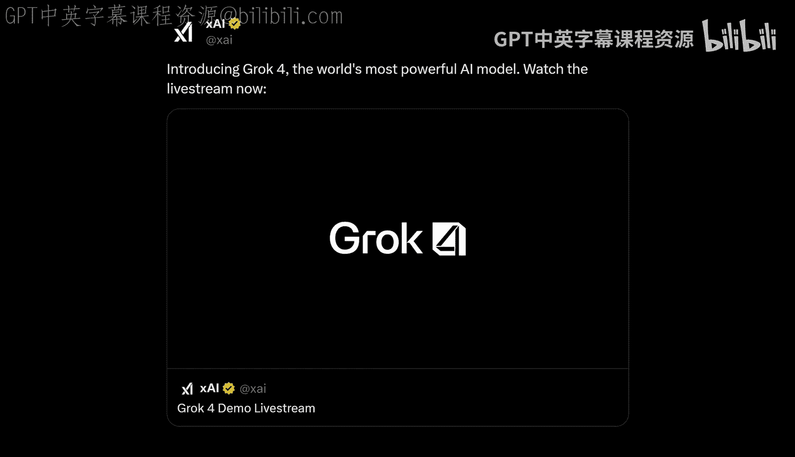

Give you an advantage， both at the small scale at the medium scale and at the pioneer levels of computing。

 by the way， you know， speaking of teams that those are XAI， Tesla or large companies。

But all those folks。I don't know what it is about， He said Jeff is really good at。

Finding good people。At seeing， seeing strength in people like Elon is also extremely I don't know what that is actually I've never actually seen maybe you could speak to that he's good at finding greatness。

 I don't think he's finding as much as he's subtracting。

He's attracting the talent because of the audaciousness of his goals and his mission。

 the clarity by which he states it， he doesn't have to go scour to earth to find the best people。

 the best people come to him because he is talking about Elon here。

 one of the single or most invigorating figures in both the same order of the universe here。

 haters and lovers right， like he's having such an impact that such a scale that of course。

 he's got to have literally millions of people think he's the。Worst person in the world。

 and he's also going to have millions of people thinking he's the greatestd gift to humanity。

Depending on the day I'm somewhere in between， but I'm more on the greatest gift to humanity the end of the scale than I'm on the other end of the scale。

 and I think that really inspires people in a way that we've almost forgotten that。

That level of audacity is so rare that when we see it。

 we don't fully know how to analyze it we think of Elon as finding greattown and I'm sure he's also good at that but I also think that this beacon of the mission we're going to fucking Mars We're gonna transform transportation into using electricity we're gonna cover the earth in internet is so grand that there are days where I wake up and go like what the fuck am I doing with these to- do lists like Jesus should I go sign up for something like that that sounds invigorating in a sense I can only imagine like a biking back in 1050 going like should we go to Normandy you may die along the way but oh boy。

 does that sound like a journey and an adventure There's a few components there's one definitely this bigger than like mission and really believing it you know every other sentence is about Mars like really believing it it doesn't。

matter what like anybody else， the criticism or anything。

 there's a very singular focused big mission， but I think it also has to do a bunch of the other components like being able to hire well once the people once the beacon attracts。

And I've just seen people that don't necessarily on paper have a resume with a track record。

I've I've seen really who now turned out to be like legendary people。

 he basically like tosses them the ball of leadership。

 sees something in them and says like you go and gives them the ownership and they run with it and that that happens at every scale that there's a real meritocracy and like there's something。

U there's， there's just like you could see the flourishing of human intellect in these meetings in these group get getting together where they're like the energy is palpable it's it's it's like exciting for me to just。

Be around that because I don't there's not many companies I've seen that in because when a company becomes successful and larger。

 it somehow suffocates that energy that I guess you see in startups。At the early stages。

 but like it's cool to see at a large company that's actually able to achieve scale you know I think part of the secret there is that Elon actually knows things and when you know things you can evaluate the quality of work products and when you can evaluate the quality of work products you can very quickly tell who's full of shit and who will actually take you to Mars and you can fire the people who's full of shit and you can bet on the people who get us to Mars。

That capacity to directly evaluate the competency of individuals。Is actually a little bit rare。

 It's not widely distributed among managers， hiring managers。

 It's not something you can easily delegate to people who are not。Very skilled at the work itself。

 And Elon obviously knows a lot about a lot。 and he can smell who knows stuff for real。

 And is this at our tiny scale， something I've tried to do in the same order where when we hire programmers。

 for example。It's going to be interesting now with AI as a new challenge， but up until this point。

The main pivot point for getting hired was not your resume。 was not the schooling you've had。

 It was not your grades。 was not your pedigree。 It was how well you did on two things。 a。

 your cover letter， because I can only work with people remotely if they're good writers。

 So if you can't pen a proper cover letter and can't bother to put in the effort to write it specifically for us。

 you're out。2。😡，You have to be able to program really well to the degree that I can look at your code and go like。

 yeah， I want to work with that person。 Not only I want to work with that person。

 I want to work on that person's code when I have to see it again in five years to fix some damn bug。

 So we're going to give you a programming test。😡，That simulates the way we work for real and we're going to see how you do and I've been surprised time and again where I thought for sure this candidate is a shing。

 they sound just right， the CV's just right， and then you see the code getting churn in I'm like no way。

 no way are we hiring this person。And the other way has been true as well。

 I've go like I don't know about this guy or this this woman I don't know。

 and then they turn in their coach stuff and I'm like holy shit。

 can that person be on my team tomorrow preferably？

The capacity to evaluate work product is a superpower when it comes to hiring there's a step that's seen Elon do really well。

 which is be able to show up and say this can be done simpler yes。

 and but he knows what he's talking about and then the engineer because Elon knows enough。

The engineer first reaction， you can kind of tell like it's almost like rolling your eyes if your parent tells you something。

 Yes， this is not， no， we've I've been working on this for a month。

 you don't but then when you have that conversational more you realize no it can be done simpler find the way。

 So there's a good when two engineers are talking one might not have perfect information。

 but if if if the senior engineer has like good instinct that's like been battle earned then you can say simplify and it actually will result in simplification And I think this is the hallmark of the true greats that they not only have the insight into what's required to do the work。

 but they also have the transcendent vision to go beyond what。

The engineer would do the programmer would do。I think if were looking at these rarities。

 obviously the myth of Steve Jobs was also this， even though perhaps he was less technical than Elon is in many ways。

 he had the same capacity to show up to a product team and really challenge them to look harder for the simplification or for making things greater。

In a way that would garner disbelief from the people who are supposed to do it。

 like this guy is full of shit， like this is crazy， we can never and then two months later it is so。

There is something of this where you need。You need the vision。

 You need it anchored by the reality of knowing enough about what's possible。

 knowing enough about physics， knowing enough about software that you're not just buildinging bullshit。

 there are plenty of people who can tell a group of engineers no， just do it faster。

 Like that's not a skill。 It's got to be anchored in something real。

 but it's also gonna to be anchored in。😡，It's a tired word。

 but a passion for the outcome to a degree where you get personally insulted If a bad job is done。

 This is what I've been writing about lately with Apple。 They've lost that asshole。

 who would show up and tell engineers that what they did was not good enough in ways that would actually perhaps make them feel a little small in the moment。

 but would spark that。Zest to really fix it now they have。

A logistics person who's very good at sourcing components and lining up production gantt charts。

But you're not getting that magic。 Now， what's interesting with that whole scenario was I actually thought how well Tim Cook ran things and has run things at Apple for so long that maybe we were wrong。

 maybe we were wrong about the criticality of Steve Jobs to the whole mission。

 Maybe you could get away with not having it。 I think the bill was just going to come later。

 And now it has。 Apple is failing in all these ways that someone who would blow up Steves ghostt and really exal him would say like。

 see， this is what's happening now。 So the other thing here， too， of course。

 is it's impossible to divorce like your perception of what's a critical component of the system and the messy reality of a million different moving parts in the reality of life。

 And you should be skeptical about your own analysis in your own thesis at all time。

 Since you mentioned Apple have to ask somebody in the Internet。submittedubmitted the question。

Does DHA still hate Apple， I believe the question is， so there was a time。

When Bascan went to war with Apple over the 30%， can you tell the saga of that battle？Yes。

 but first I'll tell you I fell in love with Apple， which was all the way back in also early 2000s。

When Microsoft was dominating the industry。In a way we now see Apple and Google dominate mobile phones。

 Microsoft was just everything when it came to personal computers and I really did not like the Microsoft of the 90s the Microsoft of the 90s was the cutoff the air supply to Netscape kind of characters was the Bill Gates sitting defiant in an interview with the DOJ asking about what the definition of what is and just overall unpleasant。

 I think you can have respect for what was achieved。

 but I certainly didn't like it and as we've talked about。

 I came begrudgingly to the PC after Commodore fell apart and I couldn't continue to use the Amiga so I already had a bit of a bone to pick with PCs just over the fact that I love my Amiga so much。

 but then in the early 200s Apple emerged as a credible alternative because they bet the new generation of max on Uni underpinnings。

And that allowed me to escape from Microsoft and suddenly I became one of the biggest boosters of Apple。

 I was in my graduating class at the Copenhagen Business School。

 I started with the first white iBook first person using Mac and by the time we were done and graduating I had basically converted half the class to using Apple computers because I would evangelized them so hard and demonstrate them and do all the things that a superf would do and I continued that work over many years。

 Jason or I actually and I think 2004，2005 did an ad for Apple that they posted on the developer side where we were all about like Apple is so integral to everything that we do and look up to them and we are inspired by them and that love relationship actually continued for a very long time I basically just became a Mac person for 20 years I didn't even care about looking at PCs it seemed。

Relevant to me， whatever Microsoft was doing， which felt like such a relief because。

In the 90s I felt like I couldn't escape Microsoft and suddenly had found my escape and now I was with Apple and it was glorious and they shared so many of my sensibilities and my aesthetics and they kept pushing the envelope and there was so much to be proud of。

 so much to look up to。And then that sort of started to change with the iPhone。

 which is weird because the iPhone is what made modern Apple。

 It's what I lined up in 2007 together with Jason for five hours to stand in the line to buy a first generation product where Apple staff would clap at you when you walked out the store。

 I don't know if you remember that was it was a whole ceremony and it was part of that myth and mystique and all of Apple。

 So I just I wasn't in the market for other computers。

 I wasn't in the market for other computer ideas， I thought perhaps I'd be with the Mac until the end of days。

But。As Apple discovered the gold mine， it is to operate a toll booth where you don't have to innovate。

 where you don't actually even have to make anything where you can just take 30% of other people's business。

 there was a ro that crept in to the foundation of Apple and that started all the way back from the initial launch of the app store but I don't think we saw at the time I didn't see at the time just how critical the mobile phone would become to computing in general。

 I thought when the iPhone came out that like oh it's like a mobile phone I've had a mobile phone since the early 90s well it wasn't a mobile phone。

 it was a mobile computer and even more than that it was the most important computer or it would become the most important computer for most people around the world。

 which meant that if you like to make software and wanted to sell it to people you had to go through that computer。

And if going through that computer meant。Going through Apple's toll booth。

And not just having to ask them permission， which in and of itself was just an dignity when you used to the internet where you don't have to ask anyone permission about anything you buy a domain and you launched a business and if customers show up boom your success and if they don't well your failure now suddenly before you could even launch you'd have to ask Apple for permission that always sat wrong with me but it wasn't until we launched hey in 2001 that I saw the full extent of the rot that has snug into Apple's Apple for people who don' know and we'll talk about it。

 hey is this amazing email sort of attempt to solve the email problem Yes。

 I like to pitch it as what Gmail would have been with 20 years of lessons applied in a way where they could actually ship Gmail was incredible when you launch in 2004 and it still is a great product but it's also trapped。

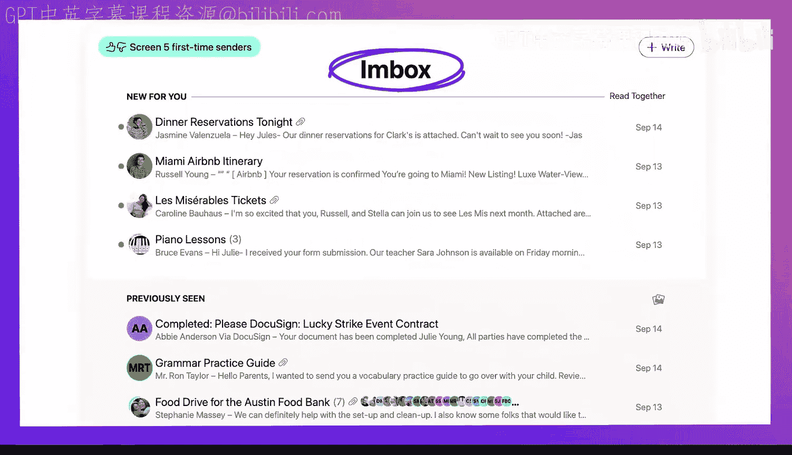

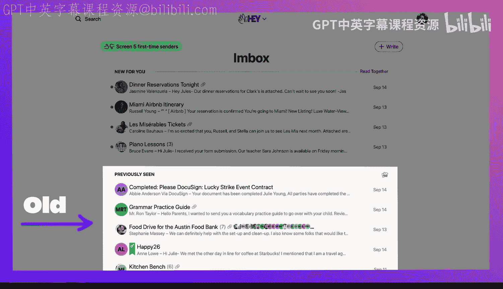

Its initial success， you can't redesign Gmail today， it just has way too many users。

 so if you want fresh thinking on email， I wanted fresh thinking on email。

I needed to build my own email system and not just my own email client。

 That's what a lot of people have done over the years。 They build a client for Gmail。

 but you're severely constrained if you don't control the email server as well。

 if you really want to move the ball forward with email。

 you have to control both the server and the client and that was the audacious mission we set out to do with hey。

 and that was what's funny。I thought our main obstacle here would be Gmail。

 It's the 800 pound gorilla in email space， something like。

70% of all email in the US is sent through Gmail， I think their world rights are probably in that neighborhood as well。

 they're just absolutely huge。And trying to attack an enormous。

Established competitor like that who' so actually still loved by plenty of people and is free。

 seems like a suicide mission。 And it was only a mission we signed up for because we had grown ambitious enough after making base camp for 20 years that we thought we could tackle that problem。

 So I thought， hey。This is dumb。 I would not advise anyone to go head to head with Gmail that seems like a suicide mission。

 We're gonna to try anyway， because you know what， if we fail， it's going to be fine。

 we're just going to build a better email experience for me and Jason and the people at the company and our cat and that'll be okay because we can afford to do so but when we got ready to launch after spending two years building this product。

 millionsions of dollarslls in investment to it， we obviously needed mobile apps。

 you're not going to be a serious contender with email if you're not on a mobile phone and you need to be there with a native client So we had built a great native client for both i and for Android。

And as we were getting ready to launch， we submitted both of them to the app stores。

 got both of them approved on， I think， Friday afternoon for the iOS app and we then went live on Monday and we were so excited。

 Hey world， we've been working on this new thing， I'd love for you to check it out and of course this's with anything when you launched a new product。

 There are some bugs。 So we quickly found a few in the i client and submitted a new build to Apple Hey。

 here's our bug faces， can you please update and that's when I help broke loose。😊。

Not only were they not going to prove our update。They said， oh， wait a minute。

 we gave you permission to be in the app store， but I'm sorry that was a mistake。

 We see that you're not using our inapp payment system。

 which means that we don't get 30% of your business。

 You will have to rectify that or you can't be in the app store。And first I thought like well。

 it got approved already we're running on the same model we've run baseca on in the app store for a decade。

 if you're not signing up through the app and we're signing up our own customers on our own website and they're just going to the app store to download their companion app we're gonna be fine that was the truth right that was why I never got so fired up about the app store even as Apple started tightening the screws was like my business was okay now suddenly my business wasn't okay Apple was willing to destroy hey if we did not agree to give them 30% of all the signups that came through the i app and it wasn't just about the 30%。

 it was also about splitting and not longer having a direct relationship with our customers when you sell an app in the app store。

 you're not selling an app to a customer you're selling an app to inventory at Apple and then Apple sell an app to that customer that customer has a purchasing relationship with Apple。

If you want to give discounts or refunds or whatever， it's complete hell。

 if you want to easily support multiplatform， that's complete hell if someone signs up for hey on their iPhone and they want to switch to Android。

 but that billing relationship it's tied to Apple it's complete hell for a million reasons I did not want to hand my business over to Apple。

 I did not want to hand 30% of our revenue over to Apple。

 so we decided to do something that seemingly Apple had never heard before we said no。

We're not going to add the inapp payment。I don't care if you're threatening us this this is not fair。

 this is not reasonable。Please approve。And， of course， they didn't。 And it escalated。

 And after a couple of days， we realized， you know what， this isn't a mistake。 This isn't going away。

 We're going to be dead if they go through with this。

 if we're not going to yield and give them the 30%。They're going to kick us off unless。

We make such a racket， such noise that they will regret it。 And that's exactly what then happened。

 We were blessed by the fact that we launched hay one week before the WwDC。

 their World developer conference， where Apple loves to get up on stage and harp on how much they do for developers。

 how much they love them and why you should bill for their new devices and so on and so forth。😊。

And then we also just happened to have a platform on the internet。

 which is very convenient when you need to go to war with a $3 trillion company。

 so I started kicking and screaming and essentially turning it up to 11 in terms of the fight and going public with our denial to be in the app store。

And that turned into a prolonged two week battle with Apple that essentially ended in the best possible outcome we could have gotten as David fighting Goliath。

 which was a bit of a truce。 We wouldn't hand 30% over to Apple。

 They wouldn't kick us out of the app store， but we had to build some bullsh。

Dummy account such that the app did something when you downloaded it。

 That was a rule that Phil Schillller seemingly made up on the fly when pressed for the fifth time by the media about why we couldn't be in the app store when a million other companion apps could。

 but we just happened to be able to create so much pain and noise for Apple that it was easier for them to just let us be than to keep on fighting What do you think about Tim Sweeney's victory with that big over Apple I think it is incredible and the entire developer ecosystem not just on I West。

 but on Android as well， Oh， E Tim Sweeney and Mark Ra an enormous debt of gratitude for taking on the only battle that has ever inflicted a serious wound on Apple in this entire sordid campaign of monopoly enforcement and that is E's fight versus them。

Tim recently revealed that it has cost well over 100 million in legal fees to carry on this battle against Apple。

 We， for a hot moment， considered suing Apple when they were threatening to kick us out。

 We shop the case around with a few law firms and perhaps， of course。

 they would tell us you have a good case。 I mean， they're time to sell a product here。

 but they would also tell us， it's going to cost a minimum of $10 million。

 and it's going to take 5 to 7 years through all the appeals。 Now。

 we now learned the actual price tag was 10 times higher， right， Epic spend over 100 million。

 It would have destroyed us to take on Apple in the legal realm。

 only a company like Epic could do it。 and only a company run by founders like Tim， like Mark could。

Risk the business in the way that they did， the audacity they had to provoke the fight in the first place。

 which I thought was just incredible and to stick with it for the long term。

 no board would have signed off on this lawsuit to a professional CEO， no freaking way so。

The fact that they've been able to beat Apple in also the most hilarious way possible。

 I think it's just incredible because remember， their first victory in the case was actually not much of a victory。

 There were about 11 counts in the trial。 Apple basically won10 of them。 and the judge awarded。😊。

E picked this one little win that Apple couldn't tell them not to link out to the internet to be able to do the payment processing So they won this one little thing and Apple。

 instead of just taking the 10 out of 11 wins and going fine， you can have your little links。

 but all these other rules stay in place decided to essentially。

Commit criminal contempt of court as they've now been referred to for prosecution and angered the judge to such a degree that the rule of law in the US now is that you can launch an app in the app store and you don't have to use in app payment。

 but you can have a direct billing relationship with a customer if you just link out to the open internet when you take the credit card and then hop back into the app。

And we owe all of that to Tim and Mark， we owe all of that to E。

 we're going to launch new apps any minute now， I hope actually and next week to take advantage of this that revamp the hay app such that people who download the hay app off the Apple app Store can sign up in the app。

😡，And can then use the web to put in their credit cards so we don't it to pay the 30% of we have a direct billing relationship and such that they can take that。

Subscription to Android to PCcs whatever without any hassle and we have Tim and Mark to thank for it Yeah。

 Tim， I mean， the like you said， founders。But also specific kind of founders because I think maybe you can educate me on this but。

Tim is somebody who maintains to this day sort of the unreasonableness of principles。

That's what I love， I think sometimes maybe even with founders， you can get worn down。

 it's a large company， there's a lot of smart quote unquote people around you lawyers and just whispering your ear over time and you're like。

 well just be reasonable being a， you know， this is a different thing。ToTo be the sort of maintain。

 I mean Steve Jobs did this， maintain still are the asshole， Yes， who says no。Yes， whole company。

 I'll sync this whole fucking company over this。 That's the exact language basically I used in our original campaign。

 I will burn this business down before I hand over 30% of it to Apple。And that sort of indignation。

 that actual rage is something I try to be a little careful about tapping into because it is a little bit of a volatile compound because I mean。

 I have a bunch of employees， we have a bunch of customers。

 it would be pretty sad if the journey of 37 signals after 25 years would come to an end because Apple would burn us down or I would burn the business down over this fight with Apple。

 but I think you also need that level of conviction to be able to even drive day to- day decisions。

One of the other Apple examples。 I know are raging on Apple a little bit here。

 and I don't actually hate them。 I really don't。 I am tremendously disappointed at the squandered relationship that did not need to be sold away for so little。

 Now， I understand that the app store told bootho is actually pretty big business。

 It's multiple billions。 But Apple is a trillion dollar company。 And I think in the lens of history。

 This is going to come off as a tremendous mistake。

 And I think it's already coming off as a tremendous mistake。

 The flop that was the Vi pro was partly because Apple had pissed off every other developer。

 no one was eager to come build the kind of experiences for their new hardware that would perhaps I've made it a success。

 So when you're on top， and you have all the cards。

 you can dilute yourself into thinking that you can dictate all terms at all times and there are no long- termm consequences。

 Apple is learning finally， the fact that there are long term consequences。

And that developers actually are important to Apple's business and the relationship is not entirely one sided。

 we don't owe our existence to Apple and Apple alone。 We've built our own customer bases。

 Apple has been beneficial to the industry。 I'm glad the iPhone exists。 data da。

 it's not that it doesn't go both ways， but Apple wants it only one way， and I think。

That is a mistake。It's a mistake that was avoidable。 And a， that's disappointing。

 Certainly disappointing for me。 I've literally spent 20 years evangelizing this shit， right。

 I've spent so much money buying Apple hardware， exusing a bunch of things they've done over the years。

 and then。For what？For the fact that you wanted 30% of something that I created in the most unreasonable way possible。

Couldn't we have found a better way to do this， I think they're to get forced to do a better way。

 but did you also have to go through the indignity of having a criminal contempt charge against you getting referred to prosecution。

 it just seems so beneath Apple， but it also seems so in line with what happens to huge companies who are run by quote unquoteprofession managers rather than founders and unreasonable people Well。

 we should probably also say that the thing you love about Apple the great spirit of Apple I think still persists and there's a case to be made that this 30% of things is a slice。

 a particular slice of a company， not a defining aspect of the company。

And that Apple is still on top in the hardware that it makes and a lot of things that it makes。

You know， this is that could be just a hiccup in a long story of a great company that。

Does a lot of awesome stuff for humanity。 So like Apple is a truly special company。

 we mentioned Amazon。 Theres no company like Apple。 I agree。

 This is why the disappointment is all greater because we had such high aspirations and expectations to Apple that they were the shining。

City on the hill， and they were guiding the industry in a million positive ways。 I think。

 as we talked about earlier， hardware is exciting again， in large part。

 because Apple bought PA semi and pursued a against all odds mission to get arm up to the level it is today。

 and we have these incredible M chips now because of it。😊。

And。The design sensibilities that Apple bring to the table are unparalleled。 No one has taste。

 certainly at the hardware level， like Apple does。 even at the software level。

 I'd say there's a lot of taste left in Apple。 But there's also some real sour taste now。

 So they have to wash that off first， I think before they find they wear back。

 But Apple's been in in a miage before。 I mean， Wassniak and Steve Jobs started this thing in the garage。

 has great success with the Apple too。 he hands the company over to a sugar or drink salesman who tanks the company into the 90s。

 he doesn't learn a lesson， spends the next 20 years building up this amazing company。

 then hands the company over again。To a logistics person who。

Presumably he had more redeeming qualities than the first guy who put in charge。

 but still ends up leading the company astray now。This is the norm。

 the norm is the great companies don't last forever。In the long arc of history。

 almost no company lasts forever。 there are very few companies around that was here 100 years ago。

 even fewer 200 years ago， and virtually nothing that are 1 thousand years old outside of a handful of Japanese sort makes or something like that。

 right so you can get diludeted into thinking that something is forever when you're in the moment and they seem so large。

 Apple could absolutely stumble， and I think they have more reason to stumble now than ever。

 they're behind on AI terribly behind。Their software quality is faltering in a bunch of ways。

 The competition is catching up on the hardware game in part because TSMC is not an Apple subsidiary。

 but a foundry that services AM D and Nvidia and others were now able to use the same kind of advanced processes。

 This is something I learned after not looking at PC hardware for the longest time that holy smokes。

 AM D actually makes CPUus that are just as fast， if not faster than Apples。

 they're not quite as efficient yet， because arm has some fundamental efficiencies over X86。

 but they're still pretty good。 So Apple should have reason to worry。

 Apple's shareholders should have reason to be concerned。 not just about all these stumbles。

 but also by the fact that Apple is run by old people。 Apple's board has an average age of。

 I think 75。 Their entire executive team is above 60 now。

That sounds horribly ageist and in some ways it a little bit is in the same way I'm ageist against myself like I'm 45 now。

 and I sort of kind of have to force myself to really get into AI。

Because it is such a paradigm shift and a lot of people when they reach a certain age are just happy to stay with what they know。

 they don't want to go back to being a beginner， they don't want to go back to having to relearn everything。

And I think like， this is a little hard for me at 45， how the hell do you do that at 75？

I have to come back to you。 you mentioned it earlier， your parent。

 can you speak to the impact that becoming a father has had on your life。

I think what's funny about fatherhood is that for me， I wasn't even sure something I wanted。

It took meeting the right woman， and letting her。Convinced me that this was the right idea before we even got started。

 I didn't have starting my own family on the list of priorities in my late 2s or even early 30s。

It was really the impetus of meeting my wife， Jamie and her telling me， this is what I want。

I want to have a family， I want to get married， I want to have kids， I want to have three。

And me going。For a second， like whoa whoa whoa。And then， all right， let's do it。And I think。

That's the kind of happy accident where some parts of my life have been very driven where I knew exactly what I wanted and how to push forward to it and what the payoff was going to be。

But when it comes to having a family。That always felt like a very fuzzy。

 abstract idea that ch someday， maybe， and then it became very concrete because I met a woman who knew what she wanted。

And。Looking back on it now。It almost seems。Crazy， like there's this fork in the road of reality where if that hadn't happened and I had been sitting here now。

 not being a father， not having a family。The level of。

Regret knowing what I know now about the joys of having that family。Would have been existential。

Would have been。I don't know if they would have been devastating。

 I think men have a little bit of a longer window to pursue these things than women do。

 there are just certain biological facts。But。Ending up with the family I have now。

 ending up with my three boys have been。Just the transformative experience in the sense that here's something that turned out to be the most important thing。

And it was an open secret， not even an open secret。 It was an open truth。 Through all of history。

 You listen to anyone who's ever had children。 They will all say my children are the most important to me。

 Yet somehow that wisdom couldn't sink in until you were in the situation yourself。

 I find those truths fascinating when。You can't actually relay them with words I can tell you， hey。

 likes。What are you doing， get a wife， make some kids？Get a move on it。And these are just words。

 they're not communicating the gravity of what it actually feels to go through the experience and you can't really learn it without going through it now of course you can be influenced then whatever we can all help contribute and little sparks and little seeds can grow in your mind about it。

 but it still has to happen。And。Now that I am in this situation and just to sheer joy on a daily basis where you think your level of life satisfaction is on a scale of one to 10。

And then the satisfaction of seeing your children understand something， accomplish something。

Learn something， do something， just be just goes like， oh my God。

 this scale doesn't go from one to 10， it goes from one to1 hundred and I've been playing down here in the one to 10 range all this time and there's a there's a one to a hundred。

That has been humbling in a way that。Is impactful in and of itself。

 This whole idea that I thought I had a fair understanding of like the boundaries of life。

In my early 30s， like， what is this about， I mean， I've been on this earth long enough now here to know something。

 And you， I don't know。 I did not know。 I did not know that the scale was much， much broader。

 And I've often talked about。The joys of having kids and just seeing your own DNA。

 which is remarkable to me because literally that's been the pursuit of humans since the dawn of time。

 I am here today because whenever 30，000 years ago some Neanderthal。

Had the same realization that I should procreate and I should continue my bloodline。

 and that that all amounts to me sitting here here now but。

It didn't become a practical reality to me before meeting the right woman and I think that that's sometimes not part of the conversation enough that there's something broken at the moment about how people pair up in the Western world and it's at the source of why we're not having enough children because there's not enough couples。

 there's not enough marriage， there's not a lot of these。

 there's not enough of all these traditional values that even 50， 60， 70 years ago。

Was just taken for granted。 We're in this grand experiment of what happens if we just remove a bunch of institutions。

 What happens if we no longer value marriage as。Something to aspire to what happened if parenthood is now seen in some camps it's almost something like weird or against your own self expression。

 it's a grand experiment that。I'm kind of curious how it turns out I'd prefer to watch it as a movie like the children of men of like that was a good show。

 I kind of wish that wasn't reality， but we're seeing that reality play out while I'm sitting here in a very traditional two parent loving household with three children and going。

嗯。This is now at the top， I've done a lot of things in my life。Built software。

 built companies have raised cars， have done all sorts of things。

And I would trade all of it in a heartbeat for my kids that's just a really fascinating human experience that the depth of that bond is something you can't appreciate before you have it but。

I also think there is a role to play to talk it up because we're being bombarded constantly with reasons why not to Oh it's too expensive well you could get divorced and then you might lose half there's all these voices constantly articulating the case against marriage。

 the case against having children。That those of us who've chosen to do the traditional thing。

To get married and to have children， have an obligation， to kind of talk it up a little bit。

 which would have seen ridiculous again， 50 years ago that you'd have to talk up something so fundamental of that。

 but I have become，Kind of obligated in that sense to do just that， to talk it up。

 to say do you know what， you can look at everything that I've done and if you like some of those parts。

 realize that to me in the situation，The kids， the family， the wife is more important than all of it。

 and it sounds like a cliche because you've heard it a thousand times before and by becoming a cliche。

 maybe you start believing it's not true that it's just something people say。

But it is reality I know almost no parents that I have personal relationships with that don't consider their children to be the most important thing in their life。

 So there's a lot of interesting things he said So one， it does seem to be。I know a lot of。

parentsarents。Perhaps more interestingly， I know a lot of super successful people who are parents。ho。

Uh really love their kids and who say that the kids even helped them to be more successful。Now。

 the interesting thing speaking to what you're saying is it does seem for us humans。

 it's easier to articulate the negatives。Because they're sort of concrete， pragmatic， you know。

 it costs more， it takes some time， you know， they could be， you know， crying all over the place。

 they're you know， tiny narcissists running around or whatever， which is all true， but yeah。

 pooping everywhere， that kind of stuff。but to articulate the thing you were speaking to of。

There's this little creature that you love more than anything you ever loveds in your life。

It's hard to convert that into words， you have to really experience it， but I' I believe it。

And I want to experience that， but I believe because just from a scientific method have seen a lot of。

People who are not honestly not very capable of love fall completely in love with their kids， Yes。

 like， you know， very sort of， let's let's just call what it is engineers that are very like sop up Yes。

 they just fall in love and it's like， all right。people who just like you said they don't really want they don't really care or don't really think about having kids that kind of stuff once they do it changes everything so you know。

 but it's hard to convert into words one of the reasons I think it's also difficult is。I mean。

 I like kids， not that I actively dislike them。But when I was around other people's kids。

 I didn't have a emotional reaction。 some women have right， they see a baby and they go。

 I never never had any emotion of that。 I mean， I could appreciate。

 I I'm glad for you that you have children。 It did not provoke anything in me。

The emotions that have provoked in me when I look at my own children。

This this doesn't exist in the same universe so you don't have something。

 you don't have a complete parallel or at least a lot of men or at least me。

 I didn't have sort of a framework to put it into。 What would it be like to have my own child and then you experience it you just it's like the。

😡，And it happens so quickly too， this is what I found fascinating。

 it happens before that little human is even able to return any words to you that the love you develop to an infant。

It happens quite quickly， not necessarily immediately， I don't know。

 different people have different experiences， but it took me a little bit， but then once it hit。

 it just hit like cake of a horse。And。I love that it's also just such a universal experience that you can be the most successful person in the world。

 you can be the poorest person in the world， you can be somewhere in the middle。

 and we share this experience that being a parent，For most of them。

 turns out to be the most important thing in their life。But you know。

 it is really nice to do that kind of experience with the right partner。

 but I think because I'm such an empath， the cost of having the wrong partner is high for me。

 but then I also like realized man， have a friend of mine who's divorced happily and he still loves the shit out of his kids and its still beautiful IMSMS but there's all of that love is still there and it's you know you just have to make it work。

It's just that I don't know that kind of like divorce would destroy me。

 You should listen to the School of life。 He has this great bit on YouTube you will marry the wrong person If you accept upfront that you will marry the wrong person that every potential person you can marry is going to be the wrong person on some dimension they're going to annoy you。

 they're going to be not what you hoped in certain dimensions。

 the romantic ideal that everything is just perfect all the time is not very conducive to the reality of hitching up and get making babies。

Because I think as you just accounted， even when it turns to shit。I find that。

Most of the people I personally know where things have fallen apart and have turned to shit。

Never in a million years would they go like I regret it。

 I would rather my children did not exist because a relationship turned sour。

I mean I think you should try very hard and I think this is also one of those things where we didn't fully understand。

Thoset fences。 And when we pulled them up and celebrated how easy it is to get divorced， for example。

 that that wasn't going to have some negative consequences。 I'm not saying shouldn't have divorces。

 I'm not saying return to。Times passed， I am saying， though。

 that civilization over thousands of years developed certain technologies for ensuring the。

Continuation of its own institutions and its own life that perhaps we didn't fully appreciate。

 I mean， again， this is something Jordan Peterson than others are far more articulate to speak about and that I've learned a lot to just analyze my own situation。

 Why is it that this incredible burden it is to be responsible for someone else's life that you brought into this world。

Is also the most rewarding part of existence。 That's just curious Before I heard Peterson articulateticulate the value of taking on the greatest burden。

 You know， how to carry。 I always thought about burdens as a negative things。

 Why would I want the burden of a child。 I might screw it up。 I might be a bad parent。

 They might have bat out， all this stuff。 right， all the reasons why you shouldn't And so few voices are tickulating why you should。

 Yeah， but there I should also add on top of that thing you mentioned。 Currently。

 perhaps in the West， The matchmaking process。Is broken iss broken and technology made it worse。

 It's fascinating It whole thing that that hasn't been solved So hiring great teams that's probably been solved the best out of matchmaking finding great people to hire right second finding great friends that's like thats also hasn't been solved and it's breaking down is breaking down and third is matchmaking for like relationships that's like the worst and in fact。

 technology made it even worse Yes， it's fascinating it is it's a great example again of how all the greatest。

Intentions still LED us straight to hell。 I really enjoyed Louis Perry's analysis of。😊。

The sexual revolution not being an unqualified good。

 which was something I hadn't thought about at all before she articulated it， that， of course。

 women should be able to have freedom and self termination and abortions and all of these things and。

Louise Perry is not arguing against that either， of course。

 but there are second order effects that we don't appreciate at the time。

 and we may not have readym solutions for。 And that's just interesting。

 You make life better in a million different ways， and somehow we end up more miserable。 Why is that。

 Why is it that humans， find meaning in hardship。 And I think。Some of that is that。

It's a difficult question to answer through science。And again， Peterson the ticketdes well。

 this idea that you have to find some of it through art， some of it through authors。

 some of it through different。I was just about to say modes of knowing before I stop myself because that sounds like woo bullshit。

 but there are different ways to。Acquire those deep lessons that。

Sort of a paper is not going to tell you， I mean， this is really。The point。also applies to religion。

 for example， if you remove from society the softer of religion， yes。

 you better have a good replacement and we've had a bunch of bad replacements。

 especially over the last few decades。Religion is one of those things I've struggled with a lot because I'm not religious。

But I sort of wish I was。I can now。Fully appreciate the enormous value having an operating system like that brings not just at the individual level。

 but rather at a societal level。 and it's not clear at all what the answer is。

 I think we've tried a lot of dead ends when it came to replacements。

 and people have been filling that void in a million different ways that seem worse than all the religions。

 despite their faults in a myria of ways have been able to deliver。 Yeah。

 religions like the cobalt code。 It's just yes。It's the institutions where we don't fully understand the rules and why they're there and what's going to happen if we remove them some of them。

Seems obvious to me or just bullshit of the time Oh you shouldn't need whatever shellfish because in that region of the world there was something。

 something something Okay fine， but there's a bunch of other things that are pivotal to keeping society functioning for the long term and we don't fully understand which is which What's the bullshit and what's the load bearingar pillars of society Can you speak to the hit on productivity that kids。

Have did they increase your productivity decrease it， or is that even the wrong question to ask。

 I think it's one of the reasons why ambitious people are often afraid of having children because they think I have so much more to do。

 and I barely have enough time now， How would I possibly be able to accomplish the things I want to accomplish。

 if I add another human into the mix now a。We've always worked 40 hours a week， not 80 or 100 or 120。

 I think that's very beneficial B。Kids。Don't exist in this vacuum of just them alone being entered into your life。

 hopefully there's a partner。And in my life， I'm married to a wonderful woman who decided to stop working her corporate job when we got together and have been able to carry a huge part of that。

Responsibility， I was just about to say burdenton， and I think that's exactly how it often gets。

Presented， especially from a feminist perspective， that caring for your own children is some sort of unpaid labor。

That has to be compensated for in some specific way beyond the compensation of what。

Bringing life into this world， racing。Wonderful humans。

 there's something screwy about that analysis that I actually think the modern Tra movement is a reply against whether they have all the answers。

 I'm certainly not sure of either， but there's something that's just not right in the analysis that children are a burden and that if。

Woman chooses to stay at home with the kids that that some sort of failure mode of feminist ambition。

 I think that's actually a complete dead end。 Now depends on different people。

 different circumstances。 I can just speak to。My life being married to a wonderful woman who have decided to。

Be home with the kids。At least at their early age and taking on a lot of that was responsibilities。

 Now that doesn't mean there isn't plenty of ways that I have to be part of that and have to chip in。

 but it's allowed me to continue to work to 40 hours a week that I've。Always worked。

 but it's made the 40 hours more strict I have a schedule where I wake up。

Whatever 630 and we have to get out of the door a little before eight。

 I usually have to play at least one or two rounds a fortnight with my youngest sometimes middle child。

 then take the kids to school， get in start work at， I don't know of839， then work until five，530。

 sometimes six o'clock， but then dinner。And I have to be there for that。

 And then I have to read to the kids。 And by the time that's done， I don't want to go back to work。

 So my work。Time really is9 to 5，9 to 6， depending of whatever is going on。

 Sometimes there's emergencies。 and you have to tend to them， but it's made it more structured。

 And I found some。So some benefit in that。 and I' find some productivity in that that I can't goof around quite as much that the day will end at around 536。

 That's just if I didn't accomplish what I wanted to do today， if I get to that time， it's done。

 I'm over， I have to。Try again tomorrow， whereas before having a family and before kids。

 I could just like not do it and just make it up in the evening。 So in that way。

 it's made me more structured， but it hasn't really changed my volume of work all that much。

 I still work about the same amount of hourss。 And that's， by the way enough。 This is one of the。

Key points we make in it doesn't have to be crazy at work the latest book we wrote is that there's enough time 40 hours a week is actually a ton if you don't piss it away most people do piss it away。

 they piss it away in meetings， they piss it away on just stuff that doesn't matter when。

Even three hours， four hours of concentrated uninterrupted time every day would move to goals they truly care about way down the field。

 I think kids do make you more productive in that way for people who need it。

 especially people like me， they create their urgency like you have if you have to be done by five it's a maybe counterintuitive notion。

 but，For people like me who like to work。You can really fill the day yes。

 with fluff of work and if you have to be done by five。

You're going to have to do the deep work and get it done like really focused singular work Yes。

 and then you's just gonna cut off keeps you honest。

 it keeps you honest because you can you can squander one day， you can squander two days。

 but if I squander a whole week。I feel terrible。Now that's just some drive I have in me where I feel content and full meaning if I actually do stuff that matters。

 if I can look back upon the week and go like that was that was a nice week， really， we move forward。

 maybe we didn't get done， but we moved forward and everything got better。

And I think it's really helped just time box things in that way。

And a lot of people need that because I find just so much of the。

Celebration of overwork to be so tiresome Oh I work 60 hours or 80 hours。

 100 hours a week and just like， first of all， no you don't， no。

 you don't like those 80 hours are full of all sorts of fluff that you label work。

 but that I would laugh at and that most people laugh at that you would laugh at if you actually did the analysis of where that time going。

Most of the important stuff that have to be done is done in these uninterrupted chunks of two hours here or four hours there or five hours there。

 the hard part is making sure you get them in the whole piece so don't give me don't give me that there's time enough and also。

What's so important？That it ranks above continuing your lineage， I think there's just some。

Ancient honor in the fact that again， this DNA that's sitting on this chair traveled 30000 years to get here and you're going to squander all that away just so you can send a few more emails There is something that's also hard to convert into words of。

Just the kind of fun you can have just playing with your kids I don't know what that on the surface it's like I gonna have that kind of fun just playing video games by myself。

 but no it's like there's something magical about it right I have a thousand hours logged in fortnite since 19。

 I think。All of it with my kids。 I'd never be playing fortnite。 Well。

 I don't know if I never would be。 I wouldn't be playing a thousand hours a fortnight if it wasn't for my kids。

 The enjoyment for me is to do something with them that I also happen to enjoy。

 I really love fortnite， It's a phenomenal game， I don't have to force myself to play that with them。

 I often ask like， hey do you want to play fortnite。

But still it's an activity that I get to share with them。

 it's a passion that I get to share with them I've started doing go karting with my oldest。

 I've been driving race cars for a long time and now they're getting into go carting and just being at the go carart track。

 seeing them going around， seeing them get faster or seeing them learn that skill。

You just go look at like。What else would I be doing with my life？My age 45。

 I'm standing here truly enjoying life I brought into this world What else is it it was so important at this stage that I would otherwise be spending my time on。

All right， like you mentioned， you like to race cars and you do it at a world class competitive level。

 which is incredible。 So how'd you get into it， What attracts you to racing。

 What do you love about it， The funny thing about getting into racing is I did not get my driver's license until I was 25。

 I grew up in Copenhagen Denmark。😊，Where the tax on cars is basically over 200%。

 so you pay for three cars and you get one， and I didn't even have the money for one car。

 let alone three， so I could not afford a car growing up， we did not have a car growing up。

 but Copenhagen is a nice city to be able to get around on a bike or with a bus or as I did for a long period of time on rollerbls。

But。😡，When I was 25， I realized I wanted to spend more time in the US。

 I wasn't sure yet that I was going to move there that turned out later to be true。

 but I knew that if I wanted to spend time in the US I needed to have a driver's license。

 I was not going to get around very well if I didn't know how to drive a car。

 so I got a driver's license at 25， then ended up moving to the US later that year。

And I'd always been into video games， racing video games。Mr。

 Polton Street Racer on the Dreamcast was one of those games that really sucked me into it was the precursor to Project gottham。

 which was the precursor to essentially force a horizon I think okay I think that's what how the lineage goes just a great game I actually just fired it up on an emulator a few weeks ago and still sort of kind of holds up because it has enough real car dynamics that it smells a little bit like driving a real car's not just like an arcade racer like Sega rally or something like that。

 but I'd always been into that then I got my driver's license at 25。

And moved to the US and then two years later， a friend that I'd met in Chicago took me to the Chicago Audubon Country Club。

 which is this great track about 45 minutes from Chicago。

And I sat in a race car and I drove a race car for the first time。And I had。

The same kind of pseudo religiouslig experience I did as when I started working on Ruby where。

I did maybe 20 laps in this， basically a master race car from， I think like the 90s or something。

 like a pretty cheap race car， but a real race car， single seatedar， manual gearbox。

 but exposed slick wheels， all the stuff and after having had that experience。First of all。

 it was just the most amazing thing ever like the physical sensation of driving a race car is really unique and I think if you earn a car fast。

 you have a maybe a 2% taste of it。The exposure to the elements that you get in a single seat race car。

 especially one like that where your head is actually out in the elements。

 you can see the individual wheels and you sensation of speed is just so much higher is at a completely different level So can you actually speak to that so even at that even at that mazda。

So you can feel what can you feel like the track reverberating you not only can you see the bumps because you're literally looking straight at the wheel。

 you can feel all the bumps because you're running a slick tire It's a really stiff setup iss nothing like taking a fast street car out on a racet and try to driving a little bit around So can you feel like the slipping you can feel a that's a that's a huge part of the satisfaction of driving a race car is driving in at the edge of adhesion as we call it where。

The car is actually sliding a little bit a couple of percent slip angle is the fastest way to drive a race car you don't want to slide too much that lookss gray。

 lots of smoke， but it's not fast。 how you want to drive it is just at the limit of ahesian where you're rotating the car as much as your tires can manage and then slightly more than that。

And playing at it， keeping it just at that level because。

When you're at the level of or at the limit of adhesion。

 you're essentially just a tiny movement away from spinning out。I mean。

 it doesn't take much then the car starts rotating， once it starts rotating。

 you lose grip and you're going for the wall。That。😡。

Balance of danger and skill is what's so intoxicating and it's so much better than racing video games too because the criticality is taking up two notdges I often think about people really like gambling where I think like aren't you just playing poker and like no。

 the point is not poker Pors may be part of it， but the point is that I could lose my house right like that's the addiction that some people get to gambling that there's something real on the line。

When you're in a race car， there's something very real underlying if you get it wrong。

At the very least。You're going to spin out and probably hit a wall and it's going to be expensive at the very worst。

You're not getting out alive。 And even if modern race cars have gotten way safer than they used to be。

 there is that element of danger that's real that there are people who still get seriously hurt or even killed in a race car it's。

Mercifully rare compared to what it used to be when those maniacs in the 60s would do Formula one and whatever 13% of the grid wouldn't make it to the end of the year because theyd just die in a fiery flaming fireball。

 but there's still some of it there， and I think that。

Since that there's something on the line really contributes to it， but it's more than that。

 there's just a physical sensation， there's activation of all your forces， there's the flow。

And I think。That really cements like why I got addicted because I always， I love that flow。

 I got out of programming， but getting flow out of programming is a very inconsistent process。

 I can't just sit down in front of a keyboard and go like， all right。

Let's get the flow going It doesn't happen like that the problem has to be just right it has to meet my skills in just a right moment。

 it's a bit of a lottery in a race cars not a lottery at all you sit down in that car。

 you turn the ignition， you go out on track。And I get flow virtually guaranteed。

Because you need or I need at least 100% of my brain processing power to be able to go at the speed I go without crashing。

😡，There's no time to think about dinnerner night or the meeting next week or product launch it just it's complete send in actually the literal sense of the word I think of someone who's really good at meditation that's probably kind of state they get into it's just clear you're in the now there's nothing but you and the next corner That's a really addictive experience so after that that I couldn't get enough I just I kept going to the track every opportunity I got every single weekend for about four years I would go to the track。

And by the end of that time， Id finally worked up enough skill。

And enough success with the company that I could afford to go quote unquote real Ra。

So I started doing that， I started driving these Porses， and then as soon as I got into that。

 as soon as I got into quote unquote real competition， I was like。

 I wonder how far you can take this and it didn't take that long before I decided， do you know what？

I could take this all the way。 My great hero in racing is Tom Christensen。 fellow Dane。

 the mist the Lama， as they call him， the greatest endurance race in the world。

 The 24 hours of Lama has been won more times than any other by Tom Christensen。

 He won the race nine times。😊，So Tom。Just really turned me on Lama。

 I've been watching Lama since I think the 80s， I have my earliest memories of watching that on TV。

 The race has been going since 20s， but in the 80s， I got kind of into it。 And then in the late 90s。

 early 2000s when Tom started winning I like pretty much every other Danne started watching the race almost religiously。

 So I thought you know what， I want to get to Lama and this is the magic thing about racing that。

If I get into basketball， I can't set a realistic expectation that I'm going play in the NBA that I'm going to go to the finals or I get into tennis and I'm going to play to Wimbledon that just doesn't happen but racing is special this way because it requires a fair amount of money to keep these cars running。

 It's really expensive。 It's like having a small startup you need to fly a bunch of people around the world and buy expensive equipment and so forth。

 so you need a bunch of capital and I had some through the success of the company So I could do it which meant that I could get to Lama So I said that as my goal I want to get to Lama。

And I started racing in real competition 2009 and three years later in 2012。

 I was at the Gr of Lamont for the first time， we should say， so Lamont， 24 hour race endurance。

this is insane。 There are three drivers， mind you。 So it's not like one guy just driving for 20 hours。

24 hours straight， but still， it's a pretty tough race， both physically and mentally。

 especially mentally when you've been up for 24 plus hours you're not quite as sharp as when you first wake up and this is funny about Lama too。

 it starts at around  four o'clock in the afternoon。

 So you've already been up for half a day by the time the race starts and then there's 24 hours to go before youre done and you'll be in the car for anywhere from usually an hour and a half to a maximum of four hours。

 the regulations say four out of6 as max you can do I've spent perhaps two and a half hours in a single stint at Lama It's pretty taxing。

 you're going。

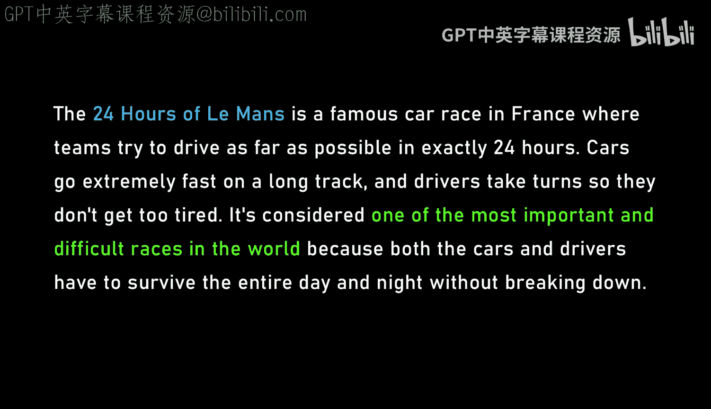

200 miles an hour。Into some of these turns and there's another 60 cars on track。

 whenever I'm in my normal category， which is the LMP2 category。

 I have GT cars which are more like a Ferrari and a Porsche that I have to overtake and then I have these hypercar which is the top class that are overtaking me so you've got a lot going on。

And you gotta stay sharp for two and a half hours straight to do that that is just a guaranteed way to get incredible flow for long。

 long stretches of time that's why you get addicted to it that was why I got a addict you gotta talking me through this video this video of you in these LM2s this is such a cool this is so cool this was probably my favorite battle of my career shut。

And Harma Hanson has beat paused to add fight Yeah。

 so this is me driving against Nikko Miller at the Shanghai International circuit You're on the outside I'm on the outside in the haku and white and we go a whole track around with basically a piece of paper between a seat down this back straight I get so close to him because I want to force him over on the other side of the track such that he can't just box me in。

And we've been fighting already at this point for basically 40 minutes straight I've been managing to keep this professional driver behind me for 40 minutes and he finally passes me。

 but we just keep the battle on for the whole time and it really just shows both these kinds of cars the Lamont prototypes we don't actually ever touch。

 we get within about an inch and keep going around Shanghai circuit to how did you get so good？

Like what， I mean that's a fascinating story right that you are able to get so good I'm pretty good for the kind of driver I am。

 which is called a gentleman driver， which means I'm not a professional driver and like many good gentleman drivers when we're at our really best。

 we can be quite competitive with even professional drivers who have been doing this their whole life。

The difference between us and the professionals is the professionals could do it every time or more or less every time。

 so I can't be this good all the time。 when everything is just right。

 I can be competitive with professional drivers， but that's not how you win championships。

 that's not how you get paid by factories to drive。

 you've got to be good every time you go out So that's a huge difference。

 but some of it was also just I really put my mind to it。

By the time I realized race cars is what I want to do as my serious hobby。

 I put in thousands of hours。Have you crashed， What's the worst crash， I've had a lot of crashes。

 But thankfully nug on wood。 I haven't had any crashes where I've gotten really seriously hurt。

 Have you like wrecked the car。 Oh， yes， oh， yes， I've wrecked many a car。

 So what what that feel like just you wreck a car like how do you get It feels like total shit if you're in a real race and other people depend on you。

 It's not even so much to car， although it's also sometimes that these cars are expensive to repair and that sucks and it feels so wasteful in a way。

 when you crash some of these cars。But the sense that you're letting a team down endurance racing is the team sport。

 not only do you have your mechanics， you usually have co drivers， so when I crash。

 I just feel like damn it。I could have avoided this。 Yeah， but also， you could have died。

 Do you know what's funny， I never think about that。 I don't think you can。

 because I think the moment you start thinking about。Being able to die， you can't do it。

 you can't go fast， well， I'm sure not not to go all Carl Young and Freud here。

But I'm sure that's always present in the back of your mind somewhere you're not just bringing it to the surface it is in the sense that it's part of the appeal。

 it's part of the sense that there's something on the line that this isn't just virtual。

 I can't just hit reset， restart， reboot。If I crash this car。

We're going to be out or we're going to be disadvantaged or it's going to get destroyed or I might get hurt。

Lightly hurt a few times I actually had the year we won 24 a little in our class。

 I'd been training in this formula 3。5 car that's a really fast car。

 it's a really nice exercise to do， but it's also it doesn't have power steering。

So some of these race cars， especially the open Cedars。

 they don't have power steering which means that the steering wheel is basically directly connected to the front wheels。

So if you crash one of those cars and the front wheels suddenly turn。

 you're really gonna hurt your hands if you don't get your hands off the wheel I hadn't raised enough of those cars to know that I had to get or do I have to instinct to have developed the instinct that I had to get my hands off the wheel so I didn't and I really hurt my hand and this was just I think a month before the 24 hours so I thought man I'm gonna have to miss it this year I had like not a cast it was just seriously sprained and then somehow miraculously like a week before the event I was like yeah actually it's okay now so got to do it and that would have been grave regret if I would have seen my team go on to win the race and I would have to sit on the sidelines。

 but I really have been quite fortunate in the sense that most of my crashes have just been expensive or sporting inconvenient They've never been。

Something where I got seriously hurt， but I've seen plenty of people who have， in fact。

 my co driver this year and for several years， Petro Fiipaldi drove a race car at Spa。

 Spa is one of the great race tracks of all time and has this iconic corner called Arrouge。

 which is probably the most famous corner in all of Moports that has a great compression before you。

😊。

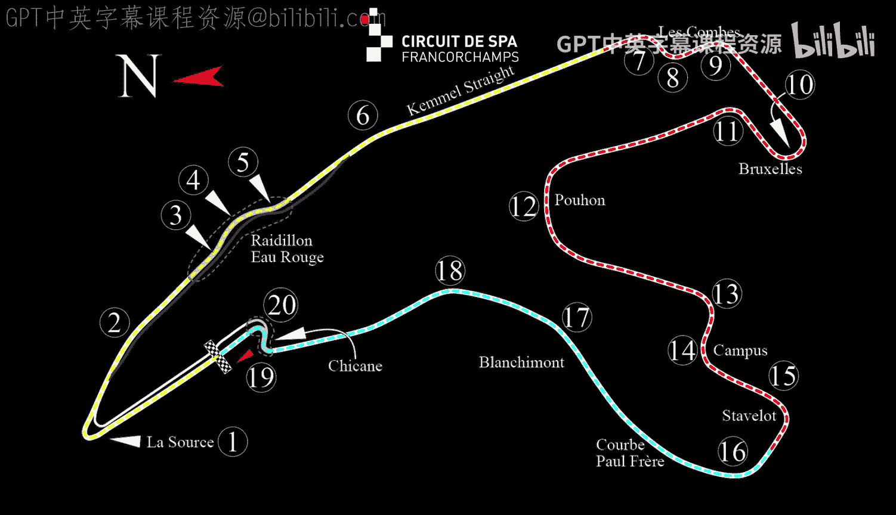

Climb uphi it's extremely fast very difficult corner and just as he does in compression。

 his car basically sets out and he loses his power steering and he drives straight into the wall and breaks both his legs and basically face the prospect that maybe his career was over i've had other。

Teammates and people I know have serious injuries that's really hurt them。And yet。

 what's funny as you say。You'd think that would sink in？第。Year before， we won。In 2014。

 that same car had a Danish driver in at Laman at the race I was driving， who died。He。

Lost control of the car when there was a bit of rain on the track and the track went。

 unfortunately designed in such a poor way that there was a very big tree right behind the railing。

And he。Hit that tree at full speed， pulled。90 Gs and was dead on the spot。

Which was just such an extremely awful experience to go through。I finished second that year。

 which should have been cause for a bunch of celebration。But it was just tainted by the fact that。

Not only did a driver die， a fellow Dane died， a guy I knew died。Yeah， that was。

That was pretty tough。So that throw that into the pile of the things that have to be considered is the weather conditions that commission mentioned of the track。

Whether it's dry or wet， it's a huge part of it， even just last year at Lamon。It was raining。

 and I was out。And I hadn't made a serious mistake at the 24is， since I。Did the first race in 2012。

 where I put it。In the sand trap with like four hours to go and we lost a couple of laps getting pulled out。

 but it didn't actually change anything for our result because that was just how the field was spread out I'd made minor mistakes over the years but nothing that really set us out and that the race last year when it was raining。

I first clobbered a Ford Mustang when I made an over ambitious pass on a damp part of the track and couldn't stop in time and then felt absolutely awful as I SAT in the gravel pit for two laps and knew that our race was over。

 A race where we were highly competitive。 You're not blessed with a competitive car。

 a competitive team and competitive setup every year。 I know how rare that is。

 So to know that we had had a chance that year。 And I sort of squandered it， felt really bad， but。

That got compounded， I got back on track， barely made it another stint and then put it into graveappl trap again when it started raining on the interest into P。

This is part of why racing is so addicting to because the highs are very。

 very high when you win a race like the 204 little mo it feels just incredible there's so much emotion。

 but if you fuck it up， the lows are very very low What are the things you're paying attention to when you're driving Whats what is what are the parameters。

 What are you loading in are you feeling the grip are you basically increasing the speed and seeing what like a constant feedback system effect it has on the grip Are you' trying to。

Manaage down and try to find that optimal slip angle。Are you looking around using your eyes？

A you smelling things or you're listening， you' feeling the wind？

Are you always looking at the field to like how howd you not hit that guy at all you get close with an inches or you have to pay attention to that too it's really interesting about that specific battle where we're literally a few inches apart。

I can't fully explain it， but humans can develop an incredible sense of space where I can't see the edge of the back of my car。

 but I can know exactly where it is。 I can have a mental model in my head that gives me the exact dimensions of this car such that I can run within a few inches of a competitor car or within a few inches of the wall and not hit either when things go well the car is about two meters wide and it's quite long5 meters and you can't see everything。

 The mirrors are actually kind of shit。 there's no rearview mirror in these cars you can't see out the back you can only see through your two side mirrors but you form this intuitive mental model when you get good enough at this。

 but。What I actually pay attention to most is I run a program What I try to do when I go to a racetrack is I try to load up the best program I know how for every single corner what's my break point what's my acceleration point what's my break trailing curve and I try to pick up that program in part just by finding it myself and how fast I can go but even more so than that by copying my professional competitors or not competitors codrivers so I usually always race with a pro and modern race cars produce an absolute enormous amount of data and you can analyze all that data after each outing you can see an exact trace of how much you pushed the brake pedal how much you did in terms of steering inputs when you got on the gas you can see every millisecond you're losing is evident in those charts so what I try to do is I try to look at the chart and then I try to load that in and that's what I got to do。

7I actually I have to be 10 bar lighter on the bright so I try to load that program in and then I try to repeat it Now then there are all the things that changes。

Your tires change quite a lot。 These tires are made to only last 40 minutes in many cases。

 Sometimes at Lama， we can go longer， but at some racetracks。

 they'll last as little as 40 minutes before they really fall off。

 So you got to manage that that the grip is constantly changing So your program I have to suddenly fit those changing circumstances and then in adjourn racing。

 you're constantly interacting with other cars because you're passing slower classes or you're getting passed by a faster class。

 So that's part of the equation and then you're trying to dance the car around the limit of adhesion。

 So you got all those factors playing at the same time。 But above all else for me is to。

Try to become a robot like how can I repeat this set of steps exactly as I'm supposed to for two and a half hours straight without making。

100 milliseconds worth of mistakes， Yeah， low latency algorithm that's really a huge part of it。

 actually， your latency is enormously important in terms of being able to catch when the car starts slipping you get this sensation in your body that the G forces are a little off。

 the slip angle is a little off and then you have to countert。

And obviously the best race car drivers just feel like an intuition I have some intuition。

 I don't have all of it， so I do occasionally spin my car。

 but that's the challenge from everything you've studied and understand what what does it take to achieve master in racing like what does it take to become the best race car driver in the world？

Obssession is part of it when I。Read and hear about Senna and the other great star。

Just singularly focused Max Vataappen is the current champion of the world。

 and he is the same kind Max has been fascinating to watch， I mean。

 he's a phenomenal race car driver， but he also。Literally does nothing else when he's not at the racetrack。

 he's driving Sim racing like he's literally in video games。

 doing more racing when he's not doing all the racing he's already doing。

 I there specific skill they have that like stands out to you as supernatural through all that obsession like what。

Is it a bunch of factors or are they actually able to like you said develop a sense is it is it they're able to get to the very edge of the slip they're able to develop very fine tuned sensibilities for when the car is sliding they can feel just these tiny moments or movements in the chassis that transports up usually through their ass that's why you call like a butt meter that goes up and you feel like the car is loose or you feel like you're just about to lock up。

You can really hone that tuning then the other thing is you have to have really good reaction time and when you look at。

Great Form One drivers Day can。Generally have a reaction time of just under 200 milliseconds。

 which is awesome and even 10 milliseconds difference makes a huge difference。

 you'll see it when the form of one grid， for example。

 they do a standing start and you see the five red lights come on and when the last light goes out。

 they're supposed to release the clutch and get going。

And they can time this so you can see exactly who has the reaction time and even being off by 20 milliseconds can make the difference of whether you're in front or behind at the first corner how much of winning is also just this the strategy of josting for position there's some of that and some of it is also just nerve who wants it more that's exactly when。

That sense of danger comes in there's a great quote from Fernando Alonso when he was driving at Susuka against Summarka。

 I think they're coming up to this incredibly fast corner it's very dangerous and Alonso basically accounts I was gonna make the pass because I knew he had a wife and kids at home that's so just absolutely right wow that I knew he valued life more than I did so there's a bit of poker sometimes in that who's gonna yield。

There's a bit of chicken ray in that regard。And sometimes it doesn't work。

 no one yields and you both crash， but very often one person will blink first。

 can the pass be both on the inside and the outside or you can pass wherever you want as long as you have just a slight part of the car on the racetrack。

And then you just improvise and take risks。 What a， what a sport What Andcent， of course。

 is like a legendary risk taker。 Yes， and even before him， by the time， I mean， he died in the 90s。

 But by the time we got to the 90s， racing was already a lot safer than it was when Niky Louer raced in the 60s。

That level of danger is no longer there。 There's still just a remnant of it and it is still dangerous。

 but nothing like that。 And it's a little hard to compare through the ages like who's the greatest driver of all time。

 I think there's a fair argument that Senna is but we don't have the data we don't know who he was up against like how would he far if we pitted him against Maxtaappen today I do think sometimes that you can have a bit of a nostalgia for the all time greats but。

The world moves forward and new records are being set all the time。

 and the professionalism keeps improving。 Sometimes to the detriment of the sport。

 I think there's a lot of professional drivers who are not only just very good at driving。

 but a very good at being corporate spokespeople， And it used to be quite different。

 There used to be more characters in racing that had a bit more personality that they were allowed to shine because there weren't a billion sponsorships on the line that they were afraid to lose。

 ridiculousdic question， what's the greatest car I've ever made or maybe what's the funnest one to drive。

The greatest car for me of all time is the Paganny Sada。Okay。

 I'm looking this up paganida So the pagani Sada was made by this wonderful Argentinian called Hiraio pagani my God。

 that's a beautiful car。 it's a gorgeous car。 You can look up mine。 It's the pagani Soa H H yep so。

That's a car I had made in。2010。After we visited the factory in modern and by sheer accident。

 ended up with。This car， but it became my favorite car in the world basically when I watched an episode of top gear。

 I think in 2005。Where one of the presenters were driving the Pagani Sada F around。

 and I just thought that's the most beautiful car in the world。

 it is the most incredibly sounding car in the world。If I one day have the option。

 this is what I want。And then I have the option in 2010。

 I've had the car ever since I'm never ever going to sell it。

 It's truly a masterpiece that stood the test of time。

 There's some great cars from history that are recognized as being great in their time。

 this car is still great Have you taken it on the racetrack I have It's terrible at that but I want to say it's terrible that that's not what it's designed for It's designed for the road and that's why it's great。

 there are a lot of fast cars that are straddling there race car for the road。

 you don't actually want a race car for the world。 a race car for the world is a pain in the ass。

 It's way too stiff。 It's way too loud， it's way too uncomfortable。

 you can't actually take it on a road trip So this actually feels good driving totally and you of course always go to speed limit always This is why I love having this car in Spain because theyre a little more relaxed not entirely relaxed but more relaxed than they are in a lot of places in Denmark。

 I kit you not if you are on the highway and you go more than twice the speed。😊，う？

They confiscate your car and keep it you're not getting it back they don't even care if it's your car or not like if you were boring my car and you went twice the speed limit。

 it's gone。So they don't do that in Spain， I mean in most places except for the German Audubon。

 they get pissy if you go to twice the speed limit for all sorts of fair reasons and not advocating that you should be going much more than that but there are certain special roads where you can't open things up and no one's in harm's way and that's an incredible sensation and I do think that some of those speed limits actually are kind of silly and I'm not just saying that in a vacuum in Germany。

 they have the glorious Audubon and on the Audubon there is no speed limit in a bunch of segments。

And they're so committed to their speed limitless Audubon， which is by the way。

 very weird of Germans， they usually love rules they usually very precise about and then they have this glorious thing called the Audubon。

 there was a great case a couple of years ago where a guy took out abugadi Shiron when 400 kilometers an hour on the Audubon and he filled I put it on YouTube and a case was brought against him because even though they don't have a speed limit。

 they do have rules that you can't drive recklessly and he won the case。

 he wasn't driving recklessly， he was just going very。

 very fast I done to Audubon a couple of times my wife and I went on a road trip in Europe in 2009。

And I got the Lamborgni guto we were driving up to 200 miles an hour and I'd driven 200 miles an hour or close to it on a racetrack before that feels like one thing driving on a public road 200 miles an hour feels really。

 really fast scary actually a little scary， Yes， because you constantly think like，On a racetrack。

 you know the road， you know the surface， you can walk to track and most of the time。

 you can know if there's a dip on a public road， you can't know if there's suddenly a pothole won't believe there's not going to be a pothole on the German Audubon。

 but it does feel a little scary。But also exhilarating。 speede is just intrinsically really fun。

 I don't know anyone。 I've taken out in a fast car。 Well， actually， I do know a few people。

 Most people I take out in a fast car。 They grinned。

 it's a human reaction to grin when you go really fast。 Do you know what the fastest you've ever got。

 I was probably at Lama， I think when the L2s were at their maximum power and had 600 horse power and really stickky tires。

 We were going 340 km now， which is just over。😊，200 miles an hour。

 a bit over200 miles an hour's that does feel fast and it's really interesting with speed is that the difference between going。

 let's say， 150 and 160 doesn't feel that much actually those 10 miles an hour。

 but the difference between going 190 and 200 feels crazy faster。

 which has a percentage change is actually less than going from150 to 160 but there's some sense of exponentiality once you get up to those limits where it's just on a complete different level。

 Yeah because to me， like 110120 feels fast200 thats that's crazy it really is crazy。

I gotta ask you about the。The the details of your programming setup， the ID， all that kind of stuff。

 let's paint the picture of the perfect programming setup。

 do you have a programming setup that you enjoy or you very flexible like how many monitors？

What kind of keyboard， what kind of chair， what kind of。Dek， it's funny because if you'd ask me。

 let's see a year and a half ago， I would have given you the same answer as I would given anyone for basically 20 years。

I want to Mac。I like the magic keyboard， I like the single monitor Apple makes an awesome 6K 32"ch XDR screen that I still haven't found anyone who've beaten that I still use even though I switched away from Apple computers I still use their monitor because it's just fantastic but I've always been a single screen kind of guy I do like a big screen but I don't want multiple screens I've never found that that really works with my perception I want to be able to just focus on a single thing I don't want all of it all over the place and I've always used multiple virtual desktops and be able to switch back and forth between those things。

But the setup I have today is Linux that I switched to a little over a year ago after I finally got fed up with Apple enough that I couldn't do that anymore。

 and then I use this low profile mechanical keyboard called the low free flow 84。

Which is just the most glorious sounding keyboard I've ever heard。

 I know there are a lot of connoisseurs of mechanical keyboards that'll probably contest me on this。

 this is too thier too clickier， too clackier or whatever。

 but for me the low freeee flow 84 it's just at the light that I did not even know existed。

 which is so funny because I mean I've been programming for a long time。

 mechanical keyboards have been a thing for a long time and the keyboard when you look at it like this。

 it just kind of it looks plain， it doesn't look extravagant but。

The tactile sensation you get out of pushing those keys the talky sound that you hear when the keys hit the board is just sublime and I'm kicking myself that I was in this Mac bubble for so long that I wasn't even in the market to find this I didn't I knew mechanical keyboards existed。

 but to be blunt， I thought I was a bit of a nerd thing that only real nerds that were much more nerdy than me would ever care about。

And then I got out of the Apple bubble。 And suddenly I had to find everything again。

 I had to find a new mouse。 I had to find a new keyboard。 I had to find everything。 And I thought。

 like all right， let me give mechanical keyboard a try。

 And I gave quite a few of them a try the keykon is one of the big brands in that。

 I didn't like that at all。 I tried a bunch of other keyboards。

 And then I finally found this keyboard。 and I just went like。

Angels are singing wherever have you been my whole life。

 we spent as programmers so much of our time interacting with those keys。

 it really kind of matters in a way I didn't fully appreciate I used to defend the Apple magic keyboard like it's it's great it's actually a great keyboard and I think for what it is this ultra low profile ultra low travel is actually a really nice keyboard。

But once you've tried a longer travel mechanical keyboard， there's no going back。

You do have to remember in many ways both on the software side and the hardware side that you do spend a lot of hours Yes behind the computer it's worth it's worth investing in and also worth exploring until you find the thing where the age just start singing what have exactly right and I actually do regret that little bit especially with this damn keyboard I think I could have been listening to these beautiful thy keys for years and years。

But sometimes you have to get really pissed off before you open your eyes and see that something else exists。

 I feel the same way about Linux， so I've been using Linux on the server since。

Late 90s probably if we ran servers on Linux back then I never seriously considered it as a desktop option I never ran Linux before directly myself I always thought you know what I just I want to focus on programming I don't have time for all these configuration files and all this set up bullshit and whatnot and Apple is close enough is build on un underpinnings why do why do I need to bother with Linux and again it was one of those things I needed to。

Try new things and try something else to。Realize that there is other things other than Apple and again。

 it's not because I hate Apple I think they still make good computers。

 I think a lot of the software is still also pretty okay。

 but I have come to realize that as a web developer。

 Linux is just better Linux is just better it's closer to what I deploy on the tooling is actually phenomenal and if you spend a bit of time setting it up。

You can record a reproducible environment that I've now done with this Aakcube concept or project that I've done that I can set up a new Linux machine in less than 30 minutes and it's perfect it's not pretty good it's not like I still need to spend two hours on it's perfect because you can code all aspects of the development environment into this and I didn't know I didn't even know to be fair that Linux could look as good as it can if you look at a stockcobuuntu or Fiora boot I mean not that it's ugly but I'd pick the Mac in day of the week you look at you look at Ammakuup I mean I'm biased here of course because I built it with my own sensibilities but I look at that and go like this is。

Btter this is beautiful。 and then you look at some of those true Linux rising setups where people go nuts with everything and you go。

Oh yeah， I remember when computers used to be fun in this way when there was this individuality and this setup and it wasn't just all bland the sameness。

And I think that's a flip side sometimes of something like Apple where they have really strong opinions and have really good opinions。

 they have very good taste and it looks very nice and it also looks totally the same and Linux has far more variety and far more texture and flavor sometimes also annoyances and bugs and whatever but I run Linux now it's abuuntu base with the Yamakuop stuff on top the low freeee keyboard I use a Loitech well it's called the MS3 mouse which I love how it feels in my hand I don't love how it looks I actually was。

Magic mouse Stan for the longest time。 I thought it was genius that Apple integrated the trackpa into a mouse。

 and I used that and I always thought it was ridiculous that people would slag it just because you had to charge it by flipping it over because the battery would last for three months and then you'd charge it for half an hour。

 I thought like that's a perfect。Compatibility with my sensibilities。

 I don't mind giving up a little inconvenience if something is beautiful and that magic mouse is beautiful。

 but it wasn't gonna to work on Linux so I found something else then DMm3 is nice。

 but I sometimes do wish like the magic mouse that pretty good Yeah Linux is really great for customizing everything for tiling for macros for all of that I also do the same in Windows with auto hockey or just customize the whole thing to geo your preferences if you're a developer you should learn how to control your environment with the keyboard。

It's just it's faster， it's more fluid， I think one of those silly things I've come to truly appreciate about my Almacoup setup is that I can in whatever time it takes to refresh the screen。

 probably five milliseconds switch from one virtual desktop to another。

Even on windows can't get it that smooth get close， can't get it that smooth on。

Ma O OS for whatever reason， Apple insists on having this infuriating animation when you switch between virtual desktops。

 which makes it that you don't want to， you don't want to run fullscreen apps because it's too cumbersome to switch between the virtual desktops the kind of immediacy that you can get from a wonderful Linux setup in that regard it's just next level it seems like a subtle thing but difference in milliseconds and latency between switching the virtual desktops for example I don't know it changes it changes how you used a computer it really does similar thing with VR right if there's some kind of latency or it just completely takes you all out of it and it's funny I actually had to watch I think it was the primgen on YouTube when he was showing off his setup and I was seeing how quickly he was switching between those virtual desktops and I'd always been using virtual desktops but I didn't like switching too much because just that latency and it's like oh you can do that on Linux that's pretty cool so I run that。

And then my editor of choice now is Ne。 Oh good。 All right Well， we're out of time。

 All right you did for many， many years， used what is a textmate。 Yes。

 textmate that was actually that was the main blocker of moving away from Apple everything else I thought。

 do you know what I can swing it but textmate was and is a wonderful editor one I helped birth into this world。

 the programmer Alan Ugel is a good friend of mine all the way back from those the party days when we were lugging our computers around and he was a big Mac guy and in 2005。

 he was writing this editor and I helped him with the project management of kind of keeping him on track keeping focus on getting something released because I really wanted it for myself And I thought this was the last editor I thought I was never gonna switch forgive me for not knowing but how featureful is this editors It's quite featureful。

 but。

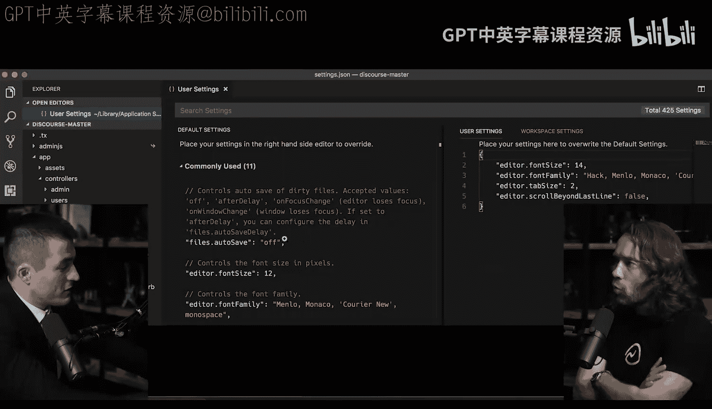

It's。AGee driven editor in some regards， it was really early on with ways of recording macros and having sort of sophisticated syntax highlighting and it did a bunch of first and it was just a really pleasant editing experience I think these days a lot of people would just use VS code VS codes exist in the same universe as textmate in some ways and actually I think it' compatible with the original textmate bundles the original textmate format so it really trailed a path there but it also just didn't evolve Now a lot of people saw a huge problem with that。

 they were like， oh， it needs to have more features and needs to have all these things I was like I'm happy with this text editor that hasn't changed that all basically when Alan stopped working on for a decade or more。

 I don't need anything else， because as our original discussion went I don't want an ID I don't want the editor to write code for me。

 I want a text editor I want to interact with characters。Directly。And knee themm。

Itows me to do that in some ways that are even better than text me and I love textm。

 but BI as you know， once you learn the commands and it sounds。

 I sometimes feel like BI fans overplay how difficult it is to learn because it makes them perhaps seem kind of more awesome that they were able to do it。

 it's not that difficult and it doesn't take that long in my opinion to learn just enough combo moves。

To get that high of holy shit， I could not do this and any other and how long it it take you。

 and by the way， I don't know， I'm still I haven't yet I know intellectually。

 but just like with kids I haven't。You I haven't gone in all the way and I haven't used you you have a treat in mind Well I switched in about I had three when I switched here about a year ago。

 I had three days of cursing where I thought it was absolutely terrible and it was never gonna happen and I had three days of annoyance and already the next week I was like this is sweet I'm not going anywhere but I also had a bit of a head start about 20 years ago in early200 I tried vim for like a summer and it didn't stick I didn't for whatever reason love it at the time but Neovim is really good The key of Neovim is to realize that you don't have to build the whole damn editor yourself a lot of Neovim stands or like here's how to write the conflict from scratch over 17 episodes that's gonna take you three weeks I don't care that much I love a great editor I love to tailored a little bit but not that much so you have to pair Neovim was this thing called La vim。

vim。org is a distribution for Neovim that takes all the drudgery out of getting an amazing editor experience right out of the box。

Ridiculous question we talked about a bunch of programming languages you told us how much you love JavaScript it's your second favorite programming language would Typescript be the third then Typescript wouldn't even be in this universe I hate Typescript as much as I like JavaScriptscript so what？

You hate， oh man， I'm not smart enough to understand the math of that， okay？

Before I ask about other programming languages， what's？

If you can encapsulate your hatred of Typescript。Into something that could be human interpretable。

 what would be the reasoning， The Javascript smells a lot like Ruby when it comes to some aspects of its metaprogramm and Typescript just complicates that to an infuriating degree when you're trying to write that kind of code。

 And even when you're trying to write the normal kind of code。

 None of the benefits that accrue to people who like it like auto completion is something I care about。

 I don't care about auto completion because I'm not using an I。 Now。

 I understand that that is part of what separates it and why。I don't see the benefits。

 I only see the costs。 I see the extra typing。 I see the。

Type gymnastics that you sometimes have to do and where a bunch of people give up and just do any instead。

 right like that they don't actually use the type system because it's just too frustrating to use so。

I've ever only felt the frustration of Typecr and the obfuscation of Typecr in the code。That。

Gave me no payoff。 Again， I understand that there is a payoff。 I don't want the payoff。

 So for my situation， I'm not willing to make the trade。

 and I'm not willing to take a language that underneath is as dynamic of a language as rupus and then turn it into this pretend static type language。

 I find that just。Intellectually insulting， do you think it will and do you think it should tape script？

I don't want to take something away from people who enjoy it。

 So if you like Typescript all the most part of you。

 if you're using Typescript because you think that's what a professional program is supposed to do。

 here's my permission， you don't have to use Typescript There's something deeply enjoy enjoyable but。

A brilliant programmer such as yourself， a DHh talking shit， it's just。

 it's like one of my favorite things in life。What are the top three programming languages everyone should learn if you're talking to a beginner I would 100% start with Ruby。

 it is magic for beginners in terms of just understanding the core concepts of conditionals and loops and whatever because it makes it so easy。

 even if you're just making a shell program that's outputting to the terminal。

Getting hello world running in Ruby is basically puts P U TS space start quotes hellello world and quotes you're done right there's no fluff。

 there's nothing to wrap it into。 there are other languages that does that。

 especially in the pearl or Python would be rather similar but go would not Java would not。

 There's a lot of other languages that have a lot more ceremony and boiler plate。

 Ruby has none of it。 So it's a wonderful starting language。

 there's a book called learn to program by P that uses Ruby。

 essentially to just teach basic programming principles that I've seen heavily recommended。

 So that's a great language。 How quickly would you go to rails。

 It depends on what you want to do if you want to build web applications， go to rails right away。

 learn Ruby along with rails because I think what really helps power through learning programming is to build programs that you want right if you just learning it in the abstract。

 It's difficult to motivate yourself to actually do it while some people。

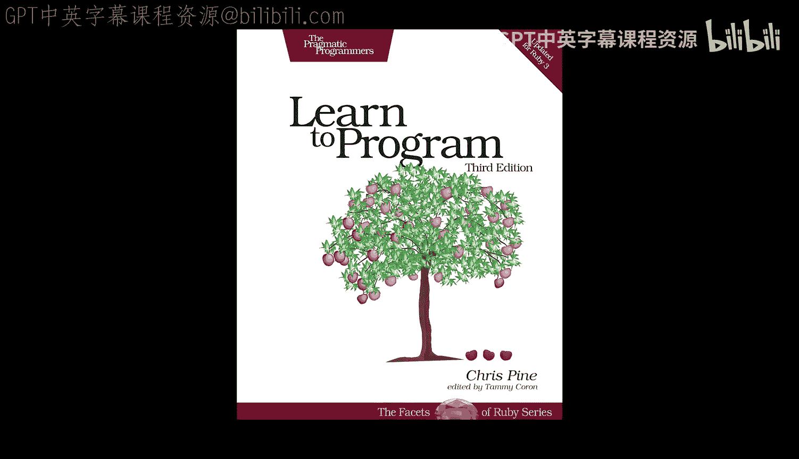

My languageguage is just for the fun of them， most people do not。

 most people learn it because they have a mission， they want to build a program。

 they want to become a programmer， so you got to use it for something real and actually find that it's easier to learn programming that way too because it drives your learning process you can't just learn the whole thing up front you can't just sit down and read the language specification then go likeoo like Neo now I know kung fu now I know Ruby it doesn't download that way you actually have to type it out in anger on a real program。

Yeah， yeah for sure So I would start there， but then number two I probably would be JavaScript because ja just is the language you need to know if you want to work with the web and the web is the greatest application platform of all time if you're making business software collaboration software all this kind of stuff if you're making video games you should probably go off learn C++ or C or something else like that but if you're in the realm of web applications you got to learn ja regardless of what else you learn。

 you got to learn ja So if you're learning Ruby what is Ruby not have in terms of programming concepts。

That you would need other languages for。 I don't know if there's any concepts missing。

 but it doesn't have the speed or the low level access of memory manipulation that you would need to build a 3D gaming engine。

 for example， No one's going to build that in Ruby。 you could build。

Quite low level stuff when it comes to web technologies in Ruby。

 but at some point you're gonna hit the limit and you should use something else I'm not someone who prescribed just Ruby for everything just once you reach the level of abstraction that's involved with web applications。

 Ruby is superb but if you're writing for example a HTP proxy go is great for that we've written quite a few HP proxies lately at the company for various reasons including our cloud exit and so forth and Kevin one of the programs I'm working with he writes all of that and go go just have the primitives and it has the pace and the speed to do that really well。

I highly recommended if you're writing an HP general proxy do and go great language for that don't write your business logic and go I know people do。

 but I don't see the point in that So what would you say that three so go Ruby plus rails jascript Yeah if you're or interested in working with the Web I probably pick those three go Ruby and jascript go Ruee jascript okay functional languages someone's talking about O Caml there's always they are always going to show up they're always it must be some kind of。

O Caml industrial complex or something like this， but they always say mention O Cammo。

 I love that there are people who love functional languages to that degree。 those people are not me。

 I don't care at all I， I care about functional principles when they help me in these isolated cases but that's just better than everything else。

 but at heart， I'm an object oriented。Guy， that's just how I think about programs。

 that's how I like to think about programs， that's how I carve up a big problem space into a domain language。

Objects are my jam。 Yeah， I mean too。 so I program and list a bunch for like AI applications for basic。

So Oello chest engines， that kind of stuff and I just try hocal just to force myself to program just a very basic game of life。

 little simulation it's not it it's much。You know， list。It's just parentheses everywhere。

 It's actually not readable at all。 That's lid Oca is very， very intuitive。

 very readable That's nice I really should pick up a language like that at some point I've been programming long enough that it's a littlebarrassing that I haven't actually done anything real in anger in a fully functional programming language Yeah。

 but like I have to figure out I'm sure there's an answer to this What can I do that will be useful for me like that I actually want to build。

That's my problem that a functional language is better suited for that's right because I really want to experience the language properly。

 That's right。 Yeah， because I'm still， yeah， I'm very at this point。

 I'm very object oriented brained Yes， and that's my problem too I just。

 I don't care as much about these low level problems in computer science。

 I care about the high level。 I care about writing software。 I care about the。

Abstraction layer that really floats well with web applications and business logic。

 And I just I've come to accept that about myself even though as we talked about when I was a kid。

 I really wanted to become a games programmer and then I saw what it took to write a collision detection engine and I go like yeah。

 that's not me at all。 I'm never gonna be into vector matrix manipulation or any of that stuff it's way too much math。

And I'm more of a writing person than I of a math person， I mean。

 just in the way you are speaking today。You have like a poetic literary approach to programming Yes。

 yeah， that's actually exactly right， So I did actually a keynote at Railscom 10 years ago。

Where I call myself a software writer。 I mean， I'm not the first person to say that software writer has been in the vernacular for a long time。

 but the modern。Identity that most programmers adopt when they're trying to be serious is software engineer。

 and I reject that label I'm not an engineer。 occasionally I dabble in some engineering。

 but the vast majority of time I'm a software writer。

 I write software for human consumption and for my own delight。

I can get away with that because I'm working in a highlel language like Ruby working on collaboration software and todo lists and all the other stuff。

 again， if I was trying to apply my talents to writing 3D game engines。

 no that's not the right mindset that's not the right identity。

 but I find that the software engineering identity flattens thing a little bit。

 I'd like to think that we have software writers and software mathematicians， for example。

 and then those are actually richer ways of describing the abstraction level that you're working at than engineer。

Yeah， and I think if AI becomes more and more successful。

 I think well need software writer skill more and more because it feels like that's the realma whichca it's not writer。

You're going to have to do the software， you're going to have to be a computer person。

 but there there's a more。I don't know。 I still' want to romanticize it， but it's more poetic。

 It's more literary。 It' more feels like writing a good blog post than I actually wish that AI had a bit higher standards for writing。

 I find the fact that it accepts my sloppy in complete sentences， a little offensive。

 I wish there was like a strict mode for AI where it would snap my fingers。

 It was just feeding it keywords like speak proper。 do pronunciation。

 do punctuation because I love that。 I love crafting。😊。

At just right sentence that hasn't been boiled down that it has no meat on it。

 has no character in it。 It's succinct。 It's not overly flowery。 It's just right that。

Writing phase to me。Is just addictive and I find that when programming is the best。

 it's almost equivalent exactly to that。You also have to solve a problem。

 you're not just communicating a solution， you have to actually figure out what are you trying to say。

 but？Even writing has that half the time when I start writing a blog post。

 I don't know exactly which arguments I'm going to use， they develop as part of the writing process。

 and that's how writing software happens too， you know roughly the kind of problem you're trying to solve。

 you know don't know exactly how you're going to solve it and as you start typing the solution emerges。

😡，And actually， as far as I understand， you and Jason are working on a new book。

It's in the early days of that kind of topic I think he said it's some he tweeted that it's going to be titled something like we don't know what we're doing or upfront or something like that that kind of topic and you figure out along the way that's a big part of it。

Trying to give more people the permission to trust their own instincts in their own gut and realizing that。

Developing that supercomputer in your stomach is actually the work of a career and that you should not discard those feelings in preference to over。

Or not even complicated to analytics， to intellectualism。

 very often when we look at the big decisions we've had to make。

They've come from the gut where you cannot fully articulate like why do I think this is the right thing well。

 because I've been in this business for 20 years and I've seen a bunch of things and I've talked to a bunch of people and that is percolating into this being the right answer。

A lot of people are very skeptical about that business or unable to trust it because it feels like they can't rationalize why are we doing something Well。

 because I feel like it damn it that's a great privilege of being a bootstrapped independent founder who don't owe their business to someone else and doesn't have to produce a return because I feel like a lot of the bullshit really creeps in when you're trying to rationalize to other people why you do the things you do and why you take the decisions that you do if you don't have anyone to answer to you're free to follow your God and。

That's。Hell up enjoyable way to work and it's also in very often the correct way to work your gut knows a lot like you can't articulate it but it's spot on more times than not Yeah having to make a plan can't be a paralyzing thing I've often I mean I suppose there's different kinds of brains and first of all I can't wait to read that book if it materializes they I often feel like in the more in the more interesting things I do in my life I really don't know what I'm doing up up front。

And I think there's a lot of people around me that care for me that really want me to know what I'm doing。

 They're like， what's the plan， what's the whyhy are you doing this crazy thing？And I。

 if I if I had to wait until I have a plan， I'm not going to do it I people they have different brains on this kind of stuff。

 Some people really are planners and it maybe energizes them， but I think most creative pursuits。

 most really interesting， most novel pursuits are like。

You kind of have to just take the leap and then just figure out as you go。

 my favorite essay in rework is the last one and it's entitled inspirationspiration is Perishable。

And I think that captures a lot of it that。If you take the time to do a detailed plan。

 you may very well have lost the inspiration by the time you're done。

 if you follow the inspiration in that moment and trust your gut。

 trust your own competence that you will figure it out。You're going to get so much more back。

 You're going to go on the adventure you otherwise wouldn't have。

 whether that's just a business decisions or life decision， you have to。Seize that inspiration。

 There's a great set of children's books written by this Japanese author about chasing an idea and trying to get a hold of it and it's beautifully illustrated as an idea as something that's floating around as something you have to catch and latch onto that I really feel cat versuss this notion that inspiration is perishable。

 itll disappear if you just put it back on the shelf and say like， well。

 I gotta be diligent about this。 I got to line up a plan。

 you may run out and then there's no there's no steam to keep going。I have to ask about open source。

What does it take to run a successful open source project you've spoken about that it's a misconception that open source is democratic。

 it's actually meritocratic。I thought that's a beautiful way to put it。So theres often is a kind of。

Was a benevolent dictator at top。Often。So can you just speak to that having run a successful open source？

Projects yourself and being a benevolent dictator yourself。

Which just going to be a bit of a biased piece of evidence here。

 but I we definitely have dictators and they should control everything。

 especially when the dictators me now well， I think I learned very early on that a quick way to burn out in open source is to treat it as。

A business as though your users are customers， as though they have claims of legitimacy on your time and your attention and your direction。

 because I faced this almost immediately with Ruen Rails as soon as it was released。

 there were a million peoples who had all sorts of opinions about where I ought to take it and not just opinions。

 but actually demands unless you implement an oracle database adapter。

 this is always going to be a toy。It was actually more or less that exact demand that prompted me to have a slide at one of the early rails conferences that just said。

 fuck you。 Hey， Yes。 I'm not going to do。 Would you tell me to， Im here as a bringer of gift。

 I am sharing。Code that I wrote on my own time， on my own volition。

And you don't have to say thank you， I mean， be nice if you did。

 you can take the code and do whatever you want with it， you can contribute back if you want。

 but you can't tell me what to do or where to go or how to act。I'm not a vendor。

 This is a fundamental misconception that users of open source occasionally step into because they're used to buying software from companies who really care about their business。

I care about people using my software， I think it's great。

But we don't have a transactional relationship。I don't get something back when you tell me what to do except grief。

 and I don't want it so you can keep it。 So my open source philosophy from the start has been。

I gotta do this primarily for me。 I love when other people find use in my open source。

 It's not my primary motivation。 I'm not primarily doing it for other people。

 I'm primarily doing it for me and my own objectives， because。😊，As Adam Smith said。

 it's not for the benevolence of the butcher that we expect our daily meet it's for his selfinterest and I actually find that to be a beautiful thought that our comments increase in value when we all pursue our self-interest。

 certainly in the realm of open source This is also why I reject this notion that open source in some sort of crisis that there's a funding crisis that we have to spend more no you we don't open source has never been doing better。

 open source has never controlled more domains in software than it has right now there is no crisis theres a misconception from some people making open source and from a lot of people using open source that open source is primarily like commercial software。

 something you buy and something where you can then make demands as a customer and that the customer always right customers not always right not even in business but certainly not in open source。

In open source， the customer as it is， is a receiver of gifts。We are having a gift exchange。

 I show up and give you my code。 If you like it， you can use it。

 And if you have some code that fits in with where I'm going with this。

 I would love to get those gifts back and we can keep trading like that。 I give you more gifts。

 You give me some of your gifts together we pool all the gifts such that someone showing a brand new just get a mountain of gifts。

 This is the magic thing of open source is it increases the total sum value of what's in the commons when we all pursue our own selfinterest。

 So I'm building things for rails that I need。 and you know what， you want me to do that。

 You do not want me to build things that I don't need on behalf of other people because I'll do a crap job。

 I do I build much better software when I can evaluate the quality of that software by my own use。

 I have to I need this feature。 I'm going build a good version of that feature。

 and I'm going just enough just for me。 So I'm not going to blow it。

 I'm not trying to attract a customer here。 I'm not trying to see some。An。

 I'm just building what I need。 And if you go into open source with that mentality that you're building for you and everything else is a bonus。

 I think you have all the ingredients to go to distance。

 I think the people who burn out in open source is when they go in thinking I'm making all these gifts。

 I don't really need them myself， but I'm like hoping someone else does and maybe they'll also give me some money That's a losing proposition。

 It never basically works。 If you want money for your software。 you should just sell it。

 We have a perfectly fine model of commercial software that people can make that kind and then they can sell it。

 but I find a lot of。Confusion， let's just call that politely in open source contributors who want to have their cake needed to。

 they like the mode of working with open source， they maybe even like the status that comes from open source。

 but they also would like to earn a living for making that open source。

And therefore they occasionally end up with the kind of grievances that someone who feels underappciated or work will develop when others aren't doing enough to recognize their great gifts and then they might walk away。

 I wish I had one of the I wish I had more insight into their mind state of the individual。

People that are running these projects like if they're feeling sad or they need more money or they're like it's just such a dark box。

 it can be I mean， of course there's some communication。

 but I just I just sadly see too often they just kind of walk away right and I think that's actually also part of the beauty of open source you are not obligated to do this code forever you're obligated to do this for as long as you want to do it that's basically your own obligation but there is I know okay。

 you might criticize this and pushback you did write a blog post on forever until the end of the Internet with Ta Dallas。

There is a beautiful aspect， and you found a good balance there。But I don't know。

 You're bringing so much joy to people with this thing you created。

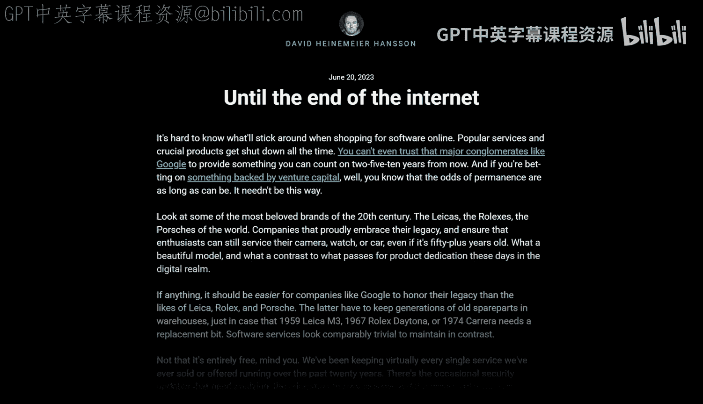

It's not an obligation， but there's a real beauty to taking care of this thing you've created and not forgetting。

 I think we。What I think what the open source creator is not seeing enough， I mean， there's like。

How many lives you're making better， there's certain pieces of software that I just quietly use a lot。

And like they bring my life joy， and I wish I could communicate that well。There's ways to donate。

 but it's inefficient。 It's usually hard to donate。 It is。

 There's some ways for some people that made it easier。 Github donations is one way of doing it。

 I donate to a few people， even though I don't love the paradigm。

 I also accept that we can have multiple paradigms。

 except that I can do open source for one set of motivations。

 and other people can do open source for other motivations。 We don't all have to do it the same way。

 but I do want to counter the misconception that open source is somehow in a crisis unless we all start paying for open source。

 That model already exists。 It's commercial software。 It works very well。

 and plenty of great companies have been built off the back of it。

 and the expectations are very clear。 I pay you this amount and I get this software open source Once you start mixing money into it gets real muddy real fast。

 And a lot of it it's just from those misaligned expectations that if you feel like your starving artists as an open source developer and you are owed。

X amount of money because your software is popular。

You're delusional and you need to knock that off just get back on track where you realize that you're putting gifts into the world and if you get something back in terms of monetary competition。

 okay， that's a bonus。 But if you need that money back in terms of monetary computation just charge for software or go work for software company that will employ open do open source。

 There's tons of that， that is probably actually the primary mode that open source software is being developed in the world today commercial companies。

Making open source that they need themselves and then contributing it back so I'm glad you brought up sort of like drew some hard lines here is a good moment to bring up。

What I think is the。Maybe one of the greatest open source projects ever， Word。And。

You spoke up in October。24。About some of the stuff that's been going on with WordPresspress' founder。

 Matt Mullloig in a blog post， open source royalty and Mad Kings。

Is the really good blog post on sort of just the idea of benevolent dictators for life。

 this model for open source projects？And then the basic implication was that。

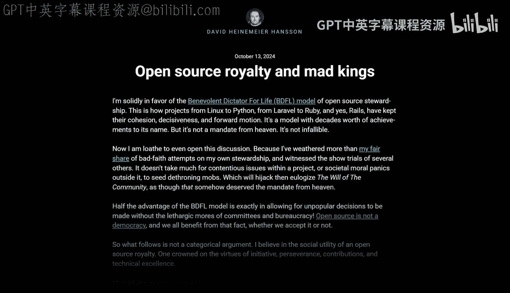

Matt as the Bd of WordPresspress has lost his way a bit with his battle with WP engine。

So I should also say that I really love WordPresspress it brings me joy， I think it's a really。

It's a beacon of what open source could be。I think has made the internet better。

It allowed a lot of people to create wonderful websites。And I also think。

 now you might disagree with this， but from everything I've seen。WP engine。Just gives me bad vibes。

I think they're not a good， the good guy in this， I don't like it， I understand the frustration。

I understand all of it， but I don't think that excuses the behavior。

There is a bit of see this kind of counter to a little bit what you said。

 which is when you have an open source project of that size。

 there is a bit of it like when you're the king。That for a project of a kingdom that large。

 there's a bit of responsibility anyway， could you speak to your u maybe to your empathy？

Of Matt and geocticism and what。And maybe paint a path of。How he and Warpresss can be winning again。

First echo， what you said about what a wonderful thing it is that WordPress exists。

 that there are not many projects in the open source world or in the world at large that has had as big of an impact on the Internet as Word has he deserves a ton of accolades for that work so that was my engagement essentially my premise Do you know what I had tremendous respect for what Matt has built with WordPress what that entire ecosystem has built around itself it's a true marvel。

But there's some principles that are larger than my personal sympathies to the characters involved。

I agree， the Silver Lake private equity company that's involved with WP Engine is not my natural ally。

I'm not the natural ally of private equity doing some game with BPp engine that's not my interest in the case my interest is。

Essentially。A set of principles， and the principles are， if you release something as open source。

People are free to use it as they see fit and they are free to donate code or resources or money back to the community as they see fit。

 you may disagree about whether they've done enough whether they should do more but you can't show up after you've given the gift of free software to the world and then say now that you've used that gift。

 you actually owe me a huge slide of your business because you got too successful using the thing I gave you for free。

 you don't get to take a gift back。 That's why we have open source licenses they stipulate exactly what the obligations are on both sides of the equation the users of open source don't get to demand what the makers of open source do and how they act and the makers of open source don't get to suddenly show up with a ransom note to the users can say actually you owe me for all sorts of use I'm 100% allergic to。

That kind of。Interaction， and I think Matt， unfortunately， for whatever reason。

Got so wrapped up in what he was owed？That he failed to realize what he was destroying。

Wordpress and automatic already makes a ton of money。 This is part of the wonder of WordPress。

 this is a project that generates hundreds of millions of dollars。

And Matt didn't feel like he was getting enough of that。That's not good argument， bro。

 you can't just violate the spirit and the letter of these open source licensees and just start showing up with demand letters。

 even to characters that are not particularly sympathetic。

 This goes to the root of my interpretation of open source in general。

The GPL is a particular license that actually demands code from people who use it under certain circumstances I've never liked the GPL I don't want your shitty code if you don't want to give it to me。

What am I going to do with that some code dump that you've I I'm not on board with that part of Staolman's vision at all。

 I love the MIT license to me， that is the perfect license because it is mercifully short。

 I think it's two paragraphs， three paragraphs， really short。 and it basically says。

Here's some software。It comes with no warranty， you can't sue me， you can't demand anything。

 but you can do whatever the hell you want with it， have a nice life。

That's a perfect open source interaction， in my opinion。

And that license needs to be upheld these licenses in general， even the GL， even if I don't like it。

 we have to abide by them because if we just set aside those licenses when we in a moment's notice feel like something slightly unfair we've lost everything we've lost the entire framework that allowed open source to prosper and allowed open source to become such an integral part of commerce too I mean back when open source was initially finding its feet it was at war with commercial software。

 Staman is at war with commercial software and always has been Bill Gates was in return at war with open source for the longest time。

The open source licensees and the clarity that they provide allowed us to end that war Today。

 commercial software and open source software can peacefully coexist。 I make commercial software。

 I sell basecamp。 I sell he he， and then I also make a bunch of open source software that I give away for free's gifts。

😡，That can't happen。If we start violating these contracts， no commercial company is going to go。

 let me base my next project off this piece of open source。

 If I'm also running the liability that some mad maker is going to show up 7 years in。

 and demand I give them 50 million。 That's not an environment conducive to commerce collaboration or anything else。

 and it's just basically wrong。 I think there's one analysis that's all about kind of the practical outcomes of this。

 which I think are bad。 There's also some an argument that's simply about ethics。 This is not right。

 You can't just show up afterwards and demand something。

 This is not too dissimilar in my opinion to the whole Apple thing we talked about earlier。

 Apple just showing up and feeling like they're entitled to 30% of everyone's business。 No。

s that's not right。 That's not fair。So I think Matt， unfortunately。Kind of。

Sted himself blind on the indignity he thought was being perpetrated against him because there was all this money being made by VP engine making a good product and not giving quite enough back in Matt's opinion。

Tough， tough cookie， I think they're maybe I'm reading too much into it。

 but there might be some personal stuff too， which they weren't not only not giving enough。

 but probably implicitly promising that they will give。

And then taking advantage of him in that way in his mind just like interpersonal interaction and then you get like interpersonally frustrated。

 you forget like the bigger picture ethics of it， it's like when a guy keeps saying you know。

 promising he'll do something。And then you and then you realize you wake up one day like a year or two later。

 Wait a minute。 I was being lied to this whole time and that I don't even know if it's about money I'd get mad too。

 It's totally fine to get mad when people disappoint you That's not justification for upending decades of open source licenses and essential de facto case law we've established around it。

 This is why I chose to even weigh in on this because I like Word。 I don't use Word。

 I'm not a part of that community。 I don't actually have a。Dog in this fight。

 I'm biased of anything towards Matt just as a fellow BDF。 I would like to see him do well with this。

 but I also think there's some principles that stake here that ring much louder。

 I don't want rails to suddenly。Be tainted by the fact that it's open source and whether companies can rely on it and build businesses on it。

 because wait， maybe one day I'm going to turn Matt and I'm going to turn Matt King and I'm going to show up with the demand ransom letter。

 No screw that we we have。Way more to protect here there's way more at stake than your personal beef with someone or your perceived grievance over what you're owed what would you recommend what do you think you should do can do to walk it back to heal。

Decide。This is the curious thing he could decide to give this up， that's very。

 very difficult for driven ambitious people to do to accept that they're wrong and to give up and lay down their sword。

I had a hope earlier on in this that that was possible。

I haven't seen any evidence that Matt is interested in that。 and I find that deeply regretful。

 but that's her， his prerogative。 I continue to speak out when he's violating the spirit and ethics of open source。

 but。I wish you would just accept that this was a。Really bad idea he just he made a bad bet and I thought。

 I think he thought he'd just get away with it that they'd just pay up。

And that he could put pressure。I mean， I know that temptation when you sit as the head of a very important project。

You know that that comes with a great degree of power and you really need a great degree of discipline to rein that in and not exercise that power at every step where you feel aggrieved。

 I felt aggrieved a million times over。In the 20 plus years of Ruen Ras。

 I've really tried very hard not to let those sometimes petty。

 sometimes substantial grievances over time。See in to the foundation of the ecosystem and risk ruining everything as the king of the rail of kingdom has the power got into your head over the years。

 I'm sure it has， I mean， who wouldn't do you pace around in your chamber。I do occasionally。

And I do marvel at both what's been built， what's been possible。

 over a million applications have been made with Rubyen Rails by one estimate that I've seen。

 businesses like Shopify and GitHub and a million others have been built on top of something that I started。

 that's very gratifying。But。😡，You really have to be careful not to smell your own exhaust too much and you have to be just as careful not to listen too much to the haters and not to listen too much to the superf either that you assess the。

Value and。Sort of principles of what you're working towards on its own merits on your own scoreboard I try to。

Block that out and then just go， well， I'm working Rs because I love to write Ruby I love to use Ruby to make web applications。

 that's my North star and I'll continue to do that and I'll continue to share all of the open source gifts that I。

Uncover along the ways。And and that's it。 That's enough too。 I don't have to get all of it out of it。

 This is sometimes just as with the guy who thought I'd given up on being Jra or something instead of doing basecam。

 There are people over the years whove asked like why didn't you charge for rails Like。

 don't you know how much money have been made off rails。 If we just look at something like Shopify。

 It's worth billions of dollars。 I'm not a billionaire and so freaking what I got more than enough。

I got plenty of my share。I will say though， I'm also。

Introspective enough to realize that if it hadn't panned out as well as it did for me on my own business。

 Maybe I would have been more tempted。 Maybe if you see other people build huge。

 successful companies off the back of your work。 and you really don't have a pot to pissson。

 you might be tempted to get a little。Upset about that。

 I've seen that in the rails world as well where there are people who contributed substantial bodies of work and then got really miffed when they didn't feel like they got enough back I was fortunate enough that the business that Jason and I built with Rubyian Rails was as successful as it was and I made the money I needed to make that I didn't need to chase the rest of it。

But we should also just。Make explicit that many people in your position。Chase。Chate the money。

It's not that difficult to chase Basically you turned away money。

 you made a lot of decisions that just turn away money。Maybe I also think of。This example with Matt。

 he probably thought there was easy money for the taking， and wasn't so easy was it。

 It looked like low hanging dollar bills， and it turned out to be some really sour grapes。

 it turned out he turned he probably destroyed vast sums of money by undermining the whole Word trust and the ecosystem and putting question marks in the heads of folks who would choose to use WordPress or something else going forward。

So I often think when people think like， a you left money on the table， first of all so what。

 I don't have to have all the money， but second of all。

 maybe the money wasn't on the table at all and maybe the costs。Even if you got the money。

 maybe the cost in other ways， we've talked about， would outweigh all the money that you could have possibly gotten。

 meaning like， I think you said the thing that makes you happy。

Is flow and tranquility those two things beautifully， really beautifully put and， you know。

 gaining money might assign to your responsibility of running a larger thing。That takes away。

The flow that you gain from being from from fundamentally for you。

 what flow means is programming and then tranquility is like。

 I think you also have a beautiful post of like，Nirvada is an empty schedule When I look at a upcoming week and I see that I have no scheduled meetings at all。

 which is quite common， Or maybe I just have one thing for one hour on one day。 I think to myself。

 do you know what this could very easily have been very different。

 We could have been running a company of hundreds of people or thousands of people and my entire calendar would have been packed solid with little tetris blocks of other people's demands on my attention and time。

 And I would have been miserable as fuck And I look at that and go like what more can I ask for。

 which is a really nice state of being I'd actually say。

I didn't have this always I did have early on in my career some sense of。

Like I need a little more a little more security and I remember this really interesting study where a bunch of researchers asked people who had made certain amounts of money。

 how much money would it take。For you to feel secure。

 they'd ask people who had a million dollars network。

 how much money did you need probably need 2 million2 million then it'd be good then they ask people with a net worth of 5 million。

 how much do you need 10， any need 10 Ask people with 10 million， what do you need 20？

Every single time people would need double of what they did。

 I did that for a couple of doublings until I realized you know what this is silly。

 I am already where I wished I would be and a million times over。So。What less is there to pursue No。

 that doesn't mean that if more money is coming my way， I'm going to say no to it， of course not。

 but it does mean that I'm free to set other things higher。 And I also do think you realize。

 as Jim Kerry would say， I wish everyone would get all the money that they wished for and they'd realize it wasn't the answer that money solves a whole host of problems and anxieties。

 And then it creates a bunch of new ones。 And then it also doesn't touch a huge swath of the human experience at all。

The world is full of miserable， anxious， hurt， rich people。It's also full of miserable， anxious。

 poor people。 and I'd rather be a miserable， anxious rich person than a poor person。

 but it isn't this magic wand that make everything go away。 And that's again one of those。

Insights just like having children。 that you cannot communicate in words。

 I've never been able to persuade a person who's not wealthy that wealth wasn't going to solve all their problems。

 One quote， you've returned to often that I enjoy a lot as the coco Chanel quote of the best things in in life are free。

And the second best things are very， very expensive。I guess the task is。To a focus on。Oh。

 surrounding yourself with the best things in life like family and all of this and not caring about the other stuff。

 I would even say you can care about the other stuff。 Just know the order of priority。 Yeah。

 if you are blessed with。A partner that you love？Some children that you adore。

 you've already won the greatest prize that most humans are able to achieve。

Most humans in this world， if they are of marital age and they have children。

 if you ask them what's the most important thing， they would all say that。

 they would all say that no matter whether they're rich or poor。

It's easy to lose sight of that when you're chasing the second best things because you know what they're also very nice I I really like that paganti sa it was a very expensive car and I would have no chance of acquiring it if I hadn't become rather。

Successful in business， so I don't want to dismiss it either， it's great fun。To have money it's just。

Not as fun for quite as long or as deep as you think it is。 And these other things。

 having an occupation and a pursuit that you enjoy。

 being able to carry burdens with a stiff of a lip and with。😊，Again， a sense of meaning。

Is incredible to have family， to have friends， to have hobbies。

 to have all these things that are actually available。To most people around the world。

 that's winning。And it doesn't mean you have to discount your ambitions。

 it doesn't mean you can't reach for more but。It does mean it's pretty dumb if you don't realize that。

It's not going to complete you in some Hocuspocuss woos sense。To make more， it， it really isn't。

What gives you hope about the future？This whole thing we have going on here， human civilization。

I find it easier to be optimistic， optimistic than pessimistic because I don't know either way。

 So if I get to choose， why not just choose to believe it's going to pan out Yeah like we suffer more in our imagination than we do in reality。

 That's one of the quotes out of storeicism。And I also think we have a tendency。

 a lot of humans have a tendency to be pessimistic in advance for things they don't know how it's going to pan out。

Climate change， for example， is making a lot of people very anxious and very pessimistic about the future。

 you know nothing。40 years ago， we thought the problem was that the planet was gonna to be too cool。

 I happen to believe that it's probably correct that the planet is getting too hot and that CO2 has something to do with it。

 whether we have the right measures to fix it in time if that's even possible or not is completely up in the air and we don't know if you convince yourself with such certainty that the world is going to turn to shit。

 It is right up here in your head today。Climate change might wipe out this entire species in 200 years。

It's not next year。It's not 10 years from now， your life might become more unpleasant than there might be more negative effects and so on。

 Yes， okay， but then deal with that hardship when it arrives， don't take that in advance。

 how are you helping earth by just walking around being depressed？

I think our whole conversation today is also an indication it's just two humans talking。

There's billions of us and there is something about us that wants to solve problems and build cool stuff。

 and so we're going build our way out of whatever shit we get ourselves into this is what humans do we create problems for ourselves and and come out figure out how to build rocket ships。

To to get out of those problems and sometimes the rocket ships create other problems like nuclear warheads。

 and then we'll I'm sure。I hope figure out ways how to avoid those problems and then there'll be nanobots and then the aliens will come and there'll be a massive war between the nanobots and aliens and that will bring also all of us humans together。

's a funny thing， just to pick of one of the points you mentioned， the Adamom bomb， for example。

 when that was first invented， a lot of people thought we have essentially ended life on Earth。

 right？Or maybe we prevented World War III from happening in the past 80 years because assured neutral annihilation kept the superpowers from attacking each other at least head on and kept their fighting to proxy wars。

 You know what， proxy wars are not great， but they're probably better than World War3 with nuclear weapons。

 So it's quite difficult in the moment to tell what's actually benefit and what's。

Not and I think we should be a bit more humble。 I've certainly become more humble over time of。

Thinking I know which way it's going to turn。 I think the pandemic was a huge moment for a lot of people where there was so much certainty about whether this intervention worked or that intervention didn't work。

 and most people were wrong。Certainly， a lot of very smart people。

 very qualified people got that just utterly and catastroifyingingly wrong。

 So just a little intellectuals melody， I think back upon that and go like， you know what。

 I'm not a PhD in virology。And I don't claim that like。

 I somehow saw how it always going to play out。 But the people were really experts and that they got a bunch of it wrong。

 Nobody knows anything。 I keep reminding myself of that every day。 No one knows anything。

 We can't predict。The economy， a month out， we can't predict world affairs and mother。

 The world is just too complicated。 Yeah， I when I watch the Netflix documentary Chimp Empire。

And how， you know， there's a hierarchy of chimps。All of that looks eerily similar to us humans。

 We're recent descendants。 So these experts， some of the chimps are。Got a PhD。 others don't。

 otherss are really muscular， otherss are the beta male kind。 They're sucking up to the alpha。

 There's a lot of interesting dynamics going on that really maps cleanly to the geopolitics of the day。

 They don't have nuclear weapons， but the nature of their behavior similar to ours。 So I think。

I think we barely know what's going on， but I do think there's like a basic。Uh will to cooperate。

Its a basic compassion that underlies are just。The human spirit。 that's there。

 And maybe that is just me being optimistic。 But if， if that is indeed there。

 they won't get to be okay。 The capacity is certainly there。 whether we choose that capacity or not。

 Who knows and in what situation and think accepting that we all have the capacity for both ways。

 for both incredible generosity and。Kindness and also cruelty。

I think young with his whole theory of the shadow was really spot on that we all have that capacity in us and accepting that。

It's our job to attempt to cultivate the better parts of our human nature。

Is weighed against our propensity to sometimes be the worst of ourselves I'm excited to find out what's gonna happen It's so awesome to be human I don't want to die I kind of want to be alive for a while to see all the cool shit we do and one of the cool things I want to see is all the software you create and all the things you tweet all the trouble you get yourself into on Twitter David I'm a huge fan like I said。

 thank you for everything you've done for the world for the millions of developers you've inspired and one of whom is me and thank you for this awesome conversation by the thanks so much for having me。

Thanks for listening to this conversation with DHH to support the podcast。

 please check out our sponsors in the description and consider subscribing to this channel。

 and now let me leave you with some words from Rework by DHH and Jason Fried。

What you do is what matters。 not will you think or say or plan。

Thank you for listening and hope to see you next time。

