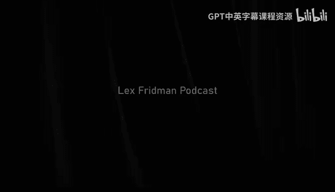
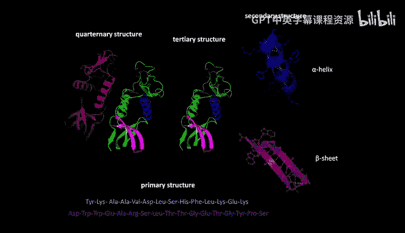
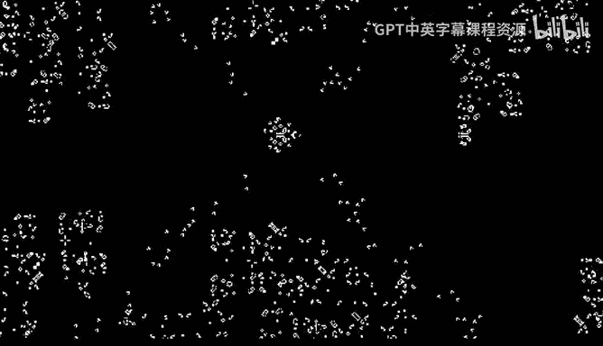
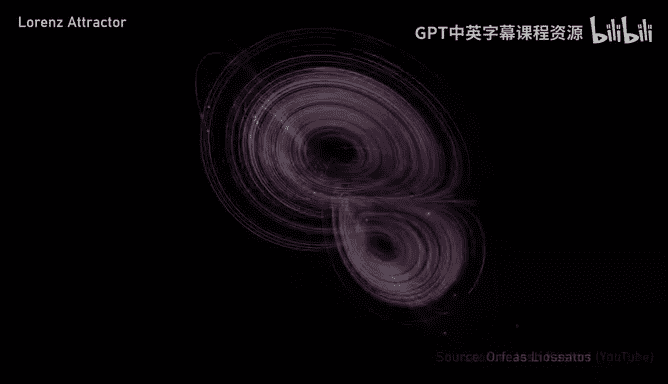
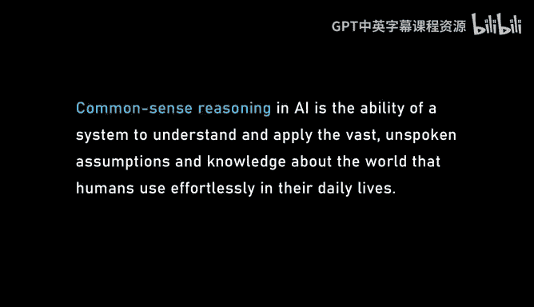
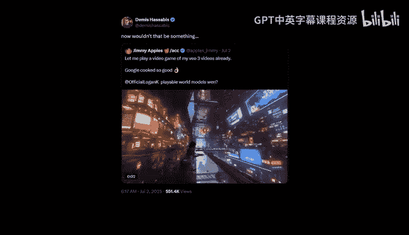
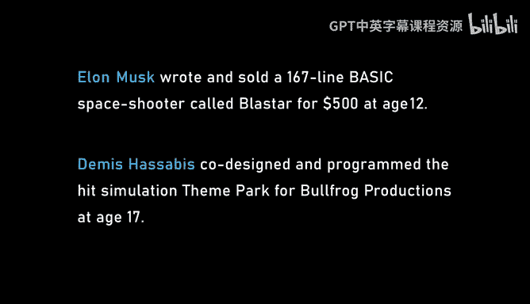
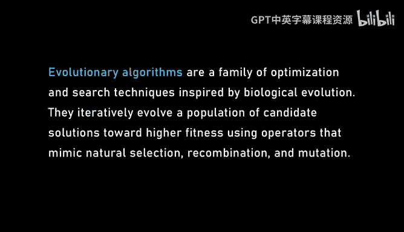
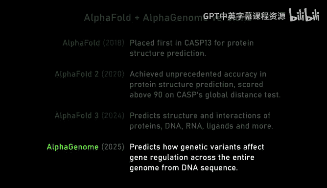
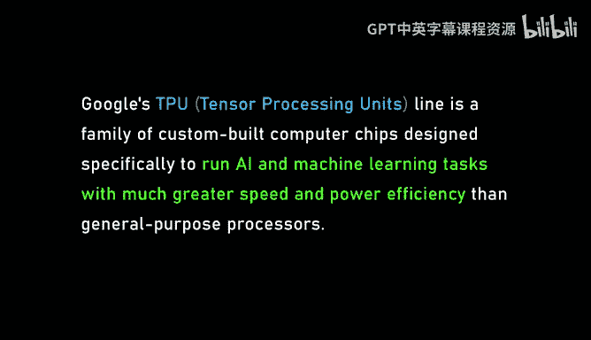

# Lex Fridman Podcast #475《Demis Hassabis：人工智能的未来、现实的模拟、物理学与电子游戏》 - P1：Lex Fridman Podcast #475《人工智能的未来、现实的模拟、物理学与电子游戏》 - GPT中英字幕课程资源 - BV1YP2TBdEA5

It's hard for humans to make any kind of clean predictions about highly nonlinear dynamical systems but again to your point you may be very surprised what classical learning systems might be able to do about even fluid Yes exactly I mean fluid dynamics。

 navitokes equations， these are traditionally thought it was very very difficult intractable problems to do on classical systems they take enormous amounts of compute you where the prediction systems you know these kind of things all involve fluid dynamics calculations but again if you look at something like V our video generation model it can model liquids quite well surprisingly well and materials。

 spec lighting， I love the ones where you know there's people are generated videos where there's like clear liquids going through hydraulic presses and then being squeezed out I used to write physics engines and graphics engines in my early days in gaming and I know it's just so painstakingly hard to build programs that can do that and yet somehow these systems are you reverse engineering from just watching。

so presumably what's happening is it's extracting some underlying structure around how these materials behave。

 so perhaps there is some kind of lower dimensional manifold that can be learned if we actually fully understood what's going on under the hood that's maybe you know maybe true of most of reality。

😊。

The following is a conversation with Des Hasabs， His second time on the podcast。

 He is the leader of Google Deep Mind and is now a Nobel Prize winner。

Dems is one of the most brilliant and fascinating minds in the world today。

 working on understanding and building intelligence， and exploring the big mysteries of our universe。

This was truly an honor and a pleasure for me。This is the Alex Friedman podcast to support it。

 please check out our sponsors in the description and consider subscribing to this channel。And now。

 dear friends， here's Des， Hasalis。

In your Nobel Prize lecture you proposed what I think is a super interesting conjecture that quote any pattern that can be generated or found in nature can be efficiently discovered and modeled by a classical learning algorithm what kind of patterns or systems might be included in their biology。

 chemistry， physics maybe cosmology， neuroscience what are we talking about Sure well look I felt that it's sort of a tradition I think of Nobel Prize lectures that you're supposed to be a little provocative and I wanted to follow that tradition。

 what I was talking about there is if you take a step back and you look at all the work that we've done especially with the alpha X projects so I'm thinking alpha go of course alpha fold what they really are is we're building models of very combinatorly high dimensionmenal spaces that you know if you try to brute force a solution and find the best move and go or find the exact shape of a protein and if you enumerated all the possibilities there wouldn't be enough time in。

In the time of the universe so you have to do something much smarter and what we did in both cases was build models of those environments and that guided the search in a smart way and that makes it tractable so if you think about protein folding which is obviously a natural system you why should that be possible how does physics do that you know proteins fold in milliseconds in our bodies so somehow physics solves this problem that we've now also solved computationally and I think the reason that's possible is that in nature natural systems have structure because they were subject to evolutionary processes that shape them and if that's true then you can maybe learn what that structure is this perspective I think is really interesting one you've hinted it at it which is almost like crudely stated anything that can be evolved can be officially modeled I think there's some truth to that Yeah I sometimes call it survival of the staist or something like that。

' of course there's evolution for life living things。

 but there's also you know if you think about geological times。

 so the shape of mountains that's been shaped by weathering processes right over thousands of years but then you can even take it cosmological。

 the orbits of planets， the shapes of asteroids， these have all been survived kind of processes that have acted on them many。

 many times so if that's true then there should be some sort of pattern that you can kind of reverse learn and a kind of manifold really that helps you search to the right solution to the right shape and actually allow you to predict things about it in an efficient way because it's not a random pattern so it may not be possible for man-made things or abstract things like factorizing large numbers because unless there's patterns in the number space which there might be but if there's not in it's uniform then there's no pattern to learn there's no model to learn that will help you search you have to do brute force so in that case know。

😊。

Maybe you need a quantum computer， something like this。

 but if most things in nature that we're interested in are not like that。

 they have structure that evolved for a reason and survived over time and if that's true。

 I think that's potentially learnable by neural network like nature is doing a search process and it's so fascinating that it's in that search process it's creating。

😊，Systems that could be efficiently modeled。Yes right so interesting so they can be efficiently rediscovered or recovered because nature is not random right these everything that we see around us。

 including like the elements that are more stable all of those things they're subject to some kind of selection process pressure do you think because you're also a fan of theoretical computer science and complexity do you think we can come up with a kind of complexity class like a complexity zoo type of class where maybe it's this set of learnable systems the set of learnable natural systems L and this is a new class of systems that can be actually learnable by classical systems in this kind of way natural systems that can be modeled efficiently I mean I've always been fascinated by the peak calls MP question and what is modable by classical systems a non-quantum systems you know tuuring machines in effect and that's exactly what I'm working on actually and kind。

My few moments of spare time with a few colleagues about is should there be you know maybe a new class or problem that is solvable by this type of neural network process and kind of mapped onto these natural systems so you know the things that exist in physics and have structure so I think that could be a very interesting new way of thinking about it and it sort of fits with the way I think about physics in general which is that you know I think information is primary information is the most sort of fundamental unit of the universe more fundamental than energy and matter I think they can all be converted into each other but I think of the universe as a kind of informational system so when you think of the universe is an informational system than the P equals MP question is is a physics question that's right is a question that can help us actually solve the entirely of this whole thing going on Yeah I think it's one of the most fundamental questions actually if you think of physics as informational and the answer to that I think is going to be you know very enlightening more specific to the P。

P question。This again， some of the stuff we're saying is kind of crazy right now。

 just like the Christian entrance and Nobel Prize speech controversial thing that he said sounded crazy and then you went and got a Nobel Prize for this with John Juper solve the problem So let me let me just stick to the P equals NP P。

 do you think there's something。In this thing we're talking about that could be shown if you can do。

Something like polynomial time or constant time compute ahead of time and construct this gigantic model。

 then you can solve some of these extremely difficult problems in a theoretical computer science kind of Yeah I think there are actually a huge class of problems that could be couched in this way the way we did AlGo and the way we did Al fold where you know you model what the dynamics of the system is the properties of that system。

 the environment that you're trying to understand and then that makes the search for the solution or the prediction of the next step efficient basically polynomial time so tractable by a classical system which in neural network is it runs on normal computers。

 right classical computers tuuring machines in effect and I think it's one of the most interesting questions there is is how far can that paradigm go I think we've proven and the AI community in general that。

systems tuuring machines can go a lot further than we previously thought you know they can do things like model the structures of proteins and play go to better than world champion level and you know a lot of people would have thought maybe 10。

 20 years ago that was decades away or maybe you would need some sort of quantum machines to quantum systems to be able to do things like protein folding and so I think we haven't really even sort of scratched the surface yet of classical system so-called could do and of course AGI being built on a neural network system on top of a neural network system on top of a classical computer would be the ultimate expression of that and I think the limit you know what the bounds of that kind of system what it can do it's a very interesting question and and directly speaks to the peak calls MP question what do you think again hypothetical maybe outside of this？

Maybe。Eergennt phenomena like if you look at cellular auto some of that you have extremely simple systems and then some complexity emerges Yes maybe that would be outside or even would you guess even that might be amenable to efficient modeling by a classical Yeah I think those systems would be right on the boundary right so I think most emergent systems cellular autometerta things like that could be modelable by a classical system you just sort of do a forward simulation of it and it probably be efficient enough of course is the question of things like chaotic systems where the initial conditions really matter and then you get to some you know uncorrelated endstate those could be difficult to model so I think these are kind of the open questions but I think when you step back and look at what we've done with the systems and the problems that we've solved and then you look at things like V3 on like video generation sort of rendering physics and lighting and things like that you know really core fundamental。

things in physicsIt's pretty interesting I think it's telling us something quite fundamental about how the universe is structured in my opinion so you know in a way that's what I want to build AGI for is to help us as scientists answer these questions like Ps MP Yeah I think we may be continuously surprised about what is modelable by classical computers I mean Alpha fold3 on the interaction side is surprising that you can。

😊，Make any kind of progress on that direction Al a genome is surprising that you can map the genetic code to the function kind of playing with the emergent kind of phenomena。

 you think there's so many combinatorial options and then here you go you can find the kernel that is efficiently model Yes because there's some structure there's some landscape you know in the energy landscape or whatever it is that you can follow some gradient you can follow and of course what neural networks are very good at is following gradients and so if there's one to follow and object and you can specify the objective function correctly you know you don't have to deal with all that complexity which I think is how we maybe have naively thought about it for decades those problems if you just enumerate all the possibilities it looks totally intractable and there's many many problems like that and then you think well it's like 10 to 300 possible protein structures 10 to the0 and you know 70 possible go positions all of these are way more than atoms in the universe so how could one possibly find the right solution。

or predict the next step but it turns out that it is possible and of course reality in nature does do it right proteins do fold so that gives you confidence that there must be if we understood how physics was doing that in a sense then and we could mimic that process I model that process it should be possible on our classical systems is basically what the conjectures about and of course there's nonlinear dynamical systems highly nonlinear dynamical systems everything involving fluid right you know the recently a conversation with Ternce Tau who mathematically it contends with a very difficult aspect of systems that have some singularities in them that break the mathematics and it's just hard for us humans to make any kind of clean predictions about highly nonlinear dynamical systems but again to your point we may be very surprised with classical learning systems might be able to do about even fluid exactly I mean fluid dynamics and avitokes equations these are。

😊，thought it was very， very difficult， intractable kind of problems to do on classical systems they take enormous amounts of compute。

 you weather prediction systems， you know these kind of things all involve fluid dynamics calculations and but again if you look at something like our video generation model it can model liquids quite well surprisingly well and materials。

 specular lighting I love the ones where there's people have generated videos where there's like clear liquids going through hydraulic presses and then its being squeezed out I used to write physics engines and graphics engines in my early days in gaming and I know it's just so painstakingly hard to build programs that can do that and yet somehow these systems are reverse engineering from just watching YouTube videos so presumably what's happening is it's extracting some underlying structure around how these materials behave so perhaps there is some kind of lower dimensionmenional manifold that can be learned。

We actually fully understood what's going on under the hood that's maybe you know。

 maybe true of most of the reality Yeah， I've been continuously precisely by this aspect of V3 I think a lot of people highlight different aspects including the comedic and the media all that kind of stuff and then the ultra realisticistic ability to capture humans in a really nice way that's compelling and feels close to reality and then combine that with native audio。

 all of those are marvelous things about V3 but exactly the thing you're mentioning which is the physics Yeah it's not perfect but it's pretty damn good and then the really interesting scientific question is what is it understanding about our world in order to be able to do that because of the cynical take with diffusion models。

There's no way it understands anything。But it seemed I mean I don't think you can generate that kind of video without understanding and then our own philosophical notion of what it means to understand then is like brought to the surface to what degree do you think V3 understanding our world I think to the extent that it can predict the next frames you know in a coherent way that that is a form you know of understanding not in the anthropomorphic version of you know it's not some kind of deep philosophical understanding of what's going on I don't think these systems have that but they certainly have modeled enough of the dynamics put it that way that they can pretty accurately generate whatever it is eight seconds of consistent video that by eye at least you know at a glance is quite hard to distinguish what the issues are and imagine that in two or three more years time that's the thing I'm thinking about and how incredible that they will look given where we've come from you know the early versions of that one or two years ago and so the rate program。

is incredible and I think I'm like you is like a lot of people love all of the stand-up comedians and that actually captures a lot of human dynamics very well and body language。

 but actually the thing I'm most impressed with and fascinated by is the physics behavior the lighting and materials and liquids and it's pretty amazing that it can do that and I think that shows that it has some notion of at least intuitive physics right how things are supposed to work intuitively maybe the way that a human child would understand physics right as opposed to you know a PhD student really being able to unpack all the equations iss more of an intuitive physics understanding Well that intuitive。

😊，Physics understanding that's the base layer that's the thing people sometimes call like common sense like it really understands something that I think that really surprised a lot of people it blows my mind that。

I just didn't think it would be possible to generate that level of realism without understanding there's this notion that you can only understand the physical world by having an embodied AI system a robot then interacts with that world that's the only way to construct an understanding of that world but the O3 is directly challenging that right feels like yes and there's very interesting you know even if if you were to ask me five。

1 years ago， I would have said even though I was a must in all of this， I would have said。

 well yeah you probably need to understand intuitive physics you like if I push this off the table。

 this glass it maybe shatter you know and the liquid will spill out right so we know all of these things but I thought that you know there's a lot of theories in neuroscience it's called action in perception where you you need to act in the world to really truly perceive it in a deep way and there was a lot of theories about you'd need embodied intelligence or robotics or something or maybe at least simulated action so that you would understand things like intuitive physics。

Seems like you can understand it through passive observation which is pretty surprising to me and again。

 I think hints at something underlying about the nature of reality in my opinion。

 beyond just the cool videos that it generates and of course there's next stages is maybe even making those videos interactive so one can actually step into them and move around them。

 which will be really mindbing especially given my games background so you can imagine and then I think you know we're starting to get towards what I would call a world model。

 a model of how the world works， the mechanics of the world。

 the physics of the world and the things in that world and of course that's what you would need for a true AGI system I have to talk to you about video games so you're being a bit trolley I think you're having more and more fun on Twitter on X which is great to see so a guy named Jimmy Apple's tweeted let me play a video game of my V3 videos already Google Cook so good。

😊，Plalayable world models when spelled W EN question mark and then you quote tweeted that with now wouldn't that be something so how how hard is it to build game worlds with AI。

 Maybe can you look out into the future。

Of video games51 years out What do you think that looks like Well games were my first love really and doing AI for games was the first thing I did professionally in my teenage years and was the first major AI systems that I built and I always want to I want to scratch that it one day and come back to that so you know and I will do I think and I think I'd sort of dream about you know what would I have done back in the 90s if I'd had access to the kind of AI systems we have today and I think you could build absolutely mind-blowing games and I think the next stage is I always used to love making all the games I've made are open world games so they're games where there's a simulation and then there's AI characters and then the player interacts with that simulation and the simulation adapts to the way the player plays and I always thought they were the coolest games because so games like theme park that I worked on where everybody's game experience would be unique to them because you're kind of co-creating the game。

We set up the parameters， we set up initial conditions and then use the player immersed in it and then you are co-creating it with the simulation。

 but of course it's very hard to program open world games you know you've got to be able to create content whichever direction the player goes in and you want it to be compelling no matter what the player chooses and so it was always quite difficult to build things like cellular automata actually type of those kind of classical systems which created some emergent behavior but they're always a little bit fragile a little bit limited now we're maybe on the cusp in the next few years five ten years of having AI systems that can truly create around your imagination can sort of dynamically change the story and story tellll the narrative around and make it dramatic no matter what you end up choosing so it's like the ultimate choose your own adventure sort of game and you know I think maybe we're within reach if you think of a kind of interactive version of VO and then wind that forward five to10 years。

imagine how good it's going to be。Yeah， so you said a lot of super interesting stuff there。

 so one the open world。Built into that is a deep personalization。

 the way you've described it so it's not just that it's open world like you can open any door and there'll be something there it's that the choice of which door you're open。

In an unconstrained way defines the worlds you see so some games try to do that they give you choice but it's really just an illusion of choice because the only like like Stanley Parable game played it's really there's a couple of doors and it really just takes you down the narrative。

 Stanley Parable is a great video game I recommend people play that kind of in a meta way mocks the illusion of choice and there's philosophical notions of free will and so on。

 but I do like one of my favorite games Felish scrolls is dagger fall I believe。

That they really played with the like random generation of the dungeons of if you could step in and they gives you this feeling of an open world and there you mention interactivity you don't need to interact that's a first step because you don't need to interact that much you just when you open the door whatever you see is randomly generated for you and that's already an incredible experience because you might be the only person to ever see that exactly and so but what you'd like is a little bit better than sort of a random generation so you'd like and also better than a simple AB hard coded choice right that's not really open world right as you say it's just giving you the illusion of choice what you want to be do is potentially anything in that game environment and I think the only way you can do that is to have generated system systems that will generate that on the fly of course you can't create infinite amounts of game assets right it's expensive。

Enough already how AAA games are made today and that was obvious to us back in the 90s when I was working on all these games。

 I think maybe black and white was the game that I worked on early stages of that that had still probably the best AI learning AI in it it was an early reinforcement learning system that you you know you were looking after this mythical creature and growing it and nurturing it and depending how you treated it it would treat the villagers in that world in the same way so if you were mean to it it would be mean if you were good。

 it would be protective and so it was really a reflection of the way you played it so actually all of the I've been working on sort of simulations in AI through the medium of games at the beginning of my career and really the whole of what I do today is still a follow on from those early more hard-coded ways of doing the AI to now you fully general learning systems that are trying to achieve the same thing。

😊，Yeah， it's been interesting， hilarious and fun to watch you and Elon obviously itching to create games because you're both gamers and one of the sad aspects of your incredible success in so many domains of science like serious adult stuff that you might not have time to really create a game you might end up creating the tooling that others would create the game and you have to watch exactly others create the thing you've always dream though do you think it's possible you can somehow in your extremely busy schedule actually find time to create something like black and white an actual video game where like you could make the childhood dream come well you know there's two things where to think about that is maybe with vibe coding as it gets better and there's possibility that I could you know one could do that actually in your spare time so I'm quite excited about that as that would be my project if I got the time to do some vibe coding。

I'm actually itching to do that and then the other thing is you know maybe it's sabbatical after AGI has been safely stewarded into the world and delivered into the world you know that and then working on my physics theory。

 we talked about at the beginning， those would be the my two post AGI projects as call it that way I would love to see ultimate game post AGI which you choose solving the problem that some of the smartest people human history contend with equals MP or creating a cool video but in my world they'd be related because it would be an open world simulated game as realistic as possible so you know what is what is the universe that's speaking to the same question right MP equals MP I think all these things are related at least in my mind I mean in a really serious way I think video games sometimes are a little down upon is's just this fun side activity but especially as AI does more and more of the difficult。

Tasks， something we eat in， in modern world called work。You know。

 video games is the thing in which we may find meaning in which we may find like what to do with our time。

 You could create incredibly rich， meaningful experiences。 like that's what human life is。

 And then in video games， you can create。More sophisticated， more diverse。Ways of living， Yeah。

 I think so， I mean， those of us who love games and I still do is is isum。

You know its almost can let your imagination run wild right I used to love games and working on games so much because it's the fusion。

 especially in the 90s and early 2000s， the sort of golden era and maybe the 80s of of the games industry and it was all being discovered new genres were being discovered we weren't just making games we felt we were creating a new entertainment medium that never existed before especially with these open world games and simulation games where you were co-create you as the player we're co-creating the story there's no other media entertainment media where you do that where you as the audience actually co-create the story and of course now with multiplayer games as well it can be a very social activity and can explore kinds of interesting worlds in that but on the other hand you know it's very important to also enjoy and experience the physical world but the question is then you know I think we're going to have to confront the question again of what is the fundamental nature of reality what is going to be the difference between these。

Seeingly realistic simulations and multiplayer ones and emergent and what we do in the real world Yeah there's clearly a huge amount of value to experiencing the real world nature there's also a huge amount of value in experiencing other humans directly in person the way we're sitting here today but we need to really scientifically rigorously answer the question why which aspect of that can be mapped into the virtual world exactly it's not enough to say yeah。

 you should go touch grass and hang out in nature like why exactly it's that valuable and I guess that's maybe the thing that's been haunting me obsessing me from the beginning of my career if you think about all the different things I've done that' they're all related in that way this simulation nature of reality and what is the bounds of you know what can be modeled。

Sorry for the ridiculous question but so far what is the greatest video game of all time What's up there Well my favorite one of all time is civilization I have to say that that was the the civilization1 and civilization2 my favorite games of all time I can only assume you've avoided the most recent one because it would probably you would that would be your sabbatical you would disappear exactly they take a lot of time these civilization games so Ive got to be careful with them。

😊，Fun question， you and Elon seem to be somehow solid gamers。

Is there a connection between being great at gaming and being great leaders at AI companies I don't know it's an interesting one I mean we both love games and it's interesting he wrote games as well to start off with it's probably especially in the era I grew up in where home computers just became a thing you know in the late 80s and 90s especially in the UK I had a spectrum and then a Commodore mega 500 which is my favorite computer ever and that's why I learned all my programming and of course it's a very fun thing to program is to program games so I think it's a great way to learn programming probably still is and then of course I immediately took it in directions of AI and simulations which so I was able to express my interest in games and my sort of wider scientific interests all together and then the final thing I think that's great about games is it fuses artistic design you know art with the most cutting edge。

Programming so again in the 90s， all of the most interesting technical advances were happening in gaming。

 whether that was AI graphics， physics engines， hardware even GPUs of course were designed for gaming originally so everything that was pushing computing forward in in the 90s was due to gaming so interestingly that was where the forefront of research was going on and it was this incredible fusion with with art you know graphics but also music and just the whole new media of storytelling and I love that for me it's this sort of multidisciplinary kind of effort is again something I've enjoyed my whole my whole life I have to ask you I almost forgot about one of the many and I would say one of the most incredible things recently that somehow didn't yet get enough attention is Alpha evolve we talked about evolution a little bit but it's the Google Deep Mind system that evolve algorithms are these kinds of evolution like techniques promising as a component。

😊，Future superin system， so for people don't know， it's kind of。

 I don't know if it's fair to say it's LLM guided。Evolution search evolutionary algorithms are doing the search and LLMs are telling you where Yes exactly so LLMs are kind of proposing some possible solutions and then you do you use evolutionary computing on top to find some novel part of the search space so actually I think it's an example of very promising directions where you combine LLMs or foundation models with other computational techniques evolutionary methods is one but you could also imagine Monte Carlo research basically many types of search algorithms or reasoning algorithms sort of on top of or using the foundation models as a basis so I actually think there's quite a lot of interesting things to be discovered probably with these sort of hybrid systems let's call them but not to romanticize evolution Yeah I'm only human but you think there's some valuealing whatever that mechanism is because we're already talked about natural systems do you think there's a lot。

Of low hanging fruit of us understanding being able to model。

Being able to simulate evolution and then using that whatever we understand about that nature inspireded mechanism to then do search better and better and so if you think about again breaking down the solar systems we've built to their really fundamental core you've got like the model of the underlying dynamics of the system and then if you want to discover something new。

 something novel that hasn't been seen before then you need some kind of search process on top to take you to a novel region of the search space and you can do that in a number of ways。

 evolutionary computing is one with AlGo we just use Monte Carlorearch and that's what foundMove 37 then you kind of never seen before strategy in go and so that's how you can go beyond potentially what is already know so the model can model everything that you currently know about right all the data that you currently have but then how do you go beyond that so that。

To speak about the ideas of creativity， how can these systems create something new fight discover something new obviously this is super relevant for scientific discovery or pushing met science and medicine forward which we want to do with these systems and you can actually bolt on some fairly simple search systems on top of these models and get you into a new region of space of course you also have to make sure that you're not searching that space totally randomly it would be too big so you have to have some objective function that you're trying to optimize and he climb towards and that guides that search but there's some mechanism of evolution that arere interesting maybe in a space of programs but then the space of programs an extremely important space because you can probably generalize to everything but you for example mutation。

😊，It's just not just。Monte Car research where it's like a search。

 you could every once in a while combine things combine things alter like sub like a component of a thing。

 so then you know what evolution is really good at is not just the natural selection。

It's combining things and building increasingly complex hierarchical systems so that component is super interesting especially like with Al evolving a space of programs Yeah exactly so you can get a bit of an extra property out of evolutionary systems which is some new emergent capabilities may come about right of course like happen with life interestingly with naive sort of traditional evolution computing methods without LLMs and the modern AI。

 the problem with them they were very well studied in the 90s and and early 2000s and some promising results but the problem was they could never work out how to evolve new properties。

 new emergent properties you always had a sort of subset of the properties that you put into the system but maybe if we combine them with these foundation models perhaps we can overcome that limitation obviously natural evolution clearly did because it did evolve new capabilities right so bacteria to where we are now so clearly that it must be possible with evolutionary。

ystems to generate new patterns you know， going back to the first thing we talked about and new capabilities and emergent properties。

 and maybe we're on the cusp of discovering how to do them。Yeah， listen。

 Al of all is one of the coolest things I've ever seen I've on my desk at home， you know。

 most of my time is spent being that computer is just programming。

And next to the three screens is a skull of a  tectalik。

 which is one of the early organisms that crawled out of the water onto land。

 and I just kind of watch that little guy。It's like whatever the computation mechanism of evolution is。

It's quite incredible yes truly， truly incredible yeah now whether that's exactly the thing we need to do to do our search。

 but never never dismiss the power of nature what it did here Yeah and it's amazing which is a relatively simple algorithm right effectively and it can generate all of this immense complexity it emerges obviously running over you know four billion years of time but but it's it's you know you can think about that as again a search process that ran over the physics substrate of the universe for a long amount of computational time but then it generated all this incredible rich diversity。

So so many questions I want to ask you so one you do have a dream。

 one of the natural systems you want to try to model is a cell， that's a beautiful dream。

 I could ask you about that， I also just for that purpose on the AI scientist front just broadly。

 so there's an essay from Daniel Cocataio， Scott Alexander and others that outline steps along the way to get to ASI and has a lot of interesting ideas in it one of which is including a superhuman coder and a superhuman AI researcher。

And in that there's a term of research taste that's really interesting。 So in everything you've seen。

 do you think is possible for AI systems to have。Research taste to help you in the way that AI cos scientist does to help steer。

huan human brilliant scientists and then potentially by itself to figure out what are the directions where you want to generate truly novel ideas because that seems to be like a really important component of how to do great science Yeah I think that's going to be one of the hardest things to mimic or model is this idea of taste or judgment I think that's what separates you know the great scientists from the good scientists like all professional scientists a good technically right otherwise it wouldn't have been made it that far in academia and things like that but then do you have the taste to sort of sniff out what the right direction is。

 what the right experiment is what the right question is so it's picking the right question is the hardest part of science and making the right hypothesis and that's what you know today's systems definitely they can't do so you know I often say it's harder to come up with a conjecture a really good conjecture than it is to solve it。

So we may have systems soon that can solve pretty hard conjectures you know Ma Olympia problems where Al approved last year our system got silver medal in that。

 really hard problems maybe eventually we better solve a millennium prize kind of problem but could a system come up with a conjecture worthy of study that someone like Ternce Toweru would have gone you know what that's a really deep question about the nature of maths or the nature of numbers or the nature of physics and that is far harder type of creativity and we don't really know those systems clearly can't do that and we're not quite sure what that mechanism would be this kind of leap of imagination like Einstein had when it came up with special relativity and then general relativity with the knowledge had at the time for conjecture？

😊，The you want to come up with a thing that's interesting it's amenable to proof so like it's easy to come up with a thing iss extremely difficult it's easy to come up with a thing is's extremely easy but that very that sweet spot right of basically advancing the science and splitting the hypothesis space into two ideally whether if it's true or not true you've learned something really useful and that's hard and making something that's also you know falsifiable and within sort of the technologies that you have you currently have available so it's a very creative process actually highly creative process that I think just a kind of naive search on top of a model won't be enough for that the idea of splitting the hypothesis space into is super interesting so I've heard you say that there is basically no failure in or failure is extremely valuable if it's done if you construct the questions right if you construct the experiments right if you design。

that failure success are both useful perhaps because it splits the hypothesis basically too it's like a thats right so when you do like you know real blue sky research there's no such thing as failure really as long as you're picking experiments and hypothesistheses that meaningfully spit the hypothesis space so you know and you learn something you can learn something kind of equally valuable from an experiment that doesn't work that should tell you if you've designed an experiment well and your hypotheses are interesting it should tell you a lot about where to go next and and then you're effectively doing a search process and using that information in you know very helpful ways。

So to go to your dream。Of modeling a cell， what are the big challenges that lay ahead for us to make that happen。

 which should maybe highlight that alpha， I mean， there's just so many leaps。So Al fold solved。

 if it's fair to say protein folding and there's so many incredible things we could talk about there including the open sourcing everything you've released Alpha fold3 is doing protein RNA DNA interactions which is super complicated and fascinating this amenable to modeling alpha genome predicts how small genetic changes like if we think about single mutations。

 how do they link to actual function so it seems like it's creeping along those it's a much more complicated things like a cell but the cell has a lot of really complicated components so what I've tried to do throughout my career is I have these really grand dreams and then I try to is you've notice and then I try to break but I try to break them down it's easy to have a kind of a crazy ambitious dream but the trick is how do you break it down into manageable achievable interim steps that are meaningful。

ful in their own right and so virtual cell， which is what I call the project of modeling a cell I've had this idea of wanting to do that for maybe more like 25 years and I used to talk with Paul Nse who is a bit of a mentor of mine in biology he runs he founded the C Institute and won the Nova Prize in 2001 is we've been talking about it since before in the 90s and I used to come back to every five years is like what would you need to model of the full internals of a cell so that you could do experiments on the virtual cell and what those experiments in Silicco and those predictions would be useful for you to save you a lot of time in the wet lab that would be the dream maybe you could hundred xpe up experiments by doing most of it in Silicco the search in Sililo and then you do the validation step in the wet lab that be that's the dream and but maybe now finally so I was trying to build these components Alpha hole being one that would allow you。

Eventually to model the full interaction， a full simulation of a cell and I'd probably start with a yeast cell and partly that's what Paul N studied because the yeast cell is like a full organism that's a single cell so it's a kind of simplest single cell organism and so it's not just a cell it's a full organism and and yeast is very well understood and so that would be a good candidate for a kind of full simulated model now alpha fold is the solution to the kind of static picture of what is a look 3D structure protein look like a static picture of it but we know that biology all the interesting things happen with the dynamics。

 the interactions and that's what alpha fold 3 is the first step towards modeling those interactions so first of all pairwise proteins with proteins。

 proteins with RNA and DNA but then the next step after that would be modeling maybe a whole pathway maybe like the pathway that's involved in cancer or something like this and then eventually you might be able to model a whole cell。

Also， there's another complexity here that stuff in a cell happens at different times scales。

 is that tricky like their， you know， protein folding is you know super fast。

U I don't know all the biological mechanisms， but some of them take a long time and so that that's a level so the levels of interaction has a different temporal scale that you have to be able to model so that would be hard so you'd probably need several simulated systems that can interact at these different temporal dynamics or at least maybe it's like a hierarchical system so you can drop up and down the different temporal stages。

So can you avoid， I mean， one of the challenges here is？Not avoid simulating， for example。

 the quantum mechanical aspects of any of this right， you want to not over model。

You could skip ahead to just model the really high level things that get your really good estimate what so you've got to make a decision when you're modeling any natural system what is the cutoff level of the granularity that you're going to model it to that then it captures the dynamics that you're interested in so probably for a cell I would hope that would be the protein level and that one wouldn't have to go down to the atomic level so you know of course that's where Alphaal stock kicks in so that would be kind of the basis and then you'd build these higher level simulations that take those as building blocks and then you get the emergent behavior。

Apoize for pot had questions ahead of time， but do you think we'll be able to simulate a model the origin of life？

So being able to simulate the first from nonliving organisms the birth of a living organism I think that's one of the of course one of the deepest and most fascinating questions I love that area of biology you know these people like there's a great book by nick La one of the top top experts in this area called the10 great inventions of evolution。

 I think fantastic and it also speaks to what the great filters might be but you know prior or are they ahead of us think I think they're most likely in the past if you read that book of how unlikely to go you know have any life at all and then single cell to multicell seems an unbelievably big jump that took like a billion years I think on Earth to do so shows you how hard it was exterior were super heavy for a very a very long time before they captured mitochondria somehow I don't see why not why AI couldn't help with that some kind of simulation again it's again it's a bit of a search process through a combinatorial space here's like all the。

knowThe chemical soup that you start with the primordial soup that you know maybe was on earth near these hot vents here's some initial conditions can you generate something that looks like a cell so perhaps that would be a next stage off the virtual cell project is well how could you actually something like that emerge from the chemical soup Well I would love it if there was a move 37 for the origin of life I think that's one of the great mysteries I think ultimately we'll figure out as their continuum there's no such thing as a line between non-living and living but if we can make that rigorous that the very thing from the big bang to today it's been the same process if we can break down that wall that we've constructed in our minds of the actual origin from non-living to living and it's not a line that it's a continuum that connects physics and chemistry and biology there's no line I mean this is my whole reason why I've worked on AI and AGR my whole life because I think it can be the ultimate tool to help us answer these kind of question。

And I don't really understand why you know the average person doesn't think like worry about this stuff more like how can we not have a good definition of life and not and not living and nonliving and the nature of time and let alone consciousness and gravity and all these things it's just and quantum mechanics weirdness its just to me it' I've always had is is sort of screaming at me in my face that it's getting louder you know it's like how what is going on here you know and I mean that in the deeper sense like in you know the nature of reality which has to be the ultimate question that would answer all of these things it's sort of crazy if you think about it we can stare each other and all these living things all the time you can inspect it at microscopes and take it apart almost down to the atomic level and yet we still can't answer that clearly in a simple way that question of how do you define living it's kind of amazing living you can kind of talk your way out of thinking about but like consciousness。

Like we have this very obviously subjective conscious experience like we're at the center of our own world and it feels like something and then how are you' not screaming at the mystery a but all I mean but really humans have been contending with the mystery of the world around them for a long long there's a lot of mysteries like what's up with the sun and the rain like what's that about and then like last year we had a lot of rain and this year we don't have rain like what do we do wrong humans have been asking that question for a long time exactly so we I guess we developed a lot of mechanisms to cope with this the mysteries that we can't fully we can see but we can't fully understand and we have to have to just get on with daily life and we we keep ourselves busy right in a way did we keep ourselves distracted I mean whether is one of the most important questions of human history we still that's the go to small talk direction the weather especially in England。

And then which is you know famously is an extremely difficult system to model and even that system Google Deep has made progress on Yes we've created the best weather prediction systems in the world and they're better than traditional fluid dynamics。

 solar systems that usually calculated on massive supercomputers takes days to calculate。

 we've managed to model a lot of the weather dynamics with neural network systems with our weatherNe systems and again it's interesting that those kinds of dynamics can be modeled even though they're very complicated almost bordering on chaotic systems in some cases。

 a lot of the interesting aspects of that can be modeled by these neural network systems including very recently we had know cyclone prediction of where you parts of hurricanes might go of course super useful。

 super important for the world it's super important to do that very timely and very quickly and as well as accurately and I think it's very promising direction again。

you know simulating and so that you can run forward predictions and simulations of very complicated real world systems I should mention that I've got a chance in Texas to meet a community of folks called the storm chasers and what's really incredible about them I need to talk to them more is they extremely tech savvy because what they have to do is they have to use models to predict where the storm is so it's this it's it's this beautiful mix of like crazy enough to like go into the eye of the storm and like in order to protect your life and predict where the extreme events are going to be they have to have increasingly sophisticated models of weather yeah it it's a beautiful balance of like。

Being in it as living organisms and the the cutting edge of science so they actually may be using deep my system so that's yeah they are hopefully they are and I love to join them in one of those they look amazing right to actually experience it one time exactly and then also to experience the correct prediction Yeah where something will come and how it's going to evolve it's incredible Yeah you've estimated that we'll have EGI by 2030。

Um， so there's interesting questions around that， how will we actually know that we got there？

And what maybe the move quotemove 37 of AGI My estimate is sort of 50% chance by in the next five years so you know by 2030 let's say and so I think there's a good chance that that could happen part of it is what is your definition of AGI of course people arguing about that now and mine's quite a high bar and always has been of like can we match the cognitive functions that the brain has right so we know our brains are pretty much general Turing machines approximate and of course we created incredible modern civilization with our minds so that also speaks to how general the brain is and for us to know we have a true AGI we would have to like make sure that it has all those capabilities it isn't kind of a jagged intelligence where some things it's really good at like today's systems but other things it's really flaw that and that's what we currently have with today's systems they're not consistent so you'd want that consistency of。

intelligence across the board and then we have some missing I think capabilities like sort of the true invention capabilities and creativity that we were talking about earlier so you'd want to see those how you test that I think you just test it one way to do it would be kind of brute force test of tens of thousands of cognitive tasks that you know we know that humans can do and maybe also make the system available to a few hundred of the world's top experts Ternce Tas of each each subject area and see if they can find you know give them a month or two and see if they can find an obvious floor in the system and if they can't then I think you're pretty you know you can be pretty confident we have a fully general system maybe to push back a little bit it seems like humans are really incredible as the intelligence improves across all domains to take it for granted like you mentioned Ternce Tu these brilliant experts they might。

Quickly， in a span of weeks， take for granted all the incredible things you can do and then focus in well。

haha， right there。You know， I consider myself first of all， human， identify as human I， you know。

 some people listen to me talk and they're like， that guys not good at talking， the stuttering the。

 you know， so like even humans have obvious across domains。

 limits even just outside of mathematics and physics and so on。

I wonder if it will take something like a move 37 so on the positive side versus like a barrage of 10。

000 cognitive tests where it would be one or two where it's like holy shit I think exactly so I think there's the sort of blanket testing to just make sure you got the consistency but I think there are the sort of lighthouse moments like the move 37 that I would be looking for so one would be inventing a new conjecture or new hypothesis about physics like Einstein did so maybe you could even run the back test of that very rigorously like have a cutoff of knowledge cutoff of 1900 and then give the system everything that was you know that was written up to 1900 and and then see if it could come up with special relativity and general relativity right like Einstein did that would be an interesting test another one would be can it invent a game like go not just come up with move 37 a new strategy but can it invent。

am that's as deep as aesthetically beautiful as elegant as go and those are the sorts of things I would be looking out for and probably a system being able to do several of those things for it to be very general not just one domain and so I think that would be the signs at least that I would be looking for that we've got a system that's a G level and then maybe to fill that out you would also check the consistency you know make sure there's no holes in that system either Yeah something like a new conjecture or scientific discovery that would be a cool feeling that would be amazing so it's not not just helping us do that but actually coming up with something brand new and you would be in the room for that actually it would be like probably two or three months before announcing it and you would just be sitting there trying out to tweet something like that in that case like what is this amazing you you know physics idea and then we would probably check it with world experts in that domain right。

😊，idate it and kind of go through its workings and I guess it would be explaining its workings too yeah。

 be an amazing moment。 Do you worry that we as humans even expert humans like you might miss it it may be pretty complicated so it could be the analogy I give there is I don't think it will be totally mysterious to the best human scientist。

 but it may be a bit like for example in chess if I was to talk to Gary Casparro for Magnus Carson and play a game with them and they make a brilliant move。

 I might not be able to come up with that move， but they could explain why afterwards that move made sense and we would better understand it to some degree not to the level they do but you know if they were good at explaining which is actually part of intelligence too is being able to explain in a simple way that what you're thinking about I think that that would be very possible for the best human scientist but I wonder maybe you can educate me on the side of go I wonder if there's moves from Agnes or Gary were they。

First we'll dismiss it as a bad move Yeah it could be but then afterwards they'll figure out with their intuition that this why this works and then empirically the nice thing about games is one of the great things about games is you can it's a sort of scientific test as it do you win the game or not win and then that tells you okay that move in the end was good that strategy was good and then you can go back and analyze that and explain even to yourself a little bit more why explore around it and that's how chess analysis and things like that works so perhaps that's why my brain works like that because I've been doing that since I was for and you know is sort of hardcore training in that way but even even now like want to generate code。

There is this kind of nuanced， fascinating contention that's happening where I might at first identify as a set of generated code as incorrect in some interesting nuanced ways。

 but then I'm always have to ask the question。Is there a deeper insight here than that I'm the one who's incorrect。

And that's going to as the systems get more and more intelligent。

 you're going to have to tell with that it's like what what what you is this a bug or a future what you just came up with and they're going to be pretty complicated to do but of course it will be you could imagine also AI systems that are producing that code or whatever that is and then human programme is looking at it but also not unaided with the help of AI tools as well so it's going to be kind of an interesting you know maybe different AI tools to the ones that they're more you know kind of monitoring tools to the ones that generated it so if we look at AGI system。

Sorry to bring it back up， but that will evolve。Super cool。

 so alphapha evolve enables on the programming side something like recursive。Self improvement。

 potentially like what if you can imagine what that AGI system， maybe not the first version， but。

A few versions beyond that what does that actually look like do you think it will be simple you think it will be something like a self-improving program in a simple one I mean potentially that's possible I would say I'm not sure it's even desirable because that's a kind of like hard takeoff scenario but you these current systems like Allf evolveve they have you know human in the loop deciding on various things they' separate hybrid systems that interact one could imagine eventually doing that end to end I don't see why that wouldn't be possible but right now you know I think the systems are not good enough to do that in terms of coming up with the architecture of the code and again it's a little bit reconnected to this idea of coming up with a new conjectual hypothesis they're good if you give them very specific instructions about what you're trying to do but if you give them a very vague highlevel instruction that wouldn't work currently like and I think that's related to this idea of like invent a game as good as go imagine that was the prompt。

That that's pretty underspecified and so the current systems wouldn't know I think what to do with that how to narrow that down to something tractable and I think they's similar like look just make a better version of yourself that's too unconstrained but we've done it in as you know without evolvedvol like things like faster matrix multiplication so when you hone it down to very specific thing you want it's very good at incrementally improving that but at the moment these are more like incremental improvements。

 sort of small iterations whereas if you wanted a big leap in understanding you need a much larger advance。

😊，Yeah， but it could also be sort of to push back against hard takeoff scenario area。

 it could be just a sequence of incremental improvements like matrix multiification like it has to sit there for days thinking how to incrementally improve a thing and it does solve recursively and as you do more and more improvement it'll slow down there be like like the path AGI won't be like it' be a gradual improvement over time if it was just incremental improvements that's how it would look so the question is could it come up with a new leap like the transformers architecture but could it have done that back in 2017 when you know we did it and brain did it and it's not clear that that these systems something on Al of all wouldn't be able to make such a big leap so for sure these systems are good we have systems I think that can do incremental hillil climbing and that's a kind of bigger question about is that all that's needed from here or do we actually need one or two more big breakthrough。

And can the same kind of systems provide the breakthroughs also so make it a bunch of S curves like incremental improvement but also every once in a while leap Yeah I don't think anyone has systems that can have shown unequivocally those big leaps that right we have a lot of systems that do the hill climbing of the S curve that you're currently on Yeah and that would be the move 37 is Yeah I think would be a leap something like that do you think the scaling laws are holding strong and pretraining posttrain test and compute do you on the flip side of that anticipate AI progress hitting a wall We certainly feel there's a lot more room just in the scaling so actually all steps pretraining posttrain and。

Infer time so there's sort of three scalings that are happening concurrently and we again there it's about how innovative you can be and you know we pride ourselves on having the broadest and deepest research bench we have amazing know incredible researchers and people like Noam Shazier who you came up with Transers and Dave Silver you know led the Algo project and so on and that research base means that if some new new breakthrough is required like an Algo or transformers I would back us to be the place that does that so I'm actually quite like it when the terrain gets harder because then it theres more from just engineering to true research and you know or research plus engineering and that's our sweetport and I think that's harder it's harder to invent things than to than to you know fast follow and so you know we don't know I would say it's。

It's kind of 5050 whether new things are needed or whether the scaling the existing stuff is going to be enough and so in true kind of empirical fashion we're pushing both of those as hard as possible。

 the new blue sky ideas and you know maybe about half hour resources on that and and then scaling to the max the the current capabilities we're still seeing some you know fantastic progress on each different version of Gemini that's interesting the way you put it in terms of the deep bench。

😊，That if progress towards AGI is more than just scaling compute so the engineering side of the problem and is more on the scientific side where there's breakthrough is needed。

 then you feel confident deep mind as well but Google Deep Min as well positioned to kick ass in that domain Well I mean if you look at the history of the last decade or 15 years it's been I we know maybe I don't know 1890% of the breakthroughs that underpins modern AI feel today was from you know originally Google Bra。

 Google research and Deep Mins so yeah I would back that to continue hopefully。

So on the data side are you concerned about running out of high quality data。

 especially high quality human data I'm not very worried about that partly because I think there's enough data or and it's been proven to get the systems to be pretty good and this goes back to simulations again if do you have enough data to make simulations or so that you can create more synthetic data that are from the right distribution obviously that's the key so you need enough real world data in order to be able to create those kinds of generator data generators and I think that we're at that step at the moment Yeah done a lot of kind stuff on the set of science and biology doing a lot with not so much data Yeah I mean it's still a lot of data but I guess enough。

To get that going exactly， yes exactly。How crucial is the scaling of compute to building AG this is a question that's an engineering question it's almost a geopolitical question because it also integrated into that。

I supply chains and energy I thing that you care a lot about which is potentially fusion innovating on the side of energy do you think we're going to keep scaling compute I think so for several reasons I think compute there's the amount of compute you have for training often it needs to be colocated so actually even like bandwidth constraints between data centers can affect that so there's additional constraints even there and that's important for training obviously the largest models you can but there's also because now AI systems are in products and being used by billions of people around the world you need a ton of inference compute now and then on top of that there's the thinking systems the new paradigm of the last year that where they get smarter。

 the longer amount of inference time you give them at test time so all of those things need a lot of compute and I don't really see that slowing down and as AI systems become better they'll become more useful and it'll be more。

For themSo both from the training side， the training side actually is only just one part of that may even become the smaller part of of what's needed in the overall compute that that's required。

 Yeah， that's one sort of almost memi kind of thing。

 which is like the success and the incredible aspects of V3 there's。

People kind of make fun of like the more successful it becomes you know the servers are sweating exactly we did a little video of the servers frying eggs and things and that's right and we're gonna have to figure out how to do that there's a lot of interesting hardware innovations that we do is you know we have our ownPU line and we're looking at like inference only things inference only chips and how we can make those more efficient we're also very interesting in building AI systems and we have done help with energy usage so help data center energy like for the cooling systems be efficient grid optimization and then eventually things like helping with plasma contain fusion reactors we've done lots of work on that with Commonwealth fusion and also one could imagine reactor design and then material design I think one of the most exciting new types of solar material。

 solar panel material super room temperature superconductors has always been on my list of dream breakthroughs and optimal batch。

😊。

And I think a solution to any know one of those things would be absolutely revolutionary for you climate and energy usage and we're probably close and again in the next five years to having AI systems that can materially help with those problems if you were to bet sorry for the ridiculous question Yeah what is the main source of energy in like 2030。

 40 years you think it's going to be nuclear fusion I think fusion and solar are the two that I would bet on So I mean the fusion reactor in the sky of course and I think really the problem there is batteries and transmission so you know as well as more efficient more more efficient solar material perhaps eventually you know in space know these kind of dyssonpher type ideas and fusion I think is definitely doable seems if we have the right design of reactor and we can control the plasma and fast enough and so on and I think both of those things will actually get solved？

So we'll probably have at least those are probably the two primary sources of renewable clean。

 almost free or perhaps free energy what a time to be alive if I traveled into the future with you 100 years from now。

 how much would you be surprised if we've passed Type1 Ksha scale civilization I would not be that surprised if there's a like100 year time scale from here I mean I think it's pretty clear if we crack the energy problems in one of the ways we just discussed fusion or very efficient solar？

Then if energy is kind of free and renewable and clean then that solves a whole bunch of other problems so for example the water access problem goes away because you can just use desalination we have the technology it's just too expensive only you know fairly wealthy countries like Singapore and Israel and so on like actually use it but but if it was cheap then then you know all countries that have a coast could but also you'd have unlimited rocket fuel you could just separate seawater out into hydrogen and oxygen using energy and that's rocket fuel so combined with you know Elon's amazing self- landing rockets then it could be like you sort of like a bus service to space so that opens up you know incredible new resources and domains asteroid mining I think will become a thing and maximum human flourishing to the stars like that's what I dream about as well is like Carlls Sagan's sort of idea of bringing consciousness to the universe waking up the universe and I think human civilization will do that in the。

sense of time if we get Ai right and and and crack some of these problems with it Yeah。

 I wonder what it would look like if you're just a tourist flying through space。😊。

You would probably notice Earth because if you solve the energy problem you would see a lot of space rockets probably so it would be like traffic here in London but in space it's a lot rockets and then you would probably see floating in space some kind of source of energy like solar potentially so earth would just look more on the surface more technological and then then you would use the power of that energy than to preserve the natural Yes like the rainforest and all that kind of stuff because for the first time in in human history we wouldn't be a resource constrained and I think that could be amazing new era for humanity where it's not zero sum right I have this land you don't have it or if we take you know if the tigers have their forest than the local villages can't what are they going use I think that this will help a lot no it won't solve all problems because there's still other human foibles that will。

will it still exist， but it will at least remove one。

 I think one of the big vectors which is scarcity of resources you know including land and more materials and energy and you know we should be sometimes call it like and others call it about this kind of radical abundance era where there's plenty of resources to go around of course the next big question is making sure that that's fairly you know shared fairly and everyone in society benefits from that so there is something about human nature where I go you know。

It's like Bora like my neighbor， like like you start trouble。

 we do start conflicts and that's why games throughout as I'm learning issue more and more。

Even in ancient history serve the purpose of pushing people away from war actually hot war so maybe we can figure out increasingly sophisticated video games that pull us that give us that。

scratchtch the itch of like conflict， whatever that is。

 but us the human nature and then avoid the actual hot wars that would come with increasingly sophisticated technologies because we're now long past the stage where the weapons we're able to create can actually just destroy all human civilization so it's no longer that's no longer a great way to start shit with your neighbor it's better to play a game of chess or football or football and I mean I think that's what my modern sport is so and I love football watching it and I just feel like and I used to play it a lot as well and it's very visceral and it's tribal and I think it does channel a lot of those energies into which I think is a kind of human need to belong to some group and but into into a fun way a healthy way not。

Destructive way kind of constructive thing and I think going back to games again is I think they're originally why they're so great as well for kids to play things like chess is。

 they're great little microcosm simulations of the world their simulations of the world too they're simplified versions of some real world situation whether it's poco or go or chess different aspects or diplomacy different aspects of the real world and it allows you to practice at them too and because know how many times you get to practice a massive decision moment in your life what job to take what universities go to you get maybe I don't know a dozen or so key decisions one has to make and you got to make those as best as you can and games is a kind of safe environment repeatable environment where you can get better at your decisionmaking process and it maybe has this an additional benefit of channeling some energies into into more creative and constructive pursuits I think it's also really important to practice losing and winning right like losing is a really。

😊，That's why I love games， that's why I love even things like Brazil and Jjitsu where you can get your ass kicked in a safe environment over and over。

 it reminds you about the way about physics， about the way the world works， about sometimes you lose。

 sometimes you win， you can still be friends with everybody， but that that feeling。

Of losing I mean it's a weird one for us humans to like really like make sense of like that's just part of life that is a fundamental part of life is losing Yeah and I think in martial arts as I understand it but also in things like like chess at least the way I took it it's a lot to do with self-impement self-knowledge you know okay so I did this thing it's not about really being the other person it's about maximizing your own potential if you do in a healthy way you learn to use victory and losses in a way don't get carried away with victory and think you're just the best in the world and the losses keep you humble and always knowing there's always something more to learn there's always a bigger expert that you can mentor you you know I think you learn that I'm pretty sure in martial arts and I think that's also the way that at least I was trained in chess and so in the same way and it can be very hardcore and very important and of course you want to win but you also need to learn how to deal with setbacks in a healthy way that。

that feeling that you have when you lose something into a constructive thing of next time I'm going improve this or get better at this there is something that's a source of happiness。

 a source of meaning that improvements it's not about the winning or losing the mastery there's nothing more satisfying in a way is like wow this thing I couldn't do before now I can and again games and physical sports and mental sports their ways of measuring their're beautiful because you can measure that progress there's something about why I love all playing games like the number go up of like and skill tree literally that is a source of meaning for us humans whatever we're quite addicted to this sort of these numbers going up and maybe that's why we made games like that because obviously that is something we' hill climbing systems ourselves it would be quite sad if we didn't have any mechanism color we do this everywhere where we just have this thing that。

And I don't want to dismiss that， there is a source of deep meaning to humans。

So one of the incredible stories on the business on the leadership side is what Google has done over the past year。

So I think it's fair to say that Google was losing on the LLM product side a year ago with Gemini 15 and now it's winning with Gemini 25 and you took the helm and you led this effort what did it take to go from let's say quote unquote losing to quote unquote winning in the spin of a year Yeah well firstly it's absolutely incredible team that we have you know led by Corre and Jeff De and Orle and the amazing team we have on Gemini absolutely world class so you can't do it without the best talent and of course you have you know we have a lot of great compute as well but then it's the research culture we've created right and basically coming together both different groups in Google you know those Google Bra worldclass team and then the old deep mindd and pulling together all the best people and the best ideas and gathering around to make the absolutely greater system we could and it was been hard and but we're all。

ve competitive and we you know love research this is so fun to do and we you know it's great to see our trajectory wasn't a given but we're very pleased with where we are in the rate of progress is the most important thing so if you look at where we've come two from two years ago to one year ago to now you know I think our we call it relentless progress along with relentless shipping of that progress is being very successful and you know it's unbelievably competitive the whole space。

 the whole AI space with some of the greatest entrepreneurs and leaders and companies in the world all competing now because everyone's realized how important AI is and it's very you know been pleasing for us to see that progress you know Google's a gigantic company can you speak to the natural things that happened in that case is the bureaucracy that emerges like you want to be careful like you know like the natural kind of there's meetings and there's managers in that。

What are some of the challenges from a leadership perspective breaking through that in order to like you said ship like the number of products Gemini related products that's been shipped over the past years is insane it is yeah exactly that's what relentlessness looks like I think it's a question of like any big company you ends up having a lot of layers of management and things like that is sort of the nature of how it works but I still operate and I was always operating with old Deep Mind as a startup still large one but still as a startup and that's what we still act like today with Google Deep Mind and acting with decisiveness and the energy that you get from the best smaller organizations and we try to get the best of both worlds where we have this incredible billions of users surfaces and credible products that we can power up with our AI and and our research and that's amazing and can you know that's very few places in the world you can get that do incredible。

Wellclass research on the one hand and then plug it in and improve billions of people's lives the next day that's a pretty amazing combination and we're continually fighting and cutting away bureaucracy to allow the research culture and the relentless shipping culture to flourish and I think we've got a pretty good balance whilst being responsible with it you know as you have to be as a large company and also with a number of you know huge product surfaces that we have so a funny thing you mentioned about like the surface with the billion I had a conversation with a guy named brilliant guy here at the British Museum called Irvvin Finkel he's a world expert at Kneya Forms which is a ancient writing and tablets and he doesn't know about Chadgi Bt or Gemini he doesn't even know about AI but his first encounter with the AI is AI mode yes he's like is that what you're talking about AI mode。

And you know， it's just it's just a reminder that there's a large part of the world that doesn't know about this AI thing I know it's funny because if you live on X and Twitter and I mean。

 it's sort of at least my feed， it's all AI and there's certain places where you know in the valley and certain pockets where everyone's just all they're thinking about is AI but。

😊，A lot of the normal world't hasn't come across it yet but that's a great responsibility to their first interaction the grand scale of the rural India or anywhere across the world get right and you want it to be as good as possible and in a lot of cases it's just under the hood powering making something like maps or search work better and ideally for a lot of those people should just be seamless iss just new technology that makes their lives more you know productive and helps them a bunch of folks on the Gemini product and engineering teams spoken extremely highly of you on another dimension that almost didn't even expect because they kind of think of you as the like deep scientists and caring about these big research scientific questions but they also said you're great product guy like how to create a thing that a lot of people would use and enjoy using so can you maybe speak to what it takes to create AIbased product that a lot of people enjoy using Yeah well I mean again that comes back from my game。

Design days where I used to design games for millions of gamers。

 people would forget about that I've had experience with cutting edge technology in product that is how games was in the 90s and so I love actually the combination of cutting edge research and then being applied in a product and to power a new experience and so I think it's the same skill really of imagining what it would be like to use it vicerally and having good taste coming back to earlier the same thing that's useful in science I think is can also be useful in product design and I've just had a very always being a sort of multidisciplinary person so I don't see the boundaries really between arts and sciences or product and research it's a continuum for me I mean I only work on I like working on products that are cutting edge I wouldn't be able to have cutting edge technology under the hood I wouldn't be excited about them if they were just run of the mill products so it requires this。

😊，Invention creativity capability what are some specific things you kind of learned about when you even on the LLM side。

 you're interacting with Gemini， you like this doesn't feel like the layout the the interface。

 maybe the trade opportunity the latency， like how。

How to present to the user how long to wait and how that waiting is shown or the reason capabilities there's some interesting things because like you said it's the very cutting edge we don't know Yeah how to present how to present it correctly is there some specific things you've learned I mean it's such a false evolvingvo space evaluating this all the time but where we are today is that you want to continually simplify things whether that's the interface what you build on top of the model you kind of want to get out of the way of the model the model train is coming down the track and it's improving unbelievably fast this relentless progress we talked about earlier know you look at 2。

5 versus 1。5 and it's just a gigantic improvement and we expect that again for the future versions and so the models are becoming more capable So you've got the interesting thing about the design space in today's world these AI first products is you've got to design not for what the thing can do today the technology can do today but in a year's time so you actually have to be。

Very technical product person because you've got to kind of have a good intuition for and feel for okay that thing that I'm dreaming about now can't be done today but is the research track on schedule to basically intercept that in six months or a years time So you kind of got to intercept where this highly changing technology is going as well as the new capabilities are coming online all the time that we didn't realize before that can allow likere to work or now we've got video generation what do we do with that this multimodal stuff know is it one question I have is is it really going to be the current UI that we have today these text box chats seems very unlikely once you think about these super multimodal systems shouldn't it be something more like minority report where you're sort of vibing with it in a kind of collaborative way it seems very restricted today I think we'll look back on today's interfaces and products and systems as quite archaic in。

In just a couple of years so I think there's a lot of space actually for innovation to happen on the product side as well as the research side and then we're offline talking about the keyboard is the open question is how when and how much will we move to audio as the primary way of interacting with the machines around us versus typing stuff Yeah I mean typing is a very low bandwidth way of doing even if you're very fast typeper and I think we're going to have to start utilizing other devices。

 whether that's smart glasses audio earbuds and eventually maybe some sorts of neural devices where we can increase the input and the output bandwidth to something maybe 100 x of what is today I think that underappre art form is the interface design but I think you can not unlock the power of the intelligence of a system if you don't have the right interface the interface is really the way you unlock its power such an。

ing question of how to do that how you would think like getting out of the way is in real art form Yes you know it's the sort of thing that I guess Steve Jobs always talked about right it's simplicity beauty and elegance that we want right and we're not that nobody's there yet in my opinion and that's what I would like us to get to again it sort of speaks to like go again as a game the most elegant beautiful game can you make an interface as beautiful as that and actually I think we're going to enter an era of AI generate interfaces that probably personalizedize to you so it fits the way that you your aesthetic youll feel the way that your brain works and and and the AI kind of generates that depending on the task know that feels like that's probably the direction will end up in Yeah because some people are power users and they want every single parameter on screen and everything everything based like perhaps me with a keyboardbased navigation like to have shortcuts for everything and some people like the minimalism just fight all of that complexity exactly。

Yeah， well， I'm glad you have a Steve Jobs mode in you as well。 This is great。 Einstein Mo。

 Steve Jobs mode。 allright， let me try to trick you into answering a question when。

 when will Gemini 3 come out I said before after D TA 6。

 the world waits for both and what does it take to go from2， five。😊。

To 30 because it seems like there's been a lot of releases of 25 which are already leaps in performance So what does it even mean to go to a new version about performance this is about a completely different flavor of an experience Yeah well so the way it works with our different version numbers is we you know we tried to collect so maybe it takes you know roughly six months or something to do a new kind of full run and the full productization of a new version and during that time lots of new interesting research iterations and ideas come up and we sort of collect them all together that you know you could imagine the last six months worth of interesting ideas on the architecture front maybe it's on the data front it's like many different possible things and we collect packaged out all up test which ones are likely to be useful for the next iteration and then bundle that all together and then we start the new you know giant hero training run。

Right and then of course that gets monitored and then at the end then there's of the pretraining then there's all the post training there's many different ways of doing that。

 different ways of patching it so there's a whole experimenting phase there which you can also get a lot of gains out and that's where you see the version numbers usually referring to the base model the pretrain model and then the interimversions of 2。

5 and the different sizes and the different little additions they're often patches or posttraining ideas that can be done afterwards off the same basic architecture and then of course on top of that we also have different sizes pro and flash and flashlight that are often distilled from the biggest ones。

 you know the flash model from the pro model and that means we have a range of different choices you are the developer of do you want toitize performance or speed and cost and we like to think of this Pareto frontier of you know on the one hand the Y axises you know like performance and then the。

😊，costal latency and speed basically and we have models that completely define the frontier so whatever your trade off is that you want as an individual user or as a as a developer。

 you should find one of our models sates that constraint So behind diversion changes there is a big hero run and。

There's just an insane complexity of。Producttization。

Then there's the distillation of the different sizes along that pra front and then as each step you take you realize there might be a cool product the side quests Yes exactly but then you also don't want to take too many side quest because then you have a million versions of million product it's very unclear but you also get super excited because it's super cool like how does even you look at V very cool how does it fit into the bigger exactly exactly and then you constantly this process of converging upstream we call it you know ideas from the from the product surfaces or from the posttrain and and even further downstream than that you kind of upstream that into the the core model training for the next run so then the main model the main Gemini track becomes more more general and eventually you know AGI when here exactly you hear runs later yeah so sometimes when you release these new versions or every version really。

Are benchmarks productive or counterproductive for showing the performance of a model？

You need them but it's important that you don't overfit to them right so there shouldn't be the end with a be all and end all so there's L areina or used to be called amis that's one of them that turned out sort of organically to be one of the main ways people like to test these systems at least the chatbots obviously there's loads of academic benchmarks from the test mathematics and coding ability general language ability science ability and so on and then we have our own internal benchmarks that we care about it's a kind of multi-objective you know optimization problem right you don't want to be good at just one thing we're trying to build general systems that are good across the board。

And you try and make no regret improvements so where you improve in like you know coding but it doesn't reduce your performance in other areas right so that's the hard part because you can of course you could put more coding data in or you could put more I don't know gaming data in but then does it make worse your language system or your translation systems and other things that you care about so you've got to kind of continually monitor this increasingly larger and larger suite of benchmarks and also there's when you stick them into products。

 these models， you also care about the direct usage and the direct stats and the signals that you're getting from end users whether they're coders or the average person using the chat interfaces Yeah because ultimately you want to measure the usefulness it's so hard to convert that into a number right it's really vibebased benchmarks across a large number of users and it's hard to know and it will be just terrifying to me to。

You know you have a much smarter model。But it's just something vibebased it's not quite working that's just scary because and everything you just said it has to be smart and useful across so many domains so you get super excited because it's all of a sudden solving programming problems it've never been able to solve before but now it's crappy of poetry or something and it's just I don't know that's a stressful it's so difficult to balance to balance and because you can't really trust the benchmarks you really have to trust end users and then other things that even moreister Ter come into play like you know the style of the persona of the system you know how you know is it verbose is it succinct is it humorous you know and different people like different things so you know it's very interesting it's almost like cutting edge part of psychology research or personality research you know I used to do that in my PhD like fivefactor personality what do we actually want our systems to be like？

Different people will like different things as well so these are all just sort of new problems in product space that I don't think have've ever really been tackled before but we're going to sort of rapidly have to deal with now I think it's a super fascinating space developing the character of the thing and in so doing it puts a mirror to ourselves what are the kind of things that we like because prompt engineering allows you to control a lot of those elements but in the product？

😊，Make it easier for you。To control the different flavors of those experiences。

 the different characters that you interact with Yeah， exactly so。

So what's the probability of Google Deep winning？Well。

 I don't see it sort of winning I mean I think we need to think winning is the wrong way to look at it given how important and consequential what it is we're building so funly enough I don't I try not to view it like a game or competition even though that's a lot of my mindset it's about in my view all of us those of us at the leading edge have a responsibility to steward this unbelievable technology that could be used for incredible good but also has risks steward it safely into the world for the benefit of humanity that's always what I've I dreamed about and what we've always tried to do and I hope that's what eventually the community。

 maybe the international community will rally around when it becomes obvious that as we get closer and closer to to AGI that that's what's needed I agree with you I think that's beautifully put you've said that you talk to and are in good terms with the leads of some of these labs as the competition heats up。

How hard is it to maintain sort of those relationships It's been okay so far I try to pride myself in being collaborative。

 I'm a collaborative person， research is a collaborative endeavor science is a collaborative endeavor right it's all good for humanity in the end if you cure you know terrible diseases and you comet with an incredible cure this is netwind for humanity and the same with energy。

 all of the things that I'm interested in helping solve with AI so I just want that technology to exist in the world and be used for the right things and and the kind of the benefits of that。

 the productivity benefits of that being shared for the benefit of everyone so I try to maintain good relations with all the leading lab people they're very interesting characters many of them as you might expect but I'm in good terms I hope with pretty much all of them and I think that's going to be important when when things get even more serious than they are now that there are those communication channels and that's what。

Fate cooperation or collaboration if that's what is required， especially on things like safety。

 Yeah I hope there's some collaboration and stuff that's sort of less high stakes so doing sort as a mechanism for maintaining friendships and relationships so for example I think the internet would love it if you and Elon somehow collaborate and creating a video game that kind of thing I think that enables camaraderie in good terms and also you do a leg gamer so it's just fun that would be also and we've talked about that in the past and it may be a cool thing that you know we can do and I agree with you it'd be nice to have kind of side projects in a way where one can just lean into the collaboration aspect of it and it's a sort of win win for both sides and it's and it kind of builds up that collaborative muscle I see the scientific endeavor as that kind of side project for humanity and I think deep Google Deep has been really pushing that I would love it。

other labs do more scientific stuff and then collaborate because it just seems like easier to collaborate on the big scientific questions I agree and I would love to see a lot of people all of the other labs talk about science but I think we're really the only ones using it for science and doing that and that's why projects like Al fold are so important to me and I think to our mission is to show how AI can you know be clearly used in a very concrete way for the benefit of humanity and also we spun out companies like Iomorphic off the back of Al fold to do drug discovery and it's going really well and build sort of you know you can think of build additional alpha type type systems to go into chemistry space to help accelerate drug design and the examples I think we need to show and society needs to understand where AI can bring these huge benefits Well from the bottom where my heart thank you for pushing the scientific efforts forward with rigor with fun with humility of it I just love to see and still talking about PE equal is just incredible so I love it。

Um， there are， there's been。Seely a war for talent， some of it is meme， I don't know。

 what do you think about meta buying up talent with huge salaries and the heating up of this battle for talent and I should say that I think a lot of people see deep Mind as a really great place to do。

Cutting edge work for the reasons that you've outlined like there's this vibrant scientific culture Yeah well look of course you know there's a strategy that Me is taking right now I think that from my perspective is I think the people that are real believers in the mission of AGI and what it can do and understand the real consequences is both good and bad from that and what that responsibility entails I think they're mostly doing it to be like myself to be on the frontier of that research so you know they can help influence the way that goes and steward that technology safely into the world and you know Me right now are not at the frontier maybe' they'll manage to get back on there and you know it's probably rational what they're doing from their perspective because they're behind and they need to do something but I think there's more important things than just money of course one has to pay you know people their market rates and all of these things and that continues to go up but as and and I was expecting this because and more people。

Finally realizing leaders of companies what I've always known for 30 plus years now。

 which is that AGI is the most important technology probably that's ever going to be invented so in some senses it's rational to be doing that but I also think there's a much bigger question I mean people in AI these days are very well paid you I remember when we were starting out back in 2010 I didn't even pay myself for a couple of years because it wasn't enough money we couldn't raise any money and these days interns are being paid the amount that we raise as our first entire sea round so it's pretty funny and I remember the days I used to have to work for free and almost pay my own way to do an internship it's all the other way around that's just how it is it's the new world and but I think that we've been discussing like what happens post AG and energy systems are solved and so on what is even money going to mean so I think in the economy we're gonna have much bigger issues to work through and how does the economy function in that world and companies So I think you it's a little。

bit of a side issue about salaries and things of like that today Yeah。

 when you're facing such gigantic consequences and gigantic fascinating scientific questions which maybe only a few years away so so on the practical pragmatic sense if we zoom in on jobs we can look at programmers because it seems like AI systems are currently doing incredibly well in programming and increasingly so so a lot of people that programming for a living love programming are word they will lose their jobs。

How worried should they be， do you think， and what's the right way to。

Sort of adjust to the new reality and ensure that you survive and thrive as a human in the programming world。

Well， it's interesting that programming and it's again counterintuitive to what we thought years ago may that some of the skills that we think of as harder skills are turned out maybe to be the easier ones for various reasons but you know coding a math because you can create a lot of synthetic data and verify that data is correct so because of that nature of that it's easier to make things like synthetic data to train from it's also an area of course we're all interested in because as programmers to help us and get faster at it and more productive so I think for the next era like the next five1 years。

 I think what we're going to find is people who are kind of embrace these technologies become almost at one with them。

 whether that's in the creative industries or the technical industries will become sort of superhumanly productive I think so the great programme will be even better but they'll be even TEx even what they are today and because there you'll be able to use their skills to utilize the tools to the maximum exploit them to the maximum and so I think that's what we're going to see。

In the next domain so that's going to cause quite a lot of change right and so that's coming a lot of people benefit from that so I think one example of that is if coding becomes easier it becomes available to many more creatives to do more and but I think the top programmers will still have huge advantages as terms of specifying going back to specifying what the architecture should be the question should be how to guide these coding assistance in a way that's useful you know check whether the code they produce is good so I think there's plenty of headroom there for the foreseeable you know next few years so I think there's several interesting things there one is there's a lot of imperative to just get better and better consistently of using these tools so they're grading the way for the improvement improving models versus like competing against them。

😊，But sadly， but that's the nature of life on earth。

There could be a huge amount of value to certain kinds of programming at the cutting edge and less value to other kinds。

 for example it could be like you know frontend web design be more amenable to as you've mentioned to generation by AI systems and maybe for example game engine design or something like this or backhand designers or guiding systems in high performance situations。

 high performance programming type of design decisions that might be extremely valuable but it will shift where the humans are needed most and that's scary for people to can I think that's right any time where there's a lot of disruption and change you know we've had this is not just this time we've had this in many times in human history with the internet mobile but before that was the industrial revolution and it's going to be one of those era where there will be a lot of change I think there'll be new jobs we can't even imagine today。

just like the internet created and then those people with the right skill sets to ride that wave will become incredibly valuable。

 right those skills， but maybe people will have to relearn or adapt a bit their current skills and it's the thing that's going to be harder to deal with this time around is that I think what we're going to see is something like probably 10 times the impact the Industrial Revolution had and but 10 times faster as well。

😊，RightSo instead of 100 years it takes 10 years and so that's going to make it's like 100x the impact and the speed combined so that's what's I think going to make it more difficult for society to deal with and there's a lot to think through and I think we need to be discussing that right now and I encourage top economists in the world and philosophers to start thinking about how is society going to be affected by this and what should we do including things like you know universal basic provision or something like that where a lot of the increased productivity get shared out and distributed to society and maybe in the form of services and other things where if you want more than that you still go and get some incredibly rare skills and things like that and make yourself unique but there's a basic provision that is provided and if you think of government as technology there's also interesting questions not just in the economics but。

😊，Politics， how do you design a system that's responding to the rapidly changing times such that you can represent？

The different pain that people feel from the different groups and how do you reallocate resources in a way that addresses that pain and represents the hope and the pain and the fears of different people。

In a way that doesn't lead to division because politicians are often really good at sort of fueling the division and using that to get elected。

 the other defining the other and then saying that's bad and sort of based on that I think that's often counterproductive to leveraging a rapidly changing technology how to help the world flourish so we almost。

I need to improve our political systems as well rapidly if you think of them as a technology definitely and I I think we'll need new governance structures。

 institutions probably to help with this transition so I think political philosophy and political science is going to be key to that but I think the number one thing first of all is to create more abundance of resources right then so that's the number one thing increase productivity。

 get more resources maybe eventually get out of the zero sum situation then the second question is how to use those resources and distribute those resources but yeah you can't do that without having that abundance first。

You mentioned to me the book The Maniac by Benjamin Letu， a book on first of all， about you。

 there's a buy I bought you，'s strange， yeah， it's unclear yes， it's unclear how much is fiction。

 how much is reality， but I think the central figure that is John von Neumman。

 I would say it's a haunting and beautiful exploration of madness and genius。

Let's say the double edgege sword of discovery and you for people who don't know John von Neman is a kind of legendary mind he contributed to quantum mechanics。

 he was on the Manhattan project， he is widely considered to be the father or pioneered the modern computer and AI and so on so is many people say hes like one of the smartest humans ever。

 which is fascinating and what's also fascinating as a person who saw nuclear science and physics become the atomic bomb。

 so you got to see ideas become a thing that has a huge amount of impact on the world。

 he also foresaw the same thing for computing and that's a little bit again beautiful and haunting aspect of the book then taking a leap forward and looking at this at least at all Al zero alpha go alphapha zero big moment that。

Maybe John Vanon Norman's。Thinking was brought to reality So I guess the question is what do you think if you got to hang out with Jenniferon Neuman now what would he say about what's going on well that would be an amazing experience you know fantastic mind and I also love the where he spent a lot of his time at Princeton at the Institute of Advd Stud is a very special place for thinking and it's amazing how much of a polymath he was in the spread of things he helped invent including of course the von Neyman architecture that all the modern computers are based on and he had amazing foresight I think he would have loved where we are today and have I think he would have really enjoyed Algo being he also did game theory I think he foresaw a lot of what would happen with learning machine systems that the kind of grown I think he called it rather than programmed I'm not sure maybe he wouldn't even be that surprise this' the fruition of what I think here。

full soul in the 1950s I wonder what advice he would give you got to see the building of the atomic bomb with the Manhattan project I'm sure theres interesting stuff that maybe is not talked about enough。

 maybe some bureaucratic aspect， maybe the influence of politicians maybe。

Maybe not enough of picking up the phone and talking to people that are called enemies by the said politicians there might be some like deep wisdom though we just may have lost from that time actually yeah I I'm sure there is I mean I've you know I read a lot of books for that time is a well chronicronle time and some brilliant people involved I agree with you I think maybe there needs to be more dialogue and understanding I hope we can learn from those times I think the difference here is that the AI has so many it's a multi-us technology obviously we're trying to do things Id like to like solve you know all diseases help with energy and scarcity these incredible things this is why all of us and myself you know I worked started on this journey 30 plus years ago and but of course there are risks too probably von Neumman my guess is he foresaw both and I think he sort of said I think is to his wife that it would be this is。

Computers to be even more impactful in the world and as we just discussed。

 you know I think that's right I think it's going to be 10 times at least of the industrial revolution so I think he's right so I think he would have been I imagine fascinated by where we are now and I think one of the maybe you can correct me but one of the takeaways from the book is that reason has said in the book mad dreams of reason it's not enough for guiding humanity as we build these super powerful technology that there's something else I mean there's also like a religious component。

Whatever God， whatever religion gives， it pulls us something in the human spirit that raw， cold。

Reason doesn't give us and I agree with that I think we need to approach it with whatever you want to call it a spiritual dimension or humanist dimension doesn't have to be to do with religion but this idea of a soul。

 what makes us human， this spark that we have perhaps is to do with consciousness when we finally understand that I think that has to be at the heart of the endeavor and technology I've always seen technology as the enabler the tools that enable us to flourish and to understand more about the world and I'm sort of with Feynman on this and he used to always talk about science and art being companions you can understand it from both sides。

 the beauty of a flower how beautiful is and also understand why the colors of the flower evolve like that that just makes it more beautiful that just the intrinsic beauty of the flower and I've always sort of seen it like that and maybe you know in the Renaissance times the great discoverers then like people like Da Vinci you know I don't think he saw any difference between science and art。

And perhaps religion right everything is just part of being human and being inspired about the world around us and that's what the philosophy I try to take and one of my favorite philosophers is Spinoza and I think he combined that all very well you know this idea of trying to understand the universe and understanding our place in it and that was his kind of way of understanding religion and I think that's quite beautiful and for me all of these things are related。

 interrelated the technology and what it means to be human and I think it's very important though that we remember that as when we're immersed in the technology and the research I think a lot of researchers that I see in our field are a little bit too narrow and only understand the technology and I think also that's why it's important for this to be debated by society at large and I'm very supportive of things like the AI summits that happen and governments understanding it and I think that's one good thing。

about the chatbot era and the product here of AI is that everyday person can actually feel and interact with cutting AAI and feel it for themselves because they force the technologies to have the human conversation yeah for sure that's the hopeful aspect of it like you said it's a dual use technology that were forcefully integrating the entire humanity into it by into the discussion about AI because ultimately AI AGI will be used for things that states use technologies for which is conflict and so on and the more we integrate humans into this picture by having chats with them the more we will guide yeah be able to adapt society to be able to adapt to these technologies like we've always done in the past with with the incredible technologies we've invented in the past Do you think there will be something like a Manhattan project。

Where。There will be an escalation of the power of the technology in states in their old way of thinking we'll try to use it as weapons technologies and there will be this kind of escalation I hope not I think there will be very dangerous to do and I think also you know not the right use of the technology I hope we'll end up with more something more collaborative if needed like more like like a Cern project you know where it's research focused and the best minds in the world come together to carefully complete the final steps and make sure it's responsibly done before you know like deploying it to the world we'll see I mean it's difficult with the current geopolitical climate I think to see cooperation but things can change and I think at least on the scientific level it's important for the researchers to keep in touch and and and keep close to each other on at least on those kinds of topics。

I personally believe on the education side。Immigration side， it would be great if both directions。

 people from the West immigrated China and China back I mean。

 there is some like family human aspect of people just intermixing Yeah and thereby those ties grow strong so you can't sort of divide against each other this kind of old school way of thinking And so multi multicultural multidisciplinary research teams working on scientific questions that's like the hope't don't let the leaders that are warm on because it divide us I think science is the ultimately really beautiful connector Yeah。

 science has always been I think quite a very collaborative endeavor and you know science know that it's's it's a collective endeavor as well and we can all learn from each other So perhaps it could be a vector to get a better of cooperation What's your ridiculous question What's your p doom probability the human civilization destroys itself Well look I didn't have a。

It's you know I don't have a P doom number the reason I don't is because I think it would imply a level of precision that is not there so like I don't know how people are getting their p doom numbers I think it's kind of a little bit of a ridiculous notion because what I would say is it's definitely non-zero and it's probably non- negligible so that in itself is pretty sobering and my view is it's just hugely uncertain what these technology is going to be able to do how fast are they going to take off how controllable they're going to be some things may turn out to be and hopefully like way easier than we thought right but it may be theres some really hard problems that are harder than we guess today and I think we don't know that for sure and so under those conditions of a lot of uncertainty but huge stakes both ways you know on the one hand we can solve all diseases energy problems the scarcity problem and then travel。

to the stars and conscious of the stars and maximum human flourishing on the other hand is this sort of p doom scenarios so given the uncertainty around it and the importance of it。

 it's clear to me the only rational sensible approach is to proceed with cautious optimism so we want outcome we want the benefits of course and all of the amazing things that AI can bring and actually I would be really worried for humanity given that other challenges that we have climate aging resources all of that if I didn't know something that AI was coming down the line how would we solve all those other problems I think is hard so I think it could be amazingly transformative for good but on the other hand you there are these risks that we know are there but we can't quite quantify so the best things to do is to use the scientific method to do more research to try and more precisely define those risks and。

😊，Of course address them and I think that's what we're doing I think there probably needs to be 10 times more effort of that than there is now as we're getting closer and closer to the AGI line will be the source of worry for you more would it be human caused or AI AGI caused humans abusing that technology versus AGI itself through mechanism that you've spoken about which is fascinating deception or this kind of stuff getting better and better and better secretly and then I think they operate over different timescales and they're equally important to address so there's just the common garden variety of like you know bad actors using new technology in this case general purpose technology and repurposing it for harmful lens and that's a huge risk and I think that has a lot of complications because generally you know I mean huge favor of open science and open source and in fact we did it with all our science projects like Al fold and all of those things for the benefit of the science。

community but how does one restrict bad actors access to these powerful systems。

 whether they're individuals or even rogue states and but enable access at the same time to good actors to maximally build on top of it's pretty tricky problem that I've not heard a clear solution to so there's the bad actor use case problem and then there's obviously as the systems become more gen and closer to AGI and more autonomous。

 how do we ensure the guardrails and they stick to what we want them to do and under our control。😊。

Yeah I tend to maybe on my mind is limited worry more about the humans the bad actors and there it could be in part how do you not put destructive technology in the hands of bad actors but in another part from again geopolitical technology perspective how do you reduce the number of bad actors in the world that's also interesting human problem Yeah it's a hard problem I mean look we can maybe also use the technology itself to help early warning on some of the bad actor use cases right whether that's bio or nuclear or whatever it is like AI could be potentially helpful there as long as the AI that you're using is itself reliable right so it's a sort of interlocking problem and that's what makes it very tricky and again it may require some agreement internationally at least between China and the US of some basic standards right I have to ask you about the。

The book the maniac， there's this the hand of God moment， least it alls moved 78。

That perhaps the last time a human did a move of sort of pure human genius and beat Algo or like broke its brain Yes sorry to anthropomorphifies but it's an interesting moment because I think in so many domains it will keep happening Yeah it's a special moment and you know was great for Lisa Doll and you know I think it's in a way there was kind of inspired each other we as a team were inspired by Lisa Doll's brilliance and nobleness and then maybe he got inspired by you know what Algo was doing to then conungju this incredible inspirational moment it know captured very well in the documentary about it and I think they'll continue in many domains where there's this at least again for the foreseeable future of like the humans bringing in their ingenuity and asking the right question let's say and then u these tools in a way that then cracks a problem。

YeahWhat as the AI becomes smarter and smarter， one of the interesting questions we can ask ourselves is what makes humans special does feel I'm perhaps biased that we humans are。

Deeply special。I don't know if it's our intelligence。

It could be something else that that other thing that's outside the mad dreams of reason。

I think that's what I've always imagined when I was a kid and starting on this journey of like I was of course fascinated by things like consciousness。

 did a neuroscience PhD to look at how the brain works。

 especially imagination and memory I focus on the hippocampus and it's sort of going to be interesting I always thought the best way of course one can kind philosopphes about it and have thought experiments and maybe even do actual experiments like you do in neuroscience on real brains but in the end I always imagined that building AI。

 a kind of intelligent artifact and then comparing that to the human mind and seeing what the differences were would be the best way to uncover what special about the human mind if indeed there is anything special and I suspect that probably is but it's going to be hard to you know I think this journey we're on will help us understand that and define that and you know there may be a difference between carbonbased substrates that we are and silicon ones when they process information you know one of the best definitions I like of consciousness is it's the way information feel。

When we process it it could be I mean it's a very helpful scientific explanation。

 but I think it's kind of interesting intuitive one and so you know on this journey。

 this scientific journey where on will I think help uncover that mystery Yeah what I cannot create I do not understand that somebody you deeply admire Richard Feman like you mentioned。

 you also reach for the Wner's dreams of universality that he saw in constrained domains but also broadly generally in mathematics and so on so so many aspects on which you're pushing towards not to start trouble at the end。

 but Roger Penrose so you know do you think consciousness there' this hard problem of consciousness how information feels。

Do you think consciousness first of all is a computation and if it is if it's information processing like you said everything is is it something that could be modeled by classical computer or is it a quantum mechanical in nature Well look at Perose's amazing think are one of the greatest of the modern era and we've had a lot of discussions about this。

 of course we cordially disagree， which is you know I feel like I mean he collaborated with a lot of good neuroscientists to see if he could find mechanisms for quantum mechanics behavior in the brain and to my knowledge they haven't found in a thing convincing yet so my betting is that it's mostly you know it is just classical computing that's going on in the brain which suggests that all the phenomena are modable or mimicable by classical computer but we'll see you know there may be this final mysterious things of the feeling of consciousness。

 the Qlia， these kinds of things that philosopher's debate？

It's unique to the substrate we may even come towards understanding that when if we do things like neurallink and have neural interfaces to the AI systems which I think we probably will eventually maybe to keep up with the AI systems we might actually be able to feel for ourselves what it's like to compute on silicon so and maybe that will tell us so I think it's going to be interesting I had a debate once with the late Daniel Dennettt about why do we think each other are conscious okay so it's for two reasons one is you're exhibiting the same behavior that I am so that's one thing behaviorally you seem like a conscious being if I am but the second thing which is often overlooked is that we're running on the same substrate so if you're behaving in the same way and we're running on the same substrate it's most parsimonous to assume you're feeling the same experience that I'm feeling but with an AI that's on silicon we won't be able to rely on the second part even if it exhibits the first part that behavior looks like a behavior of a conscious being。

It might even claim it is， but we but we wouldn't know how it actually felt and it probably couldn't know what we felt at least in the first stages。

 maybe when we get to superintelligence and the technologies that builds。

 perhaps we'll be able to bridge that no I mean that's a huge test for radical empathy is to empathize with a different substrate right？

Exactly we never had to that before Yeah， so maybe through brain computer interfaces be able to truly empathize what it feels like to be a computer information to be computed not on a carbon system I mean that's deeply I mean some people kind of think about that with plants with other life forms which it could be exactly similar substrate but sufficiently far enough and the evolutionary tree it requires a radical empathy but to do that with a computer I mean we sort of there are animal studies on this of like of course higher animals like you know killer whales and dolphins and dogs and monkeys you know they have some and elephants。

 you know they have some aspects certainly of consciousness even though they not might not be that smart on an IQ sense So we can already empathize with that and maybe even some of our systems one day like we built this thing called dolphin Gema which can want a version of our system was trained on dolphin and whale sounds and maybe we'll be able to build an interpreter or。

la at some point should be pretty cool What gives you hope for the future of human civilization Well what gives me hope is I think our almost limitless ingenuity。

 first of all， I think the best of us and the best human minds are incredible and you I love you know meeting and watching any human that's the top of their game。

 whether that's sport or science or art you know it's just nothing more wonderful than that seeing them in the element in flow I think it's almost limitless know our brains are general systems intelligent systems so I think it's almost limitless what we can potentially do with them and then the other thing is our extreme adaptability I think it's gonna be okay in terms of if there's gonna be a lot of change but look where we are now without effectively our how to gatherer brains how is it we can you know we can cope with the modern world right flying on planes doing podcasts you know playing computing。

Games and virtual simulations I mean it's already mind blowlowing given that our mind was developed for you know hunting buffaloes on the tundra and so I think this is just the next step and it's actually kind of interesting to see how society is already adapted to this mind blowlowing AI technology dream we have today already it's sort of like oh I talk to chatbots totally fine and it's very possible that this very podcast activity which I'm here for will be completely replaced by AI I'm very replaceable and I' not to the level that you can do at like don thank you that's what we humans do to each other would compliment。

😊，All right， and I'm deeply grateful for us humans to have this infinite capacity for curiosity。

 adaptability， like you said and also compassion and ability to love exactly all of those humans things that are deeply human Well this is a huge honor Des you're one of the truly special humans in the world thank you so much for doing what you do and for talking today Oh thank you very much。

Thanks for listening to this conversation with Des Caabs to support this podcast。

 please check out our sponsors in the description and consider subscribing to this channel。

And now let me answer some questions and try to articulate some things I've been thinking about。

 if you like to submit questions， including in audio and video form， go to Lereman。com/am。

I got a lot of amazing questions， thoughts and requests from folks。

 I'll keep trying to pick some randomly and comment on it at the end of every episode。

I got a note on May 21st this year that said Hyx， 20 years ago today。

 David Foster Wallace delivered his famous This is Water speech at Kenyan College。

What do you think of this speech？Well， first， I think this is probably one of the greatest and most unique commencement speeches ever given。

But of course， I have many favorites， including the one by Steve Jobs。

And David Foster Wallace is one of my favorite writers and one of my favorite humans。There's a。

Tragic honesty to his work， and it always felt as if he was engaging in a constant battle with his own mind。

And the writing， his writing。Were kind of his notes from the front lines of that battle。Now。

 on to the speech， let me quote some parts as， of course。

 the parable of the fish and the water that goes。There are these two young fish swimming along。

 and they happen to meet an older fish， swimming the other way。Who nods at them and says，Mning boys。

 how's the water？And the two young fish swim on for a bit。 And then eventually。

 one of them looks over at the other and goes。What the hell is water。In the speech。

 David Foster Wallace goes on to say the point of the fish story is merely that the most obvious。

 important realities are often the ones that are hardest to see and talk about。

Stated as an English sentence， of course， this is just the banal platitude。

But the fact is that in the day to day trenches of adult existence。

 but all platitudes can have a life or death importance。

Or so I wish to suggest to you in this dry and lovely morning。

I several takeaways from this parable and the speech that follows。 First。

 I think we must question everything and in particular， the most basic assumptions about our reality。

 our life and the very nature of existence。And that this project is a deeply personal one。

In some fundamental sense， nobody can really help you in this process of discovery。

The call to action here， I think， from David Foster Wallace as he puts it， is to quote。

 " to be just a little less arrogant， to have just a little more critical awareness about myself and my certainties。

Because a huge percentage of the stuff that I tend to be automatically certain of is， it turns out。

 totally wrong and eluded。All right， back to me， Lex。

 speaking second takeaway is that the central spiritual battles of our life are not fought on a mountaintop somewhere at a meditation retreat。

But it is fought in the mundane moments of daily life。

Third takeaway is that we too easily give away our time and attention to the multitude of distractions that the world feeds us。

The insatiable black holes of attention。David Foster Wallace's call to action， in this case。

 is to be deeply aware of the beauty in each moment。And to find meaning in the mundane。

I often quote David Foster Wallace in his advice that the key to life is to be unboorable。

And I think this is exactly right。Every moment， every object， every experience。

 when looked at closely enough， contains within it infinite richness to explore。

And since Des Casss of this very podcast episode and I are such fans of Richard Feynman。

 allow me to also quote Mr。 Feynman on this topic as well。Quote。I have a friend who's an artist。

And has sometimes taken a view which I don't agree with very well。He'll hold up a flower and say。

Look how beautiful it is， and I'll agree。Then he says。I， as an artist， can see how beautiful this is。

 but you as a scientist， take this all apart and it becomes a dull thing。

And I think that's kind of nutty。First of all， the beauty that he sees is available to other people and to me too。

 I believe。Although I may not be quite as refined aesthetically as he is。

 I can appreciate the beauty of a flower。At the same time， I see much more about the flower than hes。

I could imagine the cells in there， the complicated actions inside， which also have beauty。I mean。

 it's not just beauty at this dimension。 at one centimeter。

 There's also beauty at the smaller dimensions。 They're in the structure， also the processes。

 the fact that the colors and the flower evolved in order to attract insects to pollinate it is interesting。

 It means that the insects can see the color。It adds a question。

 Does this aesthetic sense also exist in lower forms， Why is it aesthetic。

 All kinds of interesting questions， which the science knowledge only adds to the excitement。

 the mystery and the awe of a flower。It only adds。All right， back to David Fosster Wallace's speech。

 he has a great story in there。That I particularly enjoy。He goes。

There are these two guys sitting together in a bar in the remote Alaskan wilderness。

One of the guys is religious。 The other is an atheist。

 and the two are arguing about the existence of God with that special intensity that comes after about the fourth beer。

 And the atheist says， look， It's not like I don't have actual reasons for not believing in God。

 It's not like I haven't ever experimented with the whole God and prayer thing。Just last month。

 I got caught away from the camp in that terrible blizzard。 and I was totally lost。

 and I couldn't see a thing。 and it was 50 below。 And so I tried it。

 I fell in my knees in the snow and cried out， O God， if there is a God， I'm lost in this blizzard。

 and I'm going to die if you don't help me。😔，And now back in the bar。

 the religious guy looks at the atheist all puzzled。Well， then you must believe now， he says。

 after all， there you are alive。The atheist just rolls his eyes， No man。

All that happened was a couple eskimos happened to be wandering by。Show me the way back to the camp。

All this， I think， teaches us that everything is a matter of perspective and that wisdom may arise if we have the humility to keep shifting and expanding our perspective on the world。

Thank you for allowing me to talk a bit about David Foster Wallace。He's one of my favorite writers。

 and。He's a beautiful soul。If I made one more thing I wanted to briefly comment on。

Ive found myself to be in this strange position of getting attacked on line often from all sides。

 including being lied about sometimes through selective misrepresentation。

 but often through downright lies。 I don't know how else to put it。This all breaks my heart， frankly。

But I've come to understand that it's the way of the Internet and the costs of the path I've chosen。

 There's been days when it's been rough on me mentally。 It's not fun being lied about。

 especially when it's about things that are usually for a long time have been a source of happiness and joy for me。

 But again。That's life。I'll continue exploring the world of people and ideas with empathy and rigor。

 wiring my heart on my sleeve。As much as I can。For me， that's the only way to live。Anyway。

 a common attack on me is about my time at MIT and Drexel。

 two great universities I love and have tremendous respect for。

Since a bunch of lies have accumulated online about me on these topics to a sad and at times hilarious degree。

 I thought I would once more state the obvious facts about my bio for the small number of you who may care。

TLGR two things first， as I say often， including in a recent podcast episode that somehow was listened to by many millions of people。

I proudly went to Druxton University for my bachelor's master's and doctorate degrees。Second。

 I am a research scientist at MIT and have been there in a paid research position for the last 10 years。

Allow me to elaborate a bit more on these two things now。

 but please skip if this is not at all interesting。So like I said。

 a common attack on me is that I have no real affiliation with MIT。The accusation， I guess。

 is that I'm falsely claiming an MIT affiliation because I taught a lecture there at once。Nope。

 that accusation against me is a complete lie。I have been at MIT for over 10 years in a paid research position from 2015。

To today。To be extra clear， I'm a research scientist at MIT working in Ls the laboratoryatory for Information and Dec System in the College of Computing。

For now， since I'm still at MIT， you can see me in the directory and on the various lab pages。

I have indeed given many lectures at MIT over the years， a small fraction of which I posted online。

Teaching for me always has been just for fun and not part of my research work。

I personally think I suck at it， but I have always learned and groan from the experience。

 It's like Feynman spoke about， if you want to understand something deeply。

It's good to try to teach it。But like I said， my main focus has always been on research。

 I published many peer reviewed papers that you can see in my Google Scholar profile。

For my first four years at MIT， I worked extremely intensively。

 Most weeks were 80 to 100 hour work weeks。 After that in 2019， I still kept my research on position。

 but I split my time taking a leap to pursue projects in AI and robotics outside MIT。

 and to dedicate a lot of focus to the podcast。As I've said。

 I've been continuously surprised just how many hours preparing for an episode takes。

 There are many episodes of the podcast for which I have to read， write， and think for0。

200 or more hours across multiple weeks and months。Since 2020。

 I have not actively published research papers， just like the podcast。

 I think it's something that's a serious full time effort。

But not publishing and doing full time research has been eating at me。Because I love research。

 and I love programming and building systems that test out interesting technical ideas。

 especially in the context of human AI or human robot interaction。

I hope to change this in the coming months and years。

What I've come to realize about myself is if I don't publish or if I don't launch systems that people use。

 I definitely feel like a piece of me is missing。Illegitimately is a source of happiness for me。

Anyway， I'm proud of my time at MI T。 I was and am constantly surrounded by people much smarter than me。

 many of whom have become lifelong colleagues and friends。

MitT is a place I go to escape the world to focus on exploring fascinating questions at the cutting edge of science and engineering。

This again， makes me truly happy。And it does hit pretty hard on a psychological level when I'm getting attacked over this。

Perhaps I'm doing something wrong。 If I am， I will try to do better。

In all this discussion of academic work， I hope you know that I don't ever mean to say that I'm an expert at anything。

In the podcast and in my private life， I don't claim to be smart。 In fact。

 I often call myself an idiot and mean it。I try to make fun of myself as much as possible。

 and in general， to celebrate others instead。Now to talk about Druxy University， which I also love。

 am proud of， and am deeply grateful for my time there。

As I said， I went to Drxel for my bachelor's master's and Doctorate degrees in computer science and electrical engineering。

I've talked about Drexel many times， including， as I mentioned， at the end of a recent podcast。

The Donald Trump episode Fun enough that was listened to by many millions of people。

Where I answered a question in Bagraduate school and explained my own journey at Drexel and how grateful I am for it。

If it's at all interesting to you， please go listen to the end of that episode or watch the related clip。

At Drexel， I met and worked with many brilliant researchers and mentors from whom I have learned a lot about engineering。

 science and life。 There are many valuable things I gained for my time at Drexel。First。

 I took a large number of very difficult math and theoretical computer science courses。

 They taught me how to think deeply and rigorously and also how to work hard and not give up even if it feels like I'm too dumbed to find a solution to a technical problem。

Second， I programmed a lot during that time， mostly C C++， I programme robots。

 optimization algorithms， computer vision systems， wireless network protocols。

 multimodal machine learning systems， and all kinds of simulations of physical systems。

This is where I really develop a love for programming。Including yes， EmX， and the Kisesis keyboard。

I also during that time， read a lot， I played a lot of guitar， wrote a lot of crappy poetry。

 and trained a lot of injudo and Jejitsu。Which I cannot sing enough praises to。

 Gitsu humbled me on a daily basis throughout my 20s。

 and it still does to this very day whenever I get a chance to train。Anyway。

 I hope that the folks will occasionally get swept up in en chanting online crowds that want to tear down others。

Don't lose themselves in it too much。

In the end， I still think there's more good than bad in people。But were all each of us a mixed bag。

I know I am very much flawed。 I speak awkwardly。 I sometimes say， stupid shit。

I can get ir rationally emotional， I can be too much of a dick when I should be kind。

I can lose myself in a biased rabbit hole before I wake up to the bigger。

 more accurate picture of reality。

I'm human。And so are you？For better or for worse。And I do still believe we're in this whole beautiful mess together。

I love you all。

