# Lex Fridman Podcast #490《AI 的未来与 2026 年的最前沿现状：大语言模型、编程、规模定律与 AGI》 - P1 - GPT中英字幕课程资源 - BV1bqFPzCEHz

The following is a conversation all about the state of the art in artificial intelligence。

 including some of the exciting technical breakthroughs and developments in AI that happened over the past year。

 and some of the interesting things we think might happen this upcoming year at times it does get super technicalnical。

 but we do try to make sure that it remains accessible to folks outside the field without ever dumbing it down it is a great honor and pleasure to be able to do this kind of episode with two of my favorite people in the AI community Sebastian。

 Rashka and Nathan Lambert。

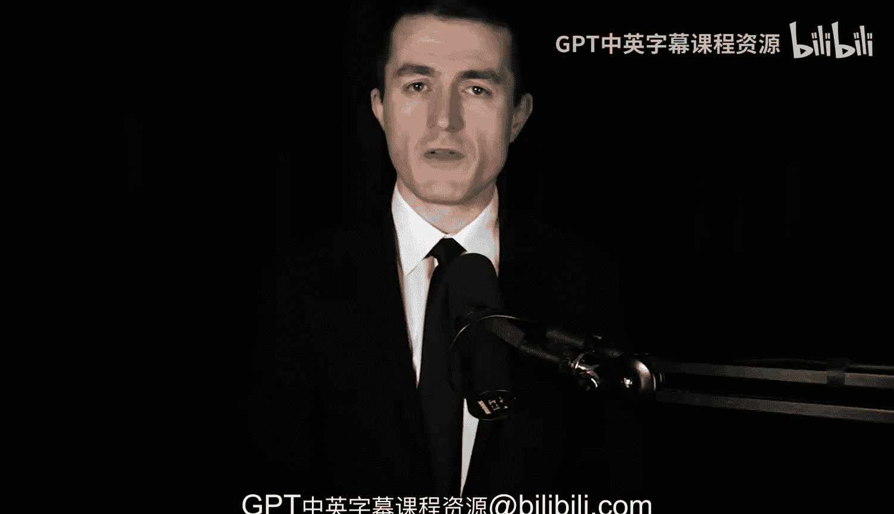

They are both widely respected machine learning researchers and engineers who also happen to be great communicators。

 educators， writers and Twitterers， exposters Sebastian is the author of two books I highly recommend for beginners and experts alike first is build a large language model from scratch and build a reasoning model from scratch I truly believe in the machine learning computer science world。

 the best way to learn and understand something is to build it yourself from scratch。

Nathan is the post Traing lead at the Allen Institute for AI and author of the definitive Book on Recement Learning from Human Fe。

Both of them have great ex accounts， great substax， Sebastian has courses on YouTube。

 Nathan has a podcast， and everyone should absolutely follow all of those This is the Le Friedman podcast to support it。

 please check out our sponsors in the description where you can also find links to contact me。

 ask questions， give feedback and so on， and now dear friends here Sebastian。

 Rashka and Nathan Lambert。

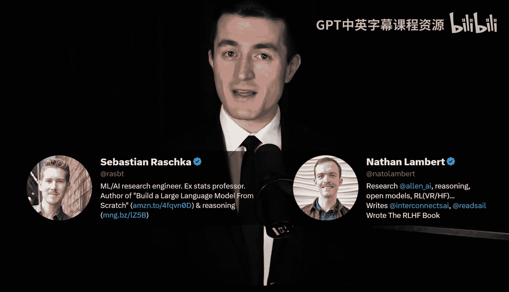

So I think one useful lens to look at all of this through is the deepse so-cal deepse moment this happened about a year ago in January 2025 when the openweight Chinese company Deepse released deepse R1 that I think it's fair to say surprised everyone with near or at state of the art performance。

with allegedly much less compute for much cheaper and from then to today the AI competition has got insane。

 both on the research level on the product level it's just been accelerating let's discuss all of this today and maybe let's start with some spicy questions if we can who is winning at the international level。

 would you say it's a set of companies in China or the set of companies in the United States and Sebastian。

 Nathan it's good to see you guys so Sebastian， who do you think is winning so winning is a very broad you know term I would say you mentioned the deepse moment and I do think deepse is definitelyhan winning the hearts of the people who work on open weight models because they share these as open models winning I think has multiple timescales to it we have today we have next year we have in 10 years one thing I know for sure is that I don't think nowadays 2026。

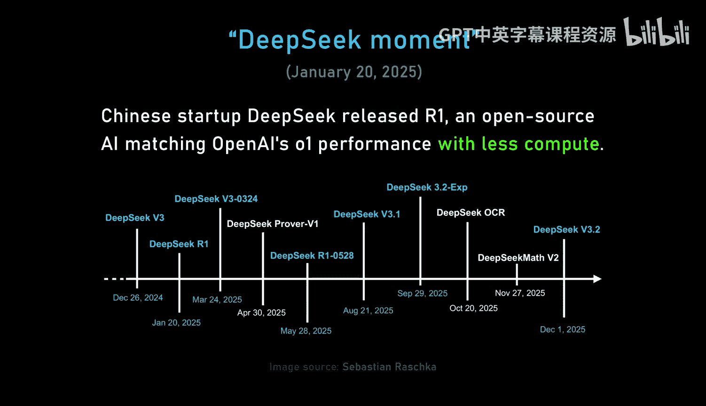

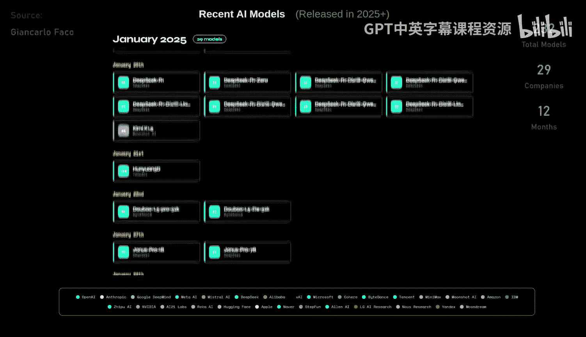

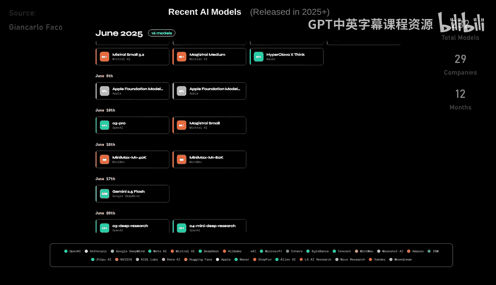

that there will be any company who is let's say having access to a technology that no other company has access to and that is mainly because researchers are frequently changing jobs changing labs。

 they rotate so I don't think there will be a clear winner in terms of technology access however I do think there will be the differenti in will be budget and hardware constraintstrain so I don't think the ideas will be proprietary but the way the resources that are needed to implement them and so I don't see currently take it all scenario where winner takes it all。

 I can't see that at the moment Nathan what do you think you see the labs put different energy into what they're trying to do and I think to market the point in time when we're recording this the hyp over anthropics called Op 4。

5 model has been absolutely insane which is just I mean I've used it builtn in the last few weeks and it's almost gone to。

The point where it feels like a bit of a meme in terms of the hype and it's。

Kind of funny because this is very organic。 And then if we go back a few months ago。

 we can get the release date and the notes is Gemini 3 from Google got released。

 and it seemed like the。😊，Marketing and just like wow factor of that release was super high。

 but then at the end of November Claude Opus 4。5 was released and the hype has been growing but Gemini 3 was before this and it kind of feels like people don't really talk about it as much even though when it came out everybody was like this is。

Gmini's moment to retake kind of Google's structural advantages in AI and Gemini 3 is a fantastic model and I still use it as just kind of differentiation is lower。

And。😊，I agree with Sebastian what you're saying with all these like the idea space is very fluid。

 but culturally anthropic is known for betting very hard on code。

 which is Clade code thing is working out for them right now。

 so I think that even if the ideas flow pretty freely so much of this is bottlenecked by human effort and kind of culture of organizations where Anthropic seems to at least be presenting as the least chaotic is a bit of an advantage and if they can keep doing that for a while。

But on the other side of things there's a lot of ominous technology from China where there's way more labs than deepse。

 so deepse kicked off a movement within China， I say kind of similar to how ChatBT kicked off a movement in the US where everything had a chatbot there's now tons of tech companies in China that are releasing very strong frontier open weight models to the point where I would say that deepse is kind of losing its crown as the preeminent open model maker in China and the likes of Z AIs with their GLM models。

 mini Maxax's models， Kimmi Moonshot， especially in the last few months have shown more brightly。

 the new deepseek models are still very strong， but that's kind of it could look back as a big narrative point where 2025 deepse came and then it kind of provided this platform for way more Chinese companies that are releasing these fantastic models to kind of have this new type of operation so these models from these Chinese companies are open weights and depending on this trajectory of business models that these American companies。

doing could be at risk， but currently a lot of people are paying for AI software in the US and historically in China and other parts of the world people don't pay a lot for software So some of these models like deepse have the love of the people because they are openwa how long do you think the Chinese companies keep releasing openwa models I would say for a few years I think that like in the U there's not a clear business model for it have been writing about open models for a while and these Chinese companies have realized it so I get inbound from some of them and they're smart and realize the same constraints which is that a lot of U tech companies and other IT companies won't pay for API subscription to Chinese companies for security concerns this has been a longstanding habit in tech and the people at these companies then see openweight models as an ability to influence and take part of a huge growing AI expenditure market in the US and they're very realistic about this and it's working for them and I think that the government will see that that is？

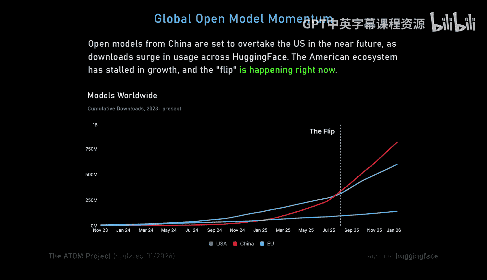

Building a lot of influence internationally in terms of uptake of the technology so there's going to be a lot of incentives to keep it going。

 but building these models and doing the research is very expensive。

 so at some point I expect consolidation， but I don't expect that to be a story of 2026 where there will be。

More open model builders throughout 2026 than there were in 2025 and a lot of the notable ones will be in China Youre going to say something yes。

 you mentioned deepse losing its crown I do think to some extent， yes， but。

We also have to consider though they are still I would say slightly ahead and the other ones。

 it's not that Deepepse got worse， it's just like the other ones are using the ideas from Zepse for example you mentioned Kimmi the same architecture they're training it and then again we have this deepfrogging where they might be at some point in time a bit better because they have the more recent model and I think this comes back to the fact that they won't be a clear winner it will just be like like that one person releases something。

 the other one comes in and the most recent model is probably always the best model we'll also see that Chinese companies have a different incentive so like Deepse is very secretive where some of these startups are like the mini Max in AIs of the world those two literally have filed IPO paperwork and they're trying to get Western mindsha and do a lot of outreach there so I don't know if these incentives will kind of change the model development because deepse famously is built by a hedge fund high flyer capital and we don't know exactly what we don't know what they use the models for or if。

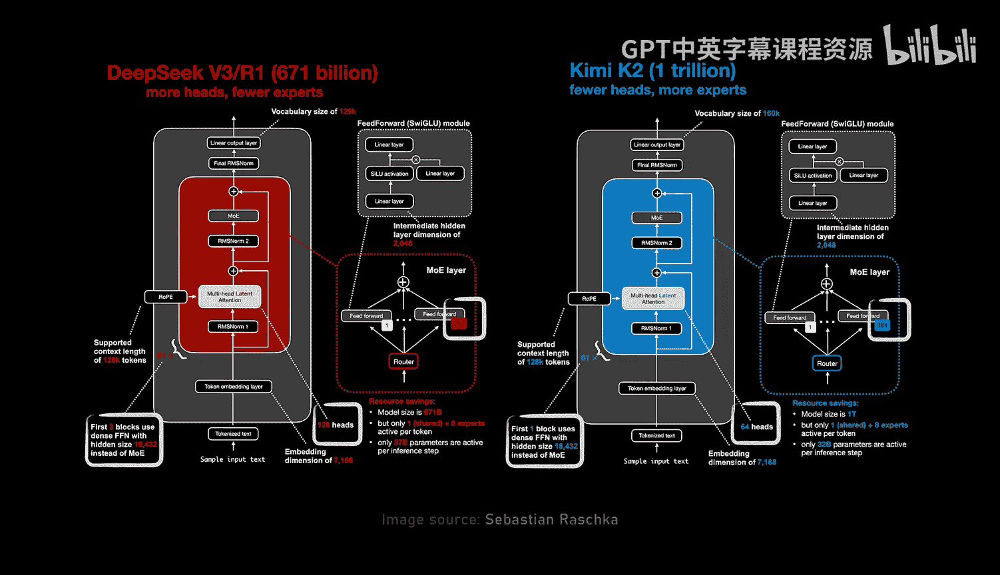

care about this they're secret in terms of communication they're not secret in terms of the technical reports that describe how their models work they're still open on that front and we should also say on the Opus 45 hype there's the layer of something being the darling of the X echo chamber on Twitter echo chamber and the actual amount of people that are using the model I think it's probably fair to say that IGBT and Gemini are focused on the broad user base that just want to solve problems in their daily wise and that user base is gigantic so the hype about the coding may not be represented the actual use I would say also a lot of the usage patterns like you said name recognition brand and stuff but also muscle memory almost where you know like CGPT has been around for a long time people just got used to using it and it's kind of like almost like a flywheel they recommended to other users and that stuff one interesting point。

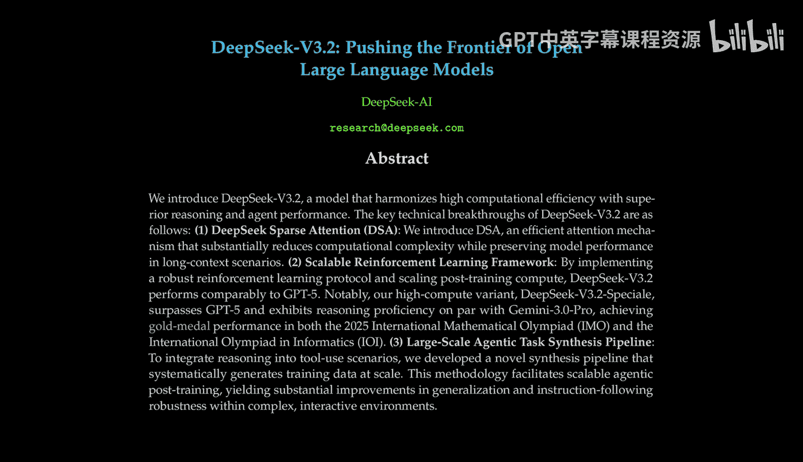

Also the customization of LLMs， for example， chatGPT has a memory feature right and so you may have a subscription and you use it for personal stuff but I don't know if you want to use that same thing at work you know because it's a boundary between private and work if youre working at a company they might not allow that well you may not want that and I think that's also an interesting point where you might have multiple subscriptions one is just clean code it keeps it's nothing of your personal images that you hobby projects in there it's just like the work thing and then the other one is your personal thing so I think that's also something where two different use cases and it doesn't mean you only have to have one I think the future is also multiple ones web model eating1 2025 and what model do you think is going to win in 26 I think in the context of a consumer chatbots is a question of are you willing to bet Gemini over chattGPT which I would say in my gut feels like a bit of a risky bet because openAI has been the incumbent and there's so many benefits to that？

Intact。I， I think that。Momentum， if you look at 2025 was on Gemini side。

 but they were starting from such a low point， I think RIP barred and these earlier attempts of getting started。

Huge credit for them for powering through the organizational chaos to make that happen。

But also it's hard to bet against to open AI because they always come off as so chaotic。

 but they're very good at landing things and I think like personally I have very mixed reviews of G5。

 but I had to have saved them so much money。With the highline feature being a router where most users are no longer charging it like charging their GPU costs as much。

 so I think it's very hard to dissociate the things that I like out of models versus the things that are going to actually。

Be a general public。Differentiator What do you think about 2026 who's going win I'll say something even though it's risky。

 I will say that I think Gemini will continue to take progress on ChaT。

 I think Google scale when both of these are operating at such extreme scales and Google has the ability to separate that research and product a bit better where you hear so much about AI being chaotic operationally and chasing the high impact thing which is a very startup culture and then on the software and enterprise side I think Anthropic will have continued to success as they've again and again been set up for that and obviously Google's cloud has a lot of offerings but I think this kind of like Gemini name brand is important for them to build and Google's cloud will continue to do wells。

 but that's kind of a more complex thing to explain in the ecosystem because that's competing with the likes of Azure and AWS rather than on the model provider side So infrastructure you think GUs give advantage largely because the margin on Nvidia chips is insane。

And Google can develop everything from top to bottom to fit their stack and not have to pay this margin and they've had a head start in building data centers so all of these things that have both high lead times and very hard margins on high costs Google has just kind of a historical advantage there and if there's going to be a new paradigm it's most likely to come from open AI where they're kind of their research division again and again is kind of shown this ability to land a new research idea or a product I think like deep research somewhere where01 thinking models like all of these definitional things have come from openAI and that's got to be one of their top trades as an organization so it's kind of hard to bet against that but I think a lot of this year will be about scale and optimizing what could be described as lowhan fruit and models and clearly there's a tradeoff between intelligence and speed This is what ChagBT5 wass trying to solve behind the scenes it's like do people who actually want intelligence。

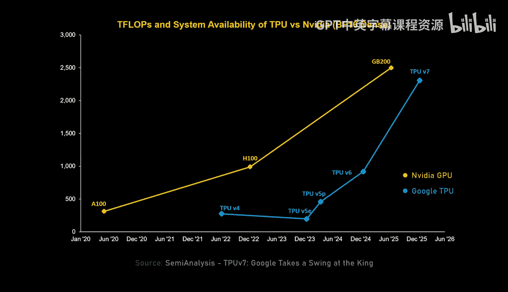

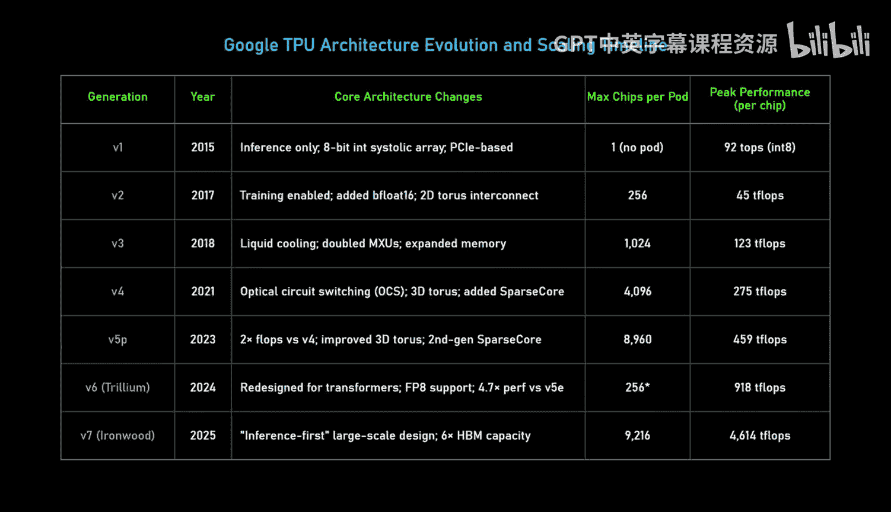

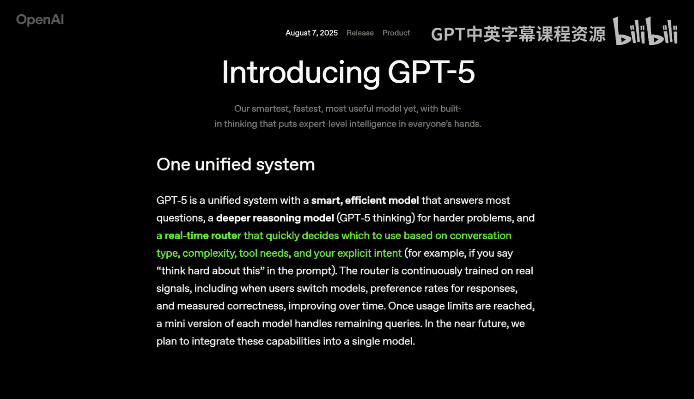

The broad public or do they want speedI think it's a nice variety actually or the option to have a toggle there I mean first for my personal usage most of the time when I look something up I use to ask quick question get the information I want it fast for you know most daily tasks I use the quick model nowadays I think the auto mode is pretty good where you don't have to specifically say thinking or you nonthinking and stuff then again I also sometimes want the pro very often I do is when I have something written I put it into Che and say hey do a very thorough check is all my references correct all my thoughts correct did I make any formatting mistakes and the figure numbers wrong or something like that and I don't need that right away it's okay I finish my stuff maybe have dinner let it run come back and go through this and I think see this is the way I think it's important to have this option I would go crazy for each query I would have to wait 30 minutes or10 minutes me。

I'm like saying over here losing my mind that you use the router and the nonthinking model I'm like how do you live how do you live with that It's like my reaction I'm been heavily on TraGBT for a while never touched five non-thinking I find it its tone and then it's propensity of errors it's just like I have a higher likelihood of errors some of this is from back when opening I released 03 which was the first model to do this deep search and find many sources and integrate them for you so I became habituated with that so I will only use GT5。

2 thinking or pro when I'm finding any sort of information query for work whether that's a paper or some code reference that I found and it's just like I will regularly have like five pro queries going simultaneously each looking for one specific paper or feedback on equation or something I have a fine example of what I just needed to answer as fast as possible for this podcast before I was going on the trip I have like a local GPU running at home and I wanted to run it along。

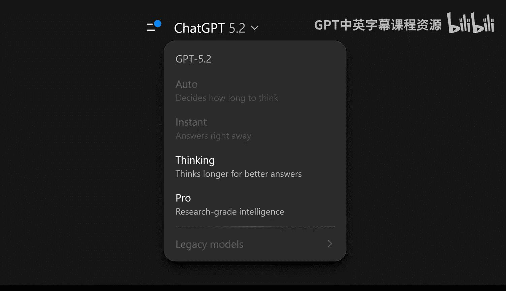

RL experiment and usually I also unpluck things because you know't know if you're not at home you don't want tona have things plugged in and I accidentally unplued the GP it was like my wife was already in the car and it's like dang and then basically I wanted as fast as possible bash script that runs my different experiments and the evaluation and did something I know I learned how to use the ba interface bash terminal but in that moment I just needed like 10 seconds give me the command as a hilarious situation but yeah so what did you use so I did the nonthinking fast model it gave me the ba command I to chain different scripts to each other and then the thing is like you have the T thing where you want to route this to a log file top of my head I was just like in a hurry I could have thought about it by the way I don't know if there is a representative case why wait in the car you have to run GP generate a batchsh sounds like a movie possible I use jammini for that so I used thinking for all。

stuff and then Gemini for fast things or stuff that I could sometimes Google which is like it's good at explaining things and I trust that it has this kind of background of knowledge and it's simple and the Gemini app has gotten a lot better and it's good for that sort of things and then for code and any sort of philosophical discussion I use Cla Opus 4。

5 also always with extended thinking extended thinking and inferenceprint time scaling is just a way to make the models marginally smarter and I will always edge on that side when the progress is very high because you don't know when that all walk a new use case and then sometimes use Goc for real-time information or finding something on AI Twitter that I knew I saw and I need to dig up and I just fixated it on although when G4 came out the Goc for what is super heavy which was like their provariant was actually very good and I was pretty impressed with it and then it's just kind of like muscle memory lost track of it with having the chat toBt app open so I used many different things I actually do use G for。

Heavy for debugging， for like hardcore debugging and the other ones cancel solve I find that it's the best at and I it's interesting because you say ChagPT is the best interface。

For me for that same reason， but this could be just momentum Gemini is the better interface for me。

 I think because I fell in love with their best needle in the haystack if I ever put something that has a lot of context but I'm looking for very specific kinds of information make sure it tracks all of it I find at least the Gemini for me has been the best so it's funny with some of these models if they win your heart over for one particular feature on one particular day for that particular query that prompt you're like this models better and so you'll just stick with it for a bit until it does something really dumb there's like a threshold effect some smart thing and then you fall in love with it and then it does some dumb thing and you're like you know what。

 I'm gonna switch and try Cla and tragedygPT and all that kind of stuff This is exactly like you use it until it breaks until you have a problem and then you change and I think it's the same how we use anything。

favorite text editor operating systems or the browser I mean there has so many browser options。

 safari Firefox Chrome all the similar but then cases maybe extensions you want to use and then you switch but I don't think that any one who types the same thing like the website into different browsers and compare them you only do that when the website doesn't render if something breaks I think so that's a good point I think you use it until it breaks and then you explore other options I think on the long context thing it was also a Gemini user for this but the G5。

2 release blog had like crazy long context course where a lot of people were like did they just figure out some algorithmic change it went from like 30% to like 70% or something in this minor model update so it's also very hard to keep track of all of these things but now I'm look more favorably G5。

2 is long context that it's just kind of like how do I actually get to testing this never ending battle it's interesting that none of us talked about a Chinese model。

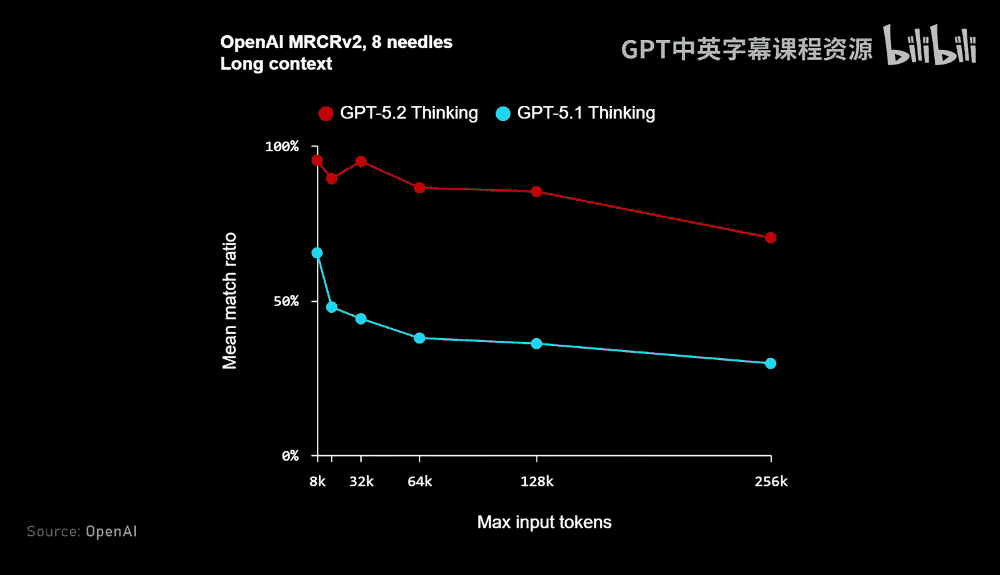

From a user usage perspective what does that say does that mean the Chinese models are not as good or does that mean we're just very biased and US focused I do think that that's currently the discrepancy between just the model and the platform so I think the open models they are known for the open weights not that platform yet there are also a lot of companies that are willing to sell you the open model inference that are very low cost I think like open router it's easy to do the at multimod things you could run deepse on perplexity I think all of us sitting here like we use openI G5 pro' consistently we're all willing to pay for the marginal intelligence gain and anyone that's like these models from the US are better and in terms of the outputs I think the question is will they stay better for this year and for years going but it's like so long as they're better I'm going pay for you to use them I think。

There's also analysis that shows that like the。Way that the Chinese models are served this you could argue due to expert controls or not is that they use fewer GPs for replica which makes them slower and have different errors and it's like speed and intelligence if these things are in your favor as a user I think in the US a lot of users will go for this and I think that that is something thing that will。

Sp these Chinese companies to want to compete in other ways。

 whether it's like free or substantially lower costs or it'll breed creativity in terms of offerings。

 which is good for the ecosystem but I just think a simple thing US models are currently better and we use them and I try Chinese I try these other open models and I'm like fun but not going I don't go back to it we didn't really mention programming that's another use case that a lot of people deeply care about So I use basically half and half cursor and cloud code because I find them to be like fundamentally different experience in both useful What do you guys program quite a bit what do you use what's the current vibe So I use the code X plugin for VS code know it's very convenient it's just like a plug and then it's a chat interface that has access to your repository I know that cloud code is I think a bit different。

 It iss a bit more agent to touch of small things it does a whole project for you I'm not quite there yet where I'm comfortable with that because。

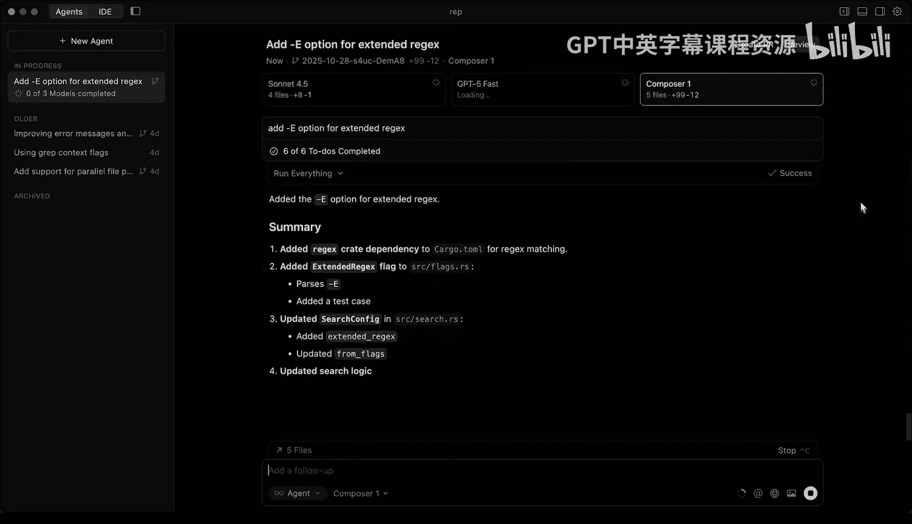

Maybe I'm a control freak， but I still would like to see a bit what's going on and Codex is kind of like right now for me like the sweet spot where it is helping me but it is not taking completely over I should mention one of the reasons I do use cloud code is to build the skill of programming with English I mean the experience is fundamentally different。

😊，As opposed to micromanaging the details of the process of the generation of the code and looking at the diF。

 which you can incursor if that's the ID use and in changing altering。

 looking and reading the code and understanding the code deeply as you progress versus just kind of like thinking in this design space and just guiding it at this macro level which I think is another way of thinking about the programming process。

 also we should say that cloud code， it just seems to be somehow a better utilization of cloud Opus 45 it's a good side by side for people to do so you can have cloud code open you can have cursor open and you can have Vs code open and you can select the same models on all of them and ask questions and very interesting like cloud coded way better in that I mean it's remarkable right we should say that both of you are legit on multiple fronts researchers program。

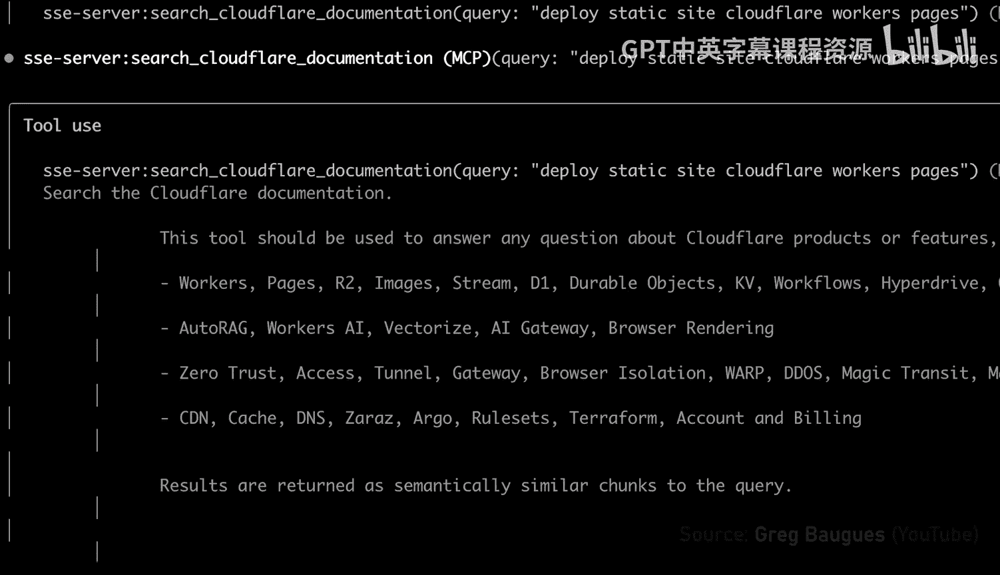

Eucators， tweeter and on the book front too， so Nathan。

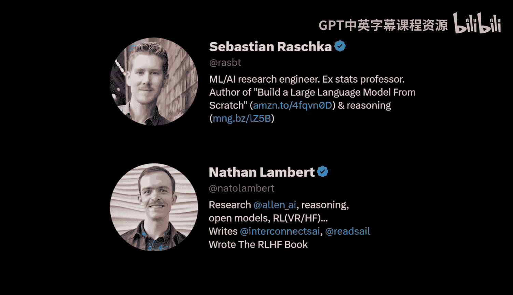

At some point soon hopefully has an RF book coming out It's available for pre-order and there's a full digital preprint just making it pretty and better organized for the physical thing。

 which is lot of what I do it because it's fun to create things that you think are excellent in the physical form when so much of our life is digital I should say going to perplexity here Sebastian Rashka is a machine learning researcher and author known for several influential books a couple of them that I wanted to mention which is a book I highly recommend build a large language model from scratch and the new one build a reasoning model from scratch So I'm really excited about that building stuff from scratch is one of the most powerful ways of learningHonestly building an element from scratch is a lot of fun it's also a lot to learn and like you said it's probably the best way to learn how something really works because。

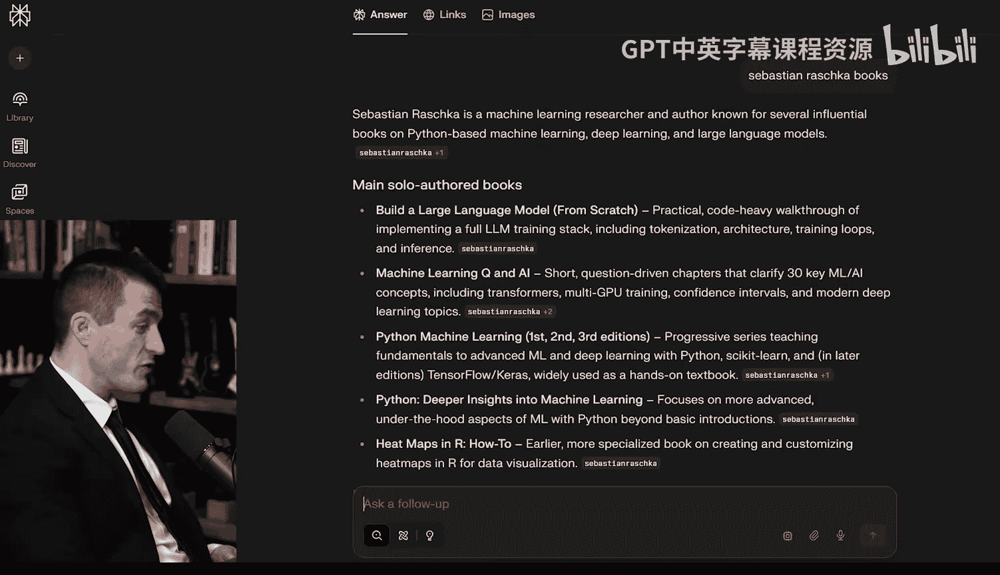

You can look at figures， but figures can have mistakes， you can look of concepts explanations。

 but you might misunderstand them， but if you see the if there is code and the code works。

 you know it's correctly I mean there's no misunderstanding it's like it's precise otherwise it wouldn't work and I think that's like kind of like the beauty behind coding it is kind of like it doesn't lie it's math basically so even though with math I think you can have mistakes in the book you would never notice because you're not running the math when you're reading the book you can't verify this and with code what's nice is you can verify it Yeah I agree with you about the Lm from scratch book it's nice to tune out everything else in the internet and so on it just focus on the book but you know I read several like you know history books it's just less lonely somehow it's really more fun like yeah for example on the programming front I think it's genuinely more fun to program with an LLM and I think it's genuinely more fun to read with an LLM。

But you're right， like this distraction should be minimized so it's you use the LLM to basically enrich the experience。

 maybe add more context。Maybe the I just the rate of aha moments for me in a small scale is really high with their arms 100% I would I also want to correct myself I'm not suggesting not to use LLMs。

 I suggest doing it in multiple passes like one pass just offline focus mode and then after that。

 I mean I also take notes but I，I try to resist the urge to immediately look things up。

 I do a second pass it's just like for me more structured this way and I get I mean sometimes things are answered in the chapter but sometimes also it just helps to let it sink in and think about it other people have different preferences I would highly recommend using LLMs when reading books for me it's it's not the first thing to do it's like the second pass by way of recommendation is to say I do the opposite I like to use the LLM at the beginning to lay out the full context of like what is this world that I'm now stepping into but I try to avoid clicking out of the LLM into the world of like Twitter and blogs and because then you're now down this rabbit hole。

 you're reading somebody's opinion， there's a flame more about a particular topic and also sudden and you're no longer you're now in the realm of the internet and read it and so on but if you're purely letting the LLM give you the context of why this matters what are the big picture ideas。

But sometimes books themselves are good at doing that。

 but not always so this is why I like the chatt G app because it gives the AI a home in your computer when you're you can focus on it rather than just being another tab in my mess of internet options and I think cloud code in these particularly does a good job of making that a joy where it seems very。

Engaging as a product designed to be an interface that your AI will then go out into the world and it's something that is very kind of intangible between it and codex is that it just feels kind of warm and engaging where codex can often be as good from open AI but it just kind of like feels a little bit rougher on the edges where it's like cloud code makes it fun to build things particularly from scratch where you just don't like you don't have to care but you trust that it'll make something like obviously this's good for websites and。

Kind of refreshing tooling and stuff like this which I use it for or data analysis so my blog we scrape hugging past we keep the download numbers for every data set and model over time now so we have them and it's like cloudude was just like yeah I've made use of that data no problem and Im like that would have taken me days honestly then I have enough situational awareness to be like okay these trends obviously make sense and you can check things。

Because that's just a kind of wonderful interface where you can have an intermediary and not have to do the kind of awful low level work that you would have to do to maintain different web projects and do the stuff All right so we just talked about a bunch of the closed weight models Let's talk about the open ones so tell me about the landscape of open LM models which are interesting ones which stand out to you and why we' already matching deepse do you want to see how many we can name off the top of our head Yeah without looking at notes deepse Kimmi minimax Z do AI。

At Lang we're just going to Chinese。 Let's go in M G the open source model bymovi had amo there's a lot of stuff especially at the of then the obvious name I was trying to get you can get at least 10 Chinese and 10 I think that I I released their first open model G when I when I was writing about open model release they're don't forget about G which I thought is really funny's such a different time G is actually a very strong model and does some things other models don't do very well and I think that selfishly I'll promote a bunch of Western companies both in the U Europe fully open I work at Institute for AIve been building Omo。

 which releases data and code and all of this and now we have actual。

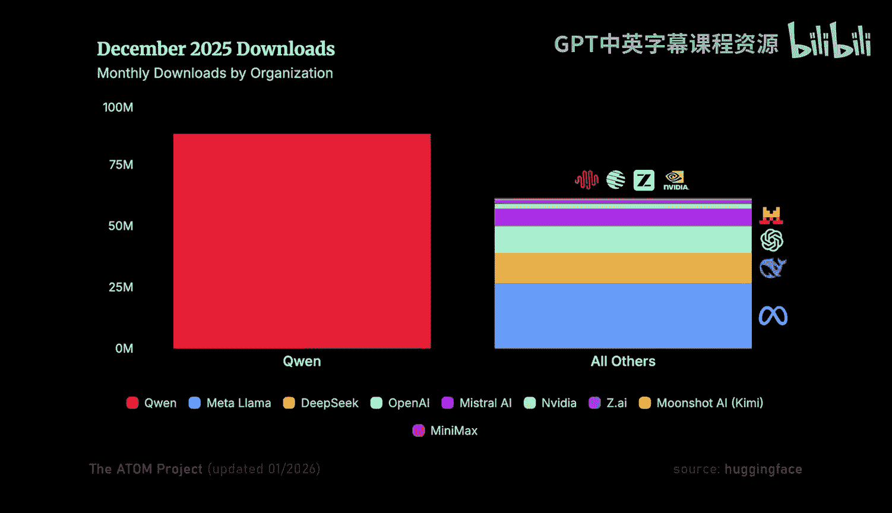

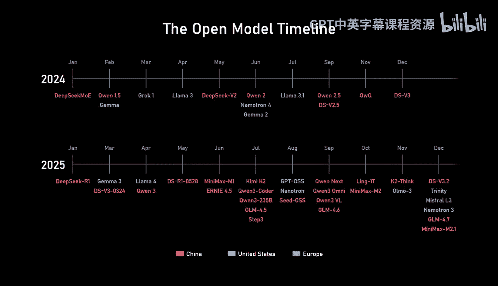

Petition for people that are trying to release everything so that other people can train these models so there's the Institute for Foundation models or slash LM 360。

 which is like had their K2 models of various types apps is a Sws research consortium hugging face has small LM which is very popular in Nvidia's name areron to started releasing data as well and then Stanford's Marin Community project which is kind of making it so there's a pipeline for people to open a GitHub issue and implement a new idea and then have it run in a stable language modeling stack so this space。

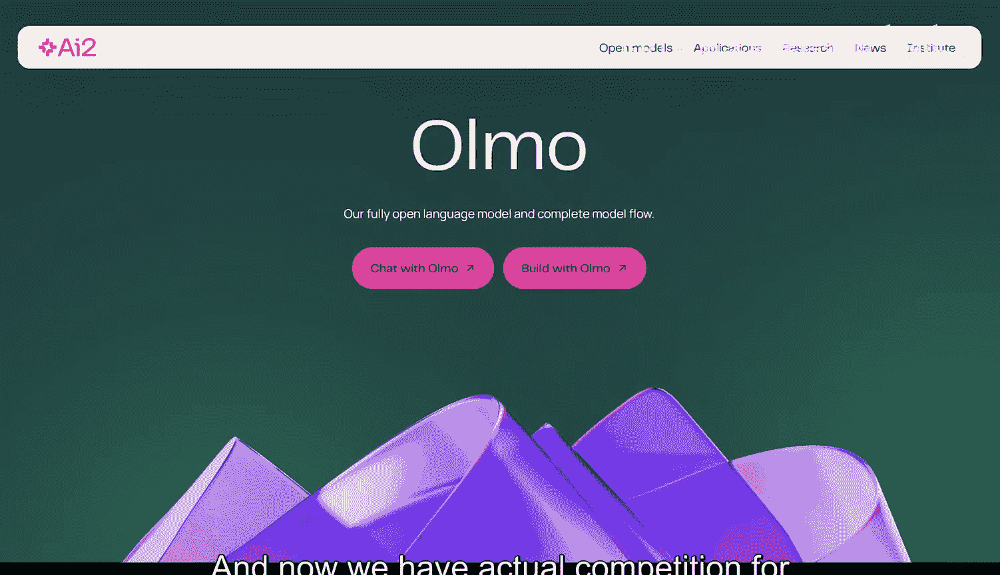

That list was way smaller in 2024， so I think it was like just AI too。

 so that's a great thing for more people to get involved and to understand language models。

 which doesn't really have a like a Chinese company that is has an analog。While I'm talking。

 I will say that the Chinese open language models tend to be much bigger and that gives them this higher peak performance as MoOEs where a lot of these things that we like a lot。

 whether it was GeEA in Nematron have tended to be smaller models from the US which is starting to change from US and Europe Mr。

 large3 came out which was a giant MOE model very similar to deepse architecture in December and then a startup RCAI and both Nematron have Nemaron and Nvidia have teased MoE models of this way bigger than 100 billion parameters like this 400 billion parameter range coming in this like Q1-2026 Highine。

 so I think this kind of balance is set to change this year in terms of what people are using the Chinese versus US Open models for。

 which would which I'm personally kind be very excited to watch first of all。

 huge props for being able to name some these Did you actually name Loma now I feel like RP。

Not a purpose All right Pma All right can you mention what are some interesting models that stand out So you mentioned Quen3s as obviously stand out So I would say the years a book ended by both a deepse version3 and R1 and then on the other hand in December deepse version 3。

2 because what I like about those is they always have an interesting architecture tweak that others don't have but otherwise if you want to go with you know like the familiar but really good performance Que3 and like Nathan said also GT and I think GT what's interesting about it is kind of like the first public or like openweight model that was really trained with tool use in mind which I do think is kind of a little bit of a paradigm shift where the ecosystem was not quite ready for it So with tool use I mean that the LlM is able to do a web search to call a Python interpretton and I do think this it's a standout because I think it's a huge unlock because one of the most common complaints about LLm R。

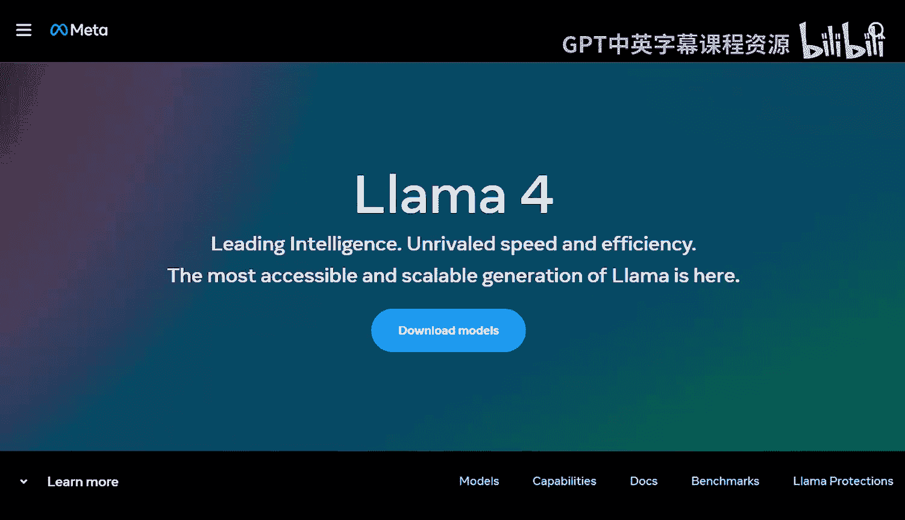

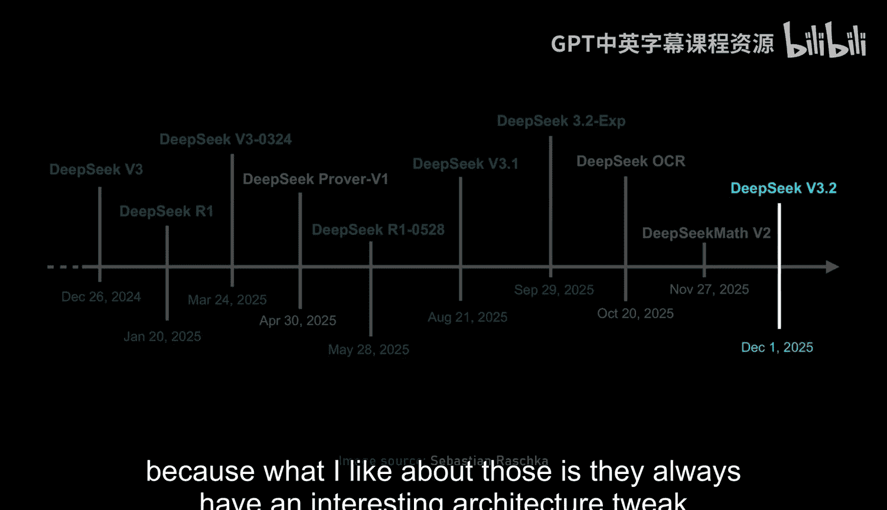

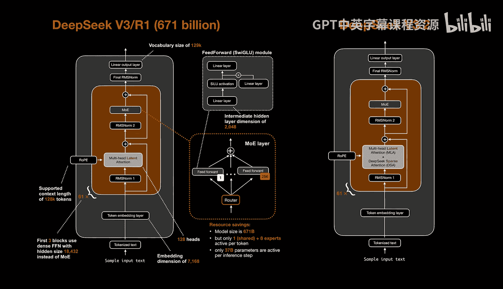

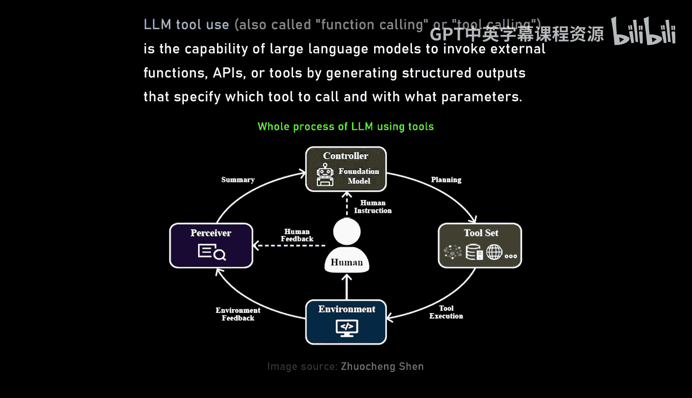

For example， hallucinations and so in my opinion， one of the best ways to solve hallucinations is to not try to always remember information or make things up for math。

 why not use a calculator app or Python if I ask N who won the soccer World Cup in 1998 instead of just trying to memorize could go do a search I think mostly it's usually still a Google search so JG GPOSA would do a tool call to Google maybe find the FiIA website find okay it was France I would get you that information reliably instead of just trying to memorize it I think it's a huge unlock which I think right now is not fully utilizeized it by the open source openweight ecosystem a lot of people don't use tool call modes because I think it's first a trusting you don't want to run this on your computer where it has access to tools could wipe your hard drive or whatever so you want to maybe containerize that but I do think that is like a really important step for upcoming year。

To have this ability so a few quick things first of all。

 thank you for defining what you mean by tool use， I think that's a great thing to do in general for the concepts we're talking about even things that sort of well established as MEs you have to say that means mixture your X person you could kind of have to build up an intuition for people what that means how it's actually utilized what are the different flavors。

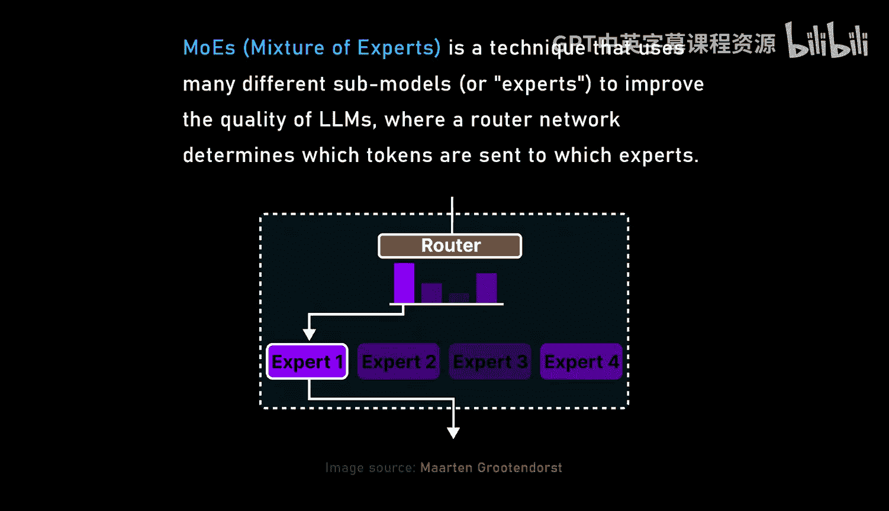

So what does it mean that there's this such explosion of open models What's your intuition If you're releasing an open model you want people to use it is the first and foremost thing and then after that comes things like transparency and trust I think when you look at China the biggest reason is that they want people around the world to use these models and I think a lot of people will not if you look outside of the U a lot of people will not pay for software but they might have computing resources where you can put a model on it and run it I think there can also be data that you don't want to send to the cloud so the number one thing is getting people to use models use AI or use your AI that might not be able to do it without having access to the model I guess we should state explicitly so we've been talking about these Chinese models and openweight models。

Oftentimes the way they run is locally， so it's not like you're sending your data to China or to whoever developed to Silicon Valley。

 whoever developed the model。A lot of American startups make money by hosting these models from China and selling them sellingken it's called like selling tokens。

 which means somebody will call the model to do some piece of work I think the other reason is for US companies like OpenI so GPU deprive they're at the limits of the GPs whenever they make a release theyre always talking about like our GPU or hurting and I think there's like in one of these like GPOSS release sessions。

 Sam Alman said like oh we're releasing this because we can use your GPU we don't have to use we don't have to use our GPUs and Open AI can still get distribution out of this。

 which is another very real thing doesn't cost them anything and for the user I also I our users who just use the model locally how they would useG but also for companies I think it's a huge unlock to have these models because you can customize them you can train them can at posttraining at more data like specialize them into let's say law medical models。

 whatever you have and the appeal。Lama the appeal of the openweight models from China is that the openweight models are also the licenses are even friendlier。

 I think they are just unrestricted open source licenses where if we use something like Lama or gemma there are some strings attached I think it's like a a limit in terms of how many users you have and then if you exceed I don't so many million users you have to report your finance situation to let's say Me or something like that and I think well it is a free model but there are strings attached and people do like things where strings are not attached so I think that's also one of the reasons besides performance why the openweight models from China are so popular because you can just use them there's there's no catch in that sense the ecosystem is gotten better on that front but mostly downstream of these new providers providing such open licenses that was funny when you pulled up perplexity it said Kimmi K2 thinking hosted in the U which is just like an I've never seen this but it's an exact example of what we're talking about where people are sensitive to this like Kimmi K2 thinking in Kimmi K2 is a model。

It is very popular people say that is very good like creative writing and also in doing some software things it's just these little quirks that people pick up on with different models that they like what is mentioning ideas that some of these models have explored that you can speak to like that particular interesting to you maybe can go chronologically I mean that was of course deepse deepse R1 that came out in January if we just focus on 2025 however this was based on deepse version 3 which came out the year before in December 2024 the multiple things on the architecture side what is fascinating is you can still I mean that's what I do in from scratch coding projects you can still start with G2 and you can add things to that model to make it into this other model it's all still kind of like the same lineage the same it is a very close relationship between those but top of my head deepse what was unique there is the mixture of I mean they were not inventing mixture of experts we can maybe talk a bit more what mixture of experts means。

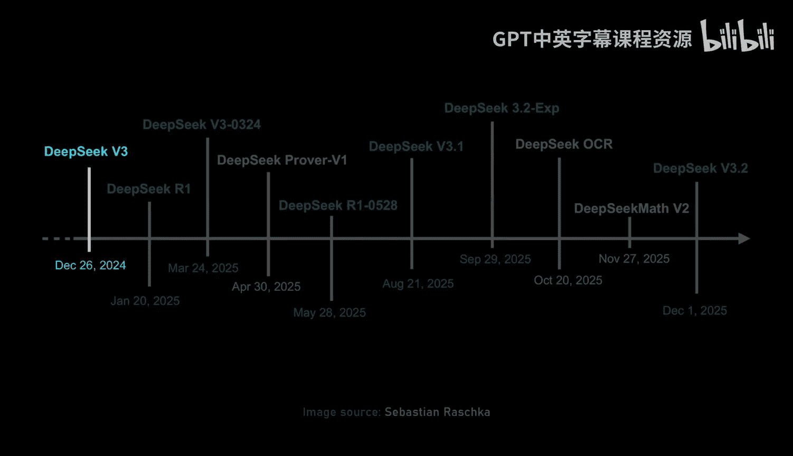

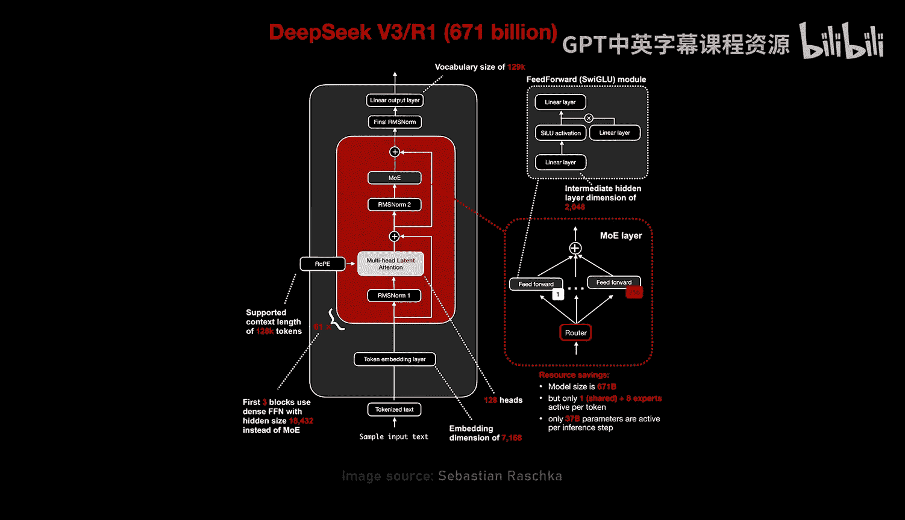

But just to list these things first before we dive into detail mixture of experts。

 but then they also had a multiheadd latent attention which is a tweak to the attention mechanism where this was I would say 2025 the main distinguishing factor between these open weight models different tweaks to make inference or Kv cache size we can also define Kb cache in a few moments but to kind of make it more economical to have long context to shrink the Kv cache size so what are tweaks that we can do and most of them focused on the attention mechanism is multihead latent attention in deepepse there is group query attention which is still very popular it's not invented by any of those models goes back a few years but that would be the other option sliding window attention I think almost reuses it if remember correctly so these different tweaks that make the models different。

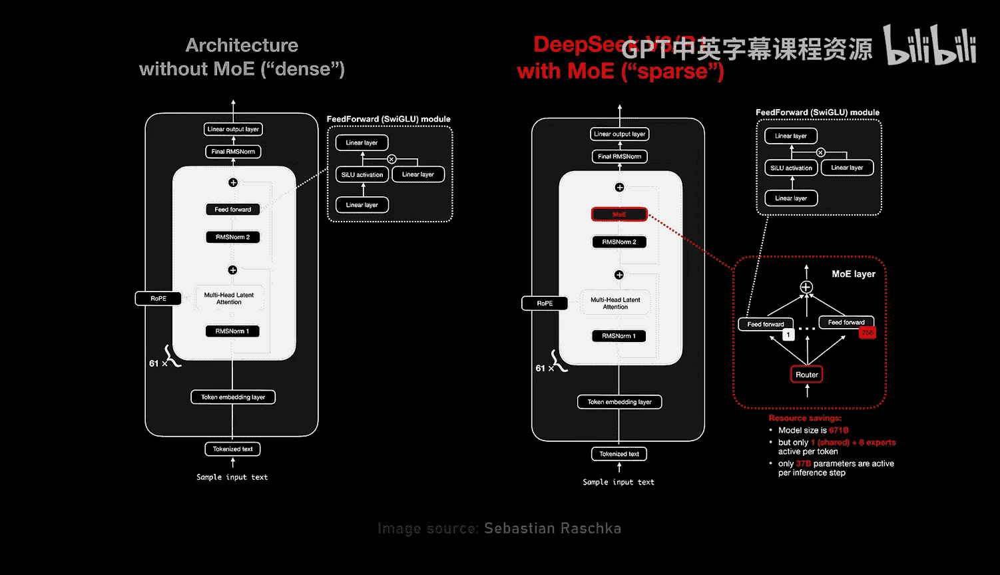

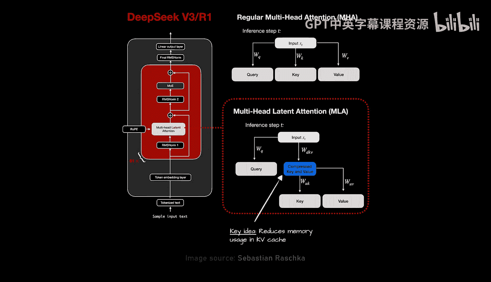

Otherwise I put them all together an article once where I just compare them they are very surprisingly similar it's just different numbers in terms of how many petitions of the transformer block you have in the center and just little littlenops that people tune but was so nice about it is it works no matter what you can tweak things you can move the normalization layers around you get some performance gains and almost always very good in ablation studies showing what actually what it does to the model if you move something around ablation studies doesn't make it better or worse but there are so many that say ways you can implement a transformer and make it still work big ideas that are the prevalent is mixture of experts multilant attention sliding window attention group query attention and then at the end of the year we saw a focus on making the attention mechanism scale linearity with inference token prediction so they werequint3 next for example which added a gated deltanet it's like。

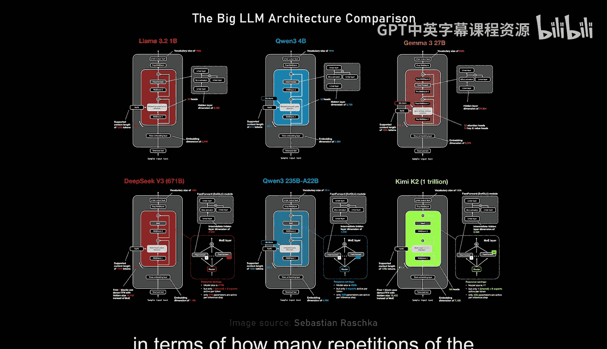

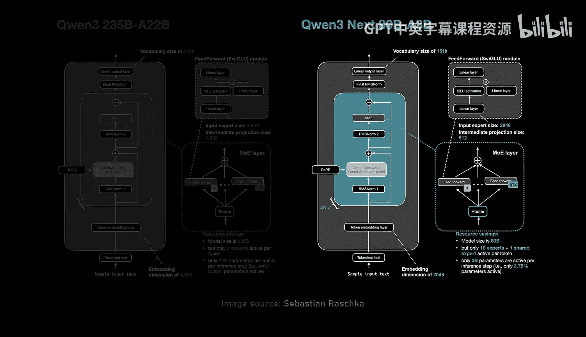

I don't like inspired by state space models where you have a fixed state that you keep updating。

 but it makes essentially this attention。per it replaces attention with a cheaper operation and it maybe is useful to step back and talk about transform architecture in general Yeah so maybe we should start with the GT2 architecture。

 the transformer that was derived from the attention is all you need paper so the attention is all you need paper had a transformer architecture that had two parts and encoder and a decoder and GPT when just focusing in on the decoder part it is essentially still a neural network and it has this attention mechanism inside and you predict one token at a time。

 you pass it through an embedding layer there's the transformer block。

 the transformer block has attention modules and a fully connected layer and there are some normalization layers in between but it's essentially a neural network layers with this attention mechanism so coming from GT2 when we move on to GPTOSS there is for example the mixture of experts layer it's not invented by GPOS it's a few years old but it is essentially。

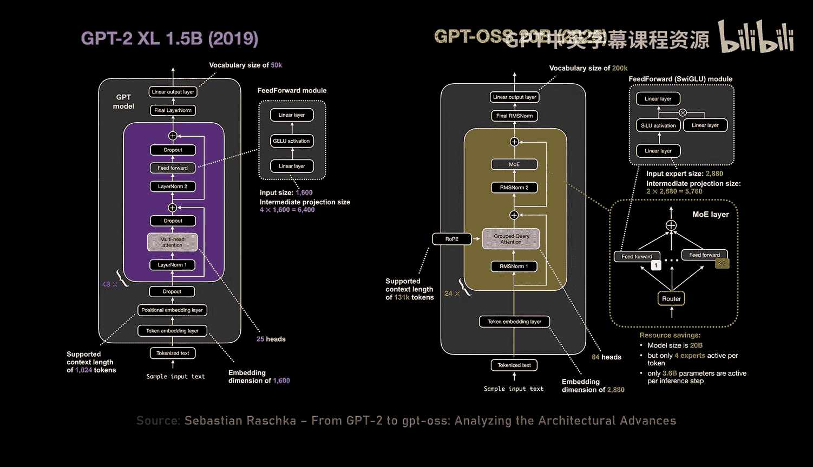

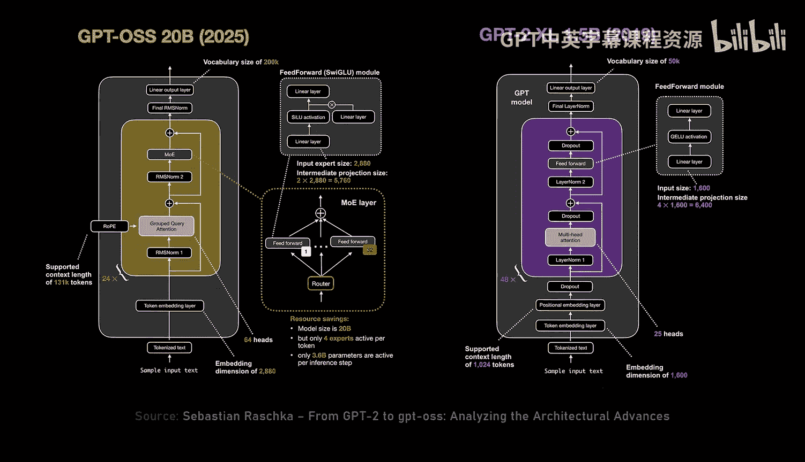

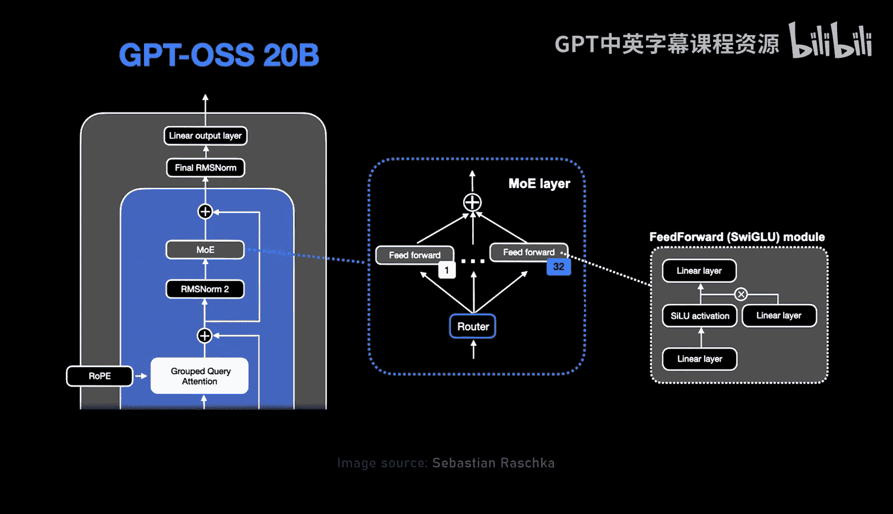

A tweak to make the model larger without consuming more compute in each forward pass so there is this a fully connected layer and if listeners are familiar with multilayer perceptrons you can think of a mini multilayer perceptron。

 a fully connected neural network layer inside the transformer and it's very expensive because it's fully connected if you have thousand inputs。

 thousand outputs that's like a1 million connections and it's a very expensive part in this transformer and the idea is。

To kind of expand that into multiple feet forward networks so instead of having one let's say you have 256 but it would make it way more expensive because now you have 256 but you don't use all of them at the same time so you now have a router that says okay based on this input token it would be useful to use this fully connected network and in that context it's called an expert so a mixture of experts means you have multiple experts and depending on what your input is let's say it's more math heavy it would use different experts compared to let's say translating input text from English to Spanish it would maybe console different experts it's not quite clear I mean it clear cut to say okay this is only an expert for math and for Spanish is a bit more fuzzy but the idea is essentially that you pack more knowledge into the network but not all the knowledge is used all the time that would be very wasteful so you have kind of like during the token generation you have more selective there's a router that selects which tokens should go。

whichch expert it's more complexity it's harder to train there's a lot of you know that can go wrong like collapse and everything so I think it's why almostmo three still uses dense I mean you have I think all models was mixture of experts but dense models where dense means also also it's jargon there's a distinction between dense and spars so mixture of experts is considered spars because we have a lot of experts but only few of them are active so that's called spars and then dense would be the opposite where you only have like one fully connected module and it's always you know utilized。

So maybe it's a good place to also talk about KVc but actually before that even zooming out like fundamentally how many new ideas have been implemented from GT2 to today like how different really are these architectures picture like the mixture of experts the attention mechanism and GTOSs that would be the group query attention mechanism。

 so it's a slight tweak for multi-head attention to group query attention so that we have two think they replaced layer norm by RMS norm but it's just like a different normalization there。

 not a big change it's just like a tweak not nonlinear activation function people familiar in with new networks I mean it's the same as changing sigmoid with it's not changing the network fundamentally it's just like a tweak a little little tweak and that's about it I would say it's not really fundamentally that different it's still the same architecture so you can convert one from one you can go from one into the other by just adding these。

These changes basically it' fundamental that is still the same architecture Y so for example you mentioned my book earlier that's a GPT2 model in the book because it's simple and it very small so 124 120 million parameters approximately but in the bonus materials I do have almost three from scratch Gema3 from scratch and other types of from scratch models and I always start with my GPT2 model and just you know trick at different components and you get from one to the other it's like it's kind of like a lineage in a sense can you build up an intuition for people because sort of when you zoouma you look at it there's so much rapid advancement in the AI world。

And at the same time， fundamentally the architectures have not changed。

So where is all the turbulence， the turmoil of the advancement happening？

wheres the gains to be had So there are the different stages where you develop the network or train the network you have the pre-training now back then they it was just pretraining with GT2 now you have pretraining midtrain and post training so and I think right now we are in the posttraining focused stage I mean pretraining still gives you advantages if you scaled up to better higher quality data but then we have capability unlocknox that we're not there with G2 for example chat GT it is basically GT3 model and G3 is the same as G2 in terms of architecture what was new was adding the supervised fine tuning and the reinforcement learning with human feedback so it's more on the algorithmic side rather than the architecture I would say that the systems also change a lot I think if you listen to videos announcements I talk about these things like you now do F you can now do F4 and what is happening is these labs are figuring out how to utilize more compute to put it into one model。

which lets them train faster and that lets them put more data in and then you can find better configurations faster by doing this so you can look at like the essentially the tokens per second per GPU is a metric that you look at when you're doing large scale training and you could get you can go from like 10k to 13 k by turning on FPA training which means you're using less memory per parameter in the model and by saving less information you do less communication you can train faster so all of these like system things underpin way faster experimentation on data and algorithms that is kind of like it's this it's this kind of。

Loop that keeps going where it's kind of hard to describe when you look at the architecture and they're exactly the same。

 but the codebased use to train these models is going to be vastly different and you could probably like I don' the GPUs are different but you probably train GTOS has 20b way faster in1'clock time than GPT2 was trained at the time like you said they had for example in the mixture of experts FP4 optimization for example where you get more throughput but I do think this is for the speed this is true but it doesn't give the model new capabilities in a sense it's just how much can we make the computation courseser without suffering in terms of model performance degradation but I do think I mean the alternatives popping up to the transformer there's text diffusion models completely different paradigm and there's also I mean the text diffusion models might use transform architectures but it's not an autoregressive transformer and also maba models it's a state space model but they do have。

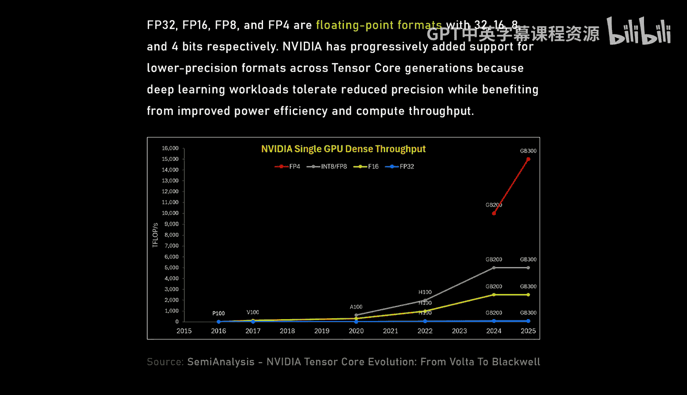

And what's right is there's nothing that has replaced the autoregressive transformer as state of the art model。

 so like for state of the art， you would still do that goal with that thing。

 but there are now alternatives for the cheaper and like alternatives that are kind of making compromises。

 but it's not just one architecture anymore， there are little ones coming up。

 but if we talk about the state of the art， it's pretty much still the。

The transform architecture autoregressive derived from GPT2 essentially。

 I guess the big question here is we talked quite a bit here in the architecture behind the pre training。

Are the scaling laws holding strong across pretraining。

 post traininging inference contact size data synthetic data I like to start with the technical definition of scaling law which kind of informs all of this the scaling law as a power law relationship between you can think of the X axis so kind of what you're scaling as a combination of compute and data which are kind of similar and then the Y axis is like the heldout prediction accuracy over an x tokens we talk about models being autoaggress it's like if you keep a set of。

Text that the model has not seen how accurate will it get when you will train and the idea of scaling laws came when people figured out that that was a very predictable relationship and I think that。

That technical term is continuing and then the question is like what do users get out of it and then there are more types of scaling where Open AIs01 was famous for introducing inference time scaling and I think less famously for also showing that you can scale reinforceable learning training and get kind of this log X axis and then a linear increase in performance on Y axis so there's kind of these three axes now or the traditional scaling laws are talked about for pre-training which is how big your model is and how big your data set is and then scaling reinforceable learning which is like how long can you do this trial and error learning that we will talk about we'll define more of this and then this inference time compute which is just letting the model generate more tokens on a specific problem so I'm kind of bullish where they're all really still working but the lowhaning fruit has mostly been taken especially in the last year on reinforceable learning with verifiable rewards which is this RLVR and then inference time scaling which is just why these models feel so different to use where previously you would get that first。

Token immediately and now theyll go off for seconds。

 minutes or even hours generating these hidden thoughts before giving you the first word of your answer and that's all about this inference time scaling which is。

Such a wonderful kind of step function in terms of how the models change abilities。

 they kind of enabled this tool use stuff and enabled this much better software engineering that we were talking about and this is when we say enabled almost entirely downstream of the fact that。

This reinforcement learning with verifiable rewards training just kind of let the models pick up these skills very easily So let the models learn。

 So if you look at the reasoning process when the models are generating a lot of tokens。

 what it will be often doing is it tries a tool it looks at what it gets back it tries another API it sees what it gets back and if it solves the problem So the models when you're training them very quickly learn to do this and then at the end of the day that gives this kind of general foundation where the model can use CI commands very nicely in your repo and handle get for you and move things around and organize things or search to find more information which if we're sitting in these chairs a year ago its something that we didn't really think of the models being doing So this is just kind of something that has happened this year and is。

Totally transformed how we think of using AI， which I think is very magical such an interesting evolution and just so unlock so much value。

 but it it's like it's not clear what the next avenue will be in terms of unlocking stuff like this I think that there's's will'll get to continuetinual learning later but there's a lot of buzz around certain areas of AI but no one knows when the next step function will will really come so you you've actually said quite a lot of things there。

And said profound things quickly， it would be nice to unpack them a little bit。

 you said you're bullish basically on every version of scaling。

 so can we just even start at the beginning。Pretrain。

Are we kind of implying that the low hanging fruit on pretraining scaling has been picked is is is pretraining hit a plateau or is even pretraining still your bullish on pretraining has gotten extremely expensive I think to scale up pretraining it's also implying that you're going serve a very large model to the users so I think that。

It's been loosely established the likes of GP4 and similar models where around one trillion like this order of trillion parameters at the biggest size。

 there's a lot of rumors that they've actually gotten smaller as training has gotten more efficient。

You want to make the model smaller because then your costs of serving go down proportionly these models。

 the costs of training them is really low relative to the cost of serving them to hundreds of millions of users I think deepse had this famous number of about $5 million for pretraining cloud market rates I almost three section 2。

4 in the paper we just detailed how long we had the GPU clusters sitting around for training which includes engineering issues。

 multiple seeds and it was like about 2 million to rent the cluster to like deal with all the problems and headaches of training a model so these models are pretty like a lot of people could get one to $10 million to train a model but the recurring costs of serving millions of users is really billion of dollars of compute I think that you can look at like1000 GPU rental you can pay 100 grand a day for and these companies could have millions of GPUs you can look at how much of these things costs to sit around so that's kind of a big。

Thing and then it's like if scaling is actually giving you a better model。

 like is it going to be financially worth it and I think it'll kind of slowly well push it out as AI solves more compelling tasks so like the likes of cloud Op is 4。

5 making cloud code。Just work for things I think I' launched this project called like the Adam Project which is like American Truly Open Models in July and that was like a true vibecoded website and like I have a job make plots and stuff and then I came back to refreshing in the last few weeks and it's like cloud Opus 4。

5 versus whatever model at the time was like just crushed all the issues that it had from building in June in July and like might be a bigger model there's a lot of things that go into this but that's like there's still progress coming so what you're speaking to is the nuance of the Y axis of the scaling laws that the ways experience versus on a benchmark。

 the actual intelligence might be different but still your intuition about pretraining if you scale the size of compute。

Will the models get better， not whether it's financially viable， but just from the law aspect of it。

 do you think the models will get smarter， Yeah， and I think that there's。

And this sometimes comes off as like almost like disillusioned from people leadership AI companies saying this。

 but they're like it's held for 13 orders of magnitude of computer or something like why would it ever end and I think fundamentally is pretty unlikely to stop it's just like eventually we're not even going to be able to test the bigger scales because of all the problems that come with more compute I think that there's a lot of talk on how 2026 is a year when very large blackwell compute clusters it's like gigawatt scale facilities that hyperscales are coming online and。

These were all contracts for power and data centers that were signed and sought out in like 22 and 2023 so before or right after chatGBT so it took this two to three year lead time to build these bigger clusters to train the models well there's obviously immense interest in building even more data centers than that so that is like kind of the crux that people are saying it's like these new clusters are coming the labs are going to have more compute for training they're going to utilize this but it's not a given and it's like I've seen so much progress that I expected and I expect a little bit bigger models and I expect I would。

Says's more like we will see a $2000 subscription this year we've seen $200 subscriptions it's like that could 1x again and these are the kind of things that could come and they're all downstream of this like big bit bigger model that offers just a little bit more cutting edge so you know it's reported that XI is going to hit that one gigawatt scale early 26 and full2 gigawatt by year end。

How do you think they'll utilize that？In the context of scaling laws。I iss a lot of that inference。

 is a lot of that training it ends up being all of the above， so I think that。

All of your decisions when you're training a model come back to pretraining so if you're going to scale RL in a model you still need to decide on your architecture that enables this we're talking about like other architectures and using different types of attention we're also talking about mixture of experts models this sparse nature of MoOE models makes it much more efficient to do generation which becomes a big part of posttraining and it's like you need to have your architecture ready so that you can actually scale up this compute I still think most of the compute is going in at pretraining because you can still make a model better you still want to go and revisit this you will still want the best base model that you can and in a few years that I'll saturate and the RL compute will just go longer is there people who disagree with you that say basically pretraining is dead。

It's all ball scaling inference。scaling post scaling context， contin learning scaling data。

 synthetic data People vibe that way and describe it in that way。

 but I think it's not the practice that is happening just the general vibe of people saying the excitement is elsewhere so the lowhan fruit and Rl is elsewhere like for example we released our model in November for every company has deadlines our deadline was like November 20 and for that our RL run was five days which compared to 2024 is a very long time to just be doing posttraining at a model of like 30 billion parameters it's not a big model and then in December we had another release which was we let the RL run for go for another three and a half weeks and the model got notably better so we release it and like that's a big amount of time to just allocate something that is gonna be your peak for the year so it's like there's types of decisions that happen when they're training a model where they just like' they can't leave it forever you have to keep you have to keep pulling in the improvements you have from your researchers so that's like。

do pre training you'll do this post training for a month， but then you need to give it to your users。

 you need to do safety testing so it's kind of just like I think there's a lot in place that reinforces this cycle of just keep updating the models。

 there's things to improve you get a new compute cluster that' lets you do something maybe more stably or faster。

It like you hear a lot about Blackwell having rollout issues where at AI too。

 most of the models we pretraining are on like one to 2000 GPUs， but when you're pretraining on 10。

000 or 100000 GPUs， you hit very different failures so GPUs are known to break in weird ways and doing 100000 GPU run is like you're pretty much guaranteed to always have at least one GPU that is down and you need to have your training code handle that redundancy which is just a very different problem whereas it like well we're doing like I'm playing with posttraining on DJX sparkar or you have your book is like or people learning ML it's like what they're battling to train these biggest models is just like mass distributed scale and it's a very different but that's somewhat different than like are these like that's a systems problem in order to enable the scaling laws especially a pretraining you need all of these GPUs at once。

When we shift to reinforcement learning， it actually lends itself to heterogeneous compute because you have many copies of the model and。

But to do a primer for language model reinforcement learning what you're doing is you have two sets of GPUs。

 one is you can call it the actor and one you call the learner the learner is where your actual reinforcement learning updates are going to do these are traditionally policy gradient algorithms proximal policy optimization PPO and group relative policy optimization GRPO are the two popular classes and on the other side you're going to have actors which are generating completions and these completions are the things that you're going to grade or reinforcement learning is all about optimizing reward and in practice what you can do is that you can have a lot of different actors in different parts of the world doing different types of problems and then you send it back to this highly networked compute cluster to do this actual learning where where you take the gradients and you need to have a tightly meshed network where you can do different types of parallelism and spread out your model for efficient training so there's just like a lot of every different type of training and。

Serving has these considerations you need to scale like we talked about pretraining we talked about RL and then inference time scaling is like how do you serve a model that's thinking for an hour to 100 million users like I don't really know about that but I know that's a hard problem and in order to give people this intelligence there's all this systems problems and we need more compute and you need more stable compute to do it but you're bullish on all of these kinds of scaling is what I'm hearing on the inference on the reasoning。

Even on the pretraining Yeah， so that's a big kind of worms here but so that basically two the Knobs are the training and the inference scanning where you can get gains and so in a world where we had let's say infinite compute resources you want to do all of them about like so you have training。

 you have inference scanning and training is like a hierarchy it's pretrain mid training post training。

Changing the model size， more training data， making training a bigger model。

Gives you more knowledge in the model than the model let's say has a better。

 it's like a better base model back in the day I mean still we call it foundation model and it unlocks so you but you don't let's say have the model be able to solve your most complex task tasks during pretraining or after pretraining you still have these other unlock phases where you have mid training non context。

 for example， posttrain with R weR that unlocks capabilities that the model has in terms of just knowledge in the pretraining And I think sure if you so do more pretraining you get a better base model that you can unlock later but like Nathan said it just becomes too expensive so we don't have infinite compute So you have to decide do I want to spend that compute more on making the model larger but you know it's like a tradeoff it's like an ideal world you want to do all of them And I think in that sense scaling is still pretty much alive。

 you would still get a better model but like we saw with GP 4。

5 it's just not worth it I mean it's like because you can。

Let's say you can unlock more performance with other techniques at that current moment。

 especially if you look at inference scaling that's one of the biggest gains this year with 01 where it took a smaller model further than pre-training a larger model like Gb4。

5 so it's like I wouldn't say pretraining scaling is that it's just like there are other more attractive ways to scale right now at the moment。

 but at some point you know you will still want to make some progress on the pretraining。

 the thing is also to consider。Where by do you want to spend your money if you spend it more on the pretraining。

 it's like a fixed cost， you train the model and then it has this capability forever。

 you can always use it and so forth， with inference scaling you don't spend money during training you spend money later per query and then it's also like the math how long is my model gonna to be on the market if I replace it in half a year maybe it's not worth spending 5 million$10 million00 million on the training it longer。

 maybe it's just I will just do more inference scaling and get the performance from there it may cost me2 million terms of user queries。

 it becomes a question of how many users you have and then doing the math and I think that's also where it's interesting where GTBD is in a position I think they have a lot of users where they need to go a bit cheaper where they have that GBT5 model that is a bit smaller other companies that have I say if your customers have other tradeoffs for example there was also the math Olympia or some of these math problems where。

JugBT maybe they had a proprietary model and I'm pretty sure it's just like a model that has been maybe fine- tuneed a little bit more but most of it was doing inference scaling to achieve this peak performance in certain tasks where you don't need that all the time and but yeah story short I do think all of these pre-training mid traininging posttraining In scaling they are all things you want to do it's just finding at the moment in this year it's finding the right ratio that gives you the best bank for the buck basically I think this might be a good place to define pretraining midtrain and posttrain so pre-training is the classic training one next token prediction at a time you have a big corpus of data and Nathanthan also has a very interesting insights there because of almost three it's a big portion of the paper focuses on the right data mix so pre-training is essentially just across entropy loss training on next token prediction on a vast corus of internet data books papers and so forth it has changed a little bit over the years in a sense。

People used to throw in everything they can。 Now it's not just raw data。

 it's also synthetic data where people re let's say， rephrase certain things。

 So synthetic data doesn't necessarily mean purely。AI made up data。

 it's also taking something from an article Wikipedia article and then rephrasing it as a Q&A question or summarizing it。

 rewording it and making a better data that way because I think of it also like with humans if someone let's say reads the book compared to a messy I't know an offense but like Reddit post or something like that I do think you learn no offense but I think there's going be a post about this some Reddit data is very coveted and excellent for training you justt have to filter it I think that's the idea I think it's like if someone took that and rephrases that in a let's say more concise and structured way。

I think it's higher quality data that gets the N maybe。you get the same out of it at the end。

 but it gets there faster， it trains faster because let's say if the grammar and the punctuation is correct。

 it already learns the correct wave versus getting information from a messy way and then learning later how to correct that and stuff like that So I think that is how pretraining evolved and how how still while why scaling still works is that it's not about just amount of data it's also the tricks to make that data better for you in a sense and mid training is。

 I mean it used to be called pretraining I think it's called mid training because it was awkward to have pretraining and posttrain but nothing in the middle it sounds a bit weird have pretraining and post training but what's the actual training So the mid training is usually similar to pretraining but you know it's a bit more I would say specialized in pretraining it's the same algorithm but what you do is you focus for example on long like one example you have long context documents The reason you don't do that during just pure。

Training is because you don't have that many long context documents you have a specific phase and one problem of LMs is also still it's a neural network it has the problem of catastrophic forgetting so you teach it something it forgets other things and you want to。

It's not 100% forgetting， but you know it's like no freelance you can it's also the same with humans if you ask me some math I learned 10 years ago I don't know。

 I would have to look at it again Nathan was actually saying that he's consuming so much content that there's a catastrophic forgetting issue I'm like trying to learn so much about AI and it's like I was learning about pretraining parallelism and like I lost something and I don't know what it was I don't off Lms but it's I think the same kind of in that sense how humans learned I mean。

The quantity is not always better because yeah it's like being selective and and the mid training is being selective in terms of quality content at the end so the last thing the LM has seen is the quality stuff and then posttraining is all the fine tuning supervised fine tuning DPO reinforcement learning with verifiable rewards with human feedback and so forth so the refinement stages and it's also interesting it's like the cost thing right I mean it's like pretraining you spend a lot of money on that right now RL a bit less RL you don't really I would say teach knowledge it's more like unlocking the knowledge it's more like a skill learning like how to solve problems with the knowledge that it has from pretraining there are actually three papers this year a last year 2025 on RL for pretraining but I mean I don't think anyone does that in production toy examples for now examples but to generalize R posttraining is more like the skill unlock where pretraining is like soaking up the knowledge essentially a few。

So that could be helpful for people， a lot of people get like。

Think of synthetic data as being bad for training the models。

 you mentioned like the deepS OCR which is optical character recognition paper a lot of labs did AI2 had one had multiple and the reason that each of these labs has these is because there's vast amounts of PDFs and other digital documents on the web that are in formats that are' encoded with text easilyL so use these OCR these or deepSee OCR and we called our OOCR to extract what can be trillions of tokens of candidate data for pretraining and。

Pretraining data sizes on the order of trillions is measured in trillions of tokens。

 smaller models from researchers can be something like5 to 10 trillion Quin is documented going up to like 50 trillion and there's remmerse that these closed labs can go to like 100 trillion tokens and just getting this potential data to put in I think they have a very big funnel and then the data you actually trained the model on is a small percentage of this like this character recognition data would be described as synthetic data for pre-training in a lab and then there's also the things like chatGT now gets wonderful answers and you could train on those best answers and that's synthetic data it's very different than like early chattBT lots of hallucinations data and people became ground in synthetic data one interesting question is if I recall correctly almost three was trained with less data then specifically some the openweight models maybe even almost two but you still got better performance and that might be one of the examples all the data it's mostly down to data quality I think if we had more compute we would train for longer I think。

Ultimately see that as a。Like just like something we would want to do and especially with big models you need to have more compute because we talk about having more parameters and we talked about knowledge and essentially there's a ratio where big models can absorb more from data and you're going you get more benefit out of this it's like one of these any logarithmic graph in your mind is like a small model will level off sooner if you're measuring trends of tokens and bigger models need more but mostly is we aren't training that big of models right now AI2 and getting the highest quality data we can is the natural starting point is there something to we said about the topic of data quality is there some little hanging food there still where the quality could be improved it's like turning the crank so I think historically in the open there's been like a canonical best pretraining data set that has moved around between who has the most recent one or the best recent effort like AI2's Domo is very early with the first Omo and huggingfacehead Fwe and there's a DCLM project which has been kind of like which is。

It stands for datacomp language model， there's been datacomp for other machine learning projects and they have had a very strong data set and a lot of it is the internet is becoming fairly closed off so we have common crawl which I think is hundreds of trillions of tokens and you filter it and it looks like being a lot of scientific work where you're training classifiers and making decisions based on how do you prune down this data set into the highest quality stuff and the stuff that suits your tasks so previously language models were tested a lot more on like knowledge and just kind of conversational things but now they're expected to do math and code so to train a reasoning model you need to remix your whole data and there's a lot of actually wonderful scientific methods here where you can take your gigantic data you sample a lot of really tiny things from different sources you say you have GiHub stack exchange Reddit Wikipedia you can sample small things from them and you train small models on each of these mixes and measure their performance on your evaluations and you can just do like basic linear ear regression and it's like here's your optimal data。

But if your evaluations change your data set changes a lot so a lot of Oote3 was new sources for reasoning to be better at math and code and then you do this mixing procedure and it gives you the answer and I think that's a lot of that's happened at labs this year like there's new hot things whether it's like coding environments or web navigation and you just need to bring in new data you need to change your whole pretraining so your posttraining can work better and stuff like this and thiss like the constant reevolution and the redettermining of what they care about for their models are there fun anecdotes of what sources of data particularly high quality that we wouldn't expect you mentioned Reddit sometimes can be a source Reddit is very useful I think that。

Like PDFs is definitely one or especially archive， yeah。

 so like AI too has run semantics scholar for a long time， which is a。

Like would you can say as a competitor to Google Scholar with a little more features and to do this AI too has found and scraped a lot of PDFs for openly accessible papers that might not be like behind the closed paid garden of a certain publisher so like truly open scientific PDFs and if you like you sit on all of these and you process it and you can get value out of it and I think that like。

A lot of that style of work has been done by the frontier labs much earlier and it's just like you need to have a。

Pretty skilled researcher that understands how things change models and they bring it in and they clean it and it's a lot of labor that like I think of a lot of frontier labs when they scale researchers a lot more goes into data。

You have people like if you if you join a frontier lab you want to impact the best way to do it is just find new data that's better and then like the fancy glamorous algorithmic things like figuring out how to make01 is like the sexiest thought of a scientist if like I figured out to scale Rl and there's a group that did that but I think most of the contributions is like I'm going to make the data better or I'm going to make the infrastructure better so that everybody in my team can run experiments 5% faster at the same time I think it's also one of the closest guarded secrets。

 what your training data is for legal reasons so there's also I think a lot of work that goes into hiding what you're trading data whilst essentially like trying the model to not give away the sources because you have legal reasons the other thing to be complete is that some people are trying to train on only licensed data where Common Cal is the scrape of like the whole internet so if I host multiple websites I'm happy to have them train language models but I'm not explicitly licensing what governs it and therefore this Common C is largely unlicensed。

Wwhichch means that your consent really hasn't been provided for how to use the data there's another idea where you can train language models only on data that has been licensed explicitly so that kind of governing contract is provided and I'm not sure if appd is they copyrightright thing or the license thing I know that the reason that they did it was for an EU compliance thing where they wanted to make sure that their model fit one of those checks and on that note for example there also the distinction between the licensing so some people like you said they just purchased the license I'd say they buy a book online let's say an Amazon Kile book or let's say money book or something and then use that in the training data and that is like the gray zone because you paid for the content and you might want to train it but then there are also restrictions where even that shouldn't be allowed and so that is like where where it gets a bit fuzzy and yeah I think that is right now it still a hot topic and also big companies like OpenmiI they approached private companies for the proprietary data。

Private companies， they become more and more， let's say protective of their data because they know okay。

 this is going to be my mode in a few years and I do think。

That's like the interesting question where。If LLMs become more commoditized and I think a lot of people learn about LLM there will be lot more people able to train LLMs of course there are infrastructure challenges。

 but if you think of big industries like pharmaceutical industries law finance industries I do think they at some point will hire people from other frontier labs to build their in-house models on their proprietary data which will be then again another unlock with pretraining that is currently not there because even if you wanted to you can't get that data you can't get access to clinical trials most of the time in these types of things。

 so I do think scaling in that sense might be still pretty much alive if you also look in。

Domain specific applications because we are still right now in this year just looking at general purpose LLMs on CPD Anthropic and so forth they are just general purpose they're not even I think scratching the surface of what an LLM can do if it is really specifically trained and designed for a specific task I think on the data thing this is one of the things where like this happened in 2025 we totally forget it is enthropic Boston court and was owe $1。

5 billion to authors。Anthropic， I think， bought thousands of books and scanned them and was cleared legally for that because they bought the books and that is kind of going through the system and then the other side they also torrented some books and I think this torrenting was the path where the court said that they were then culpable to pay billions of dollars to authors which just like such a mindboggling lawsuit that kind of just came and went like that is so much money from the VC ecosystem these are core cases that will define the future of human civilization because it's clearly that data drives a lot of this and there's this very complicated human tension of I mean you can empathize you're both authors theres some degree to which I mean you put your heart and soul and your sweat and tears into the writing that you do it feels a little bit like theft for somebody to train your data without giving you credit and like Nathan said also too layers to it someone might buy the book and then train on it which was could be argued。

or not fair， but then the three straight up companies who use pirated books where it's not even compensating the author is that that is I think where people got a bit angry about it specifically there has to be some kind of competition scheme。

 this is like moving towards，Towards something like Spotify streaming did originally for music。

 you know， what does that competition look like， you have to define those kinds of models。

 you have to think through all of that One other thing I think people are generally curious about。

 I'd love to get your thoughts。As LLMs are used more and more， if you look at even archive。

 but GitHub。More and more of the data is generated by LLms。

What do you do in that kind of world is how big of a problem is that largest problems infrastructure and systems。

 but from an AI point of view it's kind of inevitable。

 is basically LLM generated data that's curated by humans essentially right Yes。

 and I think that a lot of open source contributors are legitimately burning out If you have a popular open source repo somebody's like oh。

 I want to do open source AI it's good for my career and they just。

Vbe code something and they throw it into the you might get more than than I do。

studyud here I have a repository called MLL extent that I developed as a student around 15 years 10 years ago。

 and it is reasonably popular library store for certain algorithms I think especially like frequent data mining stuff and there was recently。

 I think to or three people who submitted a lot of PRs in a very short amount of time I do think LMs have been involved in submitting these PRs。

 me as the maintainer。 that are two things first overwhelmed like I don't have time to read through because especially it's an older library that is not a priority for me at the same time I kind of also appreciated because I think something people forget is it's not just using the LLM that is still a human you have a human layer that verifies something and and that is in a sense also how data is labeled so that's like one of the most expensive things is getting labeled data for ourL and human feedback phases and this is kind of like that where。

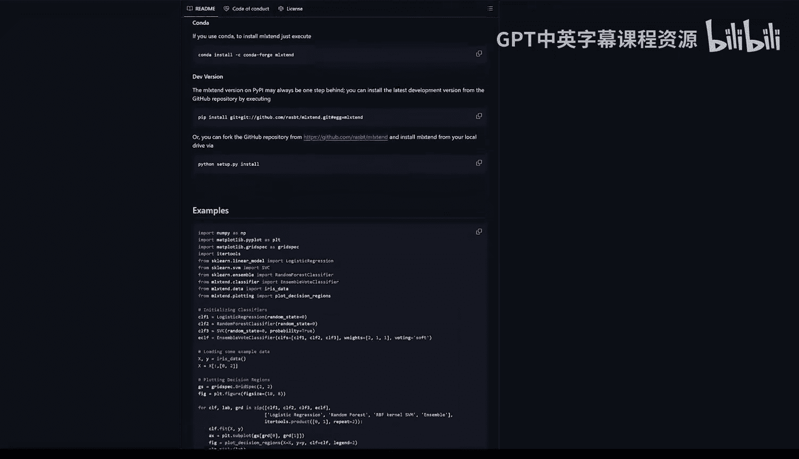

It goes through phases and then you get actually higher quality data out of it。

 you know so I don't mind it in a sense it can feel overwhelming。

 but I do think there is also value in that it feels like there's a fundamental difference between raw LM generated data and LLM generated data with human in loop that does some kind of verification。

 even if that verification is a small percent。Of the lines of code。

 I think this goes up with anything on like where。People think also sometimes oh I can just use an LLM to learn about XYz。

 which is true you can， but there might be a person who is an expert who might have used an LLM to write specific code。

 there is kind of like this human work that went into it to make it nice and throwing all the not a nice part to make it kind of like predigested for you and that saves you time and I think that'ss that that's the value at where you have someone。

Filtering things or even using the LLMs correctly I think this is still labor that you get for free with you for example read an article let's a sub article and I could maybe ask an LLM to give me opinions on that but I wouldn't even maybe know what to ask I think there is still value in reading that article compared to me going to the LLM because you are the expert you select what knowledge is actually spot on should be included and you give me this very this executive summary and this is kind of a huge value at because now I don't have to waste three five hours to go through this myself maybe get some incorrect information and so on and so I think that's also where the future。

Still is for writers， even though they are LLMs that expert can kind of like save your time it's kind of fascinating actually watch I did and I'm sure you guys do this。

 but for me。To look at the difference in a summary。And the original content。

 even if it's a page long summary of a page long content。

It's interesting to see how the summary LMB summary takes the edge off like what what is the signal it removes from the thing The voice is what I talk about a lot voice well voice I'd love to hear what you mean by voice that's really powerful but sometimes there's like literally insight like in removing an insight。

 you're actually fundamentally changing the meaning of the thing So Im continuously disappointed how bad Lms are really getting to the core insights。

 which is what a great summary does even if you go and I have these extensive。

 extremely elaborate prompts where I'm like really trying to dig for the insight and it's still not quite there。

 which I mean， that's a whole deep philosophical question about what is human knowledge and wisdom and what does it mean to be insightful and so on。

 but when you talk about the voice what do you mean So when I I think a lot of what I'm trying to do is take。

What you think as a researcher which is very raw， which a researcher is trying to encapsulate an idea at the frontier of their understanding and they're trying to put what is a feeling into words and I think that my writing I try to do this as the writing which makes it come across as raw but also high information in a way that is like some people will get it and some won't and that's kind of the nature of research and I think this is something that language models don't do well。

 particularly they're all trained with this reinforcement learning from human feedback。

 which is designed to take feedback from a lot of people and in a way average how the model behaves from this and I think that there's。

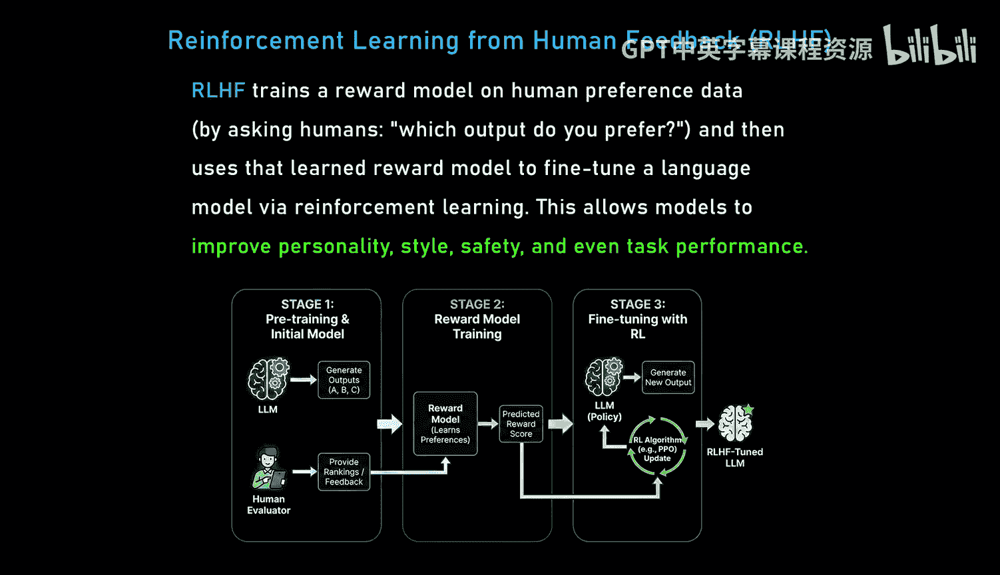

It's going to be hard for a model to be very incisive when there's that sort of filter in it and I think this is kind of a。

Wonderful fundamental problem for researchers in RLHF is like this provides so much utility in making the models better。

 but also the problem formulation is kind of like there's this not in it that you can't get past so that's what I think of is like。

😊，These language models don't have this prior in their deep expression that they're trying to get at I don't think it's impossible to do I think there's stories of models that really shock people like I think of like I would love to have tried Bing Si and like does that have more voice because it would so often go off the rails on people what is historically obviously a scary way like telling a reporter to leave its wife is a crazy model to potentially put in general general adoption but that's kind of like a trade off like is this RLHF process like in some ways adding limitations？

That's a terrifying place to be as one of these frontier labs and companies。

Because millions of people are using them there was a lot of backlash last year with the G 40 getting removed and I personally never used the model。

 but I've talked to people at open AI where there to the point where they like get emails from users that might be detecting subtle differences in the deployments in the middle of the night and they email them and they're like my friend is different and they like find these people employees emails and send them things because they're so attached to this。

Se but it's a set of model weights in a configuration that is deployed to the users we see this with Tiktk you open it I don't use Tiktk but in like five minutes the algorithm gets you it's like it's a locked in and I don't like those are language models doing recommendations like I think there are ways that you can do this with the language model within like five minutes of chatting with it the model just gets you and that is something that。

People aren't really ready for like I think that like kid like don't give that to kids like don't give that to kids at least until we know what's happening but there's also going to be this mechanism what's going to happen with these LLms is they're used more and more。

Unfortunately， the nature of the human condition is such that people commit suicide。

 and so what journalists will do is they will report extensively on the people who commit suicide and they would very likely link it to the LLMs because they have that data about the conversations。

 if you're really struggling in your life if you're depressed if you're thinking about suicide。

 you're going to probably talk to LLMs about it， and so what journalists will do is they will say。

 well the suicide was committed because of the LLM and that's going to lead to the companies。

Because of legal issues and so on， more and more and more taking the edge off of the LLM。

 so it's going to be as generic as possible， it's so difficult to operate in this space because of course you don't want an LLM。

To cause harm to humans at that level， but also。This is also the nature of the human experience is to have a rich conversation。

 a fulfilling conversation， one that challenges you from which you grow。

 you need that edge and that's something extremely difficult for AI researchers on the RHF front to actually have to solve because you're actually dealing with the human condition like a lot of researchers that these companies are so unmotivated and there's definitely likeil anthropic and opening eye or culturally so want to do good through this for the world and there it's such a unlike a momental work on this because on the one hand a lot of people see AI as a health ally somebody they can talk to about their health confidentially but then it bleeds all the way into this。

talking about mental health and things where。That's it's。

Heartbreaking that this will push like be the thing where somebody goes over the edge but other people might be saved and I'm like I don't like there's things that as a researcher training models it's like I don't want to train image generation models and release them openly because I don't want to enable somebody to have a tool on their laptop that can harm other people like I don't have the infrastructure in my company to do that safely but it's there's a lot of areas like this where it's just it needs people that will approach it with the complexity and kind of conviction of like it's just such a hard problem but also we as a society users of these technologies need to make sure that we're having the complicated conversation about it versus just fear mongering big tech is causing harm to humans or stealing your data all that kind of stuff that is more complicated than that in your right there's a very large number of people inside these companies many of which you know any which I know they're deeply care about helping people they are considering the full human experience of people from across the world not just Silicon Valley people across the。

Uned States， people across the world what that means。

 what their needs are is really difficult to design this one system。

That is able to help all these different kinds of people across the different age groups， cultures。

 mental states， mental conditions， all kinds stuff I wish that the timing of AI with different with the relationship of big tech to the average person so like big tech's reputation was so low and with how AI is so expensive it's like inevitably going to be a big tech thing where it takes so many resources and people say that US is quote unquote betting the economy on AI with this buildout and it's like to have these be intertwined at the same time is just makes versus such a hard communication environment。

 it would be good for me to go talk to more people in the world that hate big tech and see AI as a continuation of this and one of the things you actually recommend。

One of the antidotes that you talk about。Is to find agency in this whole system as opposed to sort of sitting back in a powerless way and consuming the AI s as it quickly rapidly takes over the internet。

 more fine agency by using it to build stuff， build apps。

 build so one that actually helps you build the intuition but to it's empowering because you can understand how it works。

 what the weaknesses are and it allows it gives your voice power to say like this is fucked up。

 this is bad， this is bad use of the technology and this is good use of the technology。

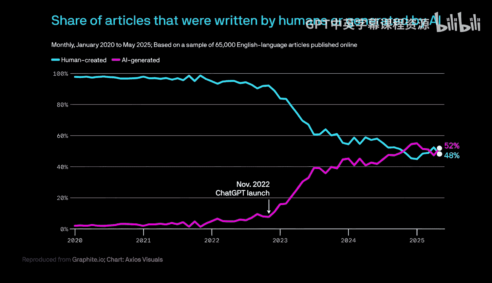

And you're more plugged into the system then so you can understand it better and you can steer it better as I think it's a good point you brought up agency。

 instead of ignoring it and saying okay I'm not going to use it。

 I think it's probably long termm healthier to say okay it's out there。

 I can't put it back you know like internet computers back then when they came out。

How do I make best use of it and how does it help me to upleve myself The one thing I worry here though is like if you just fully use it for something you love to do the thing you love to do is not no longer there and that could potentially I likely to burnout for example。

 if I use an LM to do all my coding for me now there is no coding I'm just managing something that is coding for me two years let's say later if I just do that eight hours a day。

Have something called for me。 Do I feel fulfilled still like is this like？Yeah， I mean， is this like。

Heurarding me in terms of being excited about my job。

 excited about what I'm doing am I still proud to build something so there's on that topic of enjoyment it's quite interesting we you just throw this in there that there's this recent survey of about 791 professional developers professional meaning 10 plus years of experience that's a long time yeah but its a junior developer yeah and this day and age so there's also here how many fronts are surprising so they break it down by junior senior developers but I mean it just shows。

That both junior senior developers use AI generated code in Code they ship。

SoThis is not just for fun sort of intermediate kind of learning things。

 this is code they ship and so it's 25% meant like most of them use around 50% or more and what's interesting is for the category of over 50% of your code that you ship as AI generated senior developers or much more likely to do so but you don't want AI to take away the thing you love I think it speaks to my experience these particular results I'm about to say so together about 80% of people find it either somewhat more enjoyable or significantly more enjoyable to use AI as part of the work I think it depends on the task of my personal use for example。

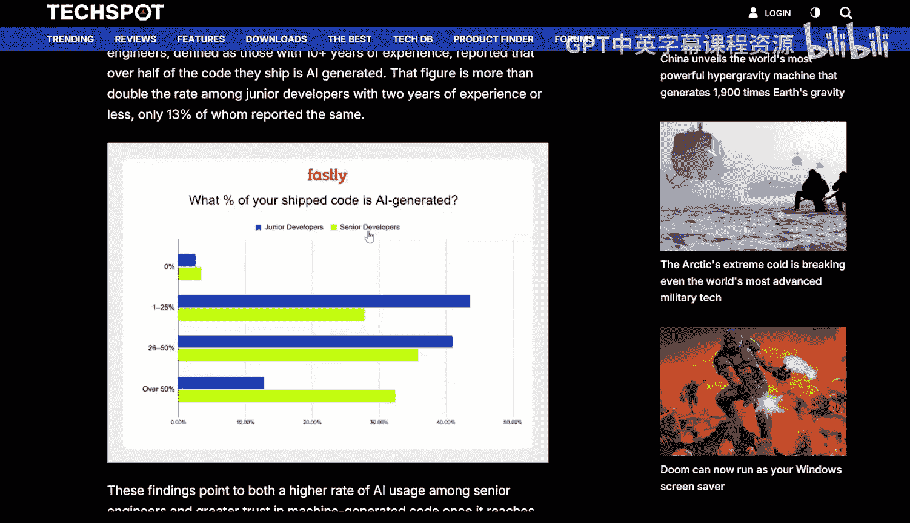

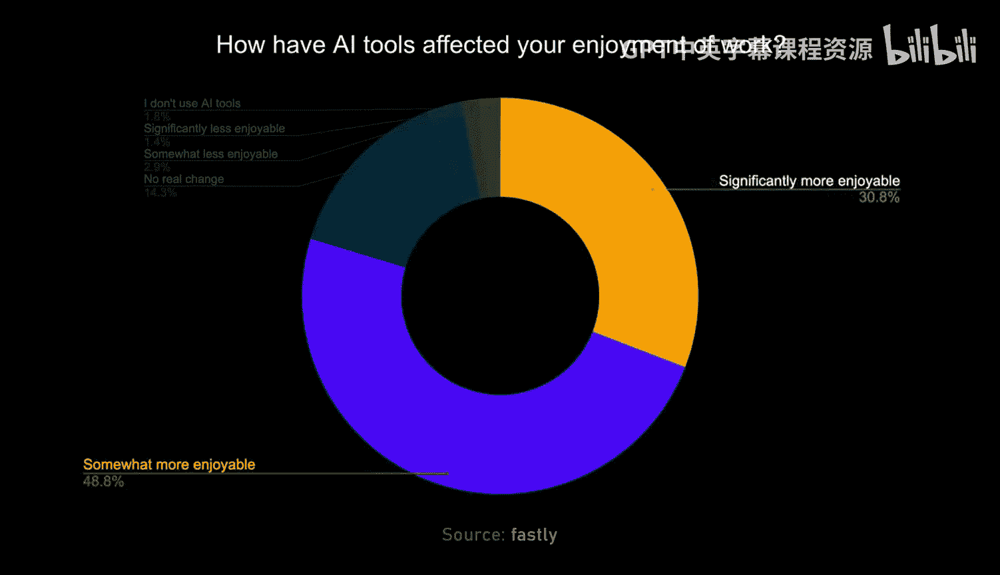

I have a website where I sometimes tweak things on the website I personally don't enjoy this。

 so in that sense if theI can help me to implement something on my website。

 I'm all here for it it's great， but then at the same time when I solve a complex problem，😊。

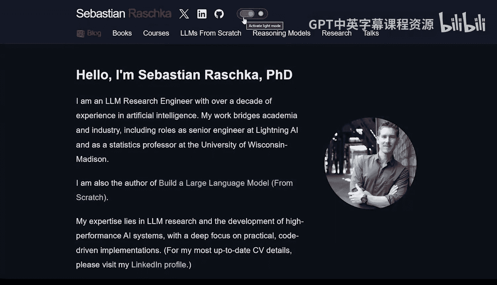

Well if there's a bug and I hunt this bug and I find the bug it's the best feeling in the world it's like you get so much joy like oh it's like you feel like great。

 but now if you don't even think about thinking about the bug you just go directly to the LLM well you never have this kind of feeling right but then there could be the middle ground where you try yourself。

 you can't find it， you use the LLM and then you don't get frustrated because it helps you and you move on something that you enjoy and so I think looking at these statistics I think also the difference is what is not factored in its averaging over all the different scenarios where we don't we don't know if it's for the core task or if it's for something mundane that people would not have enjoyed otherwise so in a sense AI is really great for doing mundane things that。

Take a lot of work so for example， my wife the other day she has like a podcast for like book discussions。

 a book club and she was like transferring show notes from Spotify to YouTube and then the links somehow broke and she had in some episodes because it is custom many books like hundred links or something and it would have been really painful to go in there and fix each link manually and so I suggested hey let's try ChejiT we copied the text into ChejiT and it fixed them and instead of two hours going from link to link fixing that you know it made that type of work much more seamless there was no frustration fix I think everyone has a use case where A I is useful for something like that that would be really boring really mundane eye for me personally as we're talking about coding。

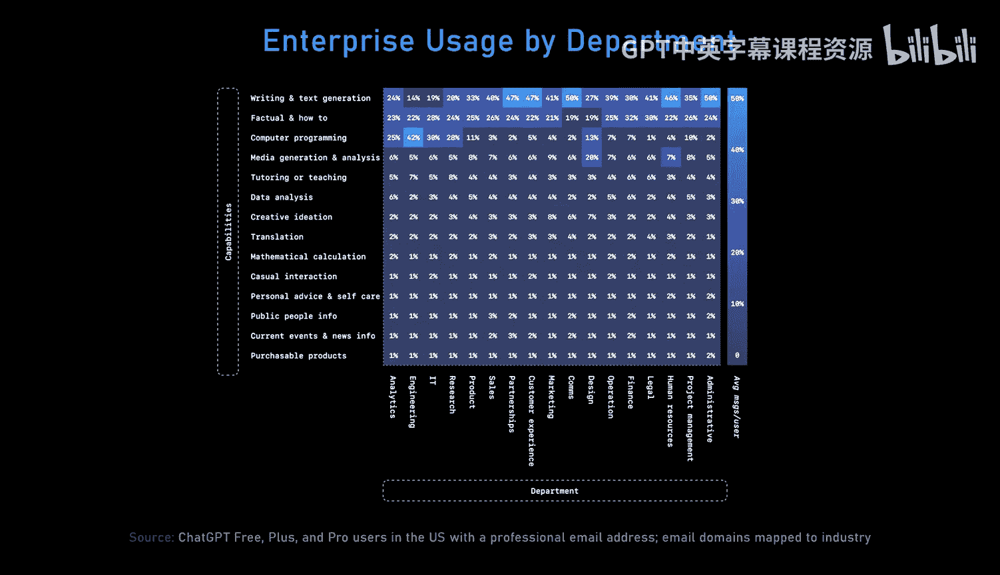

And you mentioned debugging with a lot of the sources of the enjoyment for me on more on the cursor side than the clo code side。

Is the I have a friend， I have a co what's that called a pair programmer like it's less lonely you made debugging sound like this great joy now I would say I would say debugging is like a drink of water after you've been going through a desert for days So like you skip the whole desert part where you're suffering So like sometimes it's nice to have a friend who can't really find the bug but can give you some intuition about the code and you're together would that friend going through the desert and then together find a drink of water。

 So at least for me maybe speaks to the loneliness of the programming experience's that is a source of joy It's maybe also related to delayed gratification I'm a person who you know even as a kid I like the idea of Christmas present having them getting them better than actually getting the presence I would look forward。

To the day I get the present， but then it's over and I'm disappointed and maybe it's something like also with let's say food I think food tastes better when you're really hungry and with yeah you're right with debugging it is not always you know great it's like often frustrating but then if you can solve it then it's great but there's also like a sweet goldillock zone if it's too hard and it's you know wasting your time but I think that is another challenge though how will people learn I mean the chart we looked at we saw that more senior developers are shipping more AI generated code than the junior ones and I think it's very interesting because intuitively you would think it's a junior developers because they don't know let's say how to do the thing yet because they are more junior and so they use AI to do that thing it could either mean the AI is not good enough yet to solve that task but it could also mean experts are more effective at using it they know。

wear and better how to use it and review the code and they trust the code then more and so I think one issue in the society in the future will be though how do you become an expert if you never try to do the thing yourself and I think one way it's always like for me how how I learn is by trying things myself like math textbooks if you look at the solutions yeah you learn something but I think you learn actually better if you try first and then you appreciate the solution differently because you know how to put it into your mental framework and if LLM are I hear all the time would you actually go through the length at struggling would you be willing to struggle because struggle is not nice right I mean it's struggling and if you use the LLM everything at some point you will never really take the next step and then。

You will maybe not get that unlock that you would get as an expert using an LLM so it's like you know it's like I think that's like a Goldilock sweet spot where maybe maybe the trick here is you make dedicated offline time where you study two hours a day and the rest of the day use LLMs but I think it's important also for people to still invest in themselves in my opinion to not just you know LLM everything yeah there is and we together a civilization and we each individually had to find that Goldilocks on and in the program and context as developers now we've had this fascinating conversation that started with pre-training and midtraining as get to post training。

A lot of fun stuff and post training so what are some of the interesting ideas and posttraining The biggest one from 2025 is learning this reinforcement learning with verifiable rewards you can scale up the training there which means doing a lot of this kind of iterative generate grade loop and that lets the models learn both interesting behaviors on the tool use and software side this could be searching running commands on their own and seeing the outputs and then also that training enables this inference time scaling very nicely and it just turned out that this paradigm was very nicely linked in this where it's this kind of RL training enables inference time scaling but inference time scaling could have been found in different ways so it's kind of this perfect storm of the models change a lot in the way that they're trained。

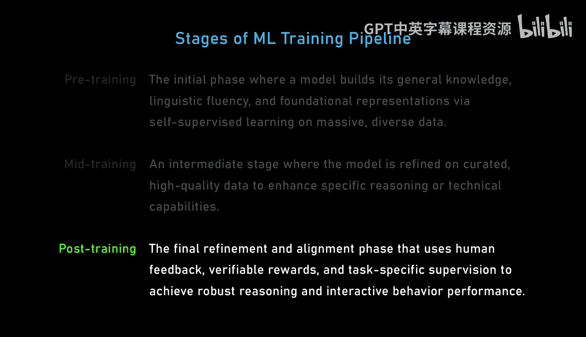

Is a major factor in doing so and this has changed how people approach post training dramatically Can you describe RL VR popularized by deepse R1 Can you describe how it works Yeah fun fact I was on the team that came up with the term RL VR which is from our two or three work before deepse which is we don't take a lot of credit for the being the people to popularize the scaling RL but it is fun as。

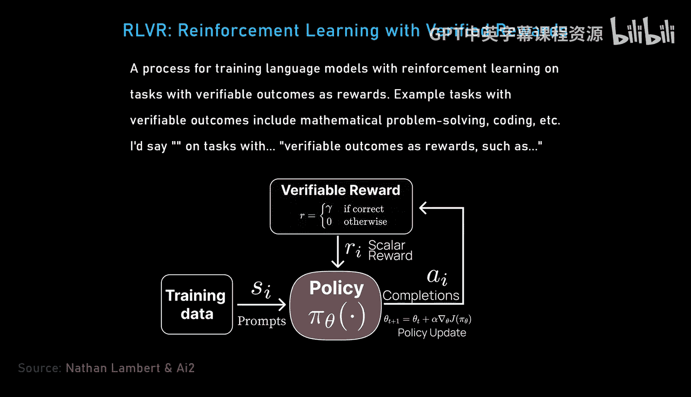

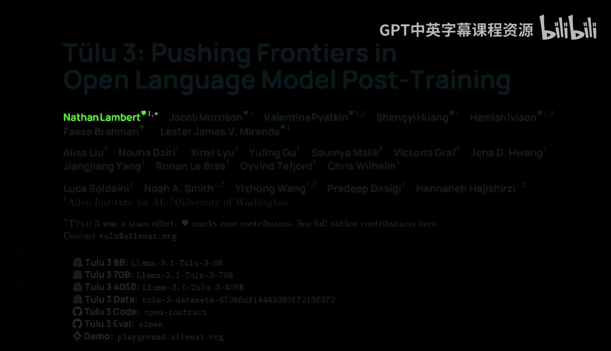

What academics get as an aside is the ability to name and influence the discourse because the closed labs can only say so much that one of the things you can do as an academic is like you might not have the compute to train the model but you can frame things in a way that ends up being I describe it as like a community can come together around this RLVR term which is very fun and then deep seek as the people that did the training breakthrough which is they scale the reinforcement learning which was you have the model generate answers and then grade the completion if it was right and then that accuracy is your reward for reinforcement learning so reinforcement learning is classically an agent that acts in an environment and the environment gives it a state and and a reward back and you try to maximize this reward and the case of language models。

 the reward is normally accuracy on a set of verifiable tasks。

 whether it's math problems coding tasks and it starts get blurry with things like。

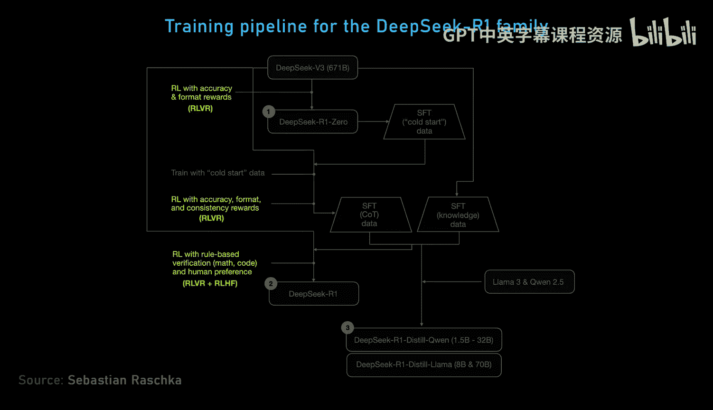

Factual domains like that is also in some ways verifiable or constraints on your instruction like respond only with sent words that start with a like all of these things are verifiable in some way and the core idea of this is you find a lot more of these problems that are verifiable and you let the model try it many times while taking these RL steps these RL。

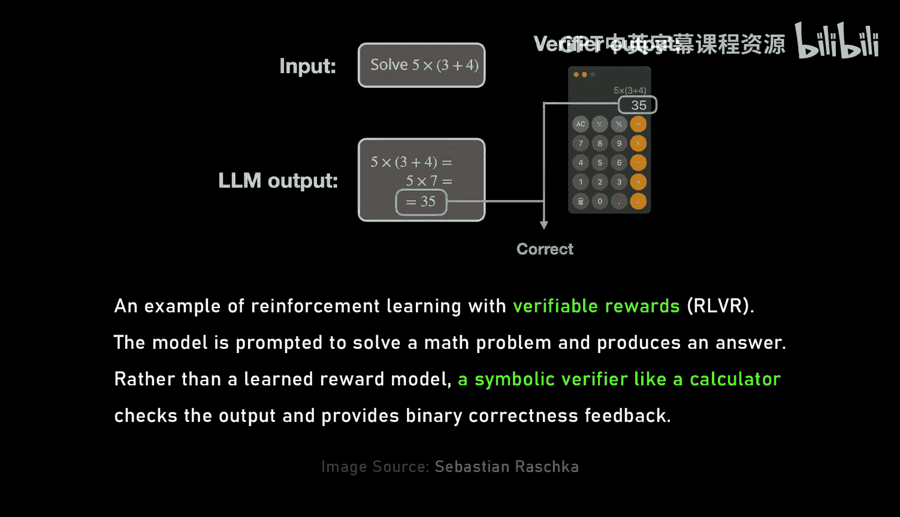

Gradient updates the infrastructure evolved from this reinforced learning from human feedback where in that era the score they were trying to optimize was a learned reward model of aggregate human preferences so you kind of change the problem domains and that let the optimization go on to much bigger scales which kind of kickstarted of major change and what the models can do and how people use them what kind of domains is ROV aremenable to math and code are the famous ones and then there's a lot of。

Work kind of what is called rubrics， which is related to word people might have heard as Elm as a judge。

 which is like for each problem all of a set of problems in my training data I'll then have another language model and ask it what would a good answer to this problem look like and then you could try the problem a bunch of times over and over again and assign a score based on this rubrics so that's not necessarily verifiable like a math and code domain but this rubric's idea and other scientific problems that it might be a little bit more vague is where a lot of the attention is where they're trying to push this set of methods into these kind of more openended domains or the models can learn a lot more I think that's called reinforcement running with AI feedback right that's the older term from it that was coined and anthropics constitutional AI paper So it's like a lot of these things come in cycles Also just one step back for the of VR So I think the interesting beautiful thing here is that you ask let's say a math question and then you know the correct answer。

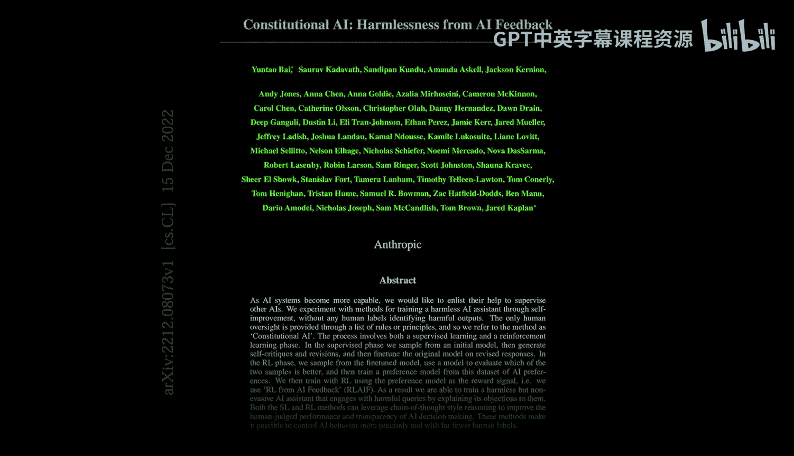

And you let the LLM like you said figure it out， but how it does it。

 I mean you don't really constrain it much。 there are some constraints you can add like use the same language。

 you don't switch between Spanish and English but let's say youre pretty much hands off you only give the question and the answer and then the LLM has to you know just the task to arrive at the right answer but the beautiful thing here is what happens in practice is that theM will do a step by step description like you know like as a student or like as mathematician how you would derive the solution it will give you it will use those steps and that helps actually the model to improve its own accuracy and then like you said the inference scaling So inference scaling loosely means basically spending more compute during using the LLM doing inference and here the inference scaling is。

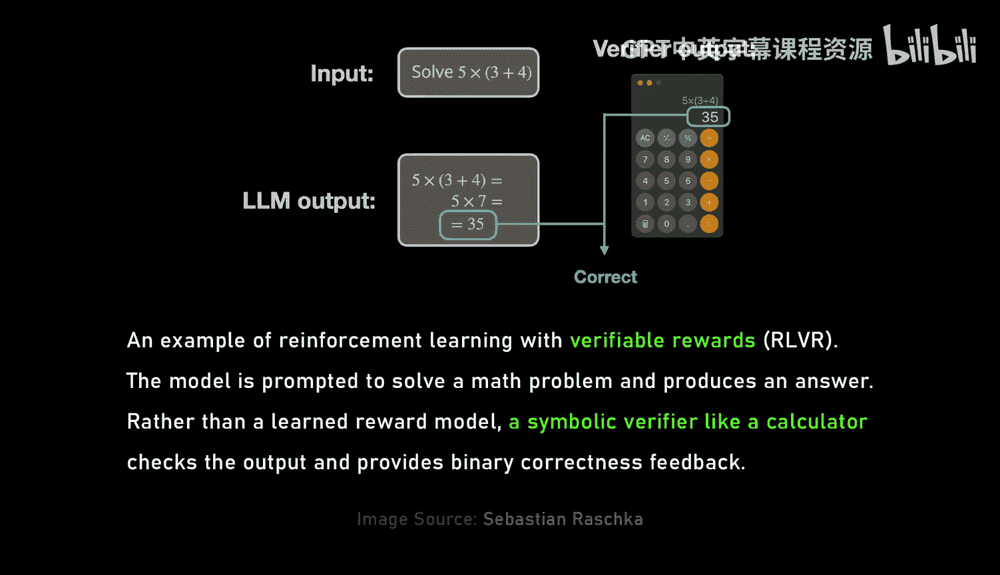

That the model would use more tokens and also I think in the R1 paper they showed the longer they train the model。

 the longer the responses are they grow over time， they use more tokens so it becomes more expensive。

 becomes more expensive for simple tasks but these explanations they help the model with the accuracy they are also an interesting a lot of papers showing but the model explains does not necessarily have to be correct or maybe it's even unrelated to the answer but for the reason it's still helps the model like the fact that it is explaining it I think it's also again I don't want to anthropomorphize these LMs but it's kind of like how we humans operate if there's a complex math problem let's say in a math class you usually have a note paper and you do it step by step you cross out things and the model also self-corr and that was I think the aha moment in the R1 paper they called it aha moment because the model itself recognized it made a mistake and then said I did something wrong and so let me try and I think that's just so cool that this faults out of just giving it the correct answer。

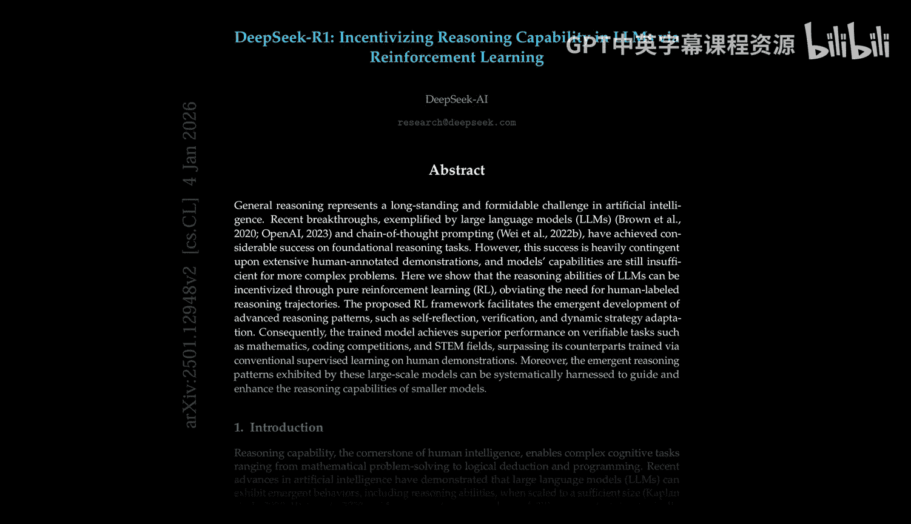

Having it figure out how to do it that it kind of does in a sense what a human would do although don't think by humans it's kind of like an interesting coincidence and the nice side effect is it's great for us humans often to see these steps builds trust but also we learn we can double check things there's a lot in here I think some of the debate there's been a lot of debate this year and if the language models like these aha I think the aha moments are kind of fake because in pre-training you essentially have seen the whole internet so you have definitely seen people explaining their work then even verbally like a transcript of a math lecture you try this oh I mess this up and what reinforcement learning is this RLVR is very good at doing is amplifying these behaviors because they're very useful in enabling the model to think longer and to check its work and I agree that it is very beautiful that this training kind of the model learns to amplify this in a way that is just so useful at the final answers being better I can give you also hands example I was training the Grin3 based model。

With RLVR on Ma 500 the base model had an accuracy of about 15% just 50 steps like in a few minutes with RLVR the model went from 15% to 50% accuracy and the model you can't tell me it's learning anything about fundamental about math and example is weird because there's been two papers this year one of which goes was on that talks about data contamination in and specifically that they train on a lot of this special midtraining phase we like a minute it's weird and since they train on problems that are almost identical exactly and so you can see that basically the RL it's not teaching the model any new knowledge about math you can't do that in 50 steps so the knowledge is already there in the pretraining are just unlocking it I still disagree the kind of premise because there's a lot of weird complexities that you can't prove because。

One of the things that points to weirdness is that if you take the Quen3 socalled base model and you could Google on the screen。

 you could Google like math dataset huggingface and you could take a problem and what you do if you put it into Que3base all these math problems have words so it'd be like Alice has five apples and takes and gives three to whoever and there these word problems with these QueNb models why people are suspicious of them is if you change the numbers but keep the wordsQun will produce like a very high without tools will produce a very high accuracy like decimal representation of the answer。

 which means there's some like at some time it was shown problems that were almost identical to the test set and it was using tools to get a very high precision answer but a language model without tools will never actually have this so it's kind of been this big debate in the research community is like how much of these reinforcement learning papers that are training on QueN and measuring specifically on this like math benchmark where there's been multiple papers talking about content。

Its like how much can you believe them and I think this is what caused the reputation of RVR being about formatting because you can get these gains so quickly and therefore must already be in the model but there's a lot of complexity here that it's not really like controlled experimentation so you don't really know but if it weren't true I would say distillation wouldn't work I mean distillation can work to some extent but the thing is that is I think the biggest problem Nm research thision because we don't know what's in the data unless you have a new data it's really impossible and the same you mentioned math the math data which is a question and then answer an explanation is given but then also even something simple like MMmu which is a multiple choice benchmark if you just change the format slightly like I don't know use a dot instead of a parenthesis or something like that the model accuracy will vastly differ I think that that could be like a model issue rather than a general issue it's not even mallitia。

By the developer of the NM like hey we want to cheat at that benchmarks just it has seen something at some point and I think the only fair way to e an NNM is to have a new benchmark that is after the cutoff date when the NM was deployed would be sort of the recipe of all the things that will be going to posttraining and you mentioned our RLVR was a really exciting effective thing maybe we should elaborate RHF still has it in really important component to play what kind of other ideas that they on posttraining I think you can kind of take this in order I think it could view it as what made01 which is this first reasoning model possible or what will the latest model be and they actually have you're gonna have similar interventions at these where you start with midtraining and the thing that is rumored to enable01 and similar models is really careful data curation where you' providing a broad set of like what is called reasoning traces which is just the model。

Generating words in a forward process that is reflecting like breaking down a problem into intermediate steps and trying to solve them。

 So at mid training， you need to have。Data that is similar to this to make it so that when you move into posttrain primarily with this verifiable rewards it can learn and then what is happening today is you are figuring out which problems to give the model and how long you can train it for and like how much inference you can enable the model to use when solving these verifiable problems so as models get better certain problems。

arere no longer like the model will solve them 100% of the time。

 And therefore there's very little signal in this if we look at the GRPO equation。

 this one is famous for this because essentially the reward given to the agent is based on how good a given action action is a completion is relative to the other answers to the same problem So if all the problems to get the same answer there's no signal in these types of algorithms So what they're doing is they're finding harder problems。

 which is why you hear about things like scientific domains。

 which is like that's so hard like getting anything right there if you have a lab or something it just generateds so many tokens or much harder software problems So the frontier models are all pushing into these harder domains and they can train on more problems and the model will learn more skills at once the RHF link to this is kind of like RHF has been and still is kind of like the finishing touch on the models where it makes the models more useful by improving the organization or style or tone there's different things that resonates the different audiences like some people like。

quirky model an RLHF could be good at enabling that personality and some people hate this like markdown bulleted list thing that the models do。

 but it's actually really good for quickly parsing information and RLHF this human feedback stage is really great for just putting this into the model at the end of the day so it what and made chatyBT so magical for people and that use is actually remain fairly stable this formatting can also help。

The models get better at math problems， for example， so it's like。

The border between style and formatting and like the method that you use to answer a problem is actually they're all very closely linked in terms of when you're training these models。

 which is why RLHF can still say make a model better at math。

 but these verifiable domains are a much more direct process to doing this because it's kind of。

Makes more sense with the problem formulation， which is why it kind of ends up all forming together。

 but to summarize it's like mid training is give the model the skills it needs to then learn。

RL and verifiable awards is let the model try a lot of times so put a lot of compute into trial and error learning across hard problems and then RLHF would be like finish the model。

 make it easy to use and kind of just round the model out can you comment on the amount of compute required for RLVR It's only gone up and up so I think G4 most famous for saying they use a similar amount of compute for pretraining and posttraining back to the scaling discussion they involve very different hardware for scaling pretraining is very compute bound which is like this flops discussion which is just how many matrix multiplications can you get through in one time and because RL you're generating these answers you're trying the model in the real world environments it ends up being much more memory bound because you're generating long sequences and the attention mechanisms have this behavior where you get a quadratic increase in memory as you're getting to longer sequences So the compute becomes very different So when in pre-training we would talk about a model I think we go back to like the by。

Idutration executive order it's like 10 to the 25th flops to train a model if you're using flops and post training it's a lot weirder because the reality iss just like how many hours are you allocating how many GPUs for and I think in terms of time the RL compute is getting much closer because you just can't。

Put it all into one system like pretraining is so computationally dense where all the GPUus are talking to each other and it's extremely efficient where Rl has all these moving parts and it can just take a long time to generate a sequence of 100000 tokens like if you think about G5。

2 pro taking an hour It's like what if your training run has sample for an hour and you have to make it so that's handled efficiently So I think in GPU hours or just like wall clock hours the RL runs are probably approaching the number of days as pretraining。

 but they probably aren't using as many GPUus at the same time there's rules of thumb where in labs it's like you don't want your pretraining runs to last more than like a month because they fail catastrophically and if you were planning a huge cluster to be held for two months and then it fails on day 50 the opportunity cost of just so big so you kind of don't want to just people don't want to put all their eggs in one basket which is like G4 was like the ultimate yolo run and nobody ever wanted to do it before where it took like three months to train and everybody was shocked to that org or I think people。

A little bit more cautious and incremental now so R VR is more let's say unlimited to how much you can train or get the benefit where RLHF because it's a preference tuning you reach a certain point where it doesn't really make sense to spend more RL budget on that so just step back with preference tuning so that multiple people that can give multiple let's say explanations for the same thing and they can both be correct but at some point you learn a certain style and then doesn't make sense to you know iterate on it my favorite example is like relatives ask me what laptop they should buy I give them an explanation or ask them yeah what is your use case like they for example prioritize battery live and storage other people like for example you would prioritize RamM and compute and so but both answers are correct but different people require different answers and with preference tuning well you're trying to average somehow like you are asking the data label us to give you the right don't the write the preferred answer and then you train on that but at some point。

Yeah， you learn that average preferred answer and there's no， I think。

 reason to keep training longer on it because， you know， it's just a style where with our LBR。

 you literally give the model。Well you let the model solve more and more complex difficult problems and so I think it makes more sense to allocate more budget long termm to LRVR and also that right now we are in LRVR 1。

0 land where it's still like that simple thing where we have a question and answer but we don't do anything with one stuff in between so there was I mean multiple research papers also by Google for example on process reward models that also give scores for the explanation。

 how correct is the explanation and I that will be the next thing let's say our LVR2 。

0 for this year， focusing in between question and answer like how to leverage that information。

 the explanation to improve the explanation and help it to get better accuracy but then so that's one angle and there was a deepsek math version 2 paper where they also had interesting inference scaling there where first they had developed models that great themselves。

pro model and I think that that will be one aspect and the other， like Nathan mentioned。

 that will be for R weR branching into other domains。

 the place where people are excited are value functions。

 which is very pretty similar so process reward models。

Are kind of like process reward modelss assigned。

How good something is to each kind of intermediate step in a reasoning process where value functions apply value to every token the language model generates。

Both of these have been largely unproven in the language modeling and this reasoning model era people are more optimistic about value functions forever for whatever reason now I think process reward models were tried a lot more in this pre01 prereing model era and a lot of people had a lot of headaches with them so I think a lot of it is the human nature of like。

Value models have a very deep history and reinforcement learning they're one of the first things that were core to like deep reinforcement learning existing is like training value models in this So right now the literature people are excited about trying value models but there's very little proof in it and there are negative examples in trying to scale a process reward models these things don't always hold in the future I think we came to this discussion by talking about scaling and the simple way to summarize what you're saying like you don't want to do too much RLHF which is eventually the signal scales is people have worked on RLHF for language models for years。

 especially in intense interest or chatgBT and the first release of a reasoning model trained with RLVR opening eyes01 had a scaling plot where if you increase the training compute logarithmically you get a linear increase in evaluations and this has been reproduced multiple times I think deepC how of plot like this but there's no scaling lot for RLF where if you increase the compute you get some performance In fact the seminal scaling paper for RLHF is scaling loss for。

model over optimization so it's like that's a big line to draw with RLVR and the methods we have now and in the future like they will follow the scaling paradigm。

 which is like the best runs you can let to run for an extra 10 x and you get a few X performance but you can't do this with RLHF and that is just gonna be field defining and how people approach them where I'm a sh for people academically to do RLHF and that's a good way to describe it is like to do the best RLHF you might not need the extra 10 or 100 x of compute but to do the best。

😊，RLVR you do so I think there's what I say is a seminal paper from what was a meta internship is called it's like the art of scaling reinforcement learning with language models they're what they describe as a framework as scale RL and their incremental experiment was like 10。

000 B200 hours which is like thousands or tens of thousands of dollars per experiment and they do a lot of them which is just like this cost is not accessible to the average academic which is a hard equilibrium where it's trying to figure out how to learn from each community I was wondering if it could take at this point a bit of a tangent and talk about education and learning if you're somebody listening to this who's a smart person interested in programming interested in AI so I presume building something from scratch is a good beginning。

So can you just take me through like where you would recommend people do So I would personally start like you said。

 implementing a simple model from scratch that you can run on your computer the goal is not if you build a model from scratch to have like something you use every day for your personal projects like it's not going be your personal assistant replacing an existing openweight model or ChegBD's to see what exactly goes into the LLM what exactly comes out of the LLM how the pretraining works in that sense on your own computer preferably and then you learn about the pre-training。

 the supervis fine tuning the attention mechanism you get a solid understanding of how things work but at some point you will reach a limit because small models can only do so much and the problem with learning about LLMs at scale is I would say it's exponentially more complex to make a larger model because it's not that the model just becomes larger you have to now think about charginging your parameterss across multiple GPUs even for the KBc that multiple ways you can implement it one is。

To understand how it works just to grow the cache is like a cache you grow step by step by let's say concateitating lists and growing it。

 but then it wouldn't be optimal in GPUus， you wouldn't do that you would pre allocatelocate a tensor and then fill it in but that adds again another 2030 lines of code and for each thing you add so much code and I think the tricked with the book is basically to understand how the LLM works it's not gonna be your production level LLM but once you have that you can understand the production level you're trying to always build an L that's going to fit out on GPU Yes most of them I have some bonus materials on some Moe models I think one two of them they may require multiple GPus but the goal is to have it on one GPU and the beautiful thing is also you can self verify it's almost like our LVR when you code these from scratch you can take an existing model from the hugging face transformer library so the hugging face library is great but if you want to learn about LLMs I think that's not the best place to start。

Because the code is so complex because it has has to fit so many use cases also some people use it in production has to be really sophisticated and it's really interwined and really hard it's not linear to read it was started as a fineering library and then it grew to be like the standard representation of every model architecture in the way it's loaded so hugging face like the default place to get a model and transformers is the software that NAs all it so people can easily load a model and do something basic with it and allfrontier labs that have open weight models have a hugging face transform us version of it like from deepse to GOSS it's like the canonical weight that you can load there but again also even transform us the library is not used in production people used and as G Lang or VLLM and add's another layoff complexity we should say that the Transers's library has like 400 models so it's a one library that tries to implement a lot of LLMs and so you have a huge code base basically it's like huge it's like。

It's maybe millions hundreds of lines of code and it's like understanding the part that you want to understand is finding the needle in the haystag but what's beautiful about it is you have a working implementation and so you can work backwards from it what I would recommend doing or what I also do is if I want to understand for example how almost three is implemented I would look at the weights in the model hub。

 the config file and then you can see they use so many layers they use let's say group query attention or multi-head attention in that case and you see all the components in like a human readable10 lines of config file and then you start let's say with your GPT2 model and add these things you know and the cool thing here is you can then lot the pretrained weights and see if they work in your model and you want to match the same output that you get with a transformer model and then you can use it as a basically as a verifiable reward to make your architecture correct and then it's kind of sometimes it takes me a day to with almost three that the challenge was rope for the position。

I'm bettings they had a yarn extension and there was some custom scaling there and I couldn't quite match these things and in this struggle you kind of understand things but the cool thing is at the end you know you have it correct because you can unitists that you can check against the reference implementation and I think that's maybe one of the best ways to learn really to basically reverse engineer something I think that that is something that everybody that's interested in getting today I today should do and I think that's why I like your book is like I came to language models from this RL and robotics field like I never had taken the time to just like learn all the fundamentals and this transformer architecture I described as being like so fundamental is like deep learning was a thing that I had to learn in the past and people need to do this I think that。

Where a lot of people kind of get overwhelmed is how do I apply this to have impact or find like a career path because like AI and language models make this fundamental stuff so accessible and people with motivation will learn it and then it's like how do I get the cycles on goal to。

Contribute to research and I think that I'm actually fairly optimistic in this because the field moves so fast that a lot of times the best people like don't fully solve a problem because there's a bigger lower like a bigger problem to solve that's very low hanging fruits so they move on and I think that a lot of what I was trying to do in this hour Je book is like take post- tradinging techniques and just describe how people think about them influencing the model and what people are doing and then it's remarkable how many things I just think are just like people stop studying them or don't so I think people trying to get narrow。

After doing the fundamentals is good and then reading the relevant papers and being engaged in the ecosystem it's like you actually the proximity that random people have online from the leading researchers like no one knows who the anonymous account on X and ML is very popular for whatever reason and no one knows who all these people are like it could just be random people that study the stuff deeply。

 especially with the AI tools to just be like I don't understand this keep digging into it I think is a very useful thing。

But there's a lot of research areas that just like or maybe three papers that you need to read and then one of the authors will probably email you back。

 but you have to put in a lot of effort into these emails to understand the field like I think it would be for a newcomer easily weeks of work to feel like they can truly grasp like what is a very narrow area。

 but I think going narrow after you have the fundamentals would be very useful to people because。

It's like I became very interested in like character training。

 which is like how you make the model funny or sarcastic or serious and like what do you do to the data to do this and it's like。

I student at Oxford reached out to me hes like， hey。

 I'm interested in this and I advised him and it's like that paper now exists and it's like I don't know there's like two or three people in the world that were very interested in this。

 He's a PhD student， which gives you an advantage but like。For me。

 that was a topic I was waiting for someone to be like， hey。

 I have time to spend cycles on this and I'm sure there's a lot more very narrow things where you're just like。

 oh it doesn't make sense that there was no answer to this and I think that its just like。

There's so much information coming that people are like I can't grab onto any of these but if you just actually stick in an area。

 I think there's a lot of interesting things to learn Yeah I think you can't try to do it all because it would be very overwhelming and you would burn if you try to keep up with everything for me for example I haven't kept up with computer vision a long time just focus on coming back to your book for example I think this is also a really great book and a really good bang the buck because you want to learn about I wouldn't go out there and readF papers because would you would be spending million contradict I just edited the book and I was like there's the chapter where I had to be like X papers say one thing and X papers say another thing and we'll see what comes out to be true what are some of just to go through some of the table contest some of the ideas we might have missed the bigger picture。

 the posttrain So first of all I did the problem setup up。

 training overview what a preferences preferences data in optimization tools reward modeling。

 regularization， instruction tuning， rejection sampling， reinforcement learning a policy。

direct alignment algorithms then constitutional AI and AI feedback reasoning and inference time scaling to use and function calling synthetic data and disstillation evaluation and then open question section over optimization style and information and then product UX character and post training So what are some ideas worth mentioning that connect both the educational component and the research component you mentioned the character training which is pretty interesting character training is interesting because they're just so a little out of it but we talked about how people engage with these models and like。

Look we feel good using them because they're positive but that can go too far。

 it could be too positive and it's like essentially it's how do you change your data？

And or decision making to make it exactly what you want。

 and like Open AI has this thing called a model spec。

 which is essentially their internal guideline for what they want to model to do and they publish this to developers so essentially you can know what is a failure of open AI's training which is like they have the intentions and they haven't met it yet versus what is something that they like actually wanted to do and that you don't like and that transparency is very nice but all the methods for curating these documents and how easy it is to follow them is not very well known I think the way the book is designed is that the reinforceable learning chapter is obviously what people want because everybody hears about it with RLVR and it's the same algorithms and the same map。

 but it's just like you can use it in very different documents so I think the core of RLHF is like how messy preferences are is essentially rehash of a paper I wrote years ago。

 but this is essentially the chapter that'll tell you why RLHF is never ever fully solvable because like。

The way that even Rl is set up is that。It assumes that preferences can be quantified and that multiple preferences can be reduced to single values and I think it relates in the economics literature to the von Neman Morganton utility theorem and like that is the chapter where all of that philosophical economic and like psychological context it tells you what gets compressed into doing RLHF so it's like you have all of this and then later in the book it's like you use this RL math to make the number go up and I think that that's why I think it would be very rewarding for people to do research on is because it's like quantifying preferences is something that is just like。

Humans have designed the problem in order to make preferences studyable。

 but there's kind of fundamental debates on link。An example is in a language model response you have different things to care about whether it's accuracy in style and when you're collecting the data they all get compressed into like I like this more than another and it's like like that is happening and there's a lot of philosophical there's a lot of research in other areas of the world that go into like how should you actually do this I think social choice theory is the。

😊，Subfield of economics around how you should aggregate preferences and there's like I was I went to a workshop that published a white paper around like。

 how can you think about using social choice theory for RLHF？

So I mostly would want people that get excited about the math to come and have things where they can stumble into and learn this kind of broader context。

 I think there's a fun thing I just keep a list of all the tech reports I like of reasoning models so in the。

😊。

In chapter 14， which is kind of like a short summary of R LVR。

 there's just like a gigantic table where I just like list every single reasoning model that I like so it's just like I think in education a lot of it needs to be like。

At this point， it's like what I like because the language models are so good at the math where it's like famous paper direct preference optimization。

 which is like a much simpler way of solving the problem than R the derivations and the appendix skip steps of math and it's like I tried for this book like I readid the derivations and I'm like what the heck is this log trick that they used that change the math but doing it with language models they're like this is the long trick and I'm like。

😊，I don't know if I like this， that the math is so commoditized。

 I think like some of the struggle in reading this appendix and following the math， I think is。

Good for learning and I。Yeah， so're actually returning to this often just on the topic of education。

 you both have brought up the word struggle quite a bit so there is value if you're not struggling as part of this process you're not fully following the proper process for learning。

 I suppose some of the providers are starting to work on models for education which are designed to not give actually I haven't used them。

 but I would guess they're designed to not give all the information at once and make people work to do this So I think you could train models to do this and it would be a wonderful contribution where like all of this stuff in the book you have to reevaluate every decision for it which is such a great example I think there's a chance to work on AI too which which I was like oh I think this is makes sense I do something like that the other day for video games for example I sometimes for my pastime play video games like I like video games with puzzle so you know like Zelda and Metroit and there's this new game where I got stuck and I really got stuck and I was okay you know I don't want to struggle。

Like two days and so I use an LLM but then you say hey。

 please don't add any spoilers just you know I'm here and there what do we have to do next and the same thing you can do I guess for math where you say okay I'm here at this point I'm getting stuck don't give me the full solution but what is something I could try know where kind of carefully pro but the problem here is I think it requires discipline and a lot of people do math for I mean a lot of people who enjoy math。

 but there also a lot of people who need to do it for their homework and then it's like the shortcut and yeah we cant develop an educational LLM but the other LM is still there and it's still a temptation to use the other LLM I think a lot of people especially in college they understand this stuff they're passionate about their aware about it and they understand it shouldn't be easy I think we just have to develop a good taste research taste like school taste about stuff that you should be struggling on and stuff you shouldn't be struggling on which is tricky to know because sometimes you don't have good。

Long-term vision about what would be actually useful to you in your career but you have to you have to be developed that I I was talking to me and I fiance or friends about this and it's like there's this brief tenure window where all of the homework and all the exams could be digital but before that everybody had to do all the exams in blue Book because there was another way and now after AI everybody's gonna need to be in blue books and oral exams because everybody could cheat so easily it's like this brief generation that had a different education system that like everything could be digital and but you still couldn't cheat and now it's just gonna go back just really funny。

You mentioned character training just zooming out on a more general topic。For that topic。

 how much compute was required and in general to contribute as a researcher。

Are there places where not too much compute is required where you can actually contribute as an individual researcher？

on the character training thing I think this research is built on fine tuning about 7 billion parameter models with Laura。

 which is like essentially you're only fine tune a small subset of the weights of the model I don't know exactly how many GPU hours that would take but is doable not doable for every academic so the situation for some academics is like so dire that the only work you can do is doing inference where you have closed models or open models and you get completions from them and you can look at them and understand the models and that's very well suited to evaluation which you become you want to be the best at creating representative problems that the models fail on or show certain abilities which I think that you can break through with this so I'。

Like， I think that the。Top end goal for a researcher working on evaluation if you want to have career momentum is the frontier labs pick up your evaluation so it's like you don't need to have every project do this。

 but if you go from a small university with no compute and you figure out something that Claude struggles with and then the next cloud model has it in the blog post like there there's your career rocket chip I think that that's hard but it's like if you want to scope the maximum possible impact with minimum compute it's something like that which is just get very narrow and it takes learning of where the models are going so you need to like。

Build a tool that tests where not Cla 4。5 will fail if you're going to do a if I'm going to start a research project。

 I need to think where the models in eight months are going to be struggling but what about developing totally novel ideas？

This is a trade off I think that if you're doing a PhD， you could also be like。

It's too risky to work in language models。 I'm going way longer term， which is like what is。

 what is the thing that's gonna define language model development in 10 years。

 which I think that I end up being a person that's pretty practical。 I mean。

 I went to my PhD where it's like I gone to Berkeley worst case I get a master's and then I go work in tech。

 It's like I'm very practical about it。 So I'm like。

The life afforded to people to work at these AI companies。

 the amount of like Open AI's average compensation is over a million dollars in stock a year for employee。

Any normal person in the US to get into this AI lab is transformative for your life I'm pretty practical of like there's still a lot of upward vity working in language models if you're focused and the outcomes is like look at these jobs。

 but from a research perspective， the transformative impact and these。

Academic awards that like be the next Y Laoonon is from not working'm not caring about language model development very much。

 It's a big financial sacrifice in that case。 So I get to work with some awesome students and they're like。

 should I go work at an AI lab and I'm like like you're getting a PhD at a top school or you're gonna leave to go to a lab I'm like I don't know if you go work at a top lab I don't blame you don't go work at some random startup that might go to zero but if you're going to open AI I'm like。

It could be worth leaving a PhD for let's more rigorously think through this。

 where would you give a recommendation for people to do a research contribution so the options are academia so get get a PhD。

And five years publishing。Comp resources are constrained。

There's research labs that are more focused on open weight models。And so working there or closed。

Frontier labs， research labs， the open AI Anthropic X AI。

 so on the two gradients are the more closed， the more money you tend to get and。

 but also the that you get less credit So in terms of building。2。

Like a portfolio of things that you've done like it's very clear of what you have done as an academic and you have done this and versus if you are going to go be like trade this。

Fairly reasonable progression for being a cog in the machine， which could also be very fun。

 so I think is's a very different career paths， but the like the opportunity cost for being a researcher is very high because PhD students are paid essentially nothing so I think it ends up rewarding people that have a fairly stable safety debt and they realize that they can operate in the long term which is they want to do very interesting work and get a very interesting job So it is a fairly like it is a privileged position to be like I'm going to see how my PhD and figure it out after because I want to do this and I think a lot of academic like。

At the same time， the academic ecosystem is getting bombarded by funding。

 getting cut and stuff so it's just like so many different trade offs where I understand plenty of people that are like oh I can't deal with this funding search I grant got cut for no reason by the government or I don't know what's going to happen so I think there's a lot of。

Uncertainty and trade offs that， in my opinion， favor justly。

Take the take the well paying job with meaningful impact because it's like not also like you're getting paid to sit around at open AI。

 you're building like the cutting edge of things that are。

Ching millions of people's relationship to tech， but publication wise they're being more secretive increasingly so so you're publishing less and less and less and less and so you are having a positive impact that scale but it's your cognitive machine it's honestly it hasn't changed that much so Ive been academia I'm not in academia anymore at the same time I wouldn't want to miss my time in academia but but I wanted to say before I get to that part I think it hasn't changed that much was working I was using AI on machine learning methods for applications and computational biology it with colllaorators and a lot of people when from academia directly to Google and I think it's the same thing but then professors were like you know sad that their students went into industry because they couldn't carry on their legacy in that sense and I think it's the same thing' it hasn't changed I think that much the only thing that。

Change is the scale but you know cool stuff was always developed in industry that was closed you couldn't talk about it and I think the difference now is well your preference do you like to talk about your work publish or you know you are more in a close lab that's one difference a compensation of course but it's always been like that I think so it really depends on you know where you feel comfortable and it's also nothing is forever the only thing right now is there's a third option which is starting a startup that's a lot of people doing startups very risky move but can be is a high risk high reward type of situation where joining an industry lab I think is pretty safe you know also upward mobility honestly I think if once you have been at industry lab it will be easier to find future jobs but then again you know it's like。

Yeah， how much do you enjoy the team and working on prop things versus how do you like the publishing word。

 I mean publishing is stressful It is you know like。Acceptance rate at conferences can be arbitrary。

 can be very frustrating but also high reward if you have a Payal plot published。

 you feel good because your name is on there， you have a high accomplishment and you know feel like my friends who are professors seem on average happier than my friends who are at a frontier lab to be totally honest because that's just grounding the frontier labs definitely do this 996 essentially is shorthand for work all the time Can you describe 99 days is culture that's I believe you could say invented in China and adopted in Silicon Valley what's 996 is 9 am to 9 pm6 days a week six days a week what is 72 hours so is this basically the standard in AI companies in Silicon Valley more and more this kind of grind mindset I mean not maybe not exactly like that but I think that is a trend towards it and it's interesting I think it almost flipped because when I was in academia I felt like that because as a professor。

had to write grants， you you had to teach and you had to do your research it's like three jobs in one and it is more than a fulltime job if you want to be successful and I feel like now like Nathan just the professors in comparison to a lab I think they have less like even maybe pressure a workload and at a frontt lab because they work a lot they're just so fulfilled but like working with students and having a constant runway of mentorship and like a mission that is very people oriented I think in anarrow when things are moving very fast and very a catartic it's very rewarding to people I think at a startup I think it's this pressure it's like you have to make it and it's like it is really important that people put in the time but well it is really hard because you have to deliver constantly and I've been at a startup at a good time but I don't know if I could do it forever it's like interesting pace and exactly like we talked about in the beginning。

These models are leapfrogging each other and they are just constantly like trying to take the next step compared to the competitors it's just ruthless I think right now I think this leapfrogging nature and having multiple players is actually an underrated driver of language modeling process where competition is so deeply ingrained to people and these companies have intentionally created very strong culture like Anthropic is known to be so culturally like deeply committed and organized I mean like we hear so little from them and everybody's Anthropic seems very aligned honestly。

Being in a culture that is super。Tight and having this competitive dynamic is like talk about a thing that's going to make you work hard and create things that are better so I think that this that that comes at the cost of human capital。

 which is like you can only do this for so long and people are definitely burning out I think ive。

I wrote a post on burnout as Im like I tried in and out of this myself。

 especially trying to like be a manager of Vol mode training it's a crazy job doing this。

 The book Apple in China by Patrick McGee， he talked about how hard the Apple engineers worked to set up the supply chains in China and he was like they had saving marriage programs and he told in a podcast he was like people died from this level of working hard so I think this just like。

It's a perfect environment for creating progress based on human expense and there's going to be a lot there's a lot of the human expense is the 996 that we started this with which it's like people do really grind also read this book I think they had a quote word for if someone had to go home to spend time with a family to save the marriage and it's crazy and then colleagues when I say okay this is like alert for this situation we have to let that person go home this weekend and but at the same time I don't think they were forced to work it's really they were so passionate about the product I guess that it is you get into that mindset and I had that sometimes as an academic but also as an independent person I have that sometimes I overwork and it's unhealthy I you know I had back issues neck issues because I did not take the breaks that I maybe should have taken but it's not because no one forced me to because I wanted to work because that's interrupt like they wanted to do this work Yeah but there's there's also a feeling a fervor that's building especially in Silicon Valley。

aligned with the scaling laws idea where there's this hype where the world will be transformed on a scale of weeks and you want to be at the center of it and then you know I have this great fortune of having conversations with wide variety of human beings and from there I get to see all these bubbles and echo chambers across the world and it's fascinating to see how we humans form them and I think it's fair to say that Silicon Valley is a kind of echo chamber a kind of silo and bubble I think bubbles are actually really useful and effective it's not necessarily a negative thing because it can be ultra productive it could be the Steve Jobs。

Reality distortion field because you just convince each other the breakthroughs are imminent and by convincing each other of that。

 you make the breakthroughs imminent B Hobart wrote a book classifying bubbles but essentially one of them is financial bubbles which is like speculation which is bad and the other one is like I don't know the term but effectively for buildouts because it pushes people to build these things and I do think AI is in this but I worry about it transitioning to a financial bubble which is like it's yeah。

 but also in the space of ideas， that bubble。

You are doing a reality distortion field， and that means you are deviating from reality。

 and if you go too far from reality。While also working you know。

 996 and you might miss some fundamental aspects of the human experience。

 including in Silicon Valley， this is a common problem in Silicon Valley like it's a very specific geographic area。

 you might not understand the Midwest perspective the full。

Experience of all the other different humans in the United States and across the world and you speak a certain way to each other。

 you convince each other of a certain thing and they can get you into real trouble whether AI is a big success and becomes a powerful technology or it's not in either trajectory you can get yourself into trouble so you have to consider all of that here you are a young person is trying to decide well you want to do with your life the thing that is I don't even really understand this but the SF AI memes have gotten to the point where permanent underclass was one of them which was the idea that the last six months of 2025 was the only time to build a durable value in AI startup or model otherwise all the value will be captured by existing companies and you will therefore be poor which like that's an example of the SF thing that goes so far I still think for young people that going to be able to tap into it if you are really passionate about wanting to have impact in AI like being physically。

SF is the most likely place where you're going to do this， but it has has trade offs。

 I think SF is an incredible place。But there is a bit of a bubble， and if you go into that bubble。

 which is extremely valuable。Just get out also read history books。

 read literature visit out the places in the world Twitter is not and subst is not the entire world I think I would say one of my one the people I worked with is moving to SF and it's like I need to get him a copy of the season of the witch which is a history of SF from like 1960 to 1985 which goes through like the hippie revolution like all the gay kind of taking over the city and that culture emerging and then the HIV AIDS crisis and other things and it's just like that is so recent and so much turmoil and hurt but also like love in SF and it's like no one knows about this is a great book season of the W I recommend a bunch of my Sf friends who do get out recommended it to me and I think that's just like。

Living there， like I lived there and I didn't appreciate this context and it's just sleep。So recent。

Yeah， okay， let's， u， we talked a lot about， we talked a lot about a lot of things。

Certainly about the things that were exciting last year。

 but this year one of the things you guys mentioned is exciting is the scaling of text diffusion models ands just a different exploration of text diffusion can you talk about what that is and what the possibility holds sort of different kinds of approaches than the current LLMs Yeah so we talk a about the transformer architecture and the autoregressive transformer architecture specifically like GT and it doesn't mean no one else is working on anything else so people are always on the let's say look out for the next big thing because I think it would be almost like yeah stupid not to because sure right now the transformer architecture is the thing and it works best and has right now nothing else other but you know it's always a good idea to not put all your eggs into one basket so people are developing other things alternatives to the autoregressive transformer one of them would be for example text diffusion models and listeners may know diffusion models。

From the image generation like stable diffusion popularized it there was like a paper on generating images back then people used GANs。

 a generative adversarial networks and then there was this diffusion process where iteratively dennoise an image and resulted in really good quality images over time stable diffusion was a company other companies build their own diffusion models and then people are now like okay can we try this also for text doesn't you make intuitive sense yet because it feels like okay it's not something continuous like a pixel that we can differentiate it's like a discrete text so how do we implement a dennoing process but it's kind of like similar to the be models by Google like when you go back to the original transformer that we're like the encoder and the decoder。

 the decoder is what we are using right now in GT and so forth， the encoder。

 it's more like a parallel let's say technique where you have multiple tokens that you fill in in parallel instead so GPT models they do autoregressive one token at a time you complete the sentence。

I'm talking at a time and in bird models you have a text let's say sentence that has gaps。

 you like masked them out and then one iteration is filling in these gaps and text diffusion is kind of like that where you are。

Starting with， let's say some random text and then you are filling in the missing parts or you're refining them iteratively and you have multiple iterations And the cool thing here is that this can do multiple tokens at the same time so it's kind of like。

😊，The promise of having it more efficient now the tradeoff is of course well how good is the quality it might be faster and then now you have this dimension of the denoising process。

 the more steps you do the better the text becomes and people you I mean you can scale in different ways they try to see if that is maybe a valid alternative to the autoregressive model in terms of giving you the same quality for less compute right now I think its you know papers that suggest okay if you want to get the same quality you have to crank up than denoising steps and then you end up spending the same compute you would spend on an autoregressive model the other downside is well it's parallel which sounds appealing but some tasks are not parallel like you like reasoning tasks tool use maybe where you have to ask an quote interpreter to give you an intermediate result and that is kind of tricky with diffusion model so there are some hybrids but the main idea can we parallelize it and so interesting avenue I think right now。

There are mostly research let's say models out there like Lada and some other ones I saw some by startup some deployed models。

 there is no big diffusion model at scale yet like you know like Gemini StgPD scale in that level but there was an announcement by Google like a site where they said they are launching Gemini diffusion and they put it into context of their I think nano2 model and they said basically for the same。

Quality on most benchmarks we can generate things much faster So you mentioned what's next。

 I don't think the text diffusion model is going to replace auto regressive nms。

 but it will be something maybe for quick cheap at scale tasks maybe the free tier in future will be something like that I think there's a couple examples where it's I've heard that it's actually been started to be used I think to paint an example of why this is so much better for example when G5 is taking 30 minutes to respond is generating one token at a time and this diffusion idea is essentially generate all of those completion all of those tokens in the completion in one batch which is why it could be way faster and I think it can be suited the startups I'm hearing or like code startups where you have a codebase and you have somebody that's effectively vibe coding and they say make this change and a code diff is essentially a huge reply from the model but it doesn't have to have that much external context and you can get it really fast by using these diffusion models so that's what I've heard of one example。

That they use these text diffusion to generate really long dis because doing it with a autoaggressive model would take minutes in that time for like a user facing product causes a lot of churn so like every second you lose a lot of users so I think that's going be this thing where it's going to grow and have some applications but I actually thought that different types of models we going to be used for different things more sooner sooner than they have been so I kind of trade off I think that the tool use point is the one that's stopping them from being like most general purpose because like cloud code and this Cha PT with search like。

the auto aggressiveive chain is interrupted with some external tool and I don't know how to do that with the diffusion setup So what's theusion of tool use this year and in the coming years do you think there's gonna to be a lot of development there how that's integrated to the entire stack I do think right now I mean it's mostly on the proprietary LLM side but I think we will see more of that in the open source tooling and I think it is a huge unlock because then you can really outsource certain tasks from just memorization to actual you know like instead of having the LLM memorize what is 23 plus5 just use a calculator so you think that can help solve hallucination not solve it but reduce it so still the LLM needs to know what like when to ask for tool call and the second one is well it doesn't mean the internet is always correct you can do a web search but let's say I asked who won the World Cup and let's say 1998。

 it still needs to find the right website and get the right information。

You can still go to the incorrect website and give me incorrect information so I don't think it will fully solve that but it is improving it in that sense and so another cool paper earlier this year。

 I think was December 31s it's not technically 2026 but close so like the recursive language model that's a cool idea to kind of take this even a bit further so just to explain so Nathan you also mentioned earlier。

 it's harder to do cool research in academia because of the compute budget。

 if I recall correctly they did everything with GPD5 so they didn't even use local models but the idea is let's see if long context task instead of having the LLM solve all of it in like one shot or even like going a chain you break it down into subtasks you have the LLM decide when what is a good let's say subtask and then recursively call an LLM to solve that and I think something like that also then adding tools and you each one maybe。

You have like a huge Q&A task each one goes to the web and gathers information and then you pull it at the end together and stitch it back together where I think there's gonna be a lot of unlock using things like that where don't necessarily improve the LLM itself you improve how the LLM is used and what the LLM can use one downside right now with tool use is you have to give the LLM permission to use tools and that will take some trust especially if you want to unlock things like having an LLM emails for you not an answer but just sort them for you or select them for you or something like that I dont know if I would today give an LLM access tool my emails I mean this is like a huge risk I think that's a one last point on the tool use thing I think you hinted at this and we've both come at this in our own ways is that the open versus closed models use tools in very different ways where open models people go to Hibase and you download the model and then the persons going to be like oh what tool do I want and I don't know X is my。

prereferred search provider but somebody else might care for a different search startup where you release a model it needs to be useful for multiple tools for multiple use cases。

 which is really hard because you're making like a general reasoning engine model which is actually what GPTOSS is good for but on the closed models you're deeply integrating the specific tool into your experience and I think that。

Open models will struggle to replicate some of the things that I like to do with closed models which will be like I don't know。

 you can reference a mix of public and private information and something that I keep trying every three to six months I try like codex on the web which is just prompting a model to make an update to some GiHub repository that I have and it's just like like that sort of secure cloud environment is just so nice for just like send it off and do this thing and then come back to me and these will probably help define some of the local open and closed。

niches， but I think initially because there was such a rush to get these tool use working that the open models were on the back foot。

 which is kind of inevitable， I think there's so much resources so many resources of these frontier labs but will be fun when the open models solve this because it's going to necessitate like a bit more flexible and potentially interesting model that might work with this recursive idea to like be an orchestrator and a tool use model so hopefully the necessity drives some interesting innovation there so continuetinual learning this is a longstanding。

😊，Topic important problem I think that increases and importance as the cost of training of the models goes up so can you explain what continual learning is and how important it might be this year and in the coming years to make progress This relates a lot to this kind of SF gets zeitgeist of what is AGI what is which is artificial general intelligence and what is ASI artificial superinlig and what are the language models that we have today capable of doing I think the language models can solve a lot of tasks but a key milestone among the AI community is essentially when AI could replace any remote worker taking in information and solving digital tasks and doing them and the limitation that's highlighted by people is that。

And language model will not learn from feedback the same way that an employee is。

 So if you hire an editor， the editor will mess up。

 but you will tell them and if you hire a good editor， they don't do it again。

 but language models don't have this。Ability to modify themselves and learn very quickly so the idea is if we're going to actually get to something that is a true like general adaptable intelligence that can go into any remote work scenario and needs to be able to learn quickly from feedback and on job learning。

I'm personally more bullish on language models by being able to just provide them with very good context you said maybe offline said that like you can write extensive documents to models where you say I have all this information here's all the blog posts that've ever written I like this type of writing my voices based on this but a lot of people don't provide this to models and the models weren't designed to like take this amount of context previously like the agentic models are just starting so it's this kind of tradeoff of do we need to update the weights of this model with this continual learning thing to make them learn fast or the counterarment is we just need to provide them with more context and information and they will have the appearance of learning fast by just having a lot of context and being very smart so as you mentioned the terminology here so continual learning refers to changing the weights continuously so that the model adapts adjusts based on the new andcoming information does so continually and rapidly and frequently and so on。

And then the thing you mentioned on the other side of it is generally be referred to as in context learning as you learn stuff there's a huge context window。

 you can just keep loading it with extra information every time you prompt the system。

 which I think both。

Are legitimately can be seen as learning It's just a different place where you're doing the learning I think to be honest with you。

 continual learning the updating of weights we already have that in different flavors I mean if you think about how so I think the distinction here is do you do that on personalized custom model for each person or do on a global model scale and I think we have that already with going from GP5 to 5。

1 and 5。2 it's maybe not immediate but it is like a curated update a quick created update where there was feedback by things that couldn do feedback by the community they updated the weights next model and so forth so it is I mean kind of like a flavor of that even fine grade example a fine grain example is like our LVR you run update the problem is you can't just do that for each person because it would be too expensive to update the weights for each person and I think that's the problem so unless you get。

I mean， even at OIscale building data centers， it would be too expensive。

 I think that is only feasible once you have something on the device where the cost is on the consumer。

 like what Apple tried to do with the Apple Foundation models putting them on the phone。

 and then they learn from the experience a bit of a related topic but this kind of and maybe anthropomorphized term but memory what are the different ideas of the mechanism of how to add memory to these systems as you're increasingly seeing so so personalized memory especially。

So right now it's mostly like context basically stuffing things into the context and then just recalling that but again I think well it's expensive because you have to I mean you can cache it but still you spend tokens on that and the second one is you can only do so much I think it's more like a preference or style I mean a lot of people do that when they solve math problems you say it's basically you can add previous knowledge stuff but you also give it certain preference prompts do what I prefer last time whatever like something like that。

 but it it doesn't unlock new capabilities so for that one thing people do use still is Laura Laura adapt us these are basically instead of updating the whole weight matrix they are two smaller weight matrices that you kind of have imp parallelil or overlay is like the delta but yeah you can do that to some extent but then again。

This economics so there were also papers， for example， Laura learns less but forgets less。

 it's like you know it's no free lunch if you want to learn more。

 you need to use more weights but it gets more expensive and then again if you learn more you forget more and it's like you have to find that Goldie looks zone basically whether they mention or much but implied in this discussion is context length also is there a lot of innovation is possible there I think the colly accepted things is that it's a compute and data problem where you can and sometimes like small architecture things which are like attention variance So if you have we talked about like hybrid attention models which is essentially if you have what looks like a state space model within near transformer and like those are better suited because you have to spend less compute to model B。

Fthest along token， and I think that。But those aren't free because they have to be accompanied by a lot of compute or the right data so how many sequences of 100。

000 tokens do you have in the world and where do you get these and I think it just ends up being pretty expensive to scale them so we've like gotten to pretty quickly to like a million tokens of input context length and I would expect it to keep increasing and get to like2 million or 5 million this year but I don't expect it to go till like 100 million and that would be like a true breakthrough and I think those breakthroughs are possible like the continual learning thing I think of as a research problem where you could there could be a breakthrough that just makes transformers work way better at this and it's cheap like these things could happen with so much scientific attention but turning the crank it'll be consistent increases over time I think also looking at the extremes I think that's again no free lunch so well the one extreme to make it cheap you have let's say an aren't and that has a single state where you save everything from the previous stuff it's like a specific。

Fixed size things so you never really grow the memory because you are stuffing everything into one state but then the longer the context gets the more information you forget because you you can't keep I mean compress everything into one state then on the other end you have the transformers which try to remember every token which is great sometimes which we want to look up specific information but very expensive because you have the Kvc that grows the dot product that grows but then yeah like you said the maba layers I mean they kind of have the same problem I would say like an R end you try to compress everything into one state you a bit more selective there but then I think it's like this Goldilocks zone again withimmoron3 they found like a good ratio of how many attention layers do you need for the global information where everything is accessible compared to having these compressed states and I think that's how I think we will scale more by finding better let's say ratios in Goldilock zone like between。

Like computer making it cheap enough to run， but then also making it powerful enough to be useful and one more plugque here the recursive language model paper that is one of the papers that tries to kind of address the long context thing so what they found is essentially instead of stuffing everything into this long context if you break it up into these smaller multiple smaller tasks so you save memory by having multiple smaller code you can get actually better accuracy than having the LLM try everything all at once I mean it's a new paradigm we will see you know there might be other flavors of that so I think with that we will still make improvement on long context but then also like Nathan said I think the problem is for pretraining itself we don't have as many long context documents is other documents so it's harder to study basically how LMs behave and stuff like that on that level like there are some ruless of thumb where essentially you pretrain a language model like oh no we pretrained like eight。

Contex length and then extended the 32K with training and there's some rules of them where you're just like essentially doubling the training context length takess like 2x compute and then you can normally like2 to 4x the context length again so I think a lot of it ends up being kind of compute bound at pretraining which is in this like we talked about this everyone talks about this big increase in compute for the top labs this year and that should reflect in some longer context windows but I think on the post training side there's some more interesting things which is as we have agents。

The agents are going to manage this context on their own where now at people that use Claud code a lot dread the compaction。

 which is when Claude takes its entire full 100，000 tokens of work and compacts it into bulleted list。

 but what the next models will do I'm just a novel I'm sure people are already working on this is essentially the model can control when it compacts and how so you can essentially like train your R algorithm where compaction is an action where it shortens the history and then the problem formulation will be I want to keep。

The maximum evaluation scores that I have gotten while the model compacts its history to the minimum length because then you have the minimum amount tokens that you need to do this kind of compounding autoaggressive prediction So there's actually a pretty nice problem setups and where like these agent models learn to use their context in a different way than just plow forward one interesting also recent example would be deepseig version 3。

2 where they had like the sparse attention mechanism where they have essentially like a very efficient small lightweight indexer and instead of attending to all the tokens it selects okay what tokens I actually need I mean it almost comes back to the original idea of attention where you are selective but attention is always on you have maybe zero weight on some of them but you use them all but they are even more like okay let's just mask that out or like not even do that and even with sliding window attention almost that is also kind of like that idea you have that rolling window where you keep it fixed because you don't need everything all the time occasionally somebody as you might。

But it's wasteful， but right now， I think。Yeah， if you use everything。

 you're on the safe side it gives you the best bang for the buck because you never missinform and right now。

 I think this year will be more also the year figuring out like you said。

 how to be more smart about that I think right now people want to have the next state of the art and the state of the art is happens to be the brute force expensive thing and then once you have that like you said keep that accuracy。

 but let's see how we can do that cheaper now like tricks you know yeah all these scaling thing like the reason we get the cloud 4。

5 sonnet model first is because you can train it faster and you're not hitting these compute also soon and they can just try a lot more things and get the model faster even though the bigger model is actually better。

I think we should say that there's a lot of exciting stuff going on in the AI space。

 my mind has recently been really focused on robotics。

 so we today really almost entirely didn't talk about robotics， there's a lot of stuff on image gen。

 video generation。I think it's fair to say that the most exciting research work in terms of the amount intensity fervor is in the LLM space。

 which is why I think is justified for us to really focus on the LLM that we're discussing。

 but itd be nice to bring in some certain things that might be useful for example world models。

 they're growing examiner on that do you think there will be any use in this coming year for world models in the LLM space Yes I do think also with LLMs what's an interesting thing here is I think if we unlock more LLM capabilities that also automatically unlocks all the other fields because not unlockns but like makes progress faster because you know a lot of researchers and engineers use LLMs like we said for coding so even if they work on robotics if you optimize these LLMs that help you with coding know it' it pays off but then yes world models are interesting it's basically where you have the model run simulation。

of the world in a sense， like a little toy thing of the real thing。

 which can again unlock capabilities like that the LM is not aware of is can simulate things and I think see。

 this is like something I think LLMs they just happen to work，Well。

 by pretraining and then doing the next token prediction。

 but we could do this even a bit you know like sophisticated in a sense So what I'm saying is like with there's like I think us by meta paper code of world models so where they basically apply the concept of models to LLMs again where they so instead of just having next token prediction and verifiable rewards checking the answer correctness they also make sure the intermediate variables are correct you know like it's kind of like the model is learning basically code environment in a sense and I think this makes a lot of sense it's just like expensive to do but。

This is like making things more sophisticated， like modeling like。Modeling the whole thing。

 not just the result。 and so it can add more value。 I remember when I was a grad student， there is a。

So there's a competition called CAP I think where they do protein and structure prediction like they predict the structure of a protein that is not solved yet at that point。

 so in a sense this is actually great and I think we need something like that for LLMs also where you do the benchmark but no one does so you hand in the results but no one knows the solution and then after the fact someone reveals that but。

Alpha fold when it came out it crushed you know this benchmark I mean there were also multiple iterations but I remember the first one。

 I'm not an expert in that sub but the first one explicitly modeled the physical interactions of the you know the physics of the molecule also like the angle impossible angles and then in the next version I think they got rid of this and so just with brute force scaling it up and I think with LLMs we are currently in this brute force scaling because it just happens to work but I do think at some point it might make sense to bring back this thing and I think with world models that is where I think that might be actually quite cool I mean yeah and of course also for robotics that is a completely unrelated from LLMs yeah in robotics is very explicitly so there's the problem of locomotion manipulationcomotion is much more solid expression and learning domain but there's a lot of value just like with the initial protein folding systems bringing。

And the traditional model based methods， so you don't， it's unlikely。

that you can just learn the manipulation or the whole body， local manipulation problem end to end。

 that's the dream， but then you realize when you look at the magic of the human hand and the complexity of the real world。

 you realize it's really hard to learn this all the way through the way I guess Alpha fold2 didn't。

I'm excited about the robotic learning space because I think it's collectively getting like supercharged by all the excitement and investment in language models generally where they're getting like the infrastructure for training transformers。

 which is like in general modeling thing is becoming like world class industrial tooling where wherever that was a limitation for robotics it's just like way better as's where morere compute and then on top of they take these language models and use them as kind of central units where you can do interesting explorative work around something that kind of already works and then I see it emerging as like kind of like we talked about hugging base transformers and hugging base where I think when I was a hugging base I was trying to get this to happen but it was too early is like these open robotic models on hugging phase and be having people be able to contribute data and fine-t them I think we're much closer now that the investment in robotics and I think self-dman cars is related and it enables this where it's like once you get to the point where you can have this sort of ecosystem where somebody can download it。

Robotics model and maybe fine tune it to their robot or shared data sets across the world and there's some data there's some work in this area like RTX I think is a few years ago where people are trying to do that but I think once they have this ecosystem it'll look very different and then this whole。

Post chatGBT boom is putting more resources into that which I think is a very good area for doing research This is also resulting in much better more accurate more realistic simulators being built closing this into real gap in the robotic space。

 but you know you mentioned a lot of excitement in the robotics space and a lot of investment the downside of that。

Wwhich happens in hype cycles， I personally believe most robotics people believe that it's not robotics is not going to be solved at the time scale as being kind of implicit or explicitly promised。

And so what happens when there's all these robotics companies that spring up？

And then they don't have a product that works and there's going to be this kind of crash of excitement which is nerve wracking there's hopefully something else will come in and keep swooping in so that the continued development of some of these ideas that's also related to the continual learning issue essentially where the real world is so complex where with LLMs yeah you don't need to really have something learn for the user because there are a lot of everyone has to do everyone maybe wants to I fix their grammar in their email or code or something like that it's more constrain so you can kind of prepare the model for that but preparing the robot for the real world that's harder I mean you have the foundation models。

 the robotic foundation models but you can learn certain things like grasping things but then again I think everyone's house is different know like it's so different and that is I think where the robot would have to learn on the job essentially and I think that I guess is。

Bottleneck right now like how to you know， customizing it on the fly essentially I do I don't think I can possibly under the importance of the thing that doesn't get talked about almost at all by robotics folks or anyone is safety all the interesting complexities we talk about learning all the failure modes and failure cases everything when be talking about LLM sometimes it fails in its interesting ways。

All of that is fun in games in the LLm space， in the robotic space in people's homes。

Across millions of minutes， billions of interactions。

 you really are almost allowed to fail never when you have embodied systems that are put out there in the real world。

 you just have to solve so many。Problems you never thought you'd have to solve when you're just thinking about the general robot learning problem and so bearish on inhome learned robots for consumer purchase I'm very bullish on self-dring cars and I'm very bullish for robotic automation EG like Amazon distribution where Amazon is built whole new distribution center is designed for robots first rather than humans there's a lot of excitement in AI circles about AI enabling automation and like mass scale manufacturing and I do think that the path to robots doing that is more reasonable where it's like a thing that is designed and optimize to do a repetitive task that a human could conceivably do but doesn't want to and then I'm but it's also going take a lot longer than people probably predict I think that the leap from。

AI singularity to we can now scale up mass manufacturing in the US because we have a massive AI advantage is one that is。

Troubled by a lot of political and other challenging problems。Let's talk about timelines。

Specifically timeline to AGI or ASI。Is it fair like as a starting point to say that nobody really agrees on the definitions of AGI and ASI？

I kind of think there's a lot of disagreement， but among。

I've been getting pushback where a lot of people kind of say the same thing。

 which is like a thing that could reproduce most digital economic work。

 so like the remote worker is a fairly reasonable example。

 and I think openAI's definition is somewhat related to that。

 which is like an AI that can do a lot of like a certain number of economically valuable tasks。

 which I don't really love as a definition， but I think it could be a grounding point because language models today immensely powerful are not this remote worker drop in and there are things that you could think of that are could be done by an AI that are way harder than remote work。

 which are like solving finding an unexpected scientific discovery that you couldn't even posit。

 which would be an example of something that somebody says is like an artificial superintelligence problem or taking in all medical records and finding linkages across certain illnesses that people didn't know or figuring out that some common drug。

Treat some niche cancer like they would say that that is like a super intelligence thing。

 So these are kind of natural tears my problem with it is that it。

Becomes deeply entwined with like the quest for meaning of AI and this religious aspects to it。

So there's kind of different， there's different paths you can take it and I don't even know if the remote。

Work is a good definition because what exactly is that it's like perfect tool use I actually I mean I like I don't know if you like the originally titled AI 27 report they focus more on code and research taste so the target there is the superhuman coder so they have several several milestone systems。

 superhuman coders， superhuman AI researcher then super intelligent AI researcher and than the full ASI artificial superin but the。

After you develop the superhuman coder。Everything else falls quickly。There。

 the task is to have a fully autonomous like automate coding。

So any kind of coding need to do in order to perform research is fully automated and from there humans would be doing AI research together with that system and they will quickly be able to develop。

A system that actually can do the research for you， That's the idea。

And then initially their prediction was 227-28 and now they've pushed it back by three to four years to 2031 mean prediction probably my prediction is even beyond 2031 but at least you can concrete way think about how difficult it is a fully automate programming Yeah I disagree with some of their presumptions and dynamics on how it would play out but I think they did they did good work in the scenario defining milestones that were concrete and to tell a useful story which is why the reach for this AI 2027 document welltranscended Silicon Valley because they told a good story and they did a lot of rigorous work to do this I think the camp that I'd fall into is that like AI is like so-called jagged which will be excellent at some and really bad at something so I think that。

When they're close to this automated software engineer。

 what it will be good at is that traditional ML systems and front end the model is excellent at but the distributed ML the models are actually really quite bad at because there's so little training data on doing large scale distributed learning and things and this is something that we already see and I think this is just just get amplified and then it's kind of messier in these tradeoffs and then there's like how do you think AI research works and so on there you think basically superhu coders。

Almost unachieevable， meaning like because of the jagged nature of the thing。

 you're just always going to have gaps in capabilities I think it's assigning completeness to something where the models are kind of superhuman at some types of code and I think that will continue and people are creative so they'll utilize this like incredible abilities and like to fill in the weaknesses of the models and move really fast and it'll always kind of be this I've received for a long time this dance between the humans are enabling this thing that the model can't do and the best the best AI researchers and the ones that can enable this superpower and I think this aligns like to what we already see I think like cloud code for building a website you can stand up a beautiful website in a few hours or do data analysis and I don't think it's going to keep getting better at these things that'll pick up some new code skills and stuff that'll get along the way and kind of linking to what's happening and in big tech is like this AI 2027 report is like it leans into this singularity idea where I think research is messy and。

Social and largely in the data in ways that AI models can't process。

 but like what we do have today is really powerful in these。

Tech companies are all collectively buying into this with tens of billions of dollars of investment。

 so like we are going to get some much better version of chat GT a much better version of cloud code than we already have。

 I think that it's just like hard to predict where that is going， but the like。😊。

Bright clarity of that future is why some of the most powerful people in the world are putting so much money into this and I think it's just kind of。

Small differences between like we don't actually know what a better version of chatTBT is。

 but also like。Can it automate AI research， I would say probably not at least in this timeframe。

 like big tech is going to spend $100 billion dollars much faster than we get a automated AI researcher that enables a AI research singularity So you think your prediction will be what like。

If this is even a useful milestone， we're more than 10 years out。

I would say less than that on the software side， but I think longer than that on the things like research it's just like。

For fun， try to imagine a world where all software writing is fully automated。

 like can you imagine that world？By the end of this year。

 the amount of software that'll be automated will be so high。

 but it's like it'll be the things of like you're trying to train a model with RL and you need to have multiple bunches of GPUs communicating with each other that'll still be hard。

 but I think it'll be much easier One of the ways to think about this is the full automation of programming。

I's just。Think of like lines of useful code written。

 the fraction of that to the number of humans in the loop。

 so presumably there'll be for a long time humans in the loop of software writing is just be fewer and fewer relative to the amount of code written right and the SC superhuman code or I think the presumption there is it goes to zero the number of humans in the loop What does that world look like when the number of humans in the loop is in the hundreds。

Not in the hundreds of thousands。 I think software engineering will be driven more to system design and goals of outcomes where I do think software is largely going to be。

 Come on， I think this has been happening over the last few weeks where people have gone from a month ago of like。

 oh， AI agents are kind of slop， which is a famous Carpathy quote to like。

What is a little bit of a meme of like the industrialization of software when anyone can just create software at their fingerprints like I do think we are closer to that side of things and it takes direction and like understanding how the systems work to extract that best from the language models and I think it's hard to like accept the gravity of how much is going to change a software development and how many more people can do things without ever looking at I think what's interesting is to think about whether these systems will be independent like completely independent in a sense that well I have no doubt that Ls will kind of at some point solve coding in a sense like calculators solve calculating so at some point humans develop the tool that you need a human to calculate that number you just type it in and it's an algorithm you can do it in that sense and I think that's the same probably for coding but the question is so I think what will happen is yeah you will just say build that website it will make a very good website and then you maybe refine it but。

do things independently where so will you be still having humans asking the AI to do something like will there be a person say build that website or will there be AI that just build websites or something or whatever I think using talking about building websites is the too simple it's just like there's the problem with websites and the problem with the web you know。

 HTML and all that kind of stuff it's very resilient to just，Sp。

 it will show you slop as good as showing slo。 I would rather like think of like safety critical systems like asking AI to end to end generate。

Something that manages logistics or manages cars a fleet of cars。

 all that kind of stuff so end to end generate stuff for you。

 I think a more intermediate example is take something like slackck or Microsoft Word， I think。

If the organizations allow it， AI could very easily implement features end to end and do a fairly good job for like things that you want to try。

 you want to add a new like tab in Slack that you want to use and I think AI will be able to do that pretty well like she has a really great example how far away are we from that？

This year See， I don't I don't know， I don't know I guess I don't know how bad production codebs are。

 but I think that within like on the order of low years。

 a lot of people are gonna be pushed to be more of like a designer and product manager where you have multiple of these agents that can try things for you and they might take one to two days to implement a feature or attempt to fix a bug and you have these dashboards。

 which I think slacklack is actually good dashboard where your agents will talk to you and you'll then give feedback but things like I make a website it's like you want to make a logo that's possible like I think these like cohesive design things and this style is gonna be very hard for models and deciding on what to add at the next time I just okay so I hang out with a lot of programmers and some of them are。

A little bit on the skeptical side in general， that's just vi wise there like that。

I just think there's a lot of complexity involved in adding features to complex systems。

 like if you look at the browser， Chrome。If I wanted to add a feature。

 if I wanted to have tabs as as opposed to up top I want them on the left side interface right I think we're not is not a next year thing one of the cloud releases this year one of their tests was we give it a piece of software and leave cloud to run to recreate it entirely and it can all almost rebuild scratch like slacklack from scratch just given the parameters of the software and left in a。

Sandbox from the scratch part I like almost better so it might be that the smaller newer companies are advantaged and they're like we don't have to have the and complexity and therefore this future exists and I think this gets to the point that you mentioned that some people you talk to us skeptical and I think that's not because the LM can't do X Y Z it's because people don't want it to do it this way some of that could be a skill issue on the human side unfortunately you have to be honest with ourselves and some of that could be an underspecation issue so。

Programming。Like you're like you're just assuming this is like in relationships in friendships communication type of issue you're assuming the Lm somehow how supposed to read your mind I think thiss where spectrum in design is really important like you just using natural language specify like what you want I honestly like if you talk to people at the labs they use these in their training and production code like cloud code is built with cloud code and they all use these things extensiveibly and Daro talks about how much clouds code it's like。

These people are slightly ahead in terms of the capabilities they have and they probably spend on inference。

They could spend 10 to 100 plus x as much as we're spending like we're on a lowly $100 or 200 month plan like they truly let it rip and I think that that。

Like with the pace of progress that we have， it seems like。

LikeWhere a year ago we didn't have a cloud code and we didn't really have reasoning models and it's like the difference between sitting here today and what we can do with these models。

It seems like there's a lot of like there's a lot of low hanging fruit to improve them。

 the failure modes are。Pretty dumb， it's like Claude。

 you tried to use the CLI command I don't have installed 14 times and then I sent you the command to run。

 it's like that thing from a modeling perspective is pretty fixable so I agree with you。

 I've been becoming more and more bullish in general。

 speaking to what you're articulating I think it is a human skill issue。

So Anthropic is leading the way in or other companies in understanding how to best use the models for the programming and therefore they're effectively using them I think there's a lot of programmers and the outskirts they're like。

They don't I mean there's not a really good guide in how to use them people are trying to figure it out exactly it might be very expensive like it might be that the entry point for that is $2000 a month。

 which is only tech companies and rich people is like that could be but it might be worth it I mean if the final result is there's a working software system that might be worth it but by the way it's funny how we converge from the discussion of timeline to AG to something more programgmatic and useful is there anything concrete and interesting and useful and profound to be said about timeline to AG and AsI or these discussions a bit to detached from the day to day there's interesting bets so there's a lot of people trying to do reinforceable learning with verifiable rewards but in real scientific domains where there's startups that are spending like they have hundreds of millions of dollars of funding and they have wet labs where they're having language models propose hypotheses that are tested in the real world and I would say that I think they're very early where they're early but with the pace of progress it's like。

Maybe they're early by six months and they make it because they were there first or maybe they're early by eight years you don't really know so I think that that type of moonshot to branch this momentum into other other sciences is like okay like that would be very transformative if like Al fold moments happen in all sorts of other scientific domains by like a startup solving this I think there are startups I think maybe harmonic is one where they're going all in on language models plus lean for math I thinking about another podcast guess we talked about this recently and it's like we don't know exactly what's going to fall out of spending $100 million on that model and most of them will fail but a couple of them might be big breakthroughs that are very different than chatGBT or cloud code type software experiences like a tool that's only good for a。

PD mathematician but makes them 100 x effective like okay I agree I think this will happen in a lot of domains。

 especially also like domains that have a lot of you know resources like finance and legal and pharmaceutical companies but then again is it really AG again because we are now specializing it again and then again is it really that much different from back in the day how we had specialized algorithms I think it's just the same thing more way more sophisticated but I don't know is there a threshold when we call it AGI I guess I think the real cool thing is here that we have like the foundation models that we can specialize I think that that's like the breakthrough at some point right now I think we are not there yet because well first it's too expensive but also。

You know like JGPT doesn't just give away that JGBT to customize it I think once that's going be true and I think I can imagine this as a business model that JGPT me I says at some point like hey you know Bank of America 400 million we will do your custom model or something like that and I think that will be the huge economic valueed the other thing though is also companies I mean right now what is the differentiating factor I mean if everyone uses the same LLM if everyone uses JGPT they will all do the same thing again I mean then well it's everyone is moving in rockstep but usually companies they want to have a competitive advantage and I think there's then no way around using some of their private data and experimenting and maybe specializing it's going to be interesting sitting in the pace of progress it does just feel like things are coming。

 I don't think the AGI and ASI thresholds are particularly useful I think I guess the real question and this takes us to the remote work。

Her thing is when I was going to see。A big obvious leap in economic impact because currently there's not been an obvious leap in economic impact of models。

 for example。And that's， you know， aside from AGI or ASI or all that kind of stuff。

 there's a real question of like， when am we going to see a GDP like。M， job。Yeah。

 it's like what is the GDP made up of like a lot of his like financial services so like I don't I don't know what this is it's just hard for me to think about the GDP bump。

 but like。I say that software development becomes valuable in a different way when you no longer have to look at the code anymore。

 so when when it is like cloud will make you a small business。

 which is essentially cloud can set up your website， your bank account。

 your email and your whatever else and like you just have to express like what you're trying to put into the world like that's not just a enterprise market but it is a hard like I don't know how you get people to try doing that I guess if ChaBT can do it like people are trying chatBT I think boils down to the scientific question of how hard is tool used to solve。

Because a lot of the stuff you're applying， the remote work stuff is tool use。

 it's like how computer use， like how you have an LM that goes out there。

 this agentantic system and does something in the world。

And only screws up  one% of the time Comp use is a good example of what labs care about and we haven't seen a lot of progress on we saw multiple demos in 2025 of like Claude can use your computer or OpenaiI had Coua and they all suck so like they're also investing money in this。

And I think thatll be a good example where that's actually something where it just seems。

Pretty like taking over the whole screen seems a lot harder than having an API that they can call in the back end and some of that is yet to then set up a different environment for the model to work in like they're not working on your MacBook they are individually interfacing with Google and Amazon and Slack and they handle all of these things in a very different way than humans do So some of this might be structural blockers Also like specification wise I think the problem is also for you know arbitraryory tasks well you still have to specify what you want your LM to do and how do you do that in a。

What is the environment， how do you specify， you can say what the end goal is。

 but if it can the end goal with LLMs， if you ask it for text you can always you clarify do substeps。

 what is how do you put that information into a system let' say books a travel trip for you you can say。

 well you screwt up my credit card information but even to get it to that point like how do you like as a user guide the model before like it can even attempt that I think the interface is really hard Yeah it has to learn a lot about you specifically and about this goes to continue learning about the general mistakes that are made throughout and then mistakes that are made through you all the interfaces are getting set up to ask humans for input I then cloud code we talk about a lot read back on questions if it doesn't have enough specification on your plan or you're desired it starts to ask questions would you rather？

We talked about memory which saves across chats which。It's。

First implementation is kind of odd or it like it'll mention my dog's name or something like in the chat I'm like you didn't need to be subtle about this like I don't care but the like things that are emerging are chat GBT has the pulse feature which is like a curated couple paragraphs with links to something to look at or to talk about and people talk about how the language models are going ask you questions which I think is a very it's probably gonna work the language model is like it knows you had a doctor appointment or something it's like hey how are you feeling after to that which is like again goes into the territory of humans are very susceptible to this and there's a lot of social change to come but also like they're experimenting with having the models engage Some people really like this pulse feature which is it processes your chats and automatically searches for information and puts it in the chat GBT app So there's a lot of things coming I use that feature before and I always feel that because it does that every day and I really shook it out It's like how much。

Money， like I mean computer is burned on something I don't even look at， you know。

 where it's like it's kind there's also a lot of idle computer in the world so don't feel too bad okay do you think new ideas might be needed iss it possible that the path to AGI。

 whatever that is however we define that to solve computer use more more generally to solve。

Biology and chemistry and physics， sort of the Daro definition of AGI or Paphaia。

 do you think it's possible that totally new ideas are needed non LLM non RL ideas。

 what might they look like This is we're not going into philosophy land a little bit。

For something like a singularity to happen， I would say yes。

 and the new ideas could be architectures or training algorithms。

 which is like fundamental deep learning things， but there' in that nature。

Pretty hard to predict and I but I think we will get very far even without those advances like we might get this software solution。

 but it might stop at software and not do computer use without more innovation so I think that it's like a lot of progress will be coming but in if you're going to zoom out like there are still ideas in the next 30 years that are going to look like that was a major。

Like scientific innovation that enabled the next chapter at this and I don't know if it comes in one year or in 15 years yeah I wonder if the bitter lesson holds true for the next 1 hundred0 years what that looks like if scaling laws are fundamental and deep learning。

 I think the bitter lesson will always apply， which is compute will become more abundant。

 but even within abundant compute the ones that，Have a steeper scaling loss slope or a better offset like this is a 2D plot of performance and compute and like。

Even if there's more compute available， the ones that get 100x out of it will win。

 it might be something like literally compute clusters orbiting Earth。

With solar panels The problem with that is heat dissipation so you get all the radiation from the sun and you don't have any air to dissipate heat but there is a lot of space to put clusters there's a lot of solar energy there and you could figure out the heat dissipation but there is a lot of energy and there probably could be engineering will to solve the heat problem so there could be is it possible and we should say that it definitely is possible how like there is is the question。

That we're basically going to be plateauing this year， not in terms of the system capabilities。

 but what the system capabilities actually mean for human civilization。

 so on the coding front really nice websites will be built。Very nice autocomplete。

Very nice way to understand code bases and maybe help the bug。

 but really just a very nice help on the code in front。

It can help research mathematicians do some math。It can help you with shopping。

 it can help you with it can help it's a nice helper it's clipy on steroids。

What else it may be a good education tool and all that kind of stuff。

 but computer use turns out extremely difficult to solve。So I'm trying to be。

 I'm trying to framera the cynical case in all of these domains where it kind of。

There's not a really huge economic impact， but realize how cost it is to train these systems at every level。

 both the pretraining on the inference， how costly the inferences。

 the reasoning all of that like is that possible and how likely is that doing When you look at the models there's so much obvious things to improve and it take a long time to train these models and to do this art and that it'll take us with the ideas that we have multiple years to actually saturate in terms of whatever benchmark or performance we are searching for。

It might serve very narrow niches like the average chatBT00 million user might not get a lot of benefit out of this。

 but it is going to serve different populations by getting better at different things but I think what everybody's chasing now is the is a general system that's useful to everybody so okay so if that's not that can plateau right I think that dream is actually kind of dying as you talked about with the specialized models where it's like。

And multimodal is often like video generation is a totally different thing that dream is kind of dying as a big statement。

I don't know if it's dying， I don't know if every I don't know if you ask the actual financial lab people I mean they're still chasing it right I do think they are still like rushing to get the next model out which will be much better than not just relative term but will be better than the previous one and I can't see them slowing down I just think the gains will be made or felt more through not only scaling the model but now so I feel like there's a lot of tech depth It's like well let's just put the better model in there and better model and better model and now people okay let's also at the same time improve everything around it to like know like the engineering of the context and inference scaling and the big labs will still keep doing that and now also the smaller labs will catch up to that because now it's just like they are hiring more that will be more people LLMs it's kind of like know like a circle they also make them more productive and' it's like amplify I think what we can expect is amplification but not。

a change of like a paradigm change I don't think that is true。

 but everything will be just amplified and amplified and amplified and I can see that continuing for a long time yeah。

 I guess my statement with the dream is dying depends on exactly what you think it's gonna be doing like cloud code is a general model that can do a lot of things but it's not like。

Necessarily like。Depends a lot on integrations and other things like I bet Cloud code can do a fairly good job of doing your email and the hardest part is figuring out how to give the information to it and how to get it to be able to send your emails and stuff like this。

 but that's just kind of like，I think it goes back to like what is the one model to rule everything ethos。

 which is just like a thing in the cloud that handles your entire digital life and is way smarter than everybody it's like it's operating in a。

And so it's an interesting leap of faith to go from cloud code becomes that， which like in some ways。

There's some avenues for that， but I do think that like the rhetoric of the industry is a little bit different。

 I think the immediate also thing we will feel next as a normal person using LLms is will will probably be related to something like also trivial like making figures right now。

 LLms are terrible at making figures I it because we are getting served the G models with very less like less inference compute than behind the scenes。

 maybe some。Like there are some cranks we can already get better figures but if you ask today I don't draw a flowchar of X Y Z it's most of the time terrible and it is kind of like a very simple task for human I think it's almost easier sometimes to draw something than to write something Yeah the multimodal understanding does feel like something that is odd that it's not better solved I think we're not saying one actually obvious thing that we're not actually realizing that's a gigantic thing that's hard to measure which is making all of human knowledge accessible to the entire world like we I。

One of the things I think is hard to articulate， but there's just a huge difference between Google search and an LLM I feel like I can basically ask an LLM。

Anything。 And get an answer。And less is doing less and less and less hallucination and that means。

Understanding my own life， figuring out a career trajectory。

 figuring out how to solve the problems all around me， learn about anything through human history。

That， like。I feel like nobody's really talking about that。

Because they just immediately take it for granted that it's just this is awesome。

 that's why everybody's using it is because you get answers for stuff。

And like the impact of that across time， like think about， this is not just the numb。

Unit States is all across the world， like kids throughout the world being able to learn these ideas like the impact that has across time is probably that's where the real like talk about GDP it won't be like a leap it'll be that's how we get to Mars that's how we build these things that's how we have a million new open AIs。

 all the kind of innovation that happens from there and that's just this quiet force that permeates everything right human knowledge I do agree with you and in a sense it makes knowledge more accessible but it also I think depends on what the topic is for something like math。

In a sense， you can ask it questions and answers， but if you want to learn a topic from scratch。

I think again like we talked about this earlier， I think the sweet spot is。

 I mean there are really good math textbooks where someone laid it odd linearly and that is like let's a proven strategy to learn this topic and it does make sense if you start from zero to ramp up to get like like an information dense text to soak it up but then you use the LLM to make infinite exercises like you have problems in a certain area or have questions somethings uncertain uncertain about certain things you ask it to generate example problems you solve them and you have questions and then maybe you need more background knowledge and you ask it to generate that and I think but then it won't give you anything let's say that is not in than the textbook it's just packaging it differently if that makes sense。

 but then there are things I feel like where it also adds value in a more。

I mean timely sense where there is no good alternative besides a human doing it on the fly。

 for example， if you I don't like let's say you're planning to go to Disneyland and you try to figure out which tickets to buy for which part when well there is no textbook on that is no information dense resource and that is only the sparse internet and then there is a lot of value in the LLM you just ask it that you have the constraints I'm traveling these in these days you want to go there and there please figure out what I need when and from where what it costs and stuff like that and it is very customized on the fly package and then this is like one of the thousand examples and exercise personalized personalization is essentially like pulling information from the sparse internet the non-information dense thing where there is no better version that exists。

 it just doesn't exist you make it from scratch almost and if it does exist it's full of speaking Disney world full of what you call a s。

Like just it's impossible here you go any city in the world what are the top 10 things to do LLM is just way better to ask than anything for now that's because they're massively subsidized and they're gonna be paid for my ads it's coming I hope I mean I'm hoping there's a very clear indication of what's an ad or what's not in that context I did there's something I mentioned a few years ago is' like It if you are looking for new running shoe is this a coincidence that Nike maybe comes up first maybe maybe not but I think they are clear loss around this you have to be clear about that。

 but I think that's what everyone fears it's like this subtle you know subtle message in there or something like that but also brings us to the topic of I guess ads where I think this was the thing I tried to launch in 2025 and just to。

Because I think it's still not making money in that other way right now so that like having really like ad spots in there and then the thing though。

 is they couldn't because well， there are alternatives without ads and people would just flock into the other products and it also is is's just like crazy how yeah。

 like theyre one upping each other spending so much money to just get the users I think so like some Instagram ads。

 I don't use Instagram but I understand the。Appeal of paying a platform to find users who will genuinely like your product and that is the best case of things like Instagram ads。

 but there are also plenty of cases where advertising is very awful for incentives and I think that。

A world where the power of AI can integrate with that positive view of like I am a person and I have a small business and I want to make。

The best， I don't know， damn steak knives in the world。

 and I want to sell them to somebody who needs them。

 And if like if AI can make that sort of advertising thing work even better。

 that's very good for the world， especially with like。Digital infrastructure。

 because that's how like the modern web has been built， but that's not to say of the leak。

Addicting feeds so that you can show people more content is a good thing。

 So it was like I think that's even what opening I would say is they want to find a way that。😊。

Can make the monetization outside of ads while still giving their users agency and I personally would think that Google is probably going to be better at figuring out how to do this because they have they already have ad supply and they figure out how to turn this demand in their Gemini app into useful ads than they can turn it on and somebody will figure I don't know if I think it's this year。

 but there will be experiments with it I do think what holds companies back right now is really just that the competition is not doing it it's more like more like a reputation thing it's just I think people are just afraid right now like ruining or like losing the reputation losing users because it would make headlines if someone launch these ads unless they were great but the first ads won't be great because it's a hard problem that we don't know how to solve。

 Yeah I think also the first version of that will likely be something like on like the timeline where you have like a promoted post sometimes in between it will be something like that where it will say like promoted or something like small and then it will be。

something I think right now the promise makes the first move if we go 10 years out the proposition for ads is that you will make so much money on ads by having so many users that you can use this to funnel better R&D and make better models which is why like YouTube is dominating the market for any like Netflix is scared of YouTube like they have the a like they make I I pay $28 a month for premium they make at least $28 a month off of me and many other people and they're just like creating such a dominant position in video so I think that's the proposition。

 which is that ads can make you have a sustained advantage in what you are spending per user but they're so much money and right now that it's like like somebody starting that flywheel is scary because it's a long term but。

Uh，Do you think there'll be some like crazy big moves this year， business wise。

 like somebody like Google or Apple acquiring Anthropic or something like this， Daro will never sell。

 but we are starting to see some types of consolidation with like Gck for $20 billion and Sc AI for almost 30 billion and countless other deals like this that。

They're structured in a way that is actually detrimental to the Silicon Valley ecosystem。

 which is this sort of licensing deal where not everybody gets brought along rather than a full acquisition that benefits the rank and file employee by getting their stock vested。

 like that's a big issue for Silicon Valley culture to address because the startup ecosystem is the lifeblood where get if you join a startup。

Even if it's not that successful， your startup very well might get acquired onto cheap。

Premium of it and you'll get paid out for this equity and these licensing deals are essentially taking the top talent a lot of the times。

I think the deal for Goc to Nvidia is rumed to be better to the employees。

 but it is still this antitrust avoiding thing， but I think that this trend of consolidation will continue I've been me and many smart people I respect have been expecting called consolidation to have happened sooner。

 but it seems like some of these things they're starting to turn which but at the same time you have companies raising ridiculous amounts of money for reasons that you don't like I'm like I don't know why you're taking that money So it's maybe like mixed this year but some consolidation pressure is starting what kind of surprising consolidation do you think we'll see you saying athropic is a never I mean Goc is a big one Goc with a queue by the way yeah。

There's just a lot of startups and there's a very high premium on AI startups so there's a lot of like there can be a lot of stuff 10 billion range acquisitions。

 which is a really big acquisition for a startup that was maybe founded。

A like a year ago， I think Manus AI from this company has based in Singapore that Meta founded was founded eight months ago and then had a 2 billion exit。

 And I think that there will be some other big like many billion dollar acquisitions like Yeah。

 like people rumored them to Apple。 I think there's a lot of。

Pressure and liquidity in AI there's pressure on big companies to have outcomes and I would guess that a big acquisition gives people leeway to then tell the next chapter of that story I mean yes I guess cursor we' even talking about code and somebody acquires cursor they're in such a good position by having so much user data Yeah and we talked about continual learning and stuff they had one of the most interesting like two sentences in a blog post which is that they had their new composer model which was a fine tune of one of these large mixtureer of expert models from China you can know that。

By asking gossip or because the model sometimes respond in Chinese。

 which none of American models do and they had a blog post where they're like we're updating the model waits every 90 minutes based on real world feedback from people using it。

 which is like the closest thing to real worldorld Rl happening on a model it's just like in one of their blog posts which is super cool and by the way I say I use composer log because it one of the benefits it has is is fast I need to try it because everybody says this and there'll be some IPOs potentially I think Anthropic openaiI XI they can all raise so much money so easily that they don't feel a need to like so long as fundraising is easy they're not going to IPO because public market supply pressure I think we're seeing in China that the ecosystem's a little different with both minimax and Z AI applying for filing IPO paperwork which would be interesting to see how the Chinese market reacts actually would guess that it's gonna be like similarly hype to the US so long as all this is going and not based in the reality。

It's that they're both losing a ton of money。I wish more of the American gigantic AI startups were public because it would be very interesting to see how they're spending their money and have more insight and also just to give。

People access to investing in theseca I think that they're some of the most like formative like they're the companies of the era and the tradition is now for so many of the big startups in the US to knock go public。

 it's like we're still writing for Stripe and the IPO but Databricks definitely didn't they raised like a series G or something and I just like it's a kind of a weird equilibrium for the market where it's like。

I would like to see these companies go public。Evolved in that way that a company can is think 10 years from now。

 some of the frontier model companies are still around Anthropic open AI I definitely don't see it to be a winner takes all unless there' truly is so algorithmic secret that one of them finds like unless this Fwheel because the development paths is so similar for all of them Google and Open AI have like all the same products and then like Anthropics more focused but when you talk to people it sounds like they're solving a lot of the same problems。

 So I think and there's offerings that will spread out there's a lot of it's a very big cake that's being made that people are going to take money out of I don't want to trivialize it but so open AI and Anthrop are primarily LLm service providers and some of the other companies like Google and XI linked to X。

Does other stuff too。 And so it's very possible if AI becomes more commodified。

That the companies that are just providing LM will die。 I think they will the advantage。

 they have to have a lot of users， and I think they will just pivot， I think。

Then if they figure is's it like anthropic I think pivoted。

 I don't think they originally plan to work on code but it happened that they found okay this is like a nice niche and now we are comfortable in this niche and we push on this niche and I can see the same thing once maybe let's say hypothetically speaking I'm not sure it will be true but let's say Google takes all the market share over the general Jebot maybe OpenI will be then focus on some other topic like have too many users to go away in foreseeable future I think I think Google is always ready to say hold my be with AI mode I think that the question is if the companies can support the valuations I think I'd see that AI companies being looked at in some ways like AW Azure and GCP are all competing in the same space in all very successful businesses there's a chance that the API market is so unprofitable that。

They go up and down the stack to products and hardware。

 they have so much cash that they can build power plants and build data centers。

 which is a durable advantage now。But there's also just a reasonable outcome that these APIs are so valuable and so flexible for developers that they become the likes of like something like AWS but AWS and Na are also can have these APIs so there's some like that's a like five or six people competing in the API market is hard so maybe like that's why they get squeezed out you mentioned RIP Lama I there a path to winning for meta I think nobody knows they're。

Moving a lot so they're signing licensing deals with Black forest labs。

 which is an image generation or midjo or a maintenanceness So I think in some ways it's on the product and like consumer facing AI front it's too early to tell I like they have some people that are。

Excellent and very motivated being close to Zuckerberg。

 so I think that there's still a story to there。Lama is a bit different where。Wahma was the。

Most focused expression of the organization and I don't seellma being supported to that extent。

 I think it was a very successful brand for them so they still might do some part of participation in the open ecosystem or continue thellma brand into a different surface because people know whatllma is do you think there's llma5？

Not an open weight one It's interesting， I think also just to recap a bit I think I mean Lama was the I would say pioneering open weight model and then Lama one to3 lot of love。

 but I think then I think what happened just hypothesizing or speculating I think the leaders at meta like the upper executives I think they got really excited about Lama because they saw how popular it was in the community and then I think the problem was trying to let's say monetize the open not monetize the open source but like kind of use the open source to make a bigger splash in a like to kind of force it almost it felt forced like developing these very big Lama four models to。

Have like the best like to be on the top of the benchmarks。

 but I don't think the goal of Lama models is to be on top of the benchmarks beating let's say CheP or other models。

 I think the goal was to have a model that people can use trust modify understand on that includes having smaller models they don't have to be the best models and what happened was just these models were of course like the benchmarks。

Suggest that they were better than they were by because I think they had like specific models trained on preferences that they perform well on the benchmark so it's kind of like this overfitting thing to kind of force it to be the best。

 but then at the same time。Well， they didn't do the small models that people could use anything that no one could run these big models then and then it was kind of like a weird thing and I think it's just because people got too excited about。

Headlines pushing the frontier， I thinks too much like on the benchmarkboxing side yeah too much I think it imploded under political like internal political fighting and misaligned incentives So I like the researchers want to build the best models。

 but there's a layer of organization and manager that is trying to demonstrate that they do these things and then there's lots of。

There's a lot of pieces and rummors where how like some horrible technical decision was made and how that comes in and it just seems like it kind of got too bad where it all just crashed out we should also like give huge props to Mark Zuckerberg I think it comes from Mark actually from Mark Zuckerberg from the top of the leadership saying open source is important I think that's like if the fact that that exists means there could be La of5 where they learn the lessons from the benchmarking and say we're going be GPOSS and provide really awesome library of open source what people say is that there's a debate between Mark and Alexander Wong who is very bright but much more against open source and to the extent that he has a lot of influence over the AI or it seems much less likely because it seems like Mark brought him in for like a fresh leadership aid and directing AI and if the like open or closed is no longer。

The defining nature of the model， I don't expect that to be a defining argument between Mark and Alex so like they're boths very bright。

 but I just like I have a hard time understanding all of it because Mark wrote this piece in July of。

2024， maybe which was like probably the best blog post at the time saying the case for open source AI and then July 2025 came around and it was like we're reevaluating a relationship with open source so its just kind of like。

But I think also the problem， not the problem， but I think， well。

 we may have been a bit also too harsh， I think， and that caused some of that because I think。

 I mean， we as open source developers or the open source community because I think。

Even though the model was maybe not what everyone hoped for， it got a lot of backlash。

 and I think that was a bit unfortunate because I can see that as a company now they were hoping for positive headlines and。

Instead of just getting no headlines or not these positive headlines in turn they got negative headlines and then all it kind of reflected bad on the company and I think that is also something like where it's maybe a spite reaction almost like okay we have not we we try to do something nice we try to give you something cool like an open source model and now you are like you know kind of like be negative about us even like like for the company so in that sense it looks like well maybe then we'll change our mind I guess I don't know yeah that's where the the dynamics of discourse on X can lead us as a community astray because sometimes it feels random people pick the thing they like they don't like and you can see the same thing with G for one and G code fast one。

I don't think vie wise people。Love it publicly but a lot of people use it So if you look to Reddit and X。

 they don't really give it praise from the programming community but like they use it and the same thing with probably with llama I don't understand I don't understand the dynamics of either positive hype or negative hype。

 I don't understand it I mean the story of one of the stories of 2025 is the US feeling the gap of llama which is like all the rise of these Chinese Openweight models to the point where I'm like that was the single issue I've spent a lot of energy on the last five months is like trying to do policy work to get the US to invest in this to tell me the story of Adam Adam project is it started as me calling it the American deepse project which doesn't really work for DC audiences but it's the story of like what is the most impactful thing I could do with my career which is that it's Chinese Openweight models or cultivating a lot of power and there is a lot of demand for building on these open models especially。

In enterprises in the US that are very cagejuly about these Chinese models going to perplexity。

 the atom Project， American truly open models is a USbased initiative to build and host high quality genuinely openweight AI models and supporting infrastructure explicitly aimed at competing with and catching up to China's rapidly advancing open source AI ecosystem I think the one sentence summary would be that or two sentences。

 one is a proposition that open models are going to be an engine for AI research because that is what people start with therefore it's important to own them and the second one is therefore the US should be building the best models so that the best researcher happens in the US and the US companies take the value from being the home of where AI research is happening and without more investment in open models we have all the plots on the website where it's like Que Que Quinn and it's all these models that are excellent from these Chinese companies that are。

Cultivating influence in the US and China and internationally and I think the US is spending way more on AI and the ability to create open models that are half a generation or a generation beyond what the cutting edge of a closed labs is costs orders of like 100 million dollars which is a lot of money but not a lot of the money to these companies so therefore we need a centralizing force of people who want to do this and I think。

We got signed engagement from people pretty much across the full stack。

 whether it's policies so there has been support from that administration I don't think anyone in that like technically in government has。

Like signed it publicly but I know that people that worked in AI policy both in Biden and Trump administration are very supportive of trying to promote open source models in the US I think for example AI too got to grant from the NSF for $100 million over four years which is like the biggest CS grant the NSF has ever awarded and it's for AI too to attempt to this and I think it's a starting point but the best thing happens when there are multiple organizations building models because they can cross pollinate ideas and kind of build this ecosystem like I don't think if it just works if it's justllma releasing models to the world because then you can seellma can go away the same thing applies for AI too where it's like I can't be the only one building models。

And I think that it's like that。It becomes a lot of time spent on。

Talking to people whether they're in policy， I know NviDdia is very excited about this。

 I think Jensen Wong has been specifically talking about the urgency for this and they've changed they've done a lot more in 2025 where the Nemeron models are more of a focus they've started releasing some data along with NviDdia's open models and like very few companies do this。

 especially if NviDdia's size so like there is there is signs of progress and we hear about reflection AI where they say they'。

2 billion fundraise is dedicated to building US open models and I feel like their announcement tweet is like it reads like a blog post Sal right and I think that that。

Cultural pride is starting to。Turn， I think in in July it was when we had like。

4 or five deep sea caliber Chinese openweight models in zero from the US。

 and that's that's the moment where it was released this I was like oh I guess I have to spend energy on this because nobody else is gonna do it So it takes a lot it takes a lot of people contributing together and I don't say that like the atom project isn't like the thing that's helping to move the ecosystem。

 but it's people like me doing this sort of thing to get the word out I do like the the 2025 America's AI action plan that includes open source stuff the White House AI action plan includes a dedicated section titled to encourage open source and openway AI defining such models and arguing they have unique value for innovation and startups Yeah I mean like the AI action plan is a plan but largely I think it's like。

Maybe the most coherent policy document that has come out of the administration and I hope that it largely succeeds and I know people that have worked on the AI action plan and the challenge is taking policy and making it real and I have no idea how to do this as an AI researcher but like's like largely a lot of things in that very real and there's a huge buildout of AI in the country and it's like there are a lot of issues that people are hearing about from water use to whatever and like we should be able to build things in this country but also we need to。

Not ruined places in our country in the process building it。

 And it's worthwhile to spend energy on I think that's a role that the federal government plays。

 it's like they set the agenda and with AI setting the agenda that open weight should be a first consideration is like that's a large part of what they can do And then people think about it Also for education and talent for these companies。

 it's I think very important because otherwise， you know， if they're only closed。Models。

 how do you get the next generation of people contributing at some point because otherwise you will at some point。

on be able to learn after you joined a company， but then at that point。

 like how do you hire talented people， how do you identify talented people and I think open source。

That's even for lot of things， but also even just for educating the population and training the next generation of researchers it's the way or the only way the way that I could have gotten this to more go more viral is was to tell a story of Chinese AI integrating with an authoritarian state and being ASI and taking over the world and therefore we need our own American models but it's very intentional for why I talk about innovation and science in the US because I think it's。

Both more realistic as an outcome， but just like it's like that's a world that is I would like to manifest I would say though。

 also even like let's say any openweight model I do think is a valuable model。 Yeah。

 and my argument is that we should be in a leading issue but I think that it's。😊。

Worth saying it so simply because there are still voices in the AI ecosystem that say we should consider banning。

 releasing open models due to the safety risks and I think it's worth adding that。

I think effectively， that's impossible without making the US like it have its own great firewall。

 which is also known to not。Work that well because the cost for training these models。

 whether it's  one to 100 million dollars is attainable to a huge amount of。

People in the world that want to have influence。 So these models will be getting trained all over the world and these we want if models。

 especially when like。I mean there are safety concerns but we want these information and tools to flow freely across the world and into the US so that we people can use them and learn from them and we like stopping that would be such a restructuring of our internet that it seems impossible do you think maybe in that case the big openweight models from China are actually a good thing in a sense like for the US companies because maybe the US companies you mentioned earlier they are usually one generation behind in terms of what they release open source versus what they are using for example。

 GPTOS as might not be the cutting edge model and Gema 3 might not be but they do that because they know this is safe to release。

 but then when they see these companies see for example there is deepse version 3。

2 which is really awesome and it gets used and there is no backlash there is no security risk that could then again encourage them to release better models maybe that in a sense is a very positive thing 100% These Chinese companies have set things into motion I think would。

Potentially not have happened if they were not all releasing models， so I think it this like。But I'm。

Almost sure that those discussions have been had by leadership Is there a possible future where the dominant models。

 AI models in the world are all open source depends on the trajectory of progress that you predict if you think saturation and progress is even coming within a few years so essentially within the time where financial support is still very good then open models will be so optimized and so much cheaper to run that they will now essentially this goes back to open source ideas where so many more people will be putting money into optimizing this serving of these openweight common architectures that they will become standards and then you could have chips dedicated to them and it'll be way cheaper than the offerings from these closed companies that are custom we should say that AI 27 report kind of predicts one of the things it does from a narrative perspective is that there will be a lot of centralization as the AI system gets smarter and smarter than national security concerns come to be and you centralize the labs。

And you'll become super secretive and there'll be this whole race from a military perspective of how to you between China and the United States。

 and so all of this fun conversations we're having about LLMs。The generals。

 the soldiers will come into the room and be like，All right。

We're now in the Manhattan project stage of this whole thing I think 20256727 I don't think something like that is even remotely possible I mean you can make the same argument for computers right you can say okay computers are capable and we don't want the general public to get them or。

Chipps， even AI chips， but you see how like you know Huawei makes chips now you know it took a few years。

 but and I think I don't think there is a way you can contain something like that like knowledge like that I think in this day and age it is impossible like the internet I don't think this is a possibility on the Manhattan project thing one of my funny things making Adam is I think that like a Manhattan project like thing for open models would actually be pretty reasonable because the wouldn't costs that much but I think that that will come it seems like culturally the companies are changing but I agree with spaing and all the stuff that you just said it just like。

I don't。See it happening nor being helpful。 Yeah， I mean。

 the the motivating force behind the Manhattan projects is there civilizational risk it's harder to motivate that for open source models There's not civilization or risk you think on the hardware side we mention Nvidia a bunch of times you think Jensen andvidia going keep winning I think they have the down that they have to iterate a lot and manufacture a lot and I think they probably。

what they're doing they do innovate， but I think there is always the chance that there is something who does something fundamentally different。

 who gets very lucky and then does something but the problem is I think adoption you know like the mode of NviDdia is probably not just the GPU it's more like the QUDa ecosystem and that has evolved over so many two decades。

 I think I mean even back when I was a grad student。

 I was in a lab we did biophysical simulations molecular dynamics and we had a Tesla GPU back then just for the computations it was in 15 years ago now and just they built this up for a long time and that's like that's the mode I think it's not the chip itself。

 although they have now the money to iterate and build and scale but then it's really the compatibility It's like well if you're at that scale as a company why would you go with something risky where it's only a few chips that they can make per year you go with the big one but then I do think with LLMs。

Also it will be easier to design something like Kuda you know like so it took 15 years because it's heart but then now we have a little M so we can maybe replicate Kuda and I wonder if there will be a separation of the training in the inference compute as we kind of stabilize a bit more and more and more compute is needed for inference that's supposed to pivot a point of the K acquisition and that's why part of what Vera Ruin is where they have a new chip with no high bandwidth with memory which is one or very little which is one of the most expensive pieces it's designed for prefill which is the part of inference where you essentially do a lot of matrix multiplications and then you only need the memory when you're doing this auto aggressivegressive generation and you have the KV cache swaps so they have this new GPU that's designed for that specific use case and then the cost of ownership for per flop or whatever is actually way lower。

But I think that。Nvidia's fate lies in the diffusion of AI still their biggest clients are still these hyperscale companies。

 whether it's like Google obviously can make TpUs， Amazon is making trainingium。

 Microsoft will try to do its own things and like，So long as the pace of AI progress is high。

 N VDdia's platform is the most flexible and people will want that， but if there's stagnation， then。

Creating besp chips。 there's more time to do it。 It's interesting that Nvidia is quite active in trying to develop all kinds of different products。

 They tried to create areas of commercial value that will use a lot of GPSs。

 but they keep innovating。 And， and there's like they're doing a lot of incredible research。

 So everyone says the company is super oriented around Jensen and how。😊。

Operationally plugged in he is and it sounds so unlike many other big companies that I've heard about and so long as that's the culture I think that I will expect them to keep progress happening and it's like he's still in the Steve Jobs era of Apple so long as that is how it operates I'm pretty optimistic for their situation because it's like it is their top order problem and I don't know if making these chips for the whole ecosystem is the top goal of all of these other companies they will do a good job but it might not be as good of a job since you mentioned Jensen I've been reading a lot about history and about singular figures in history what do you guys think about。

The single man， woman view of history， how important are individuals for steering the direction of history in the tech sector。

😔，You know， what's in video without Jensen， you mentioned Steve Jo， what's Apple without Steve Jobs。

 what's X AI。Without Elon。Or deep mind withems。 people make things earlier and faster。

 where scientifically。Many great scientists credit to being the right place at the right time and still making the innovation where eventually someone else will still have the idea。

 so I think that。In that way。Jensen is helping manifest this GPU revolution much faster and much more focused than without having a person there it would do and this is making the whole AI build out faster but I do still think that eventually like something like chatGBT would have happened and it build out like this would have happened but it probably would not have been as fast or like like I think that's the sort of flavor that is applied people these individual peoples people who are placing bets on something some get lucky some don't but if you don't have these people at the helm it would be more diffuse it's almost like investing in a ETF versus individual stocks。

 individual stocks might go up might go down more heavily than an ETF which is more balanced it will eventually go up over time will' get there but it's just like you know focus I think it's the thing passion focus isn't there a real case to be made that without Jensen there's not a reinvigoration of the deep learning revolution it could have been 20 years later。

Playing about it would say yeah， yeah， to a 20 or like another AI。

 like a deep learning winter could have come if GPpUs weren't around。

 that could change history completely because you could think of all the other technologies that。

That could have come in the meantime and the focus of human civilization the Sil Valley would be captured by different hype but I do think it is I mean there's certainly an aspect where it was all planned the GPU trajectory but on the other it's also a lot of lucky coincidences for example or good intuition like the investment into let's say biophysical simulations or like I mean I think it started with video games and then it just happened to be good at linear algebra because video games require a lot of linear algebra and then you have the biophysical simulations and then but still I don't think the plan the master plan was AI I think was just it happened to be Alex Krsevsky So someone took these GPUus and let's try to train in neural network on that and happened to work really well and I think it only happened because you could purchase those GPUs gaming would have created a demand for faster process Nvidia had got out of business in the early days that's what I would like like I think that。

The GPUs would have been different for the Alexnet。

 but I think like GPUs would still exist at the time of AlexNe and at the time of the transformer。

 it was just hard to know if it would be one company as successful or multiple smaller companies with worse chips。

 but I don't think that's okay gay。10 year delay it might be a decade delay Well， it could be one。

2 three， four， five decade delay I mean， I just can't see Intel or AMD doing wooden V I don't think it would be a company that exists I think it would be a different company would write like Silic graphics or something So yeah some company that has died would have done it but does like just looking at it。

 it seems like these singular figures， these leaders have a huge impact。

On the trajectory of the world， obviously incredible teams behind them。 but， you know。

 having that kind of。Very singular， almost dogmatic focus。

Is necessary to make progress Yeah I mean even with a GPT it wouldn't exist if there wasn't the person Elilia。

 who pushed for the scaling right， I mean Ontarioio is also deeply involved in that you read some of the histories of open AI It almost seems wild thinking about how early these people are like we need to hook up 10。

000 GPUs and take all of open AI's compute and train one model There's a lot of people there that didn't want to do that。

 which is an insane thing to believe that to believe scaling before scaling has any indication that is going to materialize again。

 singular figures。

Speaking of which。Hundd years from now。This is presumably post singularity， whatever singularity is。

When historians look back at our time now what technological breakthroughs would they really emphasize as the breakthroughs that led to the singularity so so far we have touring to today 80 years I think it would still be computing like the umbrella term computing just I don't necessarily think it's even like 100 years。

 20 years from now it would be it it could be still well be computings you know just we are now taking better advantage of computers but like the fact of computing it basically Moore' as law kind of discussion not even the details of code and GPUs won't even be remembered and it won't be all the software turmoil it'll be just obviously compute I would generally agree but it's like is the connectivity of the internet and compute able to be merged or is both of them I think the internet will probably be related to yeah。

I mean communication， it could be a phone， internet， satellite， that stuff where yeah。

 and compute is the more like the scaling aspect of it。

 it's possible that the internet is completely forgotten that internet is wrapped into the phone networks。

 like communication networks。This is just another manifestation of that and the real breakthrough comes from the just the increased compute the Moore's law broadly defined Well。

 I think that connection of people is very fundamental to it so it's like。

You can talk to you want to find the best person in the world or something they are somewhere in the world and being able to have that flow of information。

 the AIs will also rely on this I think I've been fixating on the like that when I said the dream was dead about the one central model and the thing that is evolving is like people have many agents for different tasks people already start doing this with different clouds for different tasks and it's described as many AGs in the data center where each one manage and they talk to each other and like that is so reliant on networking and free flow of information on top of compute but like networking especially when GPUs is such a part of scaling up compute like the GPUs and the data centers need to talk to each other anything about neural networks will be remembered like do you think there's something very specific and singular to the fact that it' neural networks that seems as a breakthrough like a genius that you're basically replicating in a very crude way。

 the human mind。The， the structure of the human brain， and the human mind。

I think without the human mind we probably wouldn't have neural networks because it just was an inspiration for that。

 but at the other end I think it's just so so different， I mean it's digital versus。

 you know biological that I do think it will probably be more like grouped as an algorithm that's massively paralyzable on this particular kind of compute could have well been like genetic computing like genetic algorithms just this paralyzed thing it just happens that this is more efficient。

 works better， you know， and it very well could be that the you the neural networks， the way we。🤢。

Architect on now is just a small component of the。😔，System that leadss singularity。

 I think it if you think of' in 100 years like。Society。

 I think can be changed more with more compute and intelligence because of autonomy。

 but it's like looking at looking at this like what are the things from the industrial revolution that we remember。

 we remember like the engine is probably the equivalent of the computer in this。

 but there's a lot of other like physical transformations that people are aware of like like all the the cotton and all these things that these。

Machines that are still known air conditioning， refrigerators。

Some of these things from AI will still。Be known like the word transformer could still very well be known。

 I would guess that deep learning is definitely still learn known。

 but the transformer might be evolved away from in 100 years of with。AI AI researchers everywhere。

 but I think deep learning is。Likely to be a term that is remembered and I wonder what the air conditioning and the refrigeration of the future is that AI brings is there if we travel forward1 hundred years from now。

 we transport there right now， what do you think is different how do you think the world looks different？

First of all， you think there's humans， you think there's robots everywhere walking around I do think specialized robots for sure for certain tasks。

 humanoid form that I'm maybe half humanoid wellll see I think for certain things yes。

 there will be humanoid robots because it's just amenable for the environment but like for certain tasks and might make sense what's harder to imagine is how we interact with devices and what humans do with devices will I mean I'm pretty sure will probably not be the cell phone will probably not be the laptop will it be you know implants。

 I mean it has to be brain computer pieces right I mean 100 years from now it has to like given the progress we're seeing now there has to be unless there's legitimately。

Complete。Alteration of how we interact with reality On the other hand。

 if you think of cars cars are older than 1 hundred0 years right and it's still the same interface it's not we haven't replaced cars with something else。

 we just made the cars better， but it's still steering wheel is still wheels， you know。

 I think we'll still carry around a physical break of compute because people want some ability to have a private like you might not engage with it as much as a phone but having something where you can have private information that is yours as an interface between the rest of the internet。

I think it' something that people will still exist it might not look like an iPhone and it might be used a lot less。

 but I still expect to have people carry things around Why do you think the smartphone is the embodiment of private there's a camera on it？

m private for you， like encrypted messages， encrypted photos， you know what your life is like。

I guess this is a question on how optimistic on brain machine interfaces you are。

Is all of that just going to be stored in the cloud in your whole calendar？

It's hard to think about processing all the information that we can process visually through brain machine interfaces。

 presenting something like a calendar or something to you like it's hard to just think about knowing。

Without looking， you know your email inbox like you signal to it a computer and then you just know your email inbox like what does that like is that something that the human brain can handle being piped into it nonvisly like I don't know exactly how those transformations happen because humans aren't changing in 100 years I think agency and community or things that people actually want local community so like people you are close to being able to do things with them and being able to。

Ascribe meaning like describe meaning to your life and to be able to do things。

 I think that that is maybe if not in 1 hundred years。

 I don't think that human biology is changing away from those on a time scale that we can discuss and I think that。

Like UbiI does not solve agency， I do expect mass wealth and I hope that it is spread so that the average life does look very different in 100 years。

 but that's still a lot to happen in 100 years if you think about。

Countries that are early in their development process to getting access to computing and internet。

 like to build all the infrastructure and to have。Policy that shares one nation's wealth with another is。

ItsI think it's an optimistic view to see all that happening in 100 years while they still being while they are still independent entities and not just like absorbed into some international order by force。

 but there could be just better， more elaborate， more effective social support systems that help alleviate some levels of basic suffering from the world。

 you know， the transformation of society where a lot of jobs are lost in the short term。

 I think we have to really remember that each individual jobs that's lost。

Is a is a human being who's suffering， that's like a when jobs are lost， it scales a real tragedy。

You can make all kinds of arguments about economics or it's all going to be okay。

 it's good for the GDP， there's going to be new jobs created。

Fundament at the individual level for that human being， that's real suffering。

That's a real personal sort of tragedy， and we have to not forget that as the technologies are being developed。

And also my hope for all the AI slob we're seeing。Is that there will be a greater and greater premium for the fundamentals。

Aspects of the human experience that are like in person， the things that we all。

Like seeing each other talking together in person， the next few years are definitely going to be an increased value on。

Physical goods and events and even more pressure on slo so it'll be so there'll keep the slo is only starting the next few years will be more and more diverse versions of s it would be drowning in I'm hoping that society drowns and slo enough to snap out of it and be like we can't like none like it just doesn't matter we all can't deal with it and then like the physical has such a higher premium on it even like classic examples I honestly think this is true and I think we will get tired of it we are already kind of tired of it same with I mean even art。

 I don't think art will go away mean you have paintings physical paintings there's more value。

 not just monetary value but just more value appreciation for something is the actual painting then a photocopy of that painting it could be a perfect digital reprint of that but there's something when you go to a museum and you look at that art and you see that real thing and you think about okay a human I it's like a craft you have appreciation for that and I think the same。

True for writing， for talking， for any type of experience where it will be。

 I do unfortunately think it will be like a like it will be like a fork where more some things will be automated like you know there are not as many paintings as they used to be 200 years ago。

 there are more photographs， more photocopies。But at the same time it won't go away there will be a you know value in that I think that the difference will just be a bit you know what's the proportion of that but personally I I have a hard time reading things where I obviously see it's obviously AI generated I'm I'm sorry it might be really good information there but I have like a certainh not for me I think eventually they'll fool you and it'll be on platforms that give ways of verifying or building trust so you will trust that like it's not AI generated having been here so then you have trust in this channel but it's harder for new people that don't have that trust Well that will get interesting because I think fundamentally I think there's a solvable problem by having you know。

Trust in certain outlets that they won't do it， but it's all going be kind of trust based there will be some systems to authorize okay this is real。

 this is not real， there will be some telltale science where you can obviously tell this is AI generated and this is not but they won't I mean some will be so good that it's hard to tell and then you have to trust and that will get interesting and a bit problematic the extreme case of this is to watermark all human content so all photos that we take on our own have some watermark until they are edited or something like this and software can manage communications with the。

Devicice manufactured to maintain like human editing。

Which is the opposite of the discussion to try to watermark AI images and then。

You can make a Google image that has a watermark and use a different Google tool to remove the watermark it's going be armss race and we've been mostly focusing on the positive aspects of AI I mean there's also all the capabilities we've been talking about can be used to destabilize human civilization would even just relatively dumb AI applied at scale and then further and further super intelligenttel AI systems of course there's the sort of door take that's important to consider a little bit as we develop these technologies what gives you hope about the future of human civilization everything we've been talking about。

Are we going to be okay I think we will' I'm definitely a warrior but' about AI and non AI things that humans do tend to find a way。

 I think that's what humans are built for is to have community and find a way to figure out problems and that's what has gotten us to this point and I think that。

The AI opportunity in related technologies is really big and I think that。

There's big social and political problems to help everybody understand that and I think that that's what we're staring at a lot of right now is's like the world is a scary place and AI is a very uncertain thing。

And it takes a lot of work that is。Not necessarily building things。

 it's like telling people and understanding people that the people building AI are historically not motivated or wanting to do that。

It is something that is probably doable just itll take longer than people want and we have to go through that long period of like hard。

Detroaw AI discussions if we want to have the lasting benefits。 Yeah， through that process。

 I'm especially excited that we get a chance。To better understand ourselves。Often。

 at the individual level as humans and at the civilization level。It answer some of the big mysteries。

 like what is this whole like consciousness thing going on here？

Seems to be truly special like there's a real miracle in our mind and AI puts a mirror to ourselves and get to answer some of the big questions but like what is this whole thing going on here one thing about that is also what I do think makes us very different from AI and why I don't worry about AI taking over is that you said consciousness we humans we decide what we want to do AI in its current implementation and I can't see it changing you have to tell it what to do and so。

You have still the agency。 it doesn't take the agency from you because you have to it becomes a tool。

 you can think of it as a tool。 you tell it what to do。

 It will be more automatic than other previous tools。

 it's certainly more powerful than a hammer it can figure things out。

 but it's still you in charge right So the I is not in charge you in charge you tell the AI what to do。

 and it's doing it for you。 So in a postsity post apocalyptic war between humans and machines you're saying humans are worth fighting for1% I mean。

 this is the movie Terminator they may essentially， and I do think well。

The only thing I can see going wrong is of course， if things are explicitly programmed to do the thing that is harmful basically。

 I think actually in that in a  termerary type of setup， I think human win。I think we're too clever。

It's hard to explain how we figure it out， but we do。And we'll probably be using local LLMs。

 open source LLMs to help fight the machine。I apologize for the ridiculousness like I said。

 Nathan already knows I've been a big fan of his for a long time。

 been a big fan of yours for a long time， so it's an honor to finally meet you thank you for everything you put out into the world。

 thank you for the excellent books you're writing， thank you for teaching us。

U and u thank you for talking today， this was fun， Thank you for inviting us here and having this human connection。

 which is extremely valuable human connection。Thanks for listening to this conversation with Sebastian Rashka and Nathan Lambert to support this podcast。

 please check out our sponsors in the description where you can also find links to contact me。

 ask questions， give feedback and so on， and now let me leave you with some words from Albert Einstein。

It is not that I'm so smart。But I stay with the questions much longer。

Thank you for listening and hope to see you next time。

