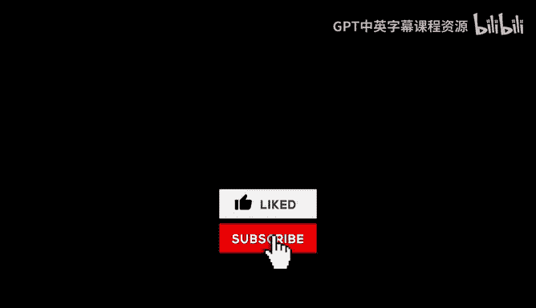
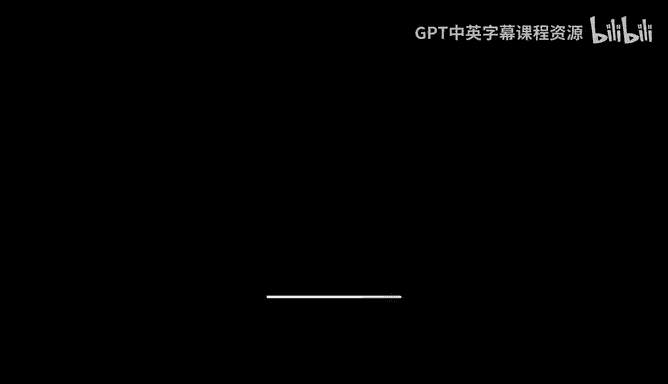

# Lex Fridman Podcast #71《弗拉基米尔·瓦普尼克：谓词、不变性与智能的本质》中英字幕 - P1 - GPT中英字幕课程资源 - BV11NreBGE94

The following is a conversation with Vtimer Abpk， Part 2， The second time we spoke on the podcast。

He's the co-inventor of support vector machinesch， support vector clustering， VC theory。

 and many foundational ideas in statistical learning he was born in the Soviet Union。

 worked at the Institute of Control Sciences in Moscow， then in the US， worked at AT&T， andEC labs。

 Facebook AI Research， and now is a professor of Columbia University。

His work has been cited over 200000 times。 The first time was spoke on the podcast was just over a year ago。

 one of the early episodes。This time， who spoke after a lecture he gave titled Complete Statistical Theory of Learning as part of the MIT series of lectures on deep learninging and AI that I organized。

I'll release the video of the lecture in the next few days。

This podcast and lecture are independent from each other。

 so you don't need one to understand the other。 The lecture is quite technical and math heavy。

 So if you do watch both， I recommend listening to this podcast first。

 since the podcast is probably a bit more accessible。

This is the Artific intelligence podcast if you enjoy it， subscribe on YouTube。

 go5 stars on Apple podcast， support it on Patreon or simply connect with me on Twitter at Lex Friedman spelled FRIDMN。

As usual， I'll do one or two minutes of ads now， and never any ads in the middle that can break the flow of the conversation。

 I hope that works for you and doesn't hurt thelicing experience。This show is presented by Cash app。

 the number one finance app in the app store。 When you get it， Use code， Lex， podcast。

 Cash app lets you send money to friends， buy Bitcoin and invest in the stock market with as little as $1。

 Brokerage services are provided by cashsh app investing a subsidiary of Square and member S I PCC。

Since cashshH allows you to send and receive money digitally， peer to peer。

 and security in all digital transactions is very important。

 let me mention that PCI data Security standard， PCI DSS levelvel 1 that Cash app is compliant with。

I'm a big fan of standards for safety and security， and PC I DS S S is a good example of that。

 where a bunch of competitors got together and agreed that there needs to be a global standard around the security of transactions。

Now we just need to do the same for autonomous vehicles and the AI systems in general。So again。

 if you get cashsh app from the App store or Google Play and use the code Lex podcast， you get $10。

 and Cashshop will also donate $10 to first， one of my favorite organizations that is helping to advance robotics and STEM education for young people around the world。

And now here's my conversation with Vladimir Vpnik。

You and I talked about Alan Touring yesterday a little bit。

And that he as the father of artificial intelligence。

 may have instilled in our field an ethic of engineering and not science。

Seeking more to build intelligence rather than to understand it。

What do you think is the difference between these two paths？

Of engineering intelligence and the science of intelligence。It's completely different story。

In engineeringing res imitation of human activity。😔，You have to make。

A device which behave as human behave。C。All the functions of human。It does not matter how you do it。

But to understand what his intelligence about。It's quite different problem。So I think， I believe。

That is somehow related to prediccate we talk yesterday about。Because。Look at the。Of Lalaimir props。

Idea。He just phone。So you one here。Predicates。行。Go it units。Which can explain human behavior。

 at least in the Russian tale here。😔，Lo at the Russian tales and derive from that。

 And then people realize that it more white than in Russian tales。

 it ist TV in movie serials and for so on and so on。 you're talking about。Vladimir Pro。

 right who in 1920 published a book Morology of the folk taleale describing 31 predicates that have this kind of sequential structure that a lot of the stories。

 narratives follow in Russian folklore and other context We'll talk about it。

 I'd like to talk about predicates in a focused way， but let me。

 if you allow me to stay zoomed out on our friend Alan Touring。And， you know。

 he inspired a generation with the imitation game。Yes。

Do you think if we can linger in a little bit longer do you think we can。

Learn do you think learning to imitate intelligence can get us closer the science to understanding intelligence。

 so why do you think imitation is so far from understanding？

I think that it is different between you have different goals。So。Your goal is to create something。

 something useful。 and that is great。And you can see how。Much since was done。

 and I believe that it will be done even more。It so driving cars and also there's business。

It is great。And it was inspired by。就认可医生。But understanding is very difficult。

 It more or less philosophical category。 What means understand the world。I believe in him。

 which starts from Pto。That the exists vat of ideas。I believe that intelligence。

 it isvault for years。But it hasvault of pure ideas ideas。🤢，And when you。Combins。

A reality thinks it creates as， in my case， in the variance， which is very specific。 and that。

I believe the combination。Of ideas in way to construct and conveyvariant is intelligence。

 But first of all， predicate， if you know， predicate and hopefully then not。

Not too much preddiiccate exist。 For example，31't prediiccate for human behavior。 It is。

 not a lot of Vladimir prop used 31。You can even call them predates 31 predicates。

To describe stories， narratives， Do you think human behavior。How much of human behavior。

 how much of our world， our universe， all the things that matter in our existence can be summarized in predicates of the kind that Pro was working with。

 I think that。Behave a lot of form of behavior。But I think the predicate is much less。

Because even in this example， Sicge gave here yesterday。You saw。That predicate。Can be。

one predicate can construct many different invaris depending on your data。

 they're applying to different data， and they give different invaris。So， but pure ideas。

Maybe not so much。 not so many。s I don't know about that。 but my guess。

 I hope that's why I challenge about digital recognition。 how much you need。

I think we'll talk about computer vision and 2D images a little bit in your challenge that's exactly about intelligence that's exactly。

That's exactly about， no， that hopes to be exactly about the spirit of intelligence in the simplest possible way Yeah absolutely you should start simplest way not able to it Well。

 there's an open question whether starting at the Mist digit recognition。

Is a step towards intelligence or is an entirely different thing。I think that to beat records。

Using 300200 times less examples。 You need intelligence。 You need intelligence。

 So let's because you used this term， and it would be nice。I'd like to ask simple。

 maybe even dumb questions。Let's start with a predicate。In terms of terms and how you think about it。

 what is a predicate？I don't know。 I， I have a feeling formally as they exist。But。

I believe that predicate for 2D images。呃。One of them was symmetry。Hold on a second， sorry。

 sorry to interrupt and pull you back。At the simplest level， we not even we're not being profound。

 Currently。 A predicate is a statement of something that is true。Yes。

Do you think of predicates as somehow probabilistic in nature or is this binary。

 this is truly constraints of logical statements about the world In my definitions。

 as simples prediiccate this function。Function， and you can。

Use this function to make inner product that is prediccate。

Was the input and was the output of the function。Iputs is x something which is input in reality。

 so if you consider digit recognition， it pixel space， yes input。

 but it is function which in pixel space， but it can be any function。Pixel space。

And you choose and I believe that there are several functions。

Which is important for understanding of images。One of them is symmetry。

 its not so simple construction。As I describe this literaryer with all this stuff。But。

Another I believe I don't know how many is how well structureized is picture。Structurized。

 what do you mean by structuralized？It is formal definition， say something heavy on the left corner。

Not so heavy in the middle and so on。 you describe。In general， concept of what you assume concepts。

 some kind of universal concepts， yeah。But I don't know how to formalize this。 Do you。

 So this is the thing。There's a million ways we can talk about this， I'll keep bringing it up。

 but we humans have such concepts。UpWhen we look at digits。

But it's hard to put them just like you're saying now， it's hard to put them into words， you know。

 that is example。When。クリティクス？In music。Trying to describe music。They use predicate。

And not too many predicate， but in different combination。But they have some special words。

For describing music。And。The same should be for images。But maybe there are critics who understand。

Essence of what this image is about。Do you think there exists critics who can。

Summarize the essence of images， human beings。The I hope that yes。

 but that explicitly state them on paper。The fundamental question I'm asking。

Is do you think there exists a small set of predicates that will summarize images。

 it feels to our mind like it does， that the concept of what makes a two and a three and a four no。

 no， no， it's not on this level。呃。What it it。It should not describe2，34。

It describes some construction which allow you to create invariance。And invari。

 sorry to stick on this， but terminology invariance， it is。It is proテity。Of your image。水。

I can say looking on my image， it is more or less symmetric and I can give you a value of symmetry。

Say level of symmetry。Using this function that I gave yesterday。A。And you can describe。That。

Your image have these characteristics exactly in the way how musical critics describe music。So。

But this is invariant applied。To specific data， to specific music or something。

I strongly believe in this。Ploot ideas that there existsvault of predicate andvault of reality and。

realityLet's talk about Plato a little bit。 So you draw line from Plato to Hegel to Wgner to today。

 Yes， so Plato has forms。The the theory of forms， there's a world of ideas。

 a world of things as you talk about， and there's a connection and presumably the world of ideas is very small。

And the world of things is arbitrarily big， but they're all what Plato calls them like。It's a shadow。

 the real world， It's a shadow from the world of。 Yeah。

 you have projection projection of world of idea Yeah， very。 And in reality， you can。

Realize this projection using this invariance because it is projection for on specific examples which create specific features of specific objects。

So， and。So the essence of intelligence。Is while only being able to observe the world of things。

 try to come up with a world of ideasenss about I feel like that's a contradiction intelligent。

Music critics， but I think I think music is to be。Enjoyed。In all its forms。

 the notion of critic like a food critic。 No， I don't want touch emotion。

 That's an interesting question。 Does emotion。There's certain elements of the human psychology of the human experience。

Which seemed to almost contradict intelligence and reason。Like emotion， like fear， like。Like love。

All of those things are those not connected in any way to the space of ideas。That I don't know。I。

 just wont。To be concentrate on very simple story。On dig recognition。

 so you don't think you have to love and fear death in order to recognize digits。I don't know。

Because it's so complicated。It involved a lot of starfish I never considered。

But I know about digital recognition。And I know that。For digital recognitionogni。と。

To get the records from small number of observations， you need predicate。

But not special precate for this problem。But universal predicate each understand。

Valult of images of visual and visual。But on the first step， they understand say Wal of。

Hwritten digits or characters or some something simple。So like you said， symmetry is an interesting。

 that's what I think one of the predic related to symmetry， but the level of symmetry。 Okay。

 degree of symmetry。 So， you think symmetry at the bottom is a universal notion and there's。

There's degrees of a single kind of symmetry， or is there many kinds of symmetries？

Many kinds of symmetries， there is a symmetry， antis， say letter S。So， it。His vertical antisymmetry。

And it could be diragonal symmetry， vertical symmetry， so when you cut vertically。The letter S。

 yeah Z。Upper part。In low part in different directions。We've heard it along the Y axis。

 but that's just like one example of the symmetry， right， isn't there like all right。

 but there is a degree of symmetry。If you play all this literative stuff to。To do。

D distance whatever I describe， you you can have a degree of symmetry。

 and that is what describing a reason of image。It is。The same as you will describe。This。你没。😔。

Saing about digits has antis， digit3symmetric。😔，More or less， look for symmetry。

Do you think such concepts like symmetry， predicates， like symmetry， is it a hierarchical？

Set of concepts。Or are these。Independent， distinct predicates that we want to discover a subset of。

もうずれずれディアめてる。And you can this idea of symmetry。Make。Very general。Like degree of symmetry。

The degree of symmetry can be0 no symmetry at all or degree of symmetry say。More or lesssymmetrical。

But， you have。One of this description in symmetry can be different。

 as I told Guizntal Verical Giorgonal。And antismet is also concept of symmetry。

 What about shape in general， I mean， symmetry is a fascinating notion， but。No。

 I'm talking about digit， I would like to concentrate on all I would like to know predicate for digital recognition。

 Yes， but symmetry is not enough for digitalit recognition right it is not necessarily for digital recognition。

It。Hels。To create invari， each will。If you can use when you will have examples。

For digital recognition， you have regular problem of digital recognition。

 you have examples of the first class or second class。

 plus you know that there exists concept of symmetry。

And you apply when you're looking for decision rule。You will apply。呃。

Concept of symmetry of this level of symmetry， which you estimate from。So let's talk everything is。

Comes from weak conversions。What is convergence， What is weak convergence。

 What is strong convergence。I'm sorry I'm going to do this to you What are we converging from and to？

You can do a drink。You would like to have a function。The function， which say indicator function。

 which indicate your。Digit。F for example， a classification task let's talk only about classification so classification means you will say whether this is a five or not or say which of the 10 digits it is。

I would like to， to have these functions。人。I have some examples。I can consider proty。

Of those examples。Seismmeter。And I can measure level of symmetry for every digit。And then。

 I can take。Oage。And I from my training data。And I will consider only functions。off。

Conditional probability， which Im looking for my decisional。Which。Applying。都。The digits。

Will give me the same average as I absorb on training date。So actually。

 this is different level of description of what you want。You won't。Not just you show not one digit。

 you show this predicate， show general property。Of all digits， which you have in mind。

If you havent mind digit3， it gives you proity of digit 3 and you select。

As admissible set of function， only function， which keeps this propertyity。

You view not consider other functions。So you're immediately looking for smaller subset of function。

 That's what you mean by dismissmissible functions， you admissible function。

 which is still a pretty large。For the number three， city pretty too large。

 but if you have one prediiccate。Right，But according to。there is a strong and weak convergence。

Strong convergence is convergence and function。You're looking because of function。

On one function and the looking comes another function。And square difference。

From them should be small。If you take difference in any points， make a s， make an integral。

 and it will be small。That is convergence in function。Suppose you have some function， any function。

So I would say， I say that。Some function cons to this function。

If integral from square difference between them is small。That's the definition of strong convergence。

 that definition of two functions， the integral of the difference， small。

 it is convergence in functions， yeah。But you have different convergence in functionals。

You take any function， you take some function fee。And take inner product this function。

 this F function。F0 function which you want to find。And that gives you some value。So you say that。

Set of functions。Goodvi。In inner product to this function， if this value。

Of inner pro that conge to value F 0。That is for one fee。But we converence requires that。

It cons for any function。Of Hilbert's space。If it converge for any function of Hill beltt space。

 then you will say that this is V conversionvergence。You can think that。When you take integral。

 that is， integral pro of function。For example， if you will take sine or cosine。

 it is coefficient of Sa Fourier expansion。So it， if it converge。For all cohesions or for expansion。

 So under some condition， its conible to the function you're looking for。

But weak convergence means any property。Convergence not point vice。

 but integral property of function。So the convergence means integral property of functions。

When I talking about predicate， I would like to。Formte。

Which integral properties I would like to have。For conversionvergence。

So and if I will take one predicated function， which I measure property。

If I will use one predicate and say， I will consider only function。

Which give you the same value as it is this predicate。I selecting set of functions。

From functions which is admissible in the sense that function which I looking for in this set of functions。

Because I checking in in， in training data。 it is。 it gives the same。Yeah。

 so it always has to be connected to the training data in terms of。Yeah， but， but pro。

You can know independent on training data。And this guy， prop， so that there is formal property。

31 fairy tale Russian fairy tale but Russian fairy tale is not so interesting。

 More interesting that people apply this to movies， to theatre。

 to different things and the same works。They're universal。Well。

 so I would argue that there's a little bit of a difference between。

The kinds of things that were applied to， which are essentially stories。And digit recognition。

It is the same story。You're saying digits， there's a story within the digit。

But my point is why I hope that it's possible to beat a record using not 60，000。

But say 100 times less。Because instead， you will give predcate。

And you will select your decision not from white set of function。But from set of function。

 which keeps us prediccate。But prediccate is not related just to digital recognition。

 right so like in Plato's case。Do you think it's possible to automatically discover the predicates？

You basically said that the essence of intelligence is the discovery of good predicates。Yeah。Now。

 the natural question is。You know， that's what Einstein was good at doing in physics。

Can we make machines。Do these kinds of discovery of good predicates。

 or is this ultimately a human endeavor？Thus， I don't know。

 I don't think that machine can do because。嗯。According to theory about weak congence。

AAny function from Hber space can be predicated。So you have infinite number prediiccate in upper and before you don't know which predicate is good and which。

Whatever。Prorop show and why people call it breakthrough that there is not too many。

Predicate which cover。Most of situation happened in the world。So there's a sea of predicates。

And most of the only a small amount are useful for the kinds of things that happen in the world。

I think that。I would say， only small part of。But， it's very useful。Useful all of them。

 only very few are what we should， let's call them good predicates， very good pre。

 very good predicates。Can we linger on it， what's your intuition， Why is it？

Hard for a machine to discover good prediicates。 I， even in my talk。

 describescribe have to do predicate。 have to find you predicate。 I。

 I'm not sure that it is very good。 What did you proposing it， No， in my talk， I， I。

 I gave example for diabetes。when we achieve some percent， so then they're looking for area。

Where some sort of predicate， which I formulate does not。Gpps。Invariant。

So if it doesnt keep I retrain my data， I select only the function which keeps this invariant in the way I did it。

 I improve my performance， I can looking for this predicate I know technically have to do that and you can of course。

Do it using machine。But I am not sure that we will construct the smartest predicate。Well。

 this is the。Allow me to linger on it because that's the essence。 That's the challenge。

 That is artificial that's， that's the human level intelligence that we seek is the discovery of these good predicates。

 You've talked about deep learning as a way to。The predicates they use and the functions are mediocre。

We can find better ones。Let's talk about deep learning。 Sure。

 let's do I know only Jan's Leon convolutional network。And what else I don't know。

 and it's a very simple convolution There's not much else left and right， Yes， I can do it like that。

1， this one predicate。 it is convolution is a single predicate。 Its single。

 it's it it's single predicate。Yes， you know， exactly you take the for translation and predicated this should be kept。

So that's a single predicate， but humans discovered that one or at least。

Not that is a risk not too many predics， and that is big story because Janan did it 25 years ago and nothing。

So clear was addeded to deep network。And then I don't understand。

Why we should talk about deep network instead of talking about piecewise linear functions。

 which keeps this prediccate。 Well， the you know， a counter argument is。

That may be the amount of prediates necessary。To solve general intelligence， say in space of images。

Doing efficient。Recognition of handwritten digits is very small。

And so we shouldn't be so obsessed about finding。We'll find other good predicates like convolution。

 for example， you know， there has been other。Advancements， like。

If you look at the work with attention， there's attentional mechanisms。

And especially use the natural language focusing the network's ability to learn at which part of the input to look at。

 the thing is there's other things besides predicates that are important for the actual engineering mechanism of showing how much you can really do given such these predicates。

I it。I mean， that's essentially the work of deep learning is constructing architectures that are able to be given the training data。

To be able to converge towards。A function that can approximate can generalize well。

It's an engineering problem。 No， yeah I understand。But， let's talk。Not on emotional level。

 but on a mathematicalmatic level。You have set of piece vice linear functions。It is all possible。

Neural networks。It's just piece vi linear functions。 This is many， many pieces。

 large large number of piece vi linear Okay exactly， but very large， very large。

 almost but it's still large， It's still simpler than secondvol than a reproducing kernel hilber space。

 which have a hiler set of functions。 What's Hilbert space。

It's space this infinite number of coordinates， say function for expansion， something like。

So it's much richer。So and when I're talking about closed form solution。

 I' talking about this set of function。Pwise linear setes。Particular。

ase you it's a small part of the neural networks is a small part of the space you're talking of functions you say a small set of functions let。

But it is fine。 It is fine。 I don't want the。ととディスカスモードビーク take。So you have some set of functions。

So now when you're trying to create architecture architecture。

You would like to create admissible set of functions， which all your tricks。To use not all functions。

But some subset of this set of functions。Save when you're introducing convolutional net。Because。

Way to make this subset useful for you。But from my point of view， unvolutional。

 it is something you want to keep some invari， say translation invariance。But now。

 if you understand this。And you。Cannot explain。On the level of ideas， what neural network does。

You should agree that it is much better to have a set of functions。As they say。

 this set of functions。Should be admissible。 It must keep zvari， zvari and that way。

You know that as soon as you incorporate new invaris。

 set a function becomes smaller and smaller and smaller， but all the invaris are specified by you。

 the human。Yeah， but what I am hope that there is a standard predicate like prop show。

That that's what I want to find for digital recognition， if they start it is completely new area。

 what is intelligence about on the level starting from Plata's ideas， what isvault of ideas。So。

 and I believe that it's not too many。Yeah。But， you know。

 it is amusing that mathematicians doing something a neural network in general function。

 but people from literature， from art。The uses all the time， that's right。

 invari saying say it is great have people describe music， we should learn from that。

And something on this level， but so why Vladimir Po， who was just。

Theore who studied theoretical literature， he found that。You know what。

 let me throw that right back at you because there's a little bit of a that's less mathematical and more emotional philosophical Vladimir prop。

I mean， he wasn't doing math， no。And you just said another emotional statement。

 which is you believe that this Plato world of ideas is small。I hope。I hope。

you what's your intuition， though， if we can linger on it？Yeah，You know。

 because it's not just small or big， I know exactly。Then， when I introducing。Some prediiccate。

I decrease set of functions。But my goal to degree set of function much。By buy as much as possible。

 Bu as much as possible。Good predicate， which does this。Then I should choose next predicate。

 which does decrease set as much as possible， so set of good predicate。It is such the decrease。This。

E amount of admissible functions So if each good predicate significantly reduces the set of admissible functions that there naturally should not be that many good predicates no but but。

If you reduce。Very well， the DC dimension。Of the function， of admissible set of function is small。

And you need not too much turning data to do well。And Vc dimension by the way。

 is a measure of capacity of this set of functions。

 right roughly speaking carbon function and this so you're decreasing decreasing and it might easy for you to find。

放 you're looking for。That the most important part to create good admissible set of functions。

And it probably there are many ways。But。The good predicative judge that can do that。

But for this duck？You should know a little bit about duck because what the what are the three fundamental laws of ducks looks like a ducks like a duck and qua you should know something about ducks to not necessarily looks like say horse sounds good。

It it's not it generalizes from and to like and make sound like horse something and run like horse and moves like horse。

 it is general， it is general prediccate。That this applied to duck， but for duck。

 you can say play ch leg duck。You cannot say please ch， why not？So you're saying you can。

 but that would not be a good No you will not reduce a lot of you would not do yeah。

 you would not reduce the certain functions So you can the story is formal story。

 which ge magical story is that you can use any function you want as a predicate。

But some of them are good， some of them are not because some of them reduce a lot of functions。

The admissible set some of but the question is， I'll probably keep asking this question。

 but how do we find such what's your intuition， handwritten handwritten recognition。

 how do we find the the answer to your challenge I understand it like that。I understand Vok。

What what it means I new predicate like guy who understands music can say this worth which he describes him when he listens to music。

You understand music。He use not too many different， or you can do like prop， you can make collection。

What he' talking about music， about this about that。 it's not to many different situation。

 he described because we mentioned Vladimir proper bunch。 Let me just mention。 there's a。

 so there's a sequence of。Of 31。Structural notions that are common in stories。

 and I think you call it units units， and I think they resonate， I mean。

It starts just to give an example absentbstion， a member of the heroes' community。

 a family leaves the security of the home environment。

 then it goes to the interdiction or forbidding edict or command is passed upon the hero。

 don't go there， don't do this， the heroes war against some action， then step three， violation。

Of interdiction。B， you know， break the rules， break out in your own， then reconnaissance。

 the villain makes an effort to attain knowledge， needing to fulfill their plot， so on。

 It goes on like this ends。Uh，Ens in a wedding number 31， happily ever after， no。

 he just gave description of all。Situation， he understands his vault。Of folk yeah。

 not but it for stories。And this story is not in just folk tales。

 This story is in detective serials as well。And probably in our lives， we probably live。What is this。

And end they all。The， this predicate is good。For different situation。From movie， from for for movie。

 for theatre。 By the way， there's also criticism， right。

 There's an other way to interpret narratives from。Claude Levy Strauss。

 I I am not in this business no， I know， it's theoretical literature。

 but it's looking at paradise service。They discussion， but at least there is a units。

It's not too many units that can describe， but this guy probably gives another units。

Or another way exactly another another， another set of unison。 another set of predicates。

 It doesn't matter。But they exist。Probably。My question is whether given those units。

Whether without our human brains to interpret these units。

They would still hold as much power as they have， meaning， are those units enough。

When we give them to an alien species， let me ask you， do you understandia digit？Images。No。

 I don't understand no no no， when you can recognize this digit images， it means that you understand。

Yeah you understand。Cararas， you understand， Nope， nope， nope， nope， I I。

It's the imitation versus understanding question because。

I don't understand the mechanism by which I no， no， I'm not talking about， I'm talking about predics。

You understand that it involves symmetry， maybe structure。

 maybe something that I cannot formulate I just was able to find。That's really good。

 so this is a good line。I feel like I understand the basic elements of what makes a good hand recognition system my own。

 like symmetry connects with me。 It seems like that's a very powerful predicate。My question is。

 is there a lot more going on that we're not able to introspect？

Maybe I need to be able to understand a huge amount in the world of ideas。

thousandshousands of predicates， millions of predicates in order to do hand recognition。

 I don't think so。So you both your hope and your intuition and such that enough you're using。

Digit you're using examples as well。Zdy says。That if you'll use。Bul。Possible functions。

From fielder space， all possible predicate， you don't need training data。You just view。

Have admissible set of functions which contain one function。Mi。

So the trade off is when you're not using all predicates， you're only using a few good predicates。

 you need to have some training data， exactly the more good predicates you have。

 the less training data exactly。That is intelligent learning。Still， okay。

 I'm going to keep asking the same dumb question， handwritten recognition to solve the challenge。

 you kind of propose a challenge that says we should be able to。

Get state of the art Mist error rates by using very few 60， maybe fewer examples per digit。

What kind of predus do you think is a challenge？So people who will solve this problem。

 they will answer they will answer， do you think they'll be able to answer it？

In a human explainable way。They just need to write function， that's it。

But so can that function be written， I guess， by an automated。Reasoning system。

 whether we're talking about a neural network， learning a particular function or another mechanism。

 No， I am not against neural network。 I am against admissible set of function。

 which creates neural network。 You did it by hand。You don't do it by invariance。

 by prediiccate by reason。But neural know can then reverse do the reverse step of helping you find a function。

Just the task of a neural network is to find a disentangled representation， for example， they call。

 is to find that one predicate。Function that's really captures some kind of essence， one。

 not the entire essence， but one very useful essence of this particular。Visual space。

 do you think that's possible？Listen， I'm grasping。

 hoping there's an automated way to find good predicates right so the question is what are the mechanisms of finding good predicates ideas that you think we should pursue a young grad student listening right now？

I gave example。So find situation。Where。Predicative。Did you suggesting。Don't create invariant。

It's like in physics， fine situation where existing theory cannot explain it。

Find situation where the existing theory cannot explain this so you're finding contradictions contradiction and then remove this contradiction。

 but in my case， what means contradiction you find function which if you will use this function。

 you're not keeping conveyvariance。So was really the process of discovering contradictions。Yeah。

It is like Con。Find situation where you have contradiction。For one of the proity。

For one of the predicate。Then include this preit， making invari。

 and solve against this problem now you don't have contradiction。But it is not。

The best way probably I don't know。To looking for predcate， that's just one way。 Okay， that no， no。

 it is brute forceway， the brute force way。 What about。

The ideas of some what big umbrella term of symbolic AI。There's what in the 80s with expert systems。

 sort of logic reasoning based systems。Is there hope there to find some？Through sort of deductive。

Reasoning to to find。Good。Predcateates。I don't think so。I think the just logic is not enough。

It's kind of a compelling notion， though。You know that。

When smart people sit in the room and reason through things。

 it seems compelling and making our machines do the same is also compelling。So。

Everything is very simple。When you have infinite number of predicate。You can choose。

The function you want， you have invariance and you can kill the function you want。But。

You have to have a。のっともに。Invariance。To solve the problem。

So and half from infinite number function to select。Findinite number。

And hopefully small volume number of functions。W is good enough。

To extract small set of admissible functions。So they will be admissible。

 it's for sure because every function just decreases set to function and leaving it admissible。

But the feel bit small。 But why do you think logic。Base systems don't can't help。Intuition。

 not because you should know reality。You should know life。 this guy like。ブロップ？

He knows something to put in envari his understanding that's the human， yeah， to see。

 you're putting too much value into Vladimir props。

 knowing something it is might of what means your know life？What common， you know， common sense， no。

 no， you know something。Common sense it is some rules。You think so， common sense is simply rules。

Common senses。Every， it's。Mortality，' no， it's fear of death， it's love， its spirituality。

 it happiness and sadness， all of it is tied up into understanding gravity。

 which is what we think of as common sense don' to discuss so bright。I want to discuss。

Understand digital recognition understand digital recognition Every time I bring up love and death。

 you you bring it back to digital recognition I like No， you know。

 if it's doable because there is a challenge， Yeah， which。I she have to solve it。

If I will have a student concentrate on this work， I will suggest something to solve。

 You mean handwritten recognition Yeah， it's a beautifully simple， elegant and yet。

I think that I know invari which will solve this。 you do， I think so you so but。It is not。

It is maybe I want some universal invariance which are good not only for digital recognition。

For you was understanding。So let me ask。How hard do you think is to D image understanding？

So we can kind of intuit handwritten recognition。How big of a step， leap journey is it from that。

 If I gave you good， if I solved your challenge for handwritten recognition。

 how long would my journey then be from that to understanding more general natural images immediatelymedia。

 you will understand this as soon as you will make a record。

Because it is not for free as soon as you will create。Several invaris， which will help you。To get。

The same。They four months。That thebo Nerone did。Using hundred maybe be more than 100 times less examples。

You have to have something smart to do that and you're saying that that doesn worry。

 it is prediccate。Because you should put somebody idea have to do that。But okay。Let me just pause。

 maybe it's a truly old point， maybe not， but handwritten recognition。

Feels like a 2D two dimensional problem。And it seems like how much complicated it is the fact that most images are a projection of a three dimensional world。

Onto too deep。Plain， it feels like for a three dimensional world。

 we we need to start understanding common sense in order to understand an image。

It's no longer visual shape。And symmetry。It's having to start to understand concepts of understand life。

 you're talking there are different in what different and potentially much larger number。You know。

 might be， but let's start form simple yeah， but you said that you know。

 I I cannot think about things which I don't understand this I understand。

 but I'm sure that I don't understand everything there。Yeah。

 and I can say do as simple as possible but not simpler， and that is the exact case。

With handwritten with hewrittenton。Yeah， but never， that's the difference between you and I。 I I I。

I welcome and enjoy。Thinking about things I completely don't understand， because to me。

 it's a natural extension without having solved handwritten recognition to wander。How。嗯。

How difficult is the the。The next step of understanding 2D， 3D images because ultimately。

While the science of intelligence is fascinating， it's also fascinating to see how that maps to the engineering of intelligence and recognizing。

Handwritten digits is not。 doesn't help you。 It might。

 It may not help you with the problem of general intelligence。 We don't know。

 itll help you a little bit。 we don't know。 It's unclear。 It's unclear。 Yeah， it might vary。

 but I would like to make a remark。 Yes， I start not from very。Premitive。Problem， Mike。

Challenge problem I start this very general problem， this plotau。

So you and it comes from Pta to dig recognition so you basically took Plato and the world of forms and ideas and mapped and projected into the clearest。

 simplest formulation of that big world and I would say is that I did not understand Pta。

Until recently， and until I consider weak convergence and then predicate and the no。

This is what Platter told。So you linger on that， like why？

How do you think about this world of ideas and world of things in Plato？No， it is metaphor。

 it is it's a metaphor for sure。 It's a compelling。 It's a poetic and a beautiful metaphor。

 but what can you。But it is the way how you should try to understand。

 have attack a idea since they walked。So from my point of view。It is very clear。

 but it is lying all the time people looking for that。Say Ptos and。He就。Whatever reasonable it exists。

 whatever exists， it is reasonable。 I don't know what you have in mind reasonable。Right。

 this philosophers again， no， no， no， no， no， no， no， it is next stop of Vigner。

That mathmatics understand something good reality。It is the same plot line。

And then it comes suddenly to Vladimir Pro。Look，31 ideas，31 units describes everything。

There's abstractions， ideas that represent。Our world。 and we should always try to reach into that。

 Yeah， but but you should make a projection on reality， but understanding is it is abstract ideas。

You have in your mind。Several abstract ideas， which you can apply to reality and reality。

 in this case， sort of if we look at machine learning as data， example， data data。Okay。

 let me let me put put this on you because I'm an emotional creature。

 I'm not a mathematical creature like you， I find compelling the idea。Forget the space。

 the sea of functions。There's also a sea of data in the world。

And I find compelling that there might be， like I said， teacher。Small examples of data。

That are most useful for discovering。Good， whether it's predicates or good functions。

 that the selection of data。Maybe a powerful journey， a useful mechanism， you know。

 coming up with a mechanism for selecting good data might be useful too。

Do you find this idea of finding the right data set interesting at all？

Or do you kind of take the data set as a given？I think that it is， you know。

 my scheme is very simple。You have huge set of functions。

If you will apply and you have not too many data， if you pick up function。Which describes this data。

You will do not very well。You randomly pick， yeah， you will ever， it will be fitting。So， you should。

Decrease set of function from which you're picking up one。

So you should go somehow to admissible set of functions。And this is what about weak conversions？So。

 but。From another point of view。To to make。Admissible set of function。 You need just a D。

 You just function， which you will take in your product。Which you will measure。😔。

Property of your function。And。That is。How it works no， I get， I get to understand it。

 but do you the reality is but let let's think about examples。

You have huge set of functions and you have several examples。If you。

Just trying to keep take function， which satisfies these examples。You still will overfit。

You need decreases， you need admissible set of functions， absolutely， but what？Say， you have。

More data than functions。So sort of consider the， I mean。

 maybe not more data than functions because that'sly impossible。

 but what I was trying to be poetic for a second， I mean， you have a huge amount of data。

 a huge amount of examples。But amount of function can even get bigger。

 I understand everything goes there's always， there's always a bigger full he build space， catch。

 but okay。But you don't find the world of data to be an interesting optimization space。

 like the optimization should be in the space of functions。

In creatingreating admissible admissible set of functions， no， you know， even from the classical vi。

Here from structure risk minimization， you should organize。Function in the way that。

They will be useful for you。喂。And that is。Yeah， but the way you're thinking about useful。

Is you're given a small set of small set of function which you contain function I looking for Yeah。

 but as looking for based on the empirical set of small examples， Yeah。

 but that is another story I don't touch it。Because I believe that this small examples is not too small。

So he 60 per class low flash numbers works。I don't need uniform law。

 the story is that in statistics there are too low。Loaw of large number seven。

 uniform law of large numbers。So I want to be in a situation where I use law of large numbers but not uniform law of large numbers right so 60 is law large its large enough。

 I hope no still need some evaluation， some bonds or but idea is following that。If you trust that。Oh。

Say this。Average gives you something close to expectations。

 so you can talk about that about this predicate。And that is。Basis of human intelligence。

Good predicates is the discovery of good predicates is the basis of it is discover of your understanding world。

Of your methodologyology of understanding world。Because you have several functions which you will apply to reality。

Can you say that again， so you have several functions predicate？But they abstract， yes。

 then you will apply them to reality to your data。And you will create in this way predicate。

Which is useful for your task。But predicate。Not related specifically to your task to this your task。

 it is abstract functions。Which being applied applied to many tasks that you might be interested in。

 it might be many tasks， I don't know。Or different tasks， well there should be many tasks。

 right it is like like in pro case。It was for fair tale， but this happened everywhere。Okay。

 so we talked about images a little bit， but。Can we talk about Noam Chomsky for a second？Yeah。

No I I don't know him personally， well， not I don't know his ideas， ideas， well let me just say。

 do you think language， human language is essential to expressing ideas as No Chomsky？Believe。

 so like language is at the core of our formation of。Predicates。The human language。

All the story of language is very complicated。I don't understand this， and I am not I thought about。

No I'm not ready to work on that because it's so huge， it is not for me。

 and I believe not for our century。It the 21st century， not for 21st century。

 so you should learn something a lot of stuff from simple task like digital recognition so you think okay you think digital recognition。

2D image。How would you more abstractly define digit recognition， it's 2D image？Symbol recognition。

 essentially。I mean。I'm trying to get a sense sort of thinking about it and now having worked with Mnist forever。

How small of a subset is this of the general vision recognition problem and the general intelligence problem？

Is it。Because yeah， is it a giant subset， is it not？And how far away is language you know？

Let me refer to interestingstein。Take the simplest problem as simple as possible， but not simpler。

 and this is challenge is simple problem。But it's simple by a year， but not simple to get it。

When you will do this。You do find some predicates it yeah， I mean， with with Einstein， you can。

You look at general relativity， but that doesn't help you with quantum mechanics。

And that's another story you don't have any universal instrument。Yes， so I'm， I'm trying to wonder。

If which space we're in， whether the whether handwritten recognitions like general relativity and then languages like quantum mechanics。

 are you still going have to do a lot of。Mess to universalize it， but。I'm trying to see。One。

 so what's your intuition， why handwritten recognition is easier than language？Just。

 I think a lot of people would agree with that， but if you could eluciate instead of the intuition of why。

I don't know， no， I don't think and give this de。I just think in con direction that this is problem。

Which if you will。😔，So it will。😔，Vi。Create。Some abstract understanding of。Images。

Maybe not all images I would like talk to guys who are doing real images in Columbia University what kind of images unrealre images real images yeah。

 what their idea is predicate what can be prediiccate I still symmetry will play role in real life images in any real life images。

 2D images， let's talk about2D images。Because。That's what you know。

And neural network was created images So the people I know in vision science， for example。

 the people who study human vision， that they usually go to the world of symbols and like handwritten recognition。

 but not really is other kinds of symbols to study our visual perception system。As far as I know。

 not much。Pdicate type of thinking is understood about our vision system they did not think in this direction they don't yeah they but how we even begin to think in that direction that's so I would like to discuss with them yeah。

 because if we will be able to show that it is。What working？And so it's because him， it's not so bad。

😔，So the unfortunate， so if we compare to language， language has like letters。

 a finite set of letters， and a finite set of ways you can put together those letters。

 so it feels more amenable to kind of analysis。With natural images。There is so many pixels。No， no。

 no， letter。Language is much， much more complicateds involved。A lot of different stuff。

It's not just understanding of very simple class of tasks。

I would like to see lists of task where language involved yes。

 so there's a there's a lot of nice benchmarks now in natural language processing from the very trivial。

Like understanding the elements of a sentence to question answering to more much more complicated where you talk about open domain dialogue。

The natural question is with handwritten recognition is really the first step of understanding visual information。

 right。But not but even our records。Shows that we go in wrong direction because we need 60000 digits so even this first step。

 so forget about talking about the full journey， this first step should be taken in the right direction no wrong direction because 60。

000 is unacceptable No I'm saying it should be taken in the in the right direction the 60。

000 is not acceptable it is you can talk it great we have half% of。And hopefully the step from。

Doing hand recognition using very few examples， the step towards what babies do when they crawl and understand their physical environment I know you don't know about babies you will do from very small examples yeah。

You will find principles that which difference。From what you're using now。And。

So it it more less clear。That means that you will use the convergence， not just strong convergence。

Do you think these principles？are。Will naturally be human interpretable。Oh yeah。

 so like when we'll be able to explain them and have a nice presentation to show what those principles are or。

Are they very going to be very kind of abstract kinds of functions for example。

 I talked yesterday about symmetry。Yes。And they gave very simple examples the same he'll be you gave like a predicate of a basic for four symmeties。

 Yes， for different symmeties and you have。For degree of symmetry， except this is important。

 not just symmetry。Existent doesn't exist， degree of symmetry。Yeah， for handwritten recognition。No。

 it's not for Hewrittenton， it's for any images， but I would like apply to Hewrittenton。Right， it's。

's in theory， it's more general。 Okay， okay。So a lot of the things we've been talking about。Falls。

 we've been talking about philosophy a little bit， but also about mathematics and statistics。

 a lot of it falls into this idea， a universal idea of statistical theory of learning。

What is the most beautiful？And sort of powerful or essential idea you've come across。

 even just for yourself， personally in in the world of statistics or sta theory of learning。

Probably uniform convergence， which we did。This Alexvan。😔，Can you describe universal convergence？

You have law of large numbers。So for any function and expectation of function。

 average your function converse to expectation。But if you have set of functions for any function。

 it is true。But it should conge simultaneously for all set of functions。B。For for learning。You need。

Uniform convergence， just convergence is not enough。Because when you pick up one which gives minimum。

You can pick up。One function which does not con in and it will give you the best answer。

For this function。So you need a uniform convergenence to guarantee learning， so learning does not。

Re on trivial love large numbers really on universal。😔，But。

A deal of the convergence existing statistics for a long time。But。It is interesting。

I think about myself。How stupid I was 50 years。I did not seevic conversions。I work on on the。

But now I think that most powerful is weak convergence。Because it makes admissible set of functions。

And even in all in products。When people try to understand。Recognition about dog law。

Looks like a dark and so on。 They use weak convergence。 people in language， they understand this。

But when they're trying to create artificial intelligence。You want event in different way。

You just consider strong convergence， Arians。So reducing the set of admissible functions， you think。

There should be。But。Effort put into understanding the properties of weak convergence you know。

In classical mathtematics。In gilded spirits， zero are only to vague to form of converence。

 strong and weak。Now you can use both。That means that we did everything。And。😔，It so happened。

Then when we use Hilbert space。😔，Which is very rich space， space of continuous functions。啊。

Each has an integral square squared。So we can apply weak strong convergence for learning。

And have closed form solution。So for computation is simple， for me。

 it a sign that it is the right way。Because you don't need any every stick you just do whatever you want。

But no， the only what left。It is concept of what is predic of preates。

 but it is not statistics by the way， I like the fact that you think that heuristics are a mess that should be removed from the system。

So closed form solution is the ultimate。No， it so happened then when you're using。Right， instrument。

 you have closed one solution。Do you think intelligence， human level intelligence when we create it？

Well。We'll have something like a closed form solution。You know， now I'm looking on balls。

 which I gave balls for。Onvergence。And when they looking for bonds？Ire thinking。

What is the most appropriate kernel for this bomb would be？So you know that didn't say。

All our businesses use ra basis function。But looking on the。

 I think that I start to understand that maybe we need to make corrections to right basis function。

To be closer。To work better for this。Bons。So I'm again trying to understand what type of kernelel。

Have burst。Approxiation， no approximation。Fit to this ball。Sure。

 so there's there's a lot of interesting work that could be done in discovering better function than radio basis functions for。

Yeah， what fines。It still comes from。You're looking to mass and trying to understand what。

From your own mind， looking at the， yeah， but I don't know， then I trying to understand。What。

Would you be good for that。Yeah， but to me there's still a beauty， again。

 maybe I'm a descendant ventting to heuristics。To me， ultimately。

Intelligence will be a mess of heuristics。And no， that's the engineering answer， absolutely。

 when when you're doing， say， self driving cars。The great guy who will do that。

It does not matter what。Tly behind that。Who has a better feeling craft？Applied， but basically。

It is the same story both preddiicates。😔，Because you cannot。

Create rule for situationation is much more than you have room for that。But。

Maybe you can have more abstract rule then it will be less the zero。

It is the same story about a and age supply to specific cases。

But still you should you cannot avoid this， Yes， of course。

 but you should still reach for the ideas to understand the science。Let me kind of ask。

Do you think neural networks or functions？Can be made to reason。

Sort of what do you think been talking about intelligence， But this idea of reasoning。

's there's an element of sequentially disassembling。Interpreting。The images。

 so when you think of handwritten recognition。We kind of think that there will be a single。

 there's an input and output， there's not a recurrence。Yeah。

What do you think about sort of the idea of recurrence of going back to memory and thinking through this sort of sequentially。

Manggling the different representations over and over until you arrive at a conclusion。

Or as ultimately all that can be wrapped up into a function。Suggestion。

That let us use this type of al when they started thinking， okay。Firsts of all。

 starting to understand what I want。Get I done。What I want。And。Then they trying to formalize。

And when I do that。I think you have to solve this problem。And。Do no， I did not。

Sitation you need recurrence， very。Do you observe human beings， do you try to。

 it's the imitation question， right， it seems that human beings reason。This kind of sequentially。

Sort of。Does that inspire in you a thought that we need to add that into our？Intelligence systems。

You're saying， okay， I mean， you've kind of answered it saying until now I haven't seen a need for it and so because of that you don't see a reason to think about it。

You know， most of things I don't understand。In reasoning came human。It is for me too complicated。

For me。The most difficult part。Is。To us cos。Good questions。How it works。

 have people asking questions。I don't know this。You said that machine learning is not only about technical things。

 speaking of questions， but it's also about philosophy。

So what role does philosophy play in machine learning， We talked about Plato， but generally thinking。

In this philosophical way。Does it have， how does philosophy and math fit together in your mind？

So studies and then their implementation， its like predicate lake。응 응 응。谁。😔。

Admissible set of functions。It comes together everything because。

The first declarationeration of Si was done 50 years ago， I told that Mississippiri。

So everything's there。If you have data， you can and your set of function is。

Not have not big capacity。 so low V dimension， you can do that。

 you can make extract risk minimization， control capacity。But。🤢，He was not able。😔。

To make admissible set of function good。No， when suddenly realized it。😔。

We did not yield another idea of convergence。日 we can。Everything is it。

 but those are mathematical notions， philosophy plays a role of simply。

Saying that we should be swimming in the space of ideas， let let's talk with this philosophy。

The lost female's understanding of life。So understanding of life。See people like plata。

 they understand on very high abstract level of life。So。And whatever。I doing。You just。

Implementation of mind is technique of life。But every new step。It is very difficult。For example。

To find this a year。😔，That we need。リクゼオリジス。Was not simple。For me。

So that required thinking about life a little bit。Hard to hard to trace， but。

There was some thought process。You know， I was work guys thinking about the same problem for 50 years or more。

And again and again and again。I trying to be honest and that is very important not to be very enthusiastic。

 but concentrate on。Whatevereverviv was not able to achieve。😔，And understand why。

And now I understand that because I believe in mass， I believe that。In Vina Sa。But no， we may see。

That there are only two way of convergence。In the using Bo。That means that we must， as well as。

People doing。But now exactly in philosophy and what you know about prediiccate。

 what how we understand life can they describe？A a predicate。I thought about that。

And that is more or less obvious level of symmetry。But。Next。I have a feeling。

It's something about structures。But I don't know how to formulate how to measure and measure our structure and all this stuff and the guy who will。

Solves this challenge problem。Then when they were looking how he did it。

Probably just only symmetry is not enough。But something like symmetry will be there absolutely material。

levelvel of symmetry be there。In level of symmetry， antismetry， geoagonal， verticalical and。

I even don't know how you can use in different direction a of symmetry that's very general。

But did you be there？I think the people very sensitive to theoscinity。But zero are several。

Ideealy ex symmetrymetry。As I would like to lot。But。You cannot learn just thinking about that。

You should do challenging problems and then analyze them。Why it was able to solve them。人身你就戏。😔。

Very simple things it's not easy to find。Even were talking about this every time about I was surprised。

 I try to understand， is people describe in language？Strong conversions， mechanism for learning。

I did not see。 I don't know。But the convergence。This dark story and story like that one you will explain。

To keep， you will use weak convergence argument。It looks like it does like it desert。

But when you try to formalize。😔，You just ignoring this， why， why 50 years？

From start of machine learning and after through all philosophy， I think I think that might be。

没 don know。😔，Maybe this is Syria also。😔，You should blame for that because empirical risk minimization all of the stuff and if you read now textbooks。

 they just about bond about empirical risk minimizations， they don't look in。For。

Another problem like admissible set。But on the topic of life。Perhaps。

We you could talk in Russian for a little bit。What's your favorite memory from childhood。

 Like guy I actually be my bombmyssesiesiesta？oo。Music。How about can you try to answer in Russian？

Msum。But b oceans door there。😔，高江ム。Go。結果里明明。どラスな compositeた。Should duck motion。Aパeno。That whatvoども有と。

So story project the here。Move on prostitute states the。いやに 누구시。Aasni Eiumrisni。Sar is gily。

It's mostly predative do。ジ 되。不 here evening小声点呢。😔，Now that we're talking about Buck。

Let's switch back to English because I like beitethoven and Cho pen。I'm usingBut Bach。

 if we talk about predicates， Bach probably。Has the most sort of well defined predicates underlying。

 you know， it is very interesting。To read。V critics？Writing about Bach， which words they're using。

 theyre trying to describe predicates。Yeah， and and and。And then show in。It is very different。😊。

Vabulary。Very different。Pific it， and I think that。😊，If you will make collection on that。No。

So media from this， you can describe predicate for digital recognition as well， from Bach and Chopin。

 no， no， no， not from Bach and Chopin from the interpretation of the music。

 but they're trying to explain you music。What they use？

they describe high level ideas of Pla's ideas what behind this music， that's brilliant。

Art is not self explanatory in some sense， so you have to try to convert it into ideas。

 it is ill post problems when when you go from ideas to the representation it is easy way。

 but when you're trying to go back， it is ill post problems， but nevertheless。

I believe that when you're looking from that， even from art。

You'll be able to find predicate for digital recognition。It's such a fascinating and powerful notion。

Do you ponder your own mortality。Do you think about it， do you fear it， do you draw insight from it？

N about mortality。No yeah。Are you afraid of that？It。Not too much。Not too much。It just speeches。

You'll not be able to do something with say。😔，See。I have a feeling to do that。For example。爱经币 very黑边。

To work this。Guys。T tradition from music。To write this collection of description。

 what have they described music the how they use prediiccate and from art as well。

 then take what is in common。And try to understand， predicate。This is absolute for everything。

And they use that for visual recognition and see if there is the connection exactly oh there's still time。

 we've got time。Yeah， at that time。It's it take years and years and years yeah it's a long way Well see you've got the patient mathematic mathematician's mind I think it could be done very quickly and very beautifully I think it's a really elegant idea Yeah well also some of many you know the the most time it is not to make this collection。

Don't understand。What is the common to think about that once again and again and again again and again and again。

 but I think sometimes especially just when you say this idea now。

 even just putting together the collection and looking at the different，Seets of data， language。

 trying to interpret music， criticize music。And images。

 I think there will be sparks of ideas that will come， of course， again and again。

 you'll come up with better ideas， but even just that notion。It is a beautiful notion。

 or even give some example。So I have friend。Who was。Specialist in Russian poetry。She is。

Processor of Russian poetry， he did not write。Poems， but she。No， a lot of stuffship。😔，Make。Book。

 several books in one of them is a collection of。Protion poetry。She images of Russian poetry。

 she collect all images of Russian poetry。Can they ask you？To do following。You have nips。

Digital recognition。And we get00。Digious。Or maybe less than 100， I don't remember maybe 50 digits。

Entri from poetical point of view， describe every image you see using commonly words。Of images of。

Russian poet。You she did it。And then you try it。To。

I call it learning of using privileged information。

 I call it privileged information you have on two languages， one language is。Just。Iu of digit。

And another the language poets a description of this image。And this is privileged information。

As there is an algorithm when we you are working using privileged information。

 you're doing well better。Mし better어。So there's something there， something there and there is a。

InN she。She unfortunately died。The collection。Of digits。And poetic descriptions of these digits。

But there's something there in that poetic description， but I think。There is an abstract ideas。

On the Pau level of ideas， yeah that they're there that could be discovered and music seems to be a good entry point as soon as view started。

Is this challenge problem the challenge problem I listen immediately connected to all this stuff especially with your talk and this podcast and I'll do whatever I can to advertise it's such a clean beautiful Einstein like formulation of the challenge before us All right。

 let me ask another absurd question。We talked about mortality。We talked about philosophy of life。

 what do you think is the meaning of life？What's the predicate？

For mysterious existence here on earth。I don't know。It's very interesting of。Behive。In Russia。

 I don't know， you know， the guy Strgasky。But I think you thinking about human what's going on。😔。

And so have a GM。It zero？Just developing。Two type of people。Common people and very smart people。

 they just started。And these two branches of people will go in different direction very soon。

So that's what they' thinking about that。So the purpose of life is to create two。Two paths。

 two paths， human societies， yes， simple people and more complicated。Which do you like best。

 the simple people are the complicated ones。I don't know that he's just his fantasy， but， you know。

 every week we have guy who is。Just。Wri and also so of literature。And he explained。

For he understand literature and human relationship？Have y see life？

And I understood that I'm just small kids。Comparing to him。He is very smart guy in understandingly。

He knows this pred， you knows。😔，Big blocks of life， I am used every time when I listen to him。

And he just talked about it age and I think that I was。Surprised。So the the。Vagers。In big companies。

Most of them are。Guys who study English language。In English literature。So why？

Because they understand life。They understand models and among them maybe many talented。クリティス。

Its just analyzing this。And this is big science like。Propped it。This is his blocks。Yes。Let么。

It amazes me that you are and continue to be humbled by the brilliance of others I'm very modest about myself I she so smart guys around。

Well let me be immodest for you， you're one of the greatest mathematicians statisticians of our time it's truly an honor thank you for talking okay and let's talk it is not yeah yeah I know my limits。

Let's let's talk again when your challenge is taken on and solved by a grad student。

Especially the soccerer game。When are they using thescripts？Maybe musical will be involved。

 Vladtimeimir， thank you so much it's been thank you very much。

Thanks for listening to this conversation with Vladtimer Vpnik。

 and thank you to our presenting sponsored CashHap。Download it， Use code Lex podcast， you'll get $10。

 and $10 are good at first， an organization that inspires and educates young minds to become science and technology innovators of tomorrow。

If you enjoyed this podcast， subscribe on YouTube， give us  five stars an Apple podcast。

 support it on Payre， or simply connect with me on Twitter and Lex Friedman。And now。

 let me leave you with some words from Vladimir Vpnik。When solving a problem of interest。

 do not solve a more general problem as an intermediate step。

Thank you for listening and hope to see you next time。

