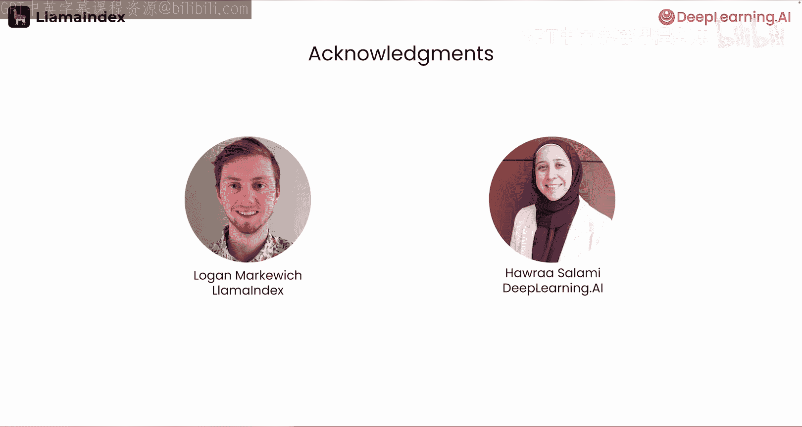
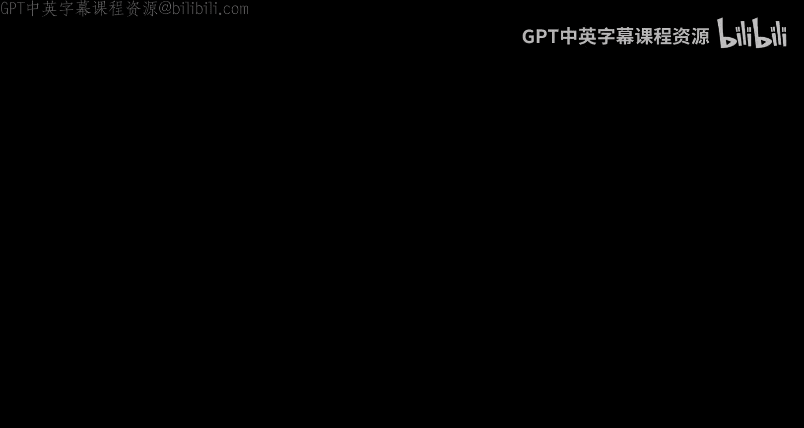

# LlamaIndex《事件驱动的智能代理文档工作流｜Event-Driven Agentic Document Workflows》中英字幕 - P1：1.intro.zh_en - GPT中英字幕课程资源 - BV1boRNYrEiz

Welcome to event driven agent Gen document workflows built in partnership with Lama Index。

 I'm delighted to the instructor for this course is Lari Vos。

 who's VP of Development relationslations at Lama Index。Thanks Andrew。

 I'm jazz to be back here with you and to teach this course Age Gen document workflows are agentbased applications that you can use to automate an end to end document processing workflow while RAG systems answer simple questions about your data。

 Age Gen workflows can be built on top of RAG to help you process input documents in more sophisticated ways in the architect you learn about and agents will identify the information that you will need to carry the task and then retrieve relevant materials using RAG and finally combine collected information into a structured output for example。

 say you want to review a contract for compliance with certain regulations。

 the agent can pass the contract， extract the key clauses and match them with relevant courses from a knowledge based of rereasury requirements and finally generate a compliance summary。

As another example， say you want to enrich a set of invoices with standardized product information。

 the agent can extract the item descriptions from the invoice。

 match them with the closest product code from a product catalog using RaG and then append the standardized information to that invoice in this course you apply this type of workflow to a practical application in which you build an agent that uses a resume to follow the job application form。

 Lori will walk you through how the builders from scratch using Lama index's workflow abstraction which is a good way to build event- drivenrin systems。

 which is a key design pattern for building efficient sets of agents。That's right。

 Amma index's workflows is an event driven architecture that you will use to create your agent。

 You will encapsulate the agent's logic in a chain of steps where each step emits events to trigger further steps。

 You will learn how you can use code branching and looping within the workflow。

 create concurrent events and collect multiple events at a given step。

 You'll apply these concepts to build your form filling agent step by step。

 You'll start by setting up your agent's rag capability to parse the given resume load into a vector store and create a query engine。

😊，Then you'll get your agent to parse the job application form。

 convert the blank spaces into a series of questions and send them to the ragg pipeline。

 You'll then provide feedback to your agent and iterate together on the returned answers。

 You will communicate your feedback through text and then using your voice。

 Many people have worked to trade this course。 I like to thank Logan Markrovitch from Lama In who helped to great deal。

 And from de learning AI H out salami also contributed to the course。

 Even driven workfis are a really important design pattern。

 And I see more and more businesses using it to design large language model powered applications。

 I think you enjoy learning about these concepts。 So he gone to the next video， Elika started。😊。

