# LlamaIndex《事件驱动的智能代理文档工作流｜Event-Driven Agentic Document Workflows》中英字幕 - P2：2.what-are-agentic-document-workflows.zh_en - GPT中英字幕课程资源 - BV1boRNYrEiz

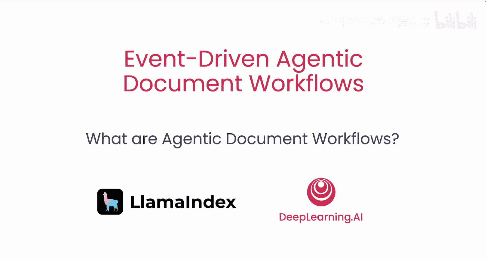

In this lesson， we'll go through the basic concepts behind agent document workflows。

 which include Ra agents and workflows。 You will learn how RaG helps answer questions about your data。

 how workflows prescribe data flows to agents and how event driven document processing enhances Rag。

 Let's dive in。What I want to tell you about today are agent document workflows。

 You're going to build a simple one today。These are a new paradigm that we've introduced for applications built on top of L L Ms like chat TPT based on Rag。

 but addressing the limitations of Rag and moving beyond them with the application of agentic strategies。

 but that's a lot of unfamiliar words all at once。 What is Rag。 What is an agent strategy。

 Before you get started， that's define what those things are。

 Rag stands for retrieval augmented generation。 Rag is a response to a fundamental limitation of LLMs。

 They are trained on mountains of data， but they aren't trained on your data。

 And usually when you're solving a problem， you don't just need general knowledge。

 You need to process your private data。 to get at LL M to answer questions about your data。

 you have to give the LL M your data。 but that runs into another fundamental limitation of LL Ms。

 The context window。 you can only give an LL M so much data at one time。

 Even the most capable LL Ms can only handle about a million tokens of information at one time。

 And you have way more data than that in your organization。 Probably tens or。

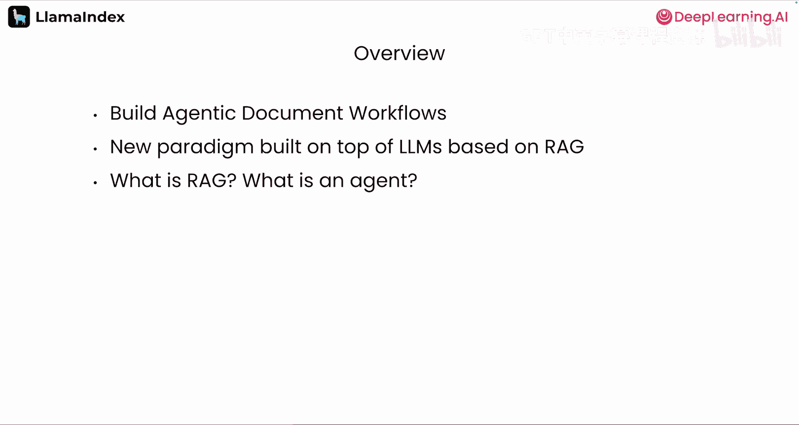

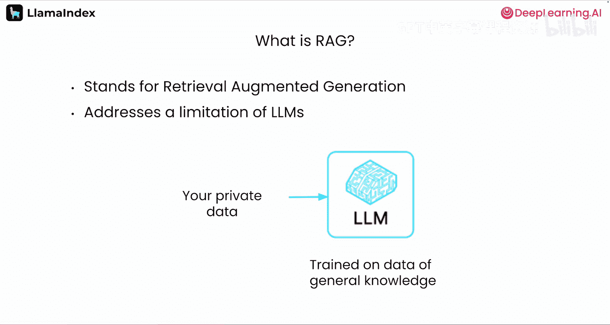

s of millions。 So you have to be selective about what data you give an LLM。 That exposes a challenge。

 How do you select the data， You want to give your LLM the most relevant possible data。

 It turns out the same technology that produced LLms produced things called embedding models。

 which are part of the solution to that problem。 embedding models take strings of data and encode them into a arrays of numbers called vectors。

 The total set of possible vectors is known as vector space。

 These vectors encode the meaning of the data that you've encoded。

 you can then store these vectors in a database。 Now， if you have a question about your data。

 you can run your question through the same embedding model and your question will also be encoded as a vector。

 The magic of embedding models， is that because they encode meaning your question and the data that answers your question。

 They are about similar things。 They mean similar things。

 So they end up mathematically nearby to each other in vector space。

 You can use your database to search for nearby vectors。 and。😊。

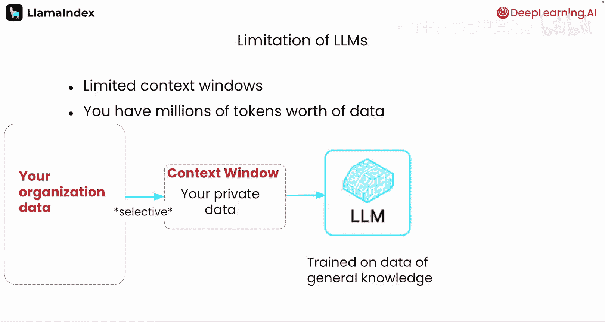

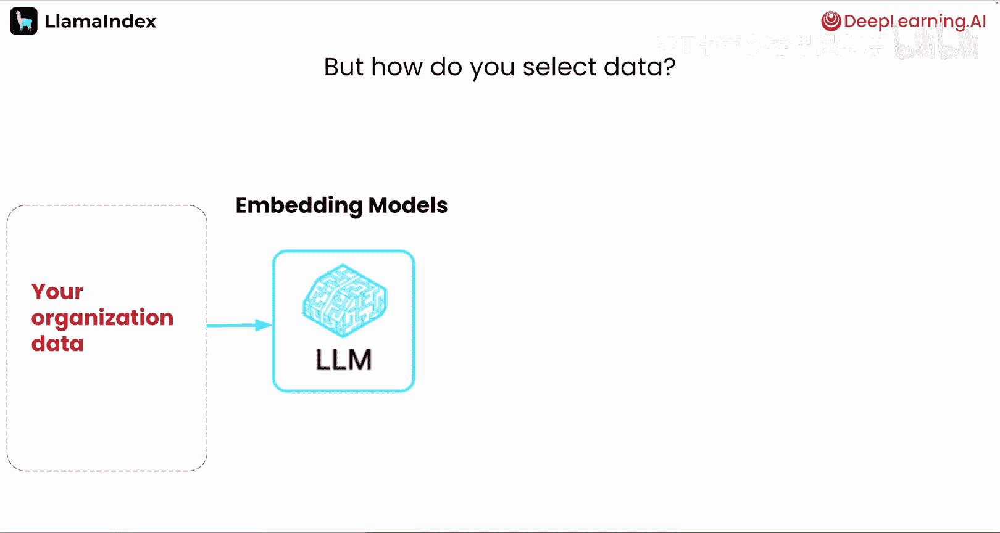

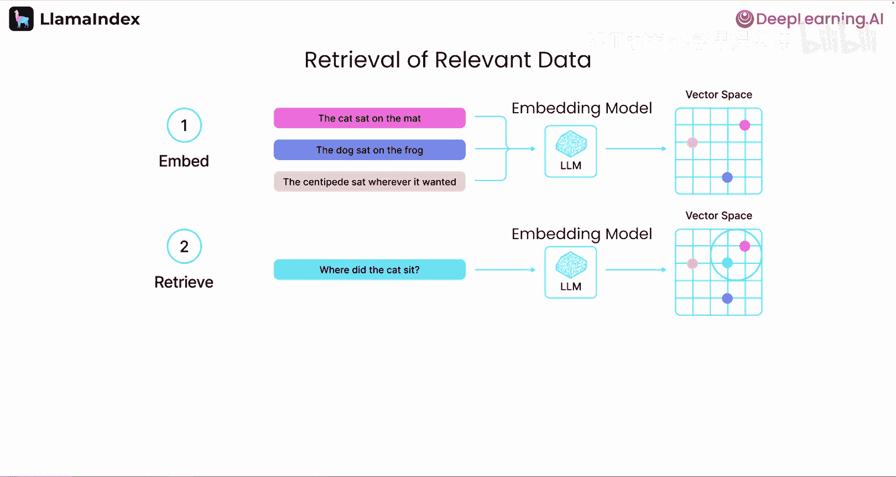

How you find the relevant data to give to an LLM when you have a query。

 You can then take your query and the relevant data called the context and give both of those to an LLM and ask it to answer the question using the context。

 We call this step generation because it's generating an answer。

 and the step where we search for relevant data retrieval， hence retrieval。

 augmented generation or Ra Rag is an incredibly powerful technique。

 but it does have some limitations。 One of them is complex or multipart questions。

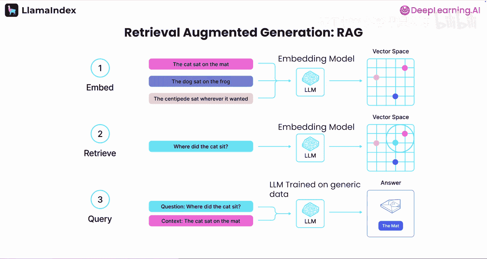

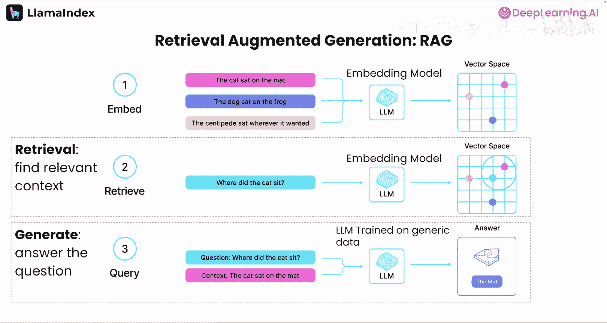

This limitation makes sense because Rag is based on search。

 If you have a question with lots of parts， Rag is going to search your embeddings for lots of things at once。

 And so the results it gets will be less focused。 You'll get a ton of results。

 but they might not contain all the information you need。

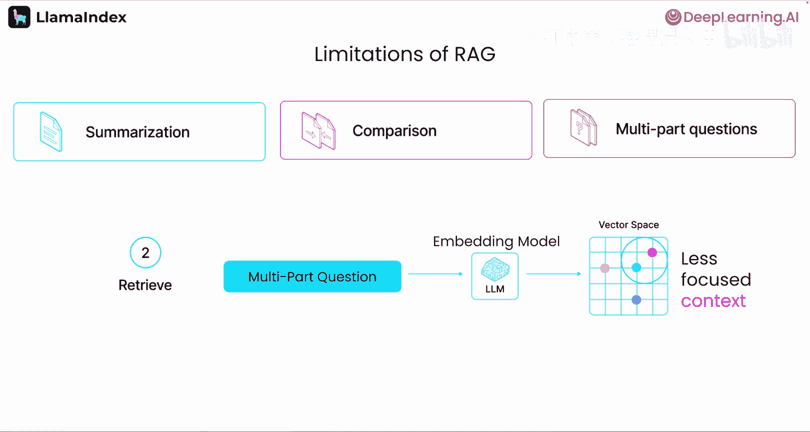

There's a solution to this problem， which is to split up your complex question into a lot of simpler questions。

 Each of those simpler questions will get a much more focused and comprehensive set of search results。

 This is a great task for L L Ms because they are good at looking at a complicated question and splitting it up into smaller questions。

 And at the other end， they can take a bunch of answers to simpler questions and synthesize them into a single coherent answer。

 This is what you're going to be doing today。 And the way you're going to do it is by building an agent。

 I mentioned agents and agent strategies earlier。 So what is an agent。 Well。

 it's a pretty fuzzy term。 at Lala index， when we say an agent。

 What we mean is a piece of semi autonomous software。

 which can be given tools and a goal and will work out how to solve the problem without needing to be given explicit step by step instructions on how to achieve that goal。

 This is very different from traditional programming where every step is precisely defined find。

 In Lama index， the way that you build an agent is by using workflows。 Workflows of the building。😊。

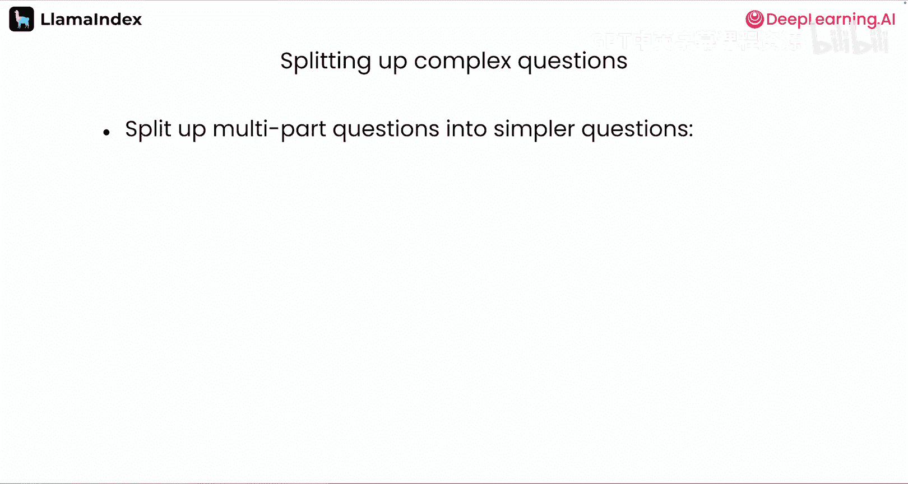

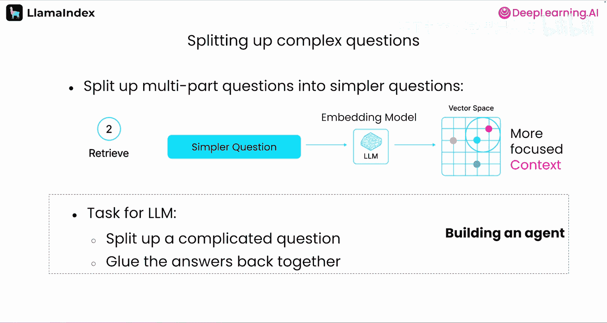

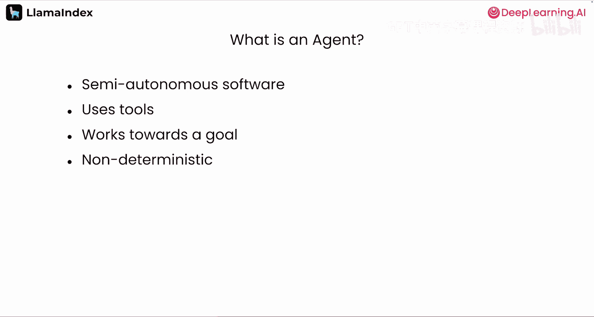

s of agent systems in Lama index。 They are an event based system that lets you defy a series of steps connected by events and pass information from step to step。

 As you'll see， you can create quite complex workflows with branches。

 loops and parallel execution to achieve any task that you need。

 Workflows provide your agent with structure as finegrained or as loose as you need it to be。

 Some agent frameworks have no structure at all， which can lead to chaotic results。

 Others go with a graph based approach which makes looping and other structures more difficult。

 I think workflows provides the best of both worlds。

 That brings us to agent document workflows or A D W。 We've already discussed the basics。

 Rag workflows and agents， agentic document workflows are a way of building software that solves real business problems by applying agent workflows to them。

 and building them into larger pieces of software。 A D W builds on top of the power of ragg。

 But unlike Rag， which is mostly about simple questions。 Ageentic document workflows。

 tackle complex problems。😊。

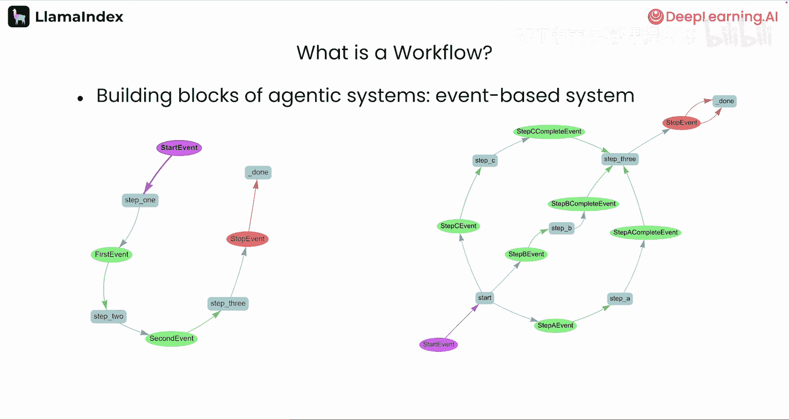

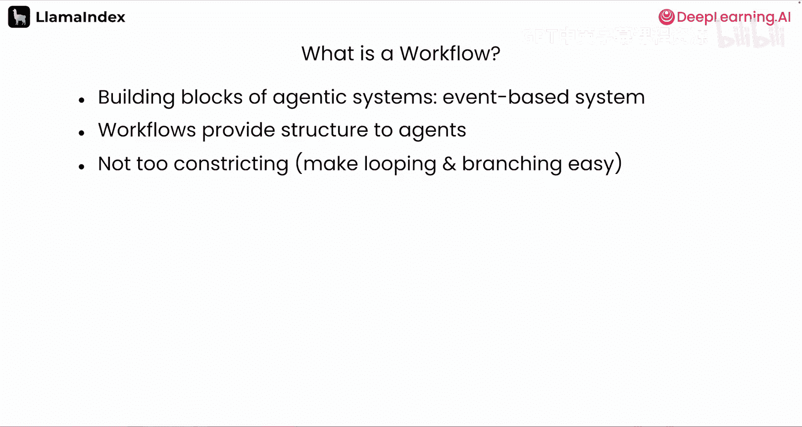

Result in structured specific output and not just plain English answers。

 Now that we've covered the basics in the next lesson， we'll get started building。

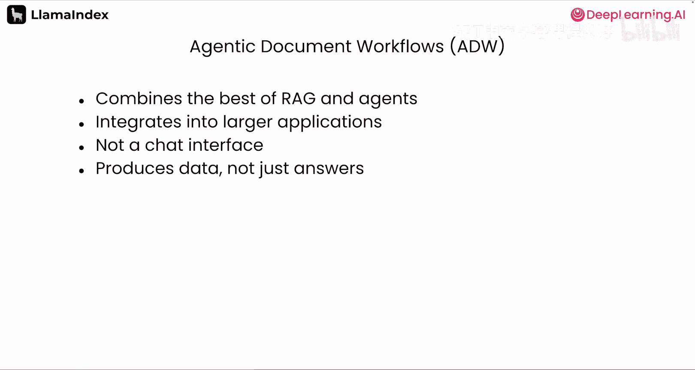