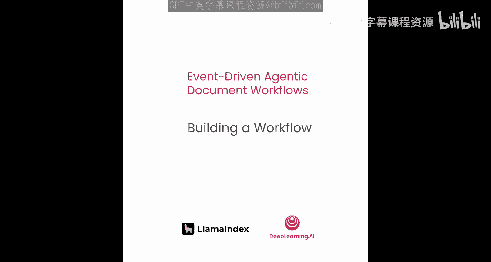
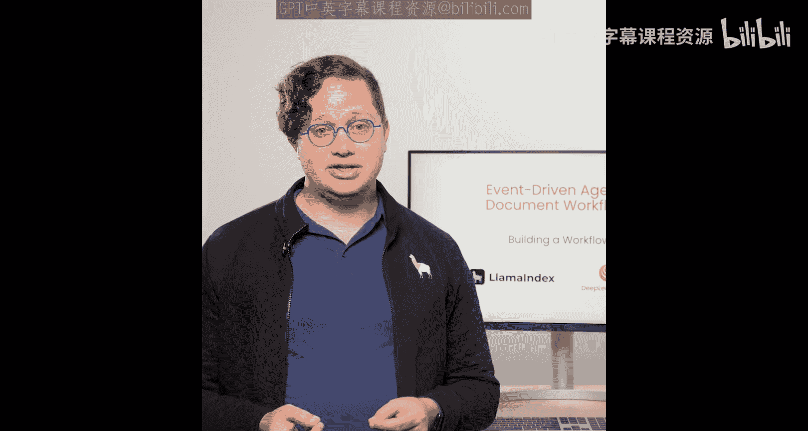
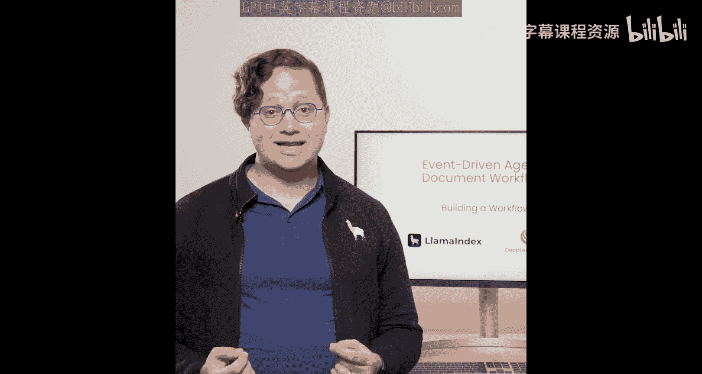
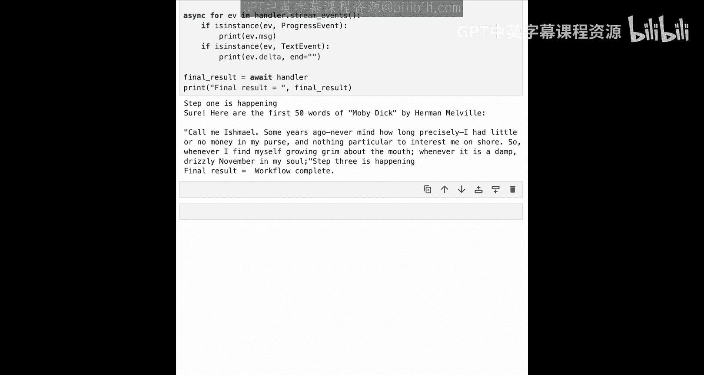

# LlamaIndex《事件驱动的智能代理文档工作流｜Event-Driven Agentic Document Workflows》中英字幕 - P3：3.building-a-workflow.zh_en - GPT中英字幕课程资源 - BV1boRNYrEiz

In this lesson， you will build a number of increasingly complex workflows to master the basic concepts。

 You will start with a simple workflow consisting of a series of steps that am events and then add to it branching and looping logic。

 implement concurrent execution and finally， collect events of different types at a given step。

 All right， let's dive into the code。😊。

Under the hood， workflows are regular Python classes。 They are defined as a series of steps。

 each of which receives certain classes of events and emits certain classes of events。

 So let's get started building one。 First， we'll bring in our imports。

And we're going to be using open AI today day。 So let's bring in our open AI key to define our events。

 We need to import some special events。 Plus the core of workflows。 That's what we're doing here。

 Now， let's define the workflow itself。 When you've got hair is a regular class declaration。😊。

A step decorator。And an async function called my step。In my step。

 we've defined an event that is of a specific type， a start event。

 And we've also said that it emits a specific type of event called a stop event。

 These are both special events。 The start event is triggered when the workflow starts。

 and when a stop event is triggered， a workflow will automatically stop。

The async keyword defines asynchronous functions， which can be paused and resumed allowing other tasks to run in the meantime。

 we'll see how this is useful when we're doing stuff in parallel later。

You can instantiate and run your workflow like this。

 We just call my workflow with a time out of 10 seconds。 And in this case。

 we're going to set verbose to false， but we're going to set it to true later。

 and you'll see what the difference is then once you've got your workflow， you call dot run on it。

 And we're using the await keyword because this is asynchronous and what you get back from the run command is an asynchronous handle。

 And then we can print the result。 So let's execute all of these cells and see what we get。

T workflows are asynchronous by default， so you use the weight to get the result of the run command。

 This is going to work fine in a notebook environment。 In a vanilla Python script。

 you're going to need to import asncio and wrap your code in an async function。

 I'll just show you what that looks like。 We can't execute it here because this is a notebook so it won't work。

 That's what that looks like。😊，You have exactly the same code to instantiate and run the function。

 but you've wrapped it in an async function and。You've imported asyncio and you've used asyncchio to run your async function for you。

 That's the only difference about running it in a notebook versus running it in vanilla Python。

 because this code isn't going to run in a notebook。

 I'm going to delete it just so that we can avoid it accidentally running。

 One of the great features of workflows is the builtin visualizer， which we're going to import now。

 This is the function drawaw all possible flows。 It takes two arguments。

 one of which is the workflow that you want to visualize and the other of which is the file name where you want it to output the visualization。

 What it outputs is an HTMLm file containing an interactive visualization of your workflow。

 because you would have to download an HTML file and open it in a browser。

 We've set up a helper function， which displays that HTML file directly in the notebook。

 That's what is happening here。 We get the HTML file， and we display it as an H element。

Let's see what our workflow looks like。We get this。As you can see， it's interactive。

 So you can drag these things around if the way that your workflow is visualized isn't the way you want it。

 But this is an extremely basic workflow with just the one step。

 My step and a start event and a stop of it。 Of course， a flow with a single step is not very useful。

 Let's define a multi step workflow。 Multile steps are created by defining custom events that can be emitmitted by steps and trigger other steps。

 So let's define a simple three step workflow by designing two custom events。

 First event and second event。 These classes can have any names and properties。

 but they must inherit from event。😊，That's what you've done there。 Now that we have our events。

 we can define a workflow that uses them。 You define a workflow by defining what events each step accepts and what events that each step emits。

 That defines how data flows around the workflow。 Let's see what that looks like。

So here we have a new class， My workflow with a step defined as step1。 It accepts a start event。

 So that ones special。 and this will kick off the workflow and in emits a first event。

 Step 2 accepts a first event， so it will be triggered by the output of step 1。

 and it emits a second event， which triggers step 3， which emits a stop event。

 The stop event will halt the workflow。 You can run this just like you ran the other workflows。

 So that's execute all three of those cells。As you can see。It started the workflow。

 you got the first step， the second step， and the workflow is complete。

 We can visualize this just like we visualize the last one。So let's call our visualizer。

And then let's display what it output。This is a more interesting visualization。

 You can see our start event going to step 1， amting this first event， which triggers step 2。

 which emits a second event， which triggers step 3， which triggers a stop event。

 and then the workflow halts。 However， there's not much point to a workflow。

 If you just run it straight through。 A key feature of workflows is that they enable branching and looping logic more simply and flexibly than graph based approaches to enable looping。

 let's create a new loop event。 This isn't a special event。

 we' have just created an event called the loop event that we're going to use to do loops。 Now。

 you'll edit your step 1 to make a random decision about whether to execute serially or to loop back。

 So we have a random number generator that's random new generating either a0 or one。 If it's a 0。

 we decide a bad thing has happened。 and we loop back。 If it's a one， we say a good thing happened。

 and we move on to the next step。 We do the loop by emitting the loop event。

 The other change that we've made here。 is we've added an accepting type to step。😊。

St1So now it will accept either a start event or a loop event。

 That means that either of these events will trigger step 1。 We've also changed what types it emits。

 So it emits of either a first event or that loop of event。 Now， let's execute our loop。

 and we might have to run it a couple of times， because it's random。

 So it might just work the first time。Yep， that's exactly what happened， that's executed again。

All right。 now we see a bad thing happened。 Then a good thing happened。

 Then the first step was complete。 Then the second step was complete。 Then the workflow was complete。

Let's visualize that once more。Here we go。You can always drag your visualizations around if you don't like the way that they initially get rendered。

 You can see our start event goes to step 1， and it can either go to a first event which triggers step 2 and the rest of the flow。

 or it can emit a loop event， which loops back to step 1。 Your loop could be anywhere。

 so we could have decided to loop back from step 3 or step 2， and it would have worked equally well。

 You don't just have to loop back to the same step that you started from。

 The same constructs that allow you to loop， allow you to create branches。

 Here's a workflow that executes two different branches depending on an early decision to make it First。

 we're going to need some additional events。 We're going to call them branch A1， branch A 2。

 branch B1 and branch B2。 We're going to create a new branch workflow that uses those events。

 and has more steps than our previous workflow did。

It has the same start with a random number generator。

 but now it emits either a branch A1 event or a branch B1 event。 A1 will trigger step A1。

 which will trigger step A 2。 B1 will trigger step B1， which will trigger step B 2。

 You don't actually need to instantiate the workflow to visualize it。

 You can just pass the workflow class directly to the visualizer。 So let's do that this time。

And see what a branching workflow looks like。We'll display our HTML。

And we can zoom in and out if our visualization is too big for the window。 As you can see。

 we've got our start event going to step A1 to step A2， Or if we emit the branch B1 event。

 we go to step B1 and step B2。 Both of them go to a stop event and are complete。

 So now you've got a couple forms of flow control。 The final form of flow control that you can implement in word flows is concurrent execution。

This allows you to efficiently run long running tasks in parallel and gather them together when they are needed。

 This can also let you perform map produce style tasks。Let's see how this is done。

 You'll be using a new concept。 The context object。

 This is a form of shared memory available to every step in a workflow to access it declared as an argument to your step。

 and it will be automatically populated In this example。

 you'll use context dot send event rather than returning an event。

 This allows you to o multiple events in parallel。 rather than just returning one as you did previously。

 So we've created a step 2 event。 We've created a parallel flow class。

 And we've changed our start event to accept the context parameter here。

 This is going to automatically populate our context。 and we're calling send event  three times。

 It's emitting three different step 2 events。 One with query 1，1 with query 2。 and one with query 3。

 We've set none workers 4 here。 This is also the default。

 It's just to show you how to send this parameter。 This can set how many of these step 2s will run in parallel。

 What step 2 does is it simply waits a random number of seconds between one and5。

 and then it returns a stop。😊，Event which will emit the query name that we set in step two event。So。

Let's execute that cell。 Now， let's execute the workflow。 As you can see， it ran all three queries。

 and then it output query 1。 and then it halted。 You don't see it output in query 2 and query 3。

 That's because the very first stop event that fires halts the workflow。 If we run this again。

 we'll probably get a different query ending the workflow。There you go。 This time。

 queryry 3 won the race。 So that's how you execute things in parallel。

 But what if you wanted the output of all three queries and not just the first one to complete Another method。

 context dot collect events exists for that purpose。 So let's see what this workflow looks like。

 We've created a new step 3 event。 and the new concurrent workflow， just like before。

 we're emitting three step 2 events， each of which emits a query 1 query 2 and query 3。

 and just like before， we have step 2， that weights in random number of seconds。

 We've modified it to emit a step 3 event， which passes the query。

 step 3 is going to be triggered every single time， a step 3 events runs。

 but we're using the collect events method， to wait for certain number of events。

 How collect events works is every time it runs， if it hasn't seen the right number of events。

 then it will return none， So that's why we're handling a nonen here。😊。

It means that not all of the events have been received yet when it receives the full number of events that it needs。

 it will return them in an array。 So that's what we're doing here is we're printing the result。

Let's execute this swordflow to see what it looks like。As you can see。

 it prints not all events received yet twice before it has received all three events。

 and then it emits the events。 It emits them in the order that it received them。

 So every time you run it， these will be in a different order because the steps happen a random number of seconds after each other。

 Let's execute it one more time just to see that happen。 Not all events received yet。

 And now the results are in a different order。 Cool。

 So this works if you want to receive a number of events of the same type。 However。

 you can use branching to emit different types of events and wait for all of them to happen separately。

 So let's give an example of how you would collect different event types。 For this。

 we're going to create a whole bunch of different event types， step a events。

 step A complete step B events step B complete and so on。 And now we're going to create a new。😊。

Workflow。Just like before this one uses send event to emit events。

 except we have changed the type definition here to say that it can emit a step A event or a step B event or a step C event。

 And here we're emitting all three of those types of events。

 We've got a step that accepts each of those。 So there's a step A， a step B and a step C。

 which collect those， all of them emit a step A complete step B complete step C event。

 step C complete event。 and then in step 3， we've told it that it should accept all three of those types of events。

 Now， our collect events function， has been modified to say collect events but collect a step C。

 a step A and a step B。 The order of these is significant， as you'll see in a second here， we do。

 as we did before， if the events that we've collected are none。

 That means that we haven't collected all of our events yet。 So we simply return none。

This is what happens if all three of the results have been collected， so let's execute the cell。

To define the workflow and then run the workflow。As you can see， it did something Aish。

 something Bish， something Cish。 It received all three queries。

 And then when it prints out the results， you'll see that the array contains step C complete。

 step A complete and step B complete。 The order is the same as the order that we defined when we were defined collect events。

 And that is how you know which event you will get when you are getting them back。

 This new workflow has quite a pretty visualization。 So I'm going to visualize it。😊，As usual。

 we display the HTML。It's useful to be able to drag these things around and reorder them so that you can make things a little bit easier to understand。

In this case， if you drag them like this， you get。This really quite pleasing visualization。

In practical use， agents can take a long time to run。

 It's a poor user experience to have the user execute a workflow and then wait a long time to see if it works or not。

 It's better to give them some indication that things are happening in real time。

 Even if the process is not complete to do this， workflows allows streaming events back to the user here。

 you'll use context dot right event to stream to o these events。😊。

This is going to be the first time that we actually use an LLM to do something in this tutorial so far。

 so let's make sure that we bring in Open AIs LLM， we're also going to define our events for a new workflow。

There's a first event， a second event， a text event and a progress event。

 You'll see what those are useful for later。 The specific event that we're going to be sending back is the deelta response from the LL M。

 When you ask an LL M to generate a streaming response as you're going to do in a second。

 It sends back each chunk of its response as it becomes available。 This is available as the delta。

 What we're going to do is wrap the delta in a text event and send it back to the workflows own stream so that you can echo it out to the user。

 Let's see what this workflow looks like。 In step 1， we're writing our first event to a stream。

 a progress event that just says that step 1 is happening In step 2。

 we instantiate the LL M using GP 40 mini， we're calling LL M dot a stream complete。

 The a is significant， which means it's an asynchronous function。

 as opposed to just the stream complete event which would be blocking。

 Calling it gives us a generator。 We can use the generator to emit events from the LL M as they happen。

 Every time we get。😊，Reponse from the LLM， we can call right event to stream and emit a text event to our own stream。

 We're passing a delta that is the delta from the response。 Once the generator is complete。

 we're going to return a second event， which means that the entire generation is complete and then we're going to call step 3 and emit one more progress event。

So， let's execute this motion。It's going to be slightly different this time because instead of just running the workflow and getting a response。

 we're going to run the workflow and handle the stream of events。

 So instead of awaiting workflow dot run， we're going to call workflow dot run directly and get a handler from it。

 We're then going to call stream events on a handler。

This gives us every event that the workflow emits。Because there can be a lot of events emitted from a workflow。

 you'll want to filter it down to just the ones you're interested in by using the type of the event。

 So in this case， we're looking for two types of events。 Those progress events that we emitmted。

 in which case we just print the message that comes with them or the text events that we omitted。

 In which case we print the delta that we received。 The end equals parameter here。

 make sure that these all end up on one line， because otherwise you end up with each chunk on a different line。

 which is hard to read。 We get the final result by using a weight on the handler。

 And then we can print the final result， which was emitted from step 3。

 Let's see that happening in practice。You see step 1 happens。

 and now you can see that the results of the call to the L M appeared in chunks。

 They didn't appear all at once。I can run that again just to demonstrate。There you go。

So step1 is happening， then you get all of the chunks from the response， then step 3 is happening。

 and then the final result。 Congratulations， you've successfully built a number of increasingly complex workflows and you've mastered the basic concepts In the next lesson。

 you'll add rag to your workflow。

