# LlamaIndex《事件驱动的智能代理文档工作流｜Event-Driven Agentic Document Workflows》中英字幕 - P4：4.adding-rag.zh_en - GPT中英字幕课程资源 - BV1boRNYrEiz

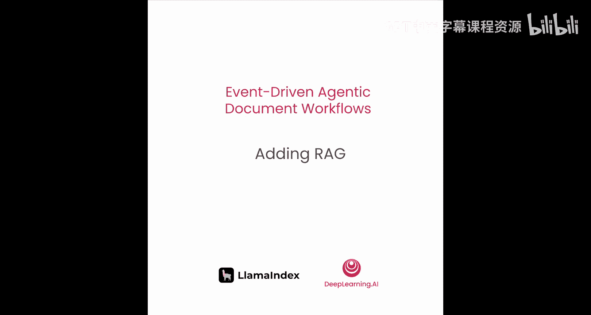

You're now ready to start building your agent。 You're given a fake resume that you will use to fill out a fake job application。

 In this lesson， you will set up the rag capability of your agent。 You will use Lamapa。

 parse the resume， load the extracted information into a vector store and then run basic queries to test it。

 All right， let's go。😊。

You need nested async for this notebook to work。 So let's enable it here。First。

 we bring in our imports。And then we bring in nested async。

And we execute both of those cells just to get them ready， we're also going to need our API keys。

Open AI we used earlier， and we're also going to need a Lama cloud API key because we're going to be using Lama parse to parse the P DS。

 Lama parse is an advanced document parser that can read Pdfs， Word files， PowerPoints。

 Excel spreadsheets， stuff like that。 It's really great at getting information out of complicated P Dfs into a form L Lms find easy to understand。

 You can get a key of cloud that Lama index dot AI for free。 Let's start by parsing a resume。😊。

One of the coolest features of Lama parse is the ability to tell it what kind of document it's parsing so that it will more intelligently parse the contents。

 In this case， you can tell it that it's reading a resume。😊，So let's import Lama parse。

 and then let's parse a document。You do this by calling Lama parse， passing in your API key。

 telling it what result type you want。 This could be markeddown or text or a number of other types。

 And then we're going to give it a content guideline instruction， saying this is a resume。

 gather related facts together and formatted as bullet points with headers once you've created a parser on parser。

 you can call load data with our fake resume。 It starts parsing the file。

 depending on the size of the file， this can take a little while。 but our resume is pretty short。

 so it shouldn't take too long。 Once it's done， we can print what we get back from the parser。

 which is an array of documents， So in this case， we're going to take the third element of the array and print out the text of that document。

 You can see that it's parsed out some projects and said what's in the resume with headers Remember it's doing markeddown。

 So it's got a project header。 It's got a company name It's got bullet points saying what are fake candidate did at all of those jobs now that we。

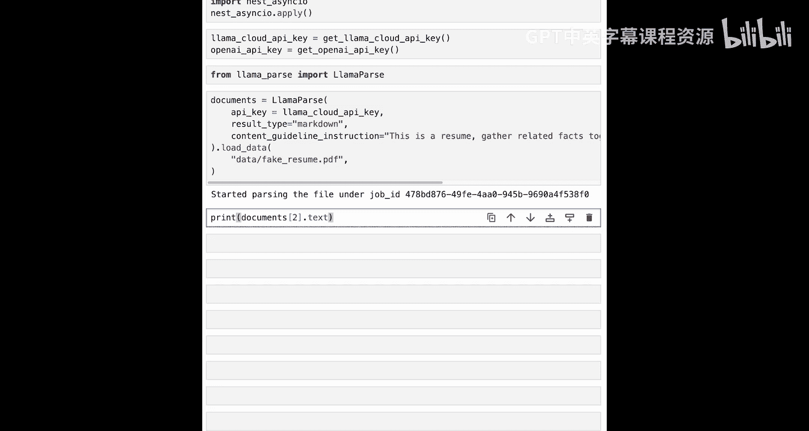

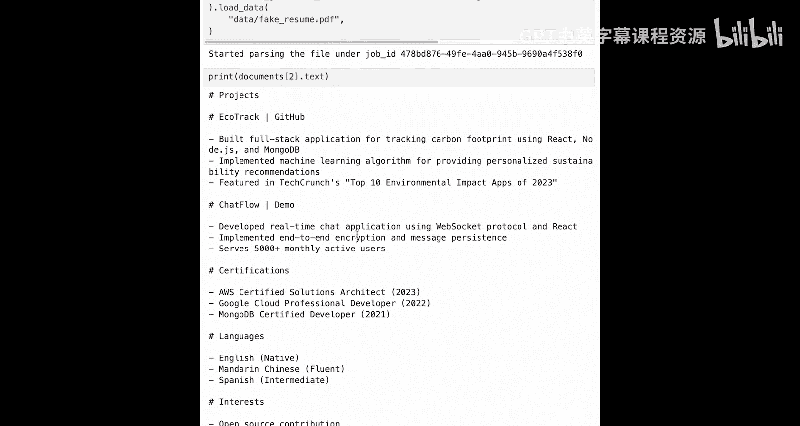

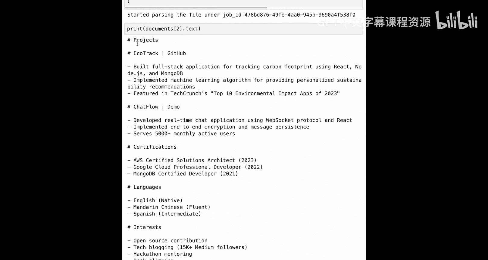

Got our documents we can pass into our vector store index The vector store index will embed the text。

 meaning it'll turn it into vectors that we can search to do this It needs to use an embedding API we'll be using one provided by open AI。

 which is why we needed an open AI key for this So here we've imported open AIs embeddings。

And our vector store index。And now we're going to create an index using vector store indexd。

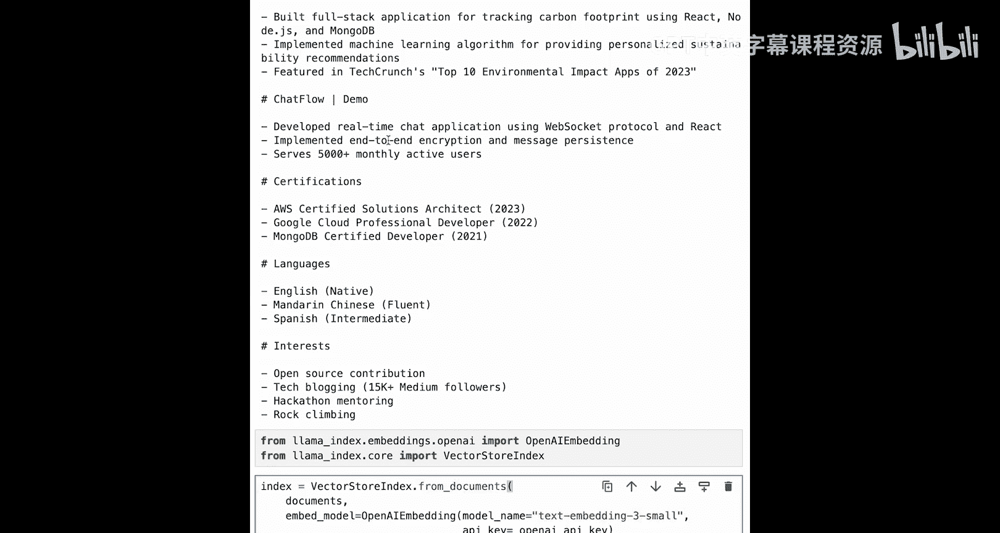

Vectctor store indexex has a from documents method that takes the documents that were returned by Lamaparse。

 And here we're passing in the embedding model just to be absolutely clear what embeddings we should use。

 We're using text embedding3 small， which is a very good embedding model provided by Open AI。

Now once again， we're going to bring in our open AILLM。And we're going to instantiate it。Again。

 we're going to use the G T40 mini model because it's quick and it's cheap。 Once you've got an index。

 you can create a query engine using the As query engine method。

 You pass in which LL M you want your query engine to use。 and you pass in similarity top K。

 When your query engine is retrieving context to answer the question。

 It will rank all of the content that it finds by how relevant it is to your query。

 rather than return all of it， it only returns a top number In this case。

 it's going to return the top 5。 Once we've got our query engine set up We can call query with a question。

 a really basic question In this case。 What is their name and what was their most recent job。

 and then we can print out the response。 Our fake developer's name is Sarah Chen。

 and their most recent job is senior your full stack developer at techflow solutions。

 One thing that you might need to do is store your vector store so that you can use it later。

 vector stores are easily persisted to disk。😊。

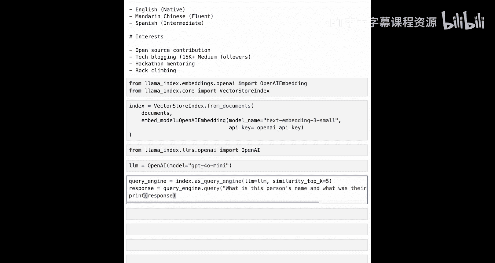

You find a storage directory in which you want to store your data and you call the persist method。

 that's all you need to do。 It's now stored on your disk to load it back。 you need a new method。

 load index from storage， and a new class， the storage context。

Here you're going to check whether or not you have already run this notebook。

 If you' have already run this notebook， then the storage directory will exist。

 and your content will already be there， in which case you'll load storage context from defaults。

 giving it the same persistence directories that you used earlier。

 and you'll create your index by calling load index from storage。

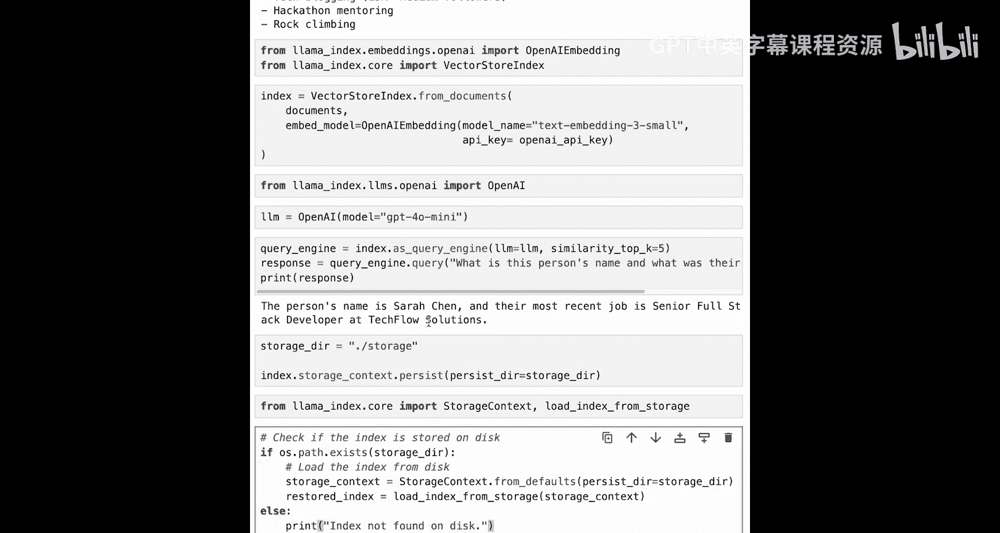

Otherwise， it will say that it didn't find it。We already called persist。

 So that just worked Now that we've got our restored index。

 We can call it with As query engine dot query again， just like we did before。 Again。

 it knows that our fake developer's name is Sarah Chan。 Congratulations。

 What you've done is you've performed retrieval augmented generation on a resume document。

 Rag is a very powerful technique that with proper scaling can work across databases of thousands of documents。

 with our ragg pipeline in hand。 Let's turn it into a tool that can be used by an agent to answer questions。

 This is a stepping stone towards creating an agentic system that can perform your larger goal。

 Only two new classes for this。 A function tool and a function calling agent。

 The first step is to create a regular python function that performs a ragg query。

 It's important to give this function a descriptive name to market inputs and output types。

 and to include a doc string。 That is the thing in triple quotes you're about to see。

 This describes what it does。 The framework will give all of this metadata to the L L M。 The name。😊。

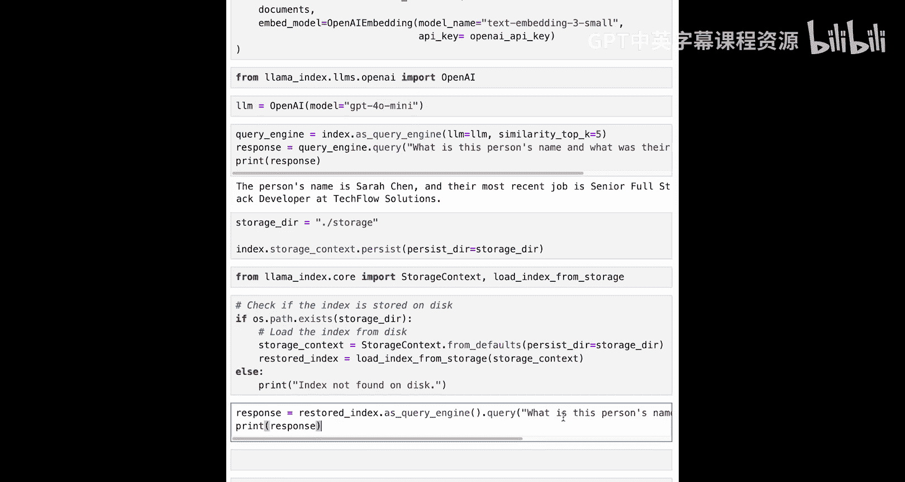

The types and the doc string， and the LLM will use that metadata to decide whether or not this tool is useful and how to use this tool。

 Once we've defined our function， we turn it into a tool that can be used by an agent using the from defaults function of function tool and we pass in the function。

 Now you can instantiate a function calling agent that uses this tool。

There are a number of different agent types supported by Lama index。

 This one is particularly capable and efficient， and it works well with open AI to create it。

 you pass in an array of tools。 Just one in this case。

 You pass it the L M that it should use to power the agent。 And in this case。

 we're going to set verbose equals true so that we can see what it's doing when it works。

 Now that we've created our agent。 We can chat with it and ask it a question。 In this case。

 we're going to ask it how many years of experience the applicant has。

 You can see the output being very noisy because we've set verbose is equal to true。

 So it tells us when it's running steps。 It says that it's added this user message to memory。

 which is our question。 And then you can see its's calling the function。

 You can see which function it's calling query resume and you can see what parameters it's passing in。

 the query is how many years of experience does the applicant have。

 This is the output that it got from the function。 And this is what the LL M responded with。😊。

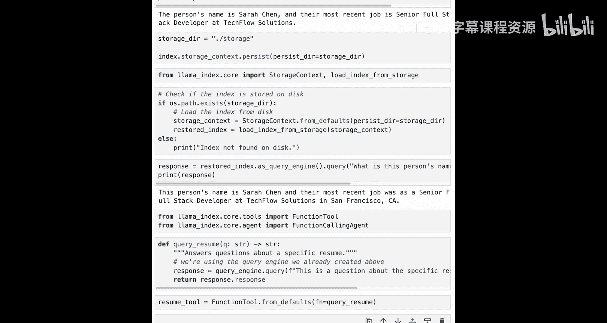

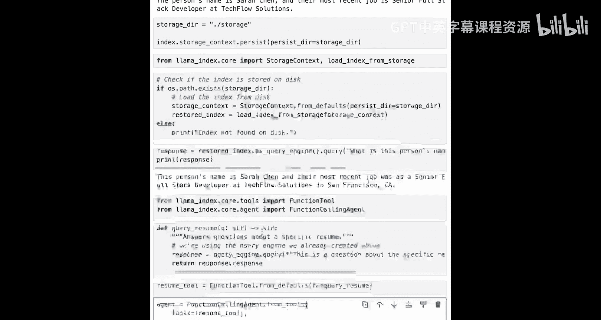

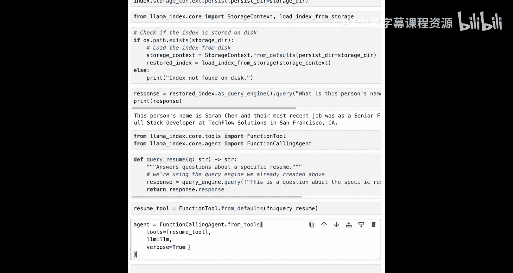

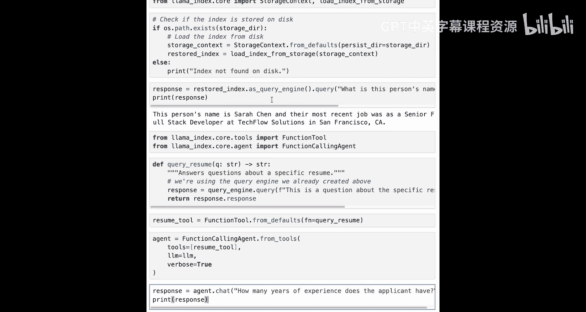

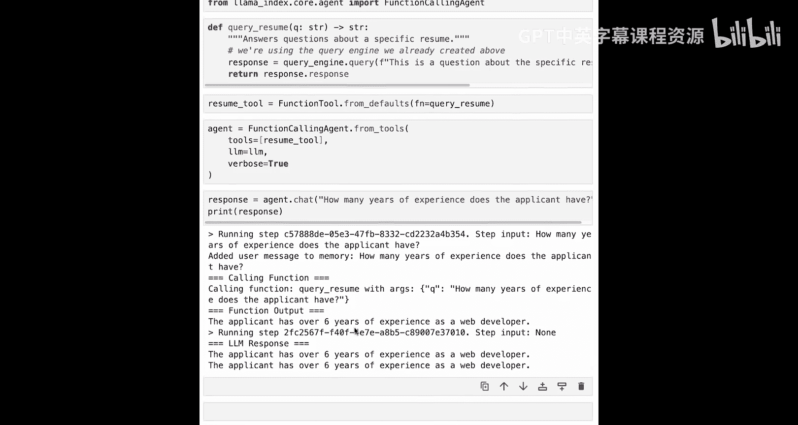

You see it twice because verbose printed at once and we printed at once。

 Now you've got a rag pipeline and an agent。 Let's wrap them up neatly into a workflow that you can extend in your later lessons。

 You won't rely on any of the things you've already created in this lesson。

 You will start this one from scratch。So just like we did in the last lesson。

 we're going to import our events and our other workflow related core classes。

 You'll see start event and stop event。

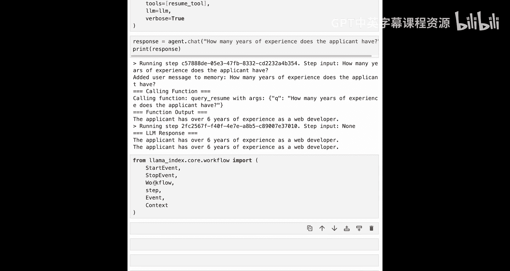

Steps， event and context， all of which you've seen before。We're going to define our query event。

 which is the only event that we need in this particular workflow so far。

 And now we're going to create a rag workflow。 This is pretty complicated。

 So let's step through it line by line。 Our ragg workflow is a class。

 so you can give it class variables just like any other class。 It's got a storage directory。

 We've given it an L L M。 and we've given it a query engine。 These are the types here。

 The first step is going to be set up。 We're going to check that we've been given resume file。

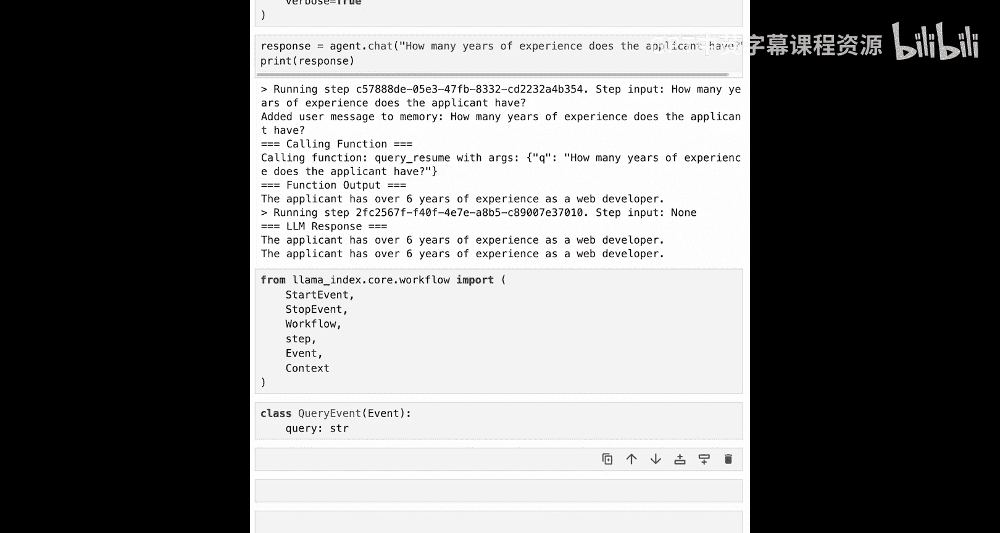

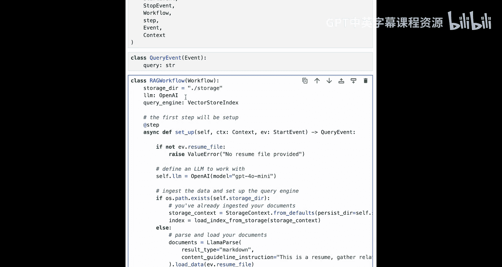

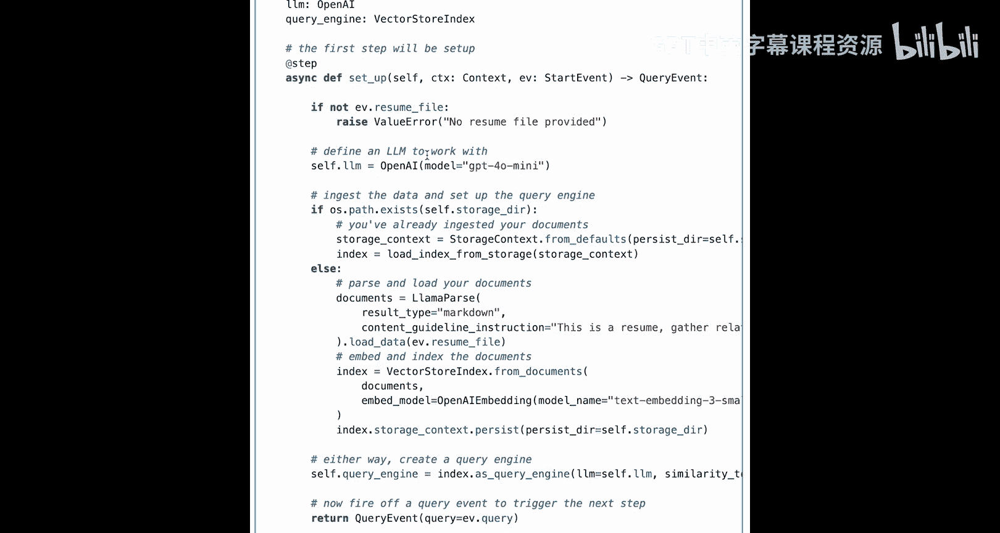

Which is attached to the start event。And we're going to instantiate our L L M as open AI again。

 This section you've seen before。 We're going to check if our storage charge already exists。

 and if it does， we're going to load it from disk。 If it doesn't。

 then we're going to parse and load our documents。 This is exactly the same thing that we did earlier in the lesson。

 We then create a vector store index。 just like we did earlier in the lesson。

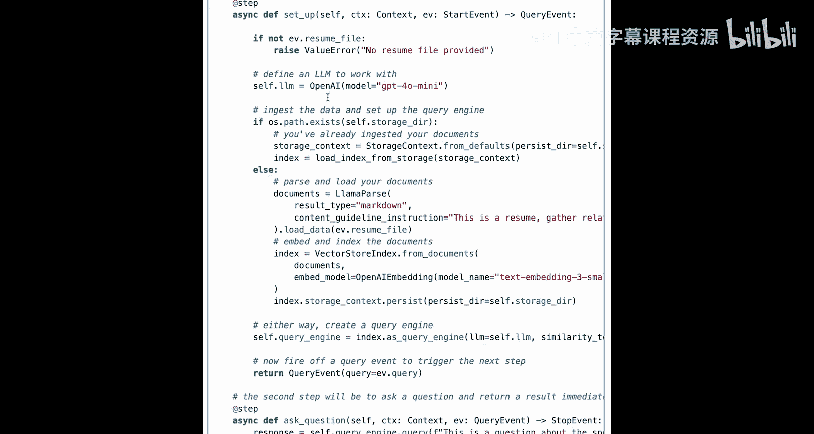

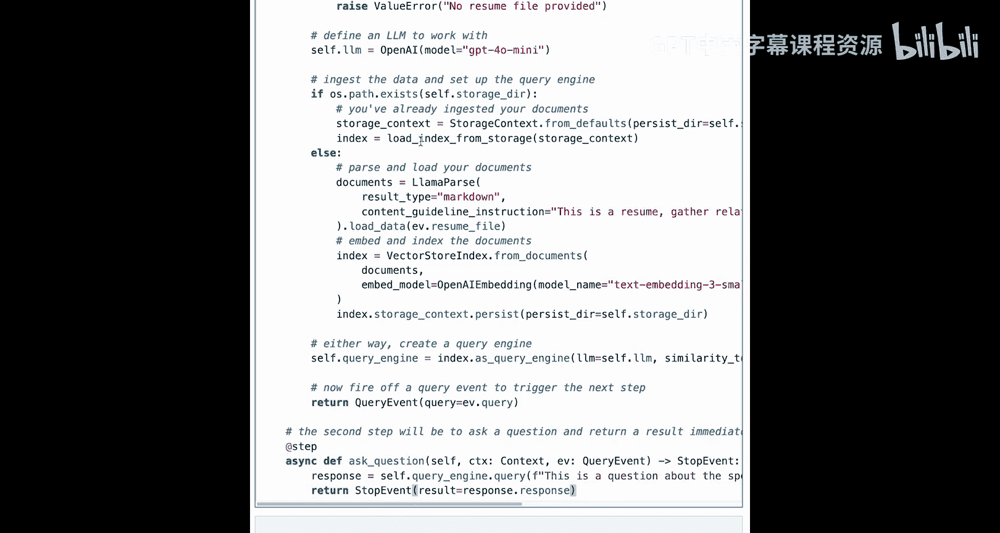

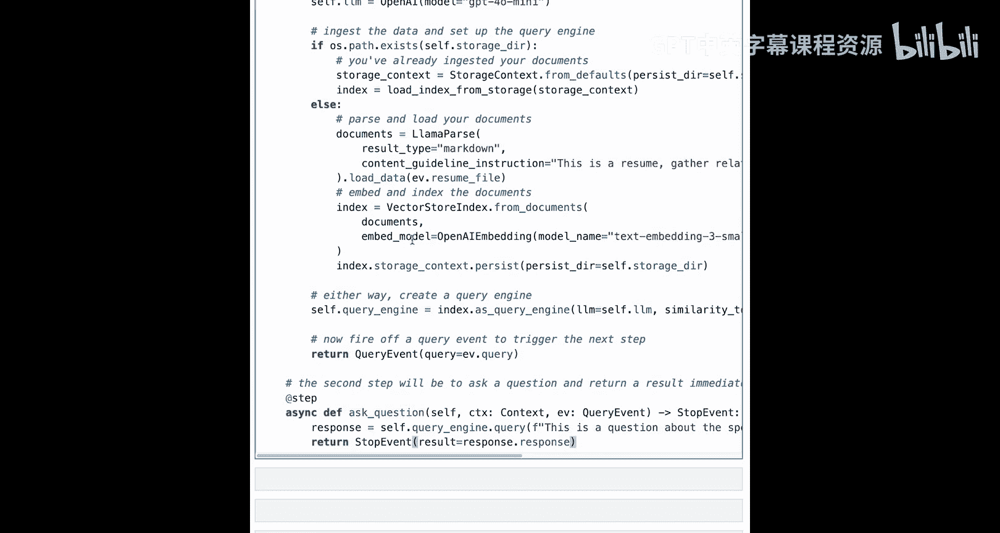

And we persisted to disk， just like we did earlier in the lesson。 Either way。

 you've now got an index and you turn it into a query engine。 Now you've got a query engine。

 you can fire off the query event。The query event will trigger ask question。

 and ask question will simply query the query engine with a question about the applicant。So。

Let's instantiate that workflow and we'll run it just like we've run any other workflow。In this case。

 the workflow is expecting two parameters， one is the location of the resume file that it can parse。

 and one is the query about the applicant。

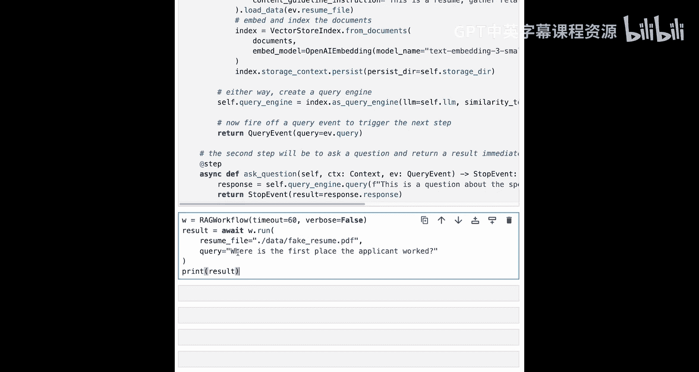

As you can see， it worked very quickly because we'd already persisted this to disk。

 It didn't need to reparse the document。 It was able to just immediately answer the question。

 There's nothing in this workflow that you haven't done before。

 It's just making things neat and encapsulated。 If you are particularly suspicious。

 you might note that there's a small bug here。 If you run this a second time with a different resume。

 This code will find the old resume on disk。 And therefore， it won't bother to parse the new resume。

 You don't need to fix that。 Now， But think about how you might fix that。 Congratulations。

 you've successfully created an agent with a rag tools。 In the next lesson。

 you'll give your agent some more complicated tasks。😊。

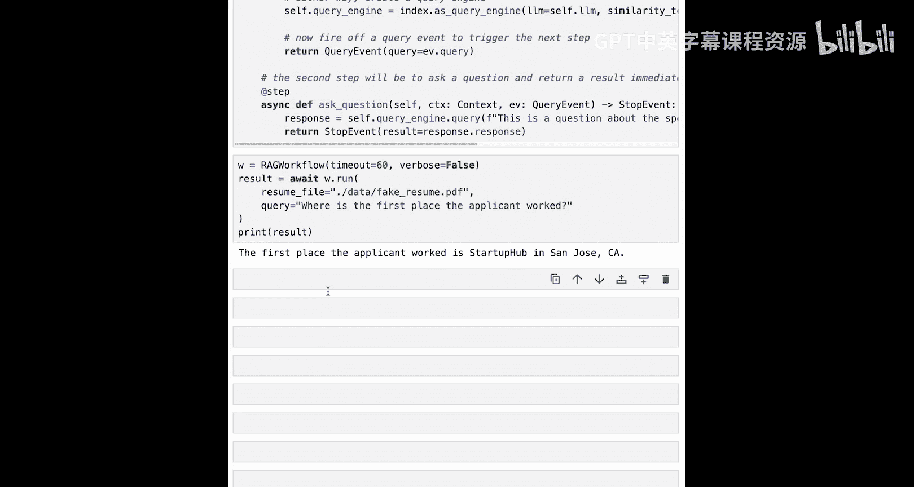