# LlamaIndex《事件驱动的智能代理文档工作流｜Event-Driven Agentic Document Workflows》中英字幕 - P5：5.form-parsing.zh_en - GPT中英字幕课程资源 - BV1boRNYrEiz

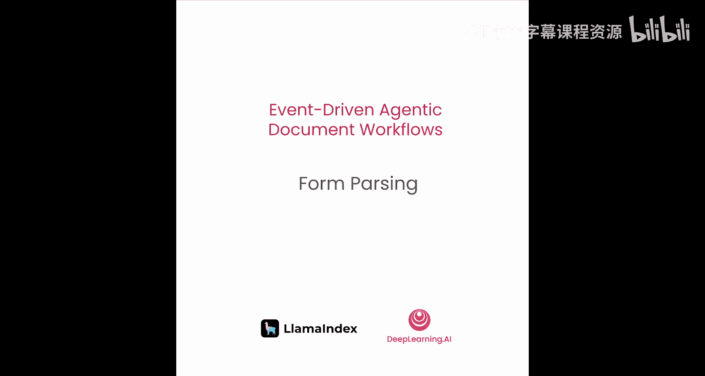

In this lesson， you'll start giving your agent more complex tasks。

 You will get your agent to parse the job application form。

 convert the parsse form into a series of simple questions。

 and use those questions to query the rag pipeline。

 You'll again use Lama parse to extract the fields that need to be filled before generating the queries to the rag system。

 Let's get coding。

In your previous lesson， you use Lama parse to parse a resume and included parsing instructions。

 You are going to do that again this time when the instructions are going to be more advanced。

 you are going to get it to read an application form and convert it into a list of fields that need to be filled in and return that as a Json object。

So let's bring in our imports。 These are all the same imports that we brought in last time。

 including our helper functions to get our open AI keys。 We're going to need ancchio。

 just like we did last time。And we're going to fetch our API keys again， just like we did last time。

Let's execute those three。Now we're going to parse a new form。

 so let's set up our parser first again， we're asking for a result type of markdown。

 but now we're doing two things。 we're providing content guideline instructions。

We're saying this is a job application form。 createate a list of all the fields that need to be filled in。

 and we're providing formatting instructions。 return a bulleted list of the fields only this will get us a nice。

 simple result。 We can now call load data on our fake application form。 When it's done。

 we'll be able to print out the results。😊。

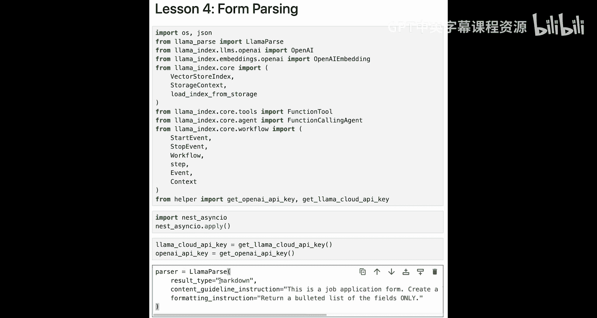

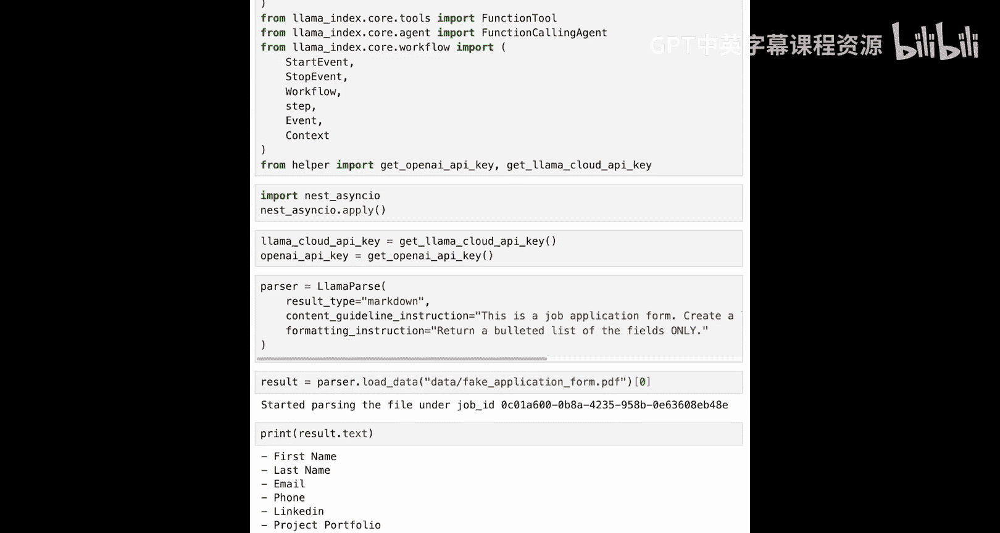

As you can see， it follows the instructions exactly。

 We have a bulleted list of just the fields in the form。

 A useful thing that LLMs can do is turn human readable formats like this list into machine readable once。

 We're going to do that here by asking it to turn the list into adjacent object with an array of fields to do that。

 we'll need an LLM。😊，So let's bring in open AI。We're going to give our LLM a prompt and our list of fields。

We're going to say this is a parsed form， here's the data and return JO only When we execute that。

 we'll be able to print out the raw J and see what we got。You can see it's given us Json。

 So now we can parse the Json。And print out the list of fields programmatically。Perfect。

 we have now got a nice array of fields that we can use for all of our programmatic work later。

 So now let's take the workflow you built in the last lesson and add your parser。

 We're going to need two new events， the parse form event and the query event。😊。

And here is your new workflow。 It's a lot longer。 So we're going to step through it line by line。

 Just like before， you've got a ragg workflow class with a storage directory。

 an LL M and a query engine。 in our setup。 We're now going to emit a parse form event。

 which triggers your new step， Parse form。 So here you see parse form event happening。

 And here's our new method， Parse form。 This is the code that we just wrote above incorporated into our workflow。

 There's our parser。😊。

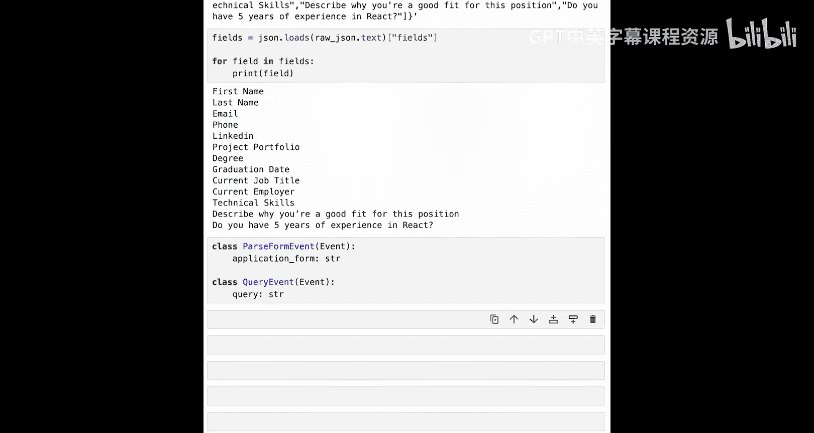

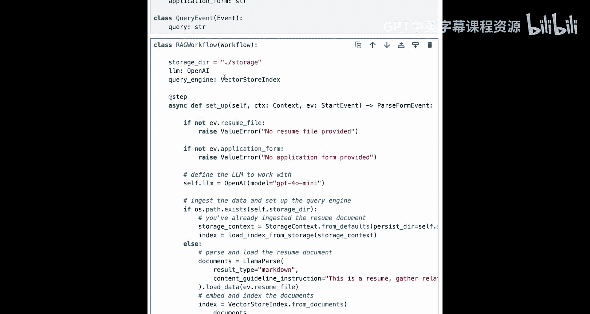

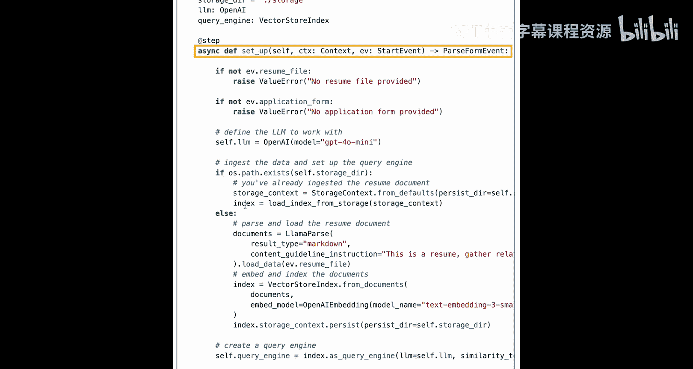

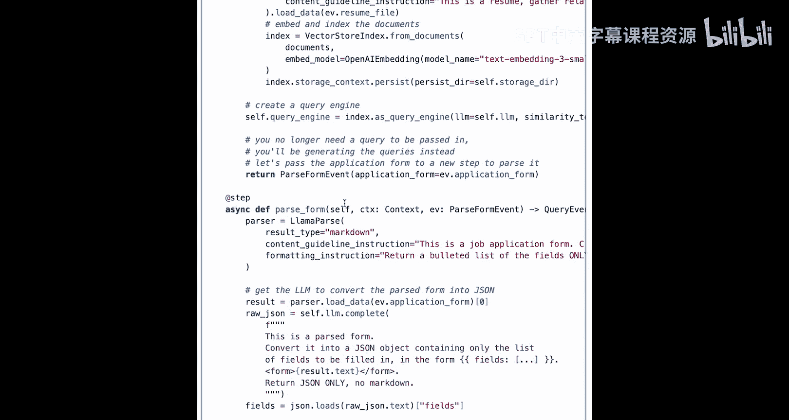

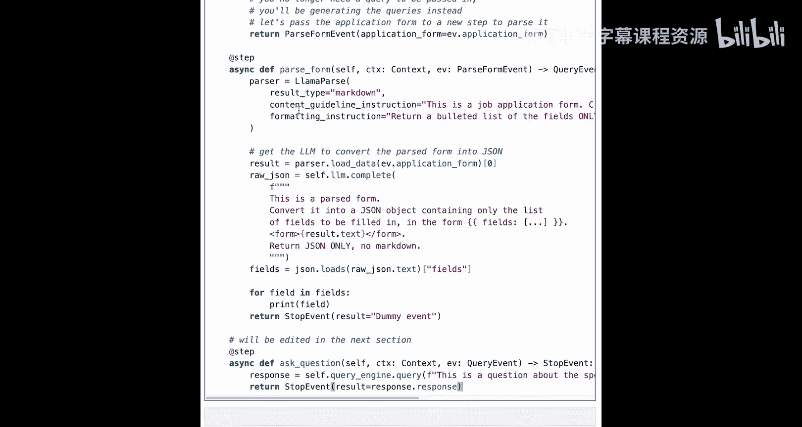

There's us converting it into Json， and there's us printing out our Json。

 We're going to leave the rest of the workflow untouched and handle the rest of it later。

 So let's execute this to get it going。And now。

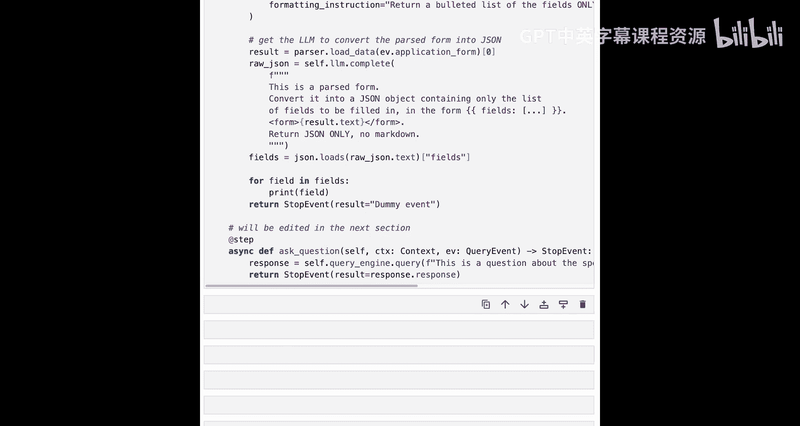

Let's execute the workflow。Great， it did exactly the same thing the code outside of the workflow did。

 which is all we needed it to do。 So now your workflow knows what fields it needs answers for in the next iteration。

 you can fire off one query event for each of the fields。 and they'll be executed concurrently。

 You'll remember in lesson 2。 We talked about doing concurrent steps。

 The changes you're going to make are。 You're going to generate a query event for each of the questions you pulled out of the form。

 You're going to create a fill in application step。

 which will take all of the responses to the questions。 and aggregate them into a coherent response。

 and you're going to add a response event to pass the results of queries to fill in application。

 So let's see what that looks like。 Here are our events。 There's a new one response event。😊。

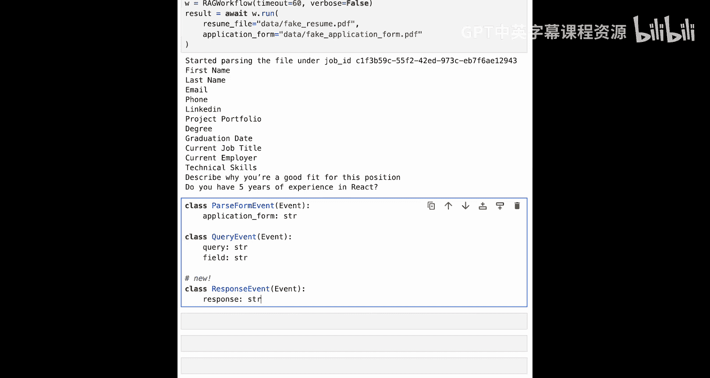

And here's our workflow。

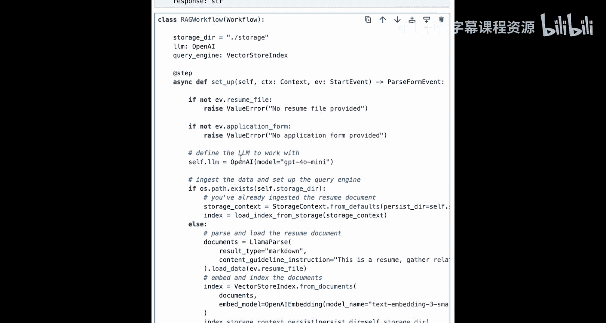

As we saw earlier。We have a parse form event。 And now we have a new step。

 Instead of just printing out the fields for each of the fields， we're going to send an event。

 specifically a query event。 The query event will accept the field that we're talking about and a query。

 It's going to be a pretty simple query。 Just how would you answer this question about the candidate。

 The other thing we're going to do is we're going to store the number of fields。

 So we know how many to wait for later。 The next thing that will happen is that the ask question step will be fired off as many times as we had query events。

 Each of them is going to return a response event， which is going to trigger the fill in application step。

 The response event will run into our collect events method that we talked about earlier。

 In this case， we're going to wait for a number of response event equivalent to the number of total fields that we slowered earlier。

 Remember， we're storing this in the context。 So it's available across steps。

 even though we haven't passed it using an event。 As before， if collect events returns nothing。

 we' do nothing。

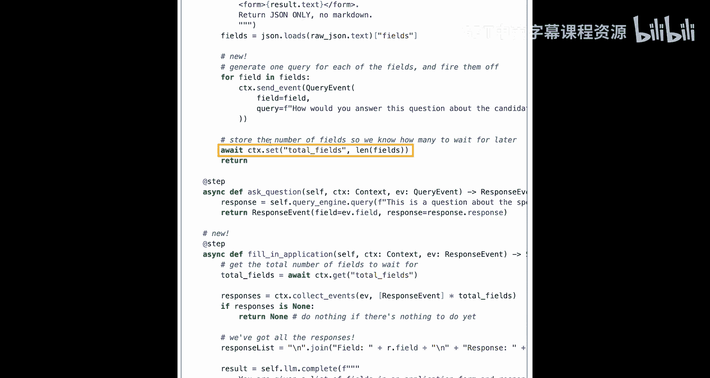

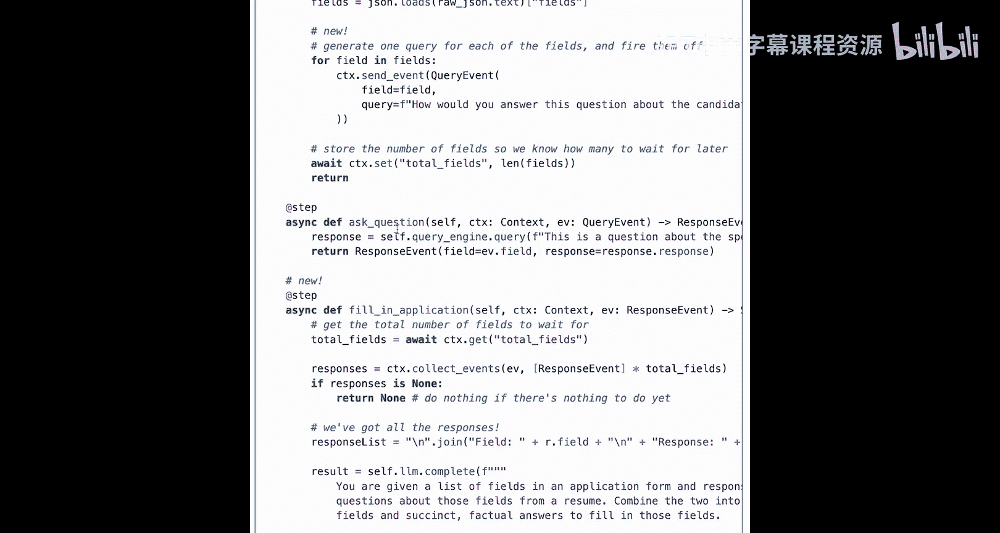

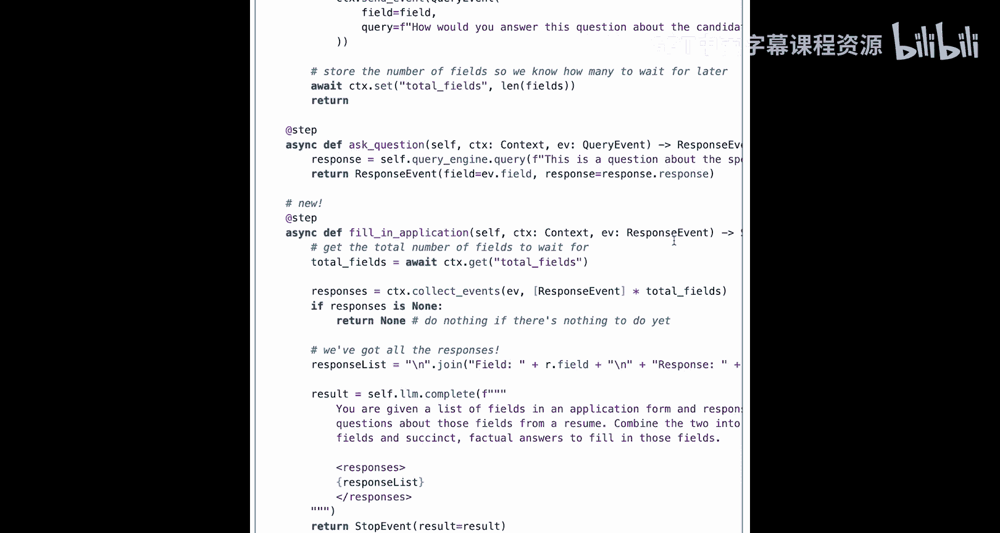

But once we've got all of the responses， we'll turn them into a list that we can then pass into our LLM with another prompt。

 In this case， we're going to ask it to answer the questions。 Then we're going to am a stop event。

 So now let's execute that workflow。Just like before。

 we're passing a fake resume and a fake application form。And we' printing our result。

 it might take a little while because it has to ask a bunch of questions this time。

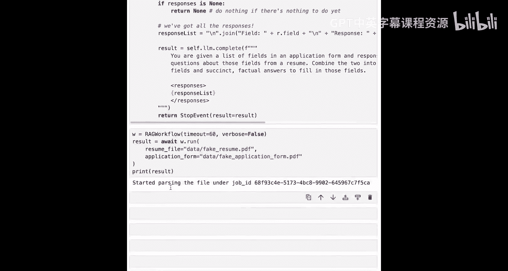

Great。As you can see， the L L M has helpfully explained what it's done and given us a numbered list of all of the fields and their answers。

 Your workflow takes all the fields in the form and generates plausible answers to all of them。

 There are a couple of fields where I think it can do better portfolio， for instance。

 in the original document， The portfolio as a link。 Whereas here it's trying to list out a portfolio。

 We'll use our feedback to see if we can correct that。 In the next lesson。

 you'll add the ability to give that feedback to the agent and get it to try again。😊。

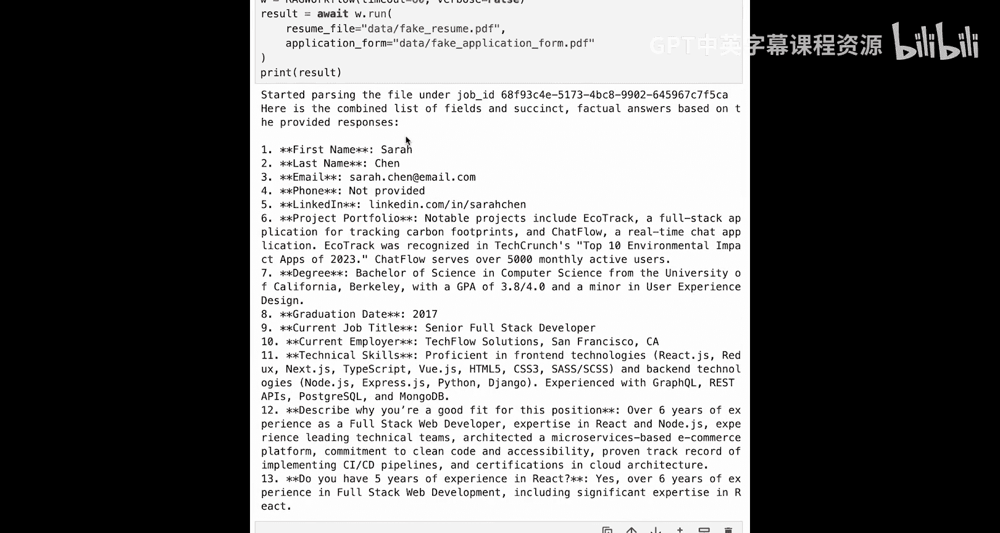

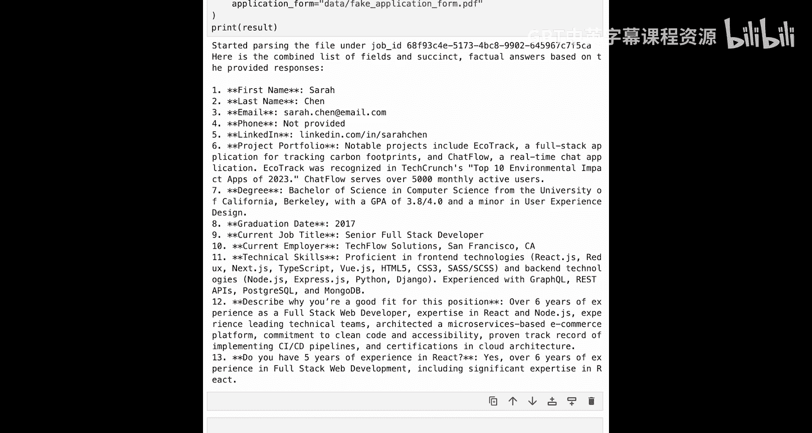