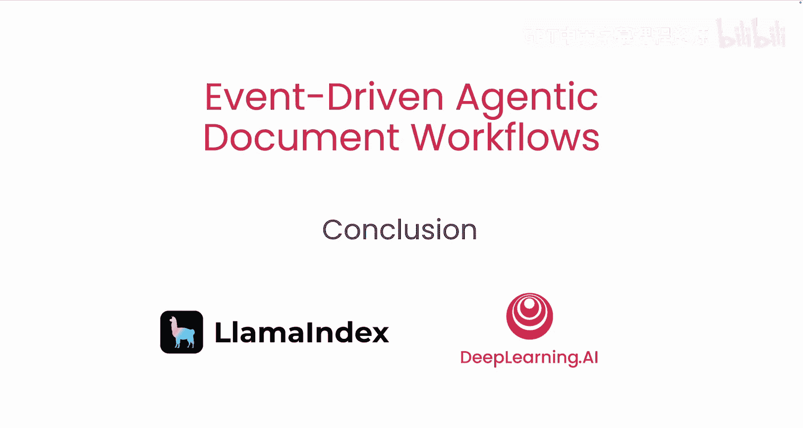

# LlamaIndex《事件驱动的智能代理文档工作流｜Event-Driven Agentic Document Workflows》中英字幕 - P8：8.conclusion.zh_en - GPT中英字幕课程资源 - BV1boRNYrEiz

Congratulations， you now know how to design an agent workflow that fills out a document and responds to human feedback to produce more accurate filled forms。

 I'm looking forward to seeing what you'll build on your own。😊。

