# OpenAI&吴恩达《使用o1进行推理｜Reasoning with o1》中英字幕（deepseek翻译） - P1：1.intro.zh_en - GPT中英字幕课程资源 - BV1UBkNY6Ep5

Welcome to reasonaing with01， built in partnership with Open AI。

 Your instructor for this course is Colin Javis， whos head of AI Solutions at Open AI。 Colin。

 great to meet you。 Thanks， Andrew。😊。

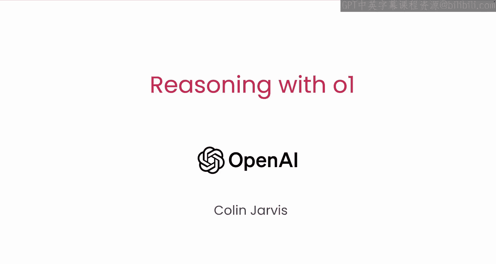

I'm really excited to be working with you on this course In this show course。

 you learn how to best prompt and use Open the eyes01 model。

 This recently released model has shown remarkable improvements in reasoning and planning tasks。😊。

In our very first short course， Ia fulfillfat from Open AI taught some prompting techniques to give the best performance from GP 3。

5。 she described chain of thought， which is a technique that gives the model time to think。😊。

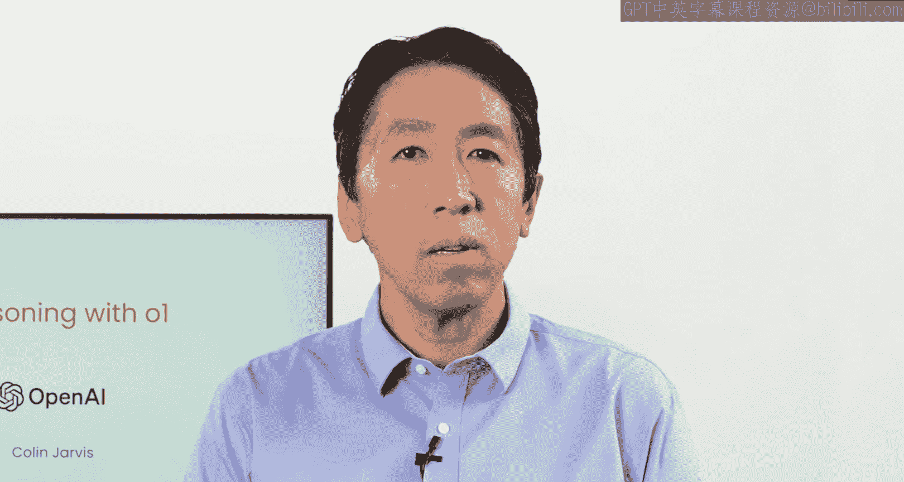

With a chain of thought prompting， you might instruct a model to think step by step and maybe also give some examples of step by step reasoning。

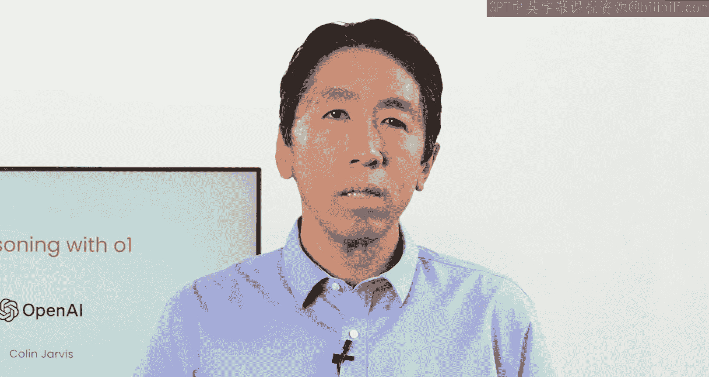

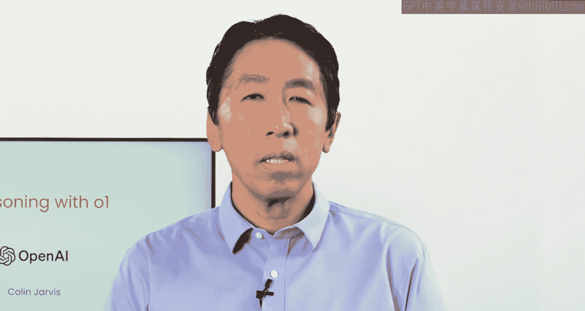

And in response to that， rather than just providing the answer directly to query。

 the model will process a query step by step。

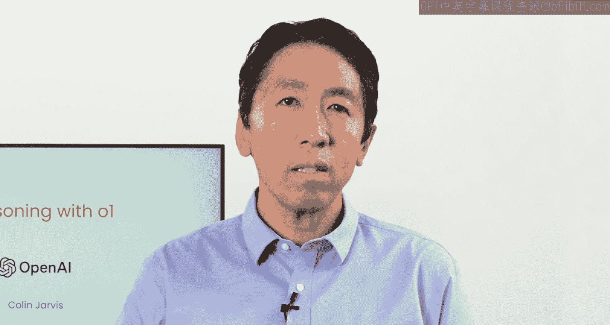

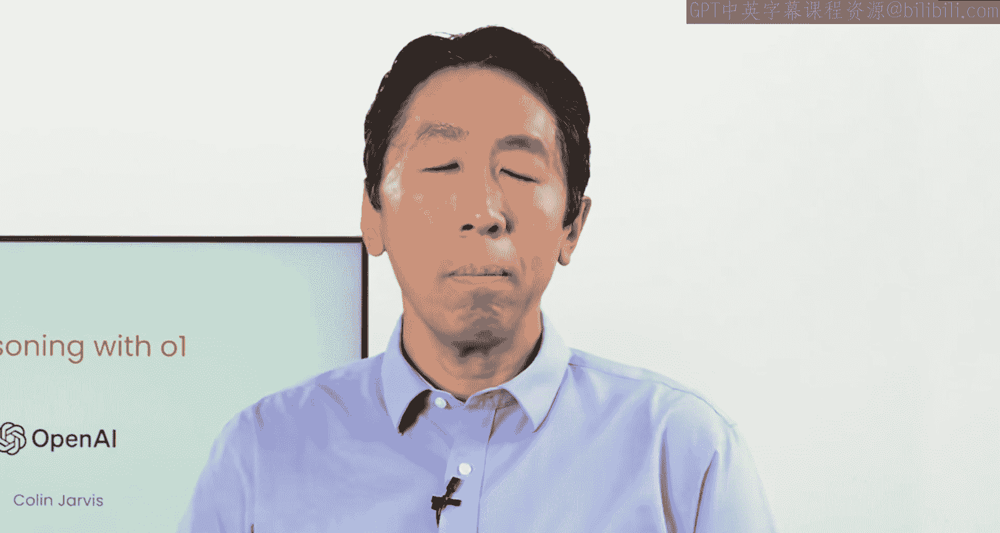

Here's an example from the 2022 paper chain of Thought Promping elicits reasonasoning and largege language Mos by Jason Wei and others from the Google Brain team In this example。

 when using chain of Thought prompting， you also provide the model with an example of a response that takes a problem and breaks it down into simplest steps。

 When responding to the query， the model creates a chain of simple steps which allows it to answer the question successfully Open eye has taken this to a new level and finet the model using reinforcement learning to autonomously incorporate chain of thought step by step reasoning into its response process。

 While the performance we see today is impressive。 What will be significant long term is test time or inference time scaling。

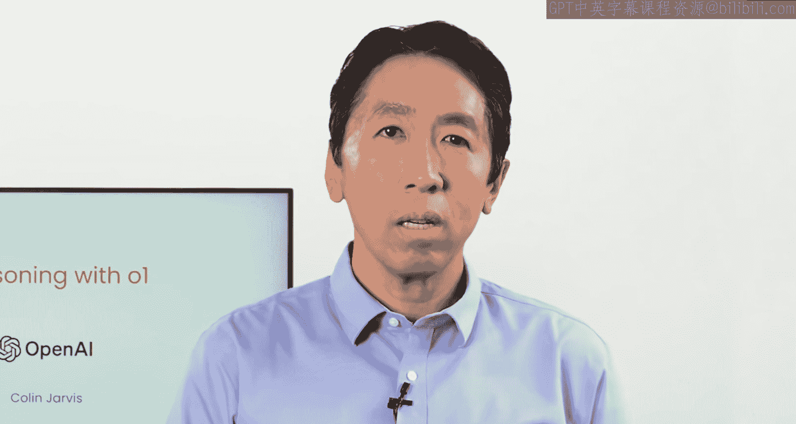

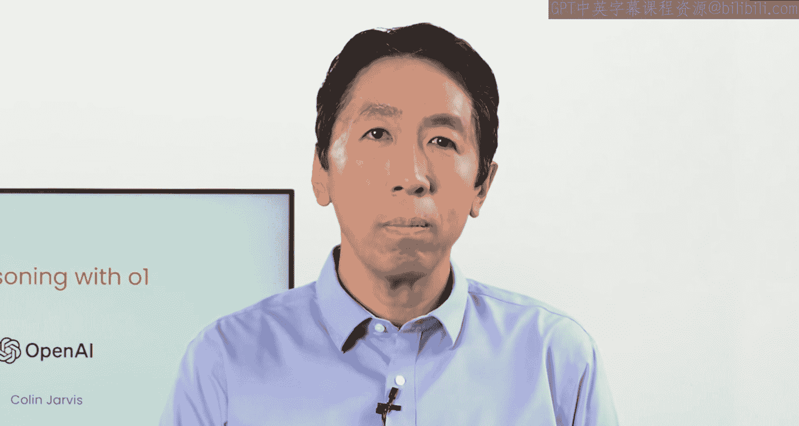

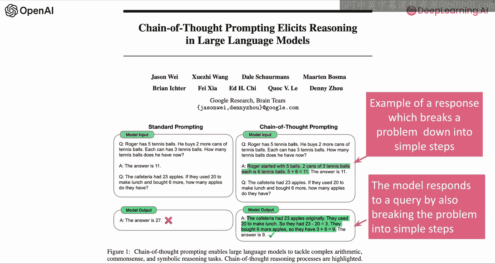

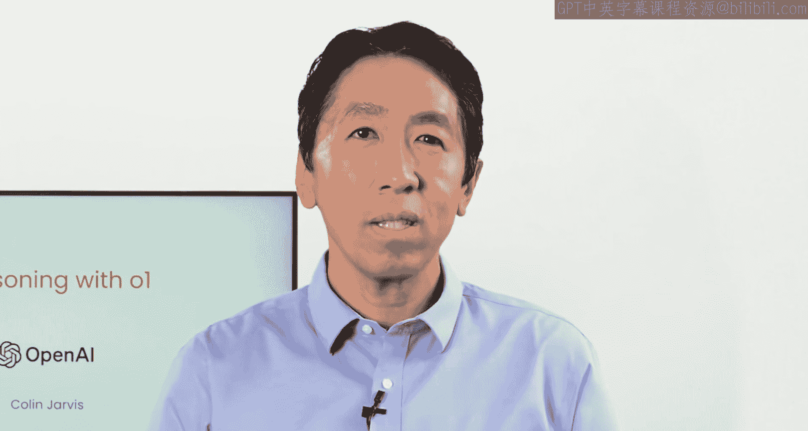

We have found that the performance of01 consistently improves with more reinforcement learning called train time compute and with more time spent thinking。

 which we call test time or inference time compute。

 This is a whole new dimension you can use to scale LM performance。The01 model， however。

 is not the right model for all situations In the course。

 you'll learn to recognize what task 01 is suited for and when you might want to use a smaller or faster model or combine those two。

Here's the outline。We'll start with an overview of the 01 models and when you might want to use them。

 as well as how scaling performance at Inf time works。

Then you'll learn about prompting the01 models to get the best performance。

 The best way to prompt01 is pretty different from earlier models。

 Youll then learn how to use01 to solve complex， multi step tasks with planning。 In this case。

 optimizing a supply chain logistical challenge using an01 orchestrator with a 40 worker。

 you'll use combinations of models together。01 for planning a sequence of tasks and faster。

 less expensive models for task execution。 After that， you'll use01 to do some coding。

 It's really good at this。 Then you'll try out a really cool new feature。 reasoning with images。

 imageage understanding has traditionally been difficult to get into production。 But with 01。

 we are seeing new levels of performance with these tasks。😊，Finally。

 we'll wrap using 01 to generate and optimize your prompts a technique we call Merompin Many people have worked to create this course I'd like to thank from Openly Eye。

 Royzeev， James Hills and Boris Powerwell from Deep Bla Ai。

 Jev Ladwig and Emal Gagari have also contributed to this course。

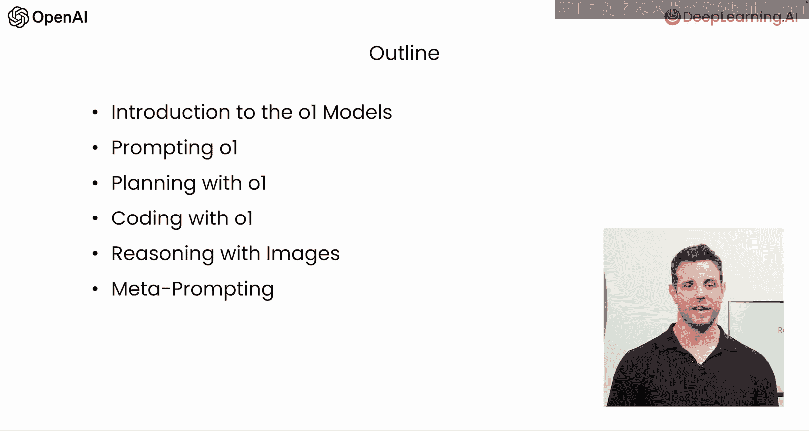

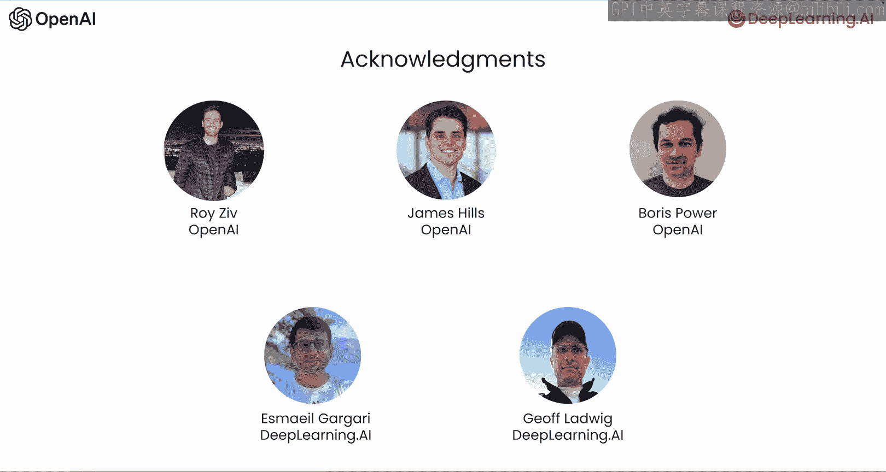

Alright， let's go to the next video where you learn more about the details of how01 was trained。😊。

