# OpenAI&吴恩达《使用o1进行推理｜Reasoning with o1》中英字幕（deepseek翻译） - P2：2.o1.zh_en - GPT中英字幕课程资源 - BV1UBkNY6Ep5

This lesson will be a general introduction to 01 to get you familiar with how it's so different。

 how it functions， and what people are using it for。Before 01。

 you could think of most models as like children。 They always say the first thing that comes to mind。

As they grow up， they need to be taught a valuable lesson。

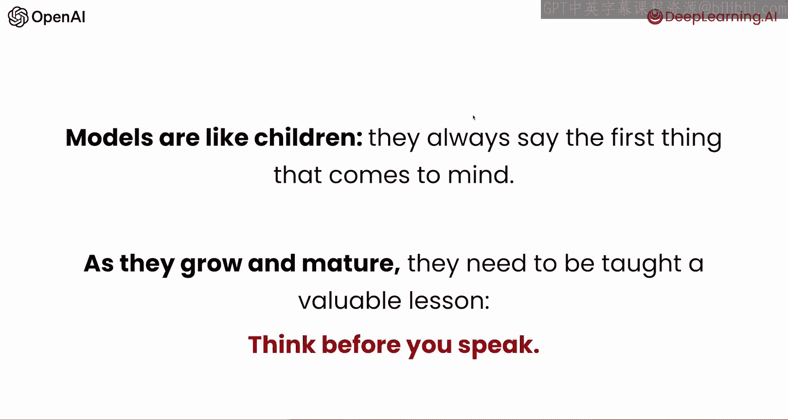

That they should think before they speak。What makes O1 so different is that it explicitly thinks before it speaks every time。

This helps it reach new levels of performance at complex tasks and domains like math， coding。

 science， strategy and logistics。 The way it does it is by using chain of thought to explore all possible paths and to verify its answers as it produces them。

 This means that O1 requires less context and prompting in order to produce very effective results。

 We've released our first two models in the Open AI01 series。 The first is01。

 Our main line reasoning model for complex tasks that require broad general knowledge。

 which includes function column and image input。

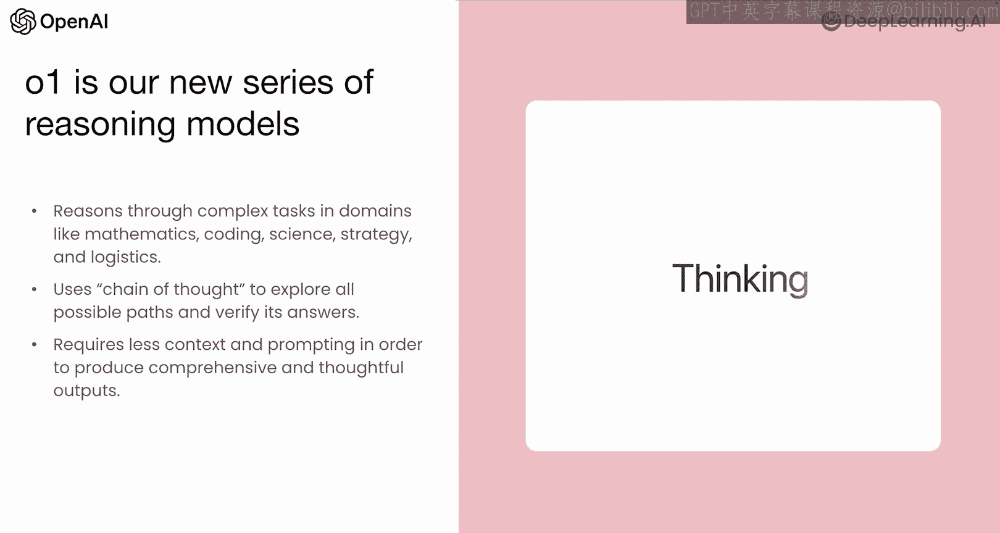

We also have a faster， more cost efficient version called 01 mini， which is tailored for coding。

 math and science and designed for those more cost or latency sensitive use cases。

The thing that makes the 01 family model so different is how they natively integrate chain of thought into how they solve problems。

Let's take an example where we give these scramble letters and we translate them for the model。

 and then we give it a new problem to solve。The way it solves it is something like this。

 where it thinks through what is given and talks itself through how to solve the problem。

 It recognizes the example and then understands the transformation that took place here。

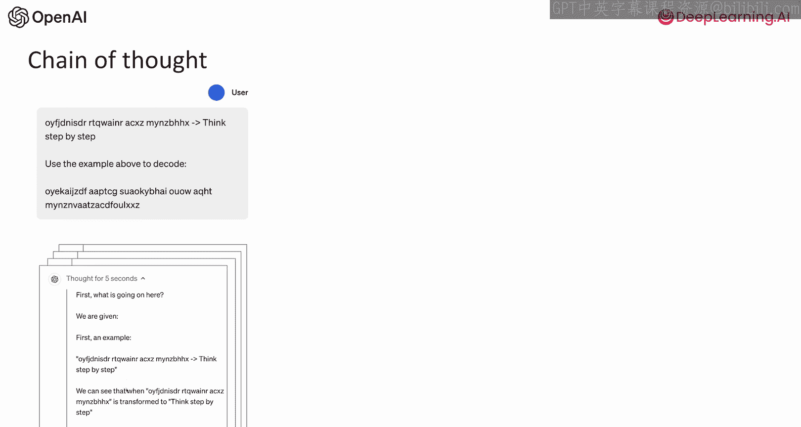

Then it comes up with hypotheses and tests them。 For example。

 it thinks maybe there's an anagram or cipher here。

 Then it notices that the cipher text words are exactly twice as long。

 So maybe then comes up with an idea to test， It tests it and finds that it doesn't work。

 but uses that to iterate to a new hypothesis which gets it to the right place。

 And this in a nutshell is what makes O1 so special。 rather than you having to prompt it to do this。

 we've trained the model to natively apply this reasoning process so that it can work through more complex problems in many disparate domains like science。

 law， coding and math。

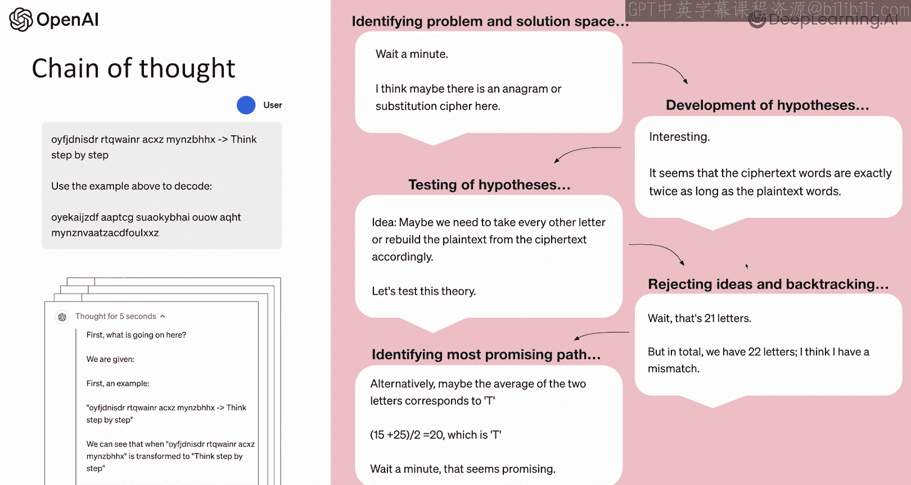

This introduces a trade off when you're using the01 family of models where you generate extra completion tokens。

 which you don't actually see， but which the model is using to problem solve your task。

 Let's look at how it works。 We can see here that completion tokens can be broken into two distinct categories。

 We can see our gray reasoning tokens here。And the actual output tokens。

 which are the tokens which you are provided for your generation。

It's important to note that reasoning tokens are not passed from one turn to the next。

 If you want to do something like this， you'll need to prompt the model to output some kind of reasoning。

 which you can choose to pass from one turn to the next。

 What this means is you also need to consider those reasoning tokens in the cost of what you're paying for。

 And also， when you're calculating your context limit。

 because those reasoning tokens do count towards the context limit。

 and if your output goes over and above that， the output will be truncated。

Two of the key breakthroughs that LED to O1's increase in performance were， first of all。

 recognizing that during the post training process， the more reinforcement learning we did。

 the more accurate the model got。 But what was possibly more surprising was the more we allowed it to think at inference time。

 we got an even sharper increase in performance。 So the key breakthrough here was the ability to think for a longer time at inference time and get better results。

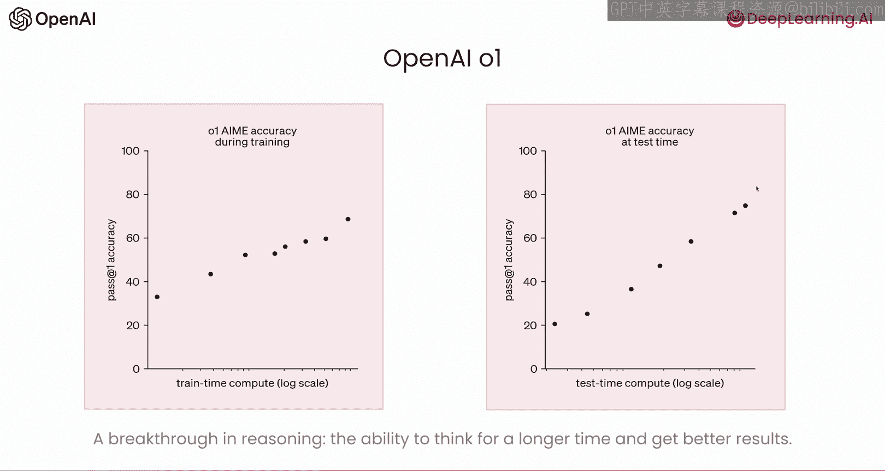

The other key breakthrough that led to the increase in performance with 01 was teaching it to verify outputs via consensus voting。

The way this works is that we generate a bunch of solutions and train the L M to choose the most common one。

 You can think of this as similar to when we sample a low temperature in one paper。

We saw a math benchmark go from 33% to 50% improvement purely due to consensus voting。

Consensus also flatlines before 100 samples， so you don't need a huge amount of samples to realize the performance improvement here。

So what's the significance of all these breakthroughs？The results of 01 have so far been really good。

For example， here's one benchmark that shows the difference between GBT40 at 13% on this benchmark and the new01 model。

 which got up to 83%， huge improvement， Similarlyly at code where GBT40 scores 11% and we see01 at 89%。

 and science， where we don't see as big of an improvement。

 but still 20 odd percentage point improvement on this benchmark。

 This carries on to other families of benchmarks， For example。

 math where we see a giant 30% improvement from01 over 40 science， 20 to 30 odd percent improvement。

 a variety of different exams， most impressive one here being the LatAT at almost 30% improvement。

 and lastly the MMmLu categories where there was improvement across the board with the highest scoring being a 98。

1% on college mathematics， just super impressive and a massive improvement over the previous family of G。

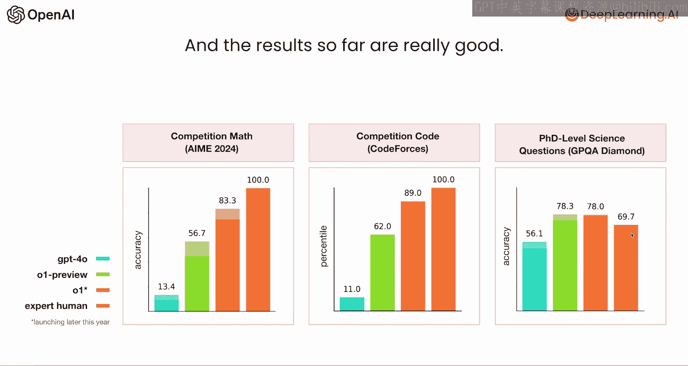

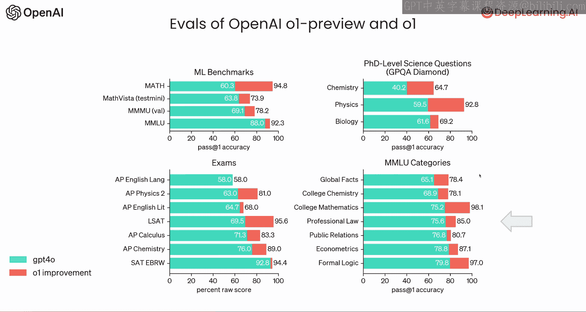

40 miles。So how does the01 model actually work？The key factor is that it uses large scale reinforcement learning to generate a chain of thought before answering。

This chain of thought it produces is longer and higher quality than what you can typically attain via prompting alone。

 It also contains behavior like error correction or trying multiple strategies and selecting the best one or naturally breaking down problems into smaller steps。

 There's a bunch of examples of these chain of thoughts on the research blog post。

 If you want to dig a little bit further。One other area that01 represents a new standard of performance over the 40 models is abstract reasoning。

 I'll give you one challenge here。

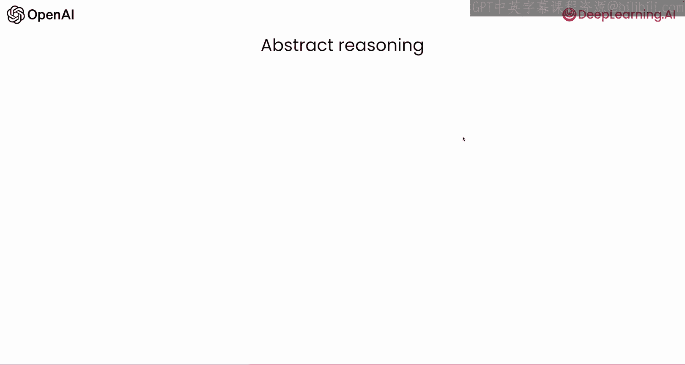

We gave G V D 40，16 words， and it was challenged to identify the four categories which united those words and then place the right terms in each category。

 And you can see here that its performance was fairly haphazard。 So other than approval。

 it was only able to identify one other category， which is movement slash action and it misident one of the terms。

 whereas when we tried it with01， it was able to correctly identify both the four categories and all 16 of the words。

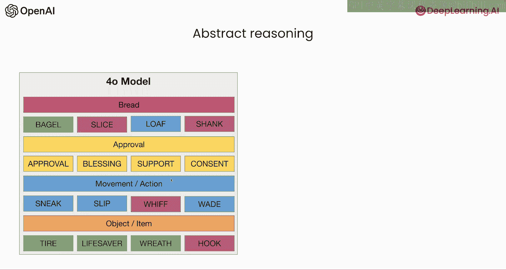

The reason we're so excited about this kind of abstract reasoning is it doesn't easily fit into the same bucket as coding。

 math or any of the other benchmarks that we've shown。

 but it shows some of the other emergent capabilities that the01 model is starting to show and we're very excited to see you all test it with your own use cases to figure out where else these kind of abstract problem solving capabilities are going to be significant。

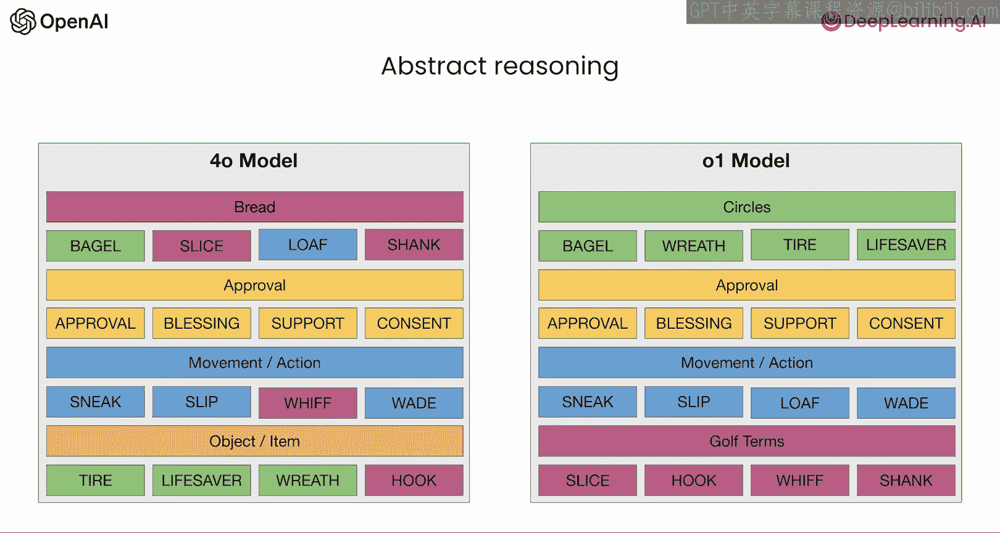

The last area we want to highlight where we've seen significant emergent capability from the01 family models is where we have a generator verifier gap。

What we mean by that is for some problems， verifying a good solution is easier than generating the perfect solution up front。

 For example， with Sudoku， with math， with programming。

 you can often generate a half decent solution， verify it。

 identify the issues and then use that to iterate to the next one。

 much more easily than building the perfect solution up front。

 There are also examples where this verification generation approach doesn't work， for example。

 for information retrieval where the question does need to be answered correctly the first time or with image recognition where you need to correctly identify what's in the image first time。

 but where a generator verifier gap exists and we have a good verifier that can run the verification process。

 we can continue spending more computer at inference time to achieve better performance。

 and for these， we're seeing01 demonstrate great capabilities。😊。

So where might the O1 models actually be used in areas like data analysis。

 interpreting complex data sets like genome sequences or mathematical problem solving。

 we've seen attended benchmarks here， but this is an area where we really see a step change in performance versus the previous family of models。

Similarly， experimental design。 So coming up with innovative approaches for niche domains like chemistry or physics is another area we've seen pretty encouraging results。

 Scific coding as well。 You'll notice a common theme here。 A lot of stem subjects， A lot of math。

 a lot of coding that we're seeing。 great use cases for01 Biological chemical reasoning is another one and algorithm development。

😊，Literature synthesis is the last one that I want to highlight here。

 where reasoning across multiple research papers to form coherent conclusions or summaries is another area where we're seeing great capabilities from 01。

So let's recap the key takeaways from this introduction to 01。

The first is that the O1 family models scales compute at inferenceprint time by producing tokens to reason through the problem iteratively。

01 gives you more intelligence as a trade off against higher latency and cost。

 so it's not appropriate for all use cases。It can also perform really well at tasks that require a test and learn approach where it can iteratively verify its results。

Some of the great emerging use cases we're seeing are planning， coding。

 or domain specific reasoning and fields like law or STEM subjects。

So let's jump into some of the practical applications that we're seeing and walk you through how you can make use of01 for your use cases。

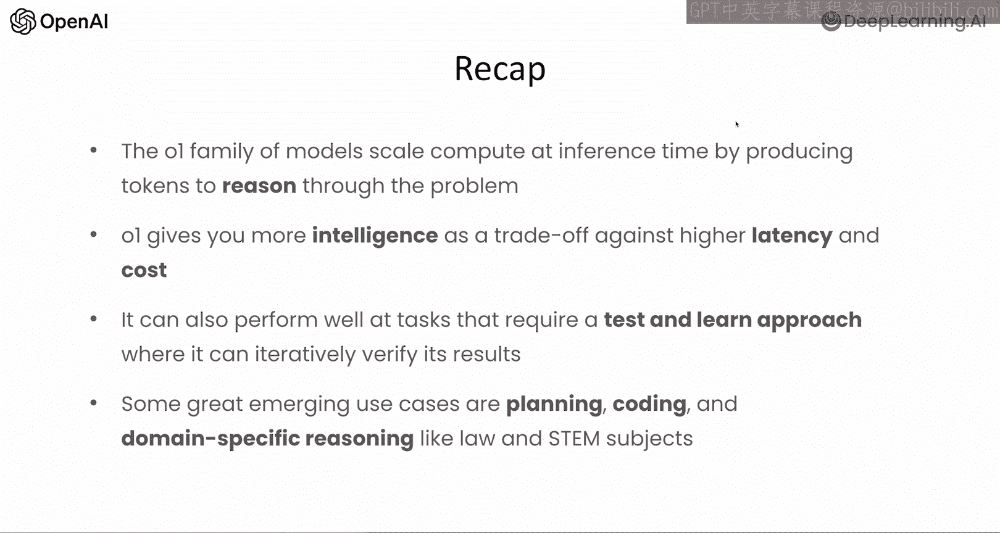

I'm going to show you a quick example of how 01 works within chat completion。

 First of allll import my API key and set up my open AI client。

 I'm going to set 01 mini to be the 01 model that I'm going to use。And Ill queue up。

H check completion request。You can see 01 requests are exactly the same as your typical track completion request。

 we specify an 01 model。And I'm going to give it the classic question， how many Rs are in strawberry。

 We'll generate this， see what comes back。

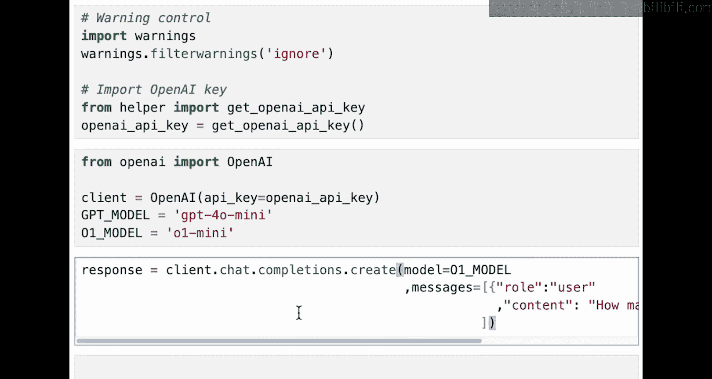

Let's have a look at the response object。 We can see here the standard chat completion response。

 We've got a chat completion message in here。 We have the output。

 the word strawberry contains three letters and。A couple of other outputs。 Now。

 the thing I want to focus on here is what makes O1 different。 Here you can print out the tokens。

 We're going to focus on the prompt tokens， the total completion tokens。

 And then the constituent parts of the completion tokens。

 which consists of the reasoning tokens and the output tokens。 If we print these out。

 You'll see that the model did a ton of thinking here。 So we gave it only 15 prompt tokens。

 But it produced over 1000 reasoning tokens to reach the output。

 This highlights the key trade off with01。 You're getting much greater intelligence。

 but in this case， we paid a 10 x premium in terms of the amount of output tokens that we paid for to get this。

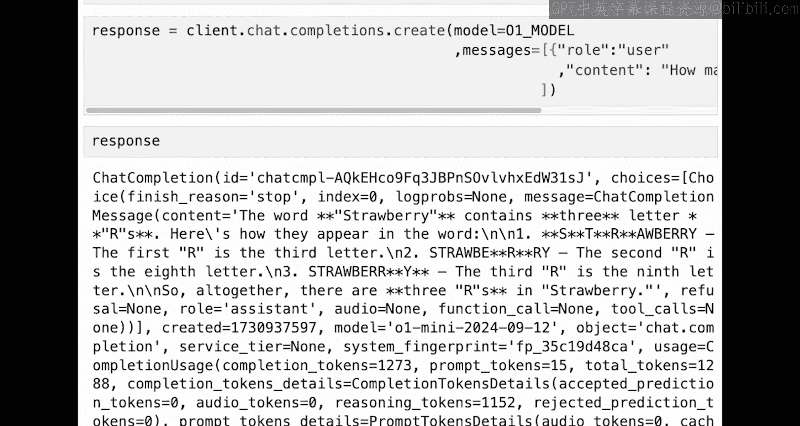

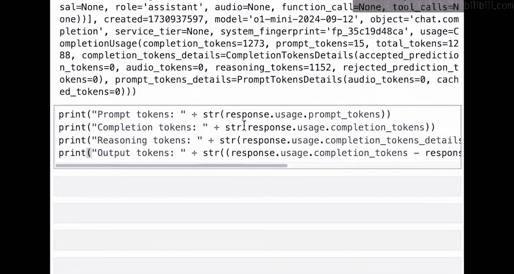

This is a key thing to consider。 You don't use01 for everything。

 It's only for those use cases where the increase in intelligence you get is worth the trade off in latency and cost。

Look forward to seeing you in the next lesson where we dive into how to prompt 01 to get the best performance out of it。

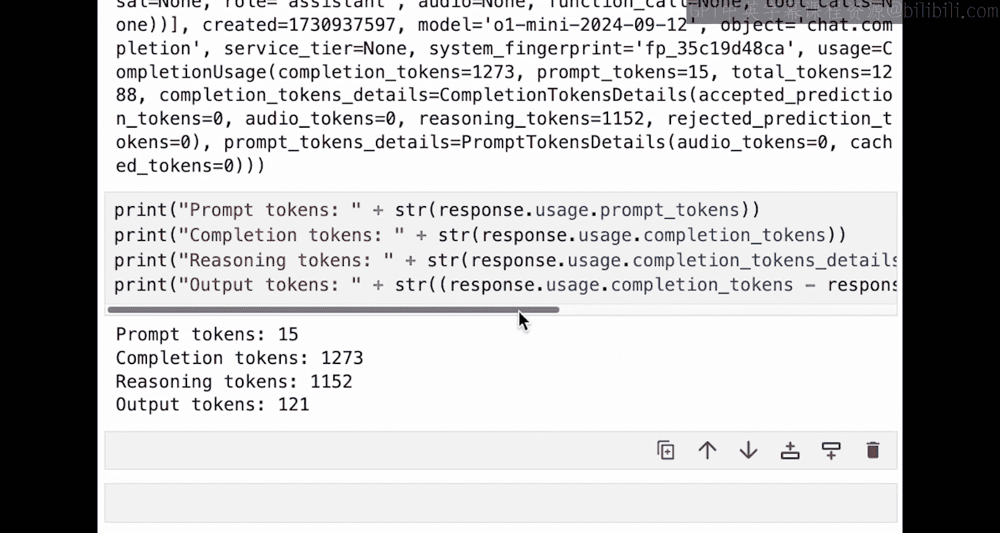