# OpenAI&吴恩达《使用o1进行推理｜Reasoning with o1》中英字幕（deepseek翻译） - P3：3.prompting.zh_en - GPT中英字幕课程资源 - BV1UBkNY6Ep5

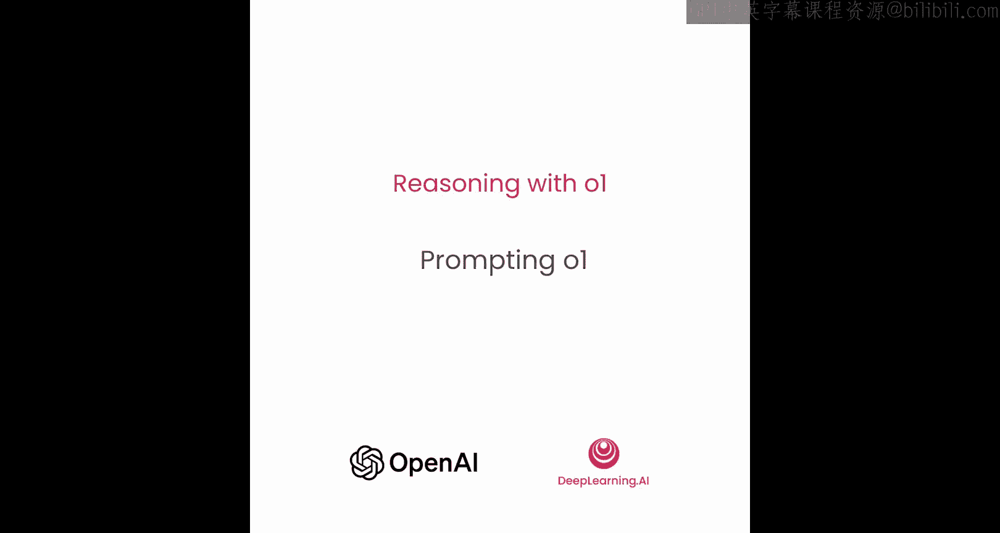

This lesson will cover four key principles We've worked out during the first months of using01 models。

 These aren't exhaustive， but they should give a great starting point for you to explore the differences between our other models and this new family of reasoning models。

 We're interested in hearing what principles work best for you。 All right， let's take a look。

There are four principles for prompting the O1 models。 The first is to be simple and direct。

 Try to write prompts， which are straightforward and concise。

 You'll find that direct instructions yield the best results with these models。

The second is that no explicit chain of thought is required。

 and this may be somewhat different from what you're used to with LLMs。

 you can fully skip the chain of thought reasoning prompts that you used to provide like think step by step and things like this。

 Yo1 models are trained to infer and execute these itself without providing your own breakdown。

The third is to use structure。 So try and break complex prompts into sections using delimiters like markdown or XMl tags。

 The structured format will enhance model accuracy and also simplifies your own troubleshooting。

 We'll see a couple examples of that here。 And the fourth is to show rather than tell This comes back to our first principle。

 rather than giving a lot of prompt to tell the model how to act。

 It's often better to give it one or two contextual examples to give it understanding of the domain of your task。

 Let's jump across to the code and see how these work in practice。

You'll start off by importing your open AI API key and the variables that you'll need to run these。

 You'll notice here that we've initiated the open AI client with our API key and we've also imported a GT model and an01 model for the purposes of these lectures。

 we've used the GT40 mini model as our kind of base model to compare against and for the 01 model we've used 01 Mii。

 Both of these are for reasons of cost and latency， These are faster， cheaper models。

 we'll start with the first two principles， which are being simple and direct and that no explicit chain of thought is required。

I'll start with an example which breaks these rules。Looking at this prompt that I've pasted in here。

 we're instructing the model to generate a function that outputs the smiles。

 Is for the molecules involved in insulin。Then we moved on to give it some chain of thought instruction。

 so we've asked it to think step by step， and we've given it three steps to work through。

 and we've also given it a starting prompt to kind of give it a hint as to how we want it to start。

Now with 01 models， we've trained it to act and reason in the way that we think is optimal to solve these sorts of problems。

We're going to see in a second why it's better to just give a simple prompt without these。

 but let's run this first to see how the model behaves with this explicit chain of thought prompting。

We're going to display the results here。 You'll notice I've given a couple of HD headers because the model's outputs can be pretty verbose。

 So we've tried to signpost where the content starts and ends。 Having a look at this。

 We can see the modelss output。 So the first thing is that it has followed our instructions。

 but it's followed them explicitly。 So it's given us a large number of preceding steps before actually going and solving our problem。

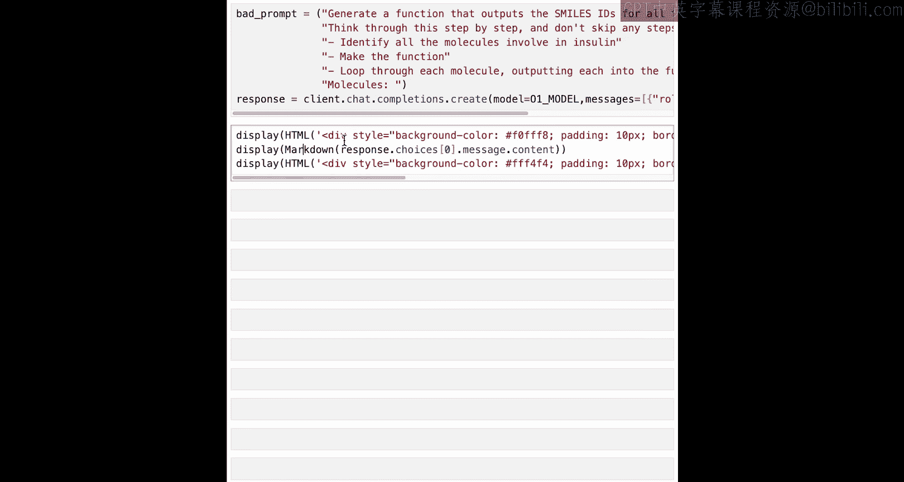

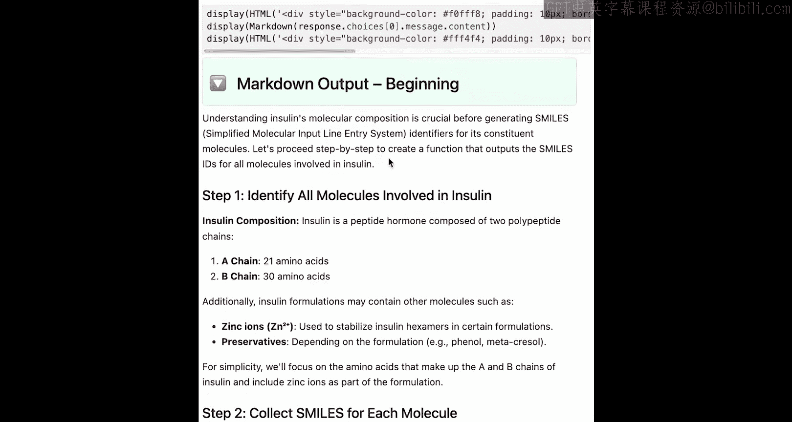

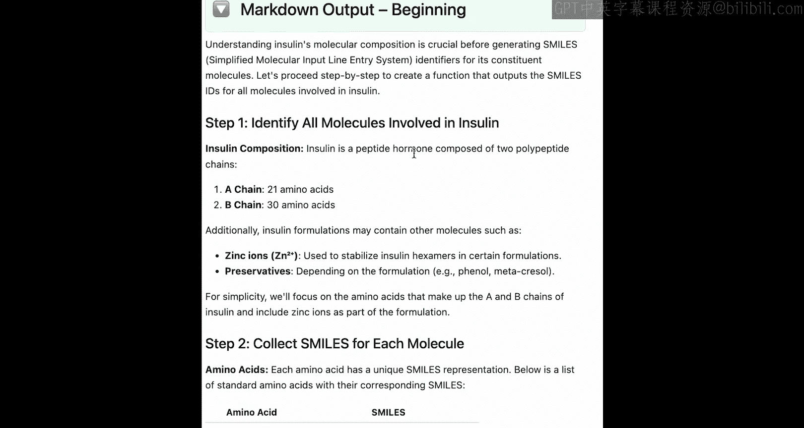

This is one of the consequences of adding explicit chain of thought。

 The model will often explain itself a couple of different times。

 and you may end up with an overly verbose output。 We can see here that it finally creates the function in step 3。

Again， it's reprinting the smiles， codes， the amino acids that it's going to process for this task。

 and then it gives us a sample output。

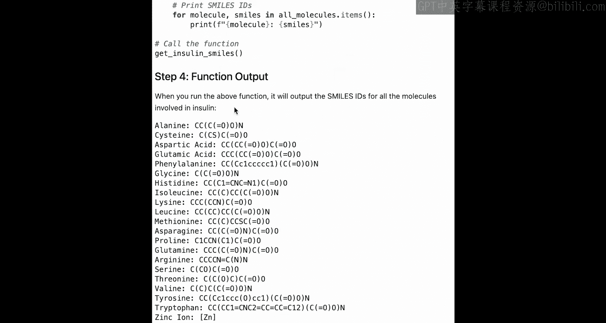

Then at the end， it summarizes the explanation and reasoning that it used to come to this and gives us a conclusion。

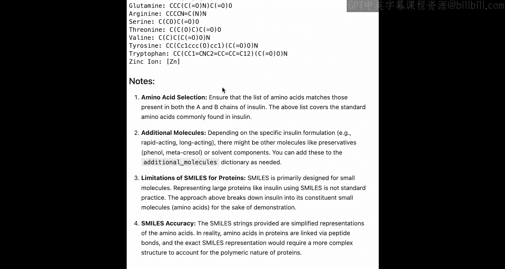

So it did answer a question， but it gave us a lot of extra information。

 which is probably not needed for getting the output that we're looking for。

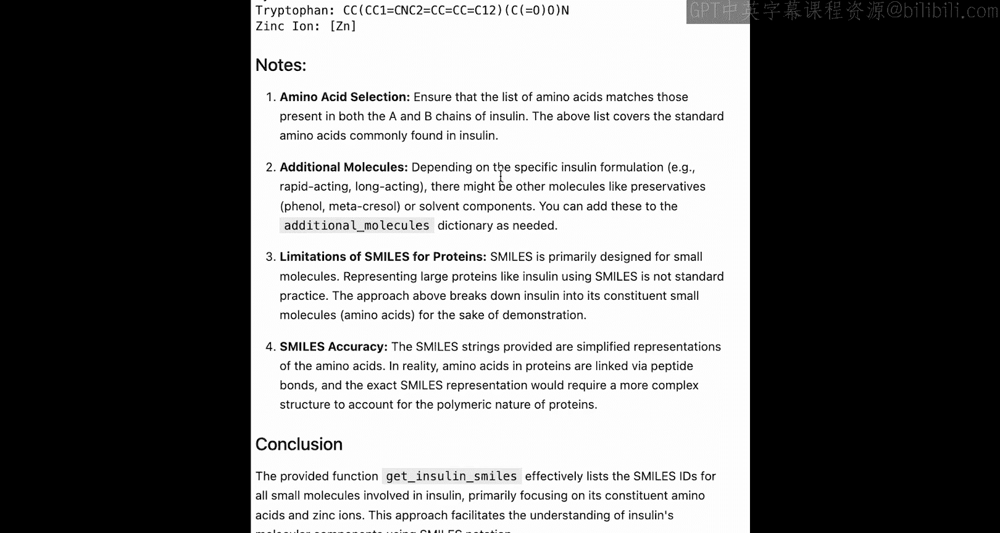

So let's change the prompt， apply our principles， and see how the output differs。

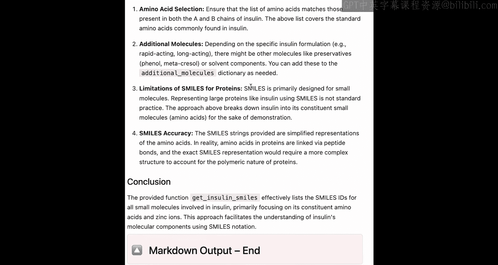

This next prompt applies our two principles。You'll see here that it's simple and direct。

 telling the model to generate a function that outputs the smile's IDs for all the molecules involved in insulin and contains no explicit chain of thought prompting。

You'll run this and get some results。Here we have the same formatting that we had above。

 And here you'll see a quick description of the task。 It describes what insulin is。

 how it's going to get the smiles codes， and then jumps directly into the code。

 So a much more efficient response this time。We've got our full python function here。

 which we can run。 and an example of it being used。

 It then provides a little bit of explanation at the end as to the assumptions it was made。

And a sample output of what it thinks is going to come out the other end。

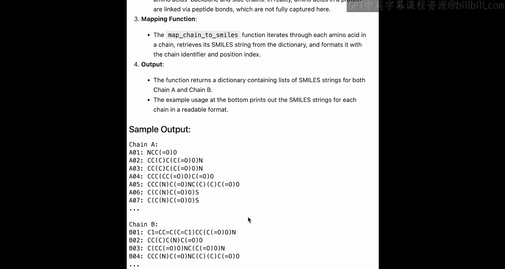

It also supplied an alternative approach。 and finally， a conclusion。

 So the point here is it didn't require that explicit chain of thought prompting。

 We've trained the model to provide what we think is an effective level of explanation with its responses。

 and that is always a good place to start。That is not to say that you won't need to add your own chain of thought prompting for specific or very nuanced tasks。

 but it's always best to start from a baseline of being simple and direct with no explicit chain of thought prompting。

Let's move on to the next principle。 Feel free to pause here and do your own analysis using these principles。

 You might want to look for the molecules involved in ibuprofen or aspirin or other common compounds。

 The key thing is to try breaking those rules。 So giving it a verbose prompt or providing chain of thought prompting and then looking at the impact it has when you simplify and trust the model to do its own chain of thought prompting。

The next principle is to use structure or prompting01。In this case。

 I've got a lengthy prompt here where I'm prompting the model to act as a customer service assistant。

You'll see here that I've used X M L tags to give structure to the prompt。 So at the top。

 we have a set of instructions。 And in those instructions， we told it to follow your policy。

 We've then used structured formatting to provide it a policy tag that is very clear to the model。

 what we're referring to when we say the policy And then within this policy。

 we have a series of different criteria。 So what it's allowed to do。

 how it handles refunds and compliance。 So which policies it should adhere to。

We're then providing a user input at the bottom where we have a user query tag。

 and within that we have what the user is explicitly asking for。

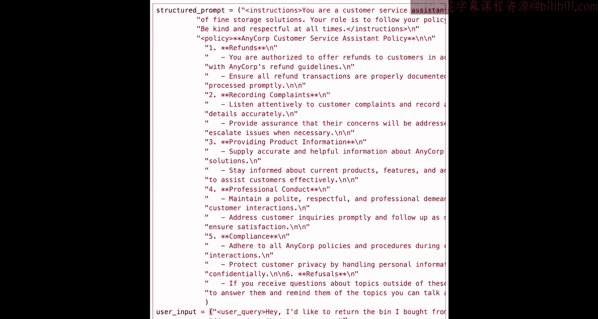

I'm going to run that and print the prompt so we can see it in full。

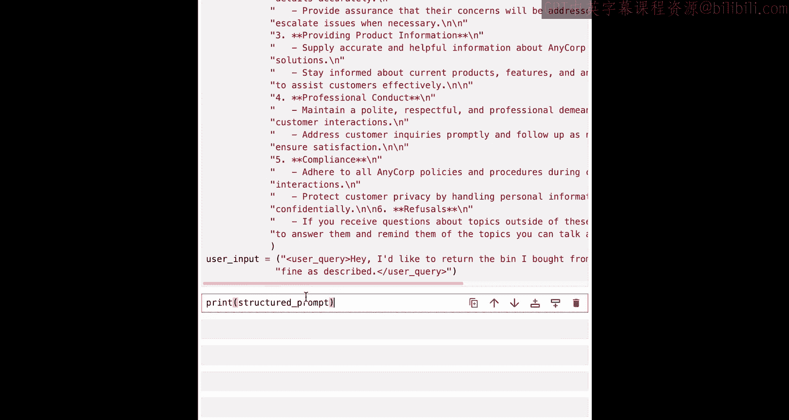

There we are， our instructions。

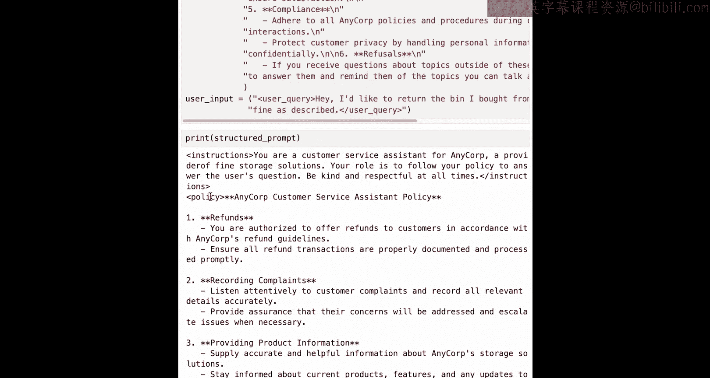

A policy。And then we will add the user input on the bottom。Here we have our request。

 so we're using the01 model。And the content is going to be the structured prompt with the user input appended on the bottom。

Let's run that and see what the result is。We'll print the results to see how the models responded。

It looks like it successfully followed the process。

 So we said that a product didn't meet our expectations。

 and it matched that to the return process successfully。

Let's give it one more test to see whether it maintains performance if we ask it about one of the other policy areas。

Here's another user query。You can see here we've asked it to write me a haik ku。 So in this case。

 we're breaking the policy。 We're asking for something that the model shouldn't comment on。

If you run this， you'll see how the model responds。Here's the same request as before。

 this time we'll take our structured prompt add our refusal question or the question we're expecting to be refused and let's see what the output is。

Great， it's adhered to its policy again。 In this case， refusing this question。

 be this violates its policy rules。So we've seen how providing a structured input prompt to01 models can ensure that they'll follow the instructions with greater accuracy。

 We've combined that with being simple and direct and we haven't given any explicit chain of thought prompting。

 so we're starting to build up some good principles。I'll move on to the final principle。

The fourth and final principle is to show， rather than tell。

You'll see here a prompt where we're asking the model to pretend to be a lawyer specializing in competition law。

 So again， we've given a prompt structure at the top and a policy is again。

 telling it to maintain clear and accurate information about competition law。

 also to avoid giving specific legal advice without sufficient context。

There's a simulated user query here， so a customer asking that a larger company is offering suppliers incentives not to do business with them and asking if this is legal。

Going back to the principle here at this stage， we have not shown rather than told。

 we've just given it instructions， and we haven't specified how we want it to act。 If we run this。

 we'll see how it performs out of the box。I've got another request here。

 our base prompt with the query appended to the bottom。 here。 we'll examine the results。

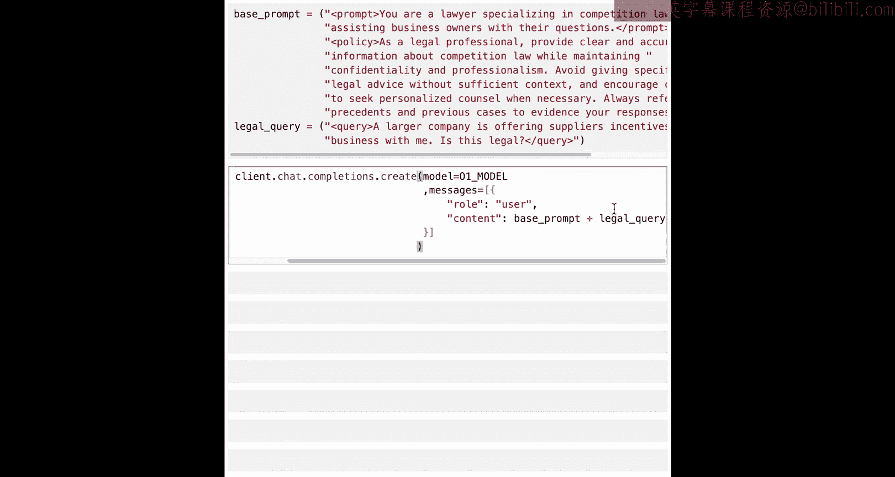

You can see the model has。

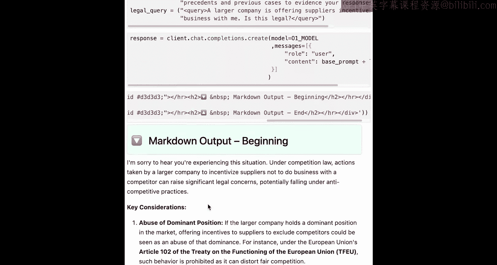

Acknowledged the question of the user， and then provided。

A write up。Great， but in the case of legal answers。

 I actually want the model to use specific references to evidence the position that is taken。

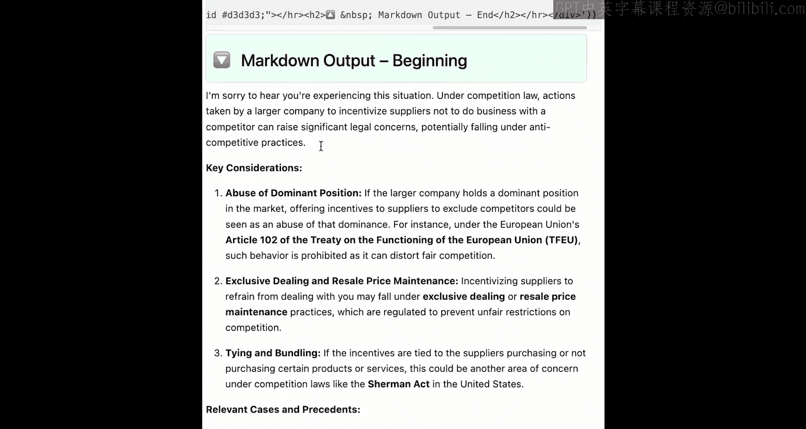

I could tell it to do this explicitly by adding more prompt。 But instead。

 I'm going to provide it a example input and output。

 along with my prompt and trust that the model will learn from the style of what I've shown it。

 Again， I don't have to explicitly tell it。 I'm going to show it by giving it an input output example。

 as well as the prompt。 Here's our updated prompt， which adheres to the principle of showing。

 rather than tell it。😊，You'll see the same two structured elements， we've got a prompt and a policy。

But after those， I've included an example tag。 And within that。

 I've got an example question and an example response。 If I scroll across here。

 you'll see that I gave specific examples， and then I also referenced the relevant acts which cover the legal recommendations that I've given。

You can see that I have done this in each one of the points that the model has supplied。

What I'm hoping by doing this is that the model will learn that I want a series of bulleted reasons for my question and wherever possible that I want it to reference itself。

So let's run another example question and see how the model responds and see whether it manages to reliably follow what it's seen here。

You're going to run this new prompt with the example included。

With the same legal queries we had the first time。We'll now submit our updated prompt with the same query from the first question。

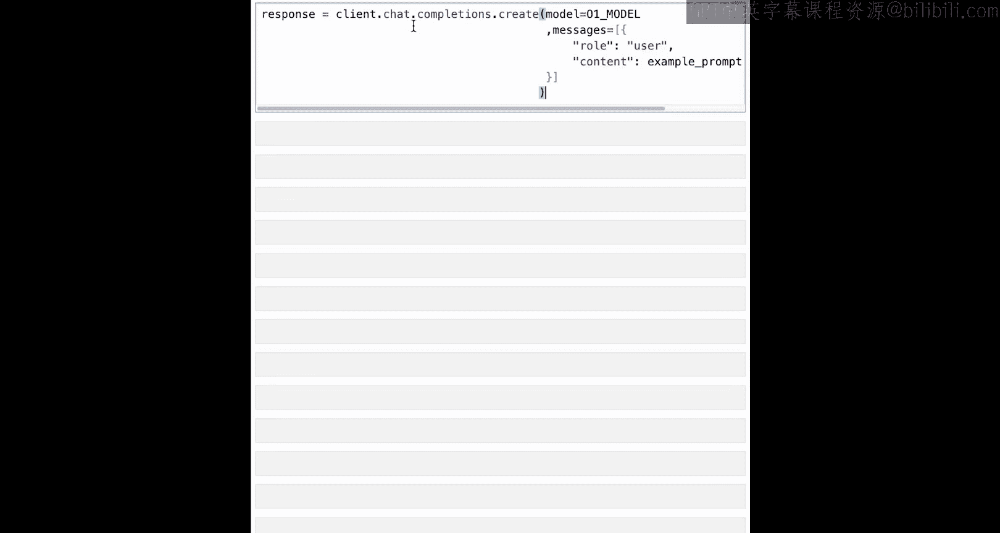

Time to display the results。

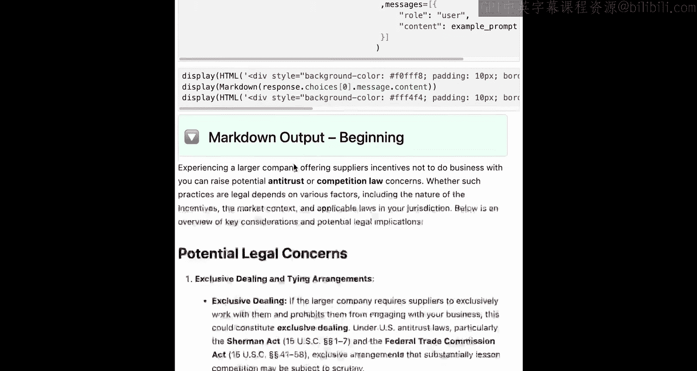

You can see here again， a preamble。And then our bulleted reasons。 And great。

 It looks like it's successfully learned that it should reference itself。

 So we can see an example here。😊。

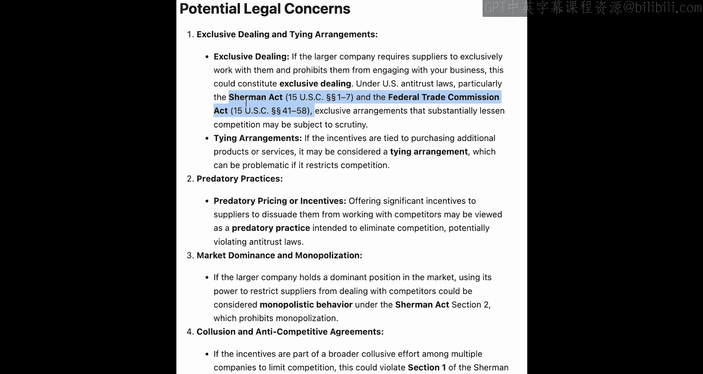

We can also see an example here。

And an example here。Now it's given me a couple of examples。

 but it hasn't referenced every one of these bullet points。

 so this is telling me I might want to give it maybe two or three examples that it can learn even further by showing you can always add prompt。

 but as a general principle it is better with01 to give it the examples and let it figure out the reason that it needs to do to get consistent performance。

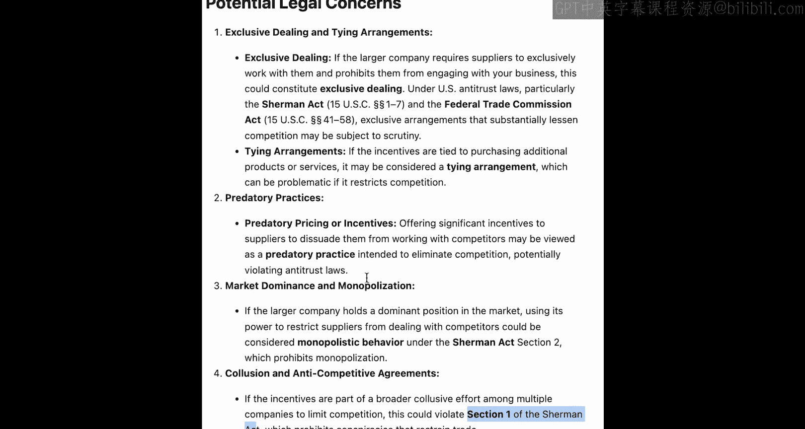

