# OpenAI&吴恩达《使用o1进行推理｜Reasoning with o1》中英字幕（deepseek翻译） - P4：4.planning.zh_en - GPT中英字幕课程资源 - BV1UBkNY6Ep5

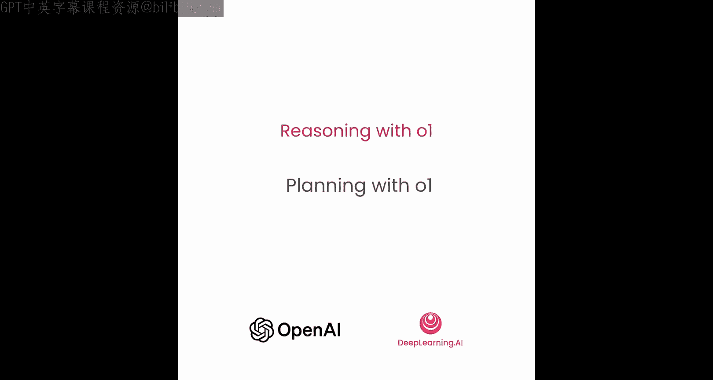

One of the great use cases where01 models shine is creating a plan to solve a task。

 given a set of tools to carry out the plan and constraints to set bounds around the task。

 This kind of use case would be very slow if we used01 for every step。

 So what we'll do is generate a plan with01 mini。 and then execute each step with G P D 40 mini。

 This trade off of intelligence against latency and cost is a practical one that we've seenDevelop used a great effect so far。

 All right， let's go。😊。

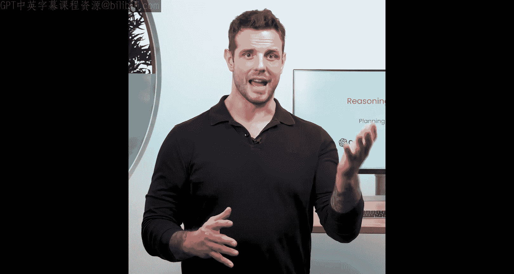

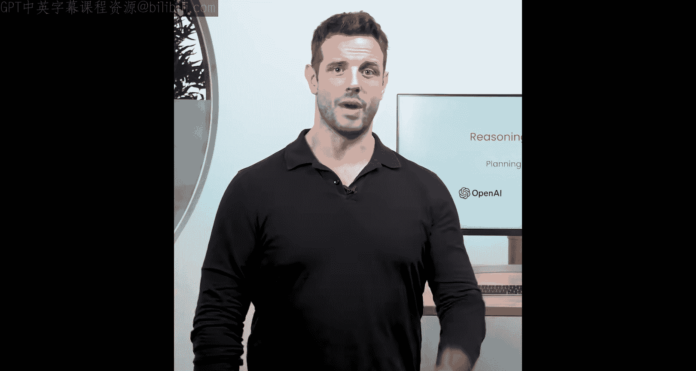

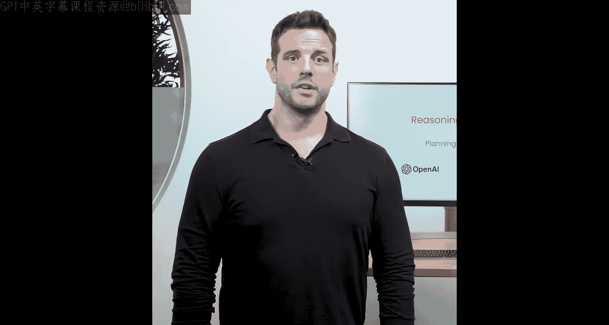

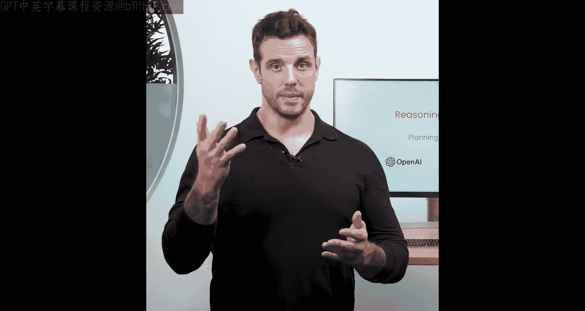

Let me tell you about the overall architecture of the task so that we don't get lost in the details as we go through the code。

You'll begin with a scenario。This comes from a customer where they're making an ask which requires multi step logic to answer that scenario。

That scenario will be given。To01 mini。Who will have at its disposal some instructions of how to build a plan and then a number of tools which it can use to carry out the plan。

This is a great use case for 01， where we use its multi step reasoning logic to build a durable plan before we then engage 40 mini as a worker to carry out each step of the plan。

Once the plan is completed。We'll have an answer， which we provide back to our customer。

Now let's sip into the code and see how this works in practice。

You'll start by importing your Open AI key。And initiating the Openai client and the O1 and DPT models。

You'll first define the constraints that this scenario will be bound by。

Your first variable is a message list， because our40 worker is going to loop through multiple steps。

 We need a list of messages to accumulate the history so that the worker can tell what steps it's performed of the plan that we've come up with。

Then you've got a bunch of context， I'm not going to go through every variable here。

 but essentially we have an inventory， a order that a customer wants to place。

 and then we have suppliers which we can use to supply us with additional material if the customer asks for something that we don't currently have。

We then have a few other variables like the shipping options and the metadata of the customer who's going to be giving us our scenario。

The last element is the state， so because we're going to go through multiple turns of conversation。

 we will maintain conversation state and when you take this and apply your own scenario。

 you can consider whether you want to wrap this in an application where you clear down the state at certain points to allow the customer to submit multiple scenarios。

Next， you need to define the prompt， which dictates how O1 is going to go about building a plan to solve the customer' scenario。

This prompt consists of a few main sections。 The first is where we define who it is and what its task is。

 So we're telling it that it's a supply chain assistant and its task is to review the challenge that it's being said or the scenario and create a detailed plan to answer it。

 We tell it that it will have access to an L M agent， and then we give it a list of functions。 Now。

 it's important to note here that the 01 model isn't going to be provided with the open AI function calls。

 Those will be given to the worker， the 40 mini model， which will be doing the work for it。

 but01 needs to know what those functions are and what they roughly do so that it can build up that multistep plan for the 40 mini worker to carry out。

 So， for example， it needs to know that there's a fetch new orders function。

 which will allow the 40 mini model to check the status of new orders that have come in and decide whether to fulfill the or not。

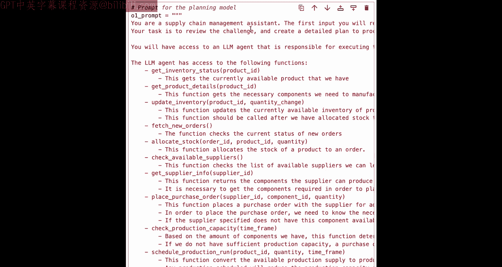

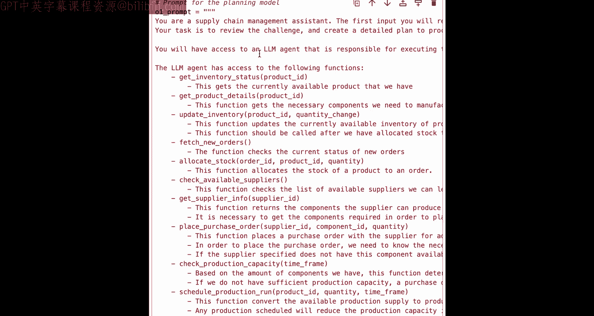

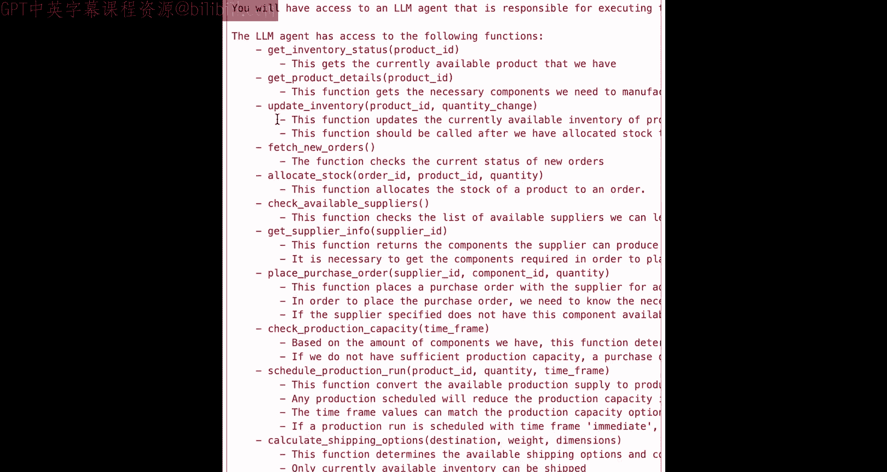

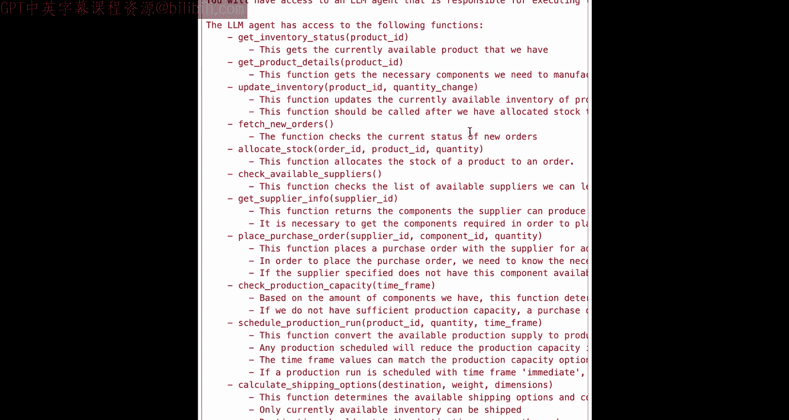

Underneath this， we've given01 a set of instructions which tell it how to lay out this plan so that we can then parse it and provide it to 40 mini to carry out。

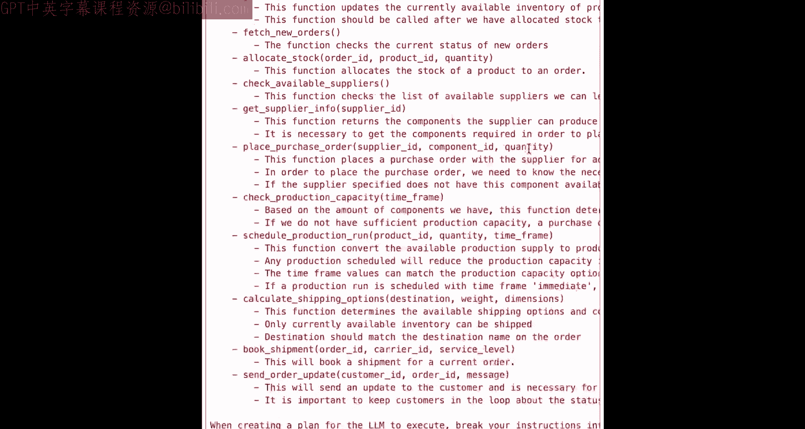

Next， we define the functions themselves。

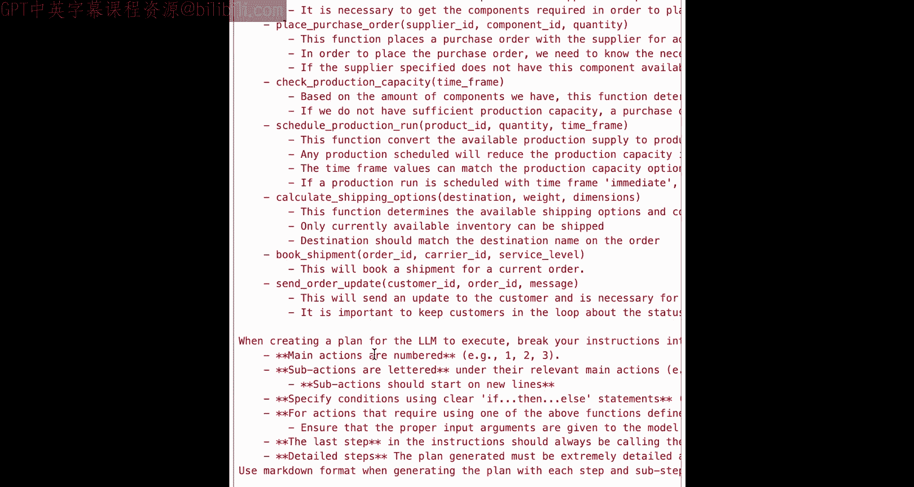

It's important to note that01 can now do function calling。

 but we're not going to use it for this scenario because we want to come up with that multi step plan to give to 40 minii to execute。

 If we wanted01 to carry out each step bit by bit， we could supply it opening eye function calls。

 But in this case， it's going to create the plan for 40 mini to carry out。

Now we'll define the GT40 system prompt， so the prompt that dictates how that 40 mini worker is going to do its job。

Again， we've given it a personality， so you're a helpful assistant for telling it that it's responsible for executing the policy that it will be given and its task is to follow the policy exactly as written。

We also ask it to explain its decision making process across various steps。

 and this will come in handy later。 So as it goes through the plan。

 it will decide whether to update the customer on the progress and whether it's hit any blockers。

 We then give it step by step instruction again， referring back to the principles for prompting01。

 we don't give 01 explicit chain of thought prompting， But given that we have a 40 mini worker here。

 it is useful to give it some chain of thought to help it make the right decisions。And lastly。

 we'll instantiate that policy that was generated by01。

 which is that plan and give it to 40 to then execute each step。

To allow 40 mini to take action on each step of the plan， it needs to have open AI function calls。

We've defined those here。You'll see a long list of function calls and I'm not going to go through each one in detail。

 but just picking out one of them， this function allows us to check the production capacity。

 so it will look at the amount of components that we have and figure out how much capacity we have to create more units。

 and again， we've got our standard open eye function call parameters here。 So in this case。

 a time frame which is an enum that it can pick from。

Each one of these functions will tie to a step of the plan。

 which01 is produced for and will allow 40 mini to take action。

Those open AI function calls map two Python functions。

 which actually execute the results of each function call。Again。

 looking at the same one that we looked at a second ago with the Open AI function calls。

 here's the Python function， which is implemented based on the results of that function call。

 so we pass in that timeframe and then we get back a Json。

 which the 40 mini model will assess and use to decide whether it moves on to the next step of the plan。

Now that we've defined the input variables， the 40 and01 system prompts。

 and the function calls with their Python definitions。

 we can move on to creating a function which will knit all of this together to orchestrate the process。

The first step is to take in a scenario provided by the customer and call 01 who will produce a plan。

 We then take that plan and initiate a 40 mini worker。

 That 40 mini worker will loop until it's carried out the whole plan and then return the messages。

 and that is what we will provide back to the user to tell them how we manage to perform against the scenario that they gave。

If you'd like to look into the underlying details behind that orchestration wrapper。

 the first function is the append message function。

 which takes in a message and decides which variables to include with it to give40 many context to continue carrying out the plan。

The next function。Provides the scenario provided by your customer 201。And generates the response。

 This plan is what we're going to provide to40 mini to then carry out that scenario。

The last orchestrating function calls GP 40 with the plan generated by01。

And uses that to carry out the plan。You'll see here that we initiate a well loop。

Which begins producing tool calls with G 40 mini。And decides what action to take based on the content of those tool calls。

So it will keep looping until it receives an instructionss complete function at which point it will break。

 Now， you defined all the variables you need。 So the only thing remaining is to come up with a scenario that the customer wants us to carry out。

 In this case， we've said that we've received a major shipment of new orders。

 We're asking no one to generate a plan that gets the list of awaiting orders and determines the best policy to ful them。

We've given it some idea of what the plan should include。

 and we've also given it an overriding directive that it should notify the customer before completing。

Lastly， we've given it a criteria， which is to prioritize getting any possible orders out that it can while placing orders for any backlog items。

With that， we're ready to start generating the plan。

You can see the plan that O1s generated for you laid out nicely here in Markdown。

The first step is to retrieve new orders。You can see here where 01 has specified the exact order with these open AI function call that 40 mini should use to carry out this step。

Next， it's asked it to process each order individually。 And then within that。

 it's given extra detail。 So for each order in the list， extract these variables。

 check availability and handle any backloggged quantity。If there's backlogged quantity。

 we've given it if then else logic to go about actually handling that。Once it breaks out of that。

 it will arrange shipping for the available inventory。And notify the customer。

We give it a little bit of logic here to tell it what to do if the order is fully fulfilled。

 if it's partially fulfilled， or if there's a backlog that it needs to let the customer know about。

Lastly， it will finalize the instructions and call instructions complete。

 which will break out of the well loop and provide the answer to the customer。Next。

 we'll go through the actual steps which40 minii carried out to check that it followed this plan as specified。

 The last thing to note is that01 has adhered to the prompt engineering principles which we mentioned earlier by providing a structured prompt so that 40 minii will find it easier to follow as we go through the40 mini actions that that took place It's key to refer back to this and understand whether or not it actually properly followed these steps as specified to review the actions that40 Mini took in more detail。

 I'm going to print out the messages that theyre a little bit easier to read。

I'm going to skip past the 01 policy because we've already gone through that。

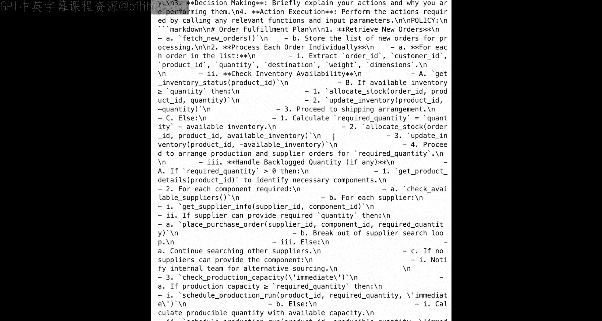

And start with the different actions that form any to。

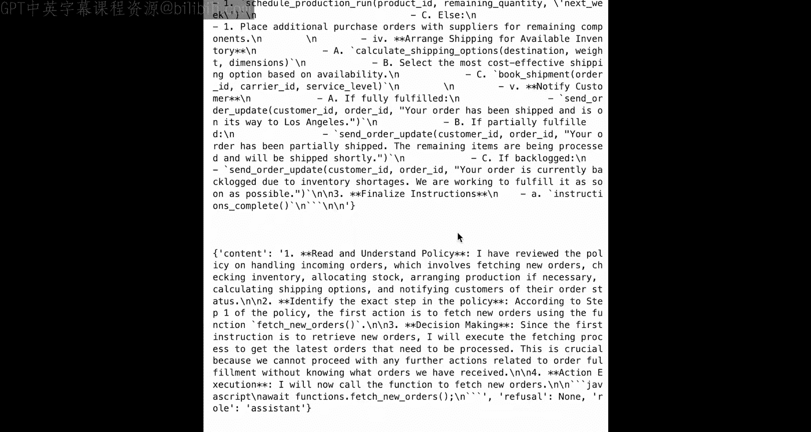

So first， we can see that it called the Fetch New orders function， and that got us one new order。

 which is a quantity of 200 of product ID X200， which we can see here。

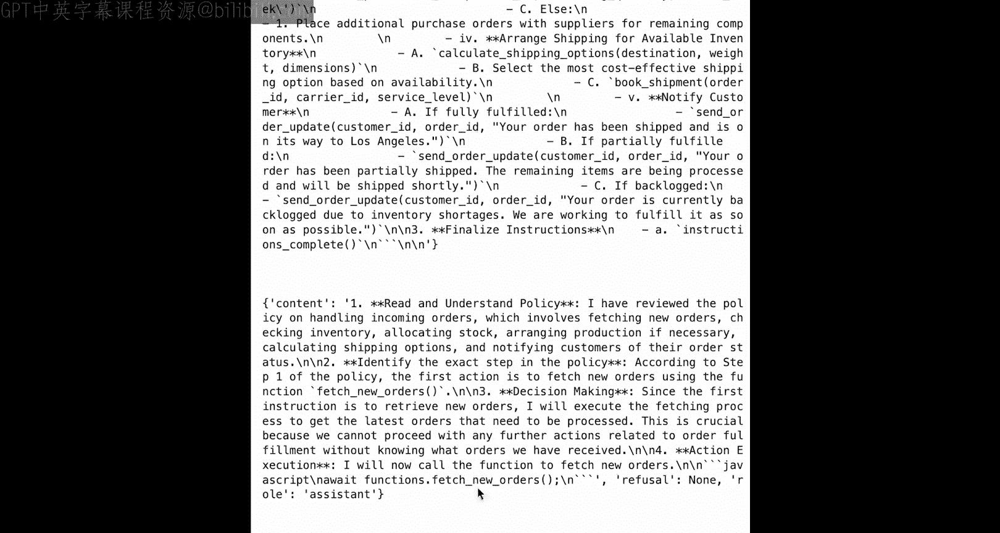

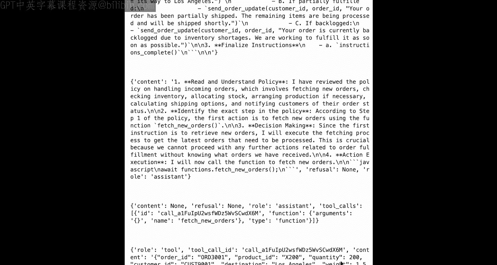

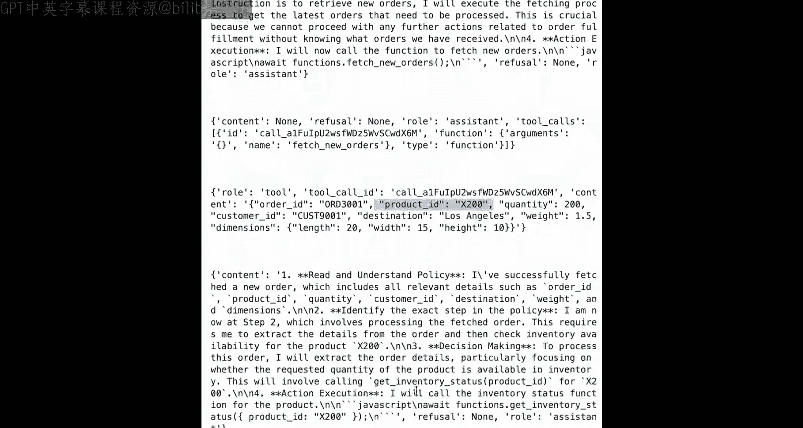

We then see that it called the get inventory status function to check whether we actually have the inventory to serve what the customer asked for。

 And we can see that we do have that particular product， but we only have 50。

 So it's going to need to order a few more if it's going to be able to fulfill the customer's order。

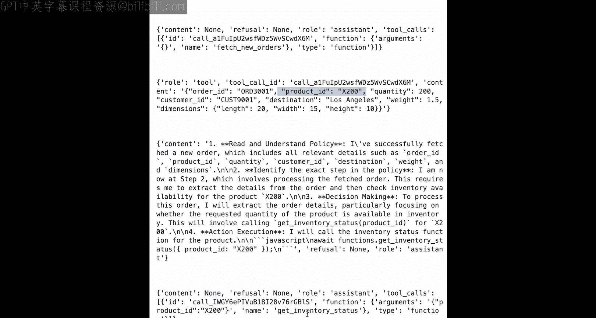

The next thing for a many he did was allocate the stock that it did have。

 so we can see here that it allocated the 50 units that it had to ful the 150 units that it doesn't have。

 The first step is to get the product details and figure out what components are needed。

 We can see that this comp X 200 component is what you need to build one of these units。

It then checks the available suppliers， finds that we have two。

And then calls the first one to figure out what the available quantity is。

It then places a purchase order for the quantity that it needs， which is 150。 there's 500 available。

 so that's okay。The next step is to check whether we have production capacity to actually produce those once we have the raw materials。

You can see that it checks for the immediate production capacity， and we only have capacity for 100。

 so it schedules a production run for 100 immediately。

 and then it goes back and checks the production capacity for next week and is able to schedule the remaining 50 units to be produced next week。

The last step is to calculate the shipping options for the units which we have right now。

Before finally， sending an order update to the customer。

 telling them your order has been partially shipped。

 The remaining items are being processed and will be shipped shortly。

And then successfully closing off the process。So pretty impressive。

 We've been able to implement an agentic flow whereby 01 acts as the orchestrator creating a plan and then handing to 40 minii who then executes the multi step plan in sequence。

Now is a great opportunity for you to take a step back and think about where you might have opportunities to use this kind of planning paradigm using the intelligence of01 and combining that with the low latency and cost of 40 to carry out these complex multi step agententtic processes。

😊，Next we'll change our focus from planning over to a very common use case for R0 and1 models。

 which is coding。Look forward to seeing you there。

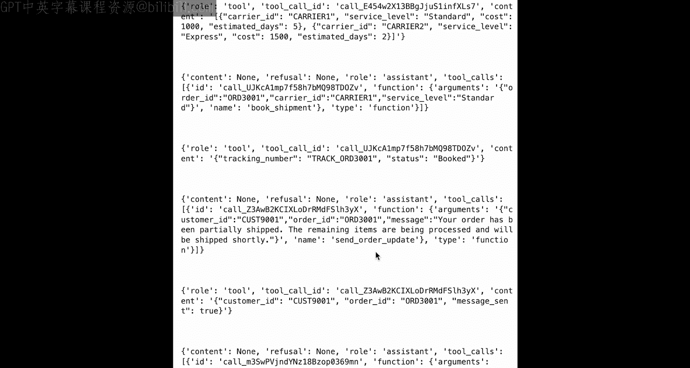