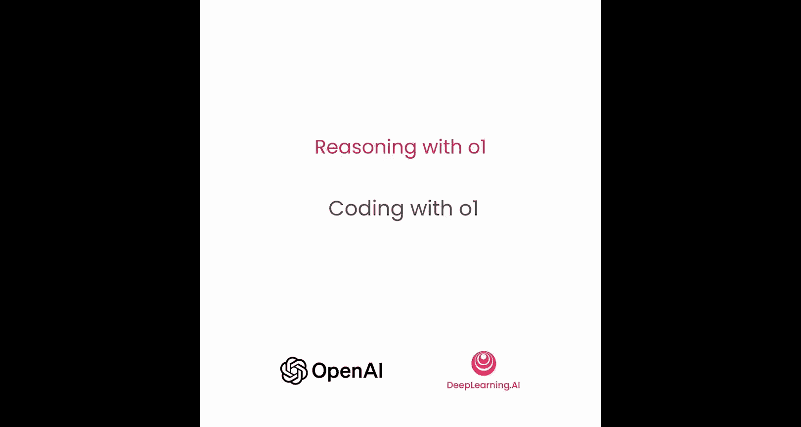
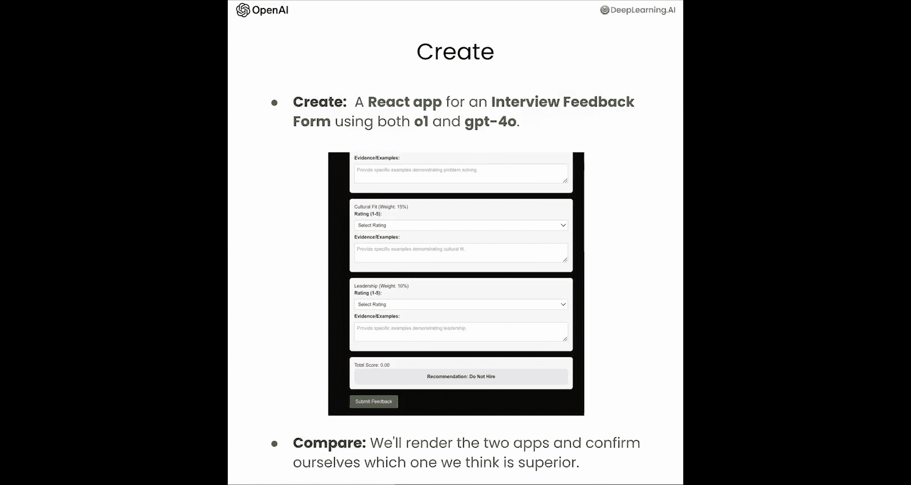
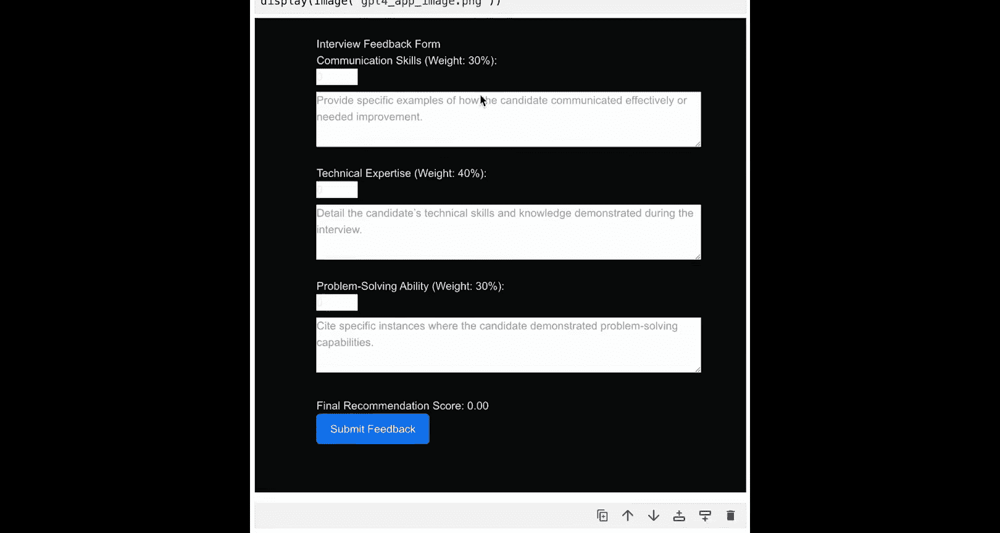
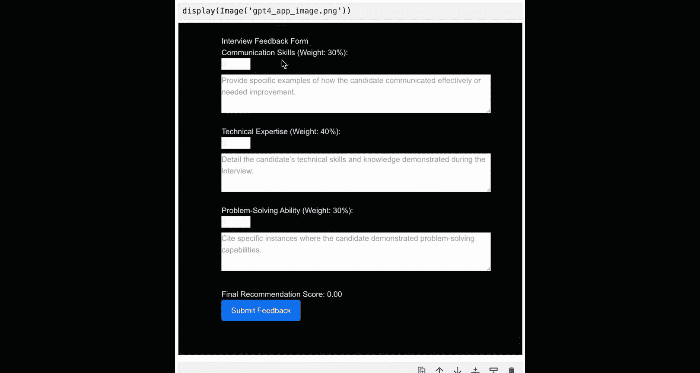
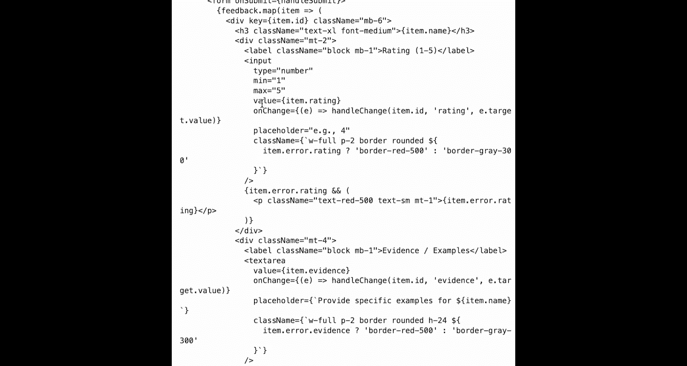
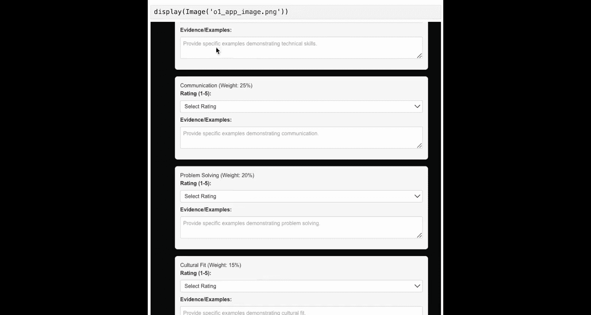
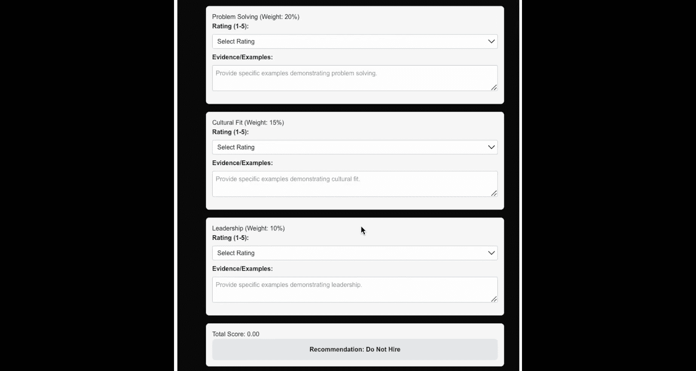
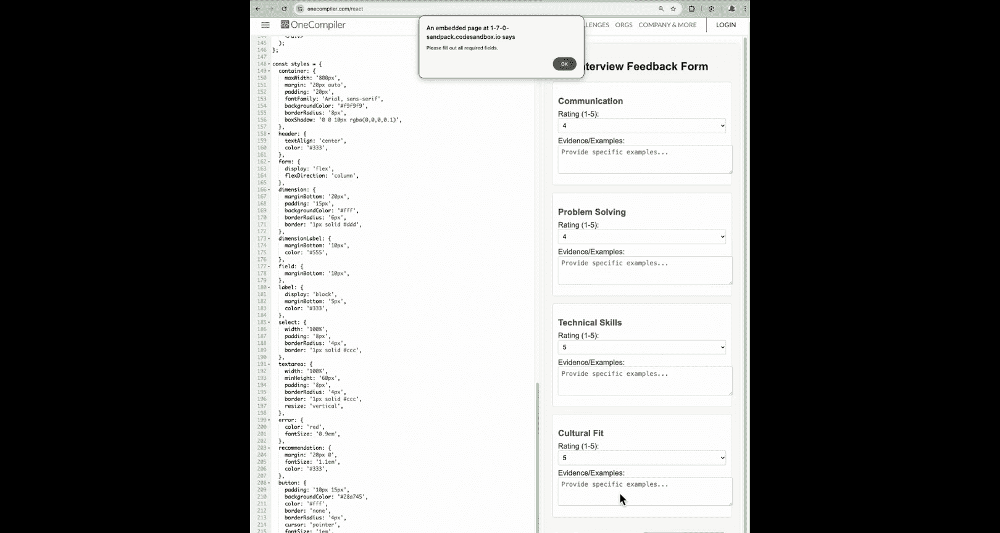
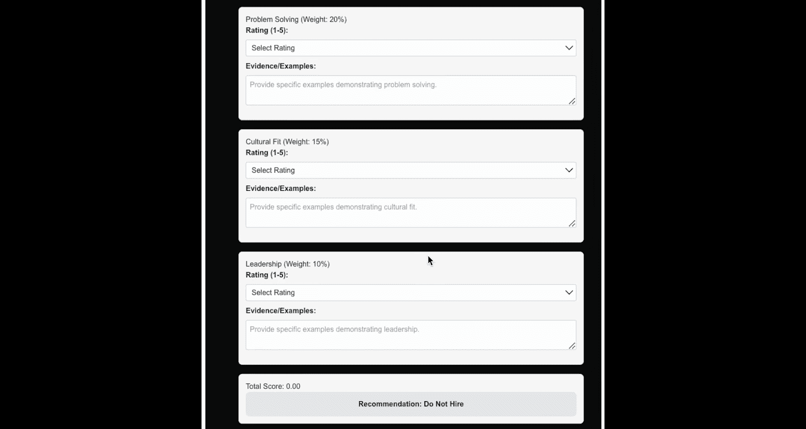
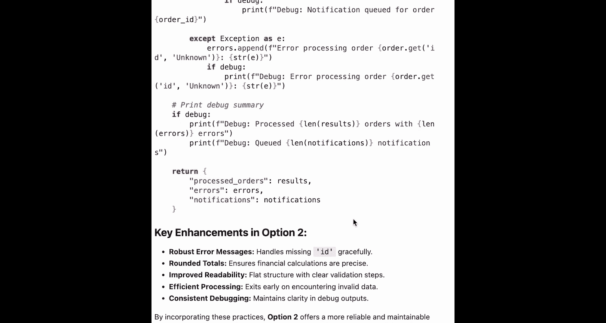

# OpenAI&吴恩达《使用o1进行推理｜Reasoning with o1》中英字幕（deepseek翻译） - P5：5.coding.zh_en - GPT中英字幕课程资源 - BV1UBkNY6Ep5

Building on the approach we use with planning， you're going to use01 to help with a coding task。

01 performs best with simple， direct prompting to both create new applications and to edit existing ones to test this。

 you'll run two coding competitions between 01 mini and G40 to create a net new application and to edit some existing code Let's get coding。

In this lab， we're going to learn how to use01 to assist us with creating an original app using code and then editing existing code using01。

To start with。We'll import our variables。So our opening IA BI key。And。😔，Again。

 the GPPT model and01 model that we've been using so far。We'll begin by creating a react app。

To start with， I'm going to define a function。Which allows us to get a chat completion response。

The next thing you'll do is define a prompt for how 01 and 40 should think about creating this app。

 So pasteing in a prompt here where we give instructions to create an elegant。

 delightful react component for an interview feedback form。😊。

We give it some criteria for how this app should perform and what the overall goal is and a couple of reminders here。

I've included these bees I'm working with 40， generally I wouldn't for01。

So now we'll generate code using both 40 and 01。 and then we're going to render both apps and visually compare the quality of each。

You'll begin with 40 here。 We'll get it to generate the app。 We'll render the app。

 and then we'll do01， and hopefully we'll see a market improvement with the 01 model。

Let's kick off the generation。Now that the code's done， let's print it and have a look。There we are。

 I'm just going to copy this out， render it in our app， and we'll be ready to inspect the results。

I'm going to display a static image of what I've gotten when I loaded that code into the app。

And here we can see an interview feedback form， but it's not so great looking。

 some some sort of little weird formatting。 So hopefully 01 is capable of improving on this。

Now， we'll repeat the process with01。 Our hope here is that using the same prompt will get superior results。

 So I'll kick this off to generate our code。Now that that's generated。

 we'll print it out to have a look at it。You see that we've got some JSx here。

 and I'm going to copy that into the app and print the image so that we can have a look at the quality of what it produced。

We can see here a， you'd have to say a superior app。

 So it's gone with some drop downs for the different rating numbers。

 It's listened to all of our instructions instead of including just a subset of categories。

 And it's given us a nice green feedback box as well。

 So a quick view of where 01 can help you when you have a high level design for an app and you want a starting point often 01 will get you a bit further forward than 40 will with equivalent prompting。

 This is a static example that I've generated。 But if you want to delve into this yourself and do some prompt engineering and then render your own app。

 then please follow the instructions in the notebook。

If you want to try out the code， you can go to the link in the notebook。

Cut and paste the code into the editor。And it'll render the form。

You can see the recommendation changing as we fill things in。And you can submit some feedback。

If you're an expert in JavaScript to react。Also， in the notebook is a description of how to download a zip file。

 contain an application you can run on your local computer。

Next， we'll move on to editing some existing code and show how 01 can give useful feedback that will result in。

 again， superior code to that produced by40。

To compare the editing capabilities of 40 versus01。

 we've produced some code that has some clear issues， like multiple nested loops。

 a lack of error handling。 And overall is not super readable。

 What we'll do is we'll feed this code to both models。 and we'll see how they clean it up。

 Then we'll employ a01 L M as a judge to rate the two resulting code blocks and tell us which one performed better。

We'll begin again with a simple and direct prompt and use 40 for our first generation。 So the prompt。

 I have some code that I'd like you to clean up and improve。

 return only the updated code that fixes the issues。 And then we're passing in that code snippet。

 which we showed above。 We'll generate this。 Have a look at the results。

You've now generated some code。 and outwardly， I mean， on first glance， it looks a little better。

 but let's generate the01 code， and then we'll compare the two with LM as a judge。

Here we're going to generate the same output but this time using01。And again。

 the results look plausible here， but the best way to figure this out is to employ an a to compare the two。

 So let's do that。We're going to employ 01 as our greater here。

 because this is the sort of nuanced multi step process where01 does generally tend to perform better than 40。

 So again， we feel pretty good using it here。 And in this case， we've used again。

 a simple and direct prompt。 So which code is better and why option 1， 40 code and option 2。

 the01 code。 So we'll run that。 And you'll see the results。😊。

The results are in and O ones deducuce that both of them are trying to do the same thing。

 but there are several key differences between the two implementations that make option2 better。

 It's called out the readability and structure， the error handling and robustness。

 where option 2 has selected a more effective way of doing that。

 and also the data processing and calculations， the debugging and logging and just general performance considerations。

 so。Again， a useful example of where even if you didn't rely on 40 for a code editor or kind of a code pilot to help you work through issues and edit your existing code。

 this is an area that01 does fairly well at。Great， so you should now be confident using O1 to assist you in coding。

 whether it's creating net new applications or helping improve your existing code。

 This is an area we're seeing a ton of uptake of01， especially in the first category。

 where you have a high level design， and you want a really good first stab。

 Looking forward to being with you for the next stage where we use01 to reason on top of images。

