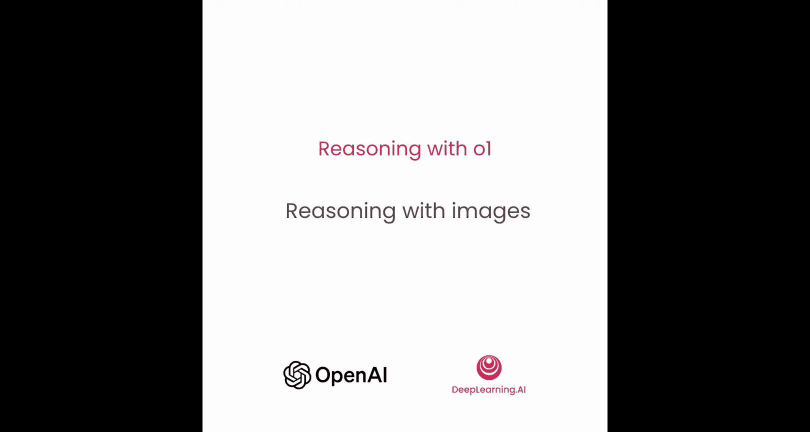
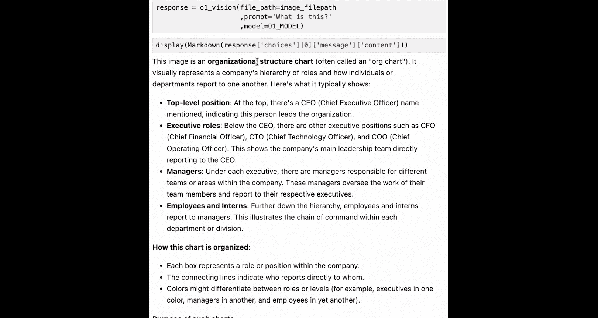
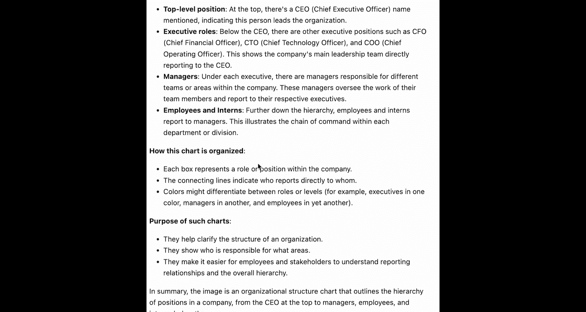
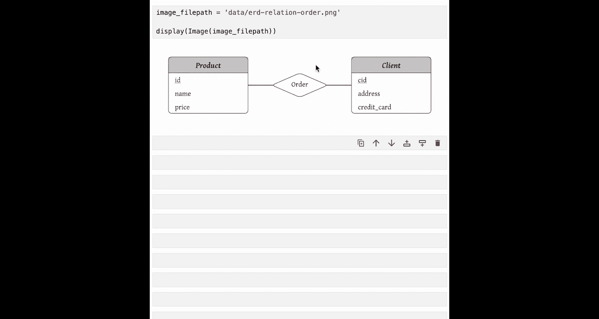

# OpenAI&吴恩达《使用o1进行推理｜Reasoning with o1》中英字幕（deepseek翻译） - P6：6.reasoning with images.zh_en - GPT中英字幕课程资源 - BV1UBkNY6Ep5

Image understanding with GPD 40 can perform well， but often needs chain of thought prompting。

 few shot examples， or fine tuning to achieve the best results。

Conversely，01 performs well at understanding images out of the box。

 This is due to the test and learn approach it follows in its reasoning。

 which gives it multiple chances to detect hallucinations before providing an answer。

One use case that is emerging is to incur the latency and cost hit for 01 up front。

 pre processinging the image and indexing it with rich details so that it can be used for Q& A later。

 That's something fun。

For this image reasoning task， we're going to use an org structure of a fictional organization。

This is the kind of nuanced diagram with a spatial reasoning that 40 would typically hallucinate at。

 but we're finding that O1 performs much better。 And it's because of that testing and learning approach that we referred to earlier。

 it will come up with a first impression of what the diagram is telling it and iterate until it thinks it has a decent outline of what the purpose is。

 So we're going start off fairly basic and just ask O1 to tell us what this is。

 and then we're going to move on to a use case which we're finding customers using practically in the real world pretty often。

 which is that you use01 to do image understanding and extract a detailed Json that describes that image and what's going on in it in a lot of detail。

 and then you can do text only follow ups to then interpret the information。

 So you're not paying the extra cost and latency of processing the image every time you effectively preprocess it with01 in a very high quality detailed manner and then use it for follow up。

Q&A。So let's head on and see how this works practically。As always， we'll begin with our imports。

 B in our libraries and any variables that we need to import。

 See here are our same standard libraries we've stored our vision request in a Uts file。

 which we'll import here。 And for this， we're going to use the new main line01 model。

 because where it be as that one is capable of image reasoning。

To get an understanding of the image that we're going to process。

 you should open up the org chart file， which we provided。

And you'll be able to see here that we have a CEO at the top， we have their C suite， their managers。

 and then the reports of those managers。You'll begin with the simple question of what is this so we can get a detailed rundown of what's contained in that order chart image。

 So we'll kick that off and display the contents。The model is given you a detailed rundown。

 so it's an organizational structure chart， it's called out the different levels of hierarchy and also given us a brief description of how the chart's organized and what the purpose is。

This is informative， but not super useful， so what we'll do next is process this into data that we can then use for follow up questions so that we can create analysis on top of this org chart and understand the details of how these different roles hang together。

What we're about to work through here is where we start to really see the improvement from 40 to 01 in terms of the quality of image understanding that we can achieve。

 What we saw previously with 40 is that it could generally give a high level description of what was in an image。

 But once you start to ask nuanced questions about like spatial reasoning。

 like what does that arrow point to or， you know， who reports to who in that org chart。

40 would give inconsistent performance and would typically need like few shot examples or fine tuning to achieve a decent level of performance。

 What we should see here with01 I that out of the box。

 it will perform pretty well and be able to reduce our。

Reasonably complex org chart to a simple Json array， which we can then use for analysis。

 So to accomplish that we've got a structured prompt here， again。

 using the principles that we learned in lesson2。 We have some instructions where we have a consulting assistant who processes org data and we'd like it to extract the org hierarchy。

 We've given it a specification for the Json that we want。

 So we want it to make up an arbitrary I for every person， their name。

 their role and then give us an array of Is they report to an array of Is that report to them。

 So once we have this， we have something which codifies the relationships in that image as data and enables it for ongoing processing。

 So you'll run this and receive the results。You'll execute the cell， and we print out the prompt。

 So there it is detailed here。 Now， you can feed that prompt into a01 request with the image and。

If we run that and print the results， we should receive a array of JO dictionaries which describe the different people in that org chart and how they relate to each other。

You can see in front of you the data representation of that org chart now。

 So we've got our array of dictionaries。 each one contains that arbitrary ID。

 And if we just reconcile the first one， we've got Juliana Silva， CEO I D 1。

 and we can see that she reports to no one， She's the CEO that's correct。

 and her reports are numbers 2，3 and 4。 if we check 2，3 and 4。Those are indeed the CFO， CTO， COO。

 great。So now that you've reduced this org chart to data， you can now use it for analysis。

 so let's step on and do some Q&A on top of this data and see if01 is able to use the data that is processed to accurately answer some questions about the org chart。

You can start by loading the01 response， says JO。And then we can create a prompt and add this data to it and then ask them questions。

In this case you've created an analysis prompt， you're an org chart expert assistant。

 your role is to answer any org chart questions with your org data。

 and then there's an org data XML tag here where we're going to interpolate the org data。

Before you ask your analysis questions of the Ag data。

 you'll need to initiate a fresh open AI client。 The reason we're not using the01 vision request is that we're simply heading out with a text only request。

 Now that we've pre processed that image， we don't need to send the image every time we're just going to use that data that we extract it and use that for our Q& A。

Here you have a simple，0 un request。 You've got that analysis prompt that you had at the beginning and then a structured question here。

 And there are two questions contained within it。 So who has the highest ranking reports and which manager has the most reports。

 if you execute that。You'll see the results。You can display the results as marked down here。And。

We can interpret the answers that we' gotten。 So， first of all， Juliana Silva， the CEO。

 has the highest ranking direct reports。 That is correct。

 All of her reports are sea level executives。Which manager has the most reports。 So， first of all。

 it's successfully filtered for only the folks with role manager。 And indeed。

 these two do have the most direct reports。 So that is a correct answer to the question and a conclusion to our image understanding task before we close off。

 I want to share one more example so that you can take what you've learned。

And tested out on a fresh image and domain。In the folder。

 you can see a photo that we've included of an entity relationship diagram。

 This is a great use case for image understanding。 Imagine all the data warehouses that you've dealt with with a complex E R D that you needed one of the local data scientists or where our owners of the warehouse to talk you through。

 Now， we can provide it to01 with image understanding and get it to parse it for you。😊。

So the challenge for you is to think of a few use cases for the entityity relationship diagram。

 For example， you may want to ask01 with vision to generate a table of order records which have Is to that link to these product and client tables and then get it to generate SQL to actually query the three。

Generation of synthetic data is a great use case that we've used Viion for in these sorts of cases on customer site。

We're very interested to see what use cases you come up with and very excited to see what you use 01 with image Under for。

Look forward to catching up with you on the next one， where we'll be going into Mepromping。

 how to use01 to automatically optimize your prompts。 Look forward to seeing you there。

