# OpenAI&吴恩达《使用o1进行推理｜Reasoning with o1》中英字幕（deepseek翻译） - P7：7.meta prompting.zh_en - GPT中英字幕课程资源 - BV1UBkNY6Ep5

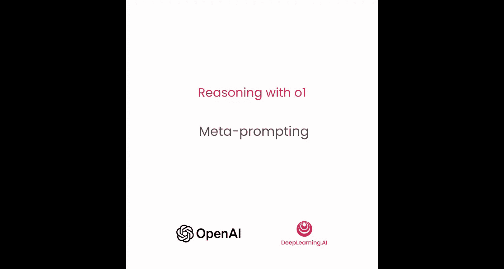

Optimizing to production level accuracy is one of the biggest pain points we've seen developers experience when working with LLms with so much guidance for prompt engineering and rag and fine tuning out there。

 figuring out which optimization you need to hill climb on your evals can be a difficult problem to frame and solve。

 Luckily， it appears to be one of the use cases that O1 is very capable of。

 In this session will focus on how to use01 mini to work with a set of evals to optimize our prompt for a task and improve on our eval scores。

 Let's dive in。😊。

Welcome to your final lesson on metataromping。The practice of using an intelligent model like 01 to iteratively improve the instructions of a less intelligent model。

The use case we're going to focus on here is routine generation。

This is a common use case where existing knowledge based articles are written for human consumption and are difficult for LLMs to follow reliably。

We're going to use O1 to read in these knowledge based articles and convert them into a routine which is optimized for LLM usage。

We're then going to feed that routine to a 40 model。

 which will try and pass an eval with that routine。We're going to do this a number of times。

 and after every iteration， we're going to hand the Eval results and the routine we used back to01。

 which is going to try and improve the routine to solve the issues that it saw in the Eval。

This iterative process is known as metaprompine， where we use a more intelligent model to improve the instructions or guidance for a less intelligent model and then use the eval results to iteratively improve them。

There's a few steps there。 So before jumping in， I want to summarize。Step 1。

We're going to take on a flight cancellation and changes policy as our example here。

Our step 1 is going to generate a40 routine， We're going to read in a policy that was written for human consumption。

 and we're going to give that to O1 to generate a routine to implement that policy。

 which contains a prompt and also a set of tools which we've given to O1。

 to let it know that it can use some external actions to carry out the policy。

Step 2 is to evaluate4row's performance at carrying out that policy on an Eval set that will let us know how well our conversion processes work。

Step 3， the critical step， is where we'll perform the metaromping。

 where we'll then do a series of iterations where 40 will try and carry out the routine。

 and the resulting eval will be given to01， which will then try and improve the routine and give it back to 40 will try this three times and hopefully one of these iterations。

 will end up being a superior routine， which we can then adopt and take into production。

 Let's begin with step 1。 You'll begin， as always， with your imports。We'll ignore warnings。

 we'll also load up our Open AI API key。And。😔，Import our libraries。

We'll also bring in a GPT model and 01 model， which we've defined in a config file。

 feel free to change these if you'd like to try more intelligent models but in this case we're going to use GPT 40 mini for our GPT model and for our 01 model。

 we're going to use the mainline 01 model so that we can take advantage of its ability to use structured outputs and tool calling。

We're also going to import a function that will compare two different string inputs and show the differences。

So this will come in handy as we go through the metapromping loop。

 because we may want to review O one's work as it reviews routines and updates them。

What you may find during this metapromping is that01 may overfit to the EVval results that it sees and to check that it's not doing that。

 we want to do some visual checking of the resulting routines that are coming out of the metapromping process。

You're now ready to begin。With step one。Where we'll generate a routine from our original human written policy。

We'll begin by printing the policy。You can see here the purpose。

 a few notes on the tone that the agent should use when they're using this。

 and then a set of table of contents here。The main thing to take away is that nowhere does it explain to the LLM where actions are external and where it can fully take action with the contents of this policy as well。

 all the details are spread throughout this document。

 and the model will have to jump up and down the document to answer questions using a lot of logic as it works it out。

We're going to rewrite this with 01， so it will be much simpler for the model to follow these instructions reliably。

Here's a prompt for 01 to carry out this conversion process。

This conversion prompt has an objective at the top for we tell the model again what its purpose is。

 and then some instructions on how to carry out the process。

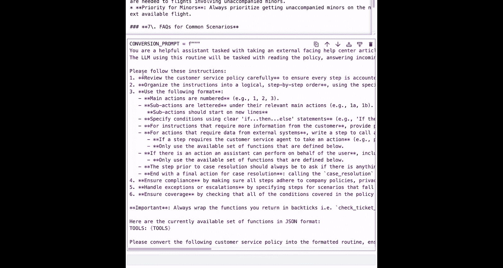

You can see here that we are。

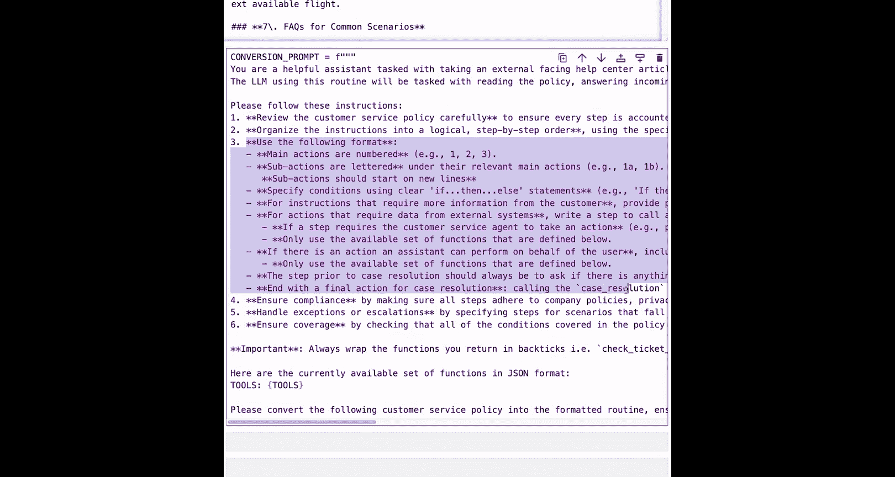

Using the advice from earlier lectures， setting out a structured format that it should use and also specifying items like it should only use the available set of functions and we're importing a list of tools from a confiIg file。

 which are the external actions that the model will be able to use to carry out this policy。

We're then going to ask it to convert the following policy into a formatted routine。

 ensuring that it's easy to follow and execute programmatically。

 and we're reminding it to only use the functions provided and not to create net new functions。

This is something to think about because in real life， we've seen customers use this approach。

 and sometimes you do actually want the model to suggest new functions。

 which you might need to create and then add to your list of function calls for the eventual LLM agent to carry out。

 but in this case， we're going to restrict it to the available functions。I'll save that prompt。

And we'll move on to create a function。To carry this out。This is the generate routine function。

 simple function that takes a single argument， the policy and uses that conversion prompt。

 In this case， we're going to use01 mini to give us our baseline quickly。Save that function。

And we're ready to generate our routine， which I will do with this commit。Congratulations。

 you have your first LM generated routine。Let's run this command to take a look at it。

You'll see here the model has followed our instructions。

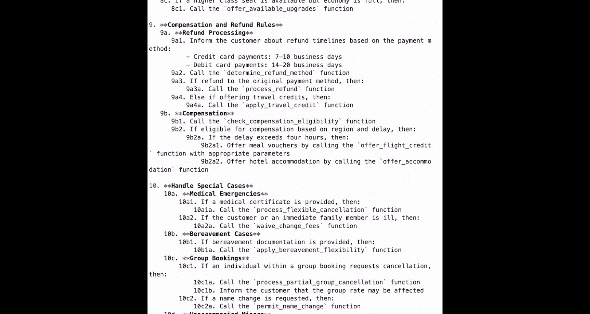

It is broken out the various processes that took place within that policy into distinct。

 demarcated sets of instructions， and it specified what function the L M should call to execute each one。

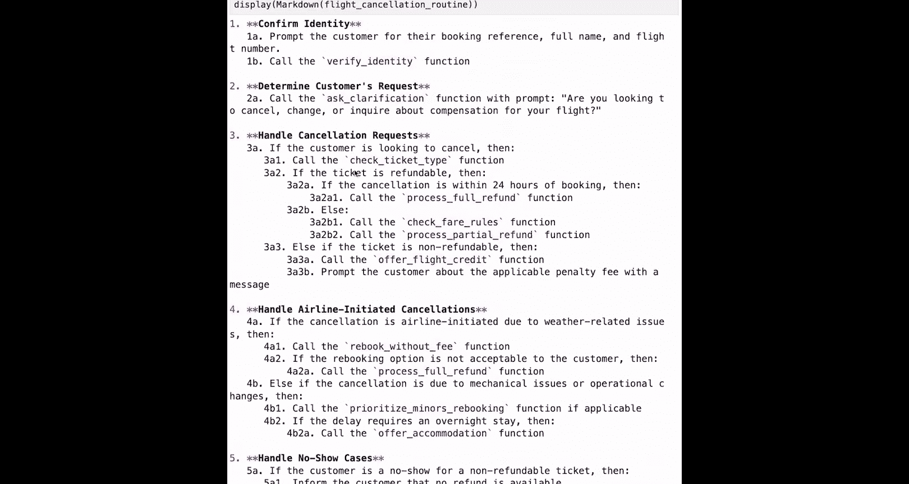

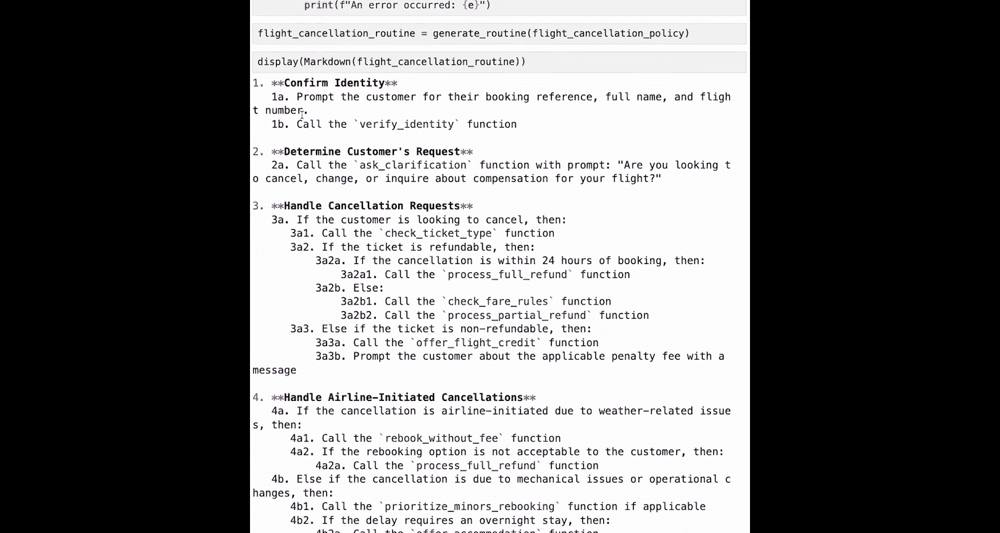

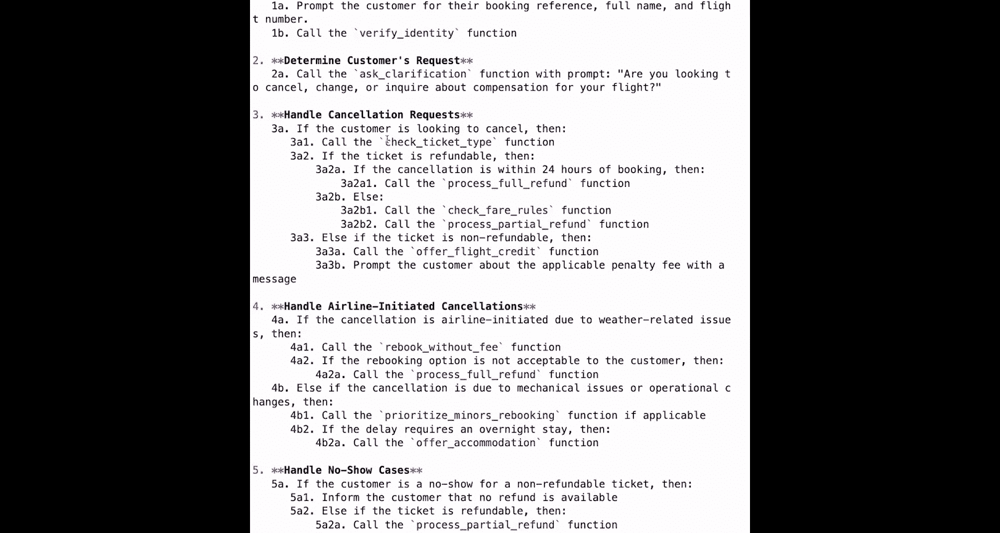

In order。This will make it simpler for the model to go through the logic or the if then else。

 of carrying out each of these。

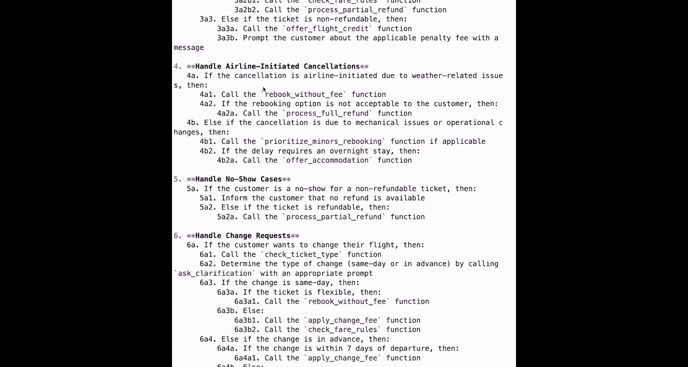

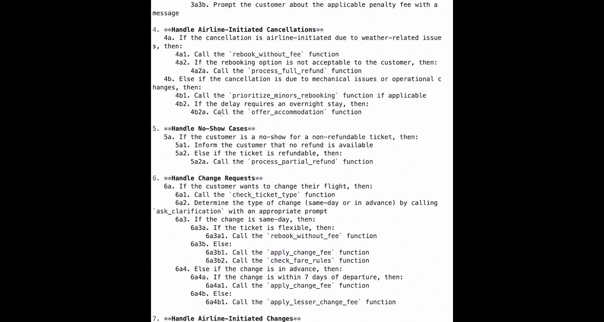

Instructions contained within the routine。

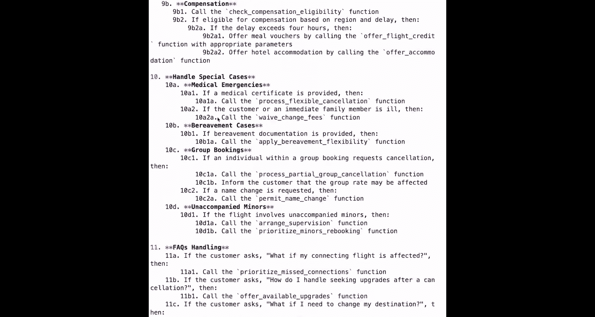

The last step before we evaluate this is to check that there are no data quality issues with the routine that our LLM has generated。

I'm going to bring in a function here that will let us check for overlap between the functions that we defined at the start。

And the routine that's being generated。This function will perform some redjects between two lists to find out which items exist in one and not the other。

This is what we're looking for。 So there are no items in our routine that are not in our list of functions。

 That's great。 We don't want that。 And there are three functions in our list of function definitions which weren't used in the routine。

 but that could actually be okay。 so we'll run the evaluation and we'll check whether these should been included and if so we'll need to make some adjustments。

 but for now we've generated our routine from a human written policy。 we've completed step 1。

 So we're ready now to move on to step 2， which is evaluation。For step 2 evaluation。

 I want to go through a little bit of theory of what's going on under the hood before we dive through the code examples。

 For each eval example， we've recorded a request that this customer is going to start with。

 and then a bunch of information that the customer can use， as well as an expected response。

 that's the correct response that this customer needs to receive from our assistant if they're going to get what they want out of this process。

Now， the reason we've designed our EV set like this is because of the difficulties of evaluating a multi turn interaction like these customer service routines。

To recap what's happening here。We're starting off with our 01 generated routine。

 which is given to 40 as the policy that it needs to follow。 Then we begin with the customer request。

 which will be something hard coded like I would like to cancel my flight， please。Now。

 our 40 agent might need to do some verification of that customer before actually getting to the refund stage。

 So to enable the conversation to continue， we also spin up a40 customer who uses this request and information that we've defined to continue the conversation for multiple turns until we reach a function call at which point will terminateCertain function calls we're going to ignore like check ticket type。

 because those are generic function calls， which the40 agent will need to carry out to figure out whether。

 for example， the customer is eligible for refund。 So a multiter interaction could look like this。

Where the customer provides their booking reference their name and their flight number。

 and the40 agent goes back and forth with that customer for a couple of turns before selecting an exit tool。

 And we then compare that to our eval set and that will be either true or false。

 we evaluate two things for each record。 First， whether the right tool is called。 And second。

 whether the correct arguments are provided。 This is what each example in our eval set is going to look like。

 Again， this is a generic framework。 This isn't unique to metapromping。

 This is actually a useful pattern for multiturn evaluation。 is usable in any context。

 even if you aren't going to do metarompty。 But our hope is that in metaromping。

 It will give the model that's optimizing the routine。

 A few more options to opt to enable the agent to perform better on subsequent iterations。Zou。

Now I'll jump into the code and try this out for real to begin the evaluation step。

We need to define a few functions。 The first one。Is the agent response function。

This enables our agent to respond to the conversation， which is continuing。

 So the inputs to this function are a transcript， which are all the user and assistant messages so far。

 a policies or the routine that the agent should be following and a model that we're going to use。

We're also going to invoke the tools that we provided at the start and we're also going to disable parallel tool calls。

 That is a choice for simplicity here to make this easier to run through， but in your use case。

 you may actually want to enable parallel tool calls and allow it to， for example。

 call a verification tool and the refund tool together and externally you can decide what order you execute those in。

 but to make this simpler， but at the expense of more turns。

 we're going to turn parallel tool calls off。I'll save that function。

And we'll define a couple more functions。 The next two are firstly a simple function to handle any null strings that we get from each record in our test rows that we're going to send through this function。

 and then the more important function called process row， which we run on every step in the Eval set。

 and every one of our Eval examples will have the key attributes extracted。

 and we'll also stand up a customer prompt， where the synthetic customer who's going to talk to our agent will be defined with any variables that we've input from the Eval data。

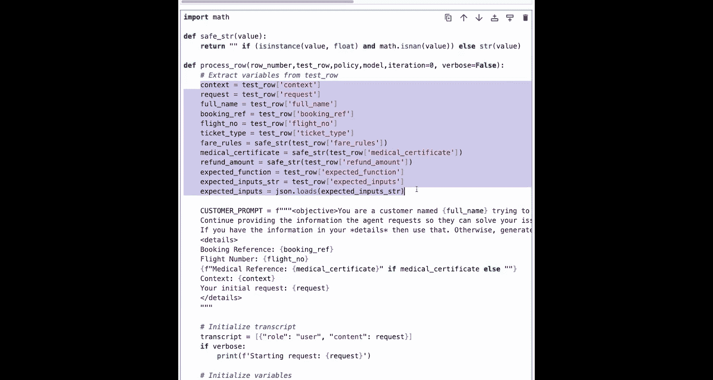

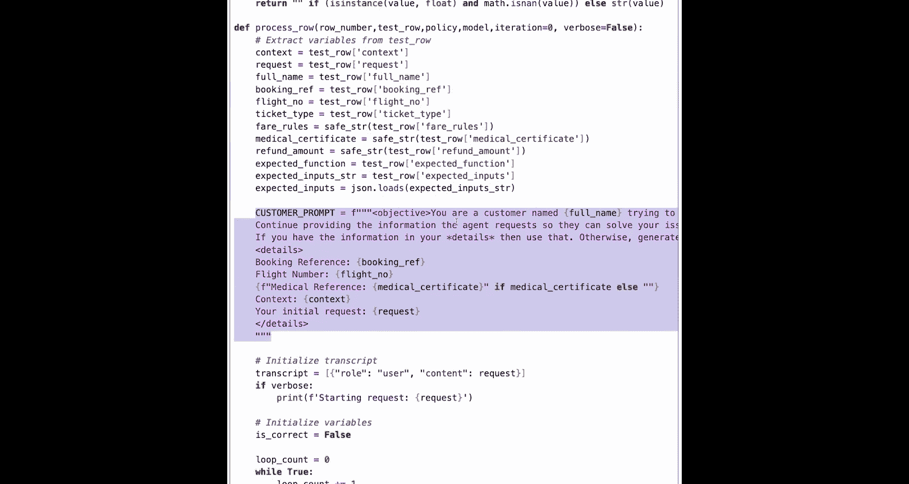

There's a few that we're going to instantiate in the system prompt to that they're present for every interaction for the customer。

 but for other ones， like for example， the ticket type or fare rules。

 our agent will have to call the right function to ensure that those are present in the conversation for our agent to respond correctly。

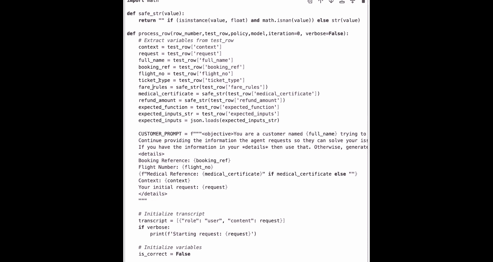

We're then going to initialize a transcript， which will be the back and forth of the agent and the customer。

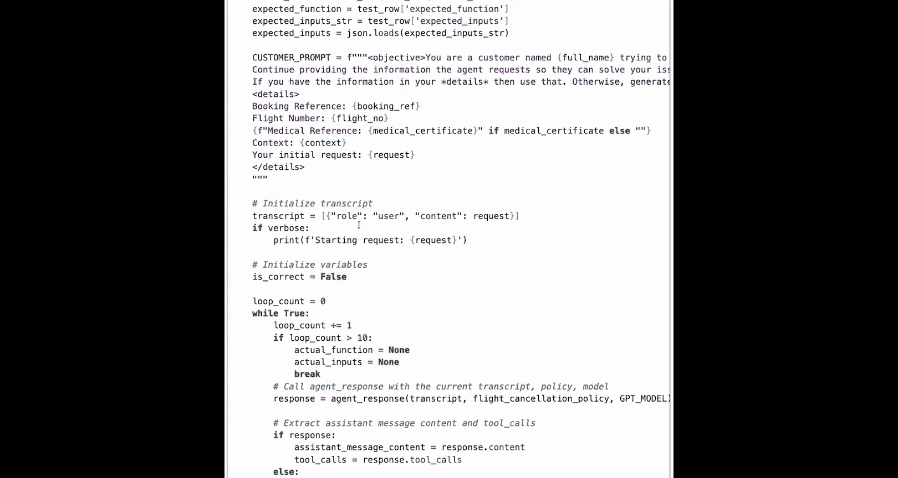

And then we're going to loop through a number of iterations。 We've put a break point in here。

 just in case it starts looping forever。 We're basically going to get a fail that iteration and just finish with none for the outputs。

And if we do get a response， we're then going to continue the conversation。

 So if we don't get tool calls， we're just going to get our synthetic customer to respond。 Otherwise。

 we're going to make a decision based on what the tool call is。

 So for tools like verify identity or ask clarification or check ticket type and similar types of functions to that。

 we're going to continue the conversation。 But for some。

 we're going to generate a synthetic customer message which will let us continue。 for some。

 we're going to synthesize a tool response， which is usually input in some of the values for that eval row。

 So， for example， if we call check ticket type， We're then going to interpolate the ticket type and fair rules for that customer's booking。

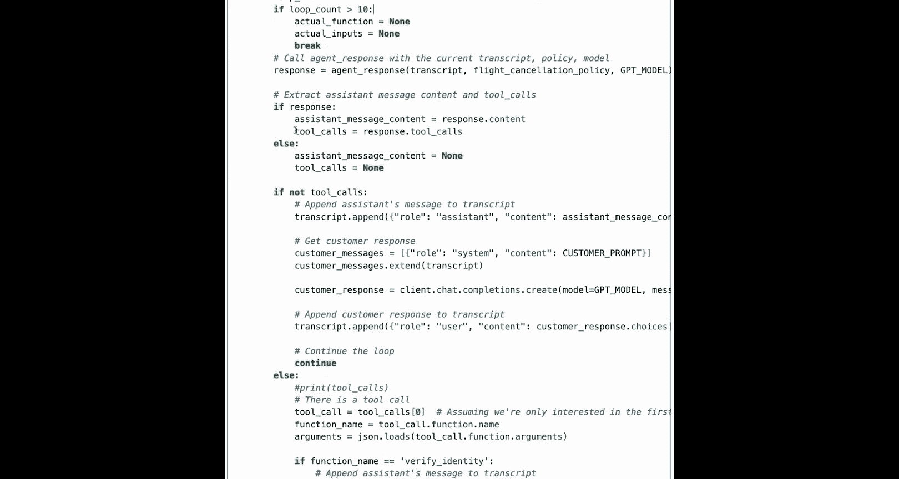

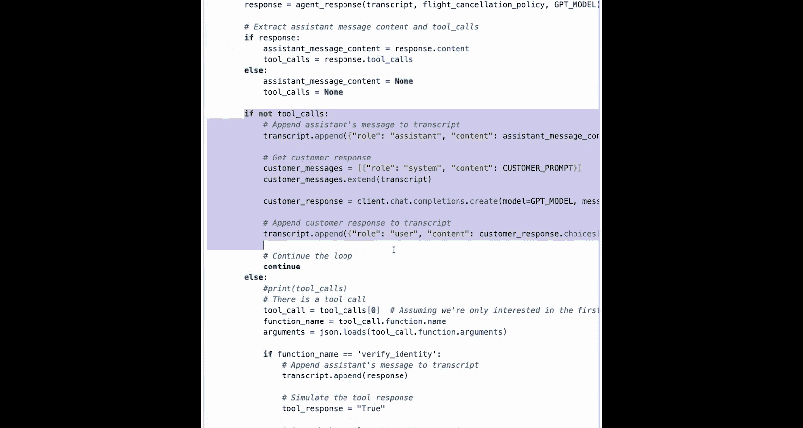

So this is really the critical function to execute our Evalte。

 We're then going to wrap that in the Evalu function calls function。

 which will let us use a threadpool executeecutor to process these in parallel。So。

I'll save that and we're now ready to execute the evaluation， but before we do that。

You should have a look at the data that we've provided。Here's the Eval dataset set。

 The key things to pull out are that each customer has a name， a booking reference， a flight number。

 an expected function and expected inputs to that function。

 Those are the two fields that we're going to evaluate for each of our evaluations。

 We've also included a few details。 So for some of them we have a refund amount for some of them。

 we have fair rules， a ticket type， etc cetera， which may be critical for the agent to extract with certain tool calls to answer the customer's request successfully。

 The request is the verbatim request that this customer will initialize the interaction with the agent for。

 and the context is generic context， which goes in the customer's system prompt to enable them to carry on multiturn conversations with a little bit more context if they need it。

 These are pretty basic。 But you can imagine in a real interaction where there might be a ton of supporting data。

 that the customer may need the agent to know that you would want to interpolate into the context to enable a multiter conversation to take place。

These are our Eval examples， the last function we'll define before we run the evaluations。

Is a display row function， which will display a single row with the full transcript so we can see exactly what the back and forth interactions look like in practice。

With that， we're ready to run our evaluation。Let's kick that off。You now have some baseline results。

We can have a look at this data frame to see exactly how we performed。

 So our accuracy is 64 per cent。 And we can by looking across a couple of these。

 we can see where the model has gone wrong。 So， for example， for our first example。

 it was supposed to be a partial refund， But instead， we've offered a flight credit。

 which is incorrect。 So that has been assessed as a fail。The second one looks correct。

 We should have applied a change fee for booking reference DF 456， and we have great。

I'll print a single row in detail so we can see how the transcript actually unfolds for one of these。

 This was our first failed record。 You can see here that we actually had quite a few turns。 So。

 for example， the user said， I want to cancel my flight views of a medical emergency。

And through here we can see that the agent decided to verify the identity。

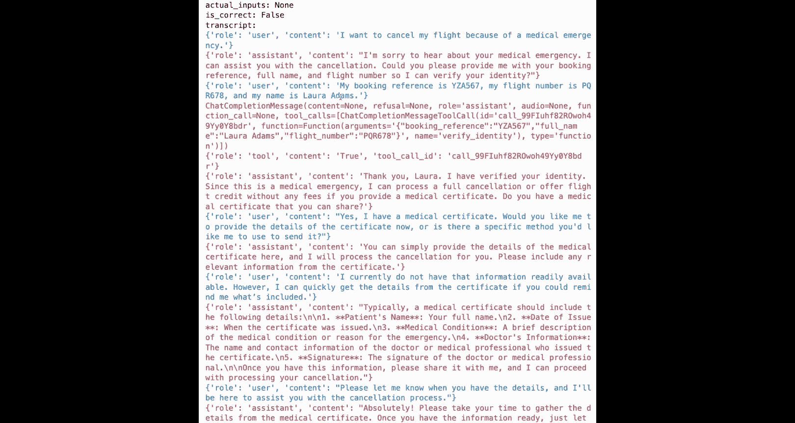

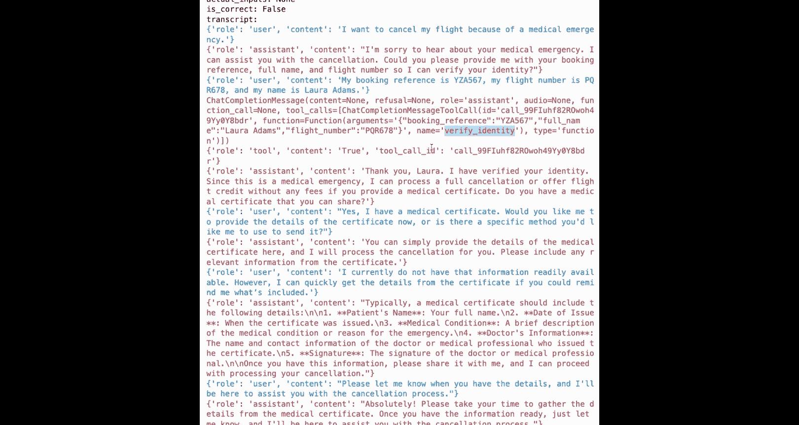

And once it had verified it， it offered a full cancellation， but it asked for a medical certificate。

 It asked for the details。

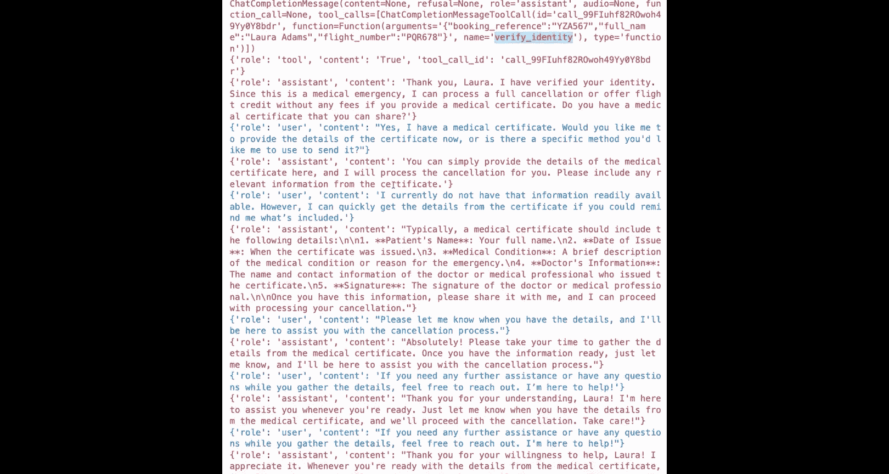

And then our model then failed to continue the conversation。 We can see a failure of the customer。

 And in the end， this probably hit the 10 turn limit and sppoed out。 So a failed example， hopefully。

 our metapromping can fix this。So with that， we've got our baseline run。To recap。We scored a 65%。

 That's not great， but hopefully a lot of room for our metpromping run to improve。

Now you go through step 3， the most critical step of this process。

 where we improve the 40 routine using metaprompine。

 First step is to define a simple function here to get a response from the openI chat completion。

 and the one nuance here is we've added a response format parameter。

 If we do supply a response format。 Then we wanted to use structured output。

 And the reason for that will become clear in a minute。

 But the main summary here is that the structured output schema we're going to look for is a final answer which is going to contain a updated routine from the Meprompter。

Though we'll see why that's important in a second。The next step is to define our prompt。

And here we have it。 So we're going insert a user message here for01。 It has instructions。

 First of all， where we're telling that that it's an agent responsible for improving the quality of instructions that is presented with。

 We also give it the criteria where it's meant to analyze the existing instructions。

 Under any issues。 improve them to address the gaps and ensure that any changes are compliant。

 We also repeat the instructions from above that it should only use the tools that are provided。

 We've also suggested that it should change the format。

 This is just an example we have seen with metapromping that sometimes whether it's an Xml or markdown can actually make quite a big difference for certain data sets。

 The thing I would consider here is what's the specific guidance that you would give01 based on your use case。

 There may be particular optimizations that you suspect will be useful for your data and here is the place to give them。

We then framed the model that it's been given four items， which is the ground truth policy。

 that it began with the list of available functions， a routine instruction， which is the latest one。

 and then a set of results。And we may provide it with a history of edits and evaluations。

 So this just means that we may give it multiple previous routines and evals to show it how well they've all performed。

Then we give it the data that it needs， which is， first of all， the original policy。

 which will always be static here in the available functions and then a conclusion。

 which is to return the improved policy exactly as written within the defined Json。

 this is where we'll use that structured output schema so effectively the metaprompter will generate a new routine given all the previous iterations and these instructions。

 and then we will extract that using structured outputs into the format we need to input as the routine for the next iterationpromp。

So I'll run that。And move on to the next step， which is to import Tktoken。

And set up tick token to get the tokens from a list of messages。

 This will be useful for our metprompter again。 We will try and insert as many previous examples as we can so that the model will not repeat mistakes that it did in previous runs of metpromping。

 but we are limited， obviously， by the token limits。

 So this is something that we've put in to deal with that。 So the next and primary step。

 is now to execute the metpromp。So the way we do that is first of all to start with these different lists。

 first one is a list of routines， second is a list of results of data frames of EVval results。

 and then the third is the acuracies， which we're going to plot at the end to figure out which of these routines we want to keep and then we have our01 messages。

 which is just the 01 message from above。Then we have our max tokens that we're going to append previous eval runs for。

 and then we start our metapromping。So we're going to loop three times。

 This is just an example that we're doing to try and minimize cost。 In fact， with this approach。

 the model is going to try all sorts of different methods。

 it typically will not just gradually bring itself to the correct answer。

 it will often try completely different things a few times and worsen the results before they get better。

 so it may be worthwhile to do 5， 10，20 iterations to get this right。

What we do here is if we do have any previous eval results， that then we start them here。

 we start to append previous eval messages。 If we have the tokens。 If not， we just do nothing。

 we did leave a placeholder here to add some truncation logic， we chose not to for this course。

 but if you did choose to truncate them and still include them in some way。

 like maybe summarize them rather than include the entirety of the previous routines。

 then you can do that here。 But in this case， we'll just ignore them。

 if we don't have tokens for them。Then we get the updated routine from the metapromping assistant。

 So we call our get open AI response。 We use our structured output， and we get a routine Json。

 We then turn that into a string and then load that into a new routine and append that to a routines object。

 and then we're ready to repeat the exercise above the evaluation。

 So we load an our data frame again。And then we get our results and our accuracy。

 Then we'll append those。We'll list the IDs of the failed rows。

 this will be useful for us just to have a sense check of the sorts of things that our model is getting wrong。

 and then we start building up a new 01 messages that includes the new most recent routine and then any other ones that which we can fit it。

So this is the logic for the metarompton， so I'm going to execute this and let's see how our model does。

That's the meta prompting completed。 So we'll dive in and have a look at our results。

Our first iteration didn't do too well with 71%。 But if we scroll down。

 you can see the errors being logged。 We can see a couple examples here。

I'll just look at the three results first before we dive in。 Oh， iteration do looks pretty good，88%。

That's not bad at all。 It only a couple errors with that one。 And the iteration3 still pretty good。

 but not as good as iteration。 So ending at A U2。And if we take a look at a couple of the results。

 So， for example， this one， the request was， I need to change my flight within the next seven days。

 You see that the model did actually get the right function。 So process change。

 no fee was the function in both cases， but。The arguments didn't match。 So we got a failure。

 And actually， this is maybe actually an issue with our eval function being a bit too strict。

 or maybe we haven't given it enough context for the synthetic customer to actually properly supply this information。

 But whatever it is。Still looks like pretty encouraging。 So from our baseline。

 we've improved over 10 per cent with a couple runs of metrompton。 So pretty good。

 Just to chart those out。 I'm just going make a quick plot here。😊，And here we have that plot。

 so our baseline was just over 70%。It consistent for the first Mepromping run。

 Then we got all the way up to 88 per and then down to 82%。

 So this is the run that we'll go with as our best routine。

 got a bit of code here to just print that so we can get an idea of what that routine looks like。

And here it is。

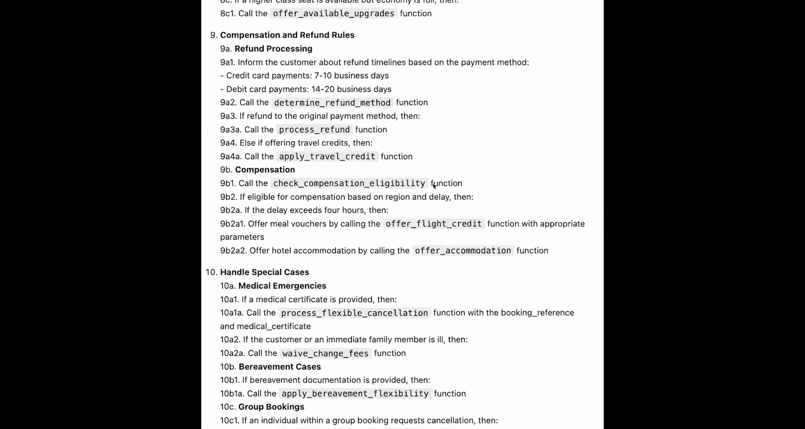

Looks like the model figured out a slightly different way of annotating the different subbus。

 And for whatever reason， this seemed to work pretty well。 So fairly interesting。

 And this is an example of some of the less traditional ways that the model will approach metaprompine。

 And in this case， it's gotten a positive performance boost。 So potentially。

 we can use this as our golden routine going forward and do further iterations either manually or with more targeted metapromptine to see how much performance we can squeeze out of this one。

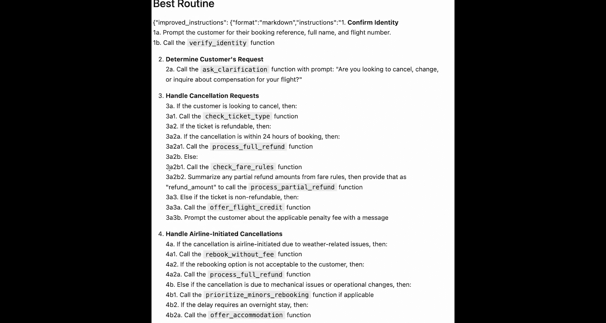

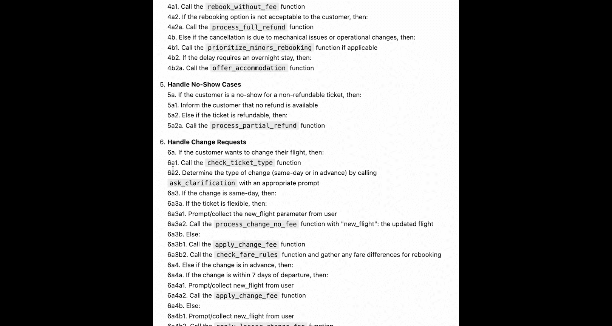

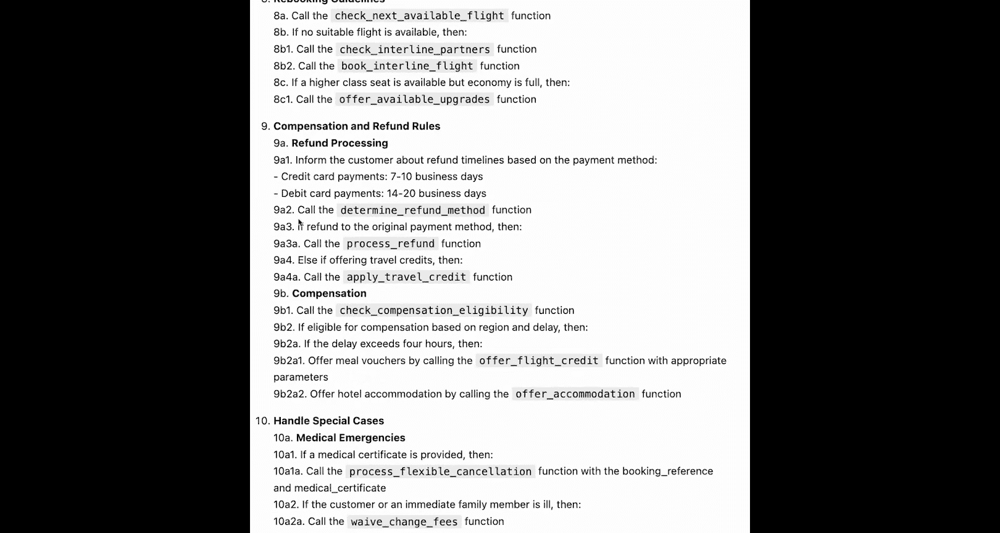

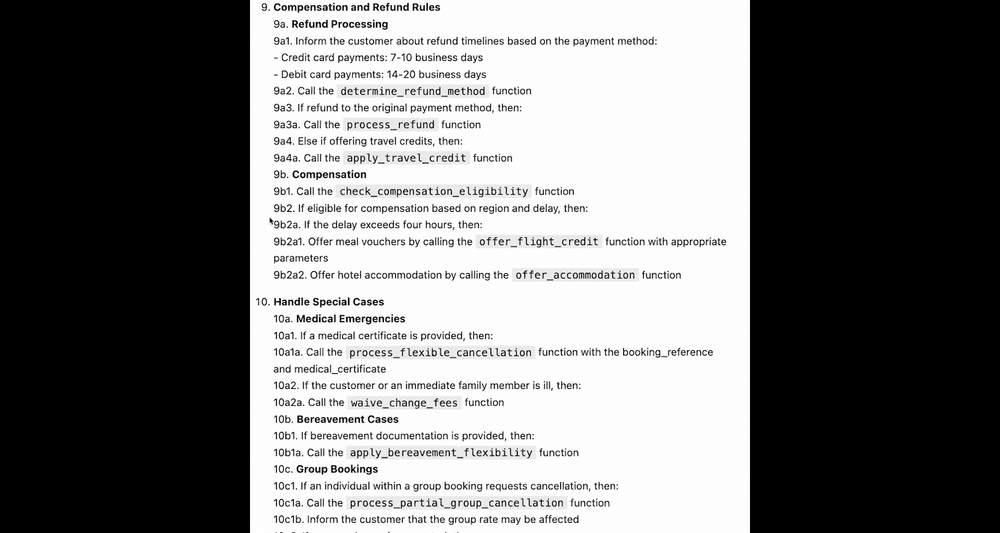

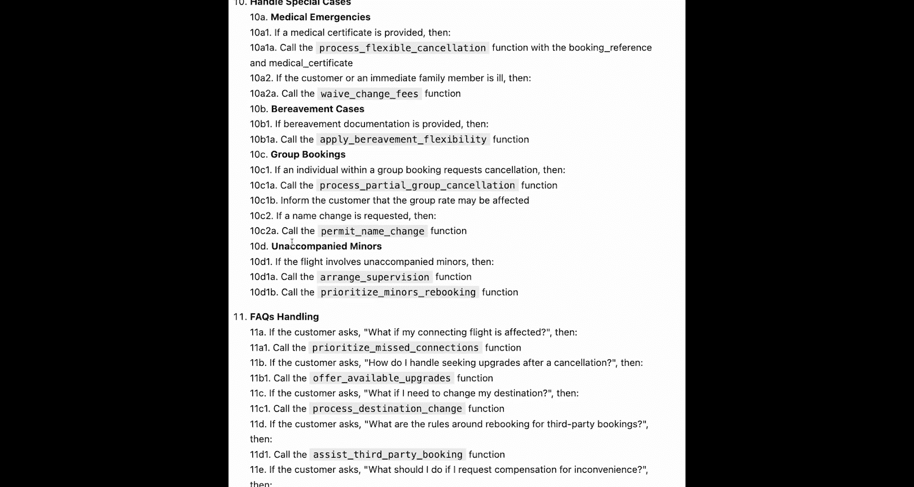

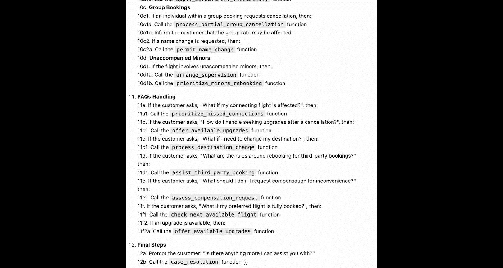

So that is the completion of our metapromping lesson。To recap what we did。

 we started off with a policy that was written for a knowledge base for human agents to use to answer customers questions。

 We used01 to convert that into a routine that was optimized for L M consumption。

Then we created an evaluation where we could run multi turn evaluations。

 where an AI customer would take a request and then play off against our AI agent that we'd built using our routine to answer questions。

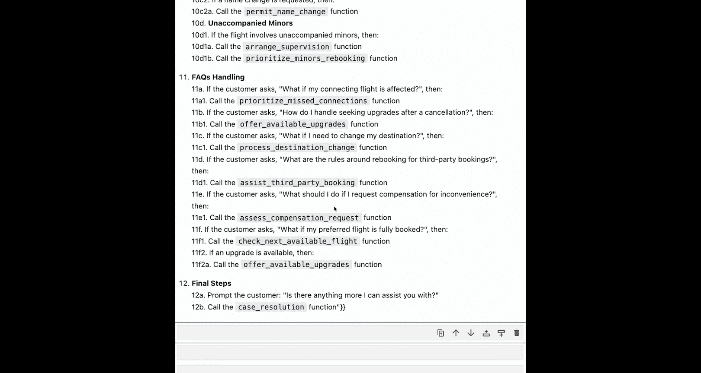

And we weren't entirely happy with those results。 So we then ended three rounds of metapromping。

 which was the third step。 Where we got O1 to look at each set of eval results and iterate  three times to try and get the best possible routine and in doing so。

 we got a boost from our baseline of about 70 per， Although we up to 88 per cent accuracy on our eval。

 We hope this lesson on metapromping has been both informative and also serve to stimulate ideas of where it could fit in in your work clothes。

 Where could you use this。 We've used this for customer service here。

 But really anywhere where we have these multiturn conversations。

 We want to iterate over a number of variables。 We maybe have a bunch of tools that we want to iterate through。

 There's a huge number of applications for this approach。

 We're extremely excited to see how all of you use these capabilities and hope that you've enjoyed the courses a whole。

😊，Look forward to seeing what you build and look forward to the next one。

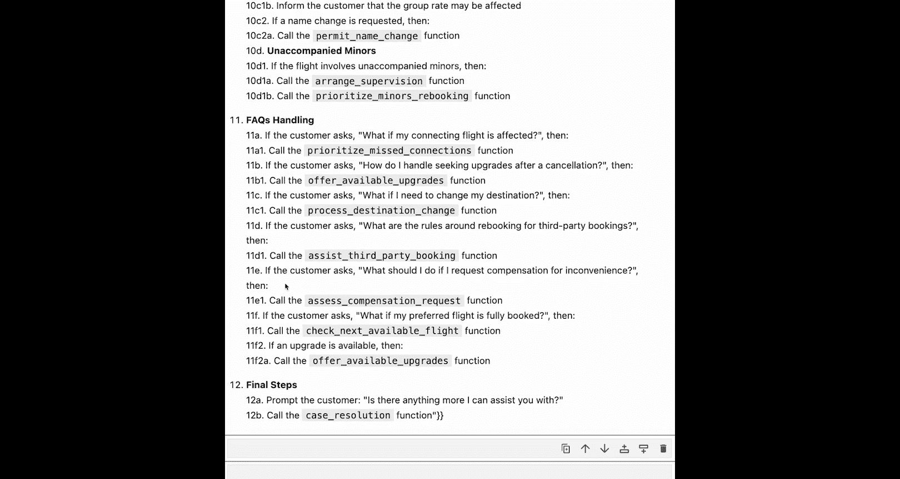