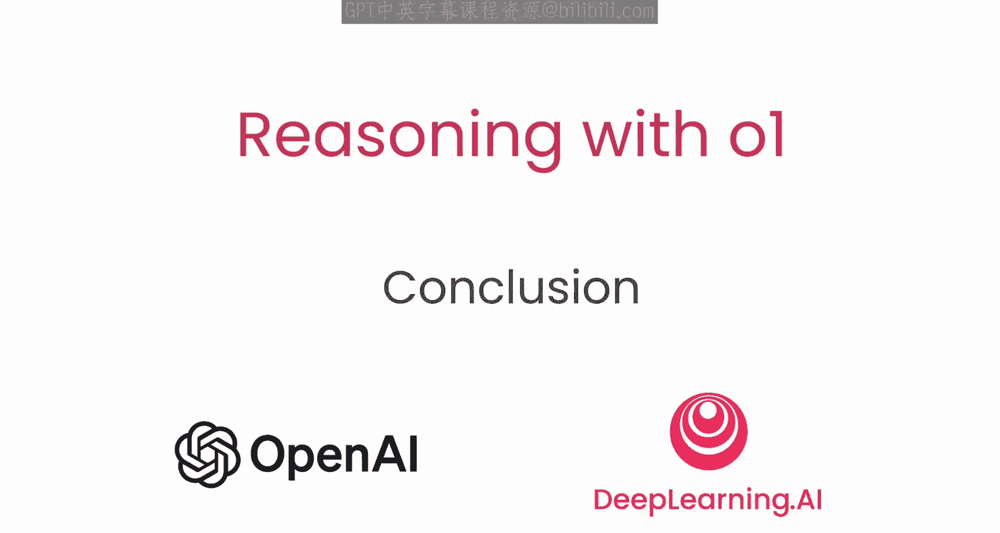

# OpenAI&吴恩达《使用o1进行推理｜Reasoning with o1》中英字幕（deepseek翻译） - P8：8.conclusion.zh_en - GPT中英字幕课程资源 - BV1UBkNY6Ep5

In this course， you learned about how our reasoning models work， how to prompt them。

 and some great use cases that developers are delivering in the real world。

You now have what you need to start building with this new class of model。

 and we are very excited to see what you come up with。

