# Sebastian Raschka《从零开始构建大语言模型｜Build a Large Language Model (From Scratch) 2025》 - P3：-3-Build an LLM from Scratch 3： Coding attention mechanisms.zh_en - GPT中英字幕课程资源 - BV1BCfdBqEVv

Yeah， hi and welcome back， everyone to Cha 3 coding attention mechanisms。

 So this is a supplementary coding a long video for theBuild a large language model from scratchbook。

 And here I'm trying to walk you through some of the code examples to explain what attention mechanisms are and what role they play in the large language model。

 This is actually a very technical chapter， maybe the most technical chapter in the book because it's similar to implementing the engine of a car where the engine is the most complex and the most technical aspect of a car。

 in my opinion。 So but it's also very important topic because it helps us really understand what the LLm is doing and why LLms are。

 let's say different than other types of models for instance。

 the transformer architecture introduced yeah this self-attention mechanism that we are going to code in this chapter and it's been very transformational in terms of。

😊，Developing these large language models。And also in the grand scheme of things just to take a step back here。

 what we are trying to do here in this video or in general。

 what I'm trying to do with the book is to help you understand how a large language models work。

 we are going to build a large language model in the next chapter actually。

 and then we are going to train it in chapterpt 5， but we are still you know keeping things more self-contained and small。

 yeah， for educational purposes， this will be a fully functional large language model。 However。

 it's more on the smaller scale compared to， let's say the latest chat GpT models。

 So personally how I would see it or compare it is that we are here。😊。

Implementing an LLM that is more similar to an old Fort Mustsang， for example， from the 1960s。

 It's a real car。 It drives。 However， it's not the latest and greatest car。 It's not like a Ferrari。

 which has been engineered with millions， if not billions of dollars， a lot of expensive machinery。

 So this would be a car， I would say that it's impossible to build by a single person。

 you need a really a big a team for that or a team of highly professional experts and you need also a lot of high precision machinery。

 where with this old Fort Mustang， you might know that it is possible actually to maybe not build the whole car。

 but to restore it and to fix it by yourself。 So if you're interested in cars。 And so in that sense。

 the LLM。 we are building here。 It's not a high performance car。

 It's more like a simpler car that we can work on ourselves， however。

It still helps us understand how cars work if we are building this simpler car。

 And the reason why we are doing this is we can do it by ourselves without having to spend millions of dollars on。

 let's say， GPU compute to train a large scale model。 However， anyways。

 the methods we are going to introduce here are the same。 So there's lots we can learn here。

 And in particular， we are going to start here with section 3。

3 attending to different parts of the input with self attention where self attention。

Is a mechanism to parse the input to data。So for instance。

 if I go to the chapter itself just to show you where we are in the grand scheme of things of this book or this video serious here。

 so in the first chapter we talked a bit about setting setting up our Python coding environment and then in chapterpt 2。

 we talked about the data preparation and sampling。

So here we download the text data and we formatted the text data。

 we tokenized it and we set up the Pytorch data on and we are going to use those later when we are training the LLM Now we are implementing this attention mechanism one of the core parts of the LLM and then later on in the next chapter we will be implementing the LLM architecture。

So if I go further to chapter 3， or I'm already in chapter3， if I go further to this figure here。

This is an outline of the topics we are going to cover in Chapt 3。

 So they are all centered around the self attention mechanism。 However。

 we are going to approach this step by step。 First。

 we are going to start with a simplified version of self attention just to highlight the big picture concept。

Then we are moving from the simplified self attention to the real self attention mechanism。

 and then we are going to add on specific things that are used currently in the decoder LLMs。

 the popular types of LLMs。 and that is causal self attention。

 So this is the concept of causal self attention。 And then we are going to take it one step further and implement multihead attention。

 which is essentially a more advanced version of causal attention。

 But we will see exactly what that means later on right now in this section in section 3。3。

 we are going to be focused on this simplified self attention to introduce the concept of self attention gently。

So。The reason why we are actually developing self attention or why we care about it is to address a shortcoming that other types of neural networks hand。

 So I don't want to go over all the details here。 if you're interested。

 you can maybe read the chapter in its entirety。 but the main idea here。

 is that previous types of architectures， for example， recurrent neural networks。

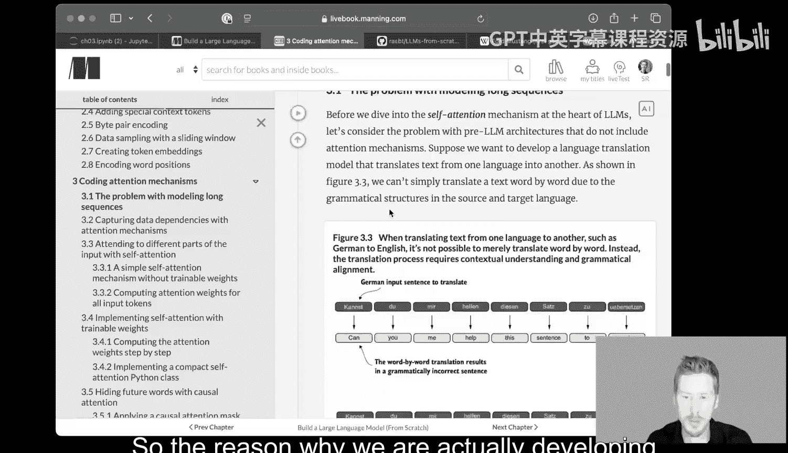

When they translated from one sequence to another sequence， for for instance， here。

 this would be German to English translation。 What they had to do is they had to memorize。

A state of the input。 So they were reading the whole input。

 And then before they could generate the output， they had to， yeah。

 they to kind of save a summary or like a latent representation。

 a condensed representation of the input and then using that input step by step。

 generating the output。 If you are not familiar with recurrent neural networks。 don't worry about it。

 It's not really important for the remainder of this chapter or this book at all。 It's just。

 I'm mentioning it here for， I would say completeness for those who are familiar with R Ns。Now。

 what's important， though， is that。Here， the shortcoming is when you translate text from one language to the other and you can't really look at the full input sentence。

 you can only have like this intermediate state。 you might lose information。

 And then it leads to an anop or suboptimal translation。 So the idea in self-at is， for each step。

 when we generate text。 So whether we translate text or whether we answer questions。

 we get information from a text or we do anything with text really。

 where we generate text at any time we can look at the whole input。

 So that's the core idea of self- attention。 So instance， for instance。

 if we have a translation task and we are translating the next token。

 So this is a German sentence and is what translate into， can you help me。

So if we here we generated the first output。 now we are here translating the second output at each step。

 even though we are at the second output， it cannot only look at the previously generated token。

 It can also look at all the other input tokens。 So it has access。 So there's a mechanism to access。

 all the input tokens that we have provided as the user。

 and what's more important even is that we give it selective access。 So for example， in this case。

 when this sentence is translated into English。 It's looking at all the input sentences。

 but I try to visualize it here with these dots。 each input token has a different importance。

 for example， this first word has a medium importance。

 and these two words that have a very small importance very small dots here where。Yeah。

 this token has a relatively high importance because it's relatively important for translating this particular token。

 So if you know German do is the German word for you。 So in this case。

 this is actually a very important word for translating this word。

 And so here we are assigning a higher weight。 we make this token more important。

 And in a similar case， the LLM yeah is doing this automatically。

 So it's assigning these important weights to to the different inputs and these important weight or importance weights are the so-called attention scores。

 and we are going to compute the attention scores and sometimes also called attention weights。

 but actually a small distinction between attention scores and weights that we will get to later on also in this video。

 So the short story here is that when we are generating text at any time we can reference the whole input text。

 if you as a user you ask a question， give me the most five most important facts of my。

Input document， the addM at any time when it generates text。

 it can reference the whole input without， you know， having to store an intermediate representation。

 So it's， it's actually a very powerful mechanism。And so yeah in the grand scheme of things。

 so what we are going to do now is we are going to implement this selfat mechanism before in the previous chapter2 video videos we covered the preprocessing steps now we are assuming we have already processed our data and we are jumping directly into this selfat module and then later on in the next chapter we will be implementing all the other parts that go into yeah LLM。

😊，So one more figure before I go to the code examples here is a summary of what we are trying to accomplish with the selfattention mechanism。

 I mentioned this referencing of all the input but on a more like zoomed in level what we are trying to accomplish is we are going to yeah we are going to transform the inputs into a different type of representation So in chapter1 what we did is we took an input text for example your journey starts do dot dot step let's say this is an input sentence that I truncated a bit here for brvity so we can fit it onto a figure So if we have an input text like this remember from the previous chapter we are tokenizing this and then we are converting the token id into so-called yeah vector embeddings so embedding vectors and each vector here just for simplicity has only three values So we talked about this more in the previous chapter2 videos so where we have a vector representation。

And now here， what I'm showing you is the vector representations of all the inputs。

 What we are going to do now is we are going to consider one of these inputs。

That we want to transform into a socalled context vector。

 it's called context vector because this Z here， it's also an embedding vector。

 but it has the information of all the inputs。 And so this is， if I scroll up a bit。

 it is kind of connected to what I told you earlier here。

 So when we are generating this output token。 So this specific token。

 it has information about all the input tokens。 It's actually weighted sum over all the input tokens。

 So you can see that this one is more important， but all of them are involved into in generating this one here。

And so。When I scroll down again， this is what you can see here。

 We have all the inputs here and they are all involved in generating this output vector here。

 They have different importances， though， So here these alpha values Al  to1 to 2 to 3 and2 T。

 They are all different weights and this is a measure of how how much of this input vector will be represented in here。

 So it's maybe very mathematical concept， it's a linear algebra concept in a sense because we are going to compute dot product here。

 but。You can。 yeah， maybe we will see in the code。 Maybe it will be more intuitive once we look actually at the code。

 But so this is the big picture level。 We also， one more thing I should say is we are going to focus on the second input。

 So here X 2。So x2 is the focus here， and this will give us the context vector with respect to this input。

 All the inputs play a role here， but you have a specific set of alpha weights。

 So you can see there's always a2 in here to 1 to 2 to 3 and 2 T。

 So this means this is the weight of the first input with respect to this one。

And this is the weight of the second input with respect to the second input。 That's why it's 22。

 And then it's the weight of the third input 3 with respect to the second one and so forth。

 So this context vector is specific to this second one here。 Why it's the second one。

 it's just because I chose it for this example， ultimately， we are going to do it for all of them。

 So if I go up one more time here。Yeah I also pick the second one and the second one looks at all the input tokens。

 but this is also true if we look at the first one。

 it would similarly also look at all the input tokens or the third one and so forth。

 we just have to pick one now for the example because otherwise if we you start picking multiple ones it gets too complicated we will get to that later because ultimately we do this computation So we do this computation here for all for all the vectors but to keep it simple we are going to focus on x2 as the reference and the reference is also often called the query。

So let me actually go to the code and then we can actually look at this in a more concrete way where it's maybe a little bit less abstract and maybe this helps with understanding what is actually happening here。

😊，So， let me copy。A tensor here I have。So we are going to use Tensorflow again。 and so。

This is the complete sentence similar to the figures I showed you。

 So your journey starts with one step。 This is my input tensor and each row here is the embedding vector corresponding to this token So'm for simplicity assuming each word is a token。

 but you know it could be a bit different It could be split into two tokens depending you know on how a tokenizer works and yeah tokenizes what a topic in chapter 2 for simplicity we are just assuming each token is one word and then we have this three dimensional input yeah vector embedding for each of these words。

So going back to the figures one more time。So here。I'm showing you。 So here this is。

 if I go up one more time。 sorry， here， this is the complete， let's say procedure。

 We are going from inputs to this context vector， and we have these intermediate weights。

 but we don't know yet how to compute those。 So we will take it step by step。

 So we are going to break this down into smaller steps that get us to this context vector。

 So the first step we are going to take。So we are going to compute these intermediate values。

 So before these alpha values， I don't want to scroll up again， but the alpha values。

 they are the so-called attention weights。 before we compute the attention weights。

 we call the compute the socalled attention scores which are an yeah nonnmalized or unormalized version of the attention weights。

 The attention weights will come later， this is more like one step towards these attention weights。

 how they are computed is by computing a dot product between an input and each value here in this sequence。

 again， like I mentioned before we are taking example2 x2 as our query and then for this query。

 we are comparing it to each。Yeah， to each of the inputs here。And so one thing again。

 I want to highlight is we are talking about a simple self attention mechanism。 Later on。

 we will talk about the real self attention mechanism。 but， you know， to keep things。

I would say step by step and at least making it a bit more approachable。

 I wanted to start with a simpler version because we can always make it more complicated later on。

 but I think this nicely highlights like the idea behind it。

 So how we compute these values is by taking the dot product between the two and in linear algebra the dot product。

 Yeah， it gives us a sense of similarity。 It's like it's a measure of how similar to two vectors are essentially。

 I mean there's also there are things involved like yeah taking the vector norm。

 normalizing the vectors length normalization and so forth。 But for simplicity， we're not doing that。

 we are just computing the dot product and you can think of it as a way to measure the similarity between two vectors。

So if I scroll down， yeah， let me just go to the code notebook， it might be easier so we have。Now。

 this input tensor here。 And so this input tensor contains 1，2，3，4，5，6。

 We're going to focus on one at a time。 So let's consider as our input vector。

Well let's call this the input query。We are considering， let's say， this one。

So I can also reference this as inputs。 Well let's。

 let's take the second one because that's what we had in the figure， right。

 if you recall here we have x2。

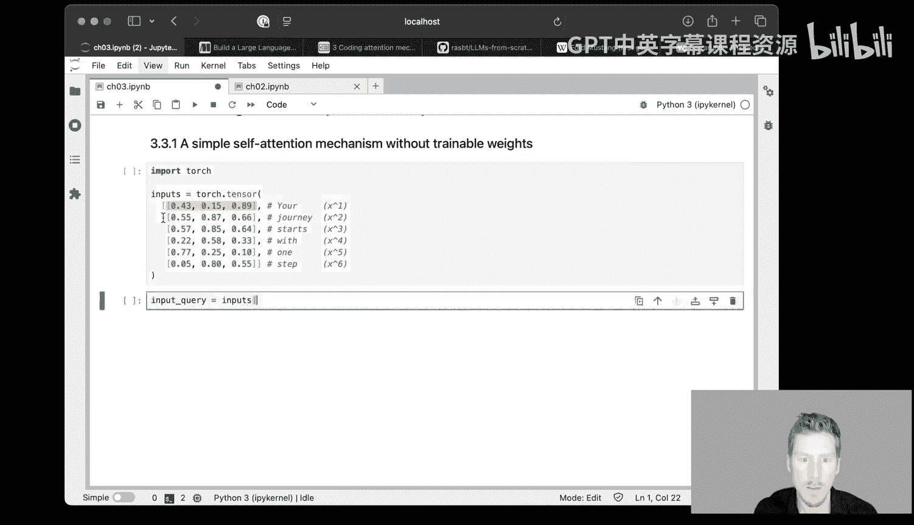

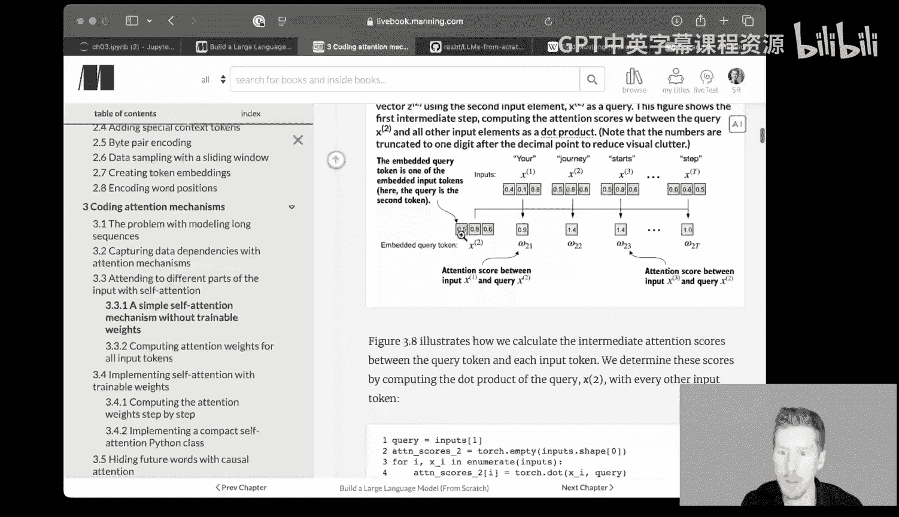

So we are going to also use x2 here。And x2 would correspond to the second row becausey Python is indexed1。

 so x2 would be the second。Ro。0，1， yeah。Okay， so this is our input query， we can print it out。啊。

There we go， this is our input query。And we do the same thing now considering a different vector。

 Let's just choose the first one here。 So let's call this input。In， input。Let's say 0。In one。

 because then we are consistent with this number， it's maybe more intuitive。And so。

 we are going to call this。Inputs 0。Andput。So this is the the vector we have here。Now。

 what we're going to do now is a manual approach。 So we are going to。Compute something here。 That is。

Taking the element element wise。 oh， yeah multiplying the vectors element wise。 So if I do it just。

 you know， brute force by hand， just to illustrate it， we do。

 we multiply the first value with a second value here。Then， this value。Times。This value plus。

This value。😔，Times。Good value。And so we get this value out here。 So this is， yeah。

 the essentially the。This vector dot product with this one。

 And there is a nicer way to do this in Pytorrch。 We can do actually torch dot。And then。

 take this one。And this one。And we get the same value as you can see。

 So this is a so called dot product。 That's what we are doing here。 and now。Yeah。

 we could do this actually， for all the different。Inputs here we only did it for the first one。

 but it would be a lot of work right so we have to either write it like this or this for each one。

 So what we could do is we could actually write a for loop So if we do a Pytoch or let's do a Python for loop first if I do a Python for loop just copy it here So what we can do is we can say for each element in my inputs value。

We are。Going to， we have a result here， and we are going to add them to it。

 So it's essentially what I've been doing here。So for each。Element， so if I print it out。

For element in inputs。0。😔，it's like print。Element。So it's for each element here， right？

And then we have。Index。Which is a different way of accessing this。

So this should not change if I do it like this。😔，Oops， it rated over 1 d tensor。😔，Oh。

 I forgot and enumerate， I think。So I'm just。I D X is just a position。 So this is the same。

 still the same here。 You can see we are just iterating over it。 But why I'm using the index here。

Is that I can now do the same thing for the query。 So we have this input query， right， so I can now。

Also， index this one。 So let me change it。一つ。Nicer， or let's let's just leave it like it list so。

Here I can now multiply those two。And then， let me just。Print them。So I have these。

 and then I can actually sum them。 So one way would be let's。To starting with 0。

 And then let's just add them up。 So we're adding them up。嗯，哎呀。And then let's double check result。😔。

So you can see what I've been doing here is to say that I've been doing here。

 but now I can do it for all the different vectors right so I can go through those actually one second。

I should probably。This a variable here， otherwise we will get always the same results。

It's high and high so that we can change the vector here。So the vector 1，2，3，4，5，6， and so forth。

So this is the first one that should be the same that we got before。

Then we can do the same thing with the next one， another one and so forth。 But again。

 this is still a lot of work， right。 So one way to make this actually easier。

Is to use the topt products， right， so I could technically go in here。And to。

Then I don't need that one。 Then I could do。This。嗯。That's。😔，So we don't need this also then。

Just making it more efficient so I can do inputs。Alle。And input query。😔，Like this。

So we don't need this one。 but's see it it doesn't change。 So it's the same as before。

 We are just replacing this manual summation with this top product。 And if I do the0。

 it should give me this one or this one， basically。So this is one way we can automate this now。

Going one step further， this code here， what it does is it's doing the same thing。

Except now we are going to do it for all of them all at once。

 instead of me having to change this here like this。All the time。

 we are going to have a for loop that does that。 So for each input X I。

 So the I here for each I in this。Collection of inputs。 We are going to compute dot product。

With the query， so we call that input query， right？😔，And we are going to store them。In。

This output tensor because yeah， it's one so in Pytorch sorry in Python。

 we could use a list and append to a list。 but in pytorch， we have vectors and tensors。

 And they have a fixed size。 So it is possible to extend those， but it's very inefficient。

 Usually tensors are a fixed size。 So we have to for efficiency， say how big our tensor should be。

 And so here we are saying it has the shape on6。6， because that's how many rows we have 1，2，3，4，5，6。

 So that's what we are doing here。 We are instantiating this。

 And then we are filling in the values that we got here。 So if I print this。

 you can see these values here are the same I'm getting here。 So if I have a 2，0，1，2。

 So this is this value here， right， And so if I want to get0，1，2，3， this value。This is the same。

Is putting a three here。 you can see these are the same。

 So all we have done now is we have made this a bit more convenient。

 We use this torch dot yeah method instead of us doing this fall loop manually and filling in the values。

 So going back and by the way， I was a bit I skimmed over this， but I think there is a tyu here。

 So you can see these are the same values， they should be actually correct in the Pdf version because I'm 100% sure that this was fixed or I fix this So I have to contact the Manning layout team to also update this here in this website version and yeah。

 so if you're a bit confused why these are the same they shouldn't be the same So they should actually be different values。

 pretty sure in the print version it's correct and I will just contact the manning team to also yeah update here。

 anyway， So we have implemented this now So we have these values So these values here are the values。

You are seeing here。 and yeah， for visual purposes， I truncated them。 So 0。9 really refers to 0。

95 and then。1。4 corresponds to 1。4 here。 So instead of rounding them。

 I truncated them because and I thought it's easier to。

 to identify them here because otherwise it would be 1。5。 And then you would be looking here。

 And where's the 1。5 here， right？ So that that's basically why yeah， why。

These numbers are different they were a bit too large or too long to have them here in the figure。

 so I just truncated them。Okay， so we have done this step now。 we have these。

Scores now the next step would be going from the scores to the attention weights and again the whole reason why we are doing that is it's a measure of similarity how yeah how similar is the input to this query So if I look at these values here。

Or maybe it's easy to look at like look at them here。

 You can see this is a higher value than this one。 So 1。4 is higher than 。9。 So one might say， oh。

 journey here， the second word journey is more similar to the input。

 which happens to be also journey。 So it's it's a way of saying， oh。

 they are more relevant to each other than this one， which is a bit different。 Now。

 these values later on。There are weight values involved。

 So here we are talking about attention weights， but there are parameter weights like a neural network weights that are going to be trained in chapter 5。

 And then these scores are optimized for the task at hand。

 So sometimes depending on the input one word is more important than the other and the the network will learn how to recognize which word is important with its weight training basically So here you know it's a very simple attention mechanism like I mentioned before。

 So I wouldn't take these values too seriously。 It's more for highlighting what is the actual computation that is happening in the attention mechanism。

そう。What we have done so far is we took the doc product between an input and each of the other inputs。

 We got these scores。 Now we are going to normalize these scores so that they sum up to one。

 So it's it's a normalization。 And this is done to so that we don't get crazy large numbers and it helps also with the optimization process to have smaller numbers。

 It's more like a cosmetic thing to do。 And so there are different ways we can normalize。

 So you probably yeah would think of the most intuitive way of dividing each score by the sum right。

 so that would be one way to do it。 So if I have， let's say。

 attention weights to it's got this temporary because we are going to introduce another method later later。

 So attention scores2。 And then what we could do。We can just。Divide this by the sum。 And yeah。

 probably you already know what happens now， This will be then giving you the nomind scores。

 You can see that。 And they are all smaller than one。 But what's more important is， of course。

 that they now。Sum up。Oops。Some up to one。 So just making the properties a bit nicer for normalization purposes。

 And there's one extreme more common way of doing that。 it's a so called soft max function。

 So I'm going to define the soft max function here myself。

 and this is something I wouldn't use in practice because it's not very stable numerically for yeah。

 certain values， but just to illustrate it it's basically exponential of the input divided。

By the exponential value os。😔，And then similarly， the， the sum。

So this is similar to what we have done here。 So this will also give us。Normalized values。

 So we call that let's like this call that attention scores 2。

 So the reason why I'm calling this attention scores2 is that it is with respect to the query for the second input token。

 So that's why， why the two。 we would technically do that for all the other ones， too。

 but we would have to change the query。 And that is something we are going to do in the next video。

So all the next section。So but yeah sticking with our normalization here。 So here we have， again。

 a normalized tensor。 The values are slightly different， not that much different。 You can see it's。

 it's roughly the same if you would round them。 you could probably get very similar values here。

 but it has slightly nicer properties during optimization when we are training the neural network。

 So it's it's again， just yeah， a small tweak to get better optimization when we are training the network。

And so， yeah， this is how we normalize the weights， how we get from here to here。

Now there's one more thing I mentioned this is a simple softmax version。

 so it might not be ideal and certain values might be unstable。

 so I highly recommend actually in practice if you're doing this。To use the， yeah。

 the Pythwa version of that。 So softm and then。Let's do this。Oops。

 yeah my mouse keeps sliding off my desk because it's an at an angle， I'm sorry。

 but so yeah here what we are doing is we are just using the Pythr version。

 so in this case you can see。That the values are exactly the same。

 but there are certain values where this one will fail or be unstable。

 And this one is a more optimized， stable version。 So whenever there is a Pytoch function that is already implemented。

 it is highly recommended to use that one over selfimple。 However， selfimple。

 I' always nice for understanding how things work。 So you can by looking at this mathematically understand what's happening because with this money it's a bit more abstracted。

 So it's harder to understand how this works。 So what we have done now is be computed those scores。

 And there's one more thing in this section I want to do。 and that is computing the context vector。

 So if you don't mind， let me scroll up one more time。 So I promised I would not do that。

 but it's maybe the last time for this section。 So in the beginning。

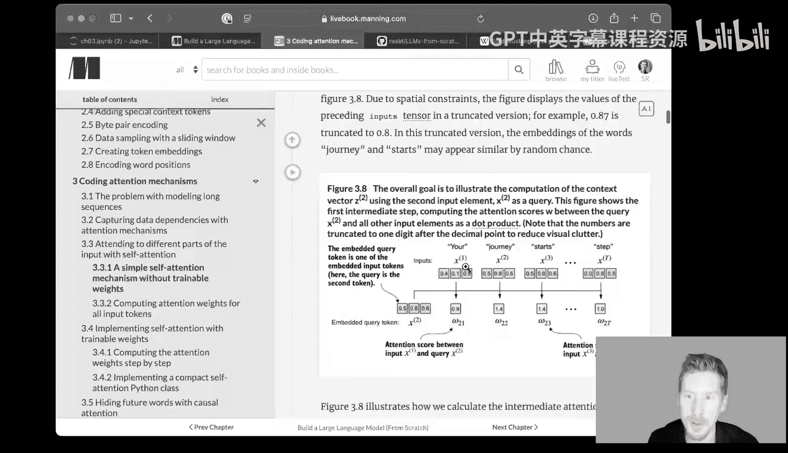

We talked about taking the inputs， computing the attention weights。

 This is all what we have already done。 and then we compute this context vector。 So we have this。

 the inputs， we have the attention weights， but we don't have the context vector yet。

 And that is what I'm doing now。 So what we are going to do is we are going to use those as weights to compute the weighted sum over these inputs。

To make this a bit more clear， I think I have a nicer figure here。Somewhere。Here。

 so we have the inputs again， and then for each input， we multiply it with this attention weight。

For each one separately， and then we just sum up all these vectors and then we get that context vector。

 And again， the idea is of this context vector that it combines the information from all the input vectors in a sense that those with a higher attention weight。

 they play a larger role in the output。 So in in this yeah， output vector here， the weighted sum。

So weighted sum， you can also think almost as averaging。

 but with a weight where each one has a different importance。Okay。

 let's actually do that so I have some code I will put in here just so that it is a bit quicker because I realize it's a very long section。

 So what we are going to do here we are going to initialize them with zeros， so we have empty vector。

😊，Let me show this。 so we have three values， and that is the desired size of our context vector。

 If I go here again， we want three output values and it's the same shape as the input。

 we have three inputs and we want three outputs。Now。

 what we are going to do is so we have the the query again， is our second query。

 which is why we call that the second context vector like back2。

 because later on in the next section， we are going to do this for all the other vectors right now。

 we are still laser focused on。The two， the。Computation with respect to the second input token。

 So the second input token to all the other inputs。 And by the way。

 that's also why it's called self attention。 So that is we are considering one of the input。

 and then we compute attention to itself to the whole sequence to each input there。 Okay so。

We have the second input as the query。 we have these zeros， just initial values。

 and then we are going to iterate over all the vectors in the input。So maybe let me show this。U。

Print。😔，Exile。Oops。Of course。So and this。If I go up here。These are those， so looking at them。

They will look familiar to you。 So we are just iterating over all these rows。One row at a time。

And then we multiply them with our attention weights。And again。

 I'm using this trick where we have the index position。

 so we are indexing so maybe I can print it out here。To make it more clear。 So we have index 0，1，2。

 and I could actually get this value。By doing。This。The same thing。

Now we use this index so that we can also access the weights， so the weights are those here。

So before maybe I do this， let me comment this out。 and this is maybe easier to see。 So we will have。

X1。it's not like this。😔，Print。Attention weights。Yeah， there we go。Yeah。

 I have my keyboard at a slightly different angle for the recording。

 which is making typing a bit more atuive for me。Okay， so。Yeah。

 so we are just looking at the attention weight and then the associated， yeah， vector。

 we can also change this to make it more intuitive。To this。嗯。There is an arrow here。😔，O。

Attention weights is not to definet， did I not。I see。I should have saved those。Still not defined。

 Well， this happens when you oh yeah， there we go。Okay， so we have this first attention weight。

 we multiply it with this first vector， we have the second attention weight。

 we multiply it with a second vector and so forth， and this is what is happening here。So。

Make this a bit more intuitive， so we have this multiplication here。This one with this one。

 this one with this one。 And then we are adding them up， so。Sure like this。 So this is plus equal。

 which means we are adding it on top of this one。 So it's a weighted sum because we are waitinging it。

 We are waitinging the input with this attention weight。 and then we are adding it all up。

On top of each other。So the result let me comment this out so the result is this one here and this is the context vector so this is the context vector that we are seeing here again the truncation 0。

4 0。6 and 0。5 so 0。40。6 and 0。5 and so what we have done now I realized it was very technical so I encourage you to maybe step through this a bit more slowly by yourself but yeah what we have done now is we computed this context vector with respect to the second input element。

In the next video， I will show you how we can do that for all the other ones So because it is a lot of work if we would have to repeat this because you have to compute the attention rates。

 So what we would have to do is we would have to change the query for example。

 if we want the first input token， we have to change it to this one here and then we would have to change it here and here and then we have to also compute those in the first place。

 So we have to go back， change this one and so forth。 So it would be a lot of work。

 So in the next video。I'm going to show you how we can generalize that to all the other inputs。

So in this section we are going to continue with our simple selfattention mechanism。

 The subtitle here or the section title is the simple self-attention mechanism without trainable weights because we are still talking about a simple selfattention mechanism in later videos we will be introducing trainable weights that help the model optimize the computations。

 but here we are still talking about the simple self-attention mechanism that we introduced in the previous section。

 Now we are going to generalize this a bit more now because in the previous section what we did is we focused only on one of the inputs as the query and then computed the attention weights between the query and all the other values or the other inputs and then we computed the so-called context vector with respect to the second input query which is why you can see the two here That's the second query So this is the context vector with respect to the second。

Nonetheless， it contains information about all the other inputs。

So now we are going to generalize that again。 in the previous section。

 I want to make this crystal clear。 So it's a bit more， I think。

 intuitive to understand what we are doing here in the previous section。

 we computed the attention weights， only with respect to this second input vector。

 Now we are going to compute all the other input。 yeah， attention weights here。

 you can see this is 6 by6 matrix because it's for each input。 we have6 inputs。

 we compute the attention weight for each other input。

 And that's why it's called self attention because it's yeah with respect to the input sequence itself。

😊，Okay， so let's actually do this by borrowing some of the code from the previous section。

 so we need to first， so this was the computation of the context vector which involved the attention weights。

 So we have to first compute these attention weights so here let's borrow this one。

And what we have done in the previous section is we computed it with respect to the second input token。

 like I mentioned。 Now we are going to generalize this。So。

Let me just get rid of some of the code comments， and it might be a bit easier to read。

 So what we have is we have an iteration over the inputs and then we compute these attention scores。

 Now let's actually modify this a bit。 So let's make this a bit more general。

 So instead of saying input query， let's say X。Jame。

And then instead of saying attention scores with respect to the second input token。

 let's just call that attention scores and then do IJ。 So this will be now a matrix。A matrix。Sorry。

 this will be the matrix， this is a specific value。

 but we have now a matrix attention scores that has the shape 6 by6 and if Ive write Ij this would be a specific value in this attention matrix so we have this6 by6 attention score matrix so let's actually initialize that。

So for that， we are going to use torch M。6，6。 So this is our6 by 6 matrix。

And then what we are going to do is let's get rid of this because this is only for the second row。

 right， So we want to do it for all the rows。 Now we are going to compute these values here。

 where each I J is。Each， each cell here。 So what we are missing is we are missing。

 we are missing one fall loop。 So what we have to do here is we have to rule4 J。X J in。Enumerate。

And then we indent this。😔，I bit like this。 So what we have here now is we have a double four loop。

And we are computing now the dot product between each input and each input。 So I X I and X J。

 if we iterate like this， it will be this1，0，0， then 0，1，0，2，0，3。And then0， sorry，1，1，1，2，1。

3 and so forth。 So it's going to be iterating over this whole matrix。

 this 6 by6 matrix via this I and J here。So if I do it like this， this would be then our matrix here。

 So this matrix。 Now the values look a bit different。 You can see it's 0。2。 we have 0。9 and so forth。

 and this is because these are the attention scores they are not normalized yet。

 So we have to also apply the softmax normalization and we will get there in a moment。

 So I wanted to show you one trick though。 So this is how we do it manually using dot products。

 but there is a concept called matrix multiplication。

 and we can actually instead of doing two fall loops。

 we could do a matrix multiplication which is much faster because in Pytorch fall loops are actually quite slow because they can't really be optimized that much compared to matrix multiplications which have very efficient implementations on the computer。

So we can actually compute this same thing here by doing a matrix multiplication。

 So if you are not familiar with matrix multiplications。It is。

 I would say a topic for a separate video， perhaps。 but yeah。

 I don't want to make these videos too long because then we would end up doing a whole course on deep neural networks and linear algebra。

 and then three weeks later， we'll get to the self attention mechanism。 So if， yeah。

 if you're not familiar with matrix modificationplication。 I would say this is essentially a auto。

Automated or shortcut way of doing these two nested fall loops。

 And you can see if I did make a mistake here， we should get the same values。

 So you can see these are exactly the same values。 We are just automating this now。

So these values here， they do look different， though， from， from this year。

 which are the attention weights。 So what we forgot is we forgot。The softm。

 So we computed previously this softm。 So that is what we are going to do now。

So let's do the soft mix。 So attention scores， it's a convention。

Attention scores refer to the anized values and then we can do attention weights and normalize them。

So。Like this。Let's print them。And so these are the normalized weights。

 So you noticed I did type something like dim1 here。 So what does that mean。

 So it's essentially so that the weights along this axis sum up to one。 I hope So actually let's。

Take。This one and a torch thatt sum。Sp be tense are not a list， oh yeah。So 9，99， okay。

 let's try another one。One， too many。Yeah， they do some minus rounding errors。

 They do should sum up to one。 So we could also actually do this automatically instead of testing all of them。

 we can do attention where its starts some。Cause -1。So you can see they do sum up to one。

 so each each of them basically。 And if you play a paid close attention， let's。See。

 I actually didn't， so let's see previously in the previous section we computed these attention weights。

With respect。To the second input。 So this is with respect to the second input。So， this here。😔。

Should technically match what we have here and as you can see。Oops。Let's just do it like this。

So as you can see， this one matches this one。Now， what we have done is we have automated this one。

 So we have automated。This whole computation here with this attention weight and everything in in a few lines of code。

 So technically， the only two lines of code we have is。Computing the attention scores。

And then the attention weights。 So we have everything in。Two lines of code。

That we have done previously in the previous video with a lot of work for one of them。 Now。

 we have it for all of them。 So that is how we generalize things。 We are missing one thing， though。

 if I。Go back。 We computed the context vector after the tension weight。

 that is still something we have to do。 So how do we do that。

 How do we compute the context vectors Again， there's a handy way of doing that with matrix modificationification。

 so I can type context V and then。The attention weights。

Then matrix multiplication with all the inputs。 So instead， so this is generalizing。

What we had in the previous section， this is generalizing this computation but。If we do it manually。

 we have to have four or four loops。 We have to have one for loop over the inputs。

 compute the attention weights， and then we have another four loop for computing those weighted sums。

 And then we have to do it for all the vectors。 And it's a lot of four loops。 So here。

We just do matrix multiplication for the attention wes another matrix multiplication for context vectors and then we are done So this is it so we are done and yeah again。

 if you paid close attention this one should resemble the context vector we got in the previous section so let's see where is it here So this is context vector2。

 let me just copy the values here。And paste them below。And yet， we can see those are indeed the same。

 But now we have done it for all the other ones， too。 So by swapping out what is our query。 And yeah。

 so this is。How we make things nice and compact。 So we have now， if I clean this up a bit。

 we have now very few lines of code。Very few lines of code to compute。

The attention weights and then the context vectors。So I can do it like this。😔。

And then you can see this is all we need to compute the context vectors for our simple attention mechanism。

Yep， so we have now these for all the different inputs。

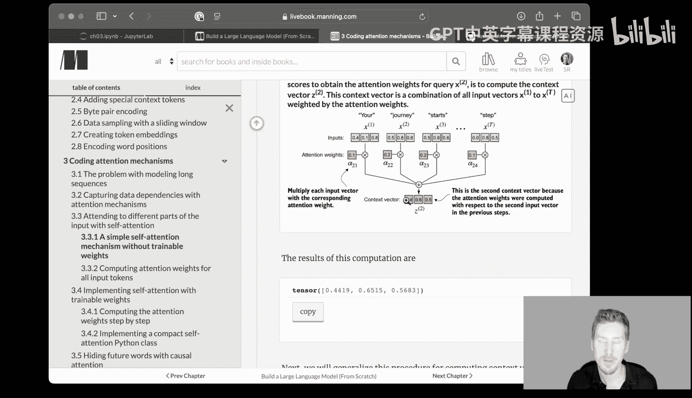

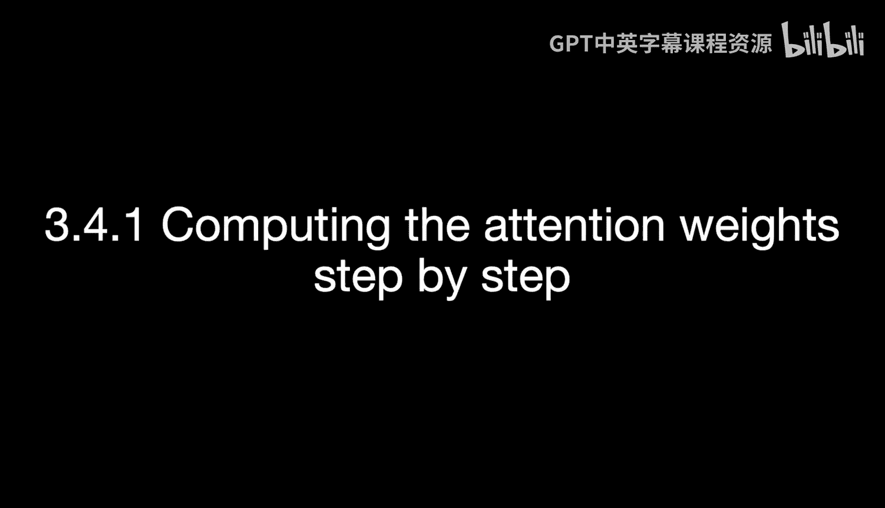

In previous sections we build a very simple version of self-attention for educational purposes to have a gentle introduction to the concept of self-attention。

 Now we are going to introduce these so-called trainable weights and the idea here is that these are model weight parameterss that are going to be optimized later during the model training in chapter5 So this will help the model to produce better outputs by learning better attention weights and this is by the way also the way the real self-attention mechanism works and this section we are not going to implement the whole self-atten mechanism that is used in GPT models this will come later later in this chapter but this is one step closer to yeah what's really happening in GT models in terms of the attention mechanism。

So。Just to take a small step back to section 3。3。1。

 what we have done there is we computed these socalled context vectors。

 So we had the inputs made an input sentence， These are the vector embeddings。

 then we computed the attention weights。And then based on the attention weights。

 we compute the weighted sum over the inputs to come at these or to get these context vectors。

 What we are going to do now is very， very similar。

 except that we are now introducing additional trainable weights。

 but the goal is still to compute this context vector to jump a bit ahead and to show you one figure here。

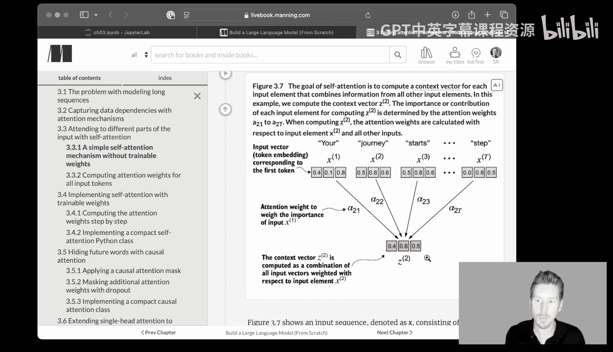

So。Here， so what we are going to do is we are still working with the input sentence。

 the same input sentence， but now we have a context vector that only has two dimensions。

 and I should mention it's two dimensions so that I want because I wanted to show you that this dimensional is arbitrary。

 I could choose two， I could choose four， but it's no longer dependent on the input size here。

 So before。

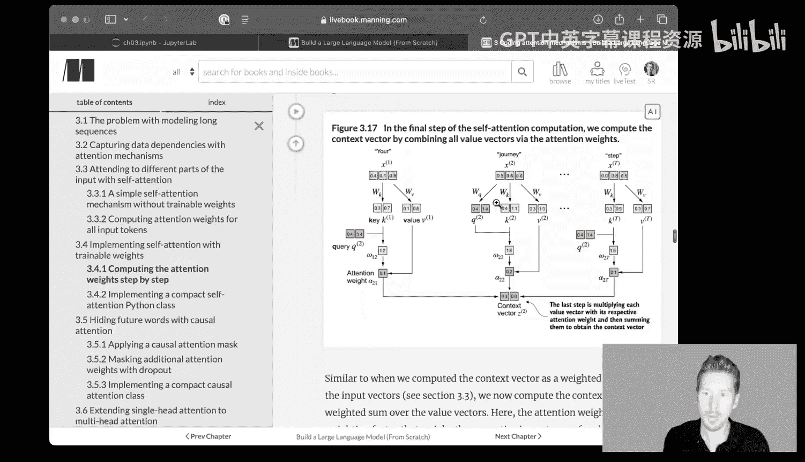

It had to have the same size as the input vector because we were computing the weighted sum over all the input。

 So if we wanted to add those， they had to have the same size as the input。 Now。

 here we are more flexible because we are introducing these query key and value parameters。

 And by the way。I'm using very very small embeddings here and context vectors for illustration purposes in reality when we are training the model later in chapter 5 these are much larger in the case of the smallest GPT2 model for example this is top of my head 768 and for the biggest one I think it's 21600 so in reality when we are training LLMs they are much larger than3 and2 it's more like thousand something or even multiple thousand of dimensions here it's really just kept small for illustration purposes but the size here the main point is it's no longer dependent on the input size it's a flexible size I can choose or we can choose and this is determined by these weight matrices。

One more thing here is。

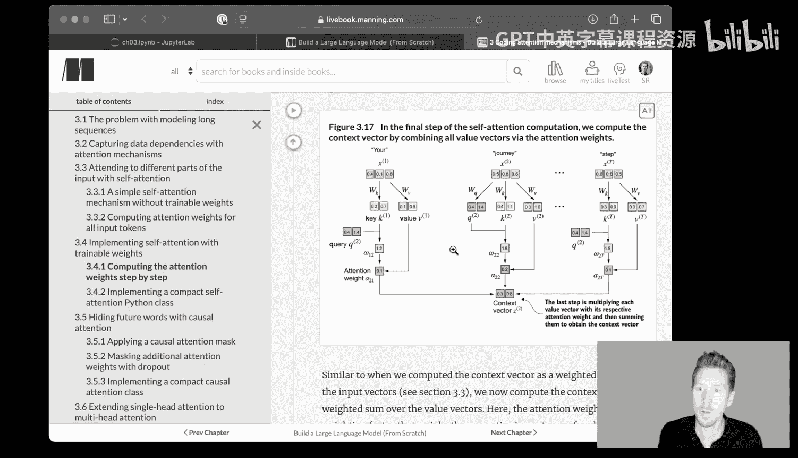

We compute these weight matrices。 So they are。WQ， WK and WV， they stand for query key and value。

 so we compute these query key and value vectors by doing a matrix multiplication between the input and these weight matrices and then based on those we compute still as before。

 similar to before these attention scores and then we convert the attention scores into attention weights that sum up to one and then we compute the context vector。

Yeah， but's new is the attention weights and that we have these intermediate values here okay so again also for simplicity similar to section 3。

3。1 we are only looking at this context vector with respect to the second input so you can see that this index position2 similar to here because we are focusing on the second input Of course in reality we want to compute the context vector for each of the inputs。

 but this is more work we will do this later to just have an introduction to the topic we will focus only on one of them at a time。

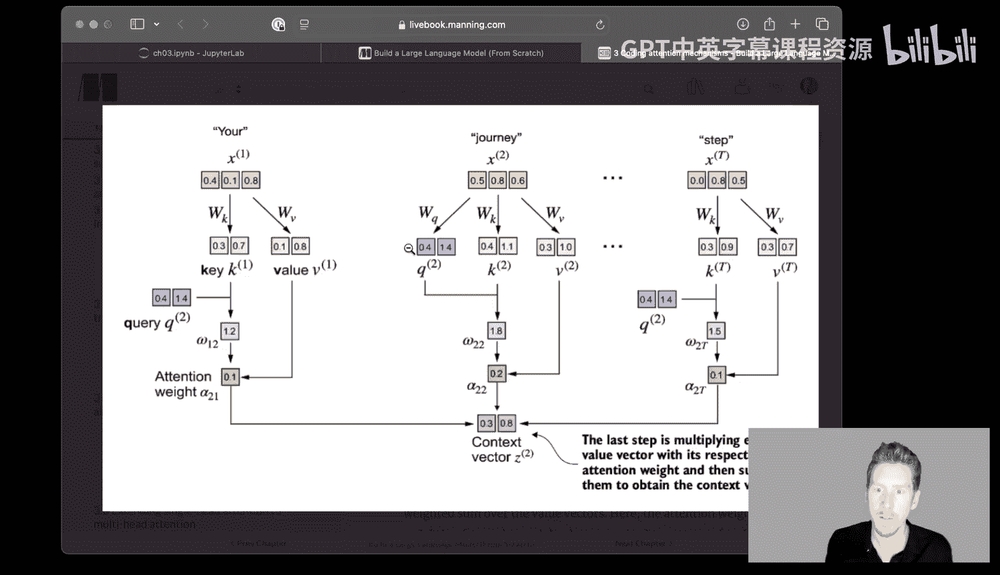

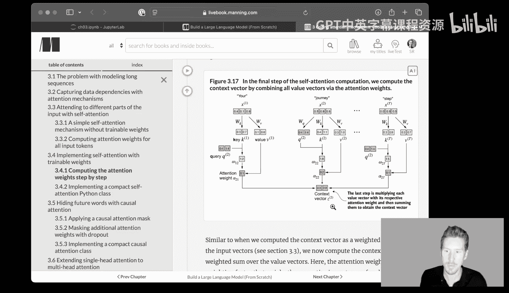

Yeah notice that the query here is derived from the second input and this query is also reused here and here。

 but again， similar before the context vector combines all the inputs。

It's still with respect to the second input， though。

 because this query is derived from the second input。

 the context vectors for the other inputs for the first input would look different because the first input would have a different query vector。

That we would use everywhere。Okay， so let's maybe jump into the code and by the way。

 why it's called Kv and Q it's because K for query sorry K for Q v for value and Q for query and this is I think I have a section on this in the book it's based on database terminology but again I don't want to go over all the details here because I realize the video 3。

3。1 was already very long and I don't want to make infinitely long videos here。

 I want to focus on the code examples so let's jump into the code。

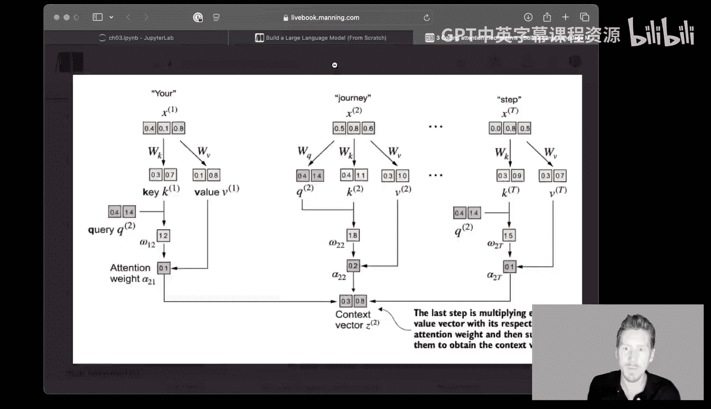

So to begin with what I wanted to do is I wanted to first define a few values here that we are going to use。

 And so before we had this inputs here， this was our inputs tensor where we had the 3D embedding for the first token。

 a second token and so forth sorry， third token， fourth token  fifth and sixth token。

 And so what we're going to do is we are going to assign this to a placeholder variable that's called that x2 to keep it shorter And then we also have a placeholder value the in。

 And so the in would be。Just the dimensionality of。Off this one。So let's do this maybe more general。

Like this。 So this would be the number of columns。 So three dimensions。

 I could also write three here， but to make it more general to show that it depends on the actual size。

 because this might be different， depending on what you choose for the embedding size。

But for this one， we can choose it as a user， we can choose our output embedding size。

 so that's the output embedding size here of each of these things。Okay。Now we have to find those。

 So just some placeholders。 the next part would be generating the weight parameterss now。

I'm setting a random seat here that。So that you get exactly the same values I'm getting。

 So we will now generate the weight for the query， the key and the values。 And for that。

 we are going to use the torch random function。 So this is。Generating random values in the shape。

3 by 2。 so three are 3 by2 matrix。And in addition to make it trainable。

 we can use torch Permetera later we will replace this by a different method， but in general。

 torch Permeter is a wrapper around a tensor in Pytorrch to make it trainable。So this will be then。

A trainable matrix。I think it should be torch in and。

So this is a trainable merit matrix and here you can see this this requires gra to true。

 which means that it is a trainable matrix， it requires a gradient basically。嗯。

But we won't be doing training until chapter。5。So we do the same thing now for。K。And。The value。

We just do it like this。 And they are all different。 So query key and value will be different。

 as you can see here。 So maybe let me do it like this W。Cry。AndW。Okay。

 so you can see they're all different randomly initialized matrices。Now。

What we are going to do next is we are going to compute the query here， the Q2。

 So how are we going to do that， So let me define query as with respect to the second input So we know what input it is corresponds to So this is corresponding to the second input that we defined here。

And then we do the matrix multiplication with aquarium。

And so what it really does here is it's transforming a linear transformation。

 it's transforming the three dimensional embedding into a two dimensional one。

 so you can see this is now a two dimensional embedding it's yeah matrix multiplication I don't want to go too much into a linear algebra here。

 which is essentially a linear transformation projecting the three dimensional tensor into a two dimensional one so if I just for a moment。

Print this out and then just really briefly because I don't want to make these videos too long because then you get bored and it takes us a lot of time。

 So I'm always recording them in the evening after work and it is always getting pretty late and dark anyway。

 so we do have this input that is three values here and then if we do the dot product with this column that would be our first value。

 And then if we do this dot product between this one and this one。

 this would be our second value essentially。 And so we are are projecting this three dimensional input into a two dimensional yeah vector。

Now we do the same thing for the keys and values。 so now we have the query now let me go back to the figure one more time。

 so the query is reused everywhere here。But the keys are unique。You can see here I'm drawing this WQ。

 but here I'm not drawing it because I'm reusing it here because it's with respect to the second input。

 the key though， in the value vectors， theyre unique。

 they are always depending on the input here at each position。So for that， it's a bit different。

 So what we are going to do is we are doing the matrix modification with a whole whole input。Tensor。

So we are going to do it like this。😔，And yeah， so this should be then having the shape。

 maybe pause the video to have like a small challenge， but this should have the weight sorry。

 the dimension of the inputs6 and the output dimension2。

It's because it's a six times three matrix times three by 2， so it's6 two。

 let's double check if I am correct here。W key， I think。So it's a six times two dimensional output。

 And so if I do keys。 So this one。Would correspond to this key here， the second one。

Should correspond to this one and so forth。 Okay， so now we have these values。 The next one。

 the next one would be computing these。Attention scores。So as you recall。

 previously we call computed the attention scores by doing a dot product。

Between the query and the input。 So going back one more time， we computed this one here。 or let's。

 let's do this one。 We computed the input here as the dot product between this input and the query。

 which is this one。Or in this case， we computed the retention score by multiplying or doing a dot product between this input and itself。

 So this x2 dot x2。 Now it's a bit different Now we are not working with these directly anymore。

 We are going to work with these here。We're going to do the dot product between Q2 and K2。

So let me do that。So for that， let's define keys with respect so to the second input。

It's a bit easier than the Python indexing because it starts at zero。

 so I want to have the nice number two here that corresponds to the two here。

And then we compute the attention score。2，2。 So 2，2， because it's the second input。

With respect to the second input as the query， so this is a 22 here。And this， yeah。

 it's like the torch。Dot product the torch query 2， and then keys2。Kase to is this money should work。

😔，Let's just print it out。So this is 1。8 something， and this should represent this one here。Now。

 we would have to do the same thing for the other ones， which is a lot of work。

 So we would do this manually for。1。2 and up to 2 T。 So in our case，2，6。

 So this would be a lot of typing if we had to， you know， do this for all of them。 So there's， again。

 one trick that we can do。 We can compute this all in one go。 We can use， again， our friend。

 the matrix not by。During this matrix modification， these attention scores are now computed。

For all of them。 So we can see， for example， the second one。

 just to double check matches this one and this one this key。

Should be the one corresponding sorry the attention score should be the one corresponding to this one 1。

2 here。

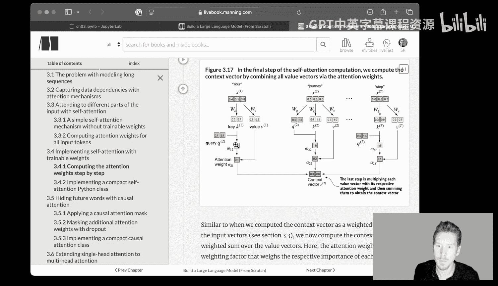

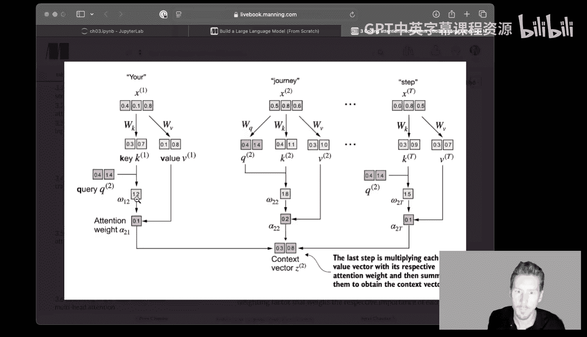

The dot is very small， it's not a 12， it's a 1。2。Okay， so far so good。Next。

 what we have to do is we have to compute the。

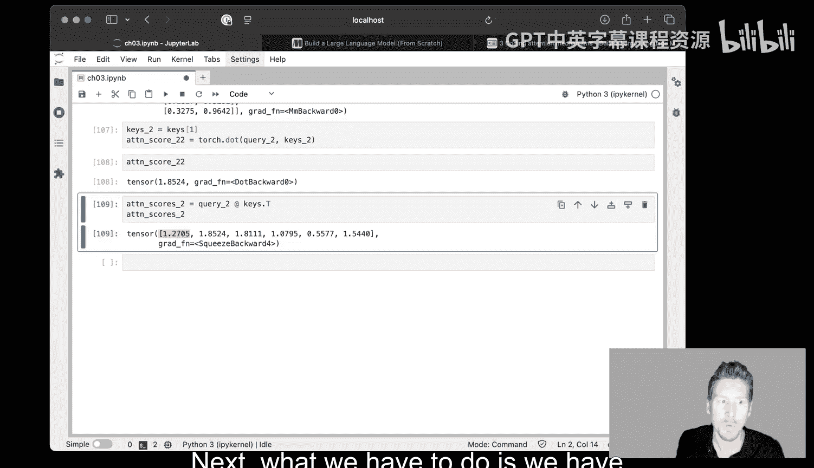

Normalized attention weights。 and remember from the previous sections how we did that。

 we computed those by using the softmax function and Pythtorch， so we had torched on softmax。

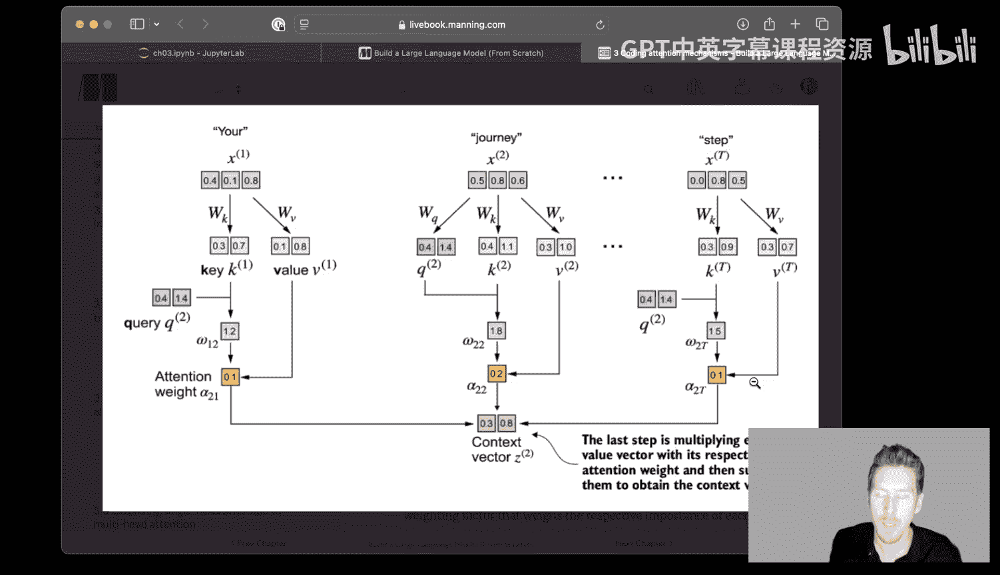

And then what we did is the attention scores here， the ones with respect to the second input。

 And then there's a new thing here， we use a normalization term。 So let me just define this so。

The keys here。They have dimension 2。So just as a placeholder， the dimension of the keys。

 and so here what we are going to do is we are going to use that the square root of that so we can do the square root in python like this。

Os still have to get used to my new keyboard position here。

 I am having it a bit different than I'm usually typing it。 But so in Pyth just to illustrate。

The square root， I mean， could do square root import math and then math do square root。 For example。

 the square root of4 should be two right， so we could do it like that。

 but an easier way instead of importing anything here， we could just do it like this。

So that's the same thing， essentially， so that's what I'm doing here。

And this will yeah keep them in a reasonable range So this was originally proposed in the attention is all you paper in the 2016 or 17 paper attentiontion is all you need that introduced the original transformer architecture and self attention mechanism so but yeah it's the same softm we used in the previous section except that we have now this normalization so let's see。

Let's call them attention。Waits。With respect to the second input。

Then we can look at how they look like。And so yeah。

 these are our attention weights and if I didn't make a mistake here， they should all sum up to one。

 let's double check this。So yeah， they nicely sum up to one and one more step。 So if you count it。

 there's one more step。 the context vector。 Now we have the attention weights。

 There's one more thing。 We have to now compute the context vector before in the previous sections。

 What we've did， what we did is we。

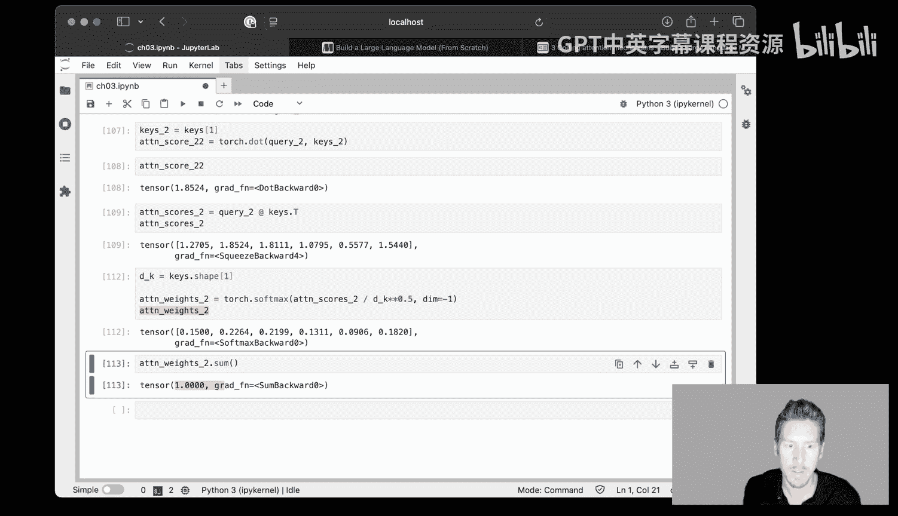

Computed those as the weighted sum over the inputs。 Now。

 we are not working directly with the inputs anymore。 We are working with these intermediate values。

 And so like shown here with this  error， we。Compute the contact vectors by applying the tension weights as to weighting to the values instead of the inputs。

Previous sections use the inputs。 Now we are going to use these values。

 So maybe just briefly has a big picture。 We have these intermediate values that are the result of this matrix multiplication。

 So it's like a linear transformation of the input。

And the query and the key they are involved in computing the attention scores and attention weights。

 and then the value is involved in computing the context vector by multiplying it with the attention weights。

 So in the case here， all of them are involved， but they are involved in different steps。

 Now these are already used up for computing the attention weights。

 but now we are going to use the value with this attention weight to compute the context vector and the context vector is again over all the inputs。

But it's still with respect to the second input because the query is everywhere used from the second input。

 but still the context vector combines the information of all the inputs from everything here。

Why do we have these。 So there are actually papers， I think I reference one in the book。

 There are papers that show it doesn't have to be that complicated。

 You can use fewer weight matrices， but this happens to work very well empirically。

 So this is a way yeah， that just happens to work well。 get， you get slightly better performance。

 I think that was even。Discussion on Github for the book chapter。 Let me maybe I can post this later。

 but a reader also experimented with。

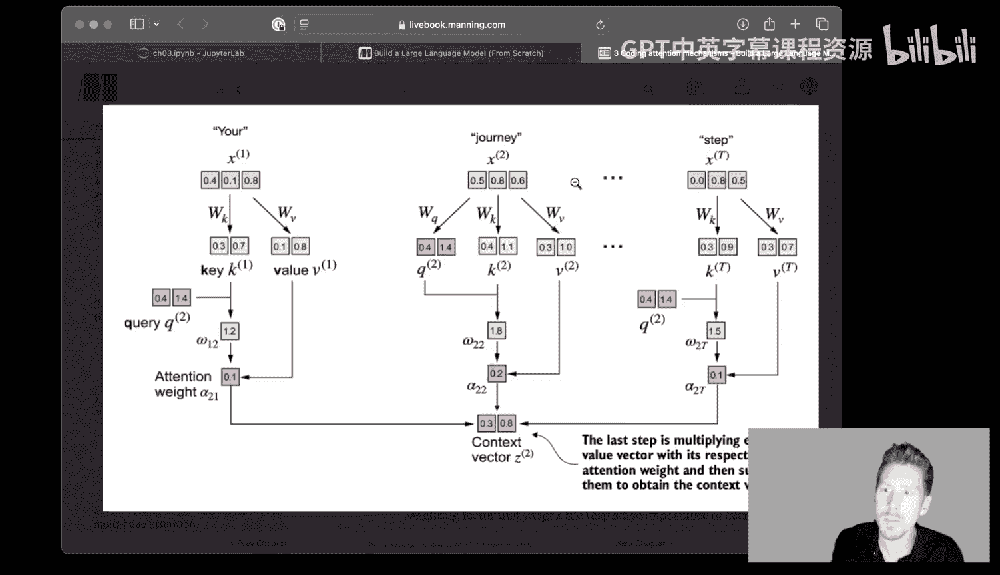

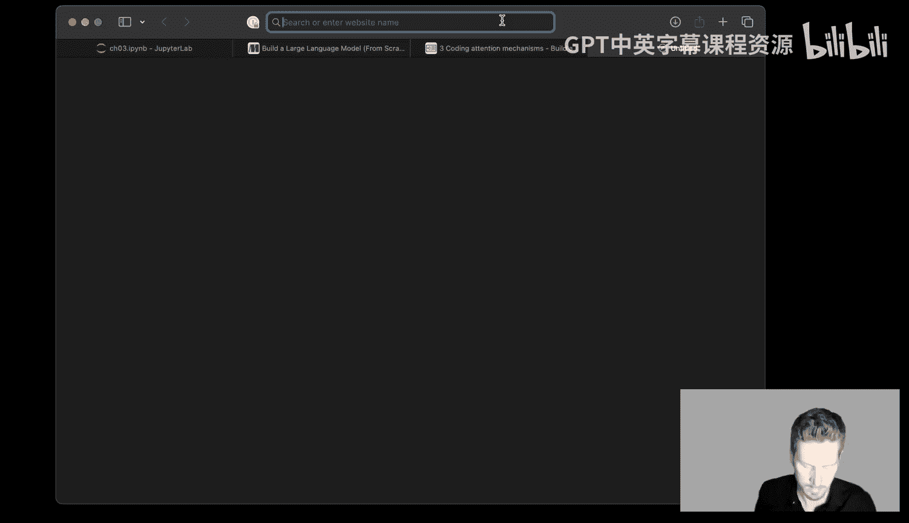

Reucing the number of matrix modificationplications。 and yeah the results were also pretty good。

 So there are different ways you can implement this。

 What I'm showing you here is the original implementation as it is used in the transformer paper and in most LMs essentially。

And it's mainly based on empirical performance。 Okay。

 so let's get back to the context vector step here。 So the context vector is now computed as the sum。

 the weighted sum over these values。 and so。

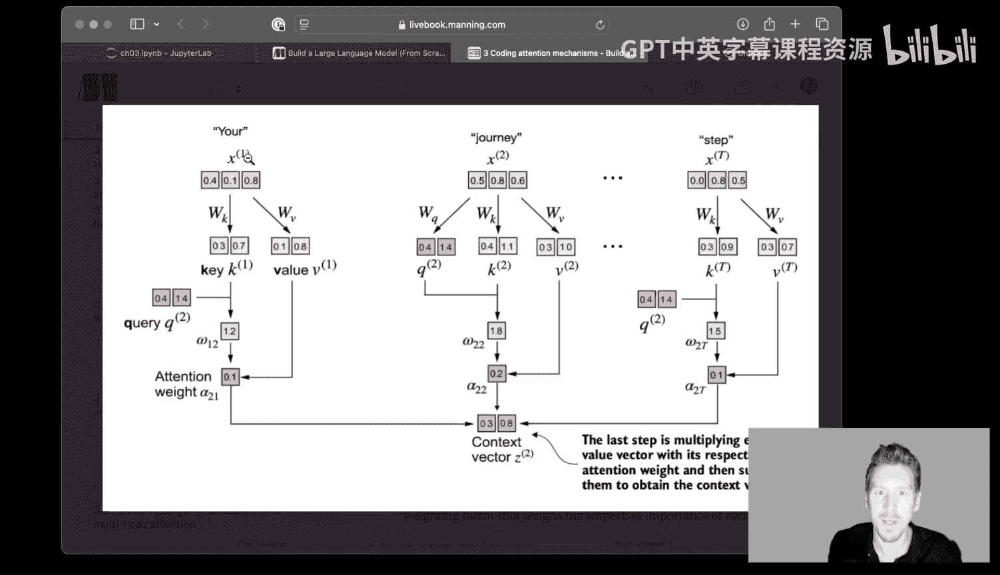

Context back。2。And then we use the attention weight that we just computed。

And do a matrix modification。 And then we should get。All the context vectors。

 So that should be six so sorry one。Context vector for all the six inputs。

 So they are the weighted sum over all the values。 And so yeah， this is our context vector here。03。

8 can see again， the trunced values。

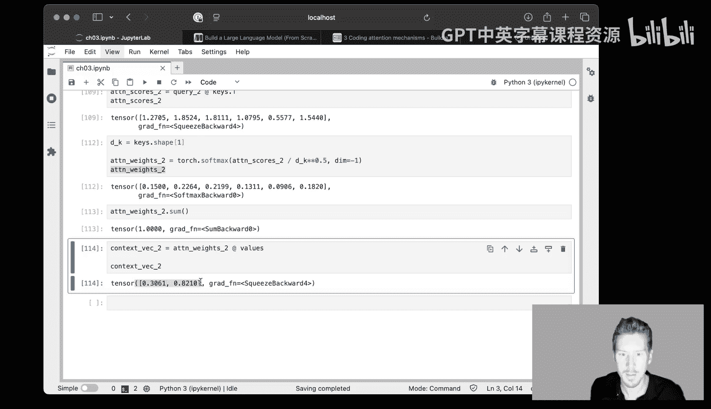

03 and 0。8 os。

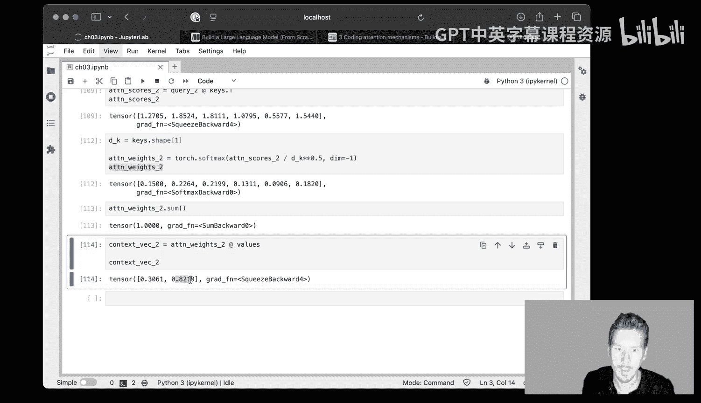

Now， what we've done here is kind of analogous to。

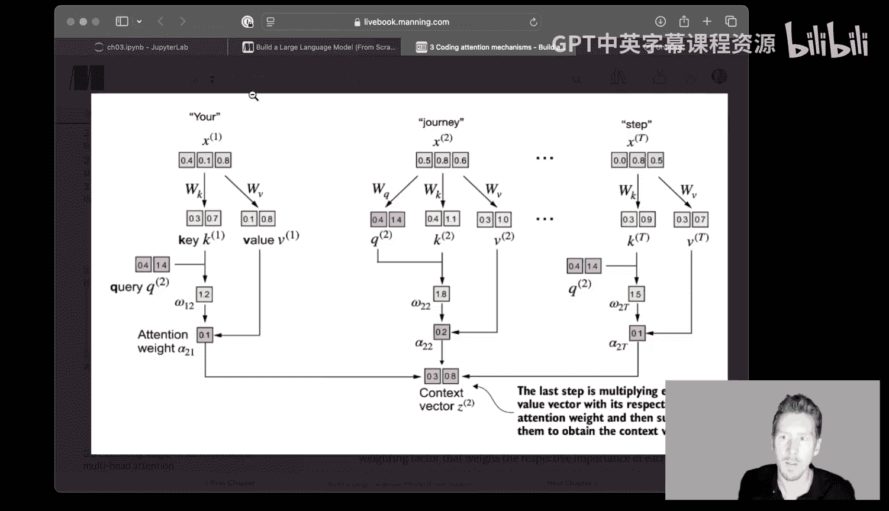

Section 3。3。1， where we computed everything with respect to the second input。 Then in Section 3。3。2。

 we generalized that for all the other input tokens in a similar fashion in 3。4。2。

 we are going to generalize this to compute the context vectors also for input 1。

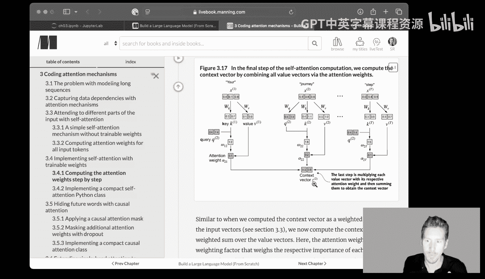

3，4，5， and 6。

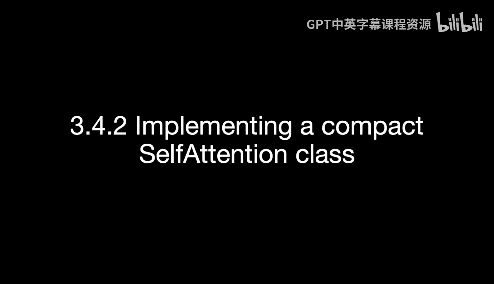

In this section we are going to generalize what we have implemented in the previous section and that means that we are now computing the context vector for all the other inputs previously we have only done that with respect to the second input using that as the query now we are going to generalize it so that we get the context vector also for all the other inputs so how we are going to do that is by yeah just reusing the code that we have written before So here I'm just instantiating a placeholder self-attention class a Pytch class so that we can use the self-atten concept a bit more I would say compactly without having to manually have multiple Jupyter notebook cells and so forth which is very error pro so we'll organize everything into one class。

And then we are going to reuse the code that we have above here， So here just going to take this one。

And put it here in our constructor。 so this will initialize these weight matrices when we create a new object。

I need a self here in addition。Okay。Next， what we're going to do is we need the。

Attention score computation。 So I had it right here。

So we will put that in the forward because this is what we instantiate and then we are going to use it in the forward column here。

Somethingone like this。values。 And then we do the same for the queries。 Now。

 we are going to do it for all the queries before we all needed that for the second query。

What is missing is the attention score and weight computation， so the attention scores here right？😔。

So， whoops we put it。Right below here。And now it's with respect to the queries。

Then we're going to reuse。The softm。Again， with respect to all the attention scores。Yep。

 and I think this is about it all the context vector computation。So we can copy from here。

There we go。And this should be about it。 So let's give it a try。 Let's use our torch dot manual。

Seat  one，23。 and then let's call that self attention version1。

 because I will show you a slightly improved version in a few moments。And we have to give it our。😔。

Input and output dimensions which are used here to instantiate the weights。And yeah。

 and then we can call this one。On the input。 So just maybe before I execute it， the inputs are our。

Input embeddings。 So the first token， second token， and so forth。

 So I'm calling it on our inputs here。And let's see what happens。So yeah。

 this gives us some values and。It works nicely here that now we generalize that and we get the context vectors for each of the inputs。

 just to double check that these numbers are correct， we know what this one should be。

 This is the second context vector。Second row。 So we know what that should be。 So by the way， again。

 each one corresponds to one token。 So this is just like this might be easier。

 So this one is the context vector using this as a query this is the context vector using this as the query and so forth and yeah this one should match oh sorry the second one should match what we have computed previously。

 So the second query as the second input as the query and we can see this here is actually the same as this one So our implementation here is correct。

 Now I wanted to show you a slightly better way of implementing this。

So we can call this version2 and so in Pytorch there's a concept called the linear layer that is also used in what is multi layer perceptrons。

 for example， and so what we can do is we can use instead of creating these ourselves。

 we can take advantage of this torch and end linear。And I shouldn't have。Remove those。

 We still need that。 So we can actually also。Yeah， create this linear layer。

 It's just like a slightly simpler way。 And this will create a linear layer that has a weight matrix。

 and it has biasaspera。 I can show it， maybe here。Just as an example。Toge the n dot linear。

 let's do a 2 by3。Then you can see there is a weight matrix here。And there's also this bias tensor。

 We don't need the bias tensor。 We just want to weight matrix。

 So what we do is we can set this to faults。 I'm sorry， bias。Falults。

And to make it maybe more general， we can call it Q KV bias。

Some LLMs use that and some LLMs don't use that， so it really depends on the implementation。

 it's more popular nowadays not to use it， but G2 for example。

 originally used it so it really depends yeah on the LLM it's not necessary to use it so modern on modern LLMs don't use it anymore。

So that's why I'm setting it two false here。Okay， so now we have those。 it's a slight modification。

 We replaced our manual per generation with this linear。

 So we don't have to call torch random and the initialization here of the initial weights。 It's also。

Slightly more optimal。 these values。 So there's a weight initialization scheme that takes into account the dimensions here and so forth。

 So it usually results in better training dynamics。

 If we just use this in a linear layer compared to using our。Toch random here。

 which we have normalized so these are just small random values。

 and here there's a slightly better weight initialization under the hood basically。

 so we are taking advantage of that。Now， this changes only slightly。

 So how this changes is that now we have。These， and they are called like this where we have the inputs as the input and so forth。

So I can copy it down here。And the rest should be the same。 Let me just。Updated。Values。

 and this should be it。 Let's double check。If everything works。But。

Don't expect the exact same results as above here。 That's because the weight initialization here is different。

 So we have different initial weights。 And that is why you won't notice the same。Values。

 I think the reason is。I call them key and value， instead of。Case and values。 Yeah， so yeah。

 this works。But the values look a bit funny。 They're a bit large。 I mean。

 they would be optimized during the training， but we could also just you know use a different random seat。

 get smaller values， which look a bit better。 but this is something that would get optimized during the neural network training。

 And yeah so in this section， we generalized。Here we generalized our computation。

To generate the context vectors for all the other inputs， In addition。

 we also have this nice compact self attention class now that uses the linear layers and that we can use。

We are one step closer now to completing the engine of our LM。

 which means implementing the selfattention class that is going to be used in Cha 5 when we are pretraining the LLM。

 Now one more concept we are introducing here is a socalled causal attention mask and the purpose here is hiding future words。

 but before we get to the hiding of future words just to recap the big picture view here of what we have done so far in chapter 3。

So before at the beginning of this chapter， we implemented a simplified self attention class for mainly educational purposes to illustrate how self attention works。

 And then we extended this with these trainable weights to implement the real self attention mechanism that is then going to be optimized in the pre training but。

On top of that， we are going to modify the self attention mechanism。

 adding this causal attention mask that hides certain words inside the mechanism。

 So to illustrate what I mean， I have a figure here。

 So before we computed all these attention weights as shown here。 If we have an input。

 your journey starts with one step。 What is happening is we are computing the attention weight for each combination of the input with itself。

 So， for example。If we have the sentence your journey and then the L M is supposed to generate the next word。

 let's say the next word is starts。 One thing that happens is when we are generating the word starts。

 it has access to all the words in this input。 So even though it hasn't seen。

 let's say future words like with one step， for example。

 it has the attention weights for these future words。And maybe to make this a bit more， let's say。

 simpler to follow， let me type this here， your journey。Starts with one step。

 So when we have input text like this， like I explained earlier in chapter 2。

 are we want to train the LLM to generate one token at a time。

 So the first token it might see is your and then it's supposed to generate journey right So when it generate it's supposed to generate journey it's not supposed to see those tokens yet。

 So they should be hidden。 And so in order to accomplish that。

 we have to mask them because during the pretraining。

 this is available because yeah we have this not a training set。

 but we don't want the LLM to see that yet。 we only want to see。

 oh you want the LLM to see only the next token。 So。

What we are going to do is we are going to mask out all these values here so that when the LLM receives the second input journey。

 it cannot yeah， really see anything beyond that。 So it's really when it's supposed to generate a token starts。

It's not seeing these other tokens in the input。 we are hiding it。

 So it's essentially a modification to the self attention mechanism to hide future words。

 So how are we going to do that， So let me show this in code and we are going to use for simplicity。

 Let's use those things here。So we implemented previously the self attention version2 class。

 and we are going to use that just to keep it a bit simpler so that we。

Can modify it because we are going to create a modified self attention class that is then the causal。

 a self attention class。 So just to play around with this for a bit， though。

 before we implement this class， let me just do it like this。And then， of course， I have to。

Use this here。😔，Instead of self。Okay， let's see if this works。

So now we have computed these attention weights。And these attention weights are the ones you are seeing here。

 And we are going to mask everything above the diagonal now。So。

So one way we can do this is by creating a mask and so this mask I just copied the code here。

 its torch tri so in this torch tri based on once it will create this triangr mask here essentially where we have once below the diagonal and zeros above the diagonal and then what I can do very simply is I can take this one。

And multiply it by。Mask， simple。And what will happen is if we multiply a value by one。

 it won't change。 But if we multiply a value by0， the value will be zeroed out。

 So let's call that masked。Simple。And then， we will。Print out how it looks like。

And so now you can see we masked these values。 So in the first row， everything。

 but the first value is here is0。 So they're all0。 And then in the second row。

 we have the two tokens here。 and everything after the two tokens is。Oops is zero out。 Now。

 one thing you might notice that has。Changed is that now the values in each row。

 they don't sum up to one anymore， right， So， and it is actually good for optimization purposes to have them sum up to one。

 So what we can do is we can。Use our normalization that I introduced way back early in this chapter just using the do sum method and yeah then essentially divide each value or each row by the sum of the values in each row and mathematically this should come out as normalizing these values so that they sum up to one。

 we did that earlier， I think it was early in this chapter where we used a similar method so。

That was before we introduced the softm。 So what we have now is we have normalized it such that each row。

Now contains， again， values that sum up to 1。 And I do think I have a nice figure here somewhere。

 Yup， here。 So what we have done so far is we。

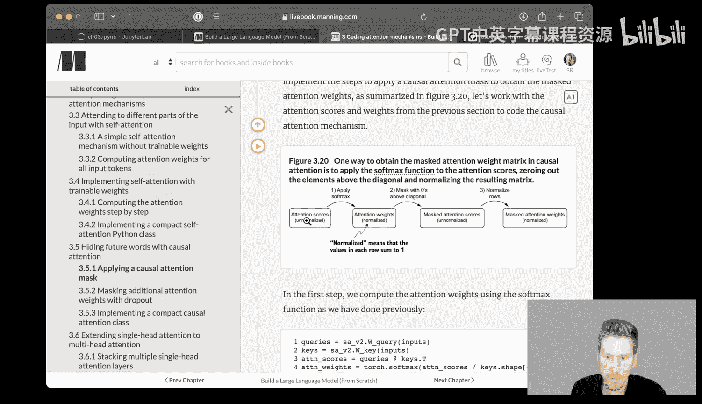

Took the anized attention scores。 So if I go back。

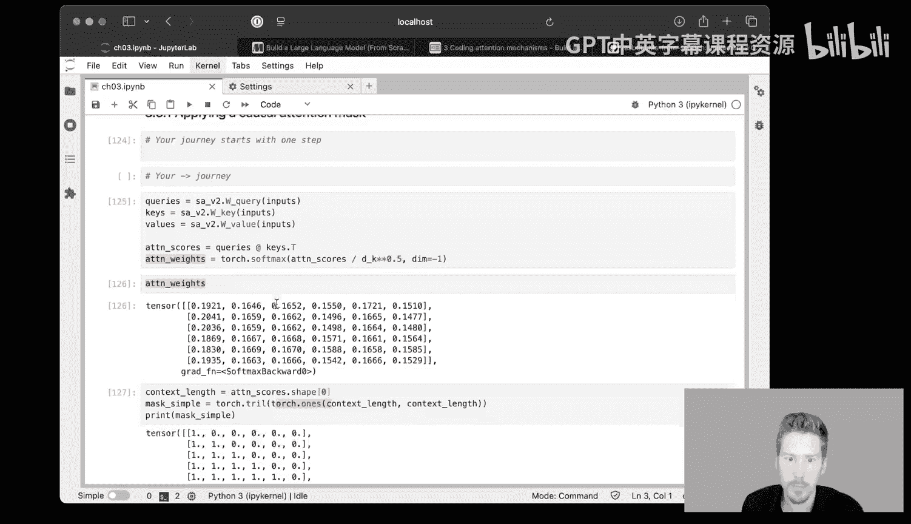

We have the attention scores here。Then what we done。

 what we have done is we computed the normalized attention weights that's with a softm here。

And then we computed the masked values， which is what we have done here。

And then we normalize those so that they sum up to one again in each row。

 And that is what we have here。 So that is one way we can do that。 So now we have yeah。

 things that sum up to one in each row again。 So that is one way how we can compute this mask here。

 So this is what we've just computed。 Now， there is actually a simpler way。 So this is one，2，3。

4 steps。 There is one simpler way of accomplishing exactly the same thing。😊。

And that is a little trick here。 should have a figure on this here。 So what we can do is， instead of。

Computing the softmax and then masking and renormalizing we could actually do this in one go。

 So where we have the attention scores， they are unmalized and then we mask them instead of applying the softm we mask them。

 So before just take one step back here before we apply the softm and then mask them Now we are doing it the other way round we are first masking it。

And then we are computing the soft mix。 And so this is only three steps。 It's a bit simpler。

 So that is one trick， if you are familiar with。Let's say some basic math concepts。

 this is one trick we can just make it a bit simpler。😊，I'm again to show you how this works。

 I'm again to creating a mask here。So this mask has now minus inf values above the diagonal。

 And so minus inf is stands for negative infinity。 Its so it's a very small number， like minus-9，9，9。

9，9，9，9，9，9，9，9， and so forth。And if you are familiar with some， yeah， basic math concepts。

 if you take E to the power of a very small value， like negative value。Let me try this like this。

 maybe。😔，This should be close to zero essentially。Oops。Toch X I， it should be a tensor。One moment。

 So that's one thing when working with Pytorch。 Yeah， so you can see it comes out as 0。

 and it's the same one as if I， as if I would do it like this， I think。This one should work。Oh yeah。

 the same problem again。T son。嗯。Oh yeah。 I have a double in I have a minus here and a minus here。

 So either this one or。This one should do the job。 So what we have。

 So what I'm showing you here is what we have here。 So the minus in。

And if we take the exponent of that， it comes out as zero。 And if you recall previously。

 when we implemented the softm， let me search for this。Here。

 so you can see we computed like this here， like the exponent， right。 So what we are doing is。We are。

Taking a shortcut based on this mathematical property。 And we are now computing。

This mask and apply this mask directly to the attention weights and then what we do is we can compute the softmax again so。

Me me do it here。 So this is the same softmax function we used before。 if I scroll up again。

So right here， so you can see this is the same thing。Except now we are going to apply to the mass。

 the values instead of the attention scores， but this part is essentially the same I could also。

Make it more consistent。A bit like this， and。This should give me also the masked attention ratess and these are exactly the same masked attention weights that we have seen earlier here except now it's one less step so now we only have three steps instead of four steps and so yeah this is our causal attention mechanism and yeah later on we will also add this to our causal attention class。

 the compact class but I want to introduce one more step in the next section before we actually modify our compact selfat class。

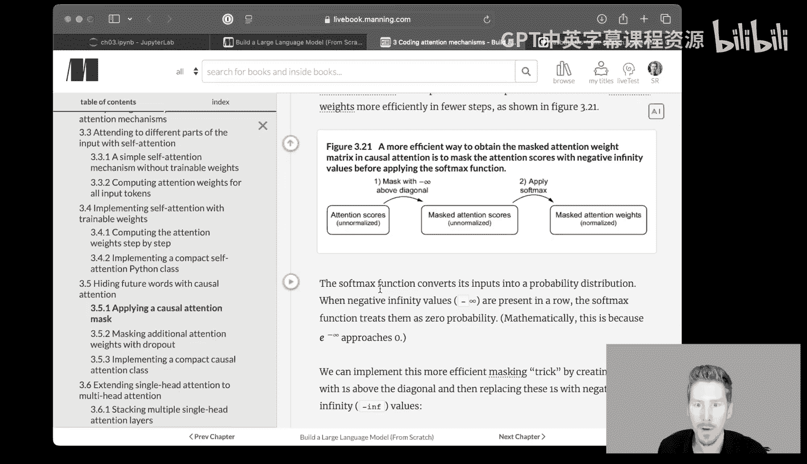

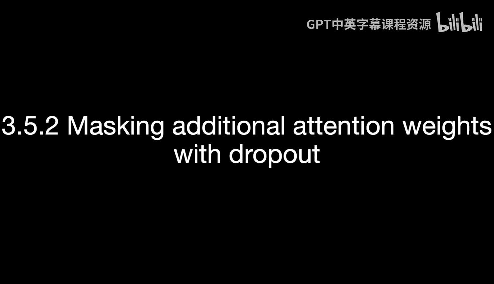

In the previous section we introduced a so-called causal mask to hide future words in the input so that the LLM can't cheat and access future words when it's generating the next word now we are going to introduce another type of mask a so-called dropout mask。

 So what is the dropout mask So the dropout mask will pick random positions in this attention weight matrix and then mask them out And so this is a dropout is a very popular concept in deep learning and has been around maybe for 10 years or longer and it's just applied to various layers to reduce overfitting and similar here we can apply a dropout mask to the attention mechanism so that the model learns to rely less on certain positions So here it's just a random selection of certain positions and then we apply this mask on top of our causal mask to mask out these positions。

You can see if we apply this mask to things that are already masked out here above the diagonal。

 nothing will happen， but it will additionally also mask out certain things in the input to reduce the reliance on these positions to reduce overfitting。

 I should say though this is not very commonly used anymore when training LLMs。

 I'm adding it here for completeness because the openI team for the G2 model。

 they used a dropout mechanism， but more modern LLms， they are not using it anymore。

 The reason why I'm introducing it here is just for completeness so that we are implementing the original architecture。

 But you know if you are training LLMs， you can also just deactivate that or just omit the dropout mask。

 but yeah just for a completeness。 let's see how dropout works， how we mask these things。So luckily。

 so Pyrch has。A layer called dropout。 So it's actually quite simple to add this on top of our existing procedures。

 And it asks you to specify the dropout rate。 So 。5 here means 50%。 So this means， for example。

 we are dropping half or 50% of the positions。 So let's assign this to layer。

 And then let me also add a random seat to manual。Seeit so that you hopefully get the same results that I do。

 However， I should say that' one thing that is particular about dropout and that is that it has a little implementation detail or back depends on how you want to call it in Pytorch that on certain hardware or operating systems it is not fully doministic。

 So you might get slightly different results。 I reported this a while back to the Pytorch team on the Github tracker So it's not resolved yet because they said it's not a high priority issue because I guess dropout is not that popular in the first place anymore。

But， so just that you are aware， you might get slightly different results。

 but that doesn't really matter that much。 Now， one more thing just to to around with a simple example。

 let me create a。Tsor of one。 let's do a 6 by6。 So it's exactly the same size as our attention weight matrix。

 And so I can now call layer example。 So I'm calling my dropout layer on this example。

 and let's see what happens。So yeah， what you can see is certain positions are zeroed out now。

 so just random positions here。 by the way， if I change the random seatd。

You will see it's different positions。 So it's just a random way of masking out values。 Now。

 one thing here is， though， that the other values notice that they are now larger。

 And so why is that so。To maintain approximately the same sum in each row。

 it is rescaling the values。 So， for example。The， the formula is I think it should be one over one minus。

Dropout rate。So if we have this formula here and my drop out rate。Is what did I say above。

05 so I put 0。5 here。This should come out at too。 So if I have a smaller dropout rate。

 this should be then a different value。 So we are essentially rescaling our values here to account for the fact that we are missing certain values。

 So it's just so that if you consider fully connected layers。

 the next layer that receives the output from this layer， it receives about the same sum the value。

 So if if we would sum those value values and these。

 it should be in the same order of magnitude before and after。 Of course。

 this is a very small example so it doesn't let's say。

 turn out as nicely that it is exactly like that。 but it's the rough idea that we when we reduce half of the values here。

 if we remove half of them， the other ones are scaled up So it's compensating for that。Yeah。

 and so this is essentially dropout works。 And then we can apply our layer to our。Attention weights。

 and then yeah， have the dropped out attention weights essentially。

 So this is this mask is what you are seeing here。 And now yeah， we are again。

 one step closer to completing the engine， the attention mechanism for the LLM。

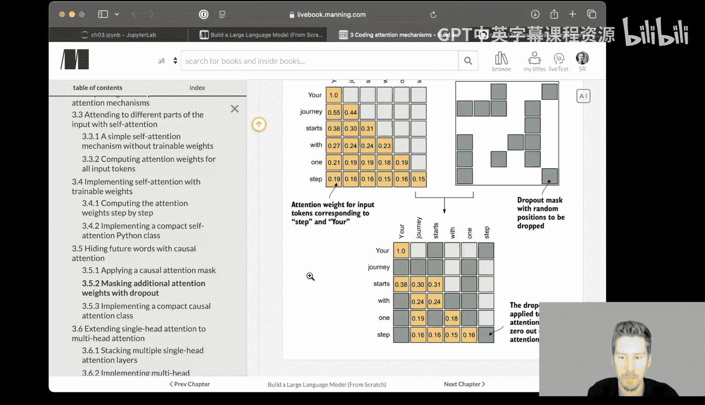

嗯。

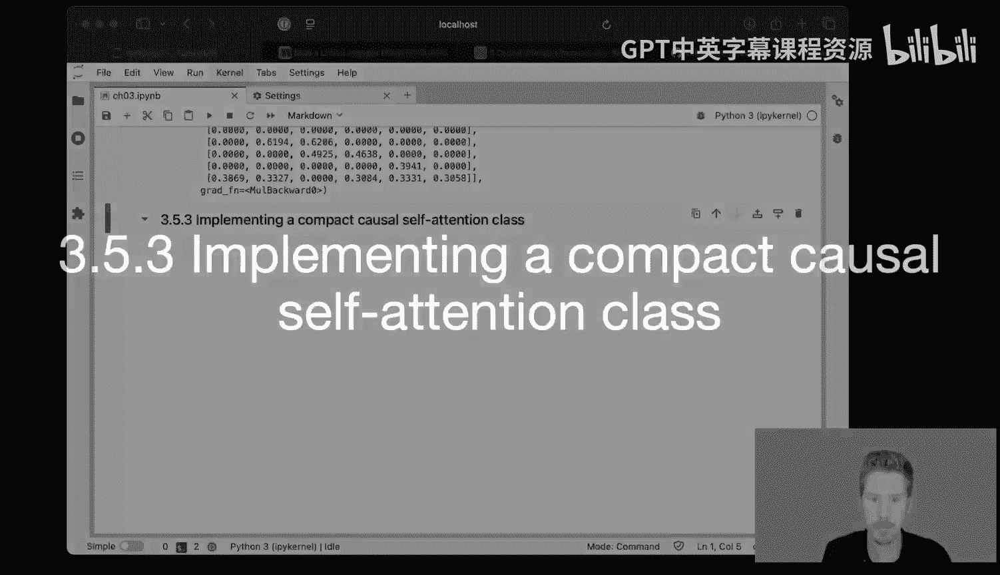

In the previous two sections， we introduced two types of masks。

 a causal attention mask and a dropout mask。 Now let's actually add those masks to our compact self attention class。

 which brings us one step closer to completing the engine of the LLM。

 the self attention mask that we are going to use when we are training the LLM。

 So let me copy this one。 This is our self attention。Classs here。

And I think I just saw also a little mistake here。Notice that we have an x here and we have inputs here。

 so this should also be。X， and yeah， speaking of inputs， let's now also work with。A batch of inputs。

 So that would be similar to the output that the data load in chapter 2 returns。 So inputs， again。

 is a tensor we had consisting of 1，2，3，4，5，6 input tokens。

 and each input token consists of a three dimensional vector。

 Now to create a batch just for simplicity， I'm going to。Just stick loopops。

Stack two inputs on top of each other。It should probably be across the first dimension。

 So to give me a batch of inputs， let's call that batch。And this should now。

 if I didn't make a mistake be a2 by 6 by three dimensional tensor， let's see。 So it's two inputs。

 so two times the inputs tensor。And each input stens has six tokens and each token has a three dimensional or is a three dimensional vector so now we are going to work with this batch next let's make a few modifications to our class here let's also call this causal attention and we are going to add now the causal attention mask and the dropout mask so let's add dropout mask here。

And then we are go。 So this is the dropout rate。 And now we are going to add the drop out layer。

And then dropout， which uses。The dropout rate next， we are going to implement。Casal mask。

 so I'm just copying it here， and so the causal mask here is similar to what we have defined before。

 except that I am going to register this now as a buffer。So let's call this just for simplicity mask。

And why am I doing this。Register buffer。Why am I doing this is in Pytorch。

 we could optionally later on train a model on the GPU， you don't have to， but if you have a GPU。

 later on when we define the model we can move it over to a device， for example， a QUa GPU device。

Now， Pythr will move over all the weight parametersus， all the layers here， but it won't do that。

 for example， for arbitrary tensors like those。And by the way。

 I define the context length here as the size of the mask。 so I should also ideally。Put that here。

 context length。So Pythrch doesn't move over tensors like that。

 so we have to register those tensors and this is called register buffer and then if we do that this mask also gets moved over to the model yeah and we could technically also generate the mask on the fly here down here it's just yeah a design decision so that we don't have to regenerate this mask every time we are just generating one mask once with a maximum supported context length and then we are going to reuse that here when we apply the causal attention mask。

So let me just copy and paste the relevant code。 So this is just a small update here。

 so notice that I added a few things I have now this masked fill now and in Pytorch by convention everything that ends with an underscore is an inplace operation So in place means it doesn't create a copy as an intermediate value's if these operations exist。

 it's an efficiency thing so but nothing to worry about this is just like a small note here that this will happen in place so I don't need for example。

 I don't need anything like like this because it already happens in place so I don't need to assign anything this will this will already modify this existing attention scores。

And yeah， and then we have this bo thing where it's applying the mask to those that are non zero。

 so we apply the mask， the minus infinity mask that we defined in a previous section here。

So we are going to apply this one。So we are setting essentially sorry we are setting those minus infinity values and then we are applying the softm function to scale it and then we apply dropout so essentially what we are doing is we are applying this mask to our attention score so it's exactly the same thing that we have here。

And then after that， we also apply the dropout mask to our attention weights， so we apply two masks。

 the causal mask。And then the drop out mask。 and then。

 we compute the context vectors similar to what we have done before。

 So let's actually see if I didn't make a mistake and let's modify this here， causal。

I have a few more inputs now， the context length and the dropout rate。So we can define dropout。

Let's just set it to0， by the way， because like I mentioned before。

 it's not commonly used anymore anyways。 And then context length。

 this should be depending on the batch input。 So our。Bch has。6 input token。

 So let's say our attention mechanism supports up to 6 input token。 so I can do shape1 where 0，1。

 it should give me this。6ix here， as you can see， yeah and。Let me add white space here。

 and then we can call it on our。Bch here， and maybe yeah， let's try it out。Unmatched。

 I think I have one。Too many。Of these， nu tokens is not defined。Yeah。

 so one more thing I should probably add is。I should define numb tokens so we can here， for example。

 define the batch size， numb tokens and then the input dimension based on our input。 So this is。2。

 in our case， because our batch is 2， number tokens is 6。

 and this would be the dimension for the embedding。 So the input embedding so。Oops， yeah， this works。

 So I actually wanted to make a new line here。 Sorry， So this comes from X。

 which is batch in our case。 And this has is's a two by， let's say two by 6 by。3 tensor， right。

 So this is， we are just extracting out these dimension here， these dimensions here。

 but in a more general case。 So instead of， yeah， hard coding those。

 we extract them directly from the input that goes in here。Okay， and yeah， as you already saw。

 this works。 So now we have this causal attention class。

 which is a nice compact causal attention class to compute the context vectors。

 So you can see there are bunch of things。 This thing is similar to this thing。 and that is because。

If we look at our batch， we duplicated the inputs。 so just for simplicity。

 this is the first input and this is the same thing because we we created the batch by yeah duplicating it in reality when we are using our data loader later。

 of course they will be different So different inputs in our batch but this is just yeah for educational purposes and then for each three dimensional input we now have a two dimensional context vector So for the second input this would be the corresponding context vector and so forth。

 So yeah we have now a nice causal attention class。

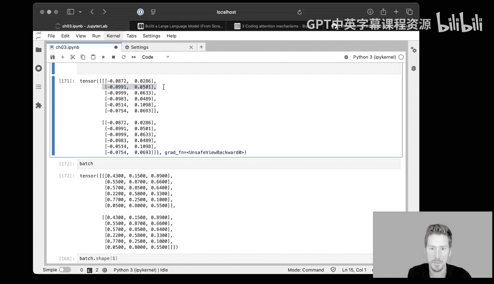

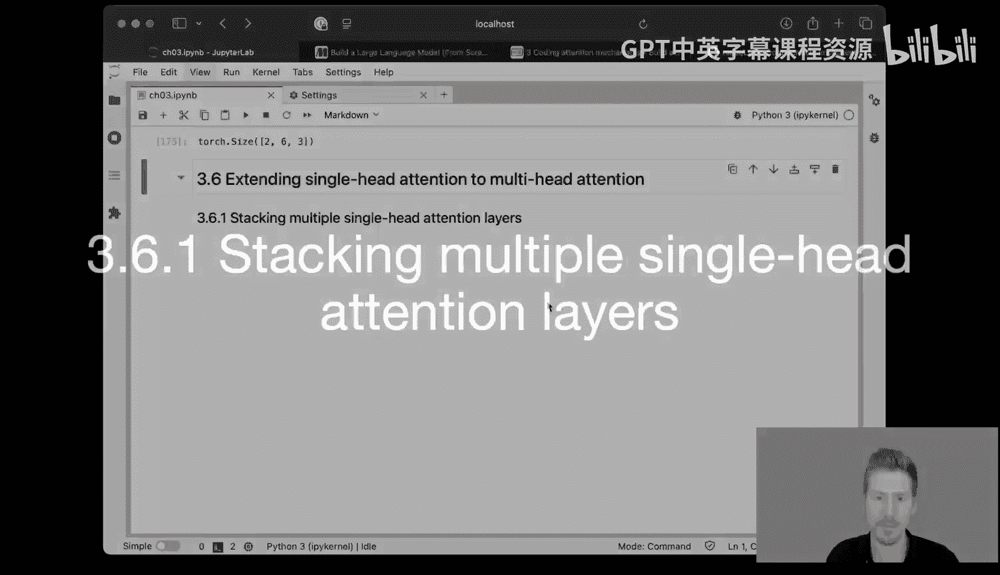

We just implemented a self-at mechanism with a causal attention mask。

 Now we are almost done with a self-atten mechanism that we are going to use in the LLM。

 as whereas as one more thing we are going to add。 and that is the so-called multihead attention。

 So if you are familiar with attention is all you paper shown here this is the original paper by Google in 2017 that introduced the original transformer architecture。

 So LLms like G and so forth they use this right subpart here。

 which is also called the decoder sub moduleule。 So the left part is not commonly used anymore in LLms。

 So this was a more let's say a complicated architecture than what's really needed。

 So on the right hand side this would be what's similar to yeah G style LLMs today。

 and you can see there something called the masked multihead attention module。

 And that is what we are going to implement in this section。

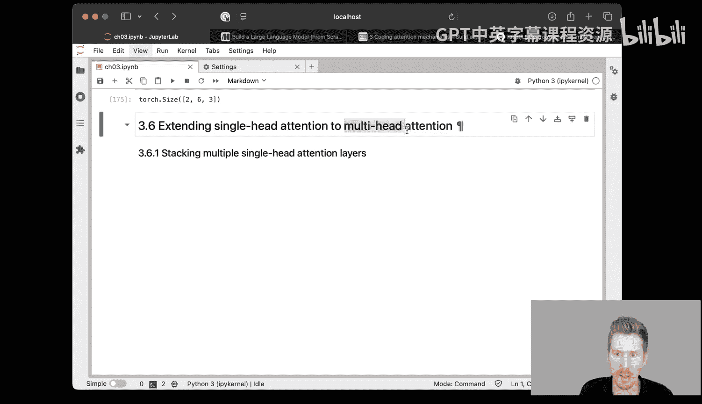

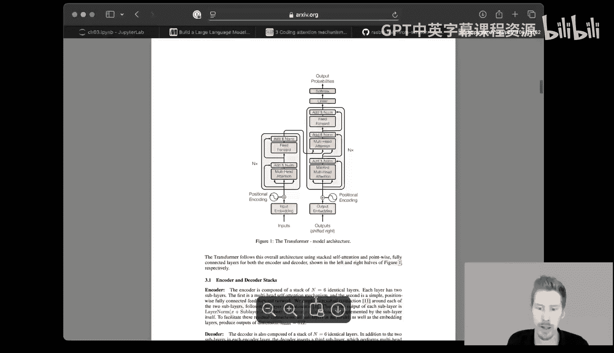

So before the causal attention module would be the same as masked attention。

 So masked here is a more general term that refers to a type of masking in the previous section we introduced a specific type of mask。

 the causal mask and by the way they were also using a causal attention mask。

 but yet whether you call it mask attention or causal attention in this context is the same thing。

 but our causal attention class that we implemented。 it would be a single head attention module。

 a masked single head attention module。 Now we are going to implement a multi head attention module。

 So。multiulti head attention module is similar， except that we have now multiple single head attention modules stacked on top of each other。

 So if you are familiar with convolutional networks just to draw an analogy。

 So a convolutional network is an older type of architecture that has nothing to do it can be used for text extraction。

 but it was originally also designed for image extraction。

 So if it's unfamiliar to you maybe don't worry about it too much。

 but the idea was that we had a well we still have and still use this type of network to extract different types of information from an image automatically。

 and there are socalled channels here。 So well different filters So the different filters。

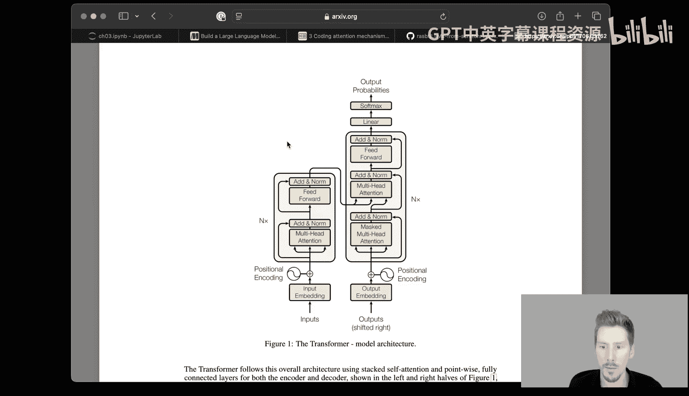

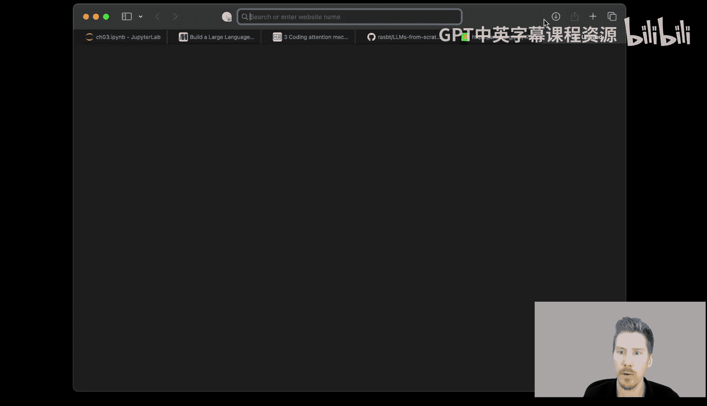

Extract different types of information from the image。 And in that sense。

 that's what we are also trying to accomplish here。

 We have multiple heads or multiple of these self- attentionten module。

 to extract different types of information from the input。

 So the idea is really yeah to extract more and different types of information and this works because each single head attention module is initialized with a different set of weights。

 And then each of them will learn slightly different features during the training。

 And then it's a way of extracting more and more diverse information from from the input。

 to show this to you in a visualization here。 So maybe let me see if I have a simplepl figure here。

 so。

Before we had this input tensor， where inputs was a 6 by three dimensional tensor， we had six tokens。

And then each token was embedded in a three dimensional space。

 And then what we did is we had a single head attention module。

 the causal attention module that created a6 by two dimensional context vector。

 So the a context vector still had six numbers of tokens or six rows corresponding to the six tokens。

 but each role was two dimensional embedding now instead of three dimensions。

 we said before the two and a three they are arbitrary we can choose them。 but to keep things simple。

 let's assume we had three input dimensions and two output dimensions And what came out was this tensor z。

 So here it's called z1。 So just think of it as z。Maybe to also show it to you here。

 So our input was a batch consisting of two input examples。 and this first one would be the inputs X。

 So here we have the six rows。In the three columns。

 six rows corresponding to the six tokens and the three columns corresponding corresponding to this three dimension embedding。

And then the context vector that we got out of the causal attention mechanism was also 6 by 2。

 also we had six numbers of tokens and now two dimensions as outputs， So before it was three。

 now we have two， but the number of rows is the same。Anyways。

 so we had that now we are going to create a second context tensor So before we only had Z1 now what we are going to create is Z1 and Z2 So this would be a case where we have two heads so one and2 the number of heads it's arbitrary it's a hyperparameter for example in GT2 models it's I think I believe it's between 16 and 25 we will see actually exactly how many there are in chapter 5 but yeah we usually use more than two heads here I'm just using two heads for visualization purposes so it fits nicely onto this slide。

😊，And then yeah we create two of these context tensrs， and then we concatenate them。

So you can see we have two context tensors where each has an output dimension of two and when we concatennate them yeah we have now an output dimension of4 because it's two times2。

 Yeah and this is what we are going to build and how we are going to build that is by yeah' simply stacking two of the single causal attention mechanisms that we implemented in the previous video on top of each other So in the previous video we had the causal attention mechanism that had a weight matrix for the query the key and the value outputs and then yeah each the query matrix created the queries。

 the key weight matrix created the keys and so forth Now we have a second set of weights before we had only Wq now we have Wq1 and Wq2 So we are having a second stack you can simply think of it as doing the same thing twice almost and then concatenating so at the end we have also two context tensors like mentioned before and we create this combined context tensor。

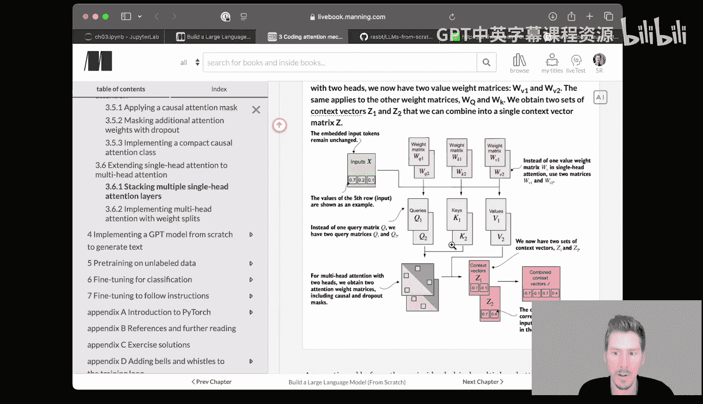

So let's maybe see how that looks like in code because I think that will make things a bit more clear。

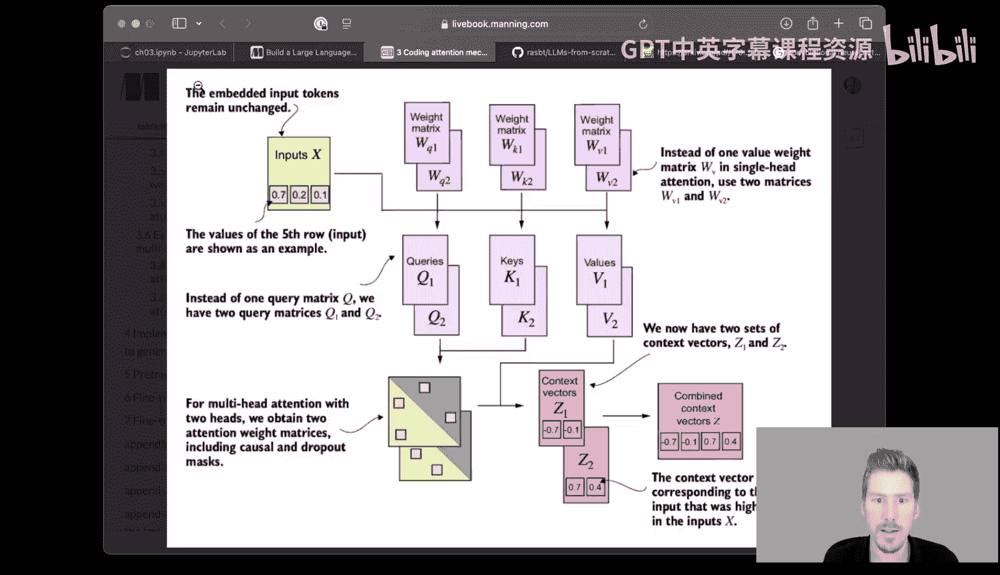

So what we' are going to do now is we are going to create a class。 It's called that a multi head。

Attention。Reper， and then we use the torch module here。And then let's do the in constructor。So。

And here， yeah， one thing just sometimes tend to forget that we are just。

Inheriting the features from the module class。OopAnd then one thing is we are going to implement this in a simple way for now later in the next video I will show you a more efficient way。

 but the simplest way would be really just stacking these causal attention mechanisms I will just copy and paste it from the previous video so previously what we had is we had this causal attention class and we are now instantiating an object from this class I mean at the missing parenthsesis so we are instantiating this object and we are going to instantiateated a number of times so for example for a number of times where the number of times is determined by the number of heads。

So for example， if we set the number of heads to2。Let's add it I actually here。

So the number of heads could be2。 and then this would be。Creating two causal attention heads。

 Let me also copy those over， actually。And then， yeah， also well。Q K V bias。

 we're not gonna use that one， but just for completeness。 So that is how we initialize， well。

 how we would， for example， initialize multiple of our causal attention modules。 One more thing。

 though， is in pytorch。 Let me just make this a bit nicer。 in pytorch。 I recommend using the an N。

Module list here because it will give it some nice properties with the buffers and everything I mentioned before。

 Yeah， and so this would be now a stack of multiple causal attention classes or objects of this class that we implemented in the previous video。

 Now， let's actually define the forward method to。To use that。 So the one way， of course。

 we could use that is by just calling head on the input for each head in。Self do heads。

 So this is a list of multiple signal head attention mechanisms。 And we're just iterating over those。

So let's make this a list。 And in Pyr， the simplest way to combine them would be concatenating them。

 So we do that along the last axis here。 And this， yeah， this should be giving us our。

Concatenated context sensorsors。 And this is really all there is to it。

 I believe if we looked at the figures， it looks a bit more complicated because there's a lot of stuff going on。

 So each layer here is showing the causal attention mechanism， but really。

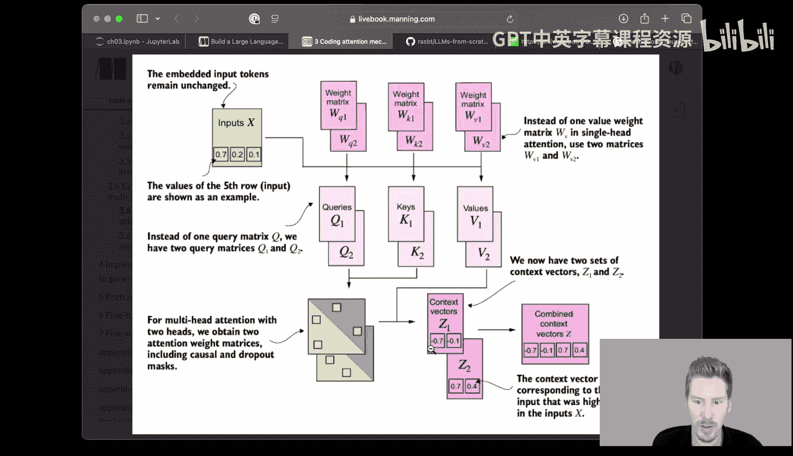

It's just multiple of those on top of each other。 And we already did the hard work and implemented this。

 So we are just stacking it here。 Then let's actually use this torch manual。

See it just so to make sure you get similar results。

 let's just define some variables so the context length would be batch or shape1 because we have the batch2 times 6 times 3 so we have two inputs each has six tokens and then the output dimension or input dimension of each token is three。

And then we can also define input dimension here again。And maybe also that output dimension。

So the input dimension is3 in the figure， or we can also make it more general。

 but shape can extract it from the input and then let's say for the output one， we do two。And again。

 I like I mentioned， this is a hyperparmeter。 so we will use much larger values later on when we implement the whole LLM。

 but。Because。😔，This one。And I'm just gonna copy this here。

So we have to find those dropout that's just for simplicity， set it to0。And yeah。

 this is technically it。 and I hope it works。 It does not super needs an argument。 Yeah。

 I always make a mistake here。 think I just forgot。The parentheses。

And now the shapes are not aligned。12 by3 can't be multiplied by。2 by two。

 So I think I made a small mistake somewhere queries here。So， let me see。😔。

I can see I should have written a different number。 I should have written -1 because。

We want the three dimensions and not the two dimensions here。 so that was the mistake。 Yeah。

 so this is it。Yep， I could also just write three here。And this should work。

 Now we have this multi head attention mechanism。 So the first two values here。

 they correspond to the first context vector and the second one。

To the second so what we are doing here is recre these two sets of tensors and then we are concatenating the results and this is yeah。

 really it。

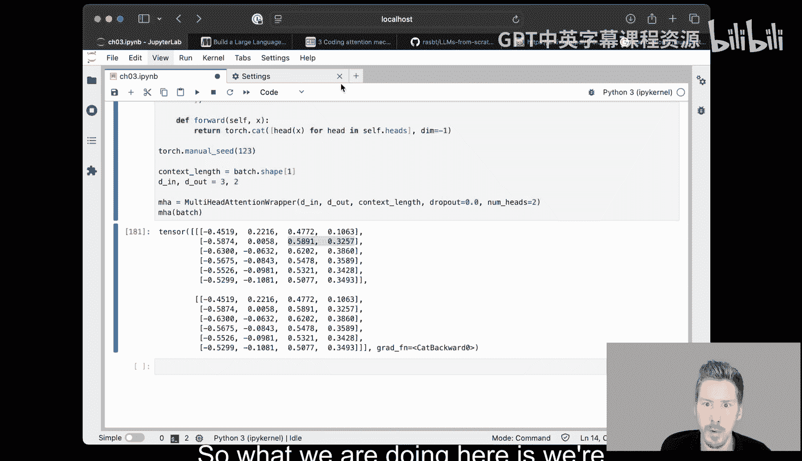

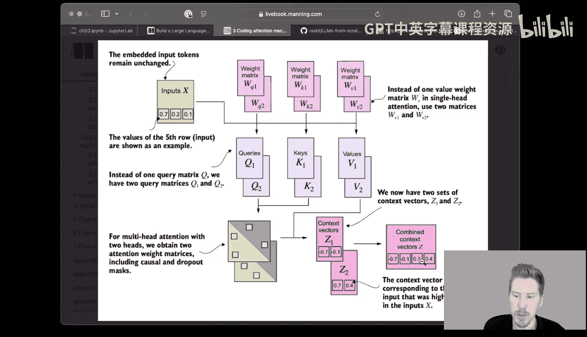

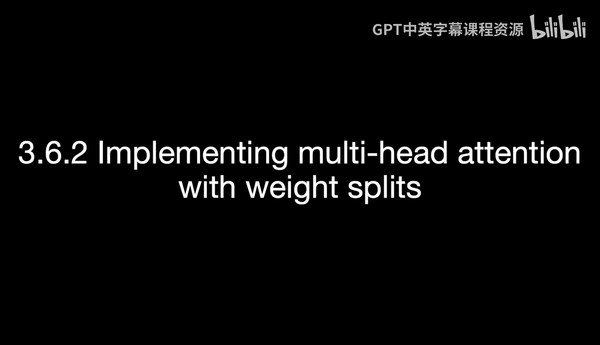

Yeah。We are now technically done with a selfatten mechanism。

 the one that we implemented in the previous section， the multihead attention mechanism。

 but I wanted to show you one more way to implement multi head attention a bit more efficiently So previously one downside of the implementation was that we were stacking multiple attention modules And then when we were calling them in the forward method that was a sequential yeah call here So we had to iterate through those sequentially I mean。

 not us， but the computer and this is not very efficient for let's say GPus or even CPUus when we train this because technically we could yeah execute the calculation and parallel parallellyzing things under the hood using for example matrix multiplication because for loops are always a bit slow in Python because yeah one for loop has to wait for the other for loop to finish。

 But since these attention heads all。Opererate independently of each other。

 There is no need for one to wait for the other。 So I'm going to show you an alternative implementation。

 and this is a bit technical， so。It's a lot of code tookook me a long time to write this code I will walk through this a bit。

 but yeah I didn't want to retype everything because it's easy to make mistakes in certain cases。

 but I will walk you through the big picture idea here。

 So here again similar to before we get the context vectors of shape123，45，66 times4。

 This is similar to what we have here。The values a bit different because yeah we use a different initialization here。

But we'll get to that in a moment。 but mathematically the operations in there they are giving us the same results。

 so you could technically take either one of them， plug them into an LLM and then train them in the LLM。

 And yeah， when we get to chapter5， maybe as an exercise。

 you can swap out the attention mechanisms and see that the model will train with either one of them it's just that this one is faster during the training。

 So what is happening here。 so let me go through this step by step。

 So what's happening here is we are still initializing the same variabless as before and then we have this assertion here。

 we are saying the output dimension， the dimension we have here。

Has to be a divisible by the number of heads。 So if we have output dimension4。

And we divide it by the number of heads， let's say two， this should be not giving you any remainder。

So because this determines the dimension of each head。So here， if this is4， this is2。

 we have a two dimensional head dimension and the head dimension can think of it as the dimension also of the context vector before we concatenate them。

Now maybe let's let's make oh let's just keep it like it is for now and going a bit further down here。

 now what we have is we have a query a key and a value like we had before。But they are bigger now。

 So before we had the out of2。 So the out was equaling 2。 Now we have it set down here to 4。

Which means these are bigger weight matrices compared to our causal attention module before。

So we are just instead of concatenating multiple causal attention mechanisms。

 we are just using a bigger weight matrix here。 I think I have a figure on that somewhere here。

That can show you。Maybe better what I mean。 So before in the previous section。

 what we did is this one。 So we had the inputs。 and then we had a stack of two weight matrices here I'm only showing you the queries but the same would apply to the keys and values。

 And then we multiplied the inputs with the query and got the queries here。

 and then we did the second multiplication and got the second set of queries and we did the same for the keys and the values we got two attention matrices and two context vectors and we concateated them and this is a value yeah。

 a reasonable thing to do。 a valid thing to do。 but this is inefficient。

 unless we do this at the same time。 So in our previous implementation。

 we had the python for loop where this was inefficient because it happened sequentially so it was first doing this and then was doing this。

 and now one way we can do both of them at once。It's by combining those into one weight matrix。

 so it's a linear algebra concept， but if you concateate those weight matrices to one bigger weight matrix like here。

Then what you could do is you can do the multiplication between the inputs and the weight matrix here。

 and then you get the queries out here， and then when you split those， you get similar to above here。

 two query query sets and。What's happening here is mathematically the equivalent thing。

 you get exactly the same values， but this one is cheaper because you can do this in one go。

 So the way it's implemented， this can be one matrix modification and splitting is incredibly cheap in Python and Pythtorch。

This one is expensive before because we had a follow loop doing them separately。

 so that that's the whole idea between what I'm showing you here that we have now these bigger matrices。

And then here we compute the keys queries and so forth。

 So this one here that you are seeing corresponds now to this bigger queries and then。

What you are seeing here。😔，Is the splitting。 So here we are performing this splitting operation and we are going to use the view。

 It's just yeah reshaping it。 And so we are splitting it by introducing the number of heads。

 So before the input dimension of each of these is the batch size。

 the number of tokens and the output embedding size。 So for example。

 this would be two if we consider all batch。6 tokens， so two times 6 and then four。2，6，4。

 And then we are going to split this。Into2，6，2， and 2。

 So we are splitting this dimension the four into2 and2。And this is why I have。

This one here because it has to be divisible right。

 so we we want this head dimension to be nicely divisible so that we can split this one up into this one。

Okay， and this is all we do and then yeah we similarly compute the attention scores， the mask。

 the weights get the context vectors， and so forth， that's one more thing though here。

The conti continuousiguous view。 This is where we are combining the context vectors。

 So we are now going from。Number of heads had dim。 So we do everything separately here。

 So we have this heads。Numb heads and had them， and now we are combining it again into the out so that we get the concatenated context vector。

 So if I go back up again。This is essentially performing this concatedination here again。嗯。And why？

Am I using contiguous in view？This is just yeah because we kind of fractured the memory at some point so in Pytorch the tensors are held in memory and with all operations。

 they got a bit fractured and it didn't allow me to do the view without the contiguous it was complaining that things are scattered in memory and it's inefficient and here we are just reorganizing things internally in the computer memory just for efficiency reasons and by the way。

 you don't even have to write it like this you could also just write instead of this you could just write reshape This doesn't either contiguous however。

 since I used in this book view before and I introduced view in the appendix。

 I didn't want to overcomplicate things and I was sticking with view but technically view and reshape are similar in Pytorch except reshape creates a copy and this one doesn't in place modification so it doesn't copy anything in memory so。

C we need to manually rearrange the memory， but here， by the way， this is a technical detail。

 you don't really have to think about it too hard， just maybe consider reshape here。

 it doesn't really matter。Yeah， and so that is what is happening。 So let's just see。

 make sure that it still works。 So yeah， this works。 And by the way。

 I can also show you what I meant。 It's not super interesting。 but if I do this， it will。Yeah。

 complain about this so we can use either reshape or this contiguous。Whatever you prefer。And yeah。

 that is what I wanted to say here and y4 this is arbitrary technically here。

 it happened to be like that because each of them we had two heads and each of them had a dimension of four。

 but now with our new modification we are actually even more flexible so we can also still have a output dimension of two if we want to so that would be also more flexible so we can control even the output size more easily。

Yeah and one more thing I should say I was talking about efficiency here。

 this is one way to implement this more efficiently。

 but if you are interested in more bonus material I know this is very technical now so you can feel free to stop this video and go to the next chapter if you want to。

 but if you are curious I implemented many different types of attention mechanisms and compared them in terms of the efficiency。

So。嗯。Let me just go back。Maybe I've clicked on the wrong thing by scroll down chapter 3。

 comparing efficient multiate attention implementations here。There we go here。

What I have is I have a notebook where I compare different attention mechanisms。

 This is based on Pyr 2。5 right now， Pyr 2。6 is out and it becomes actually even easier。

 So here I have， for example， the causal attention multi head attention wrapper that we implemented first。

 So this would be corresponding。To this one。嗯。Next， I have。

What we've just implemented the more efficient version， this is what we've just implemented。

Then I have another way of implementing it here with combined QKB matrices。

 this was suggested by a reader。And here。What we are doing is。

 instead of having a separate value key and query matrix， we only have one matrix here。

 So it's a three times as large matrix。 So instead of having。Let me scroll down ups here。😔。

Instead of having them separate。Q K B， we have now。1， that is essentially three times the size。 oops。

 and then similar to what we have done before， we are going to break it down later after the matrix moplication。

 It's a similar concept to what we have done here。And then breaking it down here， where we have。

multiplication with a bigger matrix。 and then we we split it。

 but now we go even one a level further where instead of having three different matrices。

 we have one big matrix。 So yeah， that is what you are seeing here。

Then I have just for fun because I like Einstein summation。

 I have an implementation using Einstein summation it's just different notation here。

 so maybe don't worry about it too hard it's just like a little yeah little thing I had fun with。

Then here is Pytorch scaled dot product attention。So this is the Pytorarch official implementation of the attention mechanism。

So， I'm using it。Right here。 So instead of yeah， me performing the attention score calculation and so forth。

 So this is replacing。The part down here。So here we are letting Pyr take care of the attention score and weight computation。

Then there's another one。 So this one， by default， if you have a GPU that supports multi head attention。

Sorry， flash attention。 this will use flash attention。

 which is a implementation that is more efficient here I have another implementation doing the same thing for benchmark purposes without a flash attention。

There is another way to implement this。Class and Pytorch， the multi head attention class。

 So I don't want to go into too much detail here because it might be boring by now。

 get another implementation。 and that's also Pytorchs new flex attention And so you've seen there are nine different ways of implementing the self attention mechanism in Pytorch。

 they should be all mathematically equivalent and then I benchmark them。 So here first on a CPU。

 So you can see causal attention is slightly slower than the other one。 the one we implemented。

 for some reason the combined QKV is slower。 but we will revisit this in a few moments。

 my in information is actually the slowest， but it's fun。

 And then you can see the Pytorch implementations are actually faster except for this multi head attention class。

So this was on CPU I did the same benchmarks on GPU let me just scroll down to visualizations here that I have so you can see all of them compared to each other nine different attention mechanisms I see there should be a nine here and so。

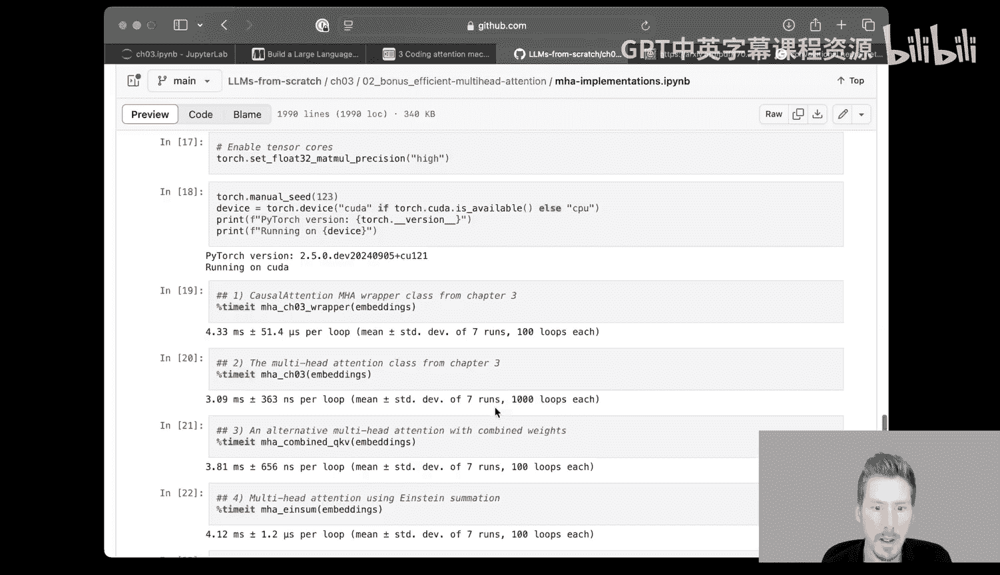

What you can see is that the fastest one is using multi head attention with the Pyto skate dot product function if it's using flash attention and you can see this one is the slowest flex attention。

 we will revisit this in a few moments so we can also see the sequential attention class that we implemented in the previous video is slower than this more efficient version that we just implemented in this section。

And the QKV combination is slightly slower than this。

 so this is actually a quite nice implementation we have here。

 given that it's a form scratch implementation， of course Pytochs native one is faster because it's more optimized。

 but this is actually not too bad what we have so far。

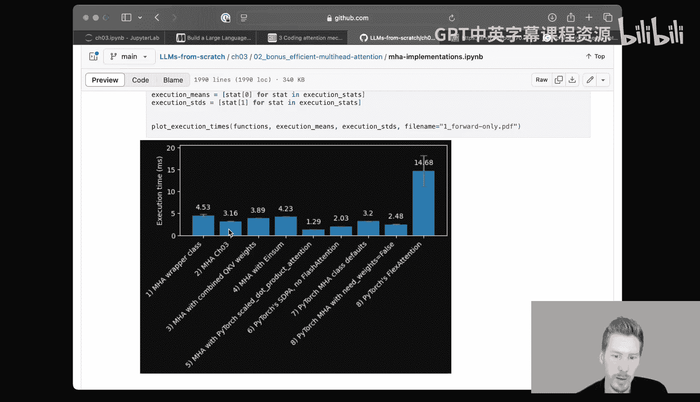

And then I've done the same thing with both the forward and a backward pass if backward pass is a new term for you。

 this will be explained more in chapter 5 when we are training than neural network。

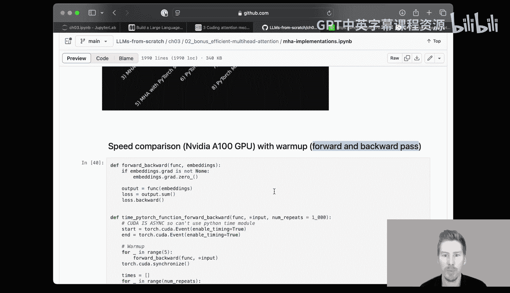

Here more benchmarking， similar relationship between the numbers。 And then I also added compilation。

 So torch compile is a nice function to make things faster to compile a static graph。

 and here what we can see is nice in the compile case。

 the Q KV combination is actually slightly faster than ours here。

 but you can see ours is actually quite nice。 It has not。

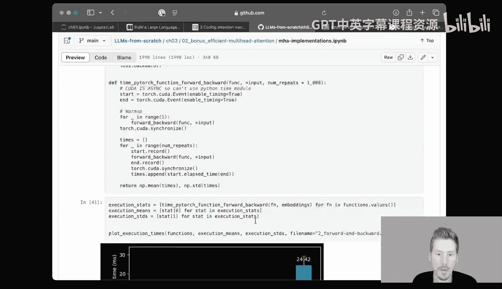

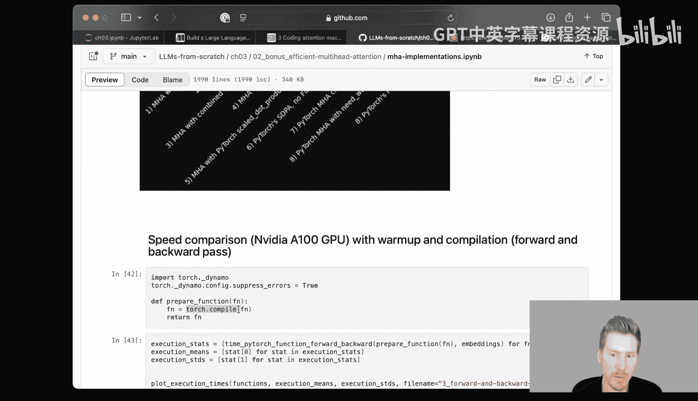

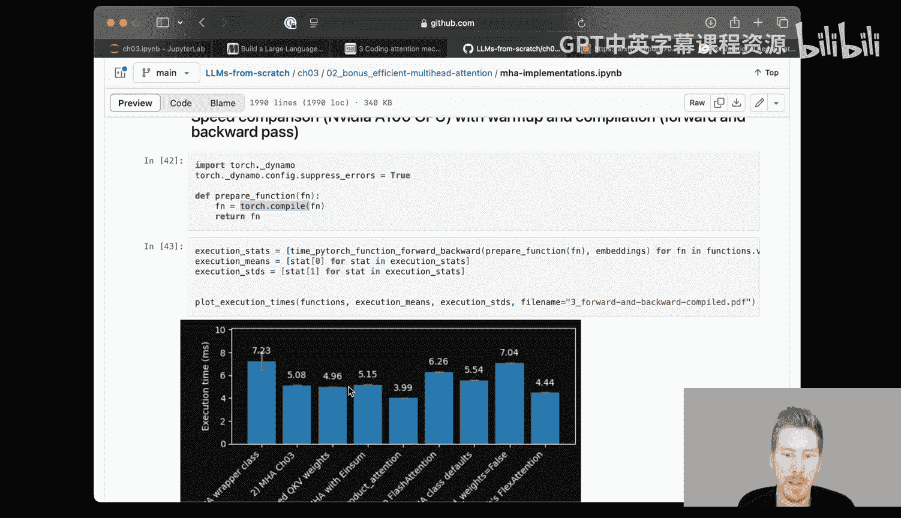

A big disadvantage compared to Pythrs native1 anymore。 it's slightly slower。

 but the compilation helps optimizing this And you can also see flex attention is now fast。

 So for flex attention， you definitely need to use compile because otherwise it's very slow。

 So it's meant to be compiled。 but yeah you can see overall our implementation here what we have this MH。

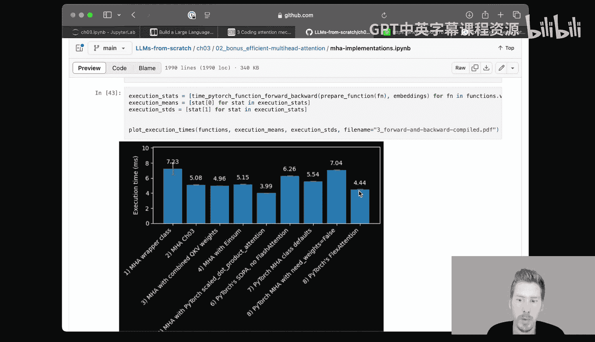

Coode， which is what we have here， is not too bad after all。

 And this is really a nice readable from scratch implementation where we can really understand what's going on。

 And yeah， and so with that， this chapter was covering the self attention mechanism in the next chapter。

 we will be putting together all the remaining blocks。

So we will be coding all the other parts of the LLM， and then in chapter 5。

 we will be actually training that。

