# Sebastian Raschka《从零开始构建大语言模型｜Build a Large Language Model (From Scratch) 2025》 - P4：-4- 4： Implementing a GPT model from Scratch To Generate Text - GPT中英字幕课程资源 - BV1BCfdBqEVv

Yeah， welcome back to Chapt 4 of the supplementary coding a long series for the built a large language model from scratchbook here in Cha 4 we are going to implement finally the GT model that we are going to pre-train and fine tune in upcoming chapters so this chapter is focused on coding the LLM architecture that we are going to use in upcoming chapters just to show you where we are in the grand scheme of things so before we already implemented the data preparation and sampling where we had token IDs that we embedded into multidimensional embedding space and also in the previous chapter we implemented the attention mechanism it's essentially the engine of the LLM that does the core computation now we are going to complete the architecture So if you think of the attention mechanism as let's say the motor of a car you can think of this one now as putting on all the remaining parts the wheels。

 the steering wheel and。Everything else around the motor， basically the seats and so forth。😊。

So let's do this in a gentle way because yeah it's a big topic to implement a whole LM architecture。

 So I think the best way to understand what the architecture looks like is to show you a dummy class。

 So here this dummy class is coding some placeholders and we will be later on replacing these placeholders by the actual code。

 I think I also have a figure here somewhere that might be helpful。 So just to show you。Again。

 when we are in this book， so previously again we tokenized text。

 we had the token embeddings and now we are going to implement this core model here。

And in this figure see yeah this one so what you can see here is the GP model that we are going to implement and so it receives tokenized text and then the embedding layers。

 we already coded them in the previous chapter， but they are technically part of the model。

 so we have these embedding layers which you can see here so we have the token embeddings and the positional embeddings they were covered in chapter 2 where we had a mapping from the token IDs to embedding dimension that we can define。

And the input size of the embedding layer was the vocabulary size。

 all the unique words in the training corpus and the position embeddings， they had the context size。

 So how many tokens can fit into a context， we had a very simple one， only6 tokens。

 I think in chapter 2， but in reality， this could be， for example，256024 and so forth。

 depending on how much context we want to support in the LLM。

 And then now we are going to add a few more things。

 So let me show this also in the context of the figure。

 So one of these things is the transformer block。 so。

And an LLLM consists of multiple of these transformer blocks and each of the transformer blocks has a number of elements that we will talk about later in this chapter。

 but one of the core elements is the masked multi head attention module which we implemented in the previous chapter and then we are going to add some output layers and that is essentially how the LLM architecture looks like conceptually Now going back to our dummy GT model。

 this is coding what I've just shown you in the figure so we have these embedding layers we have optionally dropout and then here is this transformer block and like I just mentioned。

It gets repeated a number of times。 So here we are going to repeat it。

A number of times where the number of times is specified by n layers so。

CfG stands for it's just short for configuration。 So this is a Python dictionary。

 as I will show you later， that contains some configuration。 maybe I can actually adjust。

Addit here so that it's more clear for some reason， Yeah， there we go。Here， so。We have a vocab size。

 This is the number of unique tokens in the input also so in the training set。

 So this is based on the GT2 tokenr that we are using from Tk token。

 Then we can specify a context length。 How long the context is that the LLM can support。

Here we are choosing1024， but yeah modern LLms they can also support longer context sizes。 However。

 it also depends on the hardware， what your hardware supports。 So the longer the context size。

 the more expensive the computation and the more hardware requirements you need the embedding size this is the embedding size for the token embeddings so previously in chapter 2 we talked about three dimensional embeddings Now we are going to scale is up to a bit larger 768 the number of heads in the multi head attention module that we implemented in the previous chapter here。

 the number of layers it's called yeah and layers， but it it really refers to the transformer blocks。

 how many transformer blocks we want to repeat。The dropout rate and whether we want to use the bias in the query key and value linear layers yeah。

 and this is just a configuration file that we are going to pass as a CFfG into the stmmy model。

 the reason why I'm calling this CFG is to keep it short so it doesn't go off here in the cell and becomes too long because yeah。

 otherwise it would be harder to read。Yeah， and so we have these transformer blocks。

And then we have something called a layer norm here。

 we will get to that later and then we have this output layer and so you can see what's interesting is the input layer maps from the vocabulary size into the embedding space and then the output layer maps back from the embedding embedding space to the vocabulary size so this will allow us to generate words because what we are doing is we are transforming the token IDs。

 the words into an intermediate representation， the embedding space like a vector representation and then later on we will transfer them back into this original vocabulary size space back into token IDs essentially so that the LLM generates text。

So these are the elements and here in the forward method we are going to use these elements so we create the embeddings。

 we add dropout optionally then we apply the transformer blocks so when I call this one thanks to the sequential it will put it through all the different transformer blocks。

Yeah， and then we have the output layer here。So if we。Consider this as our。LLM。

 this looks very simple because we have these placeholders。

 but just to make this work in in the case of the video before we fill in the placeholder with real code。

 I have also placeholder code so you can see。😊，For now， I'm calling this the dummy transformer block。

 and it's really not doing anything。 It's just returning the input。 Later。

 we will fill this block with actual code that will explain what the transformer block does exactly。

 But as you already have seen here， one part of the transformer block is the mass multi head attention module。

 So we will add that later on here and a few other things。 And then layer norm。

 we will also discuss that separately。 It's essentially a normalization layer that gets used both in the transformer block and here essentially。

 But these are details for now， just yeah， think of it as the big picture concept。

 and we can already。Use this for example， if we have some inputs here。

 so we are using the TikTookken tokenizer from chapter2， we are loading it here。

And then we create a small small batch here so the batch is I can just show it to you。 hope it works。

 Yeah， there we go， So the batch is consisting of two inputs1 and2。

 And so the first input text is every effort moves you and the second input text is every day holds a and then so forth and the task of the LLM is to complete this input text。

So we can see this is the first text and we have one，2，3。

 four tokens so in this case each word represents a token， it's not always true。

 sometimes a word gets split into multiple tokens， but to keep the example simple I chose words where each word is exactly one token then we are here yeah using the tokenizer to encode it。

Turn it into a tensor， and so what you're seeing here are the token IDs corresponding to these texts。

So this is an input that our LLM will receive during training and then the task is for the LLM to generate or predict the next word in this text when we are pretraining it pretraining will be the topic of the next chapter so here I'm just explaining what the input and output looks like so。

Here we are now initializing a new dummy GPT model using the configurations I have specified here。

So this would be really， you can also make it more clear。

 this would be this CFfG that you are seeing everywhere here。The dictionary。

And then we can already use the model。 so the model is initialized with random values for the layers。

 the embeending layers， and later we will also have the or we already have a linear layer here。

 So similar to before。These will be initialized with random values and those will be trained later when we are optimizing the LLM。

Yeah， so that is initializing the model and then here we are calling the model and the output of the model they are usually referred to as logicits。

 so it's like a deep learning jargon but in deep learning in the field of deep learning。

 the last layer， the last linear layer that returns the outputs of the linear layer。

Those values are referred to as logicits。I have I taught statistics classes I was a statistics faculty a few years back。

 it feels like a lifetime ago， but this was there's a lot of theory or not theory。

 but like there's a reason why it's called logicits。

 it's something I have also videos for if you're interested but for now just refer to it maybe as I think of it as the last layer outputs before we pass it to any other function。

😊，So we have not to define this one， of course it's a recurring theme here in these videos that I forget to define or execute some cells。

 So what you can see here is a very large tensor and this tensor is 2 by 4 by 5000257 and so the reason for this dimension is yeah we have two inputs So here I can maybe show this for reference batch do。

Shape is also yeah two rows。 So that is where the two comes from。

 and then we have the four tokens in each column。So here that's the four， but now we have 50257。

 so these are the los for each of the tokens essentially。

 so this dimension comes from the fact that we have an output layer here。

That generates this vocab size。 So each token before each token was represented by here in this case 768 dimensional vector in chapter2 we used a three dimensional vector So that is what goes in and then what comes out here is same as the vocabulary re it's a 50257 dimensional vector。

 So this sounds like complicated。 So how does that turn back into token ids。 So for that。

We will actually look at this closer in chapter 5， so what we have to do then is we have to optimize the LLM。

 we have to train the LLM and the LLM will learn that the next the next token it tries to predict so if we give it this input the vocabulary token ID corresponding to this one will have the largest score in this logicit vector and then we extract the largest score。

Get the token ID and then we turn it back with our Decode method， we replace end with Decode。

We replaced that into a word， so the token ID to a word。

 but this is already maybe too much detail because this will be covered in chapter 5 for now just consider we are generating some values here so we are generating these 500257 dimensional vectors for each of the token IDs and we will take care of them later once we have trained the LLM but yeah。

 I hope so far you have a good understanding at least how。

The architecture looks like so that we have this G model where it receives tokenized text。

 then it goes through embedding layers， we have these transformer blocks and then we have this output layer that produces these 5000257 dimensional vectors which are for now just placeholder values and later on we will fill in the details and yeah in the upcoming videos we will also fill in the details in terms of what goes exactly on in this transformer block。

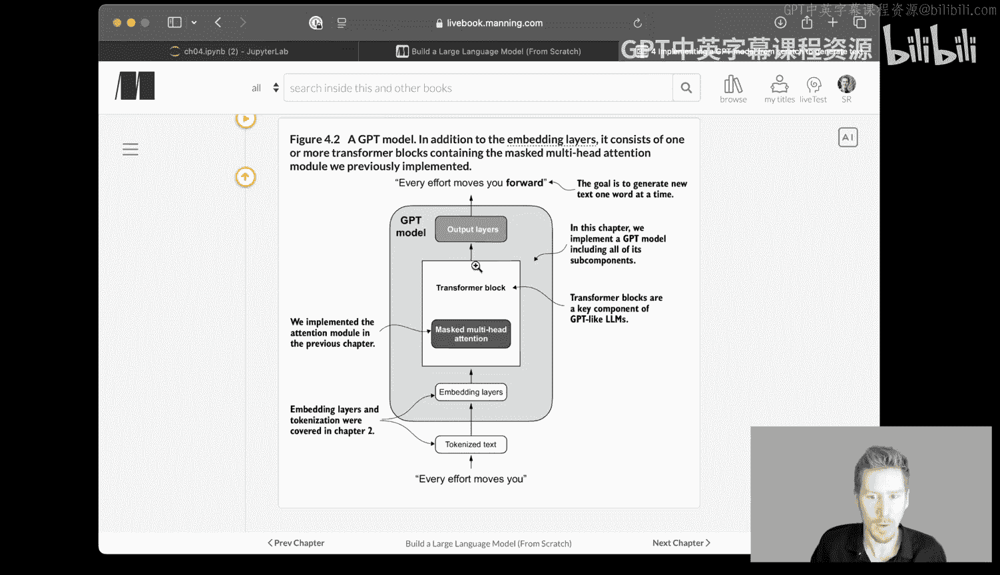

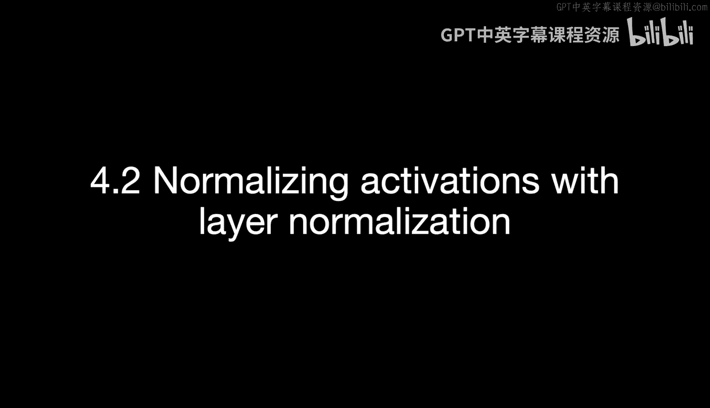

We are now talking about normalizing activations with layer normalizations。

 so in the grand scheme of things what we have done before is we introduced this GPT model architecture where we had several ingredients。

 one was the embedding layers that we introduced in chapter 2 we had the masked multi head attention module which we talked about in chapter 3 and now there are several other things and so we had this dummy GPT。

Placeholder for now， where we said we are going to fill in the blanks in the upcoming sections。

 and that is what we are going to do now for one of these ingredients。 And that is the layer norm。

 So layer norm is short for layer normalization。 It's a concept that was introduced back in 2016。

 It's a classic deep learning concept， and it's about normalizing the。

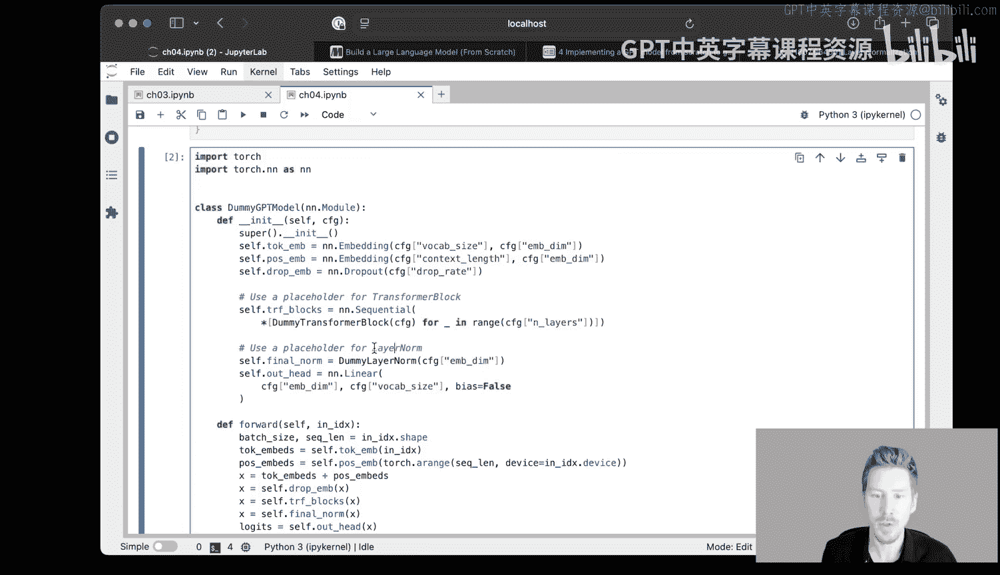

Outputs of a given layer that go into the next layer so that it has a nice property for optimization And yeah to make this a bit more clear。

 I think let's take a look at the code examples I've prepared so I think this will show you exactly what's going on there and so for the code examples I'm trying to keep it a bit more conceptual simple so we will be using layer normalization in the context of the real LLM just for simplicity though in this video。

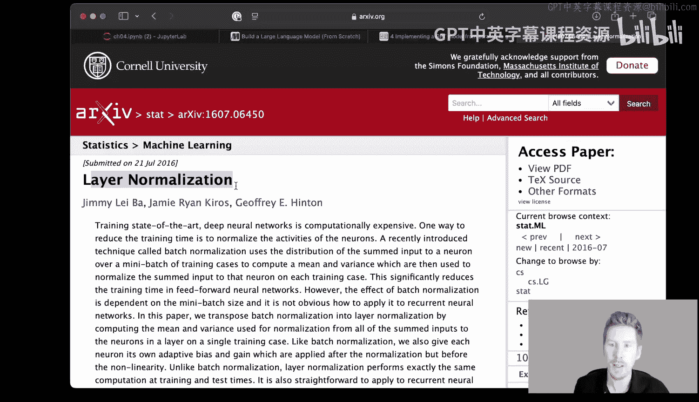

I want to use a smaller example。 So for that I'm just setting a random seat and then I'm making a smaller example here。

 let's use torch dot R n， which will generate a random sample of2 by5 here just to keep it small。

 So just looking at this。 It will be two samples here。Then each sample has five dimensions。

 so we have a five dimensional input example similar to what we have done before in previous chapters。

 for example， in chapter 2 we talked about a token that was embedded in a three dimensional space similarly here just think of it as a token embedded in five dimensional space just to have some more numbers here again。

 like in reality we talked about this earlier， the embedding dimensions might be bigger in real LLM cases so here 768 here for simplicity just let's work with a smaller example。

 so that we can fit it on a figure。Actually I should have a nice figure here somewhere。

 So what's happening essentially is that we have these five input values now for a given example and now what we are trying to do is we are trying to put them through a small neural network for example this one here and then we get output values and we want to make sure that these output values are in a certain value range so in this case if we just apply the neural network layer what we might get is a mean and average of 0。

13 across these values and a variance of 0。39 which is actually not too bad。

 so this might actually be just fine but if you are familiar with classic deep neural networks there might be problems like vanishing gradient problems and exploding gradient problems and normalizing the inputs to a given layer and then essentially also the inputs to the next layer helps with stabilizing the training so the outputs of a given layer like those they would go into the next。

Lalayer in a deep neural network because we have many layers in the network。 And if we have。

 let's say very small values so very large values。That might be not optimal。

 It might lead to unstable training。 So what we are trying to accomplish here is we are trying to add a certain layer called layer normalization to normalize these outputs that go into the next layer。

 such that they have mean 0 and variance 1。 that is our goal here。 So let's consider our inputs here。

 And then let's also implement a small layer like I've showed you before and the figure。

 So let's use sequential here。 And then let's do linear， which creates the neural network layer。

 and we have1，2，3，4，5。We have five dimensions， so the input is5 and the output let's use 6 to match what we have shown here。

So we have the layer here。 and then let's actually apply the layer。To the batch example。

Maybe one more thing we could do technically Os is adding a non linearity。 So non linearity could be。

Reou， for example， it's a activation nonlinear activation function。 And yeah， that is。

 if you have worked with deep neural networks before。

 usually we pair a linear layer with a nonlinear activation function because otherwise。

 if we only have linear layers in a neural network。

 The sum or the combination of linear layers would be a linear function and that would not be a very useful neural network。

 So usually we would add nonlinearities so that the network can learn more complex things。

So let's do this。😔，And look at the output here。 So what we can see here is yeah。

 we get some output values two examples。 So the first one corresponds to this example and this one corresponds to this example。

 transform now through this mini neural network。 So the first row here is really what we are seeing if we focus on one example what we are seeing here。

 And so before we start with any layer normalization or normalization in general。

 let's just take a look at the mean and the variance of this。 So we could for example。Call mean here。

 And yeah， if I call just mean like that and we'll see what happens is not what we expect。

 or it depends on how what you expect。 but here it's not what we want。 So here we get one value。

 and this is the average or the mean of this whole thing。

 but we want actually the mean across this first example。 so。

There are multiple ways we can compute them。 You can compute this mean of this whole thing。

 but this would be mixing multiple examples。 And this is not what we want。

 The other one we could do is we can do dim0 here。 And so here。

 what this one would be is the mean across each of those。

 So if you consider the mean this and this would correspond to this one。

 This and this correspond to this one and so forth。

 And that's also not what we want because we are again mixing different samples。

 And this is that's actually a different normalization scheme called batch normalization。

 that's what batch normalization does if you are familiar with classic deep learning。

 But batch normalization is actually not really recommended for LLms because the way when we train your networks。

 La neural networks。 and we want to split them across multiple GPus for example。

 one way would be splitting the samples across multiple GPus。

 And then we would end up with small samples per each GPU and that is not very good for batch normalization。

 which is very unstable then and so forth。 So that is why。

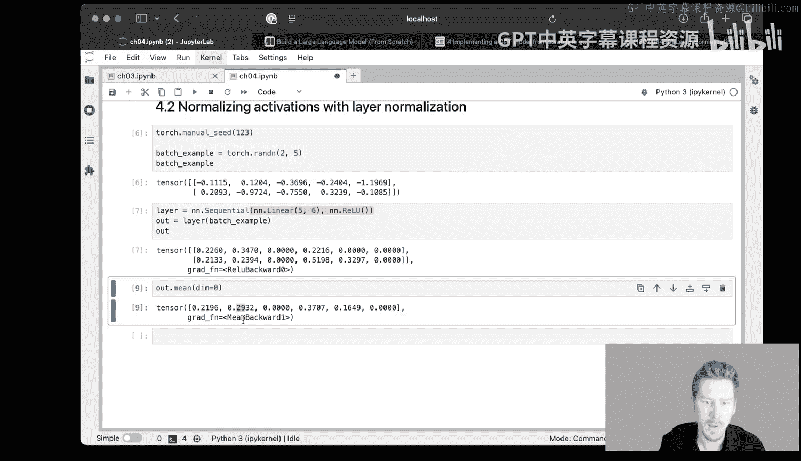

Long story short， we are using this concept called layer normalization。

 where layer normalization is independent of the sample size。

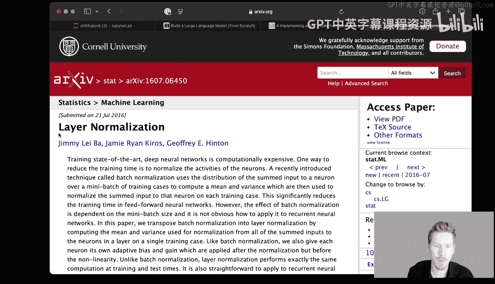

It's normalizing across this dimension here。 So in order to get this dimension we yeah use the column dimension one。

 So this will be then normalizing here， not normalizing or computing the mean here。

 So this one this value is the mean of the first sample across the features。

 the feature dimension I could by the way also type minus one here so。To explain a bit more。

 what we have here is shape。2 by6。 So if I type 0。It will be normally computing the mean across this first dimension0。

But this is the rows， right？ So for each we would normalize that well computer mean like that。

 But what we want is we want the mean across the column dimension， like going over。

 basically going over the columns here。 So for that， we go to the second dimension。 So 0。

1 and put a one here oops。And so this is what we are doing。 And by the way。

 we could also write minus1， which would be more general。 So for example。

 if I had an extra dimension here for some reason， this one。Would still give me the same results。

 right？ But if I write one now this would give me the again， mean across this dimension，01。

 which is not what we want， right， So this just to show you will be slightly different。

 What we want is we want the mean across here， the feature dimension。

 assuming the feature dimension is always the last dimension。

 we can just use the more general minus one here。So let me just get rid of this again to make this a bit simpler。

Now， one more thing is it's still a bit harder to read here。

 so we have these two values and one corresponds to the first one and one to the second row。

 we can actually keep the original dimensions。 we can do keep them equal its true here。

 and then this one will keep the dimensions。 you can see it's these two So the two dimensions。

 the two rows it will keep those which is a bit nicer。 So this would be the mean。

 Let's just call that mean。And we can do the same。For the variance here。Let's do this。😔，Okay。

 so again， we can see what we want is a variance of one for nice properties。

 we have a different variance。 So our goal here is to normalize the data such that this will be the mean of ones and the variance of zeros。

 so that's basically what we are trying to accomplish here。

And so one way we can accomplish this is by well， just step by step by centering around the mean。

 So if we have an output and we subtract the mean， this will give us the output centered at the mean。

 So for example， just a simple example， if you consider those consisting of just the value 5，5，5，5，5。

55，5，5 if I subtract the average， which would be in this case 5，5 minus5 is0 right。

 So doing this should give me。0， right。 So here what we get is this。 Actually。

 you can see it's very close to 0。 It's not exactly 0。 So this is a scientific notation in Pytorch。

 So this would mean basically0。9 leading zeros。 and then 745。 actually to make this a bit nicer。

 we can set。Print options。 And then there should be a s mode。 We can set that to faults。

And then it will look hopefully a bit nicer。 Yeah， so you can see it's basically 0 and 0。

 So that is what we have done here just to also make this a bit nicer again。Okay。

 and now this is how we center at0。 The other one that we do。

 or what we want to do is we want to also give it a variance of one。 So for that。

 we divide by the standard deviation。 So the standard deviation is the square root of the variance actually。

I could go into more detail here why standard deviation， but that would be a whole lecture by itself。

 used to be a statistics professor in teaching these things。

 but to keep things simple may you just assume this is the formula for normalization subtracting the mean and dividing by the standard deviation。

And then so this one should be， oh let's just call that want。And this one should still be。Mean 0。

And now， in addition to that， we should also have。We can just do it here， a variance of one。

So that's what we see here。 So far so good。 So we accomplish that。

 And that is one part of layer normalization。 There is a bit more to layer normalization。

 It's actually a neural network layer that learns per。 So let me just。😊。

Copy in here the layer norm class I implemented from scratch and to show you a bit more what I mean by that。

 So what we see here is a neural network class and we have an initialization here like the constructor method and there are a couple of things。

 So one thing here is that we have parameters。 And as you maybe remember from chapter 3 parameters are trainable neural network weights。

 So here we have the same sizes and bedding dimension in our case， if we consider。This one。

 this should be a six， so we have six values here。And。

The parameter will be making those six values trainable and we call that the scaling parametermeter。

 Similarly， we have a shift parameter。 and this is zeros。

 I will get it in a moment why it's once and zeros。 So and then maybe for now ignore the apps。

 So for now what we have here is exactly what we had before。

 So what we had before let me also just comment this out and get back to that later。

 the unbiased here。 So what we had before is the normalization we had we computed the mean and the variance。

 and then we subtracted the mean and divide it by the standard deviation。

 This is exactly so if I write it like this。This is exactly what we had before。

The normalization here。Now， we are adding one more concept。 and that is this apps。

 So what is the E doing。 So this is preventing a division by0 error。 So if we have square root of 0。

 basically 0， and we prevent basically dividing by 0。 So we add a small value here。

 It's just like a small placeholder value。 So that's 0。00001。 So I could also just。

Write it like this。And yeah， so that's what we are doing here。So far so good。

 So we have those things and theres something new now and there's the scale and the shift here。

 So to explain what happens， let's maybe tackle it like this。

 So we have let's just ignore this for the moment。So。

What we let's let's do it like this So because the division comes before。 sorry not not correctly。

 So let's do it like this。 it's maybe easier so what we are doing here is we are subtracting the mean right and so here we optionally add some value back so we subtract the value and then we add some value back and if we check the original value of shift that's zeros so we are essentially adding zero to it which is similar to not adding anything here right so this doesn't have any effect out of the box because it's zeros however the network during the training later in chapter 5 it might learn certain values that are more beneficial for the normalization so it might but it could technically it might learn is to just undo the mean centering。

 So if the network finds well subtracting the mean is actually not good here it's not helping me learn I can just。

Learn shift to be similar to the mean and then I'm undoing this subtraction right So if what I mean is if I subtract the values 5 and the network learns the shift to be5 I'm adding back 5。

 then if nothing has happened here。 So in that case it gives the network the option to undo this normalization long story short and then similarly we can do the same thing here for this division by the standard deviation So here the scale it's not multiplying the value right And so by default。

 this is a one。 So by default we are multiplying it by a1 which doesn't do anything。

 it's the same as just keeping this keeping this value like here like this right。However。

 the network， again， it's a parameter。 it might learn different values。

 It might learn this value here instead of scale， and then it will undo this division basically right。

 So it's just giving the option for the network to learn certain values to transform the values slightly differently。

 And this is essentially how a layer norm layer looks like and by default it will be the same as our normalization due to the fact how these ones in zeros are set here。

 Now， yeah， let's actually try this in practice。 let's see how it works。 It's do layer norm。

And then we have embedding dimension character value。Attribute argument， sorry。

 function method argument。 And so we have。This， and then we apply it to our。Let's do output here。

And yeah， these are all transformed values。 Let's actually。um。Double check。

 let's just call them temp。😔，Or like just all it puts normed， something like that。😔，Okay。

 and then's just see how they look like again。And now let's double check if they are indeed having the properties that we desired。

 so that what we mean。Of one， as sorry mean zero and standard deviation and variance of one。

The minus one， I think yeah。Keep。😔，True。Okay， and let's double check。

So we can see indeed mean zero and standard deviation of hopefully one。Close to one here。

 So basically one minus roing errors。 The one thing I commented out here is this unbiased。

 So this is just like a minor。Detail， so。There is a if you're familiar with statistics population statistics and sample statistics。

 there is a concept like a besals correction term when you compute the variance or san deviation that you divide instead of divide by n。

 the sample size， you divide by n minus1。Unbiased is basically unbiased true would be the population statistic。

And unbiased faults would be the。Sample statistics， so。When we。

 so this would be a whole again lecture by itself， I used to be a statistics professor and was teaching these things。

 but I don't want to turn this into a sta texture here。

 but what we have here is we could technically let's see if that works。😊，Set this to falses。

You can see the values are slightly different， and that is because we have a very small sample size。

 So here， if I increase this sample size， make it really large。 let's say should be then also。

Very large。Or I should also make this actually large， Okay， like this。This is very slow now。

 shouldn't have done that。But you should technically see， can I interrupt this？Not not responding。

 made it maybe too large apologies。 I hope it doesn't crash the recording。 But in any case。

 if you make this really large， you should see this should be one basic D。 So this should not。 this。

 this is only making a difference if you have very small values。 And in new network training。

 As I mentioned before。 We have an embedding dimension of 7 68。

 So it shouldn't really make a difference at all。 whether we use one or not， or it actually worked。

 It's just maybe try again。嗯。Yep。Kim。Yep， you can see here it's now almost one。

 so the bigger the input is the less of a difference this correction term makes。

And it's really just an implementation detail。 It does not matter at all for regular embedding sizes。

 The reason why I'm setting this explicitly here is that's what the Tensorflow or Pytor。 sorry sorry。

 what the GT team did when they used Tensorflow to train GT。

 And here we are reimplementing things in Pytorch and Pytorch has different default values than Tensorflow。

 So that's why I'm just setting this to mimic the same behavior that the original openGT to team did when or used when they were training the model。

 long story short。 If this was all bit confusing with this unbiased setting。 You know。

 it's just an implementation detail。 I would not worry about it too much， it's not that important。

 The main message here is。That we are normalizing values so that they have mean  zero and variance one。

 which will give the network nicer properties， the values nicer properties during the optimization。

 And this is one building block， the normalization there in the transformer network。

 the G network here， the LLM。 So we are using it in several places。 We used it in。This place。

 the final norm。Here， and we are also going to use it in a transformer block when we are implementing the transformer block later。

 anyway， I hope this was useful and explain a bit what layer normalization is。 And in the next video。

 we will tackle some of the other placeholders。

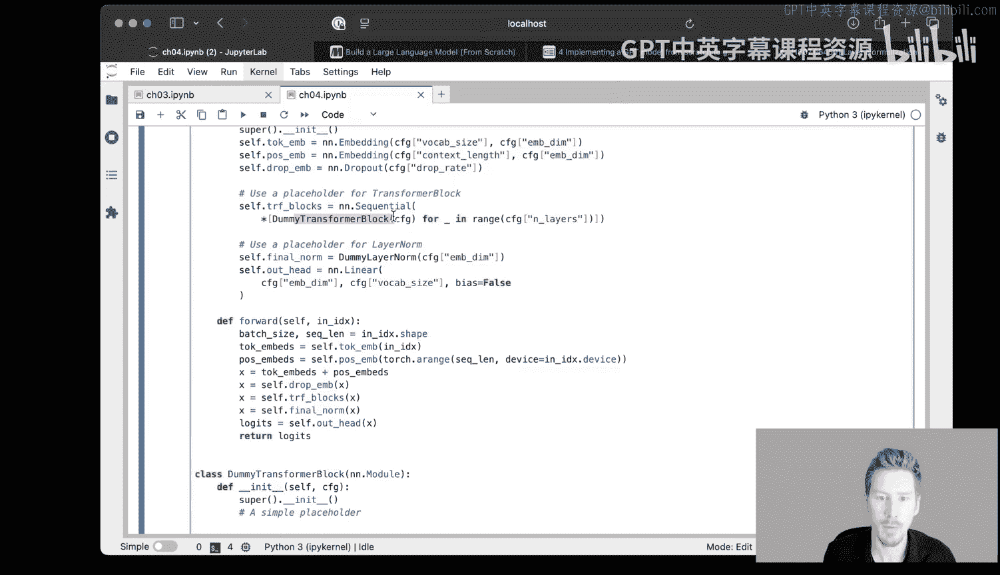

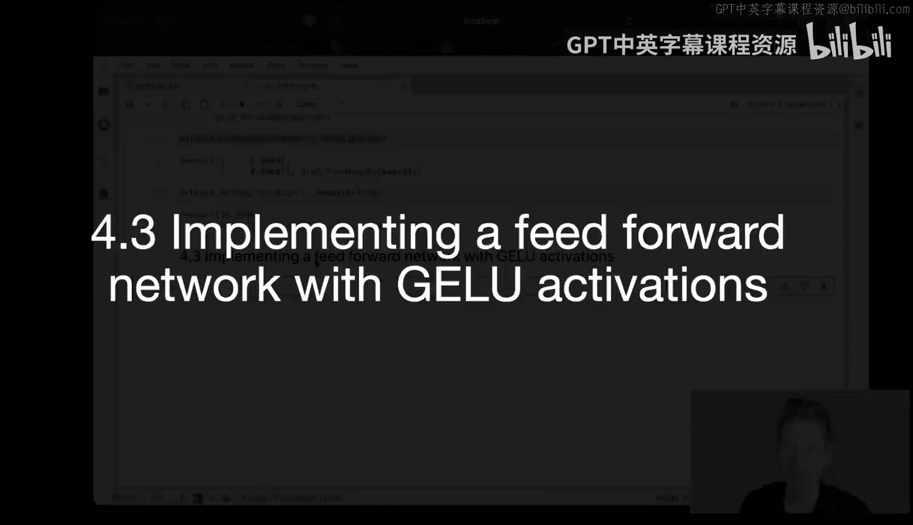

Let's now talk about implementing a feed forward network with Galo activations here the feed forward network is a small neural network contained in the larger neural network。

 the LLM and the Galo activations are nonlinearar activation functions so it's essentially a concept in deep learning where we have linear layers and nonlinearar activation functions so just before we go into these details in the grand scheme of things where we are so our goal is still to implement the final GT architecture that we want to train in the next chapter however。

 the GT architecture consists of multiple building blocks that we are working through sequentially here so we already covered layer normalization so first we coded the dummy architecture then we covered layer normalization where we were coding this normalization layer that goes between other neural network layers and now we are going to code the Galu activation that also goes between yeah。

Linear units or neural network layers。So why do we need nonlinear activations in the first place I was just digging out an older figure from a university lecture I gave when I was a professor back in the day so here this is like a multilayer perceptron architecture that consists of multiple layer so we have the inputs a first hidden layer and a second hidden layer and then the output layer and so this is a classic multilayer perceptron that you may have seen in in a context of deep learning and what's not shown here are the nonlinear activation functions so。

I scored a bit down。😊，I had it usually as an exam lecture。

 what happens if we don't have the nonlinear activation functions just briefly the goal here also in the grand scheme of things of the large language model is to extract features from the input data and the features go through the neural network layers and at the end of the day we want to generate outputs and for the feature extraction we want the network to learn something useful that helps the network to generate the correct output Now ideally this is a toy problem。

 but if we have something like this and this is a classification task has nothing to do with neural networks sorry with LLMs but for illustration purposes。

 think of this as a challenging classification problem where the network should detect whether something is a square or a circle based on some numeric input。

And ideally， the network would learn something like this。

 like a decision boundary where it can separate these squares from these xes。

 so a little bit different from here， but the goal is essentially separating two types of inputs here。

And if we don't have these nonlinear activation functions。

 what happens is essentially that we only have linear layers and the combination of linear layers is a linear function。

 too。 So the network will only learn linear functions and then。

What it means is the network will never really learn to extract useful information from the input so it's kind of like limiting the network serially if we don't have nonlinear activation functions and so nonlinear activation functions there are a whole bunch of them So the sigmoid one is a classic one there's a 10h function hard to1 H and I think I even have like a fun figure somewhere here there was even like this meme where someone was like mapping nonlinear activation functions to dance moves and so forth and so there's a whole bunch of nonlinear activation functions and the one that we are going to talk about today is not even on here yet。

 it's called Gelu， which is somewhat related to Relu but also not quite and we will see in this video how things are related So going back to some of the figures here again where the nonlinear activation function fits in is if we have a neural network。

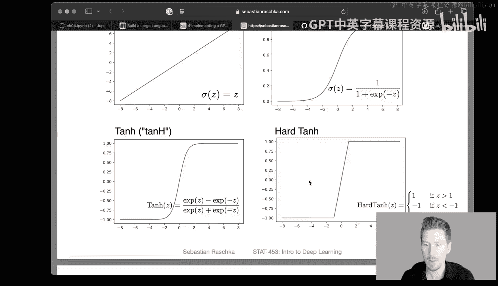

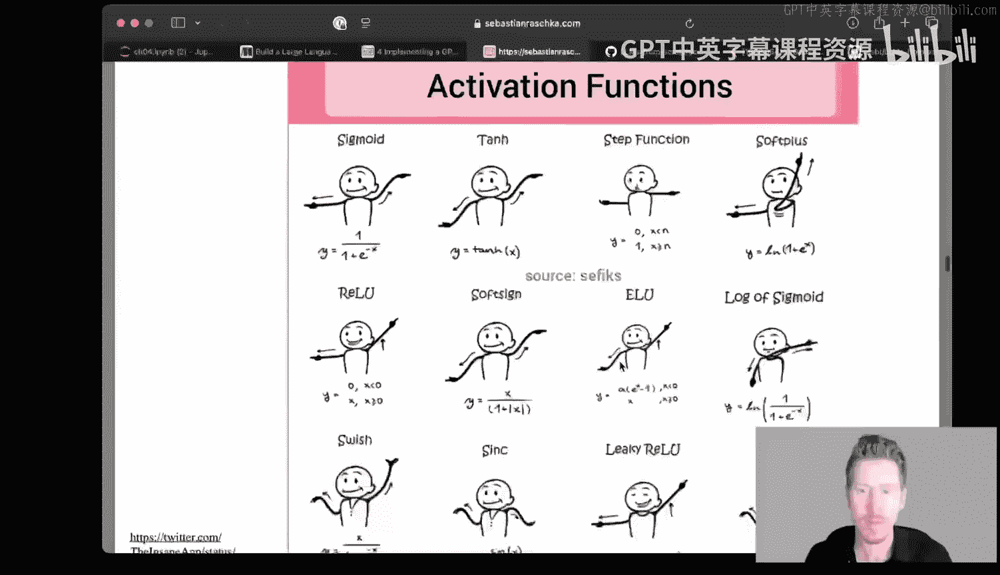

And we have multiple linear layers。 The Galu function sits between linear layers。

 So it's usually a linear layer followed by a non nonlinear activation function。

You can also see that here where we have a linear layer and then the nonlinear activation function And this whole thing here。

 a feet forward module is the module that is later coded in the transformer block So we haven't talked about the transformer block we will talk about it later。

 but I can actually maybe already show you the figure So it's a bit more clear where。

Things fit into the grand scheme of things。 So this transformer block is part of。The LLM。

 and this gets repeated a number of times。 And inside this transform block。

 there is this socalled feed forward module。 and part of the feed forward module is this setup where we have a linear layer。

 a non nonlinear activation function and the linear layer。

 And in this video we are going to take a look at what this Galu activation function is。

 So yeah a lot of background information I hope yeah this is not too confusing essentially we are just coding a small little function inside this whole thing。

 and the salu function goes back to a paper called Gaussian error linear units。

 And here in this paper they proposed a function that is essentially bit better than the relu for optimization purposes and so forth。

 and one more thing here So the relu function or there's actually a nice figure here how it relates to the。

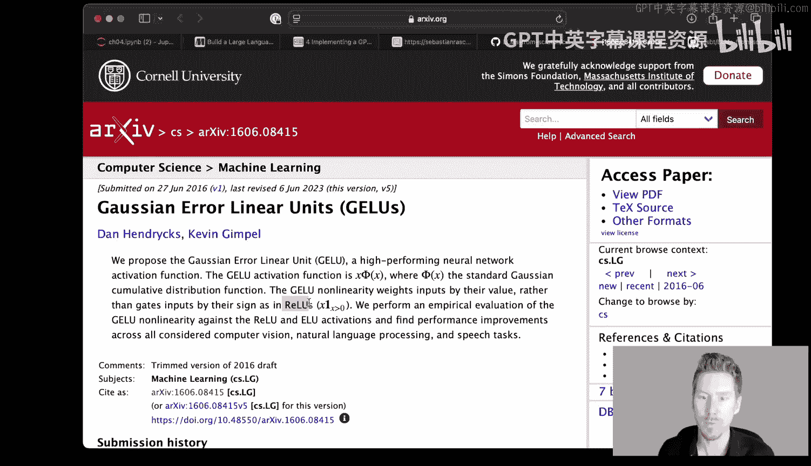

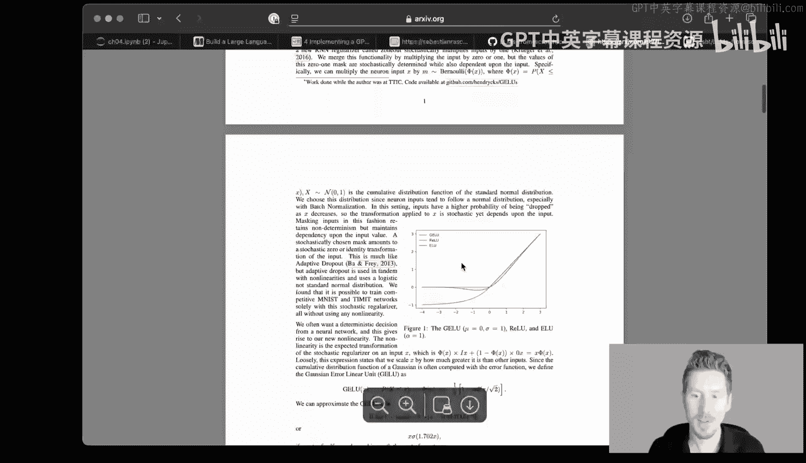

Gdo function， So the red function is a function。That is maybe the simplest non nonlinear activation function。

 What it is doing is if the So if the inputs here on the x axis， if they are negative。

They are threshold to0 so the y x is the output。 the xxs are the inputs。

 if the inputs are negative or below  zero， the output here is zero。

 otherwise it will maintain the inputs So the input is one the output is one if the input is2 the output is2 and so forth in the Galu is you know it's very similar you can see it's slightly different it has some beneficial mathematical properties for normalization or optimization during the training so if you're interested you can read through this paper but you know it's not super essential you can think of it just as a nonlinear activation function。

 one of the many nonlinear activation functions you can actually train also the LLM with other types of nonlinear activation functions it's just a choice that the original developers of the G model made and in fact later LLMs for example。

 the Lama models， they use something called a siglu activation function which is a gate。

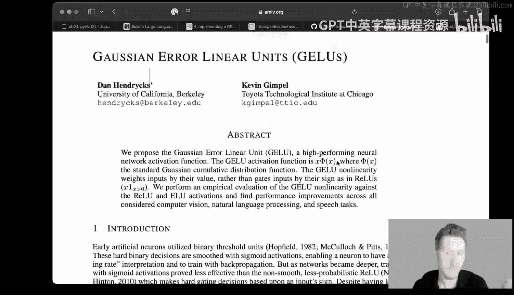

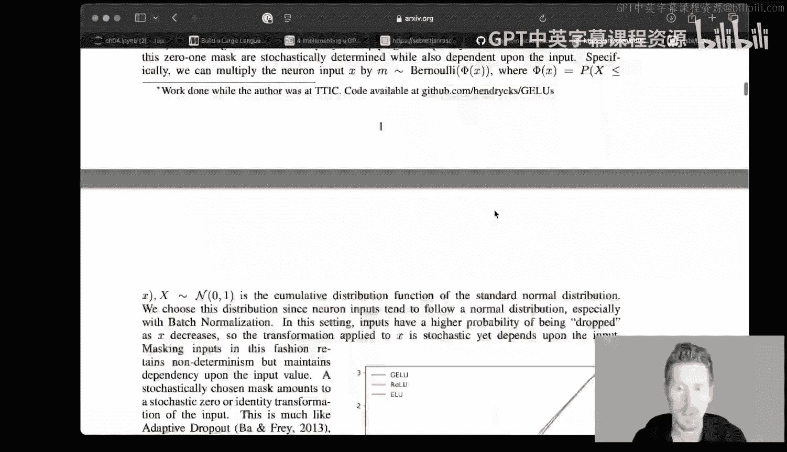

Unit with I think silu activation function。 So， you know， it's just like a choice some people make。

 so it's not super crucial。 The only thing that is crucial is that we use a non nonlinear activation function。

 Which one Well it depends。 Some might sometimes work better than others， but。I wouldn't get to。

 you know。Too serious about which type to use here One thing about the Galu activation function is that it comes actually in two flavors。

 So this is the here this is the mathematical formulation of the Galu function but the original G model it was implemented in tens flow and they used this approximation here。

 So this mathematical formula and I don't know 100 percent because I haven't talked to the authors of the original GT architecture。

 but I can assume or I would assume that this is probably due to efficiency reasons that they used this approximation So it's you know approximately the same but it's。

Approximateated， it is maybe a bit faster。 Again， it doesn't really matter in the grand scheme of things。

 but because we want to mimic the original GPT architecture。

 we are also going to implement this version here in Pytorch。 So this was like a lot of build up。

A lot of you know background information。 So let's actually get to the code and I think you know once you see the code。

 you will feel like okay this is actually much simpler than you thought compared to you know the paper and everything So here what I copy and paste it here is my yeah reimplementation of the approximate Gau function and you can see it's a very similar module has a forward method and it receives some input and then you know it applies this formula multiplies the input by 0。

5 and then multiplies it by1 plus this 10 h and so forth。

 And so this is yet just mathematical approximation of the sclu function as described in that paper and yeah if we use that let me just also copy that code here we can visualize it I'm using matplotlib here。

And I'm going to yeah apply to some sample data in the range between minus3 and 3。

 So the input going back to the paper， I'm just testing it between minus3 and3。

That's what I'm doing here， and I'm also for you completeness。

 I'm comparing it to the relu function in Pytorch。And here it's just plotting code。

 So let's see how that looks like。Yeah， so maybe I should。Maybe interrupt this， I think。Of course。

 I forgot to。Execute this code cell。 I think it should be pretty fast。

 I think my computer is still suffering a bit because in the previous video， I。um。

Executed this large matrix modificationplication。 So I should probably restart it at some point。

 yeah， yeah， we can see the figure。 So we have。us3 to 3 here as the input。

 And then you can see the output here。 and yeah， it is ultimately。

Same idea as the radio function except it's a bit smoother here。

 which has nicer properties during optimization when we compute the gradients yeah。

 and then just to go back to the chapter here so I talked about this little unit that we will need actually an upcoming section when we implement a transformer block。

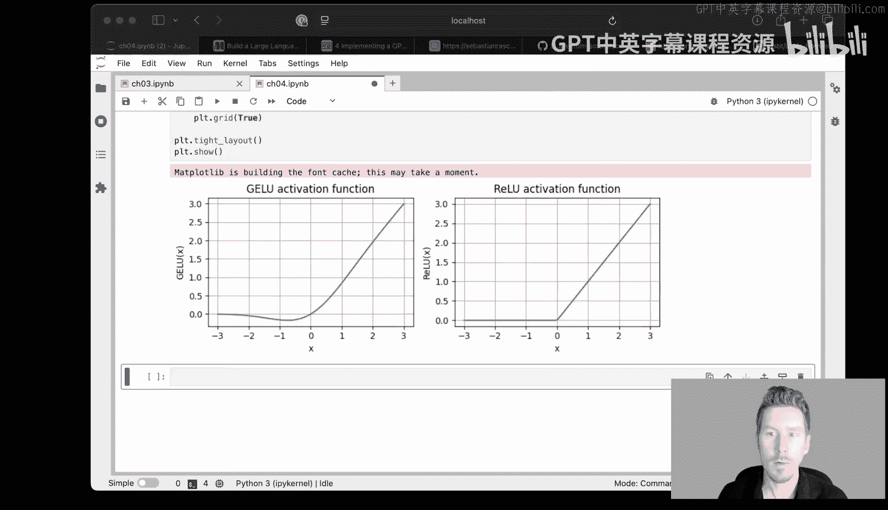

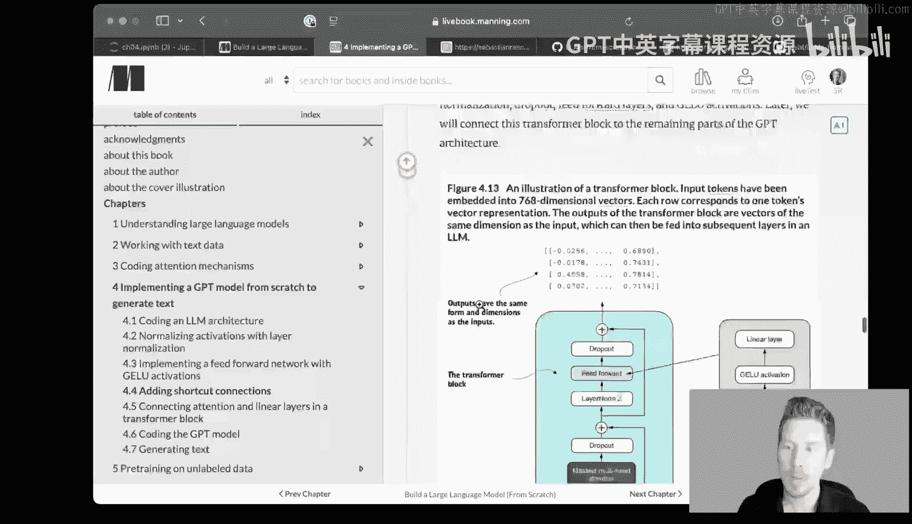

And so we are going to implement the code for this。I think it was further up here。😔，Yep。

 so we're going to implement this one。 So let's。Do this。

 And this will be something we are going to use later。 So what is happening here。

 So we have a feet forward module。And we have a sequential here。

 which means it will in the forward method， it will execute everything that is inside the sequential in a sequential fashion。

We have a linear layer。 So this goes from。The embedding dimension。 And if we go back up here。

 the embedding dimension was 768。 So it goes from 768。To  four times 768。 So we have 768 to。

4our times 768。 And so this should be something with， I think it's 3100。

 let me just calculate it3072。 so it's 3072。Let's just put it here。And then it goes from 3072。

Back to 768 here。So this。Essentially， a network that is the opposite shape of an hourglas where we go instead for an hourglas。

 we go from large to small to large。 here we go from small to large to small。

I do think I have a figure So here y， so here can think of it as as this。

 we have the small embedding dimension， we make it four times larger。

 and then we make it small again， Why do we do that。

 So this is you know it's like a trick almost in different networks where this adds a lot of parameters and these parameters learn to extract some information from the inputs It's essentially you can think of it as massaging the input to you know get to extract information for it。

That then during the optimization， when the weight matrices are optimized， help the network learn。

 yeah， learn to extract relevant information and do something useful with that。 And in this case。

 in the case of LL Ms， It's correctly generating the next word in， in the text or input data。 Yeah。

 and this is our mini neural network that we are going to use in。

Chapter 5 when sorry in the transformer block。 But then also in the LLM that we are going to train in chapter 5。

 we can initialize it。 So let's go here and do FFN。 and then let's do feed forward os。

Maybe execute this， of course。 a running ga by now， I think so we can use the， So we have the C，C FG。

 which stands for configuration， which we have defined。Up here， so this is our configuration here。

 So let's just use that。And put it in here。And that is our mini neural network and then we can try it on some sample data so we can just for simplicity create some random data again。

 so let's do2 by 3 by 768 so a batch of two input samples each one has three tokens and then each token em bedding is 768 dimensional it's just a sample later we will work with real data but yeah just to show you what happens。

So， here we get。The same output shape and that is because we have this input dimension that is also generated here so immediately there is a larger value of four times as large the 3000 but what we get out is still 768 because we map from here to larger and then from larger back again and why is it four times so this is again a hyperparmeterum so it could be as well be you know it could be two it could be8 it could be one it could be anything this is something the original authors of the GPT paper chose and again like I mentioned before we want to mimic the original GT architecture and also why'm so hung up on the GPT architecture why we want to mimic exactly is that later in chapter 5 we will download the available weights that shared on the website and then we will lot that into our code here and。

They all wait Parmatus， so if I go here。And then let's say layers right so so this one you can see there are these weight parameterss So when we have this one this is the first linear layer and then we have the weights here and these are currently random weights but later we will train them and we will also load the original opening eye weights and we have to have the exact same dimension that they have if we want to load their weights into our model so we have to match these things exactly so that the weights are compatible and that's why I'm trying to really make sure everything else is the same we use the same hyperparmeter here we use the same approximation here that they used in tensor flow and so forth and yeah so that that's why it's important for me to match these things and yeah in this section now you saw the Galu function in the next video we will tackle another building block of the LLM architecture。

In this section we are going to talk about adding shortcut connections so so far our goal is still to implement this final GT architecture we started off with this G backbone。

 this dummy GPT placeholder code and then we filled in individual building blocks for example in the beginning the layer normalization and then in the previous section we talked about the Galu No nonlinear activation function and we implemented this small feet forward neural network module that we are going to use in the transformer block however before we get to this transformer block here there's one more thing we want to implement and that is the shortcut connections here so shortcut connections they go back to a paper called deep residual learning for image recognition and here the authors implemented a convolutional neural network back then and proposed these shortcut connections。

Or sometimes also called residual connections。

So to show you what those are， heres maybe a nice figure so。

What they do is so just to orient ourselves here。 what we are looking at is like this something similar to what we have just coded in the previous section。

 this little neural network module where you have a weight layer， essentially the N linear layer。

 a nonlinear activation function， relu or Gelu。 and then another linear layer。

 And so this is actually。Similar to what we are looking at here。Now。What they added is this。

Arrow here。 So what， what they have is they have F of x， where you can think of this here as F of x。

 So F of x is really this part。 It's a function where the input goes through a linear layer。

 non nonlinear activation and a linear layer。 So you can think of it as as a function。 and then。

You add back the input。 So input is X。 the original input you add it back to the result of this one here。

 And so why is this being done。 What's the point here？ So if you have a very deep neural network。

 you can have problems like expodding gradients or vanishing gradients。 And so， for example。

 if this doesn't learn anything useful or let's say it goes to 0 due to the vanishing gradientraian problem the network。

Can still use this shortcut。 So the shortcut， it doesn't diminish anything。

 it's essentially like rescuing the network。 if this is not you're learning anything useful。

 So in that sense， yeah you maintain the gradient signal you maintain a signal during the training to help the network learn something otherwise if you have a very deep neural network。

 there might be no signal anymore。 and then yeah you have a vanishing gradient problem or other problems and then the network will fail if one of these sub modules fails because the network in neural network。

 everything is sequential these layers are sequential and they depend on each other。

 And so if one of them does something does nonsense。

 then all the other ones will suffer all the other ones that come below here So here as you know as a back door。

 you can kind of learn or the network can rely on to skip these layers if they are not useful。

It's essentially like a little a little back door here。 You can think of it like that。 Yeah。

 let's see how that works out in code。 So I have also a figure here where you can see deep neural network with many layers and we are looking at the gradients here。

 and you can see the gradients are relatively small。 So in in neural network optimization。

 we use an algorithm called back propagation。 We will use that in chapter 5 in this book。

 we are not really going over the fundamentals of deep learning because， you know。

 this would be another 500 page book。 So here we are really laser focused on LMs。 but yeah。

 some of these deep neural network concepts are relevant。 So in this deep neural network。😊。

So it's also a convention to draw neural networks from bottom to top。

 So this is why sometimes when you're looking at these diagrams， Y is you know flipped around。

 this is really a convention in in deep learning where people you tend to draw these diagrams from the bottom to the top So when we follow the inputs here from the bottom to the top the optimization in the back propagation algorithm it goes the other way around So you start with the output that's a loss function that's not shown here that is usually used and then you back propagate that's it's called propagation you go backwards and yeah you can see the gradient signal becomes weaker So you have a 0。

00500013 and it becomes weaker and then makes it harder to learn for the network to learn how to update these weight parameters in these linear layers and here on the right hand side you see the same architecture but I added short。

Cut connections。And you can see here， so by the way I'm not making these numbers up。

 we have actually or I have code， we will look at this in a few moments。

 what you can see is when we when I add these shot at connections you can see that we have much larger gradient values we have here 1。

32 and then 0。260。320。2。2 So we have much larger values and that helps the network to train better because there's more information for updating these weights here。

So let's actually take a look at the code and let me show you that this is not just a concept that it actually works。

 so I just copy pasted this here， this is neural network on where we have one two， three。

 four five of these modules。Sequential modules and each module consists of a linear layer。

And a non nonlinear activation function。 So what you're looking at here is the same thing that you can see here。

 So 1，2，3，4，5。You can see one，2，3，4，5， and then the forward method is computed by yeah calling these layers。

 so we have we iterate over the layers here， we're calling them and then optionally we add this shortcut connection。

So I'm saying optionally because just for experimentation purposes， I added an argument here。

 use shortcut that we can set to true or false， whether to use the shortcut or not。

 so if we are not using the shortcut it's just like a regular neural network without shortcut and if we have this shortcut。

Then it will add these little shortcut connections and similar to the paper。

 what will happen is it will add the input back to the output of the module So that's yeah what you are seeing here sorry what you're seeing here and here that's without shortcut connection there's one exception here if x shape equals layer output shape So this is essentially when we are it's just one way a simple way how I implemented this once we are here at the end we won't add a shortcut connection because yeah that's that wouldn't work here right so。

There's no point adding a shortcut connection to the output。Yeah， so this is it。

 And then I also have a utility function print gradients where we get the output。We have some target。

 so the target really is。A placeholder here。 yeah， how deep neural network training works。

 we usually calculate a loss function， and then we compute the difference between the value that the network outputs and the target。

In the loss function。 So that is like a measure of， let's say， how similar they are。

 And based on that， we back propagate。 Now， later on in chapter 5。

 the the targets will be the next tokens。 we want to generate And the loss function will be across entropy loss for now。

 you know， don't worry about these concepts too much。 They are just placeholder here。

 M E loss is essentially just the squared difference。

 The mean squared error loss just for simplicity so that we have something to back propag。 It's just。

 yeah， we need any loss function here and just want to keep it simple and selfcon。

 It has nothing to do with tokens。 Now， this will come later in chapter 5。Okay。

 so here let's execute that。And then of course we need some values So for the layer sizes let's do 3。

3，33 and one the one here the output size is one because what we want is something that has the same dimension as the target So what we want is our network to produce a value that is close as possible to the target and then we optimize it and so forth here we don't really care about the optimization we just want to compute the the gradients。

Then let's do some sample input， so the input is input size is three， so we need sample input。

That also has three values， just， you know， for example，1。

0 y minus1 Y have I chosen those just random just something that came to mind。

 you can try out different values and yeah and then let's do a random seed here so the random seat is so that you get the same results that I get。

And then let's first initialize our network here。 So this is our example network without shotcut connections。

 So this is printing the gradients。Without shortcut connections。 And you can see， yeah。

 these are very small values。 So the values in the figure are actually based on the code here。

 So you can see those kind of match。 And then we can do the same thing ups with。Shortter connections。

Yeah， and you can see now the values are much larger。 So with these shortcut connections。

 we lift up these gradient values， the network later on。It will also。

 it will be more than just lifting up the gradient values values here in the beginning。 It will also。

 you know， learn。How to optimize optimizeise these weight matrices。

 And if there's something that goes wrong during the training。

 these shortcut connections can always compensate and rescue the network there from totally failing because。

 yeah。One more time， you can see everything is dependent on each other。

 so if you have something that doesn't really work here the later layers in the forward pass。

 they are not affected and likewise if we do back propagation， if something fails here。

 this layer is not affected， it can learn how to skip here and that's the whole idea between behind shortcut connections。

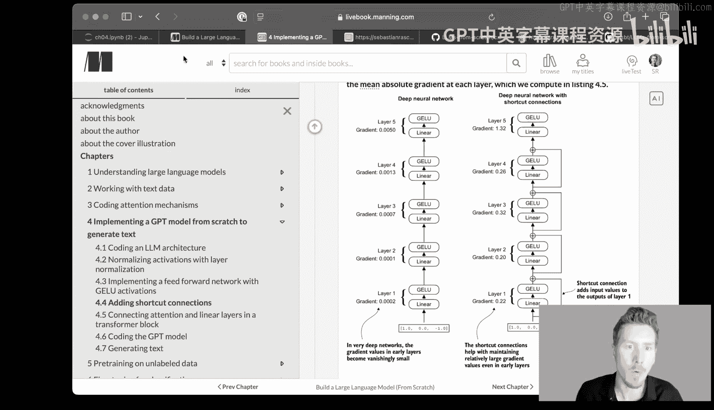

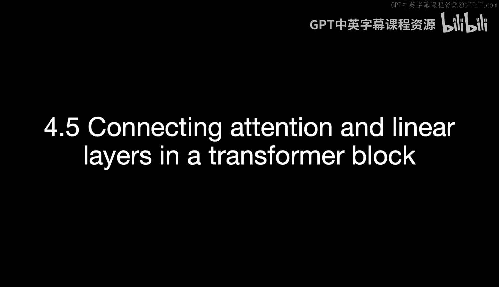

Now we are ready to code the transformer block here so the transformer block combines multiple modules。

 for example， the attention module， the multihead attention module we coded earlier in chapter3 and then it will also have a bunch of linear layers where for the linear layers we also introduced several concepts for example layer normalization Galu activations and then also the shortcut connections so going into this figure here again。

 what we have done so far in this chapter is we coded the GT backbone like the placeholder architecture and then we were filling in the blanks。

 the placeholders， for example layer normalization Gao activation。

 the feet forward module and then also the shortcut connections in the previous section now we have all the building blocks here to code the transformer block which is a very essential core part of the GT architecture so the name transformer block it's derived from the original transformer architecture。

 proposed。

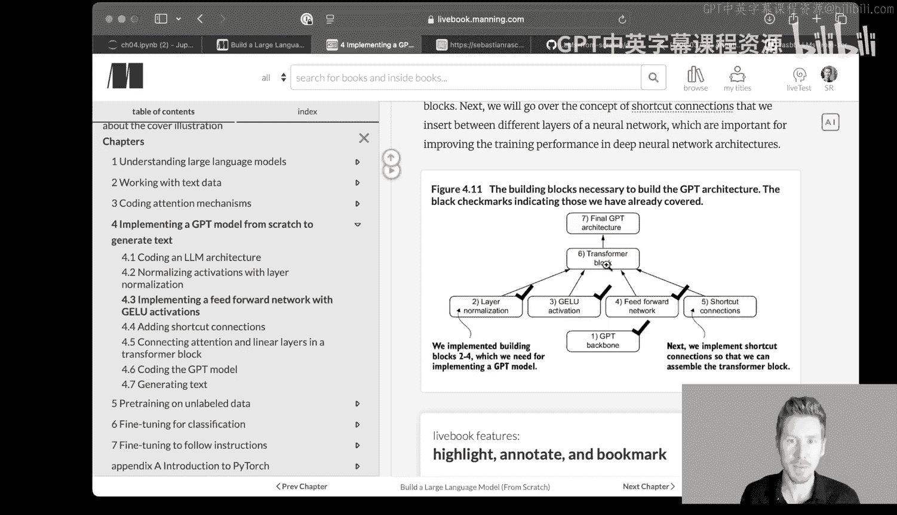

And the attention is all you need paper。

And if we go to the paper， there is this very influential figure that you might have seen before。

 We actually already talked about this briefly in a previous section。

 So there's an encoder sub moduleule and a decoder module。

 and the decoder module is yeah what's used in modern LLMs and G like LLM。 So the encodeta module。

 you can forget about it for now。 It's not used in modern LLMs like G。

 It only focuses on this right subpart here for text generation。 And there is this。😊，Gray block here。

 And this is the so called transformer block。 So to show it to you in a different。Figure。

 maybe that also helps here we have the whole G model。 and yeah， there are several aspects to it。

 We have the tokenized text that goes into the model。 for example。

 every effort moves you as the input text。There are embedding layers。

 the token and empositional embedding layers in the G model。

 and then we already coded the masked multi head attention module。

 Now the masked multi head attention module is part of this bigger transformer block that combines some other aspects。

 And here it looks like there is only one transformer block。

 but as we will see also later the transformer block is repeated a number of times in this G model。

 So it's actually a very important model or module and the transformer block takes up most of the LLM basically it's repeated a lot of times and it's a really important aspects aspect of the LLM and in this section we are going to look inside what's contained in this。

Transformer block， so let's go to section 4。5 here。

And here we see such a transformer block where it receives embeddings of token embeddings。

 for example， we have input。Every effort moves you four tokens and they get encoded into768 dimensional token embeddings as we talked about earlier。

 and these go into this transformer block here and in the transformer block we have a layer normalization layer。

 we have the masked multi head attention module from the previous chapter we have dropout。

Optionally and then here we also you can see we have the shortcut connections。

 So this is like one sub moduleule and then we have another layer norm。

 We have this feed forward module where the feed forward module consists of a linear layer。

 a yellow activation and another linear layer and then optionally we also have dropout again here and then this feeds to the next transformer block a number of times。

 So there are usually in a LLM there are multiple of these blocks following after each other。

 but we will get to that in more detail in the next section here in this section we are just concerned with coding this transformer block。

 So let's get to it and see how we can implement it in code。

 So for that let me make a class transformer。Block。

 and we are going to use again an end dot module from Pythtorch。

And let me just actually copy and paste some of the code so it's a bit faster because otherwise the videos are always so long so here we have the constructor it again receives our configuration file。

 then we have the multihead attention module from the previous chapter so I should ideally imported from the previous chapter here。

So to make this work， you would have to go in here， make a new file， for example。

 and call this previous。Chapters。And。In this file， we need to have this multi head attention code from the previous chapter。

 otherwise， yeah it won't work。So let me copy and paste the code inside here。

So this is the code from the previous chapter where I have yeah just copy and pasted some of the functions we have defined the data set from chapter 2。

 but then also most importantly the multi head attention module from chapter 3 because yeah we have to save this because we are going to import this relative to this notebook so it's a file previous chapters that contains this multi head attention class okay so let's work with this now。

And let me briefly discuss what we are looking at here。 So we have the Moate attention class。

 and it is using the configuration file for the input embeddings em be them that's 768。

 the output dimensions。 there are also 768 in our case。 So this is what we defined。

Appp here at the beginning of this chapter。Now。We define a context length。

 how long our context is allowed to be。 Then we define the number of heads。

 whether we want to use dropout or not。 So the dropout rate and the QKV bias。

 whether we want to use the bias unit in the linear layers。

 But this is all things we covered in chapter 3。 So I don't want to go into too much detail here。

 More interestingly， we have now this feet forward module which we define in a previous section and then we also have two places where we have layer norm。

 So the reason why we instantiate two separate layer norm objects is that they have trainable parameters。

 and we are using them at two different places and in both places we want the network to optimize the parameter。

 So we want share the parameters it won't be like one module that is used in two places it will be two distinct layer normalization modules。

And then yeah the drop out for another place， So there are multiple places where we use dropout。

 I think it will become more clear once I implement the forward method。Let'sDo it like this。

And in the forward method， we have one thing that we need is， of course， the input input X。

 and then let me also。Copy the code here， so it's a bit faster in the video。

So here what we are looking at is how we are using the things we have defined here in the transformer block and this will be mimicking what you are seeing here。

 We have a layer norm multi head attention optionally dropout we have the shortcut connection here。

 another layer norm， then the feet forward module and then optionally dropout again and then a shortcut connection so。

This is the first Leonome here。So first， I should say we are saving this shortcut connection because we are going to add this later。

 So this is what we are creating here， this first shortcut。Then we have layer norm1。

 which you can see here， then we have the attention which corresponds to this one on the dropout for this shortcut connection here。

 So I'm just calling this shortcut connection because it's before it goes in here。

 you can also give it a different name it's just， you know something I came up with not very creative here。

 and then we are adding this shortcut connection back。

 So this is this part corresponds to this first。Block here that you can see inside the transformer block。

Now， next， we have another layer norm， so the layer norm。Oops is here again before that。

 we save the shortcut connection， the shortcut connection you can see here。

So then we have a second layer norm， then the feed forward module， which you can see here。

 this is calling the feet forward module。And then yeah we have another dropout here and then we add back the shortcut connection。

 And this is essentially what you are seeing here。 This is the transformer block。 And to be honest。

 there's not much really that goes on inside here， it is essentially just encapsulating multiple of these ideas。

 And the reason why we even create this transformer block and why we don't add this directly to the LLM is so that we can reuse that。

 So if I go up again。To what we have done in the beginning of this chapter so you can see we have these embedding layers then we have dropout defined here。

 maybe ignore that for now what's interesting is here that we are repeating the transformer block so there is a argument here or value we define as n layers and here we have 12 layers so that means we are repeating this transformer block 12 times and then we have a final layer norm and output layer。

 but so that we can make this code very concise we encapsulate this in this transformer block class which you can。

C here， which we have just coded。 So let's just make sure that it works。 So I executed this cell。

 not making the mistake I'm usually making。 And then we are trying an autumn practice。

 I'm using a random seat again so that you get the same results that I do。 And then let's do a small。

Small example。 Let's do two。Examples with four tokens each。

 so this would be something similar to here where we have one to three， four tokens。

And let's just assume they are embedded in a 700。68 dimensional space。

 which corresponds to what we have defined find here。 We will be working with real data soon。

 so for this part， just to keep it small and self contained， I'm using this random input。

 but we will be working with real data soon in chapter 5。 So not too far away。 and then we define。

The transformer block， so。We do a transform block and then we provide the configuration file that we had at the top of this notebook and then yeah we can use it。

 we can do output equals block， and then we have the input here。And that's essentially it。 so I can。

Execute this and just take a look at the input shape so the input shape is 424768 which makes sense and the output shape should be similar so here take a look at the output shape has the similar size and why is that important that's because we have multiple of these transformer blocks as I mentioned before and so if we want the next transformer block to be compatible with this transformer block the input has to be the same size as the output otherwise we will have some complaints in the feet forward network if suddenly the input dimension changes so yeah that is all there is for now about the transformer block and in the next section we will put everything together into the GPT model architecture。

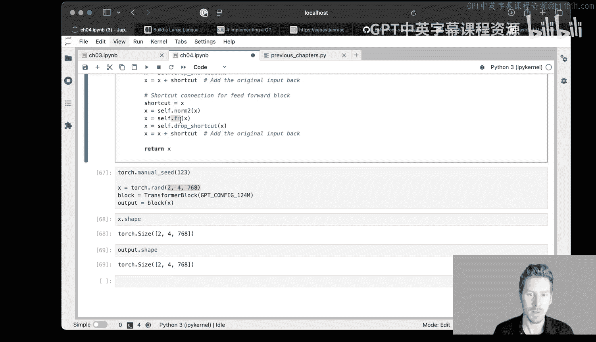

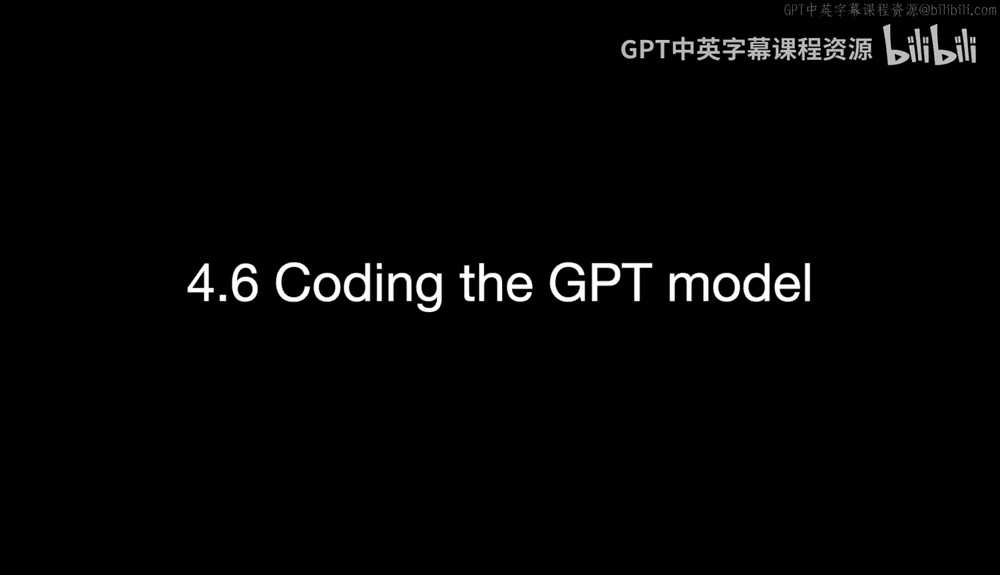

Yeah。Now we have all the building blocks together to code the GT model architecture before we jump into the code。

 let me just show you a visual showing you the whole GT model architecture in one figure so here what you can see is the GPT model architecture and there are of course familiar parts to it the input text that is tokenized and then embedded with the token embedding layers and the position embedding layer and then we have an optional dropout and in the center here the box here that is the transformer block that we have just implemented in the previous section and you can see it's repeated 12 times y12 that's an design decision you as the designer you can choose this number but I'm using 12 here because that's what the original GT team used for their smallest model but I will also show you later that we can change this number and have differently sized GP models。

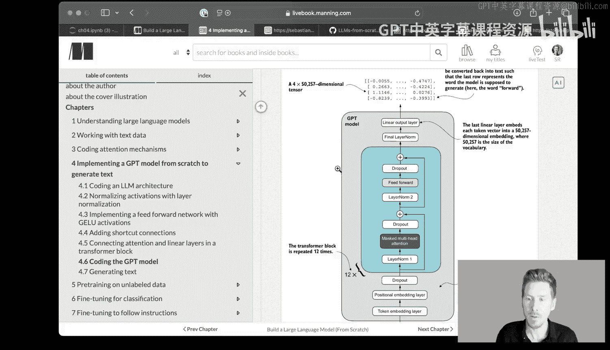

Yeah， and in the transform block， you see all the familiar parts that we implemented in the previous section。

 then we have a layer norm and an output layer。Now。

 what's interesting is that the output layer doesn't output words。 It's outputting numbers。

 So what do these numbers mean if you pay close attention。

 you might see that there are four input tokens and there are four rows here。

 So each row here corresponds to one of the input tokens。 However。

 instead of being a word you can see this is a vector here。

 So each token is represented by a vector and this vector is 5000257 dimensional。

 where do these dimensions come from So here in the input layer。

 what we do is we convert a token I that corresponds to 500257。

Entry vocabulary into an embedding vector。 So we go from this huge vocabulary space into an embedding space。

 And here at the output layer， we go back from an embedding space into the vocabulary space， so。😊。

There is one more thing that we have to do to convert these vectors back into words。

 but we will leave that part for the next section here。

 we are just focused on coding the architecture itself。

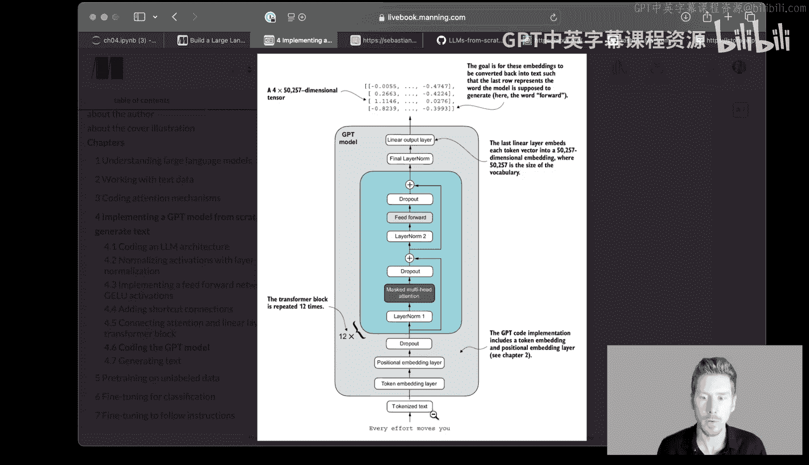

So yeah let's jump in and let's yeah get working here on the architecture and because I'm lazy or maybe because I thought it all through depends on how you wouldn want to think of me I will just copy and paste the STmmy GbT model class that we implemented earlier so let me just copy and paste this to make my life here a bit easier so。

😊，Yeah， I'm copy and pasting it here。 And then what we can do is we can replace all the dummy parts because now we are going to implement the real architecture。

 can just delete those。 We get rid of placeholder because it's no longer a placeholder because our dummy transformer block is now the real transformer block and then I can do the same thing here for the layer norm And if I see it correctly。

 we don't have any other placeholders here anymore。

 So this one should be the working G model architecture。 we can actually try it out so let me。

Initialize random seat here so you get the same results I do。And then we can instantiate the model。

 So I'm。Going to initialize it with。The configuration file we had earlier at the beginning of this chapter and let's actually use some real data now。

 so we had somewhere real data。We scroll up a bit。Here， so here we defined batch as two inputs。

 input text that were， yeah embedded into token embeddings。 Let me just copy and paste here。

So that we can make sure this actually still works。So yeah。

 we have batch to inputs and we can then compute the output here。Os。Btch。

And then we can double check maybe the input。 this should be two times 4， right os。

Should be two times 4， two examples with four tokens。

 and then output should be two times 4 times the vocabulary size。 So let's double check。

 So two times 4。 and then each of the tokens is embedded in a 50257 dimensional space。

 And we will take care of converting this in the。In the next video， for now。

 I wanted to show you one more thing。 So here I have this file， sorry。

 the dictionary that I defined at the beginning of this chapter。 And I gave it this naming 124 m。

 which stands for24 million parameters。 And so。Where does this number come from。

 We can actually calculate the number of parameters And in Pytorch。

 there is a function or a method called a number of elements here， nu number of elements。

 So what we can do is we can compute， for example， the number of elements in batch。

 And this should be 8， right， we have two times four elements。

 So here this is just like a convenient way to compute how many values are in a given tensor。

 So we can use that。To sum over all the elements in the model。 So for P in model parameterss。

 So parameterss are all the weight matrices， for example， and bias vectors that are in the model。

 all the trainable things that we have basically， that's including the Q K V matrices。

 but also the layer norm and everything。 So yeah， and then we can。

Print this out or I made a typo here should be normal。And yeah。

 you can see it's a large number to maybe show this a bit easier let's use F string。

 let's see if I get this right。F strings， if I don't use them in a while。

 I usually forget the syntax， but I think if I add a comma here yeah。

 so we can see it's163 million parameters that we have here。

 and so how does this number match with 124 I just told you we have 124 million parametersmeter And there's one thing I have not explained yet。

 so there is in the original GP model architecture， some weight sharing going on So。

I told you before that this one maps from the vocabulary space into the embedding space。

 and then this one goes the other way around。 It maps back from the embedding space into the vocabulary space。

 So what we can do is we can take a look at these weight matrices， right。

 So we could type model and then what is it token。Imbedding。

 So let's take a look at the weight matrix and see how big it is。 So we can see it's 50257 times 768。

And if we look at the output here。Let me copy this one。 And then I replace this with。Outhead。

This has exactly the same size。 So one trick， because let's say we assume this is learning a good mapping。

 We are mapping from vocabulary space into embedding space。

 and we might assume that the same in reverse might work well。

 So mapping from embedding space to vocabulary space。 we could actually share the same weights。

 So we are not doing it here for simplicity， but we could technically reuse the same weights in the output head here。

😊，So because they have the same dimensions and it's actually design a design decision。

 some people do that， some people don't。If you share the weights。

 yeah you have a few parameters in the model because these are really large matrices。

 but there are architectures or many， many architectures that don't do that。

 So it's really it really depends so Lama models by meta AI for example， Lama 3 on 3。

1 they don't do the weight sharing but 3。2 is doing the weight sharing it's really you know almost arbitrary it depends if you want to save on parameters you can share the weights but otherwise in my personal experience it's not always leading to better results。

 So it's really like a tradeoff between parameter size and better training dynamics but it really really depends on the architecture but。

Yeah， what I wanted to tell you is that the number of parameterss here。

 how it's usually computed for G2 models because they usually originally use the way sharing is without accountinging it twice。

 So what I mean is here we counted once and we counted twice here so sorry let's focus on those here and here if those are shared we are over counting。

 So what we could do is we could subtract。Let's maybe do it here。We can subtract。This。One here。

Let's see if this works。So yeah， so you will get the 124 million that is usually quoted when people talk about GPT2 models。

 I also have the paper open here， So here in this paper。

 this is the original GPT2 paper they should have a table somewhere let me see。

Where they talk about the model sizes right here， so here they have four different model sizes。

 and this is the one we just implemented with the 12 layers and the 768 dimensional embeddings。

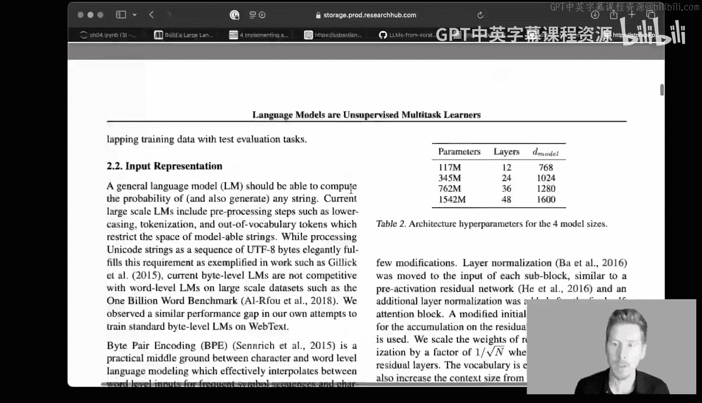

You might notice this is not 124 and this is because they had a calculation error I think so I think they talked about it somewhere。

 I think maybe in the code repository， but they haven't updated the paper which is why the number looks a bit off but it should be 124 million and they also have two different sizes here。

And yeah， I'm maybe leaving this as an exercise for you， the viewer， so to implement those。

 actually it should be relatively simple once you have the architecture coded so you could copy and paste this here。

And then change some of the values here to make the architecture La to implement the other ones you are seeing here in this table。

 I should tell you the table doesn't tell you the whole story。

 It talks about the number of layers and the embeending dimensions so。

Here the layers in the embedding dimension where layers is maybe a bit unfortunate as the term because this really refers to the number of times the transformer block is repeated。

 so it's used right here。So it's not necessarily other layers it's really specific to the transformer block so you could also maybe just call it number of transformer blocks to be more clear or n blocks or something like that but yeah I'm sticking here with n layers because that's what's used in this paper and what's you know a convention nowadays in LLM terminology but there's one more thing missing and also the number of heads is different so。

They didn't describe that in the paper， but you can see that actually when you download the model weights and we will go be doing that in chapter 5。

 that they also changed the number of heads and for your convenience I will just。

Copy and paste these numbers here。 So here I have the four different model sizes， GP is too small。

 which we just implemented 12 layers， 12 heads and 7 68 dimensions。For the embeddings。

 and then medium， large and X L correspond to these three models。 And yeah， as an exercise。

 I encourage you to try out these models， you only have to change this vocabulary as or the dictionary here。

 and then you can re initialitialize different sized models。

And you can also compute the number of parameters the size of the parameters the sorry the number of the parameters and the size of the model using this code and yeah just find out how big these models are as an optional exercise and then in the next video willll go over how we convert the output back into words。

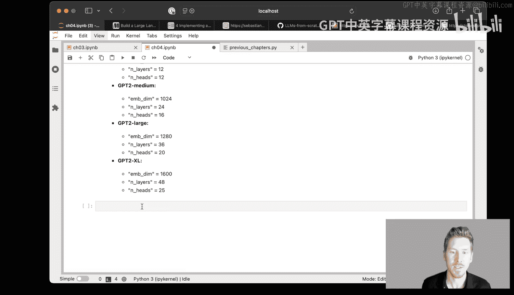

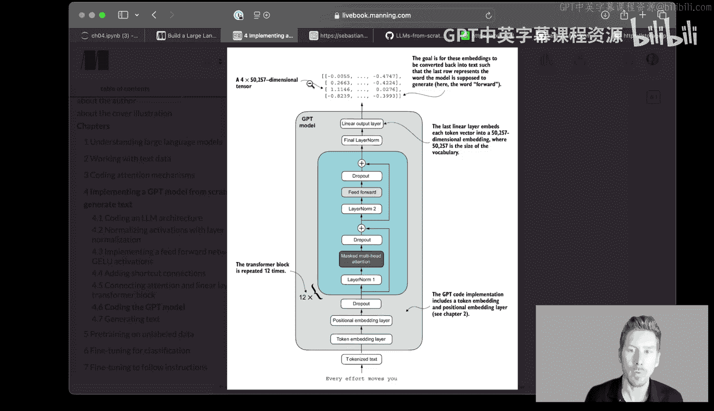

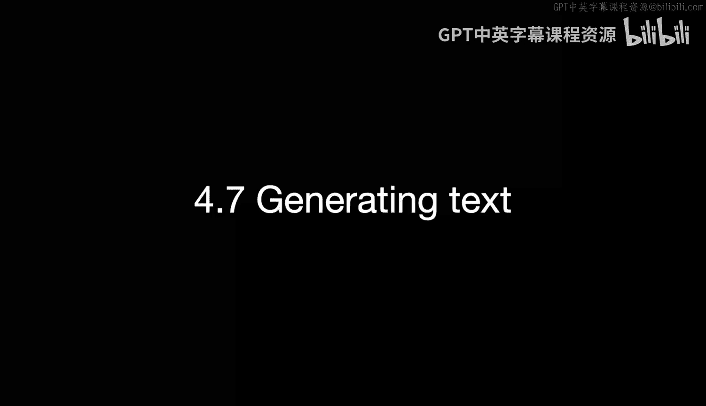

Let's now talk about how we can use the G model to generate actual text。 So in the previous section。

 we implemented this GT model architecture， and we have seen that it outputs this tensor。

 So it doesn't look like text at all yet。 So there is something else we have to do now。

 So one thing I mentioned before is that if we have four input tokens。

 we get a tensor here consisting of four rows。 But each row is 50257 dimensional。

 So how do we get these 50257 dimensions back into words。 that's the focus of this section And so。

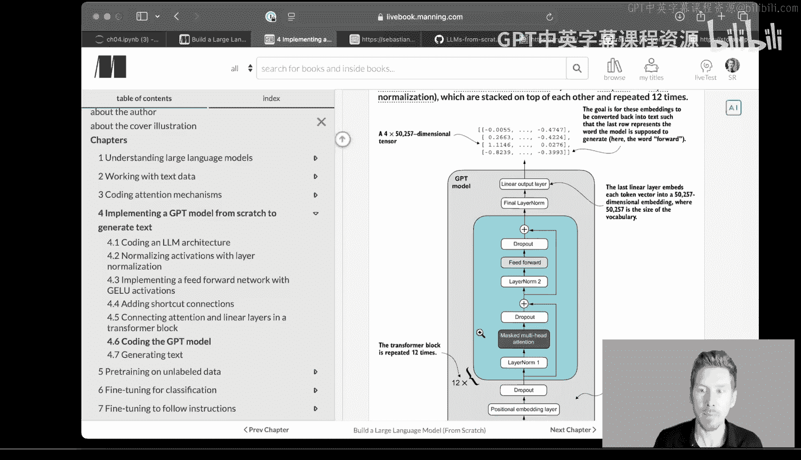

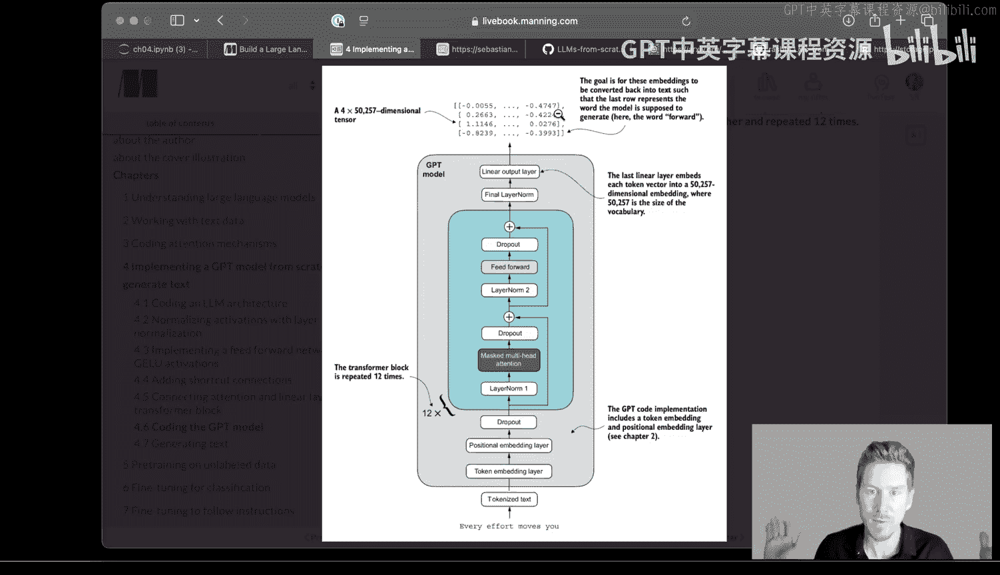

One thing before we get there， I wanted to mention is。LLMs generate one word at a time。

 So if we have an input hellello I am， it might generate the next word a。

 and then we concatenate the a back to the input。 hellello Im a and then in the next round it generates the next word and so forth。

 So it's actually an iterative process where we are always generating one word or one token and then we append this token to the input and we put the input again through the LLM and so forth。

 And if you have used web application like Chegip for example。

 if you type in a query and you pay close attention to the output you might see there's one token or word appearing at a time when it generates the output and that's because it's an iterative process。

 It's not generating the whole response all at once。

 it's doing it step by step And so how does that work。

 here is an overview it's maybe very technical but we will get through this I promise you So what you are seeing here is again the input hello I am And for now。

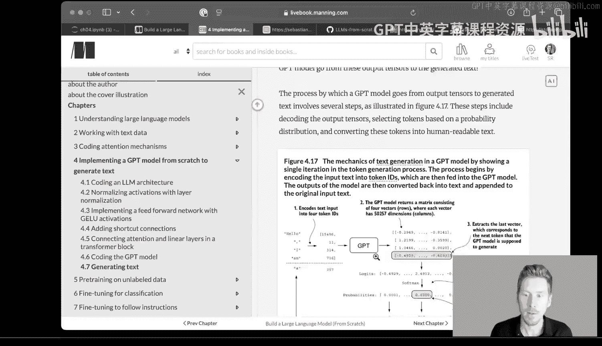

Please ignore anything about below the dashed line so the input might be hello I am and then similar to what we have done or learned in chapter 2 first we convert the tokens from a string representation into a token ID into an interteger representation so we are converting text into token IDs and then we put these token IDs into GPT the GPT model we just coded in the previous section and then like we have seen it outputs this tenseor here and it has four rows。

each of the rows corresponds to one of the input words here。 And if you recall a long time ago。

 but if you recall from chapter 2， the way we set up our data laer was that the targets are the inputs shifted by one position。

 So the way we are going to train the LLM is that for each token。

 it will associate the next token because of the plus one shifting that we implemented in the targets。

 So what that ultimately means is。At each position。

 this vector will contain information about the next position about the plus one position。

 And so that means that the last here， the last vector。

 which corresponds to the last vector in the input will contain information about the next word we want to generate。

 So the last row contains the information we need for the next word。

 but we need to now convert this vector back into the yeah into the word that we want to generate。

 how does that work。One thing I wanted to mention is this last row in general。

 these last rows here they are also called logics it's not a term。

 it's a general deep learning term I don't want to go into too much detail why they are called logicits that would go into a statistics lecture here。

 but in general it's convention to call the output of the last linear layer So the output of the last linear layer in a neural network is usually called the logics so the values that come out of this linear layer here So we call them logicits and so here we are looking at the logics of the last token so we are just you know copy pasting if you pay attention these are the same values we are just copy and pasting here in this figure the last row。

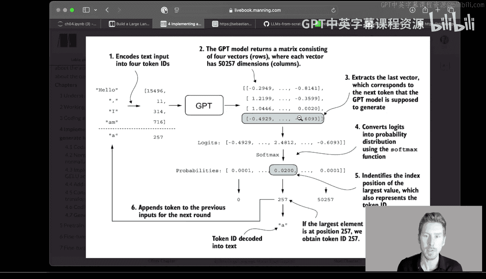

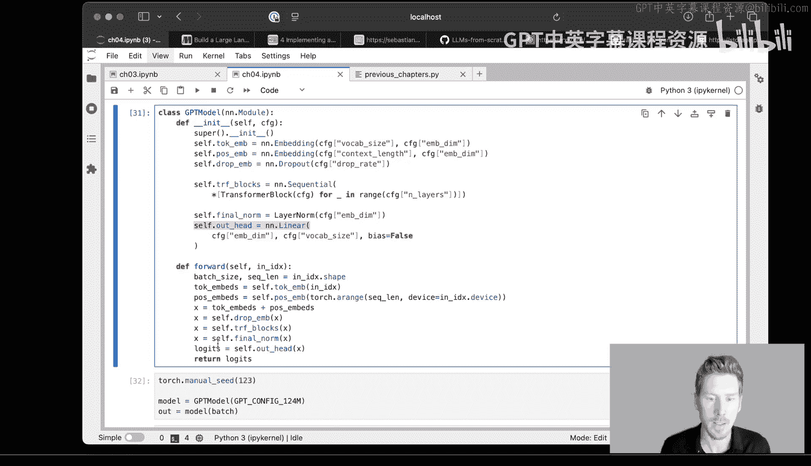

Which we call logitts， And then we apply the softmax function to normalize them。

 So they range from minus infinity to infinity。So it could be very negative small values to very large values。

 and we convert them into probabilities， which are all strictly positive and sum up to one。

 And by the way， this is an optional step。 This is not necessary you can actually skip this step because the smallest value always corresponds to the smallest probability and the largest value always corresponds to the largest probabilities。

 So there is no need for the softmax， but it makes it a bit easier to interpret。

 And so what we are looking at is the normalized logics has probabilities and we are interested and the so maybe one step back。

 I should say again， this is 50257 dimensional so。We have 50057 values here。

 and each value corresponds to a token Id in the vocabulary。

 And now our goal is to train the network， such that the correct next token that we want to generate has the highest probability。

 We are not training anything here。 This will be done in the next chapter。 But then one。

 let's assume we have a well trained G model。 it will associate the token we want to generate with the highest probability。

 So let's just assume this is a trained model。 And it will have the highest probability in position 257。

 So this is the first position position 0。 This is the last position， position 50257。

 and everything else is dotted odd。 So otherwise it won't fit。

And this model happens to put the largest probability score here into this position 257。

 and if we take our tokenizer from chapter 2 and we use tokenizer dot Dcode put in the token ID 257。

 it will generate the next token a。 So this is the desired token we want to generate now。

How does this actually or maybe one more thing here is？

We then take this generated token and append it to the input for the next round。

 So this is only showing you one round。 And like I mentioned before。

 we do this in an iterative fashion as long as we want to generate more text。

 So every time we generate the next token， it's add to the input。

 and then we put this whole input again through this pipeline and so forth。 But yeah。

 to make it maybe more clear， how does that actually work out in code so。

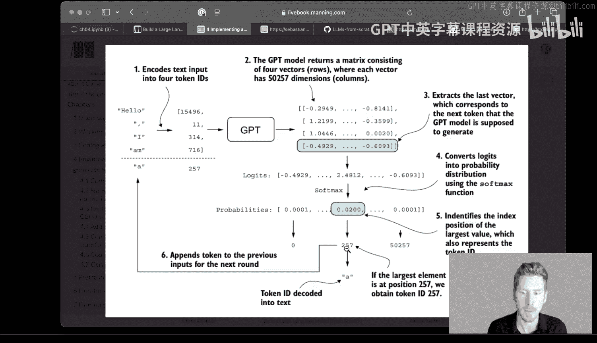

Let me go to the notebook and let me code this so we can define a function call it generate。

 let's say text simple， why simple， because we will be implementing more sophisticated。

Versions of that in later chapters that contain some additional sampling procedures。

 but the simplest version which is the one I showed you in the figure。

 works as follows so we have the model that we pass to all function we have the text let's call them IDX index tokens and then we pass the number of max new tokens we want to generate we have to define a number otherwise it will be infinitely generating more tokens and then also the supported context size that the LLM supports and then we have a fall loop so。

The follow loop is for how many tokens we want to generate。And then we keep generating。

 And so here the goal at the end。 So we will let's。Dot this odd for the moment。

 and then we will return。The modified index so here we pass in the index then here we keep app to the index and then we we return it so that is similar to what you are seeing here in the beginning in the first round。

 we have this input and then we generate the next word A and we add it to the input and so forth in an interpretative fashion。

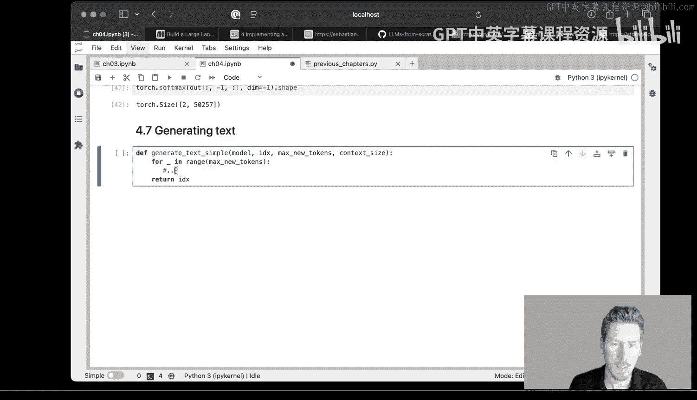

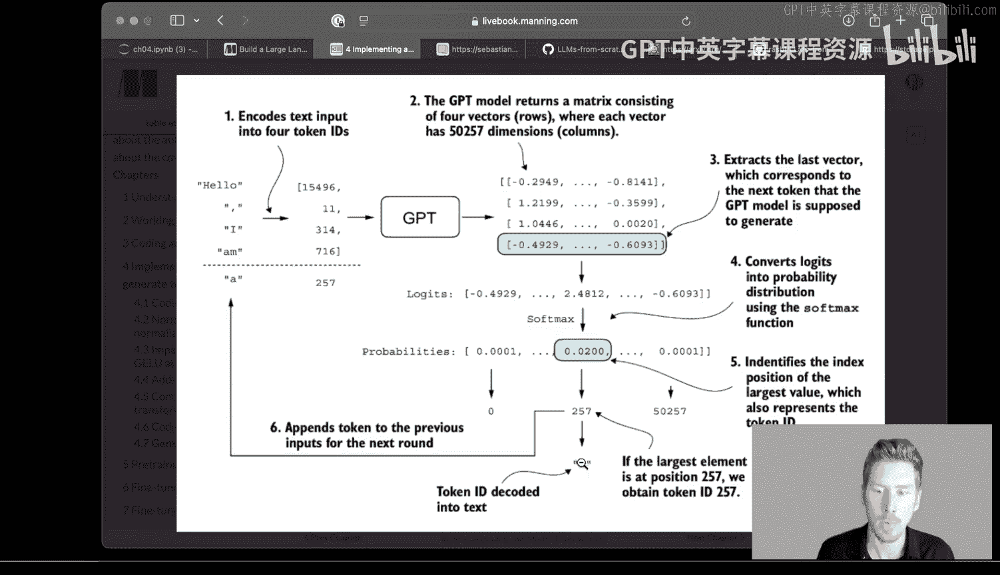

Maybe this is a bit abstract， so what is index？So index correspond to the token IDs or token index positions because the token ID corresponds to the index position in this tensor。

 so index position means 0，12，34，5，67 up to 500257 and that's the same as the token ID so the token ID corresponds to the index position。

 if I say token ID or index here in this case means the same thing because we're talking about the index position of this probability tensor。

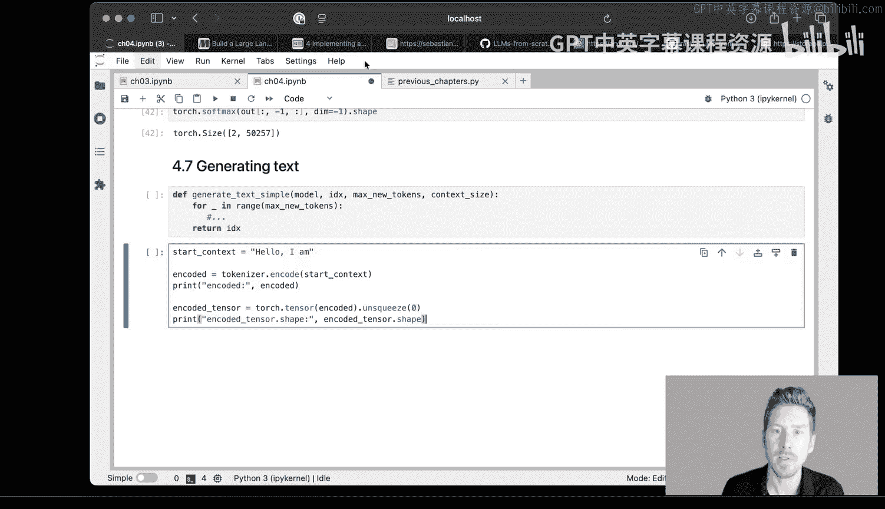

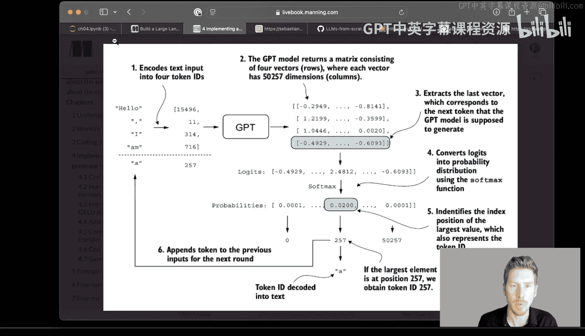

Okay， so just to have something to work with， we have this start context。

 just the first text we start with。We encode this with our tokenizer into token IDs。

So let me just show it here So these are our token IDs and we can also call them indexes yeah and so and then we also we have because our model only works with Pythr tensors。

 we have to convert this list into a Pytorch tensor so can we just show it to you。

So this is our Pythtoch tensor and I added the batch dimension here， so with this unsqueeze。

 I just added an additional dimension so you can see this is now a one by four dimensional one so course yeah our model。

Expects batches。 So we only have a batch size of one， but it's just for compatibility reasons。

 And then we can use that model later for training。 Okay。

 now let's fill in the interesting part here。So we are going to code now our token generation。First。

 we're going to trunnccate， so。What we are doing here is we。Tranating。

It up to a size that a model supports in our case that if we have something like this。

 that's not an issue。 It's just for tokens and our model supports what have we defined。

Up 2024 tokens， but let's say we copy and paste the large document， you know 50。

000 tokens so that the model doesn't crash， we just trunccate it and pass only the first 1024 tokens。

UmIt's just like a sanity check and then let me double check if I have one， two， three， four， oops。1。

2，3，4， that I just have the right spacing because it looked a bit off。

 So's just the Python convention。 and then we compute the logics of the model。Of the。

 sorry of the inputs。So this is corresponding to this one here。And Py， though。

 one more thing I should add。Is the。No gra context， so in Pytorrch by default。It is always。

Building this computation graph of the model in the background that is used for the back propagation algorithm。

 the training algorithm。 And if we don't train the model， this is very inefficient。

 So here I'm suppressing the generation of this yeah gradient computation。

 the computation graph because we are not training here。 We are just using the model。

 So it's just a back good practice to save memory。 So it's less compute intensive。

And then what we are doing is we are。Graraping。The first， sorry， the last row。

 So here what I'm doing is I am just yeah getting the last row。Of the lots。

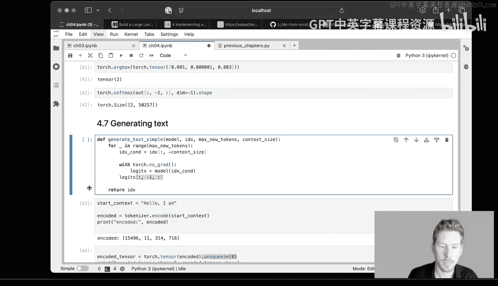

Let me see here， this is what we're doing， we're extracting the last row。

O。It's just bit like this。 why not。Next， what we are going to do is now we are computing the probabilities。

So we use torchnet softm similar to what we have done with the multi head attention。Yep。

 so we'll do that for the last dimension。And then we。Look up。

 so here maybe one more thing to explain the Arc mix。We are using the arcm function in Pytorch。

 so arcm is a， let me just move that down here。The arcm function we are going to use next is the function in Pythr that looks up the index position。

 So let me make a arbitrary。Example， tensor。Let's do something like this。 And so what Arcm is doing。

It's finding the index position with the highest value here， the highest value is the first value。

 so it should return a0。Now， if I put this 14， or let me just put a larger one here。It should return。

0，1，2，3，4。So it is returning the index position of the highest value。In。

The Pro here is what we are doing。And let's call that the next index of what we want to generate。So。

 here。We are going over the last dimension， because。The first dimension is the batch dimension。

 so we don't want to get the largest we don't want to mix up different batches。

 We want to have this for each。 So here we are only looking at one batch。

 but we have maybe two rows if we have a batch size of two so we don't want to mix between batches。

 We want to keep them independent。 so we are looking at the last dimension。

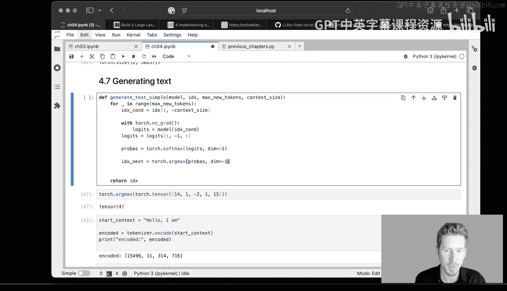

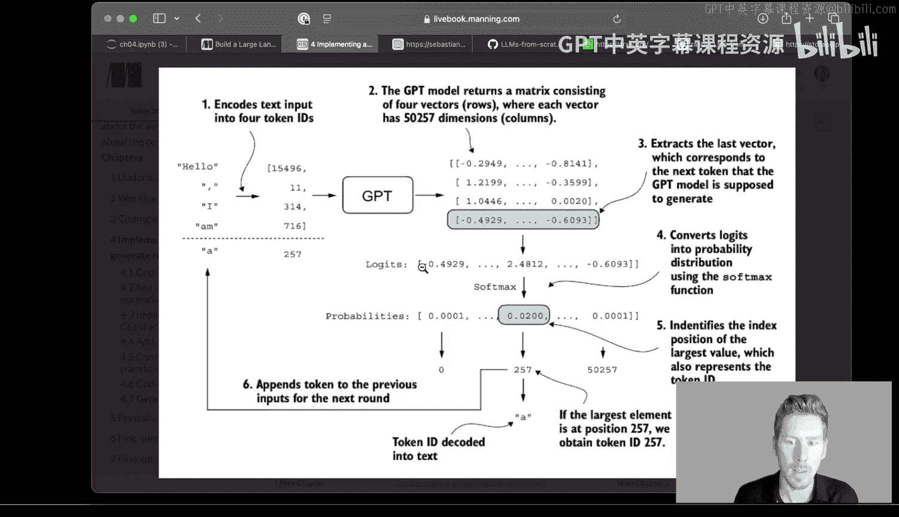

And let's also do。Keep them true so that the dimension matches the one that we have as the input。

 and then we can nicely， I hope。Concatenate， let's do index， index。Next， and。

dimensions is always something you have to keep in mind to make sure everything stays the same and if I didn't make a mistake here。

 this should be adding the next generated token， which you see here back to the input here basically we are we are not converting back to text here that is what we will do later with a tokenizer we are here operating in this token ID dimension。

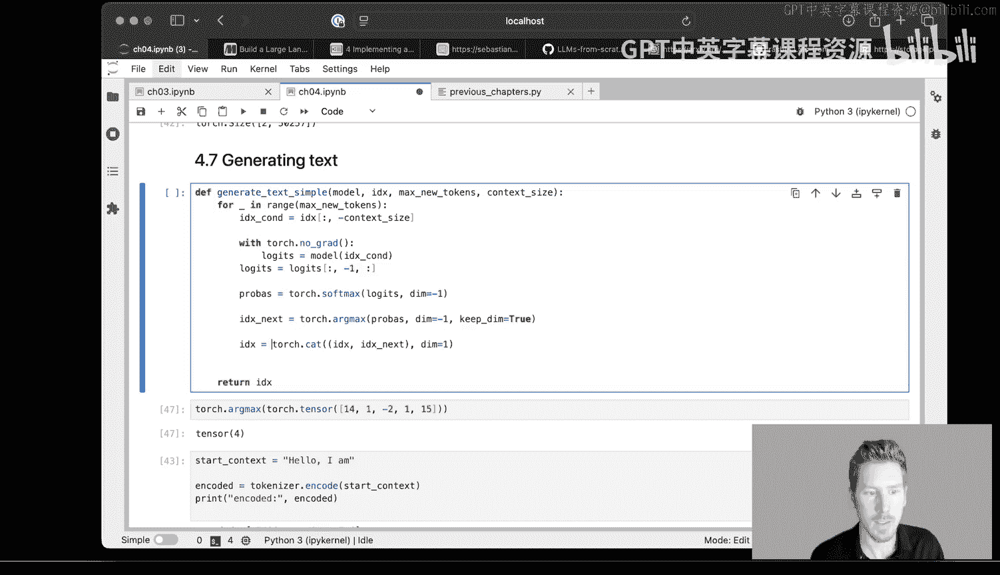

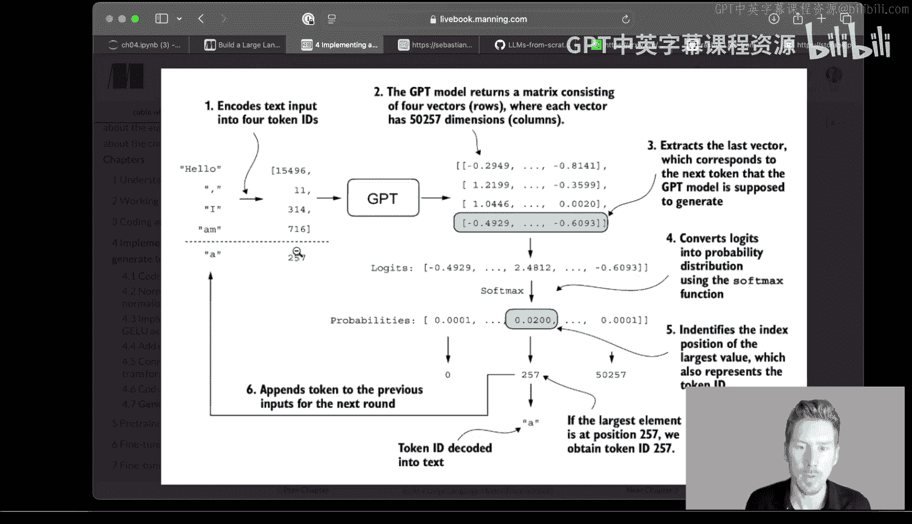

Okay， so let's hope I didn't make a mistake。 And let's try this out in practice。 So for that。

 we are going to use this text。 and then we will generate the output。 Well use our。generateenerates。

Text simple， and let me just copy and paste here what we have。😔，It's maybe easier this way。And then。

 we。Assign the model here。 The index is our。Encode it to Tensor。The max new tokens。

 how many do we want， You can experiment with us。 Let's do6 and the context size yeah。

 let's just reuse this here。 This should be。Context length。

And hopefully this works if I haven't made a mistake， I did， of course。😔，Oh。

 I think I forgot a colon， of course， so this would not work yet， so I need a colon here。Keep them。

Without the underscore。There we go。 Now we have something and let's take a look at how that looks like。

 So we have now token Is。Now， the last thing， of course。

 is to use our decode method to convert token ideass back into。Words you can see this does not work。

 The reason is this is a tensar， and our tokenizer work works with pythonists。

 So we have to convert this back into pythonists。 So first we can。Do maybe a squeeze。

To get rid of one dimension。So this got rid of one of the dimensions and then we can。You do well。

To this， I always forget if we need an underscore and not let's just see。Yeahep， this worked。

 so we have a list now。And we can see what happens here。So we can see it generated something。

 but this does not look like what we want to generate at all。 You can see this， of course。

 is our in input context。 This looks correct， but this， for example， does not look like at all。

What we have seen here， it doesn't say hello， I' am a model ready to help， it is more like gibberish。

And the reason is we have initialized our model with random weights and we have not trained the model yet。

 so the model training will be actually the topic of chapter 5 and once we have completed chapter5。

 hopefully this will actually generate useful text but yeah again we have this generate text method and we can actually reuse that after the training to see that this actually will help us generate coherent text but yeah stay tuned for the next chapter on training the model。

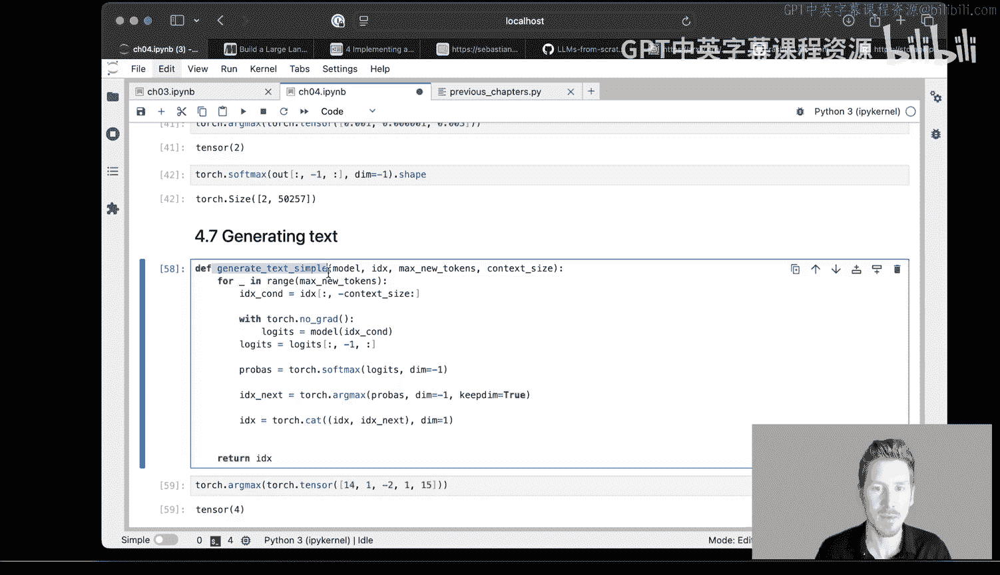