# Sebastian Raschka《从零开始构建大语言模型｜Build a Large Language Model (From Scratch) 2025》 - P5：-5-Build an LLM from Scratch 5： Pretraining on Unlabeled Data.zh_en - GPT中英字幕课程资源 - BV1BCfdBqEVv

Yeah hi everyone and welcome to Cha5 on pretraining large language models So in this chapter we are going to finally put together all the building blocks we worked on so hard in the previous chapters that means the data loading from chapter2 the multi- head attention mechanism from chapter 3 but then also of course most importantly the G model architecture from chapter4 so here we are going to yeah put them together to pretrain this G model that we just implement in chapter 4 and we will do this step by step so first we will be implementing the evaluation of generative text models and then yeah that will help us to measure how good the text is that the model generates and how we can optimize this but yeah in order to measure how good generate text is we have to actually get the model to generate text in the first place So in this first section I want to briefly go over again how we use the G model that we have just implemented in chapterpt 4。

😊，To generate text。So let me see if I have some nice figures here。

 So in the previous chapter in chapter4 at the end of it。

We discussed briefly how G models generate text and that is one token at a time。

 So if we have an input context， we generate the next token and the next token gets then concatenated with the input to generate then the next token and so forth。

 So it's like an iterative process。 and then what we talked about was this figure which looked a bit complicated at first。

 but I hope it was not too complicated in the end once we implemented it。

 So what we are seeing here is that we have a number of input tokens。

 They get converted into token Is。 Then they go through the GP model and we get out a tensor consisting of four rows。

 So each row corresponds to one of the input tokens。 we take the last row。

 we get the probabilities for each。

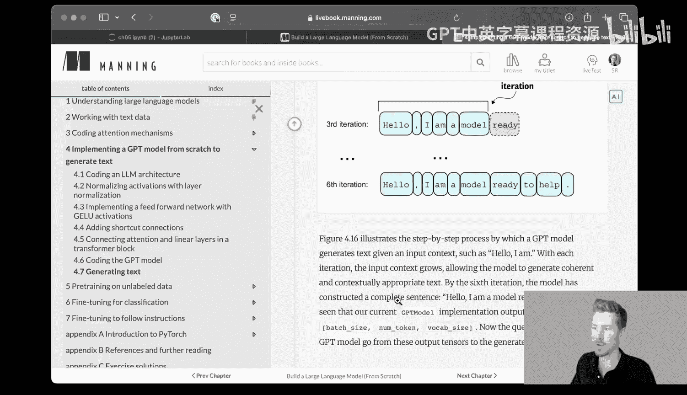

Position here where the positions correspond to the number of entries in the vocabulary and then we extract the largest position here which corresponds to the token ID that we want to generate and we convert this token ID back into text and then have the generated input text so in this case it's only one token we generated Now going to chapter5 I won't go over all these here but where we are maybe in the big picture sense we are now finally implementing the pretraining and it's done in several steps so there are seven steps to it。

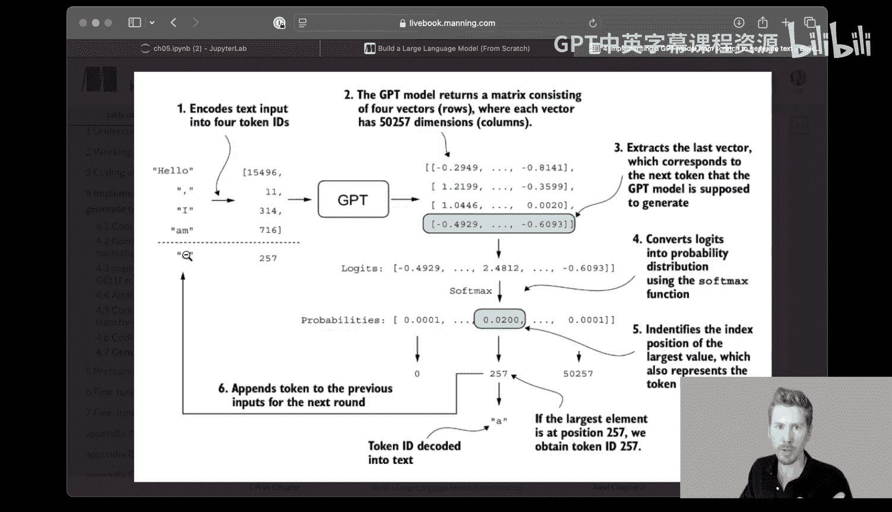

And by the way， maybe before I continue with a text generation。

 I wanted to say we are pretraining this model here and later on we will also be loading pretrained weights from the Openmii GP model so everything we do now is for educational purposes the training and everything and then we will also load the pretrained model but anyways continuing with what I just talked about the generating of token IDs or generating of tokens so here the figure is very similar to the figure we just looked at in chapter4 it's just visually a bit differently laid out and so again。

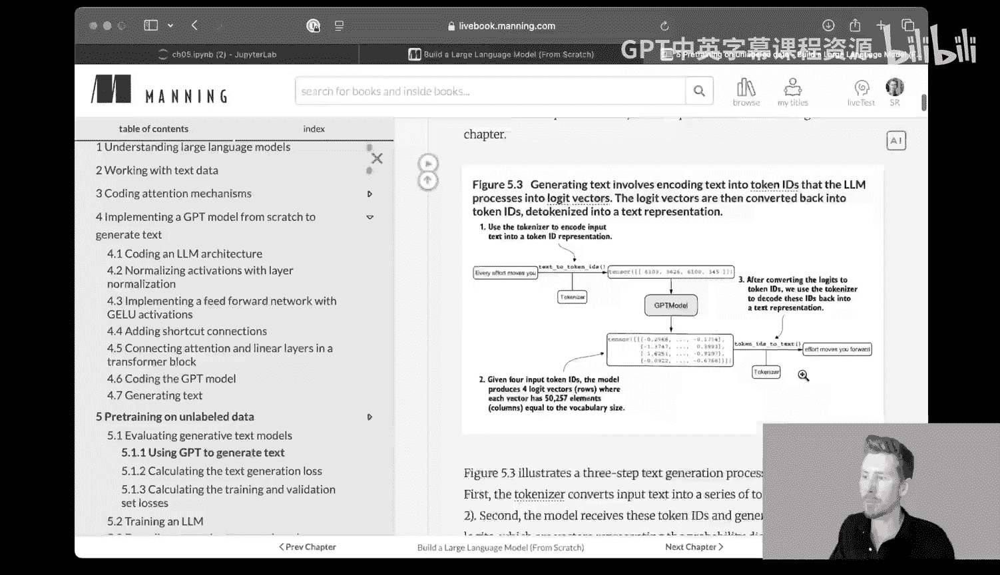

What you are seeing here is some input text for input tokens 1，2。

34 we use or we will implement a function called text to token IDs which will take this text and convert it into token IDs and this is exactly what we have seen in chapter 4 these token IDs go into the GP model and the GP model creates this output tensor consisting of for rows similar to before and then we will have yeah a code that converts these tensors into token IDs and then we will have a function called token IDs to text which will then convert the token IDs back into text and。

What you are seeing here is just like a different visualization of what you have seen in the previous figure in Cha 4。

 it's just a bit more compact。 and the focus is here on these two functions on text to token ids and token IDs to text that we will implement just to make our life easier when we are implementing the。

Training function so that we can use it in between to know print out some results and see what the model is generating to get an idea if it's actually generating useful text or not。

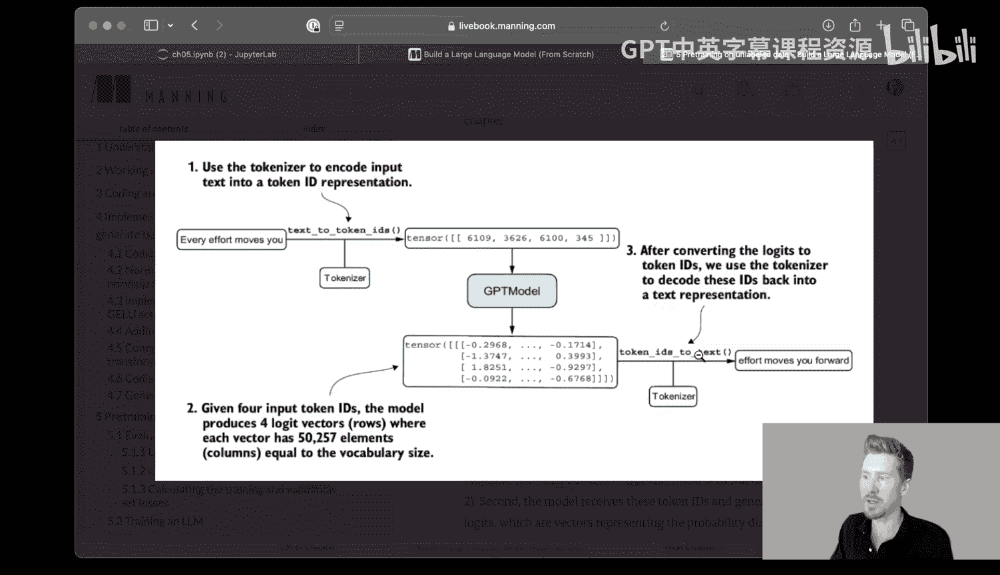

So yeah with that let's maybe get started and just you know get coding because I think then these things will become more clear and what I like to do is when I start a new coding notebook I like to import the libraries that I'm going to use in this notebook at the top because then for example in a few months when I revisit this notebook or maybe next year or if you are revisiting this。

 you see exactly what software libraries I've used and if you have a buck or anything or things look different。

 one good place to start is to make sure you have similar libraries installed because sometimes libraries get updated and they change functions and things might might break in this case。

These libraries are all very mature。 they don't change much at all anymore。

 so technically you don't need to have these exact versions。

 let me just print this out So Matpotlib is yeah just a library for ploting the graphs later when we plot the loss functions to make sure the model trains well So for now yeah it's a simple another simple it's a very sophisticated but it's a basic way of just making plots in this lecture Ny is array library that is used by Pytorch and Tensofflow Tiktken is our tokenizer from chapter 2 Pytorch know we don't need to talk much about Pytorch because we have used it now so much that I think it should be clear and by the way I'm using Pytorch 2。

6 By when I started writing the book about122 years ago it was Pytorch 2。

0 I tested all the code on 2。02。123456 it works all the same So know it doesn't really matter which Pytorch version you are using。

Older ones are also fine。With Tensorflow that's interesting though you don't have to have this exact version but you need to have a version of Tensorflow why I mean this book is not using really Tensorflow we are implementing everything in Pytorch here but so I mentioned briefly when I scrolled through the figures here that we are going to load pretrained weights from OpmiI and back then when OmiI generated GT2 model they used Tensorflow now Tensorflowlow is not very popular anymore I mean not at least as popular as Pytorch anymore it's also not super actively maintained in my opinion because it took a long time for example to even get nupy 2。

0 port in Tensorflow and I know that a lot of not a lot but a few readers had issues with Tensorflow on Windows it's not everyone it you know some people had some incompatibility so I don't know exactly why but I feel like Tensorflowlow is sometimes a bit tricky。

So right now， if you get an issue with TensorF here。I would say don't worry about it yet。

 we don't need it yet， we will need it only at the very end of this code notebook so you can you know continue and maybe revisit this later。

 so it'll be just at the very end when we are loading the weights because we only use Tensorflow here to briefly open the weight files that open eye shared and then we will convert these weights into Pytorch but for this intermediate step for just opening the files we will briefly need Tensorflow but even then in case you can't get it to work。

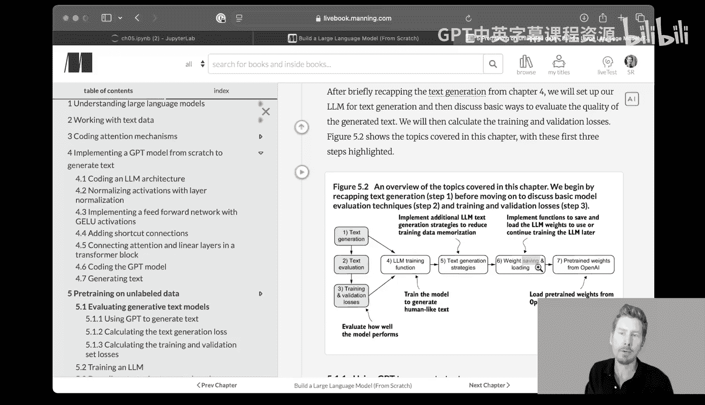

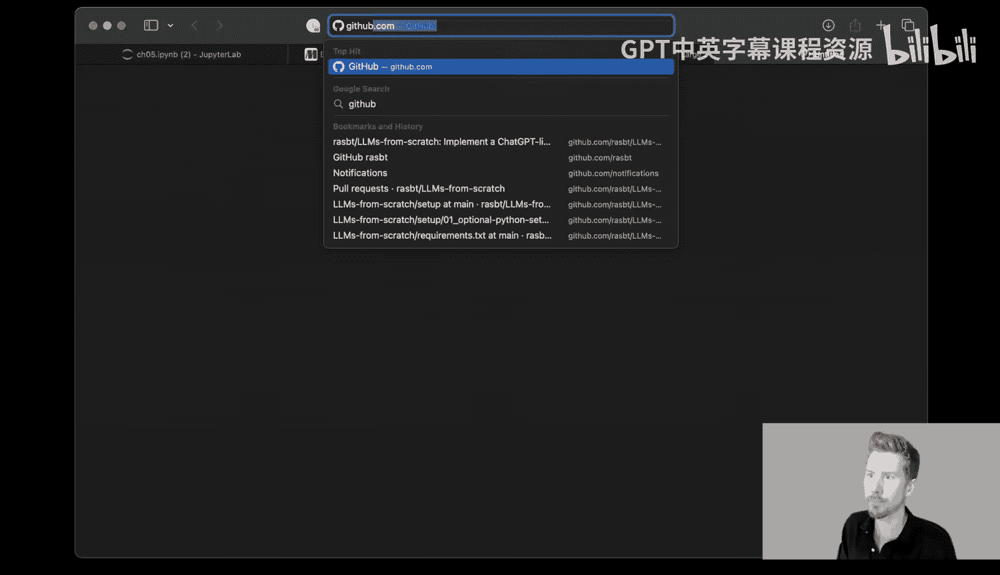

If you go to my Gitthub repository for the book。I do have a bo section for Cha5 where I also implemented it with the huggingface model hub where you can also lot the ways the weights with different libraries so there are some alternative weight loading strategies here I've outlined and the reason why I'm not using those in the book is these are not the official ones by OpenmiI so I preferred using the official ones that OpenI shared the official weights and they happen to be in Tensorflow。

 but this is a good you know backup solution in case your computer doesn't support Tensorflow for some reason but you know let's cross this bridge later when we get to the section on weight loading for now maybe if this doesn't work you know just commented out or something like that。

Yeah， so then to continue another thing is we had this。Os there we go。 This configuration file here。

 So this is from the previous chapter。 I will make some small modifications。

 I will change this to 256 because I'm running the code here on a old MacBook mini sorry。

 old MacBook Air from 2020， which is not very powerful and。It has limited memory， compute memory。

 and the longer the context size， the more compute memory you need。

 And so I'm just making it compatible to my computer here。

 chances are you have a you are a computer where it's just fine。 you have more Ram。

 maybe even you have a GPU。 So the code we will run later will also optionally run on GPU。

 But you know， just to make it compatible to most people's computers。

I thought airing on the lower end might be a better idea。 so you don't get any issues。

 but feel free to also try out larger numbers。 Yeah。

 and that that's basically the small modification I'm making here。

 And then we are going to implement our G model。 So for that， we do。

From previous chapters import GT model， and I should say in auto for that to work。

 you need to have a file here calledPrevious chapters。

And so here it's just the file I created what I put in here is all the code from Cha 2。

 the data loading code， the data set class and the function to create the data loaders。

 then the multi head attention mechanism from chapter 3 that is used for the GP model。

The yeah building blocks， the placeholders， we replaced with the actual functions。

 the layer layer norm， Galu activation， fee forward module。

 the transformer block and everything that goes into the G model。 So that's the main thing here。

 And this G model depends on the other one。 So that's why everything is in here。

And I also added this generate text simple function from the end of chapter4 so this is all the previous code I just put it together into this file here because then we can import so here this will import the GPT model from from this file So yeah just make sure you have it here。

And then we are going to use the model to torch manual seat so that we both you and I get the same results。

And then， the model itself。So we will， os， we will。There we go。

 we will use this dictionary file and then one thing I forgot actually in chapter  four。

 sorry about that。😊，The evaluation mode for generating text。 So Eval。

 what it will do is it will kind of disable all the random elements in the model。 And in chapter 4。

 we talked， I think it was chapter 3， actually， in chapter 3， we talked about dropout。

So dropout is a random dropping of notes during training to prevent or reduce overfitting。

But we don't want this random behavior during inference when we generate text。

 So we want to disable it here。 So that's what we are doing。

 We are disabling dropout so that there is no random dropping during inference。

 We only need it during training。Now， this one， Eval probably stands for evaluation or something。

 but it will just， you know， it's like you think of it of it as an inference mode or prediction mode or something like that where we don't want randomness。

 So that's what's happening here。 The reason why I'm using the semicolon。Is I should， of course。

Import pytorrch。嗯。I for this one， we need Pytorch。Because I'm calling torch dot manual。

 So if I don't do the semicolon here， you will see it prints model architecture， which is quite nice。

 you can see what the model looks like， but it is also creating a lot of clutter here。

 which is why I'm adding the semicolon And by the way。

 if you want to make the model ready for training， we will do that later。

 the opposite of Eval is train。 So that's yeah the opposite So to make it trainable again okay。😊。

So that is the model itself。 Now let's get to the functions。 So let's do this one by one。

We use T token as all tokenizer and then from previous chapters we implement the generate text simple function what we do is we have a text as input to our text to token IDs the tokenizer itself and then we use the tokenizer to encode text so that's what we are doing here here we're adding a batch dimension because our model was implemented to yeah work on on a batch not on a single Python list or Tensor so here that's what we're doing nothing too special。

Let me actually。Iitialize the tokenizer and give give some text to the function just to make sure it works。

 So let's try this actually out in practice。 So we do start context and then tokenizer。Let's see。

 So yeah， it's converting correctly text to token Is。 Now we implement the opposite。

 So what we do is we will implement the token Is to text。

 And here it will receive the token Is that we just generated as input。 So that's maybe。

Save them here。And it will remove the batch dimension because then we can convert it into a list because the tokenizer itself works with Pythonists。

 And by the way， this is exactly what we have done at the end of chapter 4 here when I did the squeeze to list and everything。

 So this is the exact same thing we are doing here。 So the squeeze。To list， essentially。

 I'm just packaging this in a function so we can reuse that without having to type it every time。

And talking nice。Ner。Okay， so yeah， we converted the tokens back into text and these are our convenience functions。

 yeah the main part is essentially setting up these functions and then we can also use the generate text simple function which we implemented also at the end of chapter4 that's from the previous chapters or we have it also here in chapter 4。

And with that one， we are here using our text to token IDs to create the token IDs。

 we say how many token ids we want to generate and then yeah the maximum context size of the LLM。

 So let's run this and let's take a look at the token IDs。So we can see this should be 14。

 so it's a double list so I can actually squeeze that to make it a single。List here， and then I can。

I can also just do shape。Does't matter。 So we see we have 14 token Is and the number 14 comes from the fact that we have。

4 input Is，1，2，3，4。 And then we generate。10 new ideas。 And now we can then。

Use our text token sorry token ID to text function。To convert these token Is back into text。

 So let's see what happens。 It's missing a tokenizer， of course。

So what happens is we can see the first four tokens are indeed correct that these are the ones that we provided。

 of course， but then everything else doesn't really make sense。

 so we can see it's you know gibberish， So what happened here What happened here is that the model we initialize it with random seat we haven't trained the model So if we want the model to generate coherent text we have to show it how and that is essentially the training But before we do the training we still need to kind of have a numeric way of visualizing it because right now we as humans we look at this and say oh。

 this doesn't make sense， but how do we actually quantify this。

 how do we measure how good this is right So because we need a measure of this in order to optimize this measure。

 So in the next videos we will see how we measure the quality of this generated text。😊。

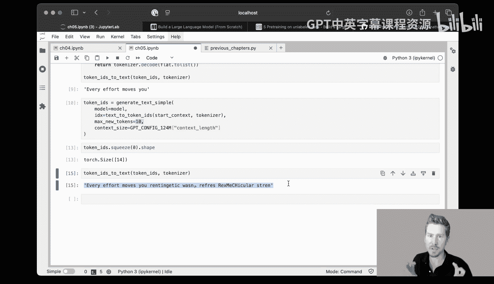

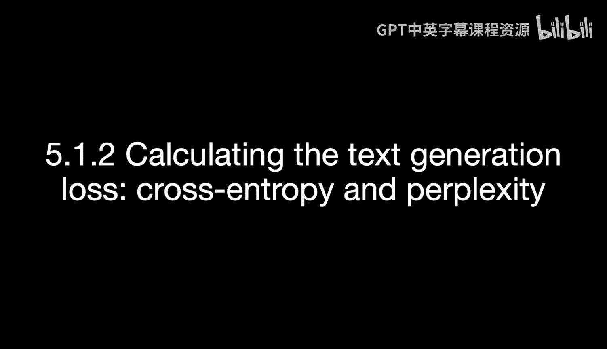

So in the previous section we had the GP model generated text and then we as humans we looked at the text and we saw oh。

 this is actually not very good text。 So in this section we are now going to implement a way we can measure this quality of the text more numericalmerly and so for this we are going to calculate the text generated loss so loss function is a measure in this case how good the generated text is and then we will be using that to optimize or more precisely to minimize the loss to optimize the generated text later in this chapter so now we are implementing the loss itself。

 how we measure this and yeah the technical term in this case for the LLM training of the loss function is the cross entropy loss so cross entropy loss is the loss function that helps us measure the quality of the generated text and we will also briefly talk about the related measure the perplexity。

text you might have heard perplexity before， we will also briefly talk about how perplexity is related to cross entropy。

 but yeah， we will tackle this one step at a time。

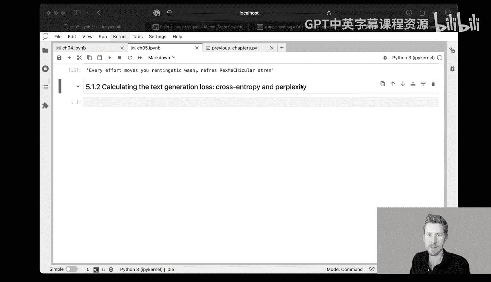

So just to briefly go back to a figure that I showed you in Cha 4 at the end of chapter 4。

 we had this figure where we went from token IDs here token IDs to these tensors and then we computed the logicits and the probabilities of the last tensor and so this was essentially for generating the next token now what we are interested in is not just generating the next token we are interested in measuring the quality of each generated token so。

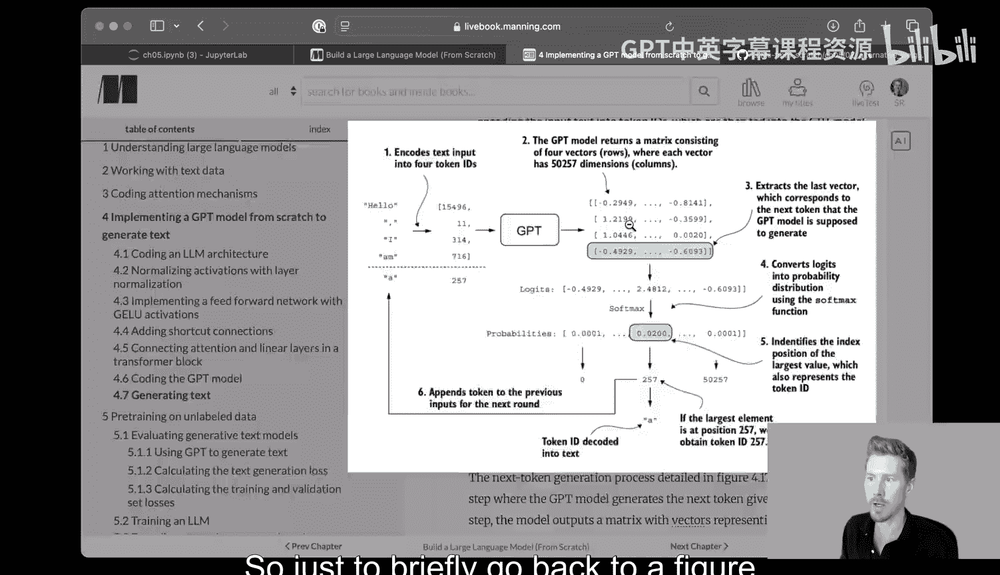

What we are now analyzing is this whole thing because for each input token then LLM generates a vector and this vector contains information about the following token so remember in chapter 2 we set up the inputs and the targets where the targets were shifted by one so we had if we have something like hello I am as our inputs the targets would be comma I am a right so then the output here。

 this comes from the first token， this should be able to generate the comma token maybe if this is to complicate。

 let me show you a simpler example。So let me maybe give you a concrete。

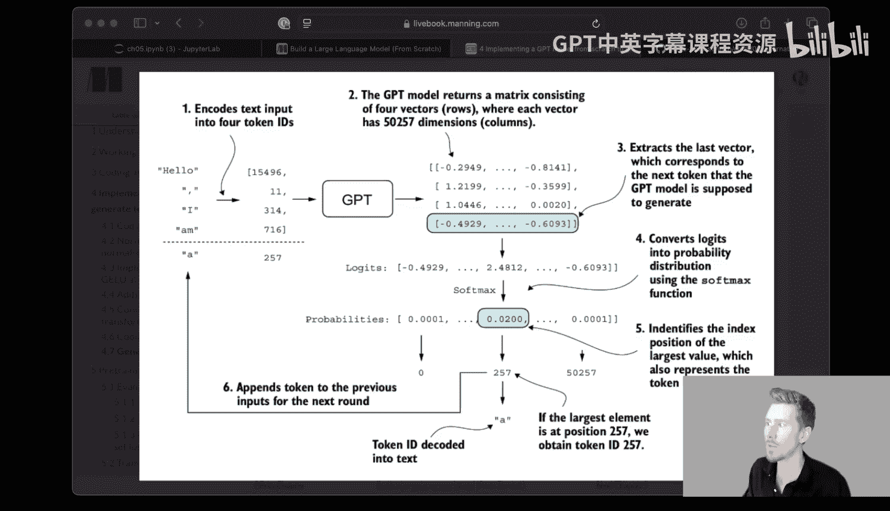

Example where we have inputs and targets。 So what I'm trying to say is if we have token IDs corresponding to some input text。

 for example， every effort moves。If we convert this into tokens， we will get these tokens here。

 This is using the tokenizer。And the targets。 So here we have the corresponding targets are shifted by one position。

This would be effort moves。And then the next token we want to generate。

 So we have this shifting by one position similar to what we have done in chapter 2。Okay， so， and。

We want to know if the model generates tokens， we want to know measure。

 how good are those for predicting this next token。

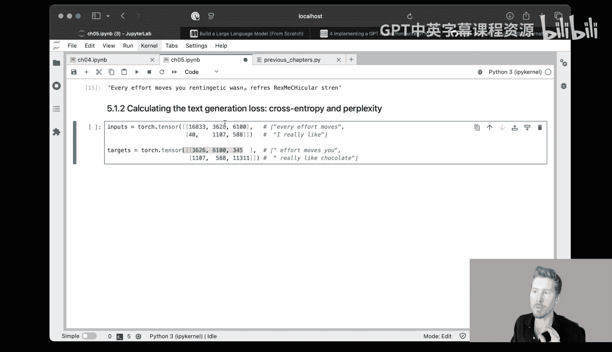

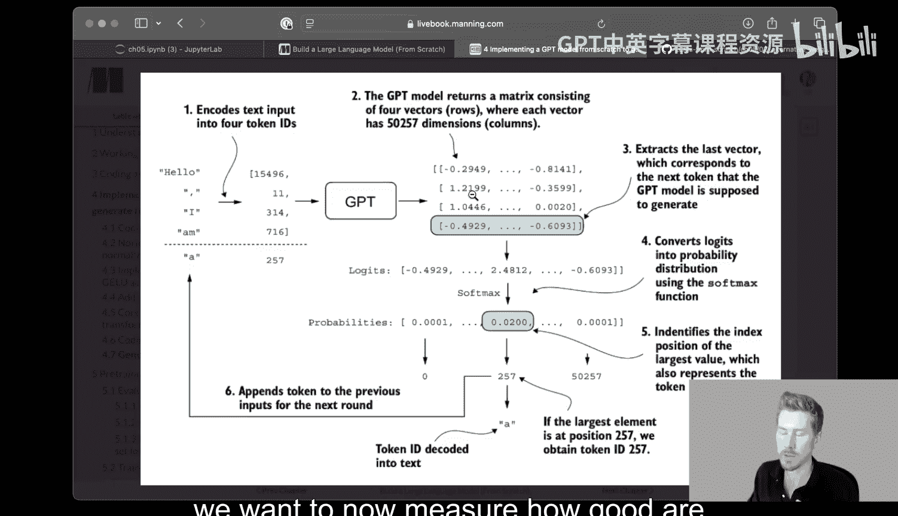

So we'll get there maybe one step at a time。 So here I'm showing you one input。And then the targets。

 this is what we want the model to generate。Here we have a second input just so that we yeah have multiple examples and here the second input is I really like and then the targets for that one would be for example。

 really like chocolate so really like really likes so because it's shifted by one position。Also。

 I chose these examples so that this one has nothing to do with this one。

 because I want to highlight when we have a batch of multiple inputs， these rows are。

Unrelated to each other。 So the relationship is between the first row here and the first row here。

 and then the second row here and the second row here。 because yeah。

 the inputs correspond to the targets， but there doesn't need to be a relation between the first and the second example here。

 If you are pretrain， you could， for example， chop up your text with a sliding window approach that we have done in chapter 2。

 In that case， yeah， they kind of relate to each other， but it's not necessary。

 They can be totally independent。 like shown here。Now let's generate the logicts。

 so what we are doing now is we are generating these outputs here， the logics。

 I can also maybe just show you the figure we looked at earlier in the previous section。

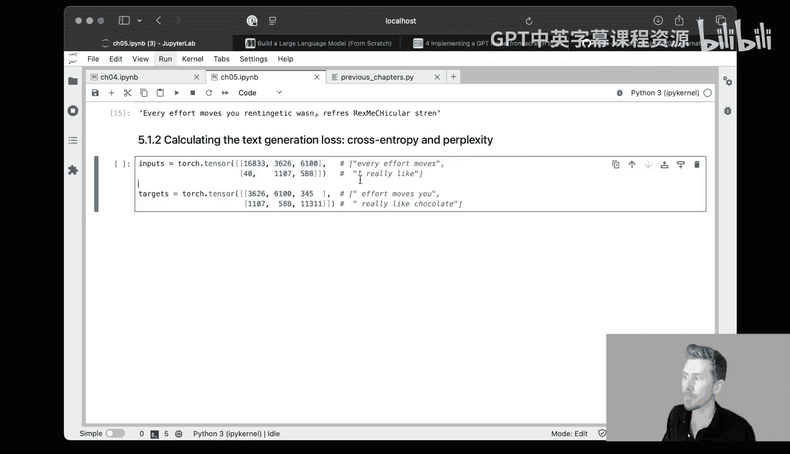

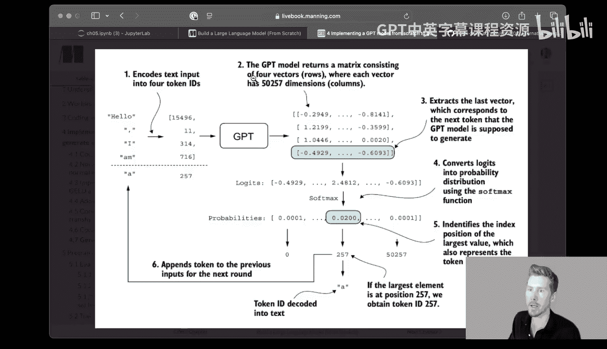

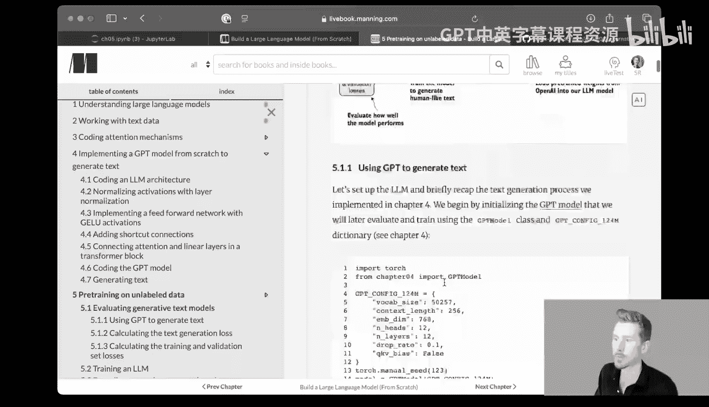

Here， so when we have us。The input text into tokens， and then we generate this output tensor。

 these logicits。

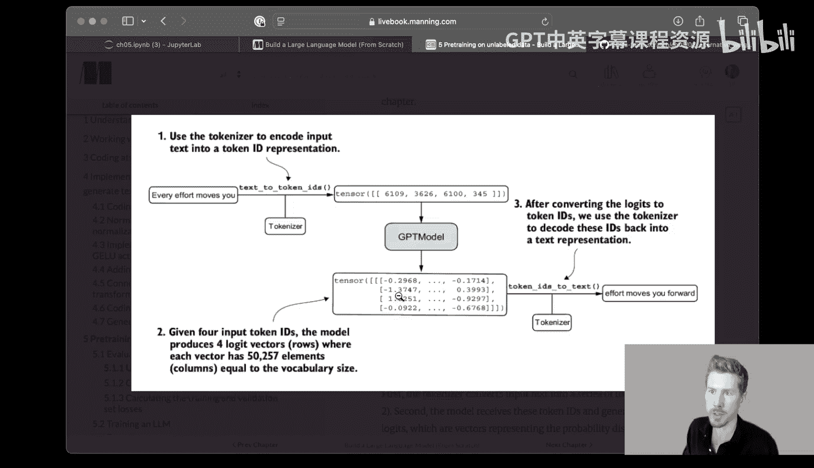

So let's do that。So here， similar to what we have done before， we generate the logicts。 And yeah。

 let's just take a look at。The shape of these lots。So what we see here is it's 2 by 3 by 50257。

 Where does this number come from。 So two， because we have。In the inputs， two rows。

Each row has three tokens。 so that's where the three comes from。 and each of the lots is a 50000。

257 dimensional vector that that corresponds to the vocabulary size and then。

We had a step where we converted these into these probability tensors。We had the softm function。

On the Lots。Like this and this one。Let's just take a look at the shape。😔。

And this one has the same dimension here。 We haven't extracted the last tensor or anything like that for this one。

 We're looking at every tensor now。 So yeah， so maybe to see this more clearly。

 we I should have a figure somewhere here here。

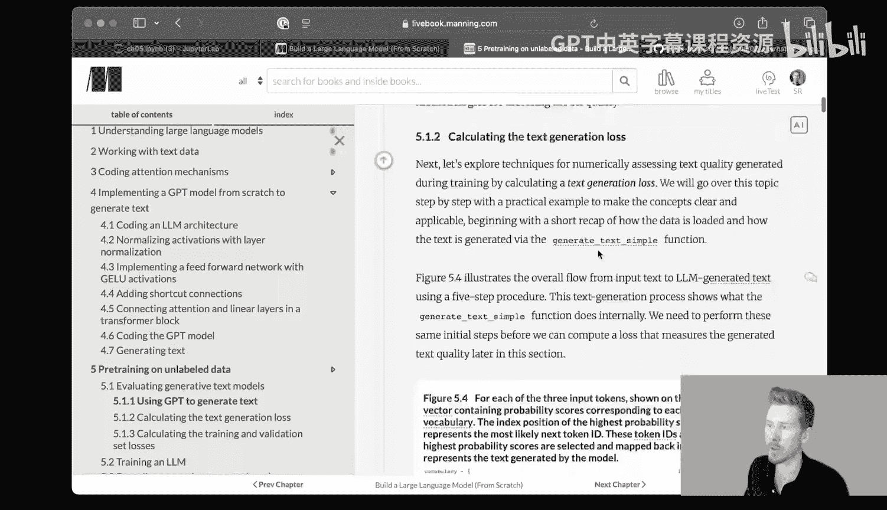

So， we have。And input here every effort moves which we convert into token 8s I'm using a different vocabulary here。

 I'm not using the 500257， so that allows me to fit it into one slide because 50000 would be quite long so。

We have these token Is we get from some input text。

 and then each token ID is converted into the dodges and then the softmax， the probabilities。

 So here you can think of this row here。

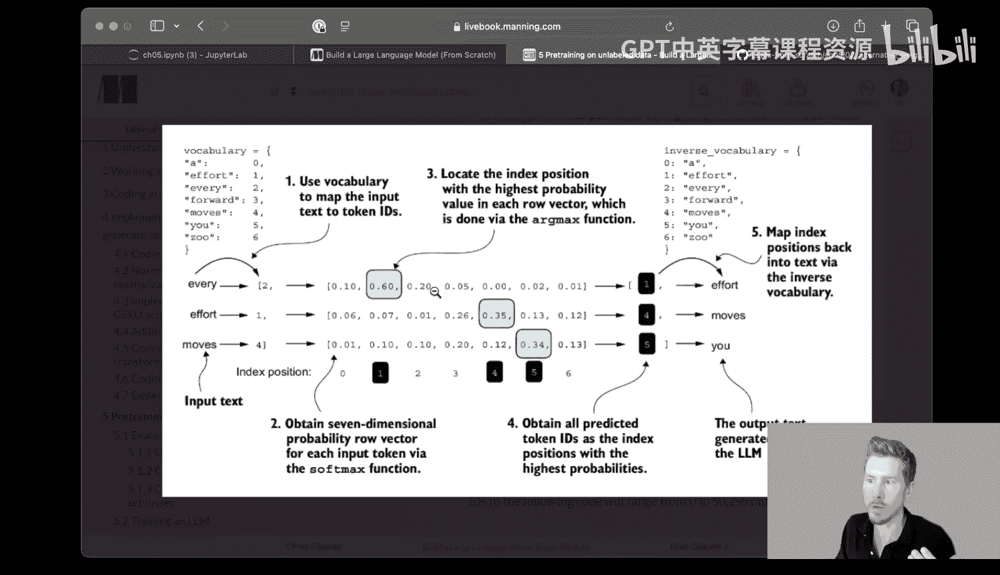

As what we have here。 So if I maybe。Show it to you here。 So we have two input examples。 So this one。

And this one。Each one consists of three rows，1，2。3。And each row here is。

 so it's kind of wrapped around the line。 But this is， you can see it started out its's 50000。

Dimenssions。 so instead of looking at 50000 because it's very long。

 and then we had to dot all these lines， I'm using a smaller vocabulary so that everything fits into one line。

 And one thing about the softm function， if you recall， these sum up to one。

 So what we're looking at here。

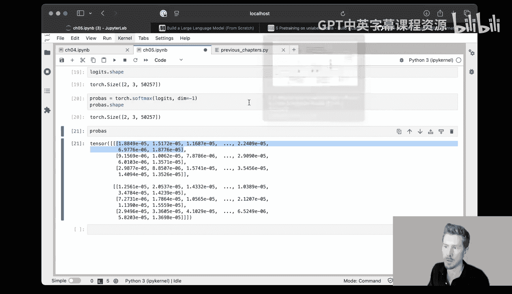

The vocabulary 0，1，2，3，4，5，6。 So we have 7 entries， so there should be 7 entries here。

7 probability scores。 and the first value tells me for this token。In the input。

I have a 10% probability to generate a。I have a 60% probability to generate effort。

 I have a 20% probability to generate every， I have a 5% probability to generate forward and so forth。

 So these give me the probabilities of the next token that is likely how probable is this that this is the next token and so the model learns during a training later to give high probabilities for the true token that we want to generate。

The true token or the target token is what we have in our targets。 So you can see every effort moves。

 Every effort moves you。 These are our targets。These are our inputs。

 we want the model to generate the the targets。 So the shifting by one position。

 So here in this case， we want a high probability for the target and the target effort。

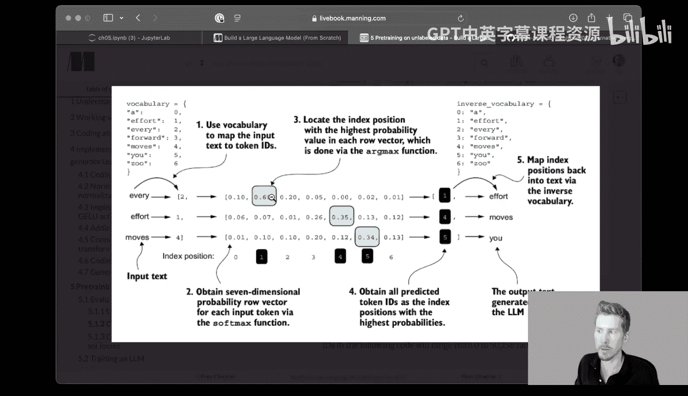

So， if I go。Back here， we had the inputs， every effort moves and the targets。Now， I want。For every。

 I want a high probability for effort。 and I want for effort。

 I want a high probability for moves because it's shifted by one position。

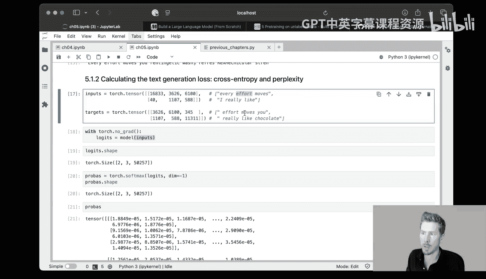

So here I want a high probability here and we have a 60% it's the highest probability。

 If I look up the index position so 0，1，2，34，5，6，0，1。

 so this is index position 1 and this corresponds to effort This is good， this is what we want。Now。

 next。For the second token， I look up again， the position。 What is the highest probability。 Oh。

 it's this one，35%。 It's the highest one。 It corresponds to token index4 token I D 4。

 What is token I D 4 in my vocabulary here 44 corresponds to moves。

 So I have this inverse vocabulary。 You can see this is I flipped， and it's easy to look up。 So4。

4 corresponds to moves， So I generate moves。 next moves as my input token。

 I look at my probability tensor， Where's the highest probability。 Oh here。

 What is this or index position 5，5 corresponds to U。 Okay， I generate U。 And this is。

How we go from probability scores。Back into this here。

 And if you recall from the previous chapter 4 video。

 when we implemented the generate text simple function。

We use the Arc Max to determine this index position。It maybe looks like a highly complicated figure。

 but all that there is happening here is we have a vocabulary where we go from token Is to from tokens to token Is。

 we get the softm， and then we go with arcm backwards from。😊。

Probilities to token ID and then back to text。

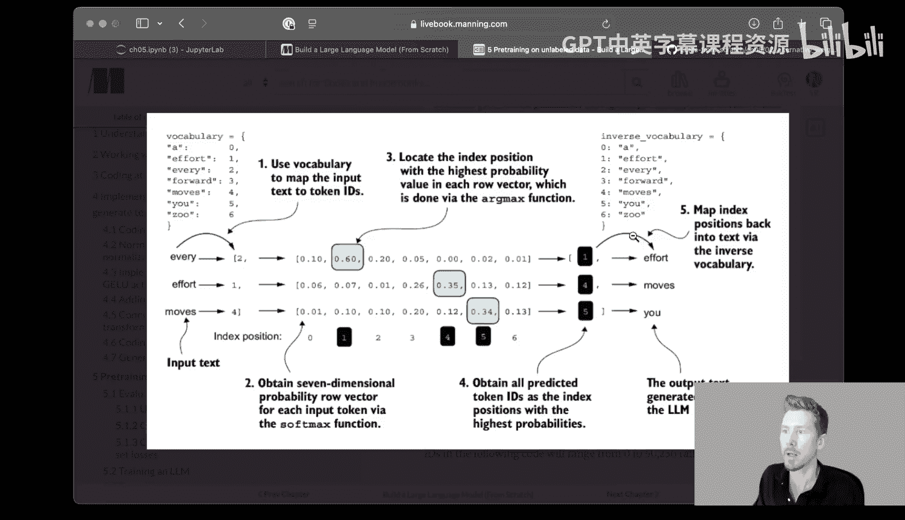

Okay， so what a lot of information maybe hopefully not too complicated now we have this pro here。

 the pro short probabilities are these these values here。😊。

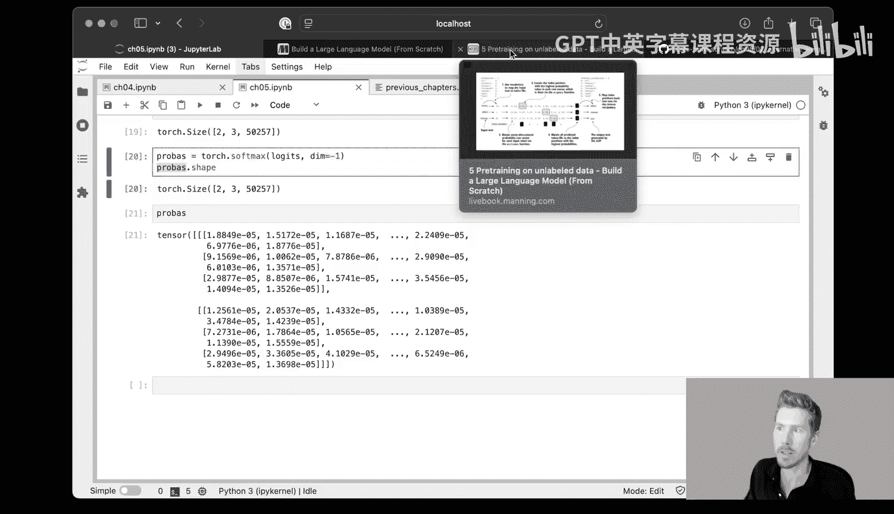

These rows you can see they are just a bit bigger because we have this 5025257 dimensional vocabulary instead of having just7。

 right。 So yeah， that is what we have so far。

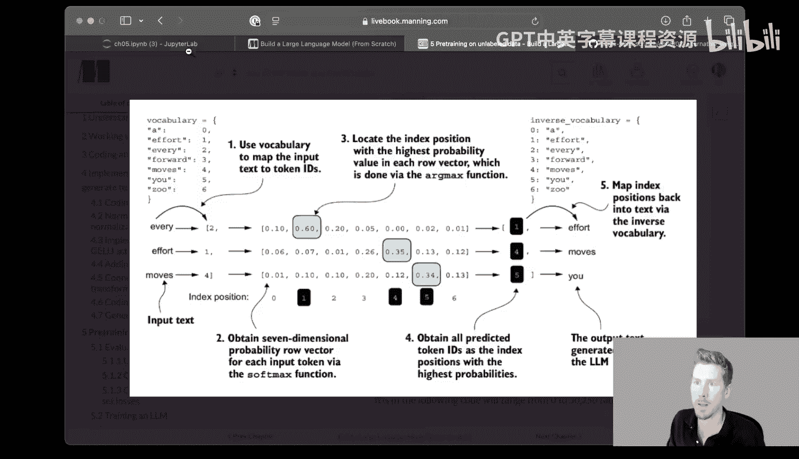

Now。Let me show you the code to convert this spec。 So here arcm， like I mentioned before。

 arcm is going from probabilities to these indices。 So these indicesm just showing them here twice。

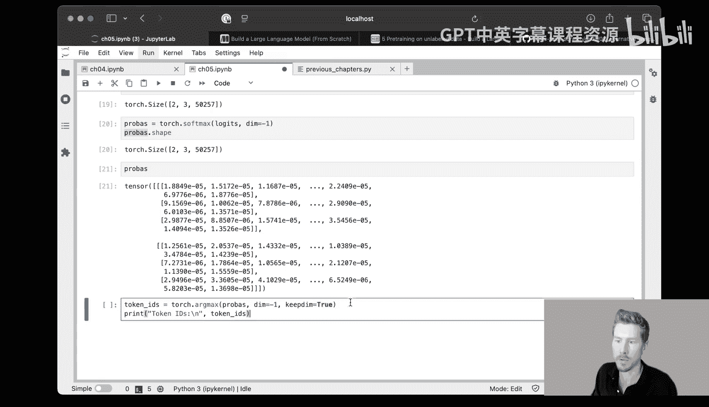

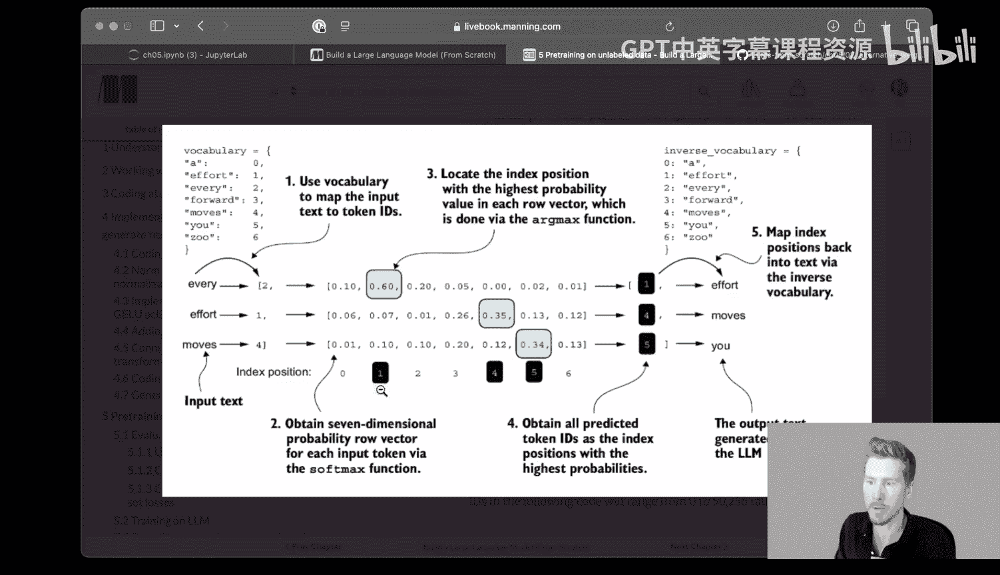

It's just the highest of the position of the highest probability in each of the cases。

So this gives me the token IDs of the highest probabilities， so for the first token at 16。

000 in the vocabulary and so forth， these numbers are higher because like I mentioned before。

 this is a smaller vocabulary for illustration purposes。

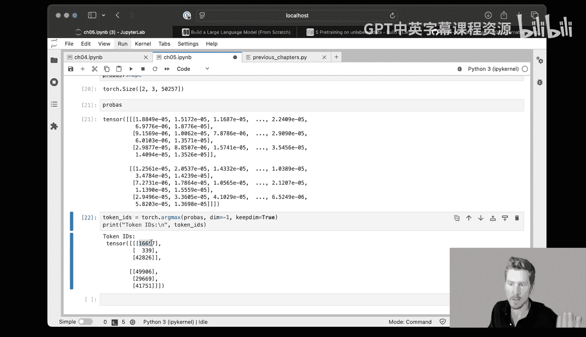

Okay， next， so we have these。

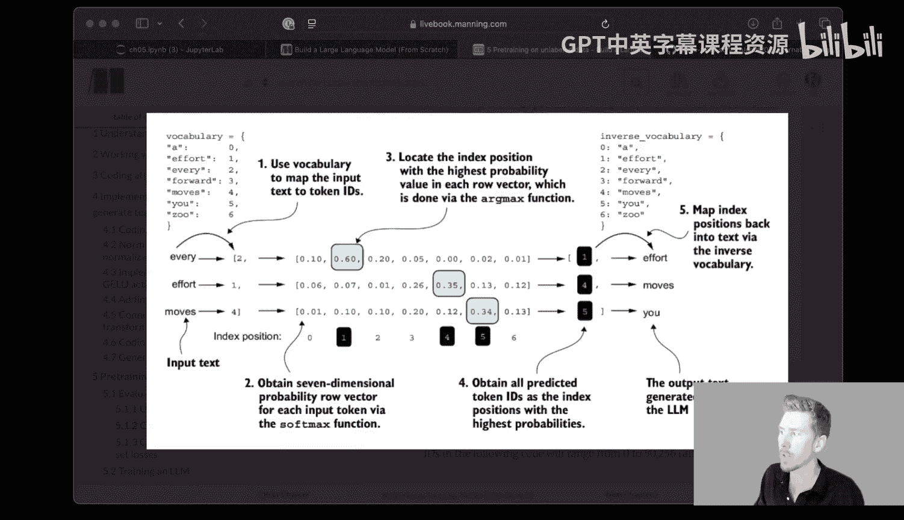

Token Is。 Next， we can convert these token Is into text similar to what we have done before。

 And so here I'm indexing。Just looking at the the first one， the first example。 So we have。

Two examples in text0 and one for simplicity， I'm just looking at one of them here。

So you can see I'm just looking up。Target0， I'm just looking up this here。

every effort moves you just to look up。 And now I am looking up what has our model generated for these targets。

 If I am going through this one， ideally， what we want is that the generated outputs match the actual targets。

 So ideally， we want the model to generate this。 But when I'm looking at the result。

 it writes something like armed T Netflix， which does not make any sense。

 And this is because we haven't trained the model yet after the model training Ily。

 the model will generate this text as similar to the targets basically。

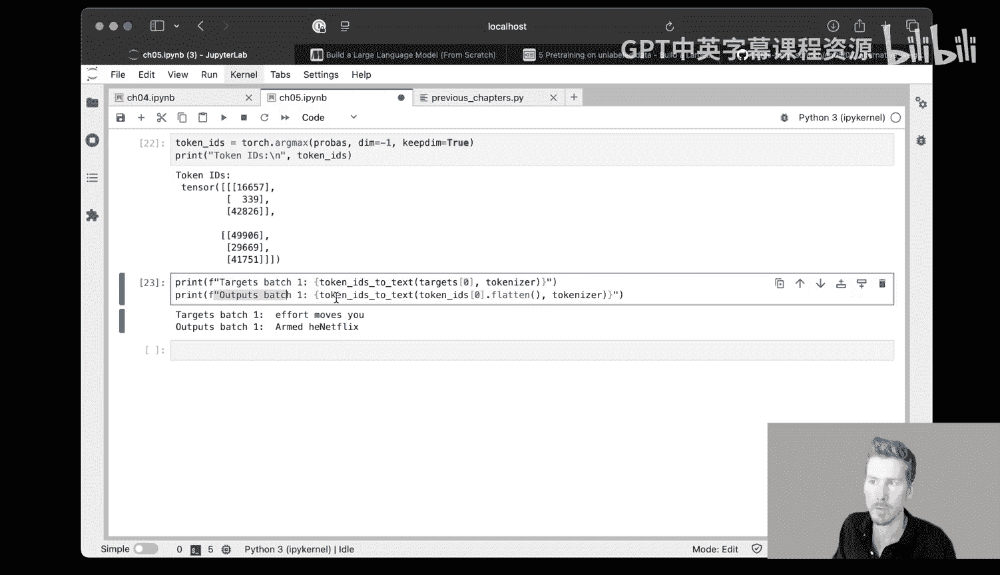

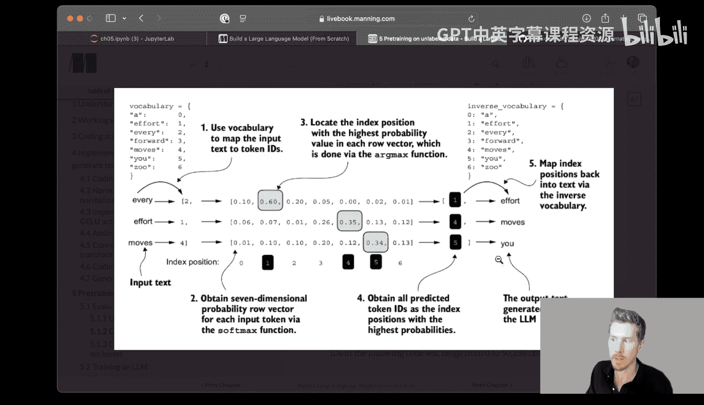

Okay， so。This is where we are so far Next here I'm just focusing on the first example similar to here。

 just assigning at zero， why， you know， just to keep it simple that we don't look。

Like that we don't mix them up。 So let's， let's just plan this out for now。

 We can focus on this later。 And so what I'm looking at here is the probabilities。

For the first example。And then I'm looking at these three tokens。

 So we have three tokens in the input，0，1，3。And similarly。

 I look up the corresponding targets for that one。So here。

 what you can see now as so I said targets Im meaning the Is。

 So for each of the three token positions I'm。Getting the。Target indices。 So I'm looking up。

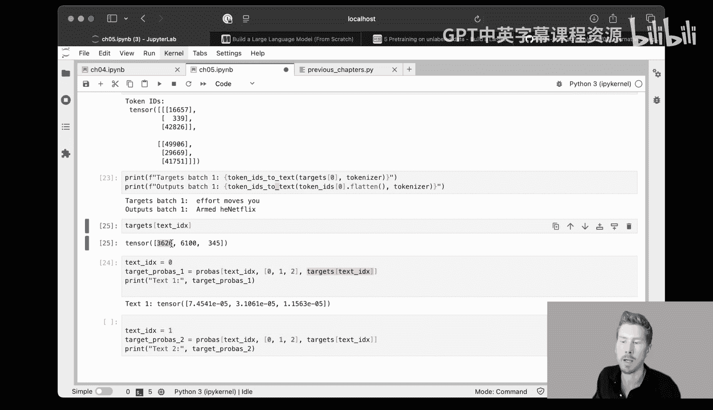

Maybe one step back here， so here I'm looking up the highest probabilities because that is what we are generating。

Now， what I'm looking up is。What should be what are the positions of the target I so。

Here it's the same， so the highest position is the position of the target ID because the target ID is happens to be every effort moves you if a model generates a correct thing。

 so we have one， four and5。As the correct target Is in this case。

 and they correspond to the highest positions。 But what if I unfortunately you don't have a figure on this。

 but what if our model is not correct， right so。

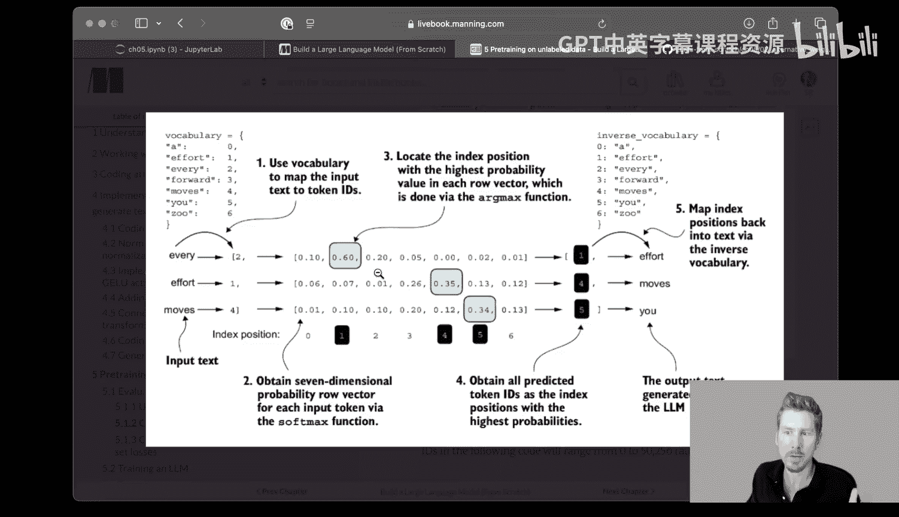

I am。Looking up in this first vector。What is the target ID？3626 for the first row。

 what is the probability in this one for this position right because that is the one that we want to maximize So I'm looking up in this first row what is the token ID 3626。

And then I'm doing the same thing for 6100。 I'm looking up where is or what is the probability corresponding to position。

6100。 And then in the last one，345， what is the probability at position 345 in this whole vector here And so that's what I'm extracting。

 So all of them are very small numbers they are very close to zero that's because the model is not trained and because we have a very large vocabulary and in our ideal case what we want to do is we want to increase those ideally to be close to。

 let's say something like 90% and that happens during training so that the model learns to associate。

The generated probabilities corresponding to the text targets。To be very large values。 Now。

 they are very small， but we want to make them very large here。

 We can do the same thing for the second text。 So again， very small values。

 and we want to make them very large， basically。And so in order to make them large。

 we have to measure。This numerically how good this is basically。 So for that。

 it's a multi step procedure。 So we first compute the logarithm of all token probabilities。

 and I make can share this data。 I have a whole lecture on。

Why lock probabilities it will make it a bit simpler during optimization there is something called maximum likelihood if you've never heard of this。

 maybe don't worry about it， I will just do it more conceptually here。

 but optionally I can share lecture on it the ideas essentially that we turn the multiplication into a sum in the maximum likelihood。

 but different topic maybe for a statistics lecture here so just think of it maybe for numerical stability。

Or maybe I can just show it to you。If you are curious。 and so it's not the right one。

 So if you go to my website。Sorry。😔，Brower auto complete here。If you go to my website， under more。

I should have courses here， where I。Tought a statistics class back in the day when I was a professor here。

 and I should have。This whole lecture here on multinoial logistic regression and softm regression。

 where I go over all these things more slowly and computing the cross entropy and so forth。

 So for here。Maybe just think of it as a thing to make it numerically more stable。

 So we are computing the lock probabilities。 we are taking the lock。

And what we are doing is we are taking。 So we are first concatetnating those two。

Because here they are separate， but we want to concatenate them so to have them all in one because then it's easier to apply the same computation。

 we don't have to apply it separately to different tensor and the forth so we're just combining it into one tensor。

And then。We apply the lock。So here so we turn this from very small values to all these negative values。

 So the smaller the value， the more the higher the negative number here is， for example。

 So that's what we are doing here。And then we can compute the average so we can do torch dot。😔。

Mean oops。And yeah， we provide the lock。Probles。As input。And you can see we get a value of minus 10。

79。 So that's the average block probability。 And then what we could do is we can multiply this by -1 to get a positive number and this is so took us a long way to get here but this is the so-called cross entropy loss。

 And during training our goal is to make this close to 0。

 that's our goal basically we want to get this number very close to0。 And if。

This number is close to 0。That means。These values are close to zero。

Which means that these values are。So the lock variance is the same。 Let me get rid of this。

 It's less confusing。 So again， so we want this to be close to 0。

 which means that these are basically very close to 0。

 which then means that these are very large values。

 because when you look at this let's do a torch dot lock。 let's do0。What9，9。You can see。

This is a a number。It's close to0， basically。 So our goal is essentially to。

Make the probabilities very large。 So ideally one， which will make those close to 0。

And if we have a very small probability， this will be a very， very， very， very negative number。

 like minus， I don't know， minus a very large number。 So minus36， for example， here。Yeah。

 so our goal is essentially to get those close to0。

 which means that the probability will be close to one。Because if this is close to one， this will be。

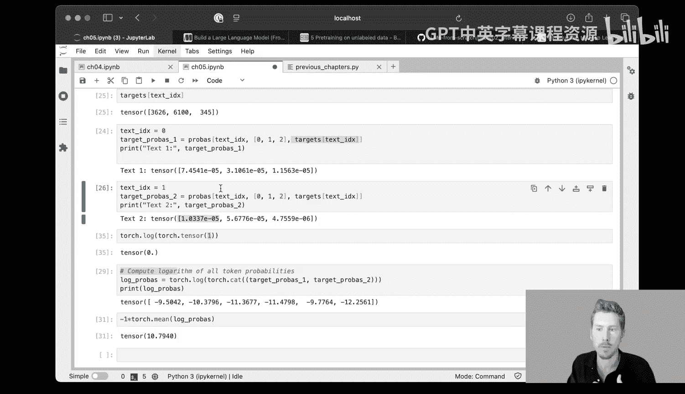

Corresponding to the correct target I because again， right now we got the target I D。

The probability corresponding to the target I， we want to make at large to make sure it gets selected by the torch arcx。

 so we want to make sure we have the large values at the right position in each cases here。

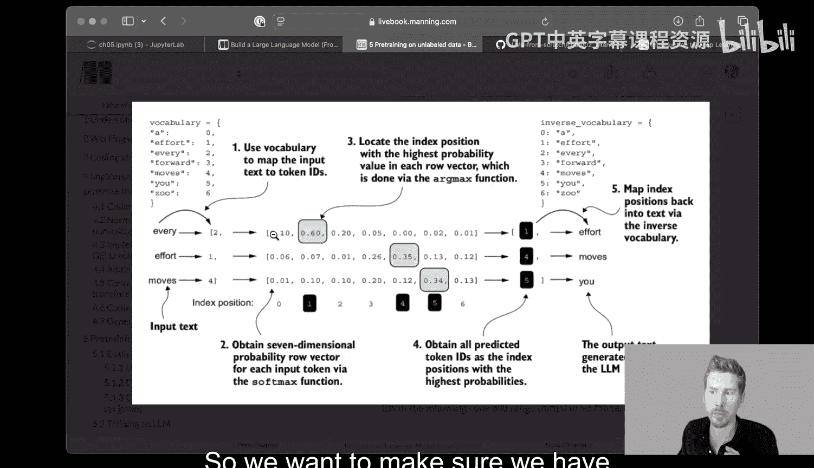

Okay， so and this is where this cross entropy comes from。 And like I mentioned before。

 if you want one nitty gritty detail。You are free to watch these videos it's a lot of videos here I think。

 but it's not really necessary to be honest， I think all you need to understand is that we are just measuring how good our generated outputs are and we want to get this number close to0。

Now， this is also a lot of steps， right， So we have quite a few steps with a softm here。 So first。

 the logics， then the softm， then the arc max and then。Lock and then the-1。

 And there is a quicker way in Pytorrch。 And there is actually this torch dot and n dot functional。

Thoughts。croross。Entropy function。Maybe I have a figure on this， let me scroll down。

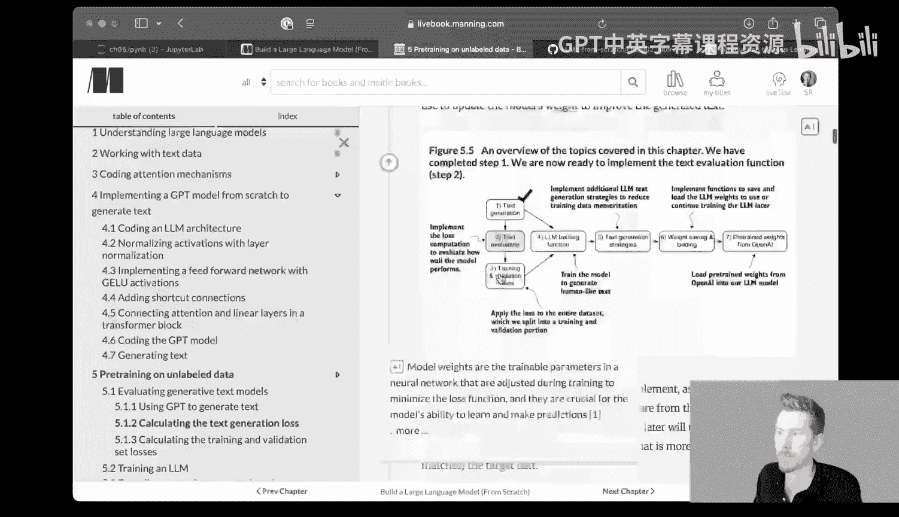

One moment here so what we have done so far is we went from the logics to probabilities to get the probabilities corresponding to the target token IDs we converted them to log probabilities then we computed the average and then we computed the negative log proba so just in a more cleaner layout。

 these are steps and you can see that's the same number we got we applied these different steps one at a time to get the cross entropy loss so cross entropy loss is a synonym for negative average lock probability it depends a bit on where you come from like if you are statistician you would probably say negative average lock probability。

 if you are a computer scientist， we studied information theory you would probably say cross entropy so cross entropy is just a different word for this negative average log pro。

It just happened that both fields independently discovered this measure or derived this measure。

 and in Pytorch this is called cross entropy because it's more a computer scienceency， deep learning。

 machine learning package。

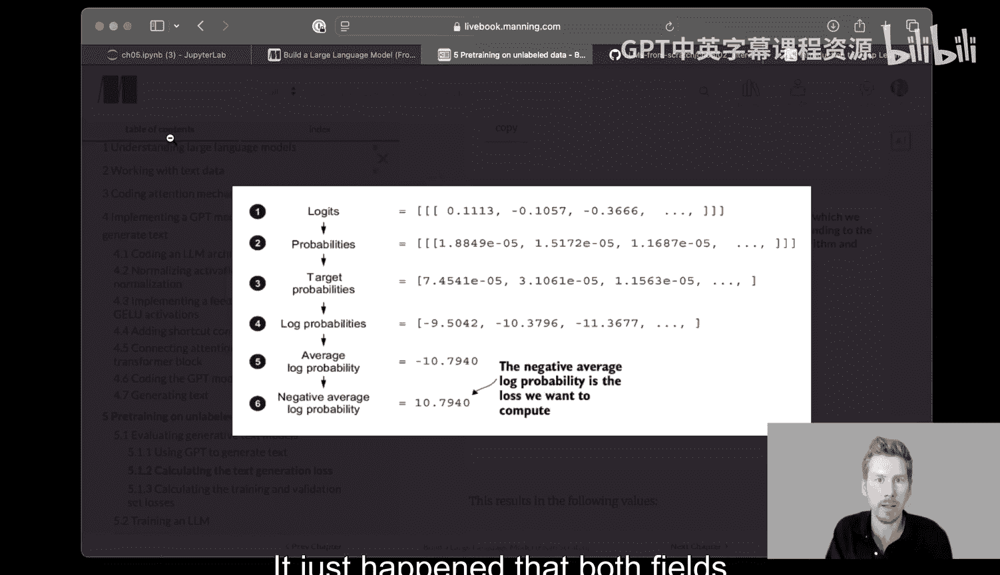

And yeah， in Pytorch， we can also compute this。 So there's one trick though in Pytorch。

So in Pythtorch， it works with the los directly。 So we have to first flatten our logics。 So our los。

Have shape 2，3，500257。 And so we have to flatten those to combine those dimensions because the logics are expected in our case to be。

2D tensor， so we had to logic its flatten0，1。It's call them Rogers flat， maybe， and then Rogers。

Flat don't shape。And so we see we combined those dimensions。

 we just you know concatenated along this axis， and so we have now the  six times 50。

0257 dimensional tensor。And so we can pass these nudges flats and then targets。 So for the targets。

 we have to do the same thing。So for the targets， if I。Look at the shape。

 We have the two by three similar to how we combined the dimensions here to6。 We do it here too。

 so we do flatten。I think I just need one。Because there's only two dimensions， let's double check。

Yeah， so we combine those。Targetets flat。 and so here。What this is doing internally。For the lodges。

 it's internally。

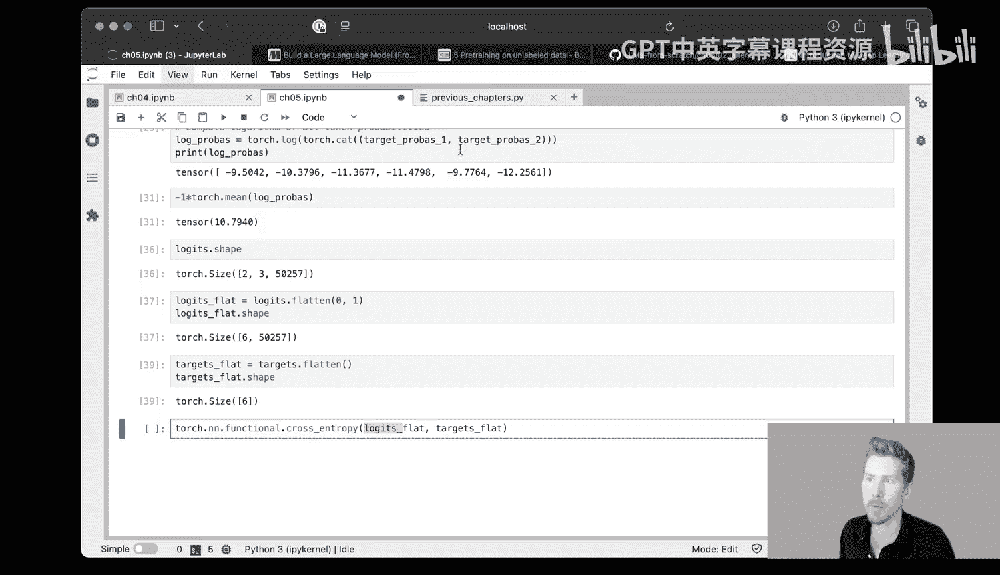

Computing the softmax probabilities。It's getting the correct probabilities according to the target token As。

 so it's getting them from here， that's why we have to provide the targets。

And then it's computing the log probabilities， average them and compute the negative like the minus1。

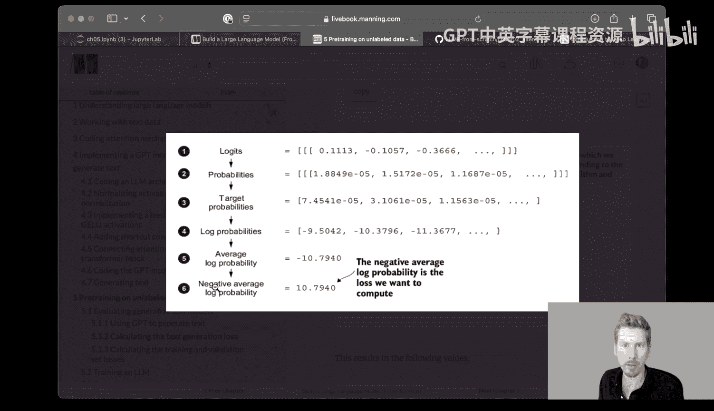

And so it all happens inside here and it's also optimized。

 so they have optimized function called Pytorch Kuda kernels。 When you run this on the GPU。

 this will be actually faster than all our manual implementation here。

So let's see if we get the correct results。 and you can see， yeah， we have now 10。79。

 which is exactly what we got before。 But before we had all these individual steps now we have combined in one step。

 Okay， and so I hope this is。

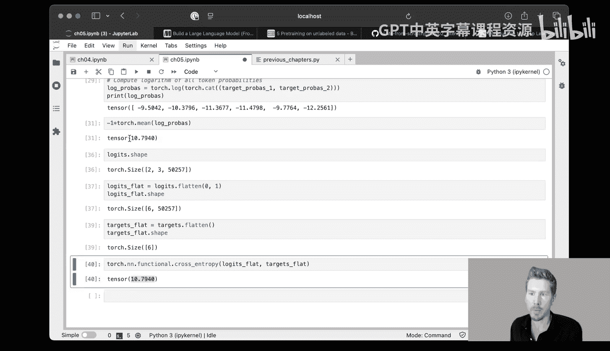

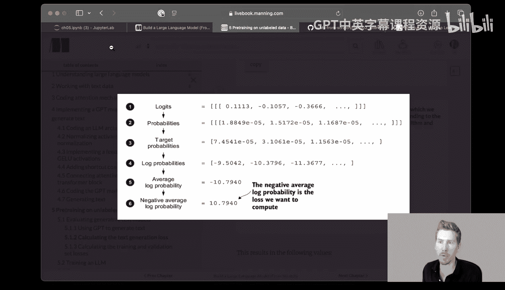

Making sense in some way， I know it's a lot of stuff that happens here。 at the end of the day。

 I think all you need to know is that what we want to do is we want to make the probabilities。

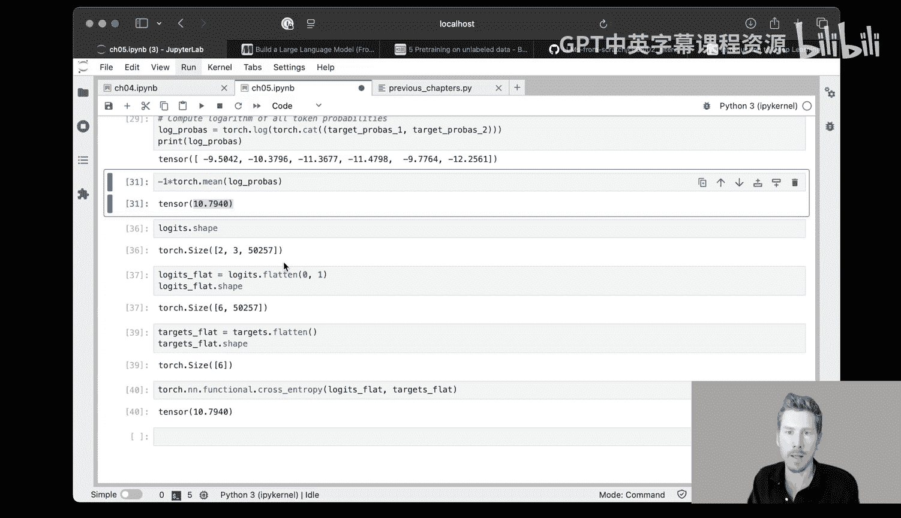

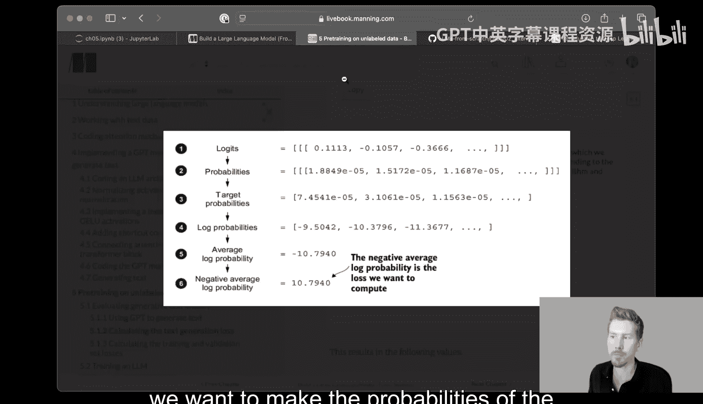

Of the。Positions corresponding to the target IDs as large as possible so yeah that is our goal essentially our untrained model will not generate anything useful。

 our untrained model will generate gibberish but at the end of the day we want to train it such that it generates the correct yeah tokens that we provide in the target tensor so in the next sections we will be working with us further and try to minimize this loss which will then correspond to large probabilities in the correct positions。

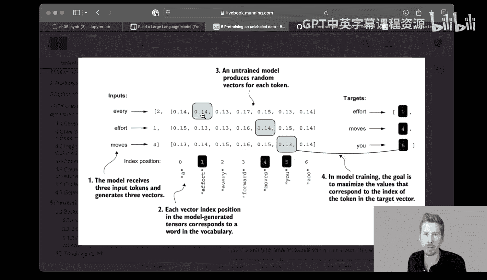

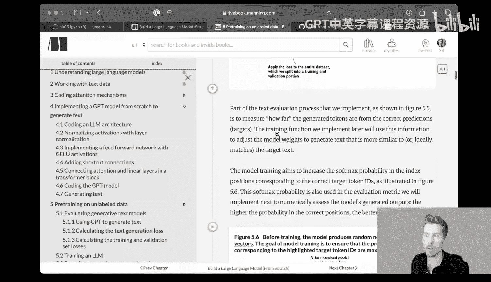

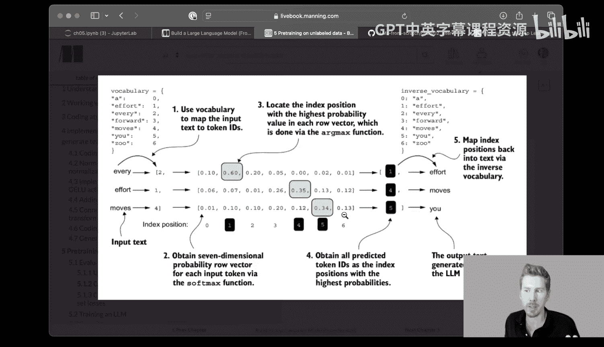

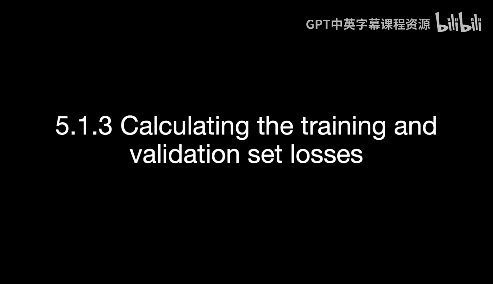

In this section， we are going to talk about calculating the training and validation set losses。

 So what does that mean， So in the previous section， we talked about the cross entropy loss。

 which is a measure of how good the generated text is that our model generated。

 But in the previous section， we only calculated this for a small sample text。

 Now we are going to calculate the cross entropy loss on the whole training and validation set that we are going to generate for the model training。

 So again， the cross entropy loss how it's calculated it's between the logics。

 the outputs of the model and then the target token Is。

 So the target token ids tell us essentially what are the tokens that the model is supposed to generate And if the。

Target token IDs are associated with a high probability score when we apply the softm to these logics。

 which happens internally in the cross entropy function like we talked about， but。

What I'm trying to say is ideally we want the model to output high probabilities for those token positions in the vocabulary that are associated with the target token ideas and only then if we have these high probabilities the overall cross entropis will go towards0 so ideal case it would be around  zero which means that the model outputs high very high probabilities for the correct tokens。

 so that's our goal right now it's very large so it's 10。

79 which is actually very very large so we want to reduce this number towards 0 in the process of the model training。

But yeah， before we train the model in the next section。

 we want to first apply this calculation to the training set that we will be using for training the model and here specifically we will be using the same training set that we introduced in Cha 2。

 the verdict by Edith Wharton。

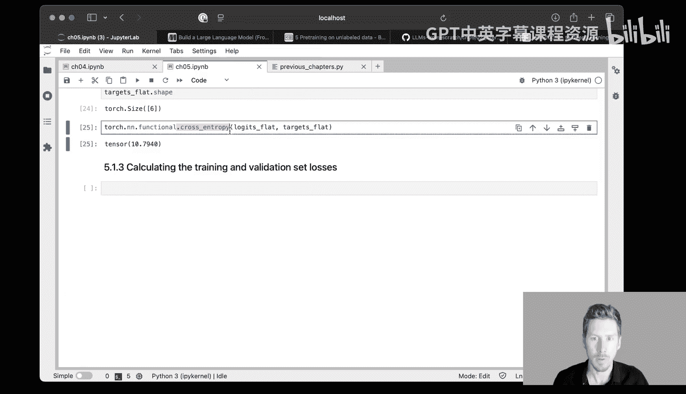

Yeah， so just to give you the brief overview where we are in this chapter before we get to the code so we talked a bit about text generation。

 we computed this cross entropy loss in the previous section now we are applying this crossenttropy loss to the training and validation sets and then later in the next section we will be actually training the LLM finally and then we will talk a bit more about more advanced text generation strategy so we get a very simple one I will add some sampling procedures to that one we will also then of course save and load our model because yeah training might take a long time so it would be nice if there's a way that we can save the model and load it later so that we don't have to retrain the model every time we want to use it and then I will also show you how we can load the pre-trained weights from OpenmiI into our LLM architecture。

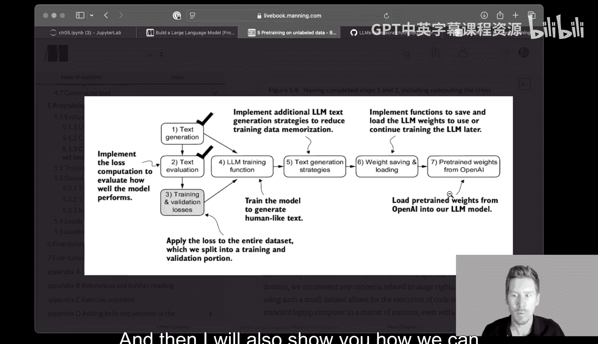

But yeah let's talk first about calculating the training and validation set losses。

 So like I mentioned before for this we will be using the verdict from chapter2 and so here it's just boilerp code which will load the verdict if it's not already on your local in the local folder here then it will download it from the internet so here in this case from my Gitthub repository if it is already in a file called the verdict relative in the same folder relative to this notebook it will just open the file so there's nothing really interesting here it's just loading the file it's never a bad idea to。

Also just yeah double check the data set to make sure it's loaded correctly。

 If this were a bigger data set， this would be very cluttered and very， very large。

 So maybe it's also not just a bad idea to only print a few characters。

 So we can see yeah this text looks okay， it's loaded correctly。 There's no error or anything。

 So yeah that is our training set。 Also just like a sanity check。

 we can calculate the size of the training set again。 So the number of characters in the data。

And also the number of tokens。 So here using the tokenizer。

 the tickk token tokenizer that we used before， we can see it's 20000 characters and 5145 tokens。

 So next what we are going to do now is we are going to divide this into a training subset and a validation subset。

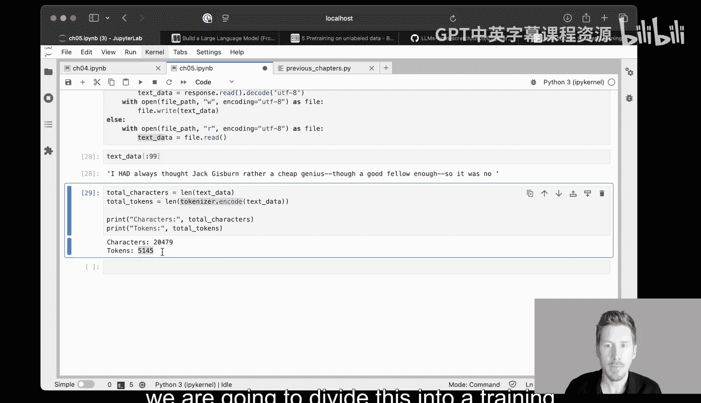

So I should have a nice figure on this here here so suppose this is the verdict data this whole thing here and what we want to do is we want to divide the data into a training portion here the large box at the top and a smaller validation portion so the training portion is what's used to train the model and the validation portion will be used to evaluate the model during the training to get a rough idea whether the model is overfitting to the training set or not but we will get to that when we you know when we implement implement the training function here for now maybe just think of it as dividing our data into two portions。

And what we are going to do is we are applying this procedure to each of the portions of the two portions。

 I'm only showing it for the top portion just you know because theres not that much space here in this figure but all these steps they will be also applied to the validation portion at the bottom。

 but yeah looking at one of these portions in this case the training portion what we are doing here is we are subdividing the training set into these little boxes So the box here has a size of6 why6 thats so I can fit it into this figure but yeah if you consider our original setup we have a context length of 256 So this is the context length how long each training sample is that the LLM receives。

We would make it 256 in our code because yeah it's， of course。

 better to have larger context sizes to train more efficiently。 but here in this case。

 because the figure gives us limited space， I'm using a batch size or sorry context length of 6 So you can see the first six tokens are contained here and。

This is like just a list of the raw token tokens， for example， if I go。

Here。😔，Let me see。So this should be this this list here， it's a very long list。

 so maybe let's immediately again get rid of it so it's not too cluttered。

But yeah what you are seeing here this list is essentially this list and now we are subdividing it into training samples。

 so the first six tokens will be the first training sample then the second six tokens will be the second training sample and so forth So here you can see we organized this in a tensor where we have six columns so six tokens per training example and each row is a training sample so that's basically what you are looking at here and then what we are doing。

I we are subdividing。The whole data set here into batches。 So here I'm using a batch size of two。

 So the first of two training samples are in the first batch。

 two training samples on the second batch and two training samples on the last batch And what you can also see if you play pay close attention is that the batches are shuffled。

 So here， for example， you can see that the first row does not correspond to the first row here。

 it's like the fourth row or something like that。 So because we use shuffling in our data load like I explained in chapter2。

 And yeah and this is the pipeline for going from text into。

A data lot of implementation to obtaining these batches that we will use for the training。

 and we will also use the batches to evaluate our model because。

It would be very expensive to pass the whole dataset set all at once into the model。

 So we will be evaluatingolating the model by iterating also over these batches。

 But maybe this will become more clear once we implemented this。 So the next step would be。

Louding just the data lata that we implemented in chapter2 So here I have my previous chapters file where I have all the different functions and methods and classes we implemented in the previous chapters and one of them was in chapter 2 the create data loadta version 1 file and function and so I'm loading it here we will be using it in a few moments then I'm saying okay we will use 90% of the data for training and then the remaining 10% will be used for the validation So what you' are seeing here is。

We need to make this more clear， what you're seeing here is the number of characters that make up in the first 90% of the data set。

 So if we have， let's say， 0。9， then this is the number of characters that we see up here。

So if I execute this， you can see the first 18000。435，31 data points will be the training data set。

 so。If I have text data here。😔，What will happen is。That。This will be our training data set。

 and then the remaining。Tokens or characters from 18。

000 till the end will be our validation data and so that is what you are seeing here。

So that's all that's happening here essentially so we have now a training set and a validation set and the next we are going to initialize the data load so let me just copy it here so I'm not making any typos and this is the same that we had in chapter 2 so we have the training set。

And the validation sets， we have two data load and。We use a batch size of two similar to the figure。

 the context length and the stride， and so if we would set that to6， it would look like here。

Right where we have context size of 6 and then we have a stride of 6 which means moving six positions over and getting the next six and so forth。

 except in our case， this is hypermeter that we have set to 256 up here。

Yeah， and then we drop the last batch if the number of the data set size is not evenly divisible by the number of batches。

And then we set the shuffling and that's essentially it' there's nothing really new compared to what we have covered in chapter2。

Yeah， and then what I usually like to do is I like to iterate over the data。

 So if you have a very large data， I would probably do it like this。

And so this will just make sure that there are no arrows in the data where it iterates smoothly through the data。

 and you can see the first tensor here is the training set tensor。

And this so the input Is and this is the target Is。 That's the way we set up our data ladder。

 if we go back here to the data set， you can see we have the input Is and the target Is。

And so this looks good， so we have a batch size of2，256 tokens each if you want to。

 you can also because it's a relatively small data set。

 you can just iterate through all of them and so we see how many batches we have， so it's one，2，3，4。

5，6，7，8，9 batches。嗯。Then what we can do is we can do the same thing for the validation set。

We can see we only have one small validation set so that's like really you know very very small data set so that the training doesn't take forever remember this book is for educational purposes and we will be loading the Open eye weights also later on so you have a more capable LLM here it's really just more for illustration purposes。

😊，I wanted to print a few more statistics here。 And so what I'm doing is remember this number of elements method。

 which computes the number of elements。 the number of tokens in each of these right。

 So if we have x dot shape， we have two times 256 tokens。 so we can compute this。As follows。

 So this is the number of tokens。 So here I'm just computing brute force。

 the training tokens we have in our data set by iterating through it。

 and I'm doing the same thing for the validation set。

 So let's print the number of training tokens and the validation tokens and add them up and see if we get roughly what we have up here。

 So just to make sure that， you know， the numbers still makes sense。 It's a good。

Way of sanity checking。So what we can see here is that we have 4608 training tokens and 512 validation tokens。

 This looks okay， of course， compared to what we have computed before。

 but this one is a bit suspicious。 So when we add up the training token and validation tokens。

 why don't we get the 50145 we had earlier here and so there are two reasons So the first one is if we look at this figure again。

 what we are doing is we are subdividing the data into these context length long chunks。

 but then if this data is not evenly divisible by the context length that we define there will be a left over chunk at the end that doesn't really fit this。

 So if we drop this then of course we will not have the so we will have dropped some of the tokens last in this case 25 tokens。

Becauseuse they are not divisible by the 256。 And the other one is also when we consider the training order and we drop the last one。

 if the last one or if the number of。Btches is not evenly divisible by the batch size。 But yeah。

 so that is why we are losing some tokens here， but it's not a bad thing。

 We want to really make sure each batch has the same size so that we don't have any weird loss spikes during the training。

 And in reality， when we are training neural network。

 we have trillions of tokens usually So it doesn't really matter if there are a few tokens missing It really。

 really doesn't matter at all。 we have so much training data。 You know。

 this is just like a drop in the bucket。 Okay， so this looks good then。 So we have 5120。 Now。

 the goal of this section was to compute the loss of the training set or the loss on the training set and the validation set。

 So how are we going to do that。 So I have a few functions here， two functions。

 They look a bit complicated。 But if we go through them in a， I would say， strategic matter。

 Then I think it should hopefully make sense。So。Maybe starting with this calculate loss batch function。

 So this one is I will get to the details later， but this on a high level is a function that computes the loss on one of these batches。

 So here we are iterating over the training order。 and we yeah we get the input batch and target batch for each iteration。

 So this is one input batch in one target batch in our training order。

 essentially what we are returning。Here。Right， okay， so。Yeah。

 this is computing the loss on one batch， the K loss batch function and the K loss loader function will apply this K loss batch on each of these batches in an iterative fashion。

 So it will。Iterate over the data model that's essentially what's happening。

 So and in each cacheg loss batch function here， what we are going to do is we are computing the cross entropy loss similar to what we have discussed in the previous section between the layer outputs。

 the logicts and the target batch So this is exactly what we have done in the previous section now applied instead of a prompt applied to a batch。

Now you see this here， this line， what is happening here。

 So this one is transferring the data to a device。And we have this device here， too。

 which gets passed it on here。 Now， what it does， it's。

 if we have a model sitting on a certain device。 maybe let me just show you an example。

 So if we have。This line here， for example， this will check so your computer may have a GPU。

 a kuda GPU， so a QUa GPU is a GPU by NviDdia that supports the KUa library and Kuda is you can think of it as a programming language like C++ for NviIDdia GPUs。

And if you just execute this one， you can essentially double check whether your computer supports this if it has a GPU and supports scuda。

 in my case， it returns false because I'm running all the code here on a MacBook Air。

 which is Apple device， it doesn't have a GPU， of course。And， but if you want to。

 there is an equivalent。 It's called MP。 It's called。MPS stands for metal performance shaders。

 I think it's like an equivalent by Apple forkuuda to utilize the the what is it called Apple silicon GP。

 essentially， So my case， I have this metal performance shader support。

 So you could technically replace this in my case by by this one。 and it will be faster than the GP。

 sorry， sorry， not the GP， the CPU。 It will be faster than the CPU on this machine。 I'm still using。

The CPU here though， because it's a bit more stable when I started writing the book。

 I tested all the code with MP Kuda and CPU and I got similar results on Kuda and CPU but I got slightly different results when I used MP that was back in Pytoch 2。

0 over the course of the last few months when they released Pytch 2。

6 I noticed it became a bit more stable so you can get similar results now with MP that you could get with Kuda and CPU but you know sometimes you get some rounding  errorss because it's it's a bit newer the MP support so but yeah just to。

I mean， even though it's slower just to make sure I get the same numbers you might be getting。

 I'm using a CPU here and so what is happening？Here is that we are transferring the data。

 the input batch to the same device where the model is sitting on。 So what we might do is we want to。

 for example。Transfer the model to the target device。 In our case。

 this will not do anything because by default， the model already sits on the CPU。 But if your're。

 so this is why I like to do the semicolon， by the way， it outputs the whole architecture。

 but if yourre。Computer supports Kuda。 then this will transfer the model to the kuda device or if you chose to use MP to the MP device and then we have to make sure though that the data is also transferred there because otherwise you have data sitting in the CPU memory and the model sitting on the GP memory and then yeah they won't be able to easily communicate so we have to make sure they sit on the same device and that's essentially what we are doing here。

Um here。What we are doing is just some initialization of the loss because we will be computing the loss in an iterative fashion。

 So for each batch we will get the loss added up so we have the plus equal so we add it up to the total loss and then we divide by the number of batches。

 It's just like an iterative way we compute the loss and then just some baseline checks if there's no batch in the data lot。

 then it will just generate not a number yeah and otherwise we can define the number of batches here。

 So for example， to make computing cheaper if we have a large data set we only want to test something we can enter two then we only compute the the loss over two batches。

But if we set this to none， it will use all the batches。 So length data la， for example。

 if we have length。Train laer， it will give us all the batches here。 in this case。

 we have nine batches。Yeah， so this is what this the combination of the two function are doing。

 and this will then calculate the loss。 So let's do it。 let's compute the loss here。

On the training set and the validation set。So I'm setting the manual seed because there's a shuffling involved。

 but it should make a difference actually for this calculation here。

 because here we are going to iterate over all the batches anyway， if we had a non batches two。

 you might get different results because the two first batches might be different depending on the random seed here since we iterate over all of them。

 it should be。It doesn't really matter whether we use a random seat or not of course we use ourtorch no grid because otherwise we will be constructing this computation graph of the model in the background and we don't need a computation graph just yet because we are not training the model So this is just like an efficiency tweak and then yeah we computer training validation loss using our Calc loss loader function。

Let's compute this。 And this might take a bit because yeah oh it's actually quite fast because it's iterating over the whole data set and then passes it batch by batch to the model。

 And we can see that training notes is quite large here。 So it's about 10。98。

 it's approximately the same that we've seen on the sample prompt in the previous chapter。

 And this is because the model is not trained yet ideally when we train it。

 we want to get that below one at least So that would be pretty good。 And by the way。

 before we go to the next section I forgot to introduce the topic of perplexity So there's a concept of perplexity。

And this is just like another measure to measure the quality of the generator text and you have maybe seen or heard about this before in the context of LLMs and so the perplexity is measured as the exponential of the loss so for example。

 if I have a loss value like this one。I can。😔，Put it in here。 And then the perplexity would be 50900。

 something is。 And so the perplexity tells us。How unsure the model is for the number the number of words。

 you can think of it as the model in the vocabulary is unsure about that and that many words。

 So how many words do we have。In the tokenizer again。Actually only 50000。 So， you know。

 it's like a rough estimate。 It should actually be around 50000 ish。

So I think if I make this a bit smaller and I can see how sensitive this is。嗯。

Yeah so what it tells us it's basically the model is unsure about any of the words or most of the words in the vocabulary so in that sense our model is not very good。

 it's not very trained we have a high loss we want to get this loss down to around yeah zero ideally but realistically maybe 0。

5 would already be good so it's unsure only about 1。6 words in the vocabulary for example。

 so unsure means it doesn't really know at which position what word it generates at any position it might take any of the words in the vocabulary as being equally likely as the next word and this makes sense because we haven't really trained our model yet so the model doesn't really know what it should generate as the next token so that is going to be the task of the next section where we will be implementing the training function to teach the model to be more confident about generating the next token。

。After all this hard work in the previous chapters that means implementing the data laer in chapter 2。

 implementing the attention mechanism in chapter 3 and then implementing the GBT architecture in chapter 4 we are now finally ready to train the LLM。

 we have waited so long for this， but yeah finally we reach the section on training the LLM using the cross entropy loss that we have introduced early in this chapter so let's go through this step by step I will introduce you to the main training pipeline first so here is a figure that will conceptually explain what's going on before we dive into the code So what we do is we iterate over the training set multiple times so that is called a epoch so one iteration over the training set is called one epoch so that means if we are going through the the verdict data set one time that's one epoch we could do it multiple times that would be then multiple epochs。

So it's a fall loop and then inside each epoch we iterate over the batches。

 So this is essentially the iteration over the training order that we've just seen in the previous section。

 What we do then we first reset a computation called the loss gradient computation and so this is something that might be a bit weird right now because we haven't done any implementations of that yet。

 So this is just something where we reset everything to zero。

 That's like a best practice in pytorch just you know making sure we don't have any baggage from some previous runs just resetting this Then we compute the loss on the current batch so this would be the cross entropy loss that we've talked about so far in this chapter。

 and then here that's the core part where we compute the backward pass to calculate these loss gradients。

 So the loss gradients were briefly mentioned here。

I will also show you where you can read more about loss gradients if that's a new topic in one moment so but just to finish this figure。

 we compute the loss based on the loss we compute the loss gradients and then using the loss gradients we update the model weights。

 the weight parameters so for example in previous chapters we looked at the N n dot linear layers and they have a weight matrix and n dot linear dot weight or our layer norm also has these parameters and these are things that can be trained optimized during the neural network training and here model weights corresponds to all these parameters like the layer norm parameters the QKV matrices in the attention heads an n dot linear layers and so forth and。

We use the loss gradients to update the weights to optimize the loss。

 which means minimizing the loss towards0。And then optionally， we can train some statistics。 So。

 for example， the training and validation set losses and some other things to make sure the model is making progress。

 And then we can also visually generate text， have the model writes some output text so that we can read the text and see if this is actually making sense or not if the model finally learned how to generate human readable text。

 so this is the yeah brief outline。 And I mentioned lost gradients here。

 And if this is something that is not familiar to you yet。

 I don't want to go into too much detail in terms of explaining how yeah all this works。

 because it's like a deep learning topic that would be a good topic for a different type of book。

 however， I mentioned this before I have written。

An introduction to Pytorch here。 Actually this was originally the first chapter。

 It was like a 4050 page chapter， but then I thought well this book is supposed to be about LLMs and not deep learning because otherwise you know it could be an infinitely long book so I moved this chapter from chapter 1 to the appendix but it's actually I think I hope a really nice chapter explaining how deep learning works and Pytorch works in a reasonable timeframe like 4050 pages and here if this is all new to you like computation graphs。

 Los gradients， there's actually a nice section here you may want to read through and so here I'm explaining this with a simpler example with a trainable way parameter and so forth and then the target label for example in our case a target token IDs a computation of the loss。

And then how we back propagate this。 So this is yeah， a calculus concept。

 I'm trying to keep it simple here for a simple neural network because Py takes care of this for us。

 So Pyotch is doing all this when we call dot backward。 So there's a method。

 we will see in a few moments。 It's called backward。 And it will do all of this。

 And then we will update the， yeah， the。Model weights using the gradient。

You don't have to necessarily understand it so if you are new to calculus and everything。

I think it's nice to understand this， but it's not 100% essential。

 What I think is essential is that we are trying to optimize or update the weights such that the loss gets minimized which then leads to the model creating more correct tokens or ideally the target token IDs So yeah to show you how this works in code let me just post the whole thing here and then we will go through this step by step So this function here it's called train model simple why am I calling this simple This is yeah I would say a relatively simple training loop minimalistic training loop it does everything we need and this is also what you can use for example to train convolutional network for image classification or other types of neural networks but it's relatively minimalistic because there are some other belts and whistles that you can optionally add to this if you want to。

And so I've written about this here in Appendix D， where I'm talking about something called like a learning rate scheduler and gradient clipping and so forth so。

This is more like I would say in an advanced concept so once I think if you finish chapter 5 you can optionally look into this but you know it's not 100% essential to understand how pretraining works So here this is really like the big picture the model training and so what we have here going through the step by step is we keep track of certain things for example the training losses validation losses so we can look at them here we also keep track of how many tokens we have process and how many steps we did like training steps and then here this is the iteration over the epochs if I go back。

To the figure I showed you earlier。嗯。One moment， here we go。😔。

There， so the first here， this first box would correspond to this first fall loop。

 we set the model into training loop because before when we played around with the model we had it briefly in this evaluation mode。

 so it's actually a good practice at the beginning of a training loop to just make sure it's in training mode which will then enable the correct behavior of dropout and so forth here we are now iterating over the training order similar to what we have done when we computed the training and validation set losses here we are resetting the loss gradients。

So we are doing that because later we computed loss gradients， for example， here。And。

Then for the next round， we are resetting it。 I could also just， I mean。

 it depends it would do the same thing if we have never computed them before。

 it would make no difference if we reset them after or before。 So it's just， I think though。

 a good practice to have it just here in case you played around with the model and you accidentally computed something。

 So this is just like， this is just like a good practice to have it here。 we compute the loss。

 the training set loss。So on the current batch， so we are iterating over the batch and then we use our Cal loss batch function。

 which we already implemented in the previous section here。So it's a reusable function， by the way。

 in the book in general， I made sure to minimize clutter so that we can reuse functions as much as possible throughout the book。

 so I think that helps also keeping track of what is happening and so there are too many concepts。

 keeping it as small as possible but of course sometimes there's a lot of code because it's necessary。

 but I'm trying to keep it also a bit minimalistic for yeah readability and so here we compute the loss that's the cross entropy loss。

And then we do the backward word。 And so the backward word。 So I mentioned before when we do。

Call the model to create the logicits and the logicts are actually created in this function。

So where we are here。 So here we have the logics that I get getting created here in the K loss batch on function and。

I mentioned something like a computation graph before。

 So when I talked about the no gra function where we don't want to have this computation graph。

 So the reason why I didn't use the no gra function inside this gloss patch is because now we actually do need the computation graph for。

Evaluating here， we don't need it。 but here down here we do need this computation graph。

 So this is computing or creating this computation graph and。Maybe one more time here， like go。嗯。

Where was it here so this computation graph if we have a computation here in this case。

 a very simple computation like this this you can think of it as a simple model。

 it will create a computation graph like this one here and in a similar sense Pytorch will create this computation graph of the model when the data passes through the model so let me just go through the model。

Computer here forward。 So here when we do for， when we call something like。Yops。

Model X or model inputs。 This will execute always the forward method。

 That's just how Pytoch is implemented。 So based on what's done in this module。

 the behavior of a Pytoch module is always when we pass input that it goes through the forward method you can。

Explicitly also write it like this， but it's best practice to do it like this because there's some extra computation happening。

 but。What happens is this gets executed and this will result in a computation graph for these computations similar to what you are seeing here。

 and then Pytor， when you do backward， it can calculateate these gradients here so。

This is the computation graph that's created during the forward call。

 and then you see there's this backward call which will create this computation graph sorry the gradients from the computation graph。

So that's computing the gradients。And then， optimize a step。This will use an optimizer， for example。

 stochastic gradient descent or atom to apply these gradients so the gradients get multiplied by a learning rate。

 which is a hyperparmeter that says how much we want to update and then the model weights get updated basically。

So if this is all new to you， it's maybe not a bad idea to go through this introduction to Pytorch and the brief introduction to deep learning I do have also this whole class in deep learning that might be interesting to you I have actually multiple classes so this is very slow right now but I have multiple classes also so if there we are if you're interested this one here or。

This one here， they both go through yeah the concept of deep learning and explaining this a bit more detailed。

 But if you are short on time and you want to just get the basics。

 I think appendix a is actually a good way to start So you can read this maybe in a few hours instead of a few weeks or days so that's like a nice short introduction So but yeah back to our training function here and we just increment the tokens we have seen the global step。

 how many steps we have taken and why we why we need the step here is I'm just using it for optional evaluation。

 So I'm saying。If we have evaluation frequency here。That we can set here， for example。

 every 10 step if we set it to10 a1 every 10 step， it will trigger this code and in this code we evaluate the model so we evaluate the training validation loss here we append the training and validation losses to our list just for record keeping so we can plot that later and the number of tokens and then we also just print it out so we can see the progress and then this is happening for each batch here and this is happening every 10 batches essentially and then every epoch so here for the auto loop for every epoch we are also additionally printing a small sample like just giving it some sample text。

And see how the model is doing。The evaluate function here for completeness。

 it is similar to what we have used before， so it's similar to this k lost order here。

 except we are using it twice so we are calling it once and twice so to get the training and validation loss and so we can compare them and see if the model is overfitting and then this generate and print simple。

Function。It puts the model into the evaluation mode by the way here it's also so to disable dropout and everything。

 then we essentially encode some sample text similar to what we have done at the beginning of this chapter and then again similar to the beginning of this chapter we call the generate text simple function and then we decode it and put it back into training mode this might not be strictly necessary because we already have train here but you know it never hurts So it would just skip it。

 but it's not a bad idea sometimes to do it in case we forget or something So yeah。And so。

 this is essentially the。Training function。 And then let's。

Call this training function So we are initializing a new model here we are using the random seat so that you get the same results that I do So for the initial model weights here optionally we put the model onto the device So here personally I'm just running this on a CPU but you are welcome to run this on if you computer supports it on a GPU or the MP device that I mentioned if you have a MacBook or Mac minii or Mac Studio or something like that。

 however， you might get slightly different results。

 it will be faster the results might not be 100% the same but it's something you can still do I'm just doing the CPU version here because you know just to show you what numbers you would get on a CPU and GPU。

Because GP， based on my experiments， you get the same results as on the CPU。

Here we have a Adam optimizer Adam W so that is yeah an optimizer version of Adam with weight decay again it's like a deep learning concept I do think I covered it in my lectures if you are curious there should be something on Adam somewhere so but you know it's not strictly necessary you can think of it as a way of computing the gradients and applying the weight updates essentially on the model parameters and the learning rate is how fast the model learns。

And yeah， so this is instantiating the model and the optimizer， which we pass。Here。

 here and here to this train simple function。And we are going to train for 10 epochs why 10 epochs。

 it's just something that happened to work well。In reality， when you train a real new network。

 for example， I dont know Gema 3， Lama 3 and so forth。

 they train these networks on 1415 trillion tokens or deepse version 3。

 which will cost you a few million dollars and will cost or will take thousands of GPUus and take months of your time So I assume you don't have millions of dollars and months of time and thousands of GPUus So we are keeping this example small train this only on a single book。

 The verdict， the short story and because short story is so short。

 one epoch would not be enough to get the model to learn anything useful So I'm just increasing into 10 epochs but you know like normally people train models for11。

5 epoch max usually it's just one epoch because the data set is like 14 trillion tokens and so forth。

 trains for months And so here we just keep it small。To make it cheaper。

 but then we need a few more epochs to see that the model is actually learning。

 and then yeah we will have a start context of familiar every effort moves you and see if the model can create more comprehensive text compared to what we had before。

 So I think before it was just generating gibberish and now we will hopefully see that the model generates better results。

 I hope this actually runs because I'm actually recording this video also on this MacBook air。

 and this is at its Mac already with you know the camera and this screen capturing So I hope this will work we will see。

Of course， the familiar。Problem， Okay， so let's see。It might take a few minutes。

Remember when I was running it without any recording here on and everything。

 it took about four or five minutes， so it's pretty fast， but yeah， we'll just wait and see。

So we can see now that the model is not generating anything useful。

 but what we can see at the same time， what is actually good and what we want to see is that the loss is going down so we can see the training loss and the validation loss they start off high and they go downwards which is good So we remember we want to minimize the loss so that it reaches or it goes towards zero you can see it's still not doing anything useful。

 it's generating words but it's repeating the words， not anything useful yet。And by the way。

 I don't know if I talked about this before。But the model we are training in general。

 the pretraining trains the model to just keep on generating text。

 so it's also called like a text completion model and this is true for basically all LLMs later on in chapter 7 we will train the LLM to follow instructions so that a separate step it requires a separate approach so right now we are only pretraining to generate the next word in in some text so if we provided some text it will just you know keep keep on talking like me at the moment but yeah later in chapter 7 we will also learn to for the model to how it follows instructions and it will also then have a stop token to stop generating text。

So we can see yeah， it is already。I would say getting slightly better。

 So it's not at least not repeating the words anymore。 So it is generating。

Something he had the donkey。 I mean， it's improving at least so we we see it getting better if we consider that it first just generated commas and then ends and so forth yeah。

And we can also see that the training loss keeps going down。

 but the validation loss gets stuck around 6。 This is kind of expected because we have a very small data set。

 And so the model sees the training set multiple times， it starts overfitting。

 So if we had more data。 like I do actually。I have an example。 Let me， in the meantime。

 while this is training。Go here and show you some bonus material。 So I do have an example。Here。

I have a lot of bonus material， as you can see。 So that's the alternative weight loading。

 which we will get back to later。 We I have a pre training of the model on the whole project Gutenberg dataset。

 So Project Gutenberg is a website of public domain books。 There are lots of data sets out there。

 but you know。The copyright debate is still going on whether it's allowed to train a model on certain data。

 So here this is only public domain data which should be fair to use in the US。

 So here I have like an example I think I train it for one or two weeks once and there you don't have that overfitting of course because the model sees different texts each time so the training set doesn't repeat。

What I also wanted to mention is， yeah， hyperparameter optimization if you're interested。

 this is maybe also nice。

Not go through this， but。

This is just adding an interface to the LLM so you can then type it similar to chatt GBT and then model yeah。

Response in a visual interface it's just a little add on here to our model once it's finished training but yeah I'm not going through these all because this is optional material you can yeah explore it maybe afterwards。

 what is interesting is maybe I actually just for fun we coded the GT architecture in chapter4。

 but I also coded the Lama architecture went through this step by step and so if you're interested in training ama model。

 ma 3 model。

You can use the same training function so everything is the same just a different model what I wanted to talk about yeah here。

 so I also have some bonus material on making the training faster So I mentioned before I kept everything very simple。

 very vanilla so it runs on any computer。It also runs on a single GPU。

 but it's not optimized for efficiency。 It's just optimized for learning。 and here。

I have some bonus material where I make some changes to the code and it will make it yeah。

 significantly faster。 So yeah， you can read through this and there are， I think。

10 tips to make the model much faster。 So if you're interested in that。

 So before I was measuring the speed in terms of tokens per second before it was generating 142 was going through 142000 tokens per second。

 And then here it's about four times faster afterwards。 So it's a very big improvement。 actually。

 this is for multi GPU。 Okay， sorry， So of course， yeah。

 multiple GPUus make this four times faster approximately3。 something times faster。 Here's the。😊。

The speed advantage of142000 tokens after the 10 steps。And before， it was just。Doing 12 token。

 So it's like 10 times slower。 So I made it basically 10 times faster by applying these tricks。

 But something like this， it might not work on any not on every computer because it has some requirements。

 for example， Also B flow 16。 this should actually work now， I think on most CPU。 But yeah。

 you can work through this on your own time。 This was optimized for GPus and B flow 16 doesn't work on every GPU。

 I think the。GPU has to be an Uair like a100 or H100 or newa I think L 4 or L 40 also works。

 but older GPUus like what do they call it like the T even forgot the names the T model GPUus they won't work anymore here with this B flow 16 but anyways it's a topic for a different time Yeah I was just trying to pass the time where a model was training here。

 but I can see it's now finished。So what we can see is the training loss went down and we have actually very small training loss。

 which is nice， co loss is high， but you know can't have everything with a small example data set so it's a trade off we make for having something that trains in just five minutes instead of five months。

And yeah， you can see the text kind of makes sense。

 So what it says is every effort moves you was one of the exxioms he laid down across the so on and so and so。

 you might get slightly different results because I may also yeah have changed certain things compared to the book while I was typing this year with a random seat in the data set and so forth。

 the shuffling but I think it should in your case， at least get something that is in the right ballpark here。

 And then yeah just to wrap up this section because I know it was a very long section I was talking a lot here。

 I wanted to just also add a plotting function。So this is just a mat plot plotting function that will plot the number of epochs。

 the training losses。Yeah， and then just visualize what we are looking at here in this text。

So let's see how that looks like and by the way， this is why I was keeping track of everything here。

And here， especially the lists， because I'm returning them here at the bottom here。

 Tra losses validation losses track token scenes， So I'm returning them from the list here so we save them here so that I can visualize them here in Matpotlib。

 And yeah we can see the training goes down towards zero like we want validationation。 you know。

 it's struggling a bit。 It's going down。 and then it's。Getting stuck。

 so it means that the model is overfitting， but again。

 it's because we have a very small data set for educational purposes here just so that it doesn't take too long。

 but this， yeah， this is something you can also apply to a larger data， of course。

Okay I think this is it for this section in the next section we will talk a bit more about the sampling because so far we only use the very simple sampling procedure and I will explain some alternative ways we can implement to generate text。

So now I want to talk a little bit about decoding strategies or text generation strategies to control the randomness and so here in the previous section we've seen that the model starts overfitting through the training set and by you know by design models its essentially at some point will learn how to generate the next token as it appears in the training set so memorizing and in practice no matter what LM you use。

 whether it's through Chechi or other providers usually they implement a sampling strategy that uses either topK or topP sampling and the temperature scaling and I wanted to talk a bit about that and how that works so before。

What we did is we implemented this generate text simple function。

 or we used the generate text simple function， which we have。Here。In chapter4。So in chapter 4。

 we implemented。Generate text simple。 And here， what we did is we always。

Grapped the token with the highest probability。 So， and if the model is well trained。

 this will ideally correspond to the target token I。 So that is what we want during the training。

 The model needs to have a reference for learning。 So we want the model to learn how to generate these target token Is。

 But then when we use this exact method。 It will exactly try to memorize the training data。

 So let me actually see something。 So if。You look here at the generator text。 I'm pretty sure if we。

Take some of the text。And go into the verdict。And just search for it。

We can see that these actually occur in the training set。

 So this was actually nonplanned I just did this spontaneously and that this worked out so we can see some of the words of phrases that it uses and that's specific order。

 they come directly from the training set and that is just due to overfitting or just memorizing the training set and it's just like an art or a side effect depending on it's a side effect of the training essentially because we want the model to generate the target token IDs but then during inference we don't always want the model to memorized right so we want the model to be a bit more creative and so in this in the following videos or sections I will explain techniques that we can use to make the model more creative and like I mentioned before and provide us are using these techniques under the hood。

 it's just not visible to the user。 but yeah to start。😊。

Becauseuse it has been a while just to show you again what we have。

 so we have trained the model I would say let's just move it to the CPU to make things simpler。

 you can keep working on the GPU but for simplicity let's just move things back to the CPU。

 put the model into evaluation mode to disable dropout and everything and then we will use the generate text simple function on the model and we will use our familiar start context。

 generate 25 tokens and look at the output。And so this is something that we will use now as reference。

 and then I will show you in the upcoming sections how we can improve this to improve the creativity of our model。

嗯。So we will be now implementing different techniques to control the randomness in our text generation。

 So one of these techniques is called temperature scaling。

 So in this section I will conceptually explain how temperature scaling works And then in the next section we will introduce another technique called topK sampling and we will see we can actually combine those techniques and once we have both techniques we will actually go back and modify the generate text function。

 But for now just to make sure we understand how temperature scaling works。

 I wanted to work with a smaller example。 So for that I。

Prepared a smaller vocabulary where we only have nine tokens before， you know。

 we worked with a vocabulary of 50257 tokens， which is a bit hard to track if we want to print out results and look at plots。

 So for this example。We are looking at this small vocabulary。

 and I will also create the inverse vocabulary similar to chapter 2 so that we can map。

Backwards from tokens to words。 So it's essentially just the same thing flipped。

 I also prepared some sample logics。 So these logics would technically be created by the model by calling the model on the inputs。

 but yeah to keep things a bit smaller self contained and easier to follow。

 I just took the liberty and made up some values here。 They would in theory be generated。By a model。

 by passing inputs to the model， but I yeah I want to keep things simple here and we can see there are different values。

And we can see there are。Medium sized values， very large values， very small values and so forth。

 and we will I mean we could technically work with these logics directly。

 but we will apply the softmax function to convert them。Into probabilities。

 let me just before I stumble upon my keyboard here copy this。

 So here we have the probabilities from the softm similar to what we have done before。

 given these lots。 And we can see these are like now the probability values associated with these logicts。

 So we see this is a very small value So minus E minus02 means 0。

06 And then here we have a pretty large one this is 0。57 And here we have 0。35 very small value，0。

00013 and so forth。 So there are different probabilities for each of these tokens And if you recall the way we used。

Or we sample it， for example， if I do next token I D， the way we sample it， we used the arc Max and。

We use the arcm on the Pros， let me just return this as my item。I do this。

 This should give me the probability or the position where the highest probability is located。 So3。

I can count 0，1，2，3， make sense this is the largest value here， that is 0。57。

 a 57% probability and token number three， I can actually look this up maybe in the inverse vocabulary。

So next token ID。😔，Oops。Somehow press the wrong button here。 There we go。 It's forward。

 So forward token ID 3 is the next generated token that the model will generate with our generated text simple function and yeah。

 and so that is deministic no matter how many times we execute this arc max。

 this is always the highest probability。 This will always be selected as the next token that is generated by the model。

 Now what we can do is there is something called torch multinoial and torch multinoial。

 lets us sample from these probabilities here。 So instead of deministically。

Always getting the largest token we will now get the token proportional to these dodges or proportional to the probability values。

 So this means if we do it like this57% of the time this token gets sampled and 35% this token gets sampled and then 0。

001% of the time this token gets sampled So to show you what I mean can execute this and it gives us forward because yeah it's the most likely token So most likely this will be returned if I disable the random seat for a moment if I execute this again I see forward is yeah returned again let me do it one more time。

 now I can see actually a different token is returned to wart So to wart it's token number 7 corresponding to 01234567 to this one here。

 So occasionally it will。Generate tot and occasionally it will generate forward because it's yet proportional to these probabilities。

 So now we added a bit more creativity or randomness to our model and it is not totally random right because it's still depending on these probabilities and these probabilities get learned from the training data So the model how it learns it's learning to generate the next token in a given text whether given text is a training data。

And。There are different， there could be different combinations of words occurring。

 They could be a sentence that says every effort moves you toward your goal or moves you toward something。

 and that could be a sentence。 every effort moves you forward。 It could be a sentence itself。

 And so depending on how frequently these word combinations occur。

 the model will learn these probabilities。And some of the time some tokens are more likely in certain positions than others。

 So it's still just statistics。 it will just you know be based on the frequency things occur in the training data essentially but at the same time we don't brute force always return the most likely token we sometimes also or we have this little freedom here to sample from all the tokens。

 but we make sure that the model doesn't generate nonsense by weighing them or having a weight that depends on the training data statistics because if we would do a totally randomly without weighing these probabilities then the model will again generate gibberish where all the tokens are equally likely So we have this kind of like common sense based on the training data that more likely tokens will be more likely sampled。

And so this is one way we can generate these more， I would say creative texts or not just memorizing from the training data by the way。

 instead of just brute forcing here executing this I can also I have a more sophisticated function here I can also just repeat this a thousand times So what I'm showing you here is a function where I call this torch multinoial1 thousand times and I just save the results look at the frequencies and then just print them out and so you can see。

582 times out of 1000。 it prints forward73 times closer and 343 times onto board and even two times inches。

 So yeah， so you can see it is not always generating the same tokens and。

We can further influence this。 So this is just based on the probabilities。

 but there's a common technique called temperature scaling where we modify this distribution further。

 So I will make a function called softm with temperature where I will apply this temperature scaling to to change this distribution a bit。

 so。How it works is what you're looking at here for now is nothing new。

 This will be like the regular soft mix， so we have the logics。

Then we have the scale logics where I'm just dividing the logics by a number here it's a one。

 And so if we divide a number by one， nothing happens right，5 divided by one is still 5 or 0。

5 divided by one is still 0。5。 And so here nothing new happens so we。

Just apply the softm like we did before。 But now if I replace this one by a different number。

 I call this the temperature， I influence the values of the logicdgets。

 I make them either smaller or larger， and that will then affect the softm。

 So this is helping us kind of as a hyperparmeter， the temperature。To change the distribution here。

 So I。As an example， I can consider let me execute this for example， the temperatures 10。1 and 5。

 So here one will not do anything。 This is like I showed you before。

 it will just divide by 1 and nothing happens 01 will make the logics larger right。

 so it will so for example， if I have 10 divided by 1 0。1， it will be 100 right oops。

So we will make the logics larger or we divide them and make them smaller right So by that calculation here。

 we are influencing the logics and then we will get different softm values So smaller values here。

They will essentially result in larger peaks right because we make the logicts larger and the larger the logicits。

 the larger the softmax values。 And if we divide by a larger number。

 we make the logics smaller which will make the softm also smaller it will distribute the softmax more because in the softmax function remember we have the constraint that they still sum up to one。

 So if I go back here here and type robust dot sum it will see they sum up to one and it will be still true here because everything that comes out of the softmax I mean by nature by design by this function will sum up to one So if we make some values larger。

 the other ones will be correspondingly smaller So let me show you。

Actually in a visual how this will look like， so if we have these temperatures。

And we compute the softmax here。 So what I'm doing is I'm applying this function。To the los。

 we had to。The logics up here， right？ So I'm applying this with a different temperature for all these three temperatures。

 And then we get these scale pro。 So let me just。Show you the shape of this。😔。

So this is three scaled pro values。Oops。It's a list， actually， sorry， So we have。three。

Proability tensors where the first one。Should be corresponding to our original progress。

 because we haven't modified anything。 It's just dividing by one。 But then when we have。This one。

 oops。This is with a temperature of 0。1。And we have this one。 We can see these are different。 Now。

 these are kind of closer to each other， and these are more peaked。

 You can see some of them are very small and some of them are very large。 So this is a 99%。

 So I actually prepared us a plot。 So we can look at this more visually。

 So this one is just plotting these out as。Bar plot here and you can see on the y axis is the probability values you saw here and then for a temperature of one。

 which is the original probability values， you can see we get about 57% of the time we get forward。

 we get 35% of the time toward and then with a smaller probability closer。

 but now if we make the temperature smaller。int1。 This will be a more spiked distribution。

 You can see these large peaks here at forward。 It's a 99% and a small one at towards。 So we go here。

We have 0。09%。For toward and 99% for forward。 Now， if we make the temperature larger， we make them 5。

 you can see the distribution becomes more uniform。

 So the values are more closer together because yeah， each of them， they still sum up to one。

 So that's one constraint， right， So if we make。Some values larger larger。

 some other values have to become smaller right so that's like the constraint we have。

 and yeah with that we implemented temperature scaling here and this is one technique we can further control these values how often each of them gets sampled。

Yeah。So next we are going to implement a sampling technique called top K sampling so here we are not going to implement all the possible sampling techniques because yeah that would be a book by itself so I was only focusing on a few popular ones that give you the intuition of how sampling works like the temperature sampling and the top K sampling and they are also both relatively frequently used inM applications there's another technique that is very popular for example top P sampling it's not going to be covered but yeah I briefly discussed in my other book the machine learning Q and A iBook but top K sampling is a nice technique that we can combine with a temperature sampling as I will show you in the next section but by itself let's briefly discuss what temperature sampling means。

So I should have a nice figure here somewhere。 I hope in section 5。3，2。So， here。

That's the illustration of a top K sampling in a figure。

 so if we have again our small vocabulary just consisting of nine tokens with the index position shown below the token strings so suppose we have the los these are the next token logics we worked with previously in the previous section and now top K sampling selects the top K largest lots it's quite intuitive like the name says top K what are the top K highest logicts and here for example if we set k to3 it will focus on the three most likely tokens or los。

So on the 0， the3 and the7 in this case， and what we will do is kind of similar to what we have done when we created the causal mask。

 so we will replace all the values we are not interested in by minus infinity。

And then we will apply the softm。 And what the softm will do is it will rescale this。 So again。

 that everything sums up to1， but the minus inf gets replaced by a 0。

 This is similar to what we have done in the causal mask。

But now we are applying this here to the logics and for the token generation。

And yeah and why is this useful So the reason why it's useful is in this case we can make sure that the LLM will never generate even with low probability。

 it will never generate any tokens that are not the top K tokens so it helps a bit minimizing like the chance that LLM generates complete nonsense because we completely eliminate unlikely tokens。

 but then also of course it limits a bit the creativity of the LLM it's kind of like a tradeoff3 is a you know just the arbitrary example it's a hyperparameter in reality might set that to 50 or to a 100 500 because in reality we are working with larger vocabulary here we only have nine tokens and our real vocabulary is 50257。

But yeah， let's just see this in action， how this actually works。

 So let me just copy the next token probabilities or logicits that we had here。

You just redefine them。 So we have them here to look at。

 and then what we can do with is we can define top K S 3 to mimic what we have seen in the figure。

 And then there is actually a pytorch function。 It's called top K。And for that。

 we can provide the next token logics and then the top K， how many we want。

 And so this will return two things。 So this will return here， the top logics。 So the highest los。

Found here。 So this would be。6。75。6。28。And 4。5 here。 So you can see it's also sorted by magnitude。

 which is quite nice。 It's convenient。 So let's give that names。 Let's give it top。

Lodges and top position。As the variable names and yeah， so it's already sorting them them for us。

 I can maybe just print them again here。So we have them。

 The next thing is now we want to set everything else to minus infinity， right So we have the next。

Talken nudges and oops。Here， and what we want to do is we want to keep this one。

This one and this one and set everything else to minus infinity。

 So there are multiple ways we can do that。 One way is。

If we create these new logics with the immenseous infinity values is to use the torch dot。

Where function。 So how does this work， So this accepts a condition。 And so for the condition。

 we can say。For example， everywhere where the token nudgeits are smaller。 what's nice is actually。

 this is sorted where they are smaller than the smallest of these top K top los so。

Saying here is if we look at -1， this should be the lowest one， right？

 So this is the lowest one in here， and we say everywhere。Where this is true。

 So here everywhere where we have a logicger that is smaller than this value。

We have this condition true and then what we do is。

We define an input and say everywhere where this is true。 we say tensor float minus in。And otherwise。

 we say just we keep the original value。Okay， so here we can't just say something like one or a torch tensor or one。

 because then everything will be either minus infinity or one here we provide the input token nudgets again so it can take what it needs from that tensor so。

Again， so what we are doing is we are replacing the true values with input and input in this case is minus infinity。

 So these will get replaced with minus infinity， and the false values will be replaced by whatever is found in the original tensor。

 So let's actually see if that works。I forgot a commas somewhere here。😔，And yeah。

 so what we have now， let me clean this up。 What we have now is our yeah， new logicts。

 where we have the highest top K top 3 logicits kept here。 and then the minus infinity。 And yeah。

 remember how we use the softm to。I'll apply this to the logics when we created the causal mask can do the same thing here。

Since we only have one dimension。This will create this new tensor and here we can now have the probabilities here in a rescaled fashion where we have 57% for the 0123 for the third position and so forth so here this is one way we can zero out other probabilities it's kind of related to what we are seeing here with a temperature scaling where some of them get a higher probability when we set the temperature to a smaller value but here we are more explicitly controlling how many tokens we want to keep or consider when we sample the next token okay so now we have introduced two topics temperature scaling and top K sampling and so in the next section I want to actually combine those to update our generate text simple function that we implemented earlier in this chapter。

So in the previous two sections， we introduced two different sampling techniques。

 the temperature scaling and the top k sampling。 Now we are going to combine those two to update our generate text simple function that we used early in chapter5 to generate the next token So let's go to our previous chapters do pifi and here we have this generate text simple function。

 which we originally implemented in chapter4 and we are going to modify it step by step for temperature scaling and top k sampling。

 So right now it's just doing the greedy sampling always generating the most likely token but we want to add some randomness in sampling to it。

 So let me copy this here first and then I will modify it step by step So let me also get rid of some of the text here because then we can fit more code into this window。

Then it's easier to read and see what's going on。And so one thing I'm going going to do first is I'm adding a few arguments here。

 I will add， let's say， the temperature。And you know we can't divide a number by0 so this if we have logits divided by temperature and the temperature is0。

 this will fail， but I will add a if condition in a few moments so the temperature scaling gets skipped if the temperature is0 so that the0 allows us to say basically we don't want to randomly sample then let's do top K and we can also set a default parameter ons let's do none and one more thing I want to introduce right now is the end of sequence ID token so we are not really needing it right now。

This will be a concept end of sequence token that we will be revisiting in chapterpt 7 so in chapterpt 7 we are going to instruction fine tune the LLM to give us answers to certain questions and then part of this procedure is also teaching the LLM when to stop generating the answer and for that we will be using the end of sequence token ID and as I mentioned before I kept this book efficient so we are going to reuse this generate text simple or the new generate text simple function later in chapter 7 so I'm already adding it here so that we don't have to redefine it later and just to yeah briefly explain what I mean by end of sequence token so EOS stands for end of sequence So if we have the tokenizer。

It has a certain vab size in our case，50257。 And the last token here in this particular tokenizer is the end of sequence token。

 so we can。Double check this。 and I can do。Because Python has zero indexing。

 so I'm going back by one position So I can also just type 6。

 So this should give me this end of text token。 So this one corresponds to this。

 or we can use this as the end of sequence token to tell the LLM or our generate function when to stop generating text。

 So what we could do is， for example， we can say if end of sequence。ID or can maybe do it like this。

 It's more intuitive。 If our next token equals the end of sequence token ID。

 then we break so we don't generate more tokens。 And why is that useful， for example。

 it might be a question。 I mean， we have the max new tokens but that might be a question that only requires a shorter answer。

 then we have to find in max new tokens So we save space。 And so for example， trivial example。

 we ask our LM to answer the question， what is two plus2， the answer is for。

 So even if we have 25 tokens， we don't need 24 more tokens to answer the question。

 we can just you know stop generating after this short answer。

 And so using an end of sequence token I。And teaching the LLM when to use it。

 we can get shorter answer and save time and money in that sense。 So okay。

 so this is just something we will be revisiting later in chapterpt 7。

 but I will just have it here already。 Yeah， so for reuse。😊，Yeah， and so let me now add。

Temperature maybe let's do top K first。 So we say if top。K is not none。 then do something。

 And then we can also do， let me just have some placeholder code if temperature。It's greater than 0。

Then do something。 and else。Do one of these days I will get used to this keyboard here。

 slightly different from the position that I use I'm used to。

 So I'm always making these  typespos here。 So what we have here is。

We use top case sampling if we have a value， for example，2，3，4，5，6 we。

Use temperature scaling if the temperature is greater than zero。

 and otherwise we use our procedure as we have used it before。So let's fill in the blanks。

 Let's do the top K， maybe first。So we can copy the code from the previous section。

Can just fill this in here。😔，I see I have to make one modifications because the last or the next token logics are now just called Los。

 so we'll have to make sure this uses the same variable name。And then。Herear this one。

We'll copy this one here。Okay， and。The same thing we have to make sure we use the same variable names here。

Okay。And I think because there's one more dimension， we also have to。

Make sure we make this get this correct here。😔，This looks okay to me。 Okay。

 we are not doing any softm because we're going to use the softm here in the temperature scaling。

 because the way the function is set up。 if the temperature is 0， there is no randomness。

 there will be an arc max。 So we don't need to do anything here。

 We will take care of this in temperature scaling。Scope， so let's apply the temperature scanning。

 And then we need， of course， the charge soft max。To get the probabilities。What else。Yeah。

 and then we need the。Minomial， rate， short multi。农苗。

And we give it the probabilities and I think there is a we only want one sample， not many samples。

 So I think if I see it correctly， this should work。

 So what we do is we do the temperature scaling if the temperature is greater than0 and then also if there's a top case scaling happening that is also used because this will do the minus infinity and then we do the temperature scaling if the temperature is0 though。

 then it will use torch arc max it will be deterministic。 So what it means is。By default。

It will behave similar to what we had before。So， let me maybe just。

See where we had I can just define it below here， so I wanted to just show you the default behavior。

 let's actually rename this because it's not the simple text generation function anymore。

 it's slightly more sophisticated so that we can tell them apart。

And then let me actually just copy it from here。Let me show you how it works。

Let me comment this maybe out for now and so this should work similar to what we had before if we use the default for top K which is none and the temperature of 0。

0 because then this code won't get executed and then it will behave similar to what we had before。

So this should be yeah， deterministic behavior。 And then if we add the top K and temperature scaling。

 we get。A different response。 So here this is essentially now combining our sampling strategies。

 but as you might see， this is still not really making sense at all。 This is just some gobbledigo。

 So it's Jewishish， almost， I mean， there are words that make some sense or to work on surprise。

 us had gone with random。 It's relatively random still。

 And this is not because our function here is bad。 It's really that we have not trained the model much。

 you know， like that that little training on that one little book。 it doesn't do that much， really。

 if we ask it sometimes questions。 So。Don't worry about it yet。

 We don't really want to spend thousands of dollars on training。

 We will be actually at the end of the chapter lot the pretrained weights from OAI and then later in chapter 6 and 7 we will do actually more training that does actually something useful but for the base model for the pretrained model yeah you can't expect much from training for five minutes in some simple text so for that don't worry about it we will be loading pretrained weights into our architecture so that we have some solid model to work on in chapter 6 and 7 but yeah we will be reusing this function because I will show you once we have good model weights this function will actually work quite well and and so by the way how did I determine these numbers I just put in some numbers but in reality。

When you use the model， the model usually comes with a model card where the developers of the model they suggest some settings for top K to P and temperature scaling。

 So if you yeah follow the new models like Lama and everything they do come with suggestions and it's usually a good idea to use these suggestions but now that you know what temperature scaling means and how it works you know that you can actually increase the temperature to increase the randomness and decrease the temperature to reduce the randomness and that sorry this was mainly the goal here in this lecture to explain a bit what these methods do and once we have a better model。

 once we have lot the prett model let's actually revisit this and play around with this and see what we can generate with slightly better model weights。

So let's now see how we can load and save our model。 I promised you later on。

 we will be loading the pretrained weights from Opmii。

 but it is not a bad idea to learn how we can save and load our own model just in case you want to revisit this without having to retrain the model。

 It's just like a it's a nice thing to know how we can save Pytorch models。 So in Pytorch。

 the recommended way is to use the so-called state di of a model that we save。

 And this contains the model weights。 you know， like the the weight parameters of the token embedding layers。

 the。😊，Qury weights， also even our oil mask here， our causal mask， which we saved as a buffer。

 so it contains all these things。But it doesn't contain information about the model architecture we will get to that in a few moments and then we can use the torch safe function and we can give it some name。

 let me just call that model do ph it's just like a common convention for Pythtorch files to append PH。

 but can be anything。 you can name it ABC or you can just omit it in general so it doesn't really matter how you name it it's really up to you and yeah this is how we save a model in Pytorch then it should be yeah saved locally to this where this notebook is located you can also be a bit more precise and you know at a specific path and so forth。

But here， yeah， let's just save it relative to this notebook。

 And then I wanted to show you more importantly， how we can lot this。

 Let's just add a new or create a new notebook here where we don't have anything。

So in order to load this model because it doesn't have any architecture information。

 what we actually do need is the architecture， so we had it in our previous chapter。

 p file and so we can import our model here， our configuration and then we can do a new model。

So we can do GT。😔，Module。And then GBT oops config。 So this will create a new model。

 and then it will have random weights， but we don't care about the random weights。

 They can be anything for now because we will be overriding these weights。

So we will be over writing them with our。Weights that we have saved in this model do PH file。

So one more thing。I wanted to define also the device again。

 so this is what we have used before when we had the couda and the CPU device。

And now the reason is because we can do a torch。Dot load。

 And then we type the name of the model file， P T H in this case。 and then we can say a map location。

Devicice， so it will load that on a device that we specify。 So if we， for example。

 save the model on a GPU。But my computer now that I'm using maybe a week later only has a CPU。

 This won't crash because this will then determine， oh， my model only oh my computer only has a CPU。

 So it will only load it on a CPU。 You can also just， you know， overwrite this manually。

 So here you can just control independently how the model was saved where the model is loaded。

 And then， yeah， and then we do。So， so this is， by the way。 So this is loading the model weights。

 So maybe let me execute this in new cell。I should， of course， import torch。

So this is loading the model weights。 And you can see this is basically the state tick that we have saved。

 Now we have to get that state di into our model。 So for that， we use model dot lot state tick。

 and then we can just。Copy and paste it in here。And then yeah it hopefully shows some success。

 and this basically means that we have loaded our model and this should be then ready to use so then yeah we can use it similar to what we have done in previous sections。

So we arrived in the last section of this chapter where we will be loading the pretrained weights from Opmii。

 so the pretrained G2 weights， which are much better than our own weights because we only train the model for five minutes。

 but of course training this model on many， many tokens would of course be very expensive So luckily OpenmiI shared their weights on the internet that we can download and load the weights I wanted to also show you in this repository again。

If you are interested， you can toy around with some of the bonus material to train a better model than we have done in this chapter。

 So， for example， I have this。Training on the whole project Gutenberg dataset set additionally。

 you maybe also want to make it faster by applying these tips。

 so these tips are not applied to this one yet， this is really just the code that we have used in this chapter。

 so there are more advanced things if you are interested。But yeah。

 just to work with what we had so far continuing， we will lot the weights you might have actually。

 depending on your computer， if you are using a work computer。

 I heard from some readers that they don't low download notess so that might be a bit tricky some work computers only a low downloadnots from hugging phase。

 but not from Open eye and are different restrictions。

 So you might have different problems in this case。

 maybe you can post the problem in the forum or on the Github discussion board。

 maybe some other readers that might be having the same issue that have solved it and can give some advice。

 or I also can forward some advice I've seen from other readers。

 but one more thing I wanted to mention is I also have this。

Alternative weight loading from hugging face transformers， or also save tens files。

 So these are two notebooks that do something equivalent to what we are doing here。

 So if what we are doing here doesn't work for you。 Yeah， I recommend in chapter 5。

And GiHub to check out one of these two notebooks。 Which one doest matter。 Both work。

 They are just two different ways to lot the weights from a different place that also doesn't require tensorflow。

 So， yeah， but to show you。What。You know what the original way is to lot the weights。

 the official weights。 So for that， we will use Tensorflow and we use also a software library called a Tq Dm。

 It's just a progress bar library。 You can install it with Pip installst Tq DM if you have not installed it yet。

 So I'm just showing you the version numbers that I was using。

 And so what I'm doing is I'm going to import some code because this code was too much for the chapter itself because of page limits。

 but then at the same time I also thought maybe the URL will change in the future。

 So in the book itself the code will show you how to download this file from a Github repository。

 but here I'm just doing it manually so you can see where it is。

So if you go to the chapter1 code GT download and it's actually not a bad idea to also， you know。

 just make sure there's nothing weird on there because when you download code from the internet。

 you know， you never know what's in there。 So it's never a bad idea to just scroll through this。

 make sure this looks okay。 It's not， I mean， I can assure you my code is fine。

 but I'm just saying in general if you're downloading code from the internet。

 it's never a bad idea to by default， check out what the code actually is doing。

 So what I will do is I will make a new。Python file。

I will paste this here and I will name this Python file download and load。😔，GP。2， okay。

ThatThat's what I have here。Justs saving this。And then I should be able to import this and know what happened。

No module。 Oh， I see。Let me double check if I。Oh， it's actually called a G donut。 Sorry。

 I made a mistake， so。This should have the name。Download GPT download， so this should work now。Okay。

 so we are loading this function。Which will download the weights from Opmi IO。It's a lot of code。

 It's not very interesting code， but there are different model sizes。 there's 124 million。

 that's the small model we implemented and the larger sizes。

 and it will by default download it from OmiI and sometimes the server has some hiccup so there's also an alternative back place link where I uploaded the weights just as a backup in case this fails。

And yeah， and this is essentially just downloading the file on printing some progress。And then。

 loaduding the。Fre contents。Here and then returning them So there's nothing really super interesting。

 you can read through this if you want。 This is just like basically converting this from Tensorflow and loading this but yeah it's just like a way we have to load the weight parameters and so what I'm going to do here is I'm loading or downloading the 124 million parameter model and I will save it to a subfolder called GPT2。

So here we'll be showing a progress bar， This is why what I why I had this TQ DM library so you can see what the progress is it might take a bit。

 I mean， it's 500 megabytes depending on your internet connection And like I said。

 if this doesn't work for you。There are these alternative ways to download this from the Haging face hub that doesn't use Tensorflowlow and it's just a different URL in case your work laptop doesn't allow downloading from the Openme eye。

嗯。me I folder library here。 Sorry， a link server， however you wanna call it okay。

So let's wait until this is downloaded， and then I will print the settings。That we just。Ha here。

 so the settings， they will look similar to what we had。 So the vocabulary size， the context length。

 andbedding dimension， the number of heads and the number of layers。

And then we will also briefly look at the parameterss。 So the parameterss。

 they save the weight parameters here I'm only printing out the keys because otherwise we be do clutter。

 So these are just the keys So we could take a look at one of those。

 So for example W T that's the weight matrix for the token embeddings。

 So if I print the contents the contents here。 We see it's a weight matrix and it has the dimensions 50257 times 768。

 So this is similar to what we had in our G model。Right here， right。

Tken embeddings the vocabulary size 50057 and then 768。

 Our task will now be to load these parameters， all the weight parameters into this architecture。

So this has all the information， the numbers and everything。

 we just have to make sure we match those and。I mentioned before there are the different sizes here。

 I think I should have a figure on this， somewhere。你 see。😔，Scrolling down here。

Yeah， so just to explain how they are different。So the sizes of course。

 refer to the number of parameters in this model， so there are 124 million parameters。

 355 million parameters and so forth， I think I had a section on how to calculate those I think it was section I forgot the section anymore was in chapter 4 somewhere。

The difference between those how the architectures are different is they use the same building blocks。

 but the number of times this transformer block is repeated as different。 So we have tell 12，24。

36 or 48 times in the different models how often this transformer block gets repeated。

 And then also the number of heads and multi head dimension differs。

 So you can see here the different numbers。AndThen also the embedding sizes of the positional embedding layer and the token embedding layer that are different for the different models。

Ultimately， though， we can use the same code。 We just have to make some smaller adjustments。

 So let me copy。 I've prepared those here。 Let me copy the。

base configurations， what I've just shown you here as the small model， the medium model。

 the large and the X L model。 And then we already have our config file， right。

 So we had our config file here at the top of the。The notebook， I can maybe just copy it down here。

So that it is easier to read。😔，And so what we can do is we can take this as our base。Configuration。

 because it has some other settings， and then we update them depending on what model we choose so。

For example， I'm going copy some code here so then I don't have to retype everything because it's not super interesting。

 but let's say we choose the small model， the 124 million model we can do is we can make a new configuration file where we copy these settings that we had before。

And then， we update。This dictionary that we just copied with the new settings。

 So the new settings just to， let me just， I'm gonna execute this This will take a while。

 So let me not just， let me just wait so。We updated with these settings。For example， here。

In this case， we already have these settings so seminar 68， 12 and 12， this is already correct。

 so nothing happens。 but if we change it， for example， like this。

We will do that actually in chapter 7， then we will have different settings here and these will be updating our our config file。

Now one more thing we will update is so the context length。

 we have a very small context length of 256， we can update this to the original size 1024。

 we actually have to because of the positional embedding there。And the other one is the Q K V bias。

 So I mentioned before。Where was I here it should be somewhere in the transformable rock and then sorry I should。

 I think I need to go back to chapter 3 to show you。😔，嗯。

Somewhere here So we have these query key and value weight matrices and we have this linear layer and then we there's usually a bias vector。

 It's standard in deep neural networks for the layers but here we only care about simple matrix modificationplication so we set this by default fault。

 so this is just a simple matrix modificationplication。

 but for some reason openi they use the bias here， it's very uncommon。

 no other LLM nowadays does have a bias here， so the bias it's not like a you know like a human bias it is a vector basically but openmii for some reason set this to true I'm not aware of any other LLM that does that it's not necessary really but if we want to load the weights from openmii and have the model behave correctly we do have to enable this otherwise the model will not cur the correct numbers because it's expect。

That this bias is there and then the bias is not there。

 So all the numbers will be shifted and so forth。 So we do have to match。

The settings that they used if we want to lot the original weights。 So yeah。

 that's why I'm configuring it like this。And so this now instantiated the model with random weights for now。

So we have not laudted the weights yet， except that we have them sitting in this paras here。

 We have now still the model with the random weights。

 And now the next task will be loaduding the weights from。Pms。Into our GPpyT model architecture。

And this is a bit tricky。 It took me。Maybe half a day or not half a day。

 but many hours to figure it out because I had sometimes mismatches and stuff like that。

 So I have a little utility function。That converts the values here。

From the tensorflow format into a torch parameter。 and then。So it becomes trainable。

 And then it will also complain if the shape doesn't match。 So left and right shape。

 one of them will be our model weight， and one will be the permanent weight。

 And we want to try to match them up。 It's， it's a bit of a tedious task。 And I have actually sorry。

 sorry， I said tensorflow。 I think this is actually nuy。 I can actually double check。嗯。Yeah。

 I converted it to。To I think these are nuy arrays now。

 there's only just one step here where it is tensorflow。 and I think it becomes nuy。

 it doesn't really matter， though。 The fact is that we are converting this to tensorflow。

 sorry to Pytorch。 And for that， I have written this function。

 which took me a long time back then to write， I mean。Few hours， at least。

And so what I'm doing is I'm passing here this GPT model。Yeah， GP。And then we have。

 so I actually use the short name because otherwise these will be very cluttered。And then。

 the parentss that we have。Up here now we are trying to lot them into our model。

 And so what I'm doing is I'm iterating over。These blocks。

 so I mentioned before when you print out the results， where was it？Here， so you have the blocks。

 so these are the transformer blocks in the dictionary in the Para dictionary B stands for the bias units。

 I think G I think is one of the scale parameters of the layer norm。

Word position embedding so I think sorry， this is both the shift parametermeter of the layer norm and the scale parameter of the layer norm we will see in a few moments can actually double check the word positional embedding and the word token embedding and then here are the transformer blocks。

And so， I'm iterating over the。Transformer blocks here。 And then I do the split。

 And that is because they have one weight matrix for the Q， K and V。

 So they have this merged Q K V matrix。 I think I went over this in chapter 3 at some point where I showed you。

The different。Attention mechanisms。 And I showed you that there are different ways to implement it。

 and we implemented it。Like this where we had separate keys， sorry， separate。嗯。Qury。

 key and value matrices， one other way would be to implement it with a combined matrix。

 a combined QKV matrix。And that's what they have done。

We want to load this into our into our separate weight matrices。 So what we are doing here。

As we are splitting。Where was again you splitting this weight matrix into individual matrices and then we assign them correspondingly。

 So for the query weight of the B B transformer block。

 we assign correspondingly this QW and transpose it。

 So that was also something I had to figure out whether to transpose or not。

 So here we are just assigning so a。Did it like this， so it's not too long。

 but maybe it's more readable like this， but you can see what we have here。

 we have our own model and then this Q W from the iteration。Maybe let me go back and。 Oh， sorry。

 And so。Yeah， we' are assigning the weights one by one for the query， the key and the value。

 And this is using this thing here where it complains if it's not correctly assigned and will'll use torch parameter to make it trainable。

 So yeah， that is what is happening。And then we do the same thing for the bias units。

 so that's analogous to the weights。Then we do the output projection。

La。Feed forward layers and everything。

Here we have the layer norm， one of the layer norms， another layer norm， and you have the B sorry。

 the G is for the scaling like I mentioned， and the B is for the shift。

And then this is the B And G is for the final layer norm。 And then we also have。The output layer。

 And here it comes back to what I described in one of the earliest sections。

 I forgot which one where I mentioned that they are using weight sharing where the input layer and the output layer。

 So the input token embedding layer and the output layer have the same weight matrix。

 So that's what I'm doing here。 I'm using the token embedding layer also for the output layer So this I think I explained this in more detail in one of the previous videos because I feel like this is already going to be another long video or long section I won't go over it again。

 but yeah I should have covered it somewhere and I will probably add a comment about this。

So long story short， you don't really have to understand all the nitty gritty details。

 The one big takeaway is that we are loading the parameter values here into our。

GPT model architecture。So let's execute this and this will load it and then we put it on the device that is supported for example。

 our CPU or GPU and then finally we can actually reuse our generate function that we have implemented in the previous section and see whether our LLM now generates better results so let's see if everything works so we can see now it says every effort moves you toward finding an ideal new way to practice something。

What makes us want to be on top of that。 So I would say this is actually pretty good text。

 So this makes sense based on what I can tell as a non nativeative speaker。

 this is also grammatically correct。 So I think our the openI model that we loaded into our model is doing a good job。

 The weights are， of course， better because we only trained our model for five minutes。

 They trained this for many weeks or months even so they did a pretty good job。 This model works。

 and also still keep in mind this is the smallest model。😊。

So we used the smallest model if you are using this model， this model or this model。

 you will also again see that the model becomes more capable the larger the model is。

 So yeah we learned in this chapter how conceptually the pretrain works we learned about sampling and we lot at the pretrained weights and in the upcoming chapters we will find you in this model to give it different capabilities from classification to instruction following。

