# Sebastian Raschka《从零开始构建大语言模型｜Build a Large Language Model (From Scratch) 2025》 - P6：-6-Build an LLM from Scratch 6： Finetuning for Classification.zh_en - GPT中英字幕课程资源 - BV1BCfdBqEVv

Yeah， hi and welcome to Part 6 of the supplementary coding along video series for theBuild a largege language model from scratchbook。

 My name is Sebastian Rushka and I am the author of the book and here these supplementary video series are meant as an additional resource where I guide you a bit through the code in a more casual way。

 So in part5 what we have done so far is we pretrained the G model and now we can finally take advantage of that and build an interesting application on top of this model。

😊，So let me just show you where we are in this book。 So in the beginning we coded the data sampling。

 the attention mechanism and the LLM architecture and then in part5 here we essentially pretrained the model but pretrained models are only I would say the beginning So with a pretrained model they are quite interesting but they are just the base model of the foundation for more interesting applications。

 So for example， when you use something like Chet GPT。

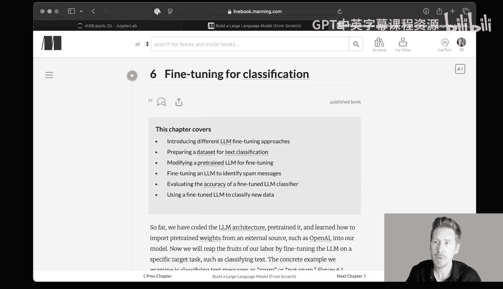

You are probably thinking of a model that is capable of interacting with a user by yeah addressing or answering to certain queries。

 for example， summarize this text。 tell me who was the first president of the US or other kinds of things so translating summarization writing a paragraph rephrasing things answering questions these are all things that you would expect from a chatbot or a personal assistant and this is what we are going to do in part 7 First in this part in part 6。

 I want to show you a simpler application of fine tuning So part 6 and part 7。

 they will be both concerned with fine tuning the model。

 So fine tuning essentially means that we are taking the pretrained model and train it further or fine unit for a certain target application where a target application could be classification or developing this personal assistance In this case。

 this will be called。Inion fine tuning， as we will see。In part 7。 But yeah。

 actually I want to start with fine tuning this G model that we pretrained or essentially also the model where we lotud the pretrained weights from Opmii as a classifier because I think this is a great introduction to fine tuning and it's also。

 by the way， one of my favorite applications of LLMs or small LLMs because it really shows what we can do with smaller models because。

 you know， not every application in reality requires general chatbot There are so many applications in this world。

 especially in the business world， where you just need a prediction。

 you don't need necessarily something that gives you a text response or。

That can do multiple things at the same time， like summarizing and transling text。

Sometimes you just need a model that predicts something。 for example。

 customer sentiment or I don't know， like stock market trends or something like that。

 So there is an infinite amount of things you can do in this chapter。

 we will focus on a simple application of email spam classification because you probably all yeah。

 are familiar with emails and spam emails and traditionally spam。

 The problem of implementing a spam classifier was done with more traditional models。

 So even going back to。For like logistic regression or naive based classifiers and so forth。

 if I recall correctly， I even one of my first tutorials even was an naive based classifier。

 it just comes to mind while I'm talking here but maybe I can same problem can I can just show you and find it if it's not too distracting here。

 but so。

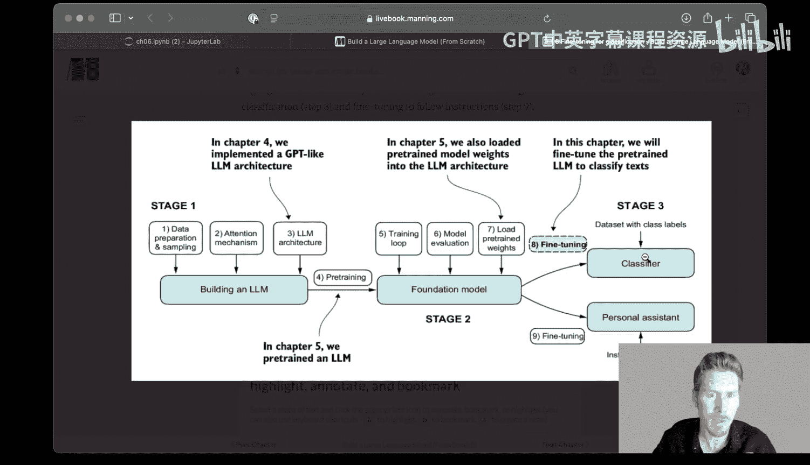

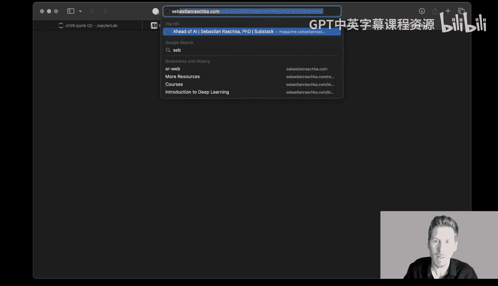

One of my earliest blog posts， I think， was on naive face。

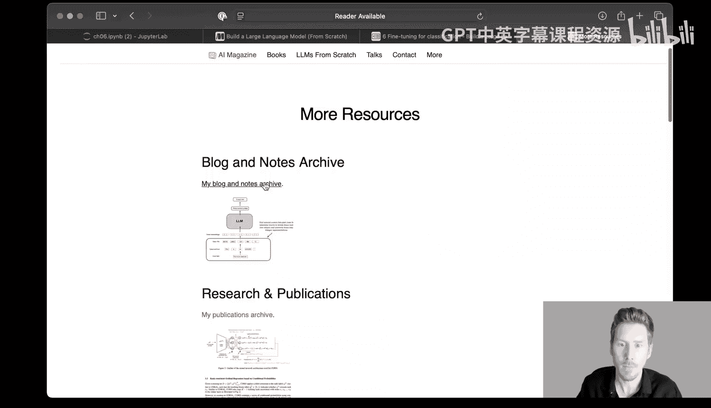

Here， it's 2014。 so traditional methods for developing a spam classifier。

 and these are methods that are very fast。 So they are very popular in cases where you have a large customer base。

 So if you are running a classifier on your computer。

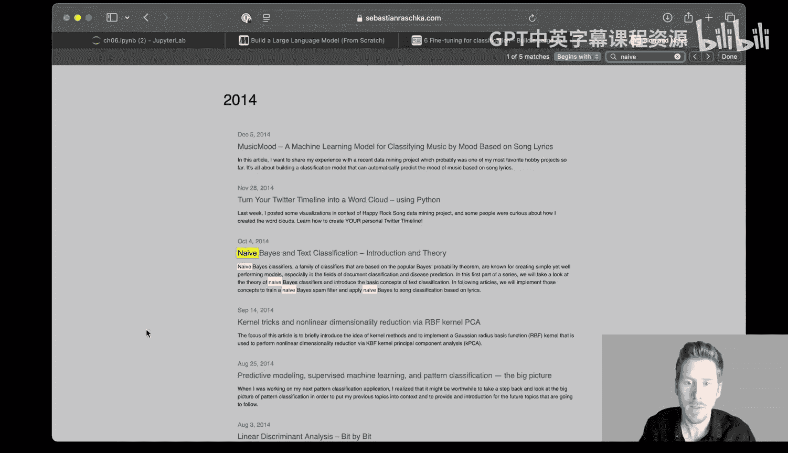

I mean， you don't really the only limitation is the hardware you have in a small LM like the one we developed before。

 it is fine to run on a local computer， but if you are， for example。

 big company like you know Google and you have millions of customers who use your email application。

 you have to be also concerned with how can we reduce cost or how can we make sure that this scales to millions of users and simple models are actually quite nice for that and even。

If you are not concerned with cost savings or efficiency。

 simpler models like naive base or logistic regression are still great for establishing a performance baseline because they are usually simpler to implement。

 And so when I develop a new application， I usually start with the simplest model。 And then I look。

 oh， I get so and so percent accuracy。 And then I try to yeah use more complex models or more expensive models and see how much are these models improving over my baseline。

 So it's actually always a good idea to also start simple。

 But in this book because it's a book focused on large language models。

 We will be actually focusing on adapting the。😊。

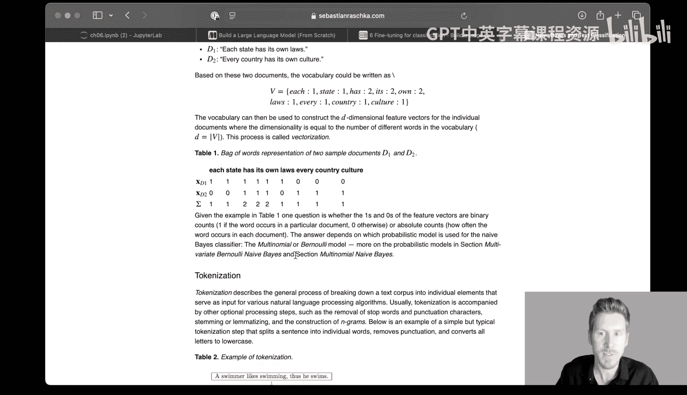

That language model from the previous chapter， the pretrain model。

And find unit as a classifier on a spam classification problem and spam classification because it's easy and it's familiar。

 but you can also do this for any type of classification task。

 which is quite interesting and these models are you will see actually quite good for classification tasks so yeah I would say let's get started so here we will be first focusing on preparing the data set and so。

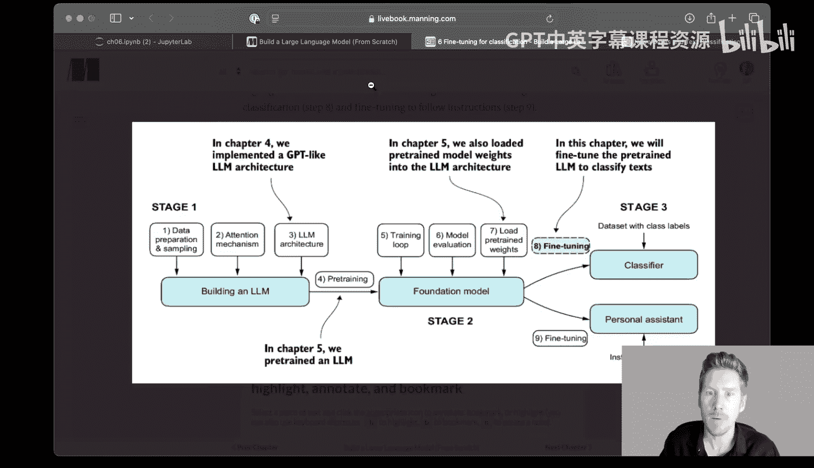

Also， maybe I should show you one more figure so。

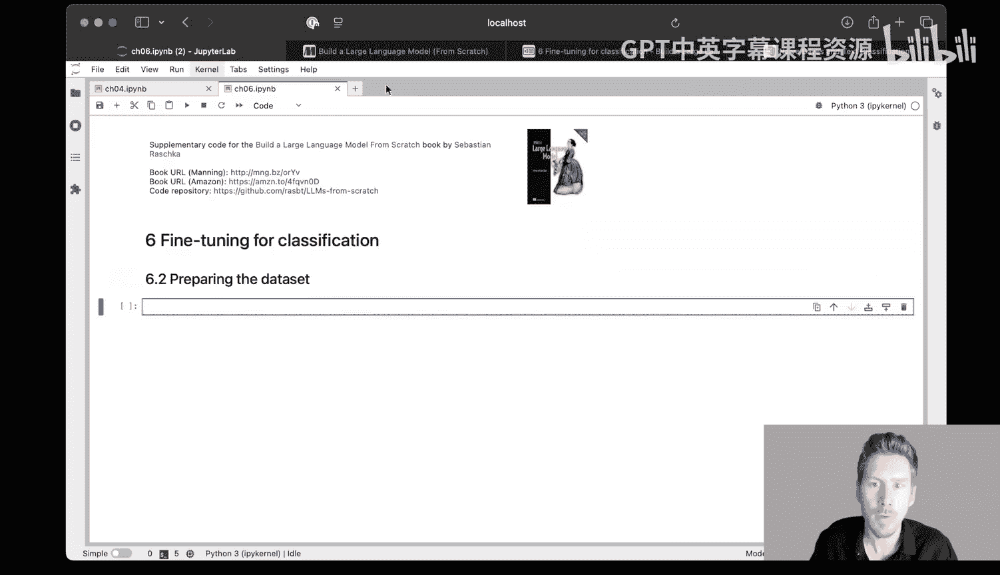

Where what we are going to do where we are here， so this chapter itself there will be several stages so the first stage will be concerned with the data set preparation and we will start with that and later we will talk about how we set up the model and then essentially how to fine tune and evaluate the model so one step at a time we are now focusing on the data set preparation part here。

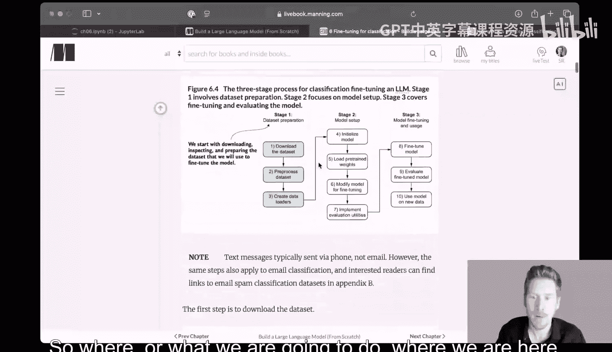

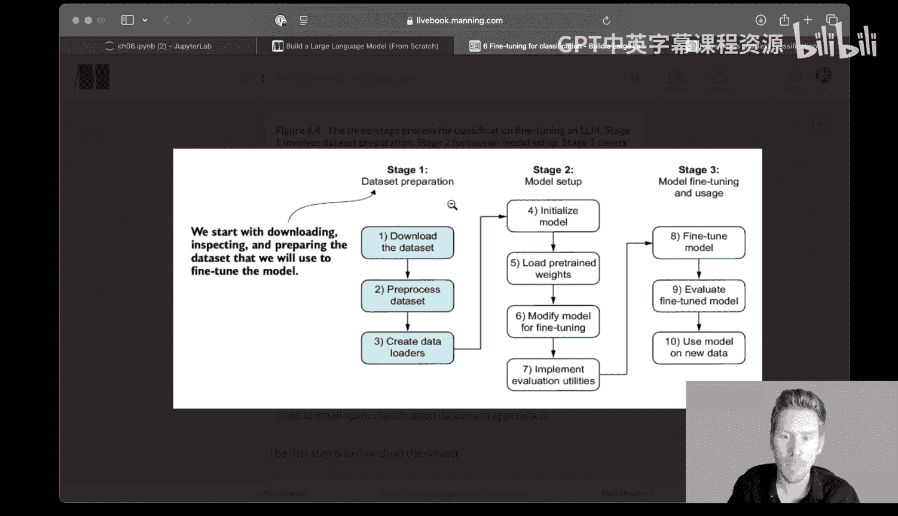

And so， for that。I will just show you the code here， and I will just briefly talk about it。

 Let's see if this URL works。 So I'm using a data set from。

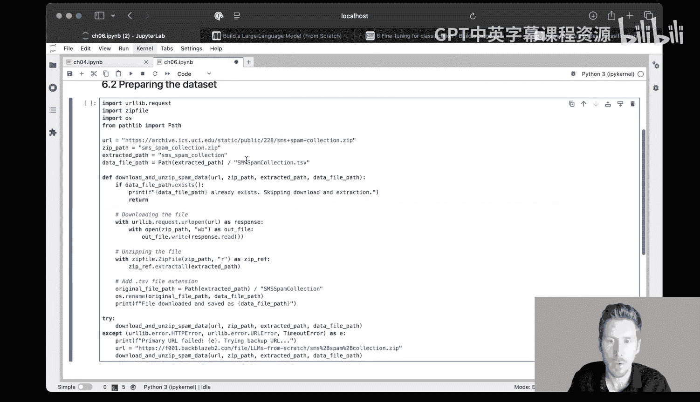

UC I， so UC I is I think it doesn't work like that。 U I is repository。

 a machine learning or repository that has been around for many。

 many years where you can find public data sets They are just， you know， easy off the shelf datasets。

 and I was trying to find a data that is relatively small。

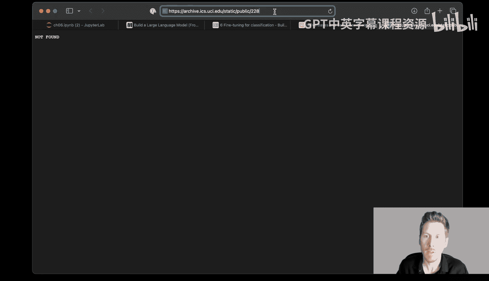

Let me see if this works because I have the zip file I have the zip file link directly。

 so maybe I should just search for this。Because I don't want to hear in the browser down on the zip file。

 I just want to show you the data set。Yeah， this one。 So we are going to work with this data set。

 which is very simple， just a small email sorry， not even email like S SMS S text message labeled messages data set。

That consists of spam and non spam。 And our goal is to classify spam images。 Oh sorry。

 spam messages and。This would also apply， of course， to email and other problems。

 I do in fact have bonus material where I'm applying this to a movie review data set。So， in this。

A Github repository for this book， where I keep my bonus material。 I do have。

 I will talk more about this later。 I do have also。

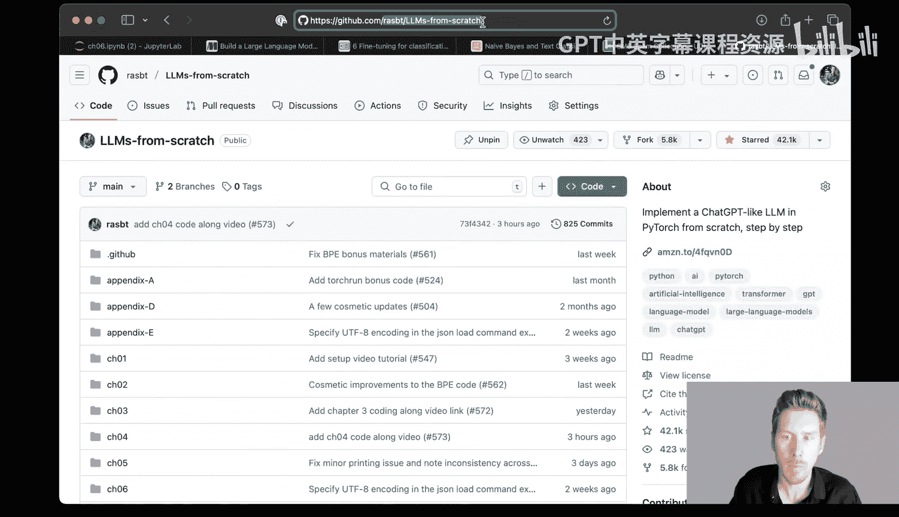

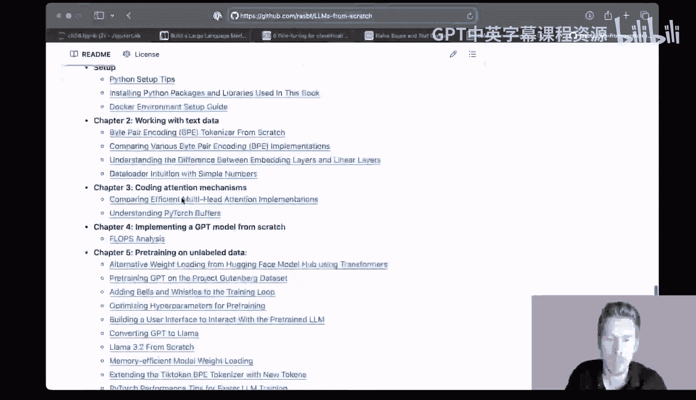

50000 yeah the data of 50000 movie reviews as another example。

 but I want to keep this relatively small this data set it only has the 7000 examples。

 so it's faster to train and I think it's sufficient to illustrate how you can adapt LLM for classification tasks and so what you are seeing here is just boiler plate code to download the data you could technically also just do that manually So this is just to automate it so it will download this zip file from the spam collection website here So compare to clicking download it's doing this in Python。

And unziing the file。And then。😔，Adding。😔，making sure the file path is correct。

 So the file path will be SSM spam collection T S V。 So this is a tap separated value file。

 It's like a C SV file。 But instead of comma separated values， it will be tap separated values。

 I will show you how this will look like。So here we have this folder and this is a small dataset set so I can just open it here in general I don't recommend just opening files like that because when they are large that will or can crash your compute memory if you have like millions of rows but yes we can see we have hamm or spam where he means nons spam and then on the right hand side we do have the yeah the text message。

And that's how the dataset is structured。Yeah， so next， so since we have lo this now。

 so next it's yeah what a bad idea to load this in Python to also make sure it's formatted correctly and by the way。

 let me also show you before I import this pandas library。

 let me show you the packages that I'm using in this book or in this chapter。

Right now so we will be using Matpotlib later for visualization the Ny array library of course。

 that underlies Matpllib and pandas Padas is data frame library it's on top of Ny adding a data frame format nowadays there's also another library called Pols which is faster it's a Python library that also implements the code in rust underlying the Python implementation which is similar to what Tiktoken is doing but I'm using pandas here because we just really not only need very very basic things and it's a very simple data set so it's gonna to be done in half a second so it doesn't matter whether it's done in half a second or 0。

1 second you know it's instant anyway。And pandas is， I think， still more popular。 So yeah。

 that's why I'm using pandas。 We still need Tensor flow。

Because we are going to load the pretrained weights from OpenI that we talked about in the previous chapter and that we used in previous chapters and then Pytorch for the GPT model and the fine tuning。

Okay， so just for reference the software versions I'm using。

 but like I mentioned before you don't have to have exactly the same versions it's just here as as a reference in case something goes wrong。

 you know what I used and you know if you want to exactly replicate things if things break so。

We are first importing pandas。 It's like an array library for， you know。

 nicely loading the data the data set。 so I will。Use the read CV function。

 So the CV function is usually used for loading。See， for loading CV files like the name implies。

 but you can also change the behavior to load tap separated files。 So tab separated。

 you couldn't really see it here because it's it looks nicely formatted。

 but maybe I can let me see if I can do it like this。嗯。Let me the first five lines of。Thisす。Data set。

It's called S S。Sm collection。 and then。So yeah， so you can see。This is just like a batchsh command。

 And you can see there's like a tap instead of a comma separating this column and this column。

 So here we see there are two columns。 But when we are looking at at it in text format， it's only。

 yeah， one line and the column is this tap essentially。

 And so we are saying this tap character is separating our columns。 And we don't have a header。

 So header means。That we don't have like a column label。 It's really just， you know， text。

 So the first line really starts with a data sample。 And so we can give it our own。Column labeled。

 so we can call it label and text where label is ham or spam。

 and text is the message we want to classify。 And then I can print it here。

 and I can see there are 5000 oops。5572 rows and two columns Look good to me。

And we can also count how many of those spam spam and not spam。

 So what I can do is I can do label and then value counts。

 And so this will be listing how many non spam and spam messages we have。

 And you can see this is like an imbalanced data problem。

 So there are many more non spam messages then spam messages。

 And this will make it a bit trickier to evaluate the model in the performance because we can't just use accuracy。

 Then we I mean， there are measures like balanced accuracy precision recall like R C curve and so forth。

 And so this would be a different type of beast and so for that。

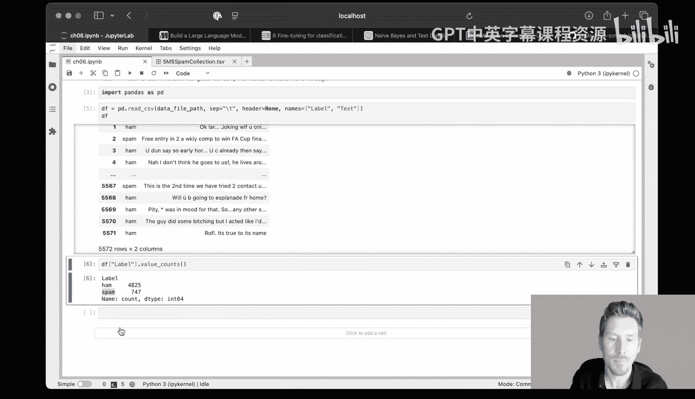

Maybe just let me see if I can recommend something。 but there's a library called imbalanced Learn。

 for example， that is specialized in working with imbalanced data。 and if you are interested。

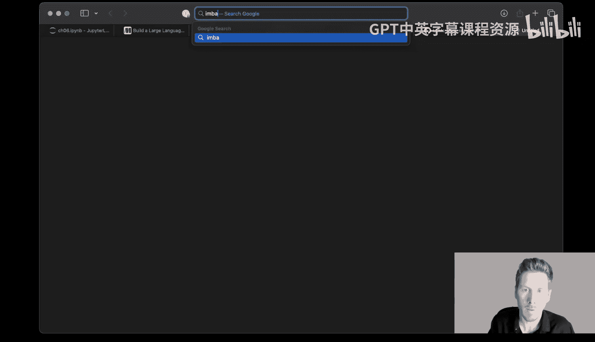

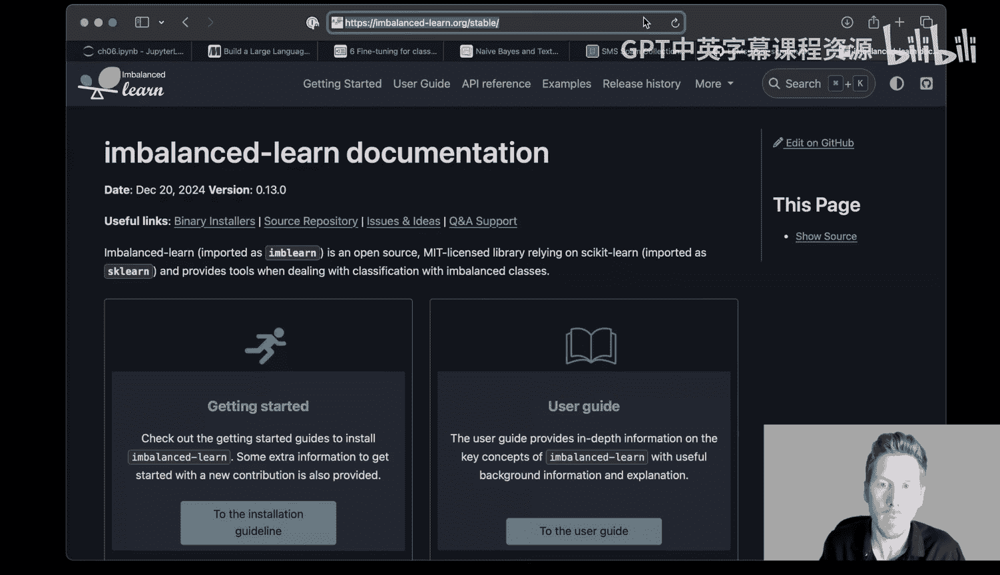

And let me see。If you are interested in model evaluation and machine learning in general。

 I do have a paper or let me see。

Yeah， here on archive。

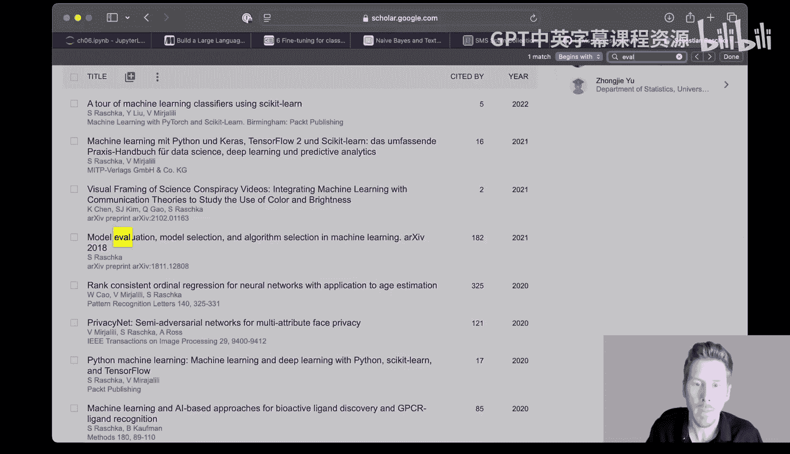

嗯。That's not the right link， let's just search for it。😔。

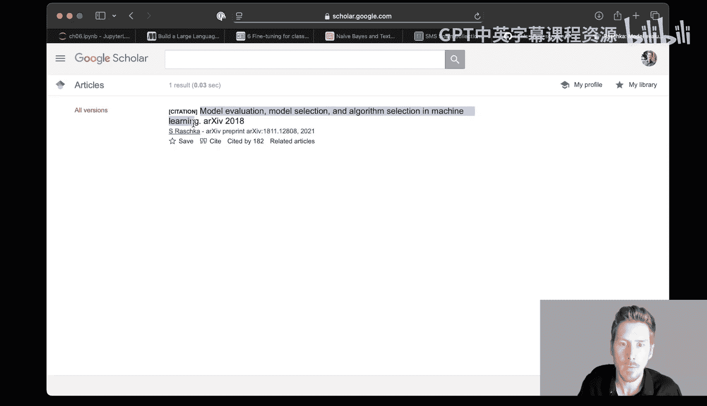

So this one， it's like a many page article。 It's probably yeah 50 pages almost where I discuss more about model evaluation and the different metrics and so forth。

 So if you're interested in that I highly recommend you know reading this in detail for this chapter I will keep things simple so I don't want to you know spend five hours talking about model evaluation and everything because then otherwise this will be way too long and it won't be about just LL Ms anymore it will be a general machine learning and deep learning lecture。

 So what I will do is I will balance this data， which means that we will make sure that we have the same number of nons spam and spam messages So I will reduce the number of non spam messages to 747 so that we have a balanced dataset and it will make。

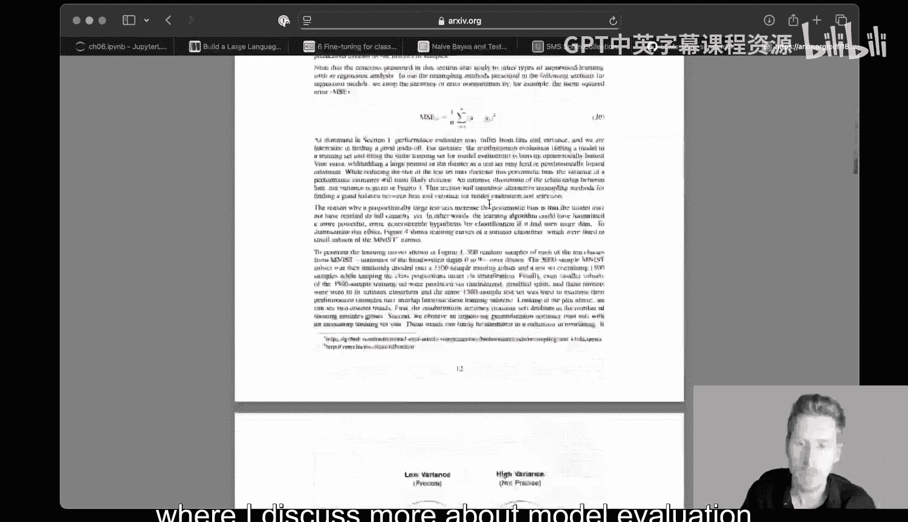

Just talking about it a bit easier。 So it's making the problem a bit simpler here。 Yeah， because。

 you know， I want to focus more on the L M part than。Yeah。

 all the other evaluation parts evaluation is a very important topic it's。

 I would say just a topic for a different book or a different course and so forth。

 so I will probably in the future one day talk about it separately。

 but for now let's make this problem simpler so we can focus on the LLM fine tuning。

So what I'm going to do is I'm defining this function here， create balanced data。

 which will make sure that non spam and spam messages have the same number of samples and so what I'm doing is。

Andm first counting how many spam messages we have I can just show you here。

 So we have 7947 spam messages。And then what I will do is I will sample the same number of non spam messages。

 So here， the sample function will take a random sample。Of 747。

 because that's yeah what we have here。And we set a random seat so that you。

 when you execute the code， you get exactly the same sample。

 So to ensure that we all all work with the same subset。 So when I just execute this。

 I should probably because I'm。Imrovising here should probably assign this to a variable。 So yeah。

 you can see we have 747 non spam messages， ham。😊，And then what I'm doing is I'm concatetnating them into a new dataset set。

 There might be more efficient ways to do this， but it's such a small data set that we， you know。

 we just keep this one in this one and concatenate this into a new data set。

 which is then our balanced data sets。 you can see。

After creating this balanced data set and looking at the new label counts。

 we can see we have 747 non spam and 747 spam messages。 Now。

 there's still one thing that I would say， kind of bothers me about this。 So and I。😔。

Oh here balanced。😔，So one thing is that the label is。Text and so to make it easier to work with。

 I usually recommend converting this into label and integer label starting at zero。

 so you can think of this integer label then as token Is so。

So essentially what's interesting is here everything we are doing is we just want to classify whether something is non spam or hem or spam。

 so we have two classes he。And spam。 And so before we wanted our LLM to deal with all kinds of words in the vocabulary and output all these words。

 now we can make the problem a bit simpler。 So instead of having these token Is going from 0 to 5000257 in the output layer we can have in the output layer。

Only two token ID，0 and1。We have to be a bit careful because our LLM will still work with the same input vocabulary because it still has to process the input text but the output can be simpler now we will get back to that later so I don't want to say too much about this yet we will get back to that here in this part modifying the model for fine tuning but here what I'm doing is I'm essentially assigning these labels0 and1 to the label column。

So what I'm doing here is。😔，嗯。Using the map method。And so， so first of all， we have the label column。

 We only focus on the label column and map is mapping the values using a dictionary。

 So our dictionary。Or mapping dictionary， it's called that map。Dictionary， so this would be。

This one here， where we say everything that is ham should become 0 and everything that is spam should become  one。

 Like I'm showing you here。 And this will execute this automatically for the whole data set。

 So let's execute this。 and then。I can。Double check it。So， you can see now。We have。

The these tail and head， by the way， are the。First five and the last five entries can also make just to make sure let's use this one。

Everything looks correct。 So we can see we have now labeled0 and one instead of。ham and spam。Yeah。

 and so that is， we are almost done with this section。

 That is how we first process the data set to make it， you know， make it nice for further processing。

 And then the next 1 I will introduce is splitting the data。 So this will split the data set into。😊。

Subsets， so we will have a training set。A validation set and a test set So the training set is for training the model The validation set is for tuning so some people also call that a tuning data set where when we are training the model。

 we look at the validation set to kind of estimate how well is our model generalizing to data that it doesn't see during training because we only look during training and on the model overfits we will get something like 10 percent but then in reality when the model sees new messages that it hasn't seen during training。

 we have no idea how well it would perform so that is why we have the validation set so we can have an estimate during training how how well the model performs and then we can also metal with the model we can fine tune it。

 we can optimize it and use the validation set to see whether our tweaking or changing of the hyperparmeters makes an improvement or not and then once we are done with everything we use the final test set because when we use the validation set multiple times。

It kind of like gets biased， I talked more about this in my article here。

 the model evaluation article。So we at the end want to have an unbiased or like an independent test set that we haven't used before during the training procedure And so how we do this is we take a portion so train end So maybe going through this sequentially first we shuffle the data frame So this is just one way to shuffle a data frame and pandas So we say sample and we use fraction 1 So the fraction is how much of the data set and one means the whole data set and for example 0。

5 would mean half the data So what we are doing is we are sampling it's kind of we to write it like this。

 but what's happening is we are sampling from this data considering all the rows and this will essentially shuffle it because yeah we are just drawing the rows in a random order and then we calculate a split indices So we say。

That， for example， train fraction could be 70%。 So it could be， for example，0 point。

7even and we could say 0。3 or something like that， so that will mean 70 or let me do two here。

 so 70% of the data this is the position where we have 70% of the data so then we extract it and then from this position considering another 20%。

So this is where the validation ends。 So maybe in simpler terms， if we have hundred examples。

 the train end。Would be at 70。And then the validation end would be 70 plus the 20。

 So this would be at point at 90 index 90。 So if we have hundred，70% for training。

 then 20% for validation。 So the position is here，90 to。嗯。Sorry， 70。

To 90 will be used for validation。 Let me write this like this。12 70 for training。

70 to 90 for validation。 and then the remainder。We have the test set the remainder。

 This will be then 90。To 100。So the remaining 10% will be used for testing。

 So that's just how we subdivide the data set。 And so let's do this and。

Apply our random split function with 70% training data here。 I'm using 10% for validation。

 So it's basically more like this。And then， 80 giant。80 to 100 for testing。And why these ratios。

 this is again a hyperparmeter usually 70 80% is a good number for training if you have a large data set you know you can also make the training set smaller。

 but yeah it really depends。On application in this case， 70% is reasonable 10% for validation。

 I would say the test set is a bit more important than the validation set because that gives you the final estimate。

 so I usually make the test set a a bit bigger than the validation set。

 Some people do it differently。 they would make multiple validation sets。

 for example and rotate them So it really depends on how much you work on the on the hyperparmeter tuning So the more tuning you do usually the more validation data you want during the development to make sure you don't overuse a certain validation set but yeah in our case it's a very small problem。

 So it should be a fine ratio and yeah just let's double check how they look。

So here by the way I'm also saving them as CsV files so that later we don't have to go through this whole procedure here again if we want to come back to this and just lot the data set from these files and personally I also like to do that when I for example write papers and so forth when someone wants to reproduce my results I can share these files with them so for example。

 yeah you can share the procedure but let's say someone makes a typo ors the random seats somewhere you would get different results So in that case I like to always you save this for record keeping and so that I know exactly what is used for training validation and testing so we have thousand45 data points for training。

Validation D F， we have 94 for validation。And then the test the F。We have 300 for testing。 Okay。

 so this is it for。This part on the data set processing。

 and in the next section we will talk about setting up our data orders and then later， of course。

 setting up the model itself。

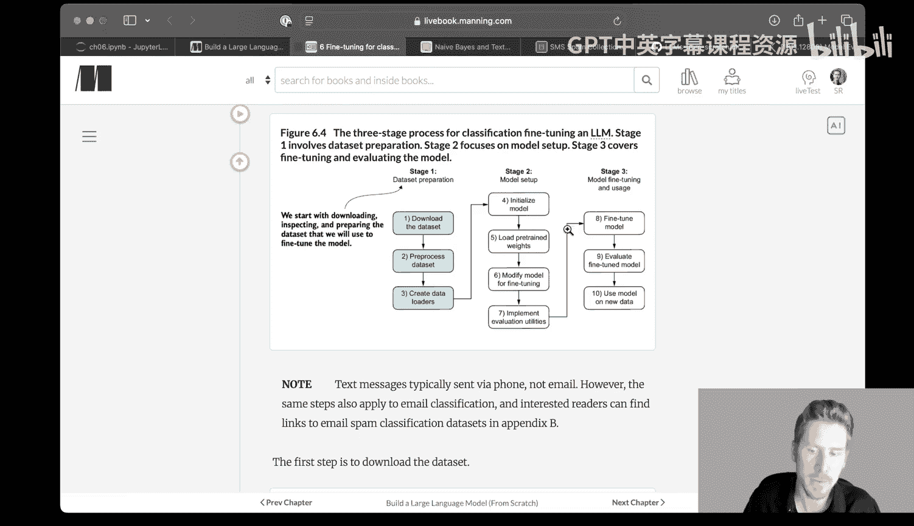

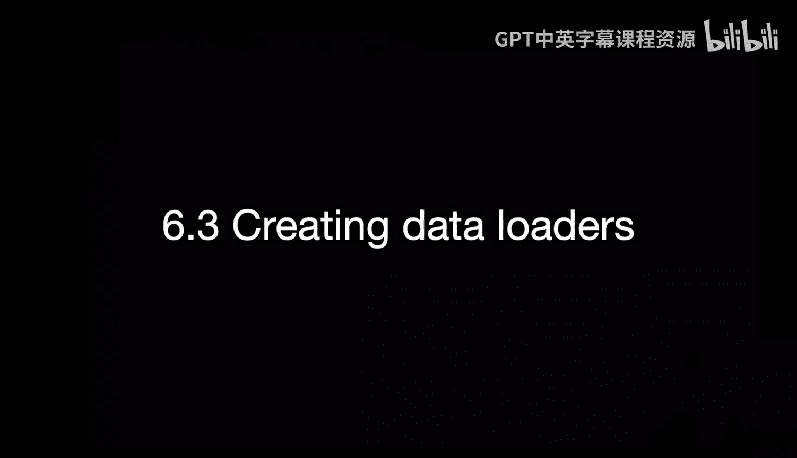

Yeah， after downloading and preparing the data in the previous section。

 we are now ready to create the Pytorch data loaders we will be using for fine tuning the model later。

 So for that I want to show you first figure before we yeah implement the code because it's I won't say it's super tricky but there is one important aspect to consider here。

 And so the text messages。 they have different lengths。

 So for example here are three example text messages。 They are not exactly from the data。

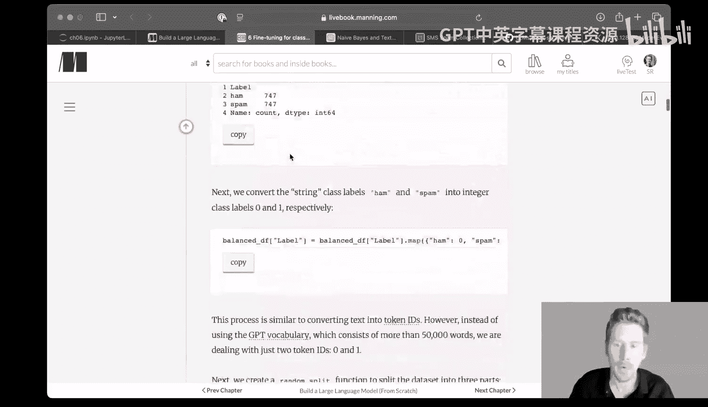

Shows shorter one here because in the data set they would be too long to fit into this figure。

 but if we have this message， this is the first text message and then here this is another text message and then this is the third text message which is very long you can see they have are all different lengths if we convert them into token IDs so each has a different number of token IDs and when we create mini batches or batches for training in the data lot。

 these are ten0srs and tensrs have to have the same number of elements in each row for example if we have10 training examples。

10 rows in that batch each of them has has to have the same number of token IDs。

So how do we accomplish that， how do we make the number of entries or token IDs the same for each training example。

 so what we can do is we can pad the sequences to the longest sequence in the batch。And。

What we are doing here is we are using a token ID that is usually not used for many other things。

 For example， here， the token I 50256， which is the end of text token And we are app pending at here。

 So first we have to figure out what is the longest sequence。

 So if we only had a data set consisting of three training examples。

 we would check the lengths here and see oh， this is the longest training example。

 And so we will find out 1，2，3，4，5，6，7，8，9，101111 tokens。 And so we have to make sure that every。

Entry has 11 tokens now。 So here in this case， because we only have five tokens。

 it means that we have to add6 padding tokens。 So here we can see 1，2，3，4，5，6。

 We are adding the 50000 to 56 padding token 6 times。And here in this case。

 we are adding it five times， so we make each sequence 11 tokens long to match the longest sequence here。

And they are， I mean。Multiple ways we can do that We can do this for each batch。

 so one batch might have on the maximum token length of 11 one other batch might have the maximum token length of 13。

 another 115 or what we can do is we can check the longest training example in the dataset and then pad all the examples to the longest training example in the dataset and that is what we are doing here in this chapter in the next chapter in chapter 7 instruction fine tuning I will show you how we do this on a batch basis for simplicity now we are finding the longest sequence in the whole dataset and then pad all the other ones。

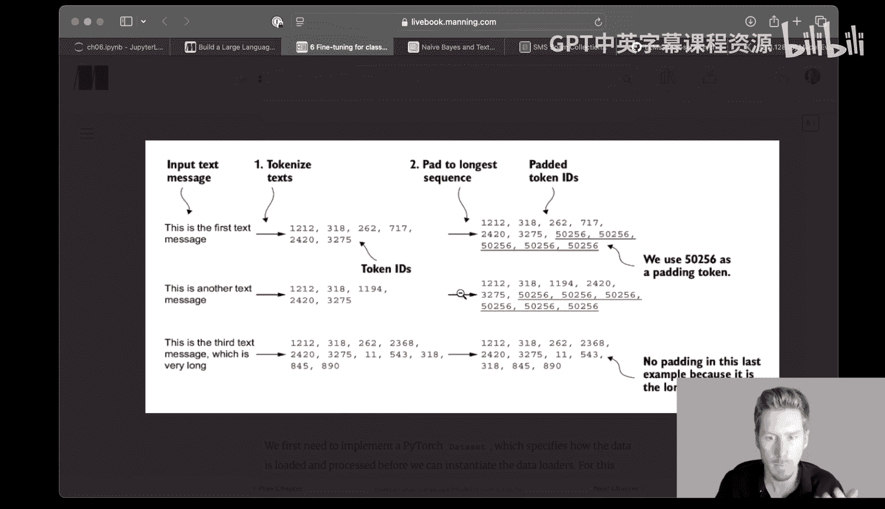

Okay， so let's see how this looks like in code so and by the way yeah we will be using the T token tokenizer again and just to show you the 50256 that's the end of text token so how we are going to implement this is we are going to use the data set class again the data set class from Pytorch。

And yeah just copy pasted it so it doesn't take forever when I type this。

 so I will walk through this more slowly。 This is a bit different from the data set that we used for pretraining So in pretraining by the way。

 we didn't have that issue with different length because we determined the length right we set the context length and then we had these sliding windows and we made sure that each window has the same size。

 So in that case we never had to worry about different lengths because we created these lengths now it's a bit different because we have this data set where each has a different yeah different length here。

Okay， so what we' are doing is in this data class。By the way， it's not complete yet。

 I will add a bit more code once I explain this part， so we have a CV file that we want to open。

 This could be， for example， the the training validation and test set here。And then the tokenizer。

 that would be our tick token tokenizer。Then we define a maximum length。 in this case。

 this will be determined So we can either say。We want to have a specified length。

 let's say 10 token Is 00 token Is， or whatever the model supports。

 or we can just say the longest sequence is based on what we have in the training set like I showed you。

 but yeah， we can restrict this further， for example， if we want to trunnccate it more， you know。

 if we in this case， if we want to have just five or something like that and why is that useful if you think about an application where you work with long documents。

 for example。Let's say you want to classify newspaper articles。

 you want to develop a classifier that categorizes them as sports article， politics。

 finance and so forth。 Maybe you don't need the whole article。

 maybe some articles are so long maybe 100000 tokens of something that it wouldn't be working with your LM So you can say。

 oh， I only want the first thousand tokens because it has already enough information to build a really good classifier and then I don't need to feed my LM 100000 tokens so you can artificially you know truncate the length here and then we define what token we want to use for the padding So yeah we read the data set here and here what we are doing is we are tokenizing the texts so this is the familiar encode method we used before and we do this for each row in the dataset。

And if we don't use the maximum length。That we specify here。

 then we find it ourselves based on the longest example。 that's similar to what I've done here。

 where I looked at all these examples and found oh， this is the longest one。 And so based on that。

 we say， oh， the longest one is 11 so we have to pad everything to 11。

 So I will implement this method shortly。 Otherwise if we have a max length。

 then we truncate to the max length here。嗯。Yeah， and then we pad the every element or every training example。

 according to the max length。 So we have the encoded text。 and then for。

TheWhat the difference is between the max length。 So， for example， if the， if， if this is。Let's see。

 we have a length of 500。 and our max length is 1000。 Then the different here。

 a difference here is 500。 So1 thousand00-500。 And we say。500 times pad token ID D。

 so we add 500 padding tokens to the encoded text， which has length 500。

 so it will have length 1000 after this and we do it for each example in the text。

 So we essentially determining the maximum length also we have it here and then we add the number of tokens corresponding。

To the difference between the actual length and the max max length so that we fill up the length up to the max length。

 It's what you are seeing here essentially。Okay， so this is the init method。

 this happens when we construct the data set。So then next we have a get item method。

 let me add this here。So the get e method will retrieve one example so here it's similar to what we have done before there's an index and by the way this is just like a Pytorch convention of how the data loaders work the data sets work and then the data loaders operate on the data sets so index is a number so for that we need actually one second we need the length method。

So the index is a number between 0 and the length of the data set。 So if we have in our case。

Let's say for the training set， 1045 examples， this is the index is a number between 0 and 1045 and it will select a random entry from the data set and it will also get the corresponding label so this is the text and this is 0 or1 depending on whether the email is hem or not hem and then we convert it into tensors。

Yeah， and then the only thing I have not explained yet is how we get the longest length。So yeah。

 then depending on how you want to implement this。I have a verbose version and later in chapterpt 7。

 I'll use also shorter version。So that's actually very simple。

 what we are doing is we are just brute force iterating through all the encoded texts。

 the tokenized texts， and we say if a given text is longer than the max length。

 then we update the max length and a shorter way to write this would be yeah just like that。

 depending on which one you prefer。If you are， yeah more familiar with Python。

 you might find list comprehensions or here， like just a generator more readable or here。

 in this case， the more verbo way of doing it。 But it's essentially just finding the longest sequence brute force using traditional python code。

 Yeah， so that is our data loader or sorry， not our data load of our data set。

 The data loader will come in a few moments。 So let's first initialize our。Data set here。

 So what I'm doing is。I'm initializing it with a training dataset first。

 and then we don't set a max length， which means that the dataset will determine the max length based on the longest encoded length like we just discussed So this will be my training dataset and then I can print out what is my max length。

 what is the longest sequence so I execute this I will find its 120 and it's been a long time so I grew up in the 90s and I remember SMSs text messaging was very popular nowadays you know everyone uses eye messagessage or whatsapp where you don't have any limit how many characters you write I think I'm not sure but I think if I remember correctly the maximum number of characters was 120 which might explain why the longest sample in this training set is 120 in any case So just as a side note So we have now the longest training example of 1。

20。 so that is how we。Pad our training set。 And then we do the same thing for the validation set and the test set。

 Now， there could be longer examples， not in this case， maybe because based on what I said。

 text messages were maybe limited to 120 characters。 But if you are working in a more general case。

 there may be examples where。You find that record in the validation set or test set is longer than something that has been in the training set。

 So here what we are doing is we are truncating it to the training set set length。

That is because we'll get to that later， because we are going to fine tune a certain position。

 a certain token I D。 I will explain other ways of doing it also later， as let's say bonus material。

 But for the way we implement the LLM， it is important that。

Validation and test sets have the same lengths as the training set。 So that's why I am。

Restricting that here。So another way you could do it technically is you could also determine the length based on the whole data set before we split it up and then use that length。

And by the way， I don't think though they are longer than1 in 20 so I'm just doing it for best practice reasons because in model evaluation the best practice is also to use the same parameter derived from the training set on the validation set and test set and not use all the data to determine settings because that would indicate we are considering information that would not be available at test time。

 so we are kind of like almost cheating if we would look at the length of the validation and test set。

 but this is again a topic for you know model evaluation if you're interested I mentioned my other article。

 so here I'm just doing it also for best practice reasons。

Let's see if I have a figure here to illustrate where we are so what we have done now is we have these original text messages and then we made them all 120 tokens long by adding these patting tokens the 50256 so this is our data set and then we have also the class labels to zeros and ones so that's what we have done so far。

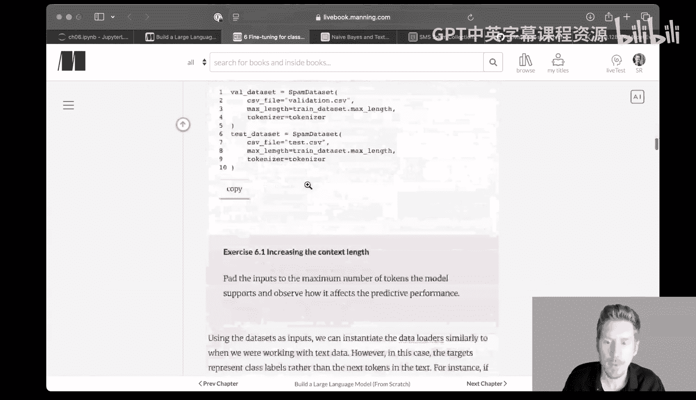

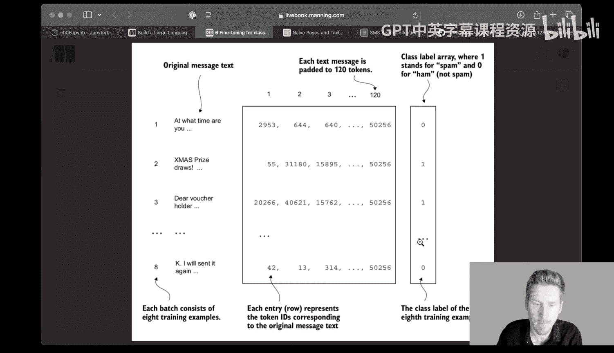

But one step that is missing I mentioned in the beginning of the section we are going to create the data loaders so far we only created data sets。

 so let's also create our data loaders and this is code you know that is very similar to what you have used before in chapter2 when we set up the data loaders so here we set the number of workers I mentioned there might be some issues on certain machines and also in Jupyter notebooks usually I don't recommend using multiprocessing so just setting it to zero but you know we can increase this and see if it works on your computer and then we set the batch size to8 and everything else is the same we are shuffling for the training set we don't need to shuffle for validation and testing and then also the drop last equals true which I explained in a previous video that it will drop the last batch if the number of examples in the training set。

Is not divisible by the batch size。 And yeah， and this is it。 So let's execute that。

 And let's maybe also do the dry run。 I mentioned before I like to just iterate over the data set just to make sure there are no bugs。

 you can do that also for the validation and test set。

 And just to make sure the sizes of the input and targets are what we expect。

 And so we can see each batch has a size of8。 or in this case it will be the last one。

 but yeah it should be fine。 So we are just making sure the batch size is in indeed 8。

 and the number of tokens is 120。 So this looks okay。 and the labels of course。

 corresponding to the eight examples also have size 8。 So this looks all good。 And then lastly。

 we can also。Just print out the length in terms of how many batches do we have in the training validation and test set so we can see we have 130 training batches。

 19 validation batches and 38 test batches and so with that we have now the dataset prepared and to load it the next step would be loading the model。

 the pretrained model before we can modify the model and before we can find you in the model on this dataset。

So this is probably going to be the easiest section ever because we are just going to lot the weights that we lotted before the model weights from Openmii and the reason why we are doing this is that we need this to find tune in the model so we are just in this particular coding session we are just using the code from chapter5 and lot the model weights。

 so for that to work you have to make sure that in the folder here where we are executing the notebook that you have。

The previous chapter code So from all the previous chapters and this includes the yeah G model class and everything we have here in chapter 5 for the weight loading So all the code we worked before I have it here in a file previous chapters do Py the Python file and then here also this GPT download function we got in the previous chapter。

 So this is old code， this is the same code we looked in at in chapter 5。

 we are just going to reuse that now so that we have the model set up and can fine tune it。

So let me show you just the basics here So first I'm just copy pasting it because it's not very interesting at all。

 This is something you have seen before， so we just choose the smallest model here。

 the 124 million parametermeter model just like an example input pro I think we don't even need that one can get rid of this and then we have the vocabulary size。

 the context length， the dropout and the QKB bias and then we are。From here， yeah。

 just getting the embedding dimensions， the number of transformer blocks here and then the number of heads and the multi head attention modules。

 And so this is all what we used in previous chapters。 Nothing new。 This is just yeah。

 getting our configuration。And then， yeah， I'm going to。Lot well。

 import the download and not G function from the G download file。 And again， like I mentioned。

 these are files。 So this is a file。 and this is a file that are relative to this notebook here。

 And so in this case， Pythtorch can just import from these files。

 so we don't have to copy and paste the code from the previous。Part but you can also go in here。

And just find the code in chapter 5 and just copy and paste it into into this one here。

 So it doest matter， but just if you want to have it a bit more clean and just only see the code that is new。

 I prefer usually to just import it from Python functions where I keep it separate and then in a notebook it's more like focusing on the new code here。

And yeah， some more boiler plate code。 So this is also from the previous。Chapter where we。

Prepare this choose model to get the model size。 So it's essentially just getting this number year 1 out24 million。

And then download this from the Open eye server。 So just going back here， this is。

 yeah just downloading it from the Open eye server and yeah loading the model。

Might take a few moments and later， I mean， this will be our base model like I mentioned before in the meantime。

 I could maybe go back to this figure。

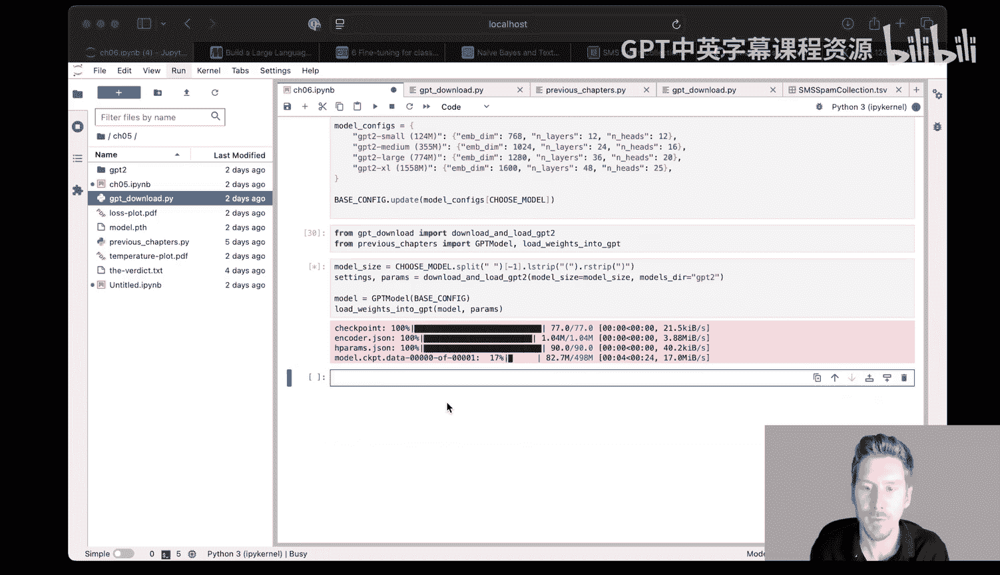

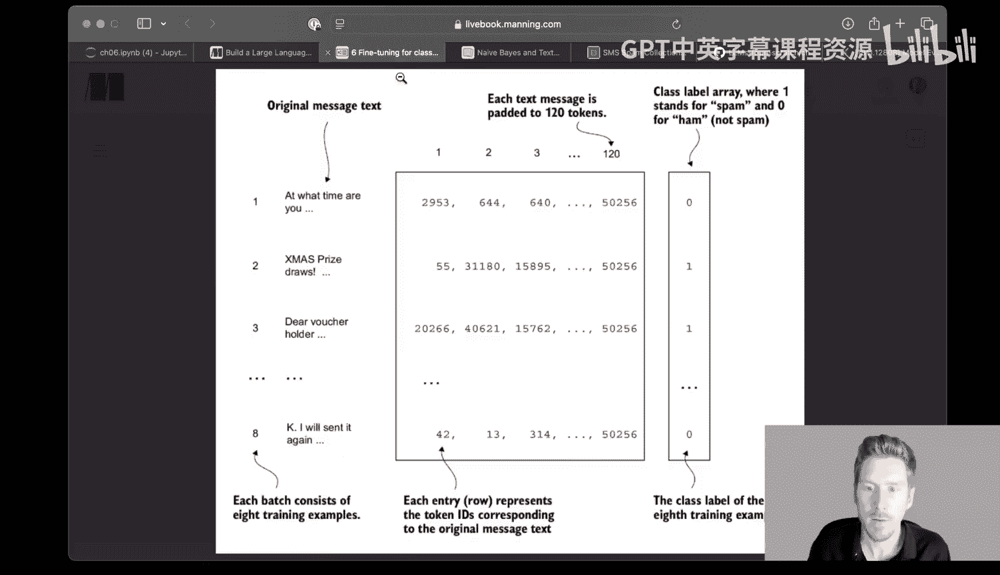

And show you what I mean。 So this is also called foundation model。 Some people like the term。

 or they don't like the term。 It depends because yeah。

 there was like an academic paper that invented this term。 and sometimes people say， oh。

 this is just， you know。

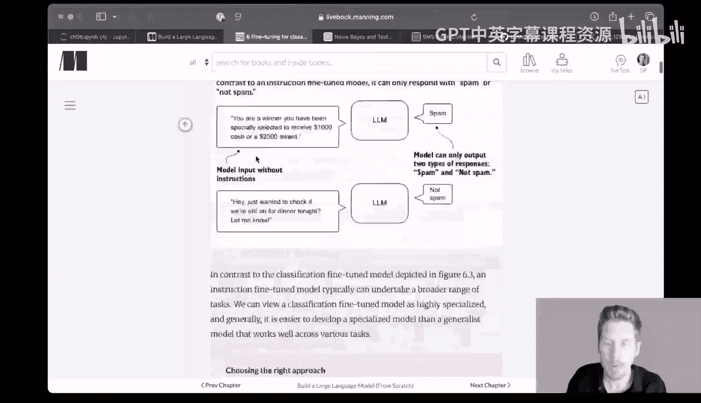

Just another term I have to remember in everything and so you can also think of it as the pretrained model or the base model and this model that has been pretrained the foundation model pretrained model or base model however you want to call it we are going to then modify it but in most cases you don't need to train the model from scratch So what I'm trying to say is we are building the classifier and you can also start with random weights and then just you know fine tune the model on the data set that we care about without bothering with a pretrained model but。

The pretraining is actually quite useful because the pretraining teaches the model， you know。

 to distinguish between different words and learn some meaning of what words are。

 So there' is actually a quite nice foundation to build on So it's actually usually better to use the pretrain model and fine tune it for classification compared to training this model from scratch on classification tasks because we could technically also use the random weights instead of the pretrain weights but yeah usually it's why not taking advantage of these pretrained weights basically where the model already learned feature extraction inside the transformer blocks and everything。

 So we kind of take advantage of all this processing power that went into it during the pretraining So we have our。

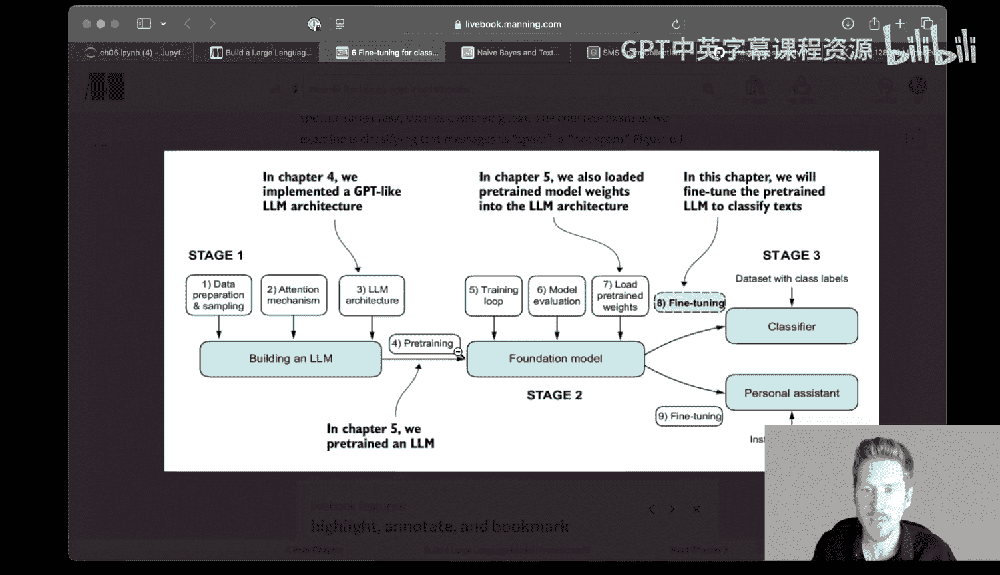

Model downloaded now。 And then we will also import some of the convenience functions。

 generate text simple。 And then these two just to make sure that we allotted the model correctly。

 So what I'm doing here is we are not going to use the model for you know writing text or anything。

 But I just want to make sure that the model works so that there is no back in the code in everything。

 So this should produce exactly the same texts we have seen in chapter5。 So， for example。

 every effort moves you forward， the first step is to understand the importance of your work。

 just to make sure the model is loadedted correctly。 If it generates gibberish。

 it means maybe we made a typo somewhere。 So it's just like a sanity check。Now， you might wonder。

 could we actually use this model？To do the classification。 So， for example。

 we could have a prompt that says， is the following text spam。

Answer with yes or no and then we provided the text。

 If I go to chat GT I'm pretty sure if I type this in there it will do a good job and classify this correctly so it will for example。

 say this is a spam text message and that is because it has been instruction fine tune on so much data that it will actually do a good job on that however。

 if you don't have a lot of data if you don't have hundreds of thousands of instruction fine tuning examples classification fine tuning if you care only about classification is gonna be more data efficient we are later in chapter 7。

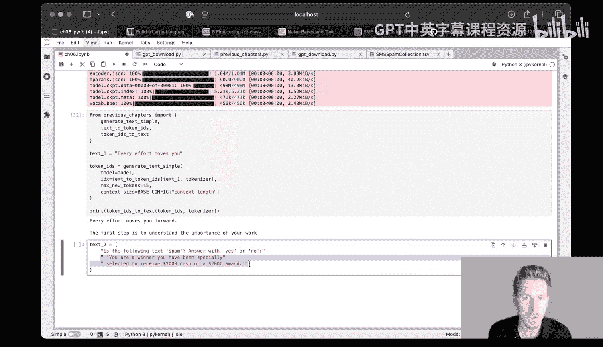

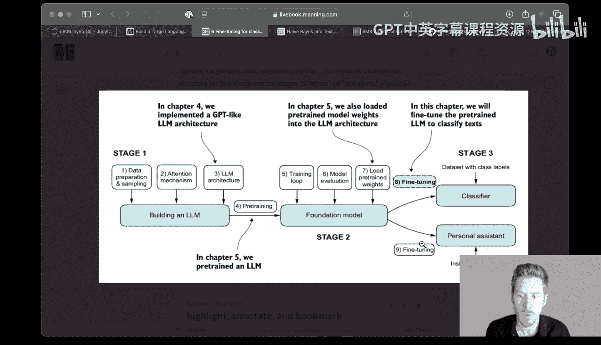

We are going to fine tune the model on instruction data so that it theoretically can deal with cases like that。

 but this will be a future chapter or a future problem。 So， for example。

 here if we have a pretrain model and we give it this text。

 So this prompt you will see the pretrain model is not quite capable of dealing with that。

 So it will。Generate， it will actually repeat the text even you can say see is the following text So this is the input。

 Sorry， this is the input。 And then the second row。This is what it generates。

 And you can see it's kind of like copying copying text almost from the beginning here。

 And that is because it's just a pre trained model and pretrain models。

In theory are only good for yeah generating text continuing to write text。

 but it's not really capable of answering instructions so for that we will need this technique instruction fine tuning for now we just want to keep it simpler and we just want this model to return0 or1。

 so if model sees only this text it should just return0 or one whether it's ham or spam。

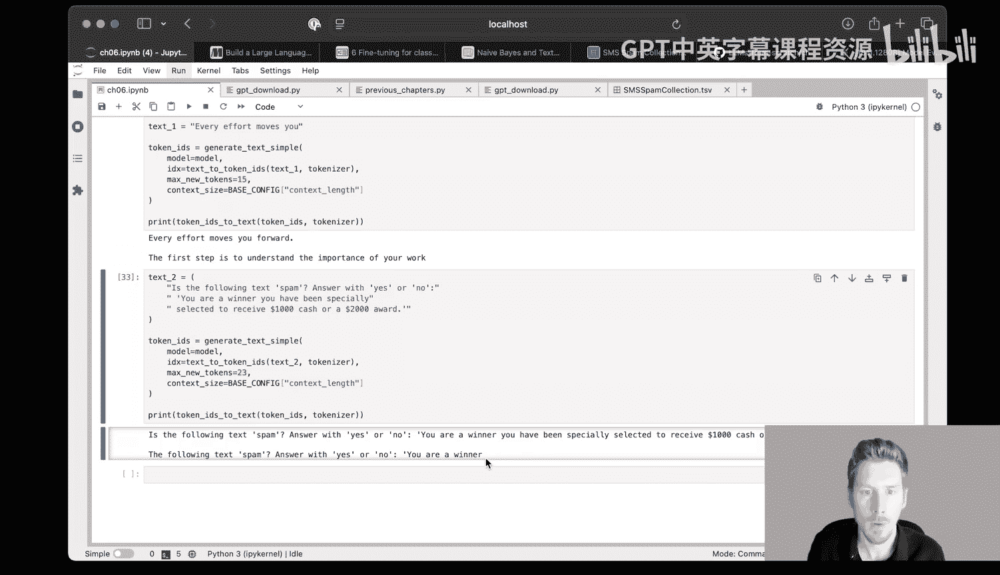

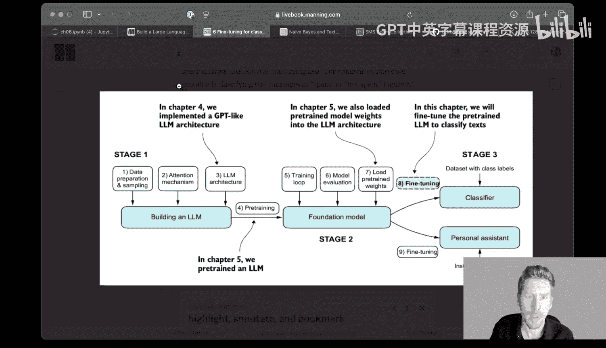

The， the thing is also that modern LLMs， just like a side note now， So modern LLMs。

 if you pretrain them。To some extent nowadays they can actually answer questions without this explicit step here。

 the instruction fine tuning step， and that is because nowadays big companies based on the papers they release。

 they do include some instruction Q and A data， something like this in the pretrain data set so that the model already learns a bit of doing that during the pretrain。

 but in general。

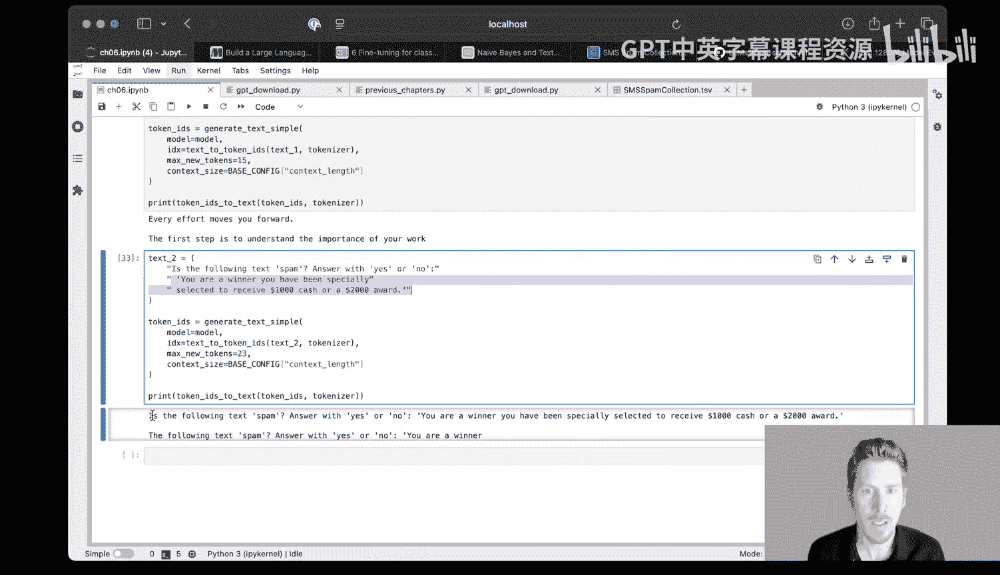

What's yeah， a true statement is if you just have raw text without any specific format。

 the model will be relatively limited。 It will continue generating text。

But it can't really answer instructions。 You can see This one is a more natural one。 It's just。

 you know， continuing this text from here could be from a book or something like that。

 if we give it something slightly different， a question is or no， it won't say yes or no。

 it will just you know， do something unexpected here。 Okay。

 so we determined now this model is not capable of doing spam classification And like I said。

 there are now two routes we can take。 one is classification fine tuning。

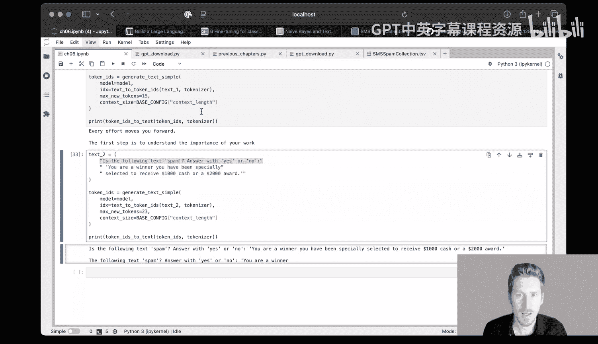

Or chapter 7 instruction fine tuning here， we will start with the instruction sorry。

 the classificationification fine tuning and leave instruction fine tuning for a future chapter problem。

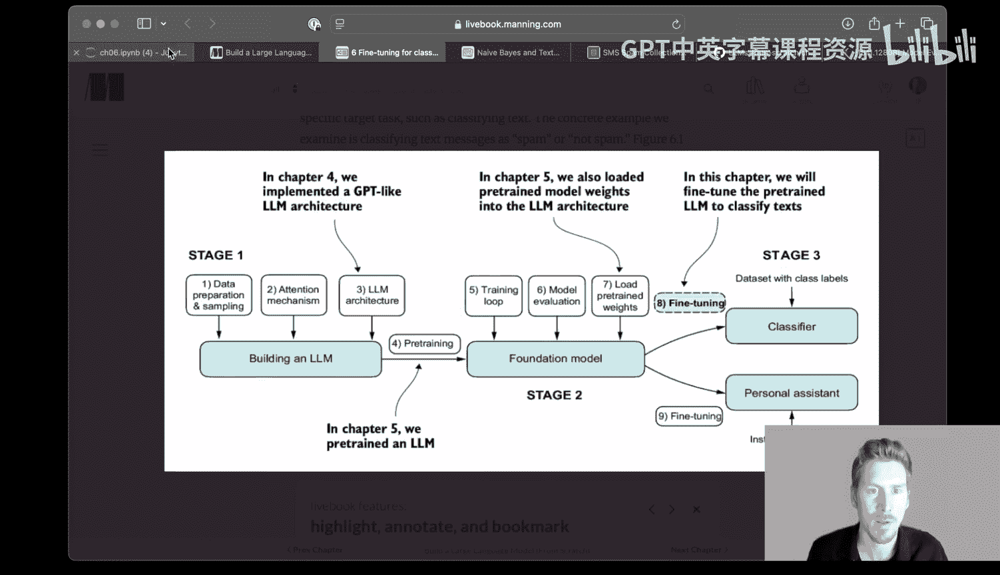

So。This video was really just setting up the model， the pretrain model。

 And we determined it's not capable in the next section。

 I will show you how to make it ready for classification fine tuning。

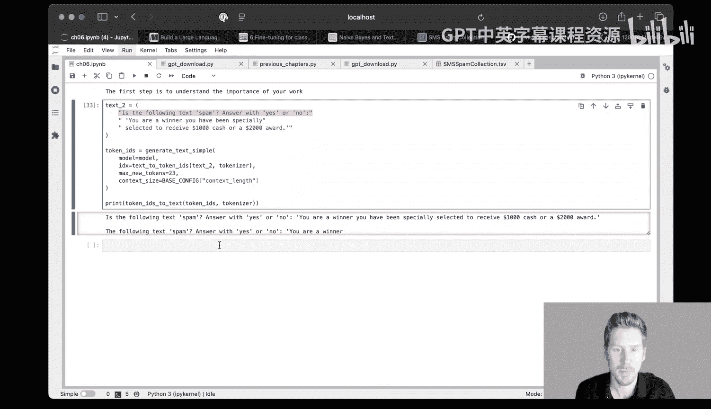

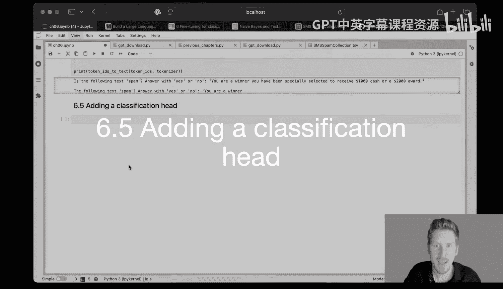

Yeah so in the previous section we just loaded the weights from OpmiI into our GPT model architecture and now we are going to get this GPT model architecture ready for the classification find Uni so before I go to the code just to conceptually showing you what's going on or what's going to happen so here what we are doing is we are looking at the GPT model architecture that we coded in chapter 4 and then pretrained in chapter 5 and where we just loaded the pretrained weights into this architecture。

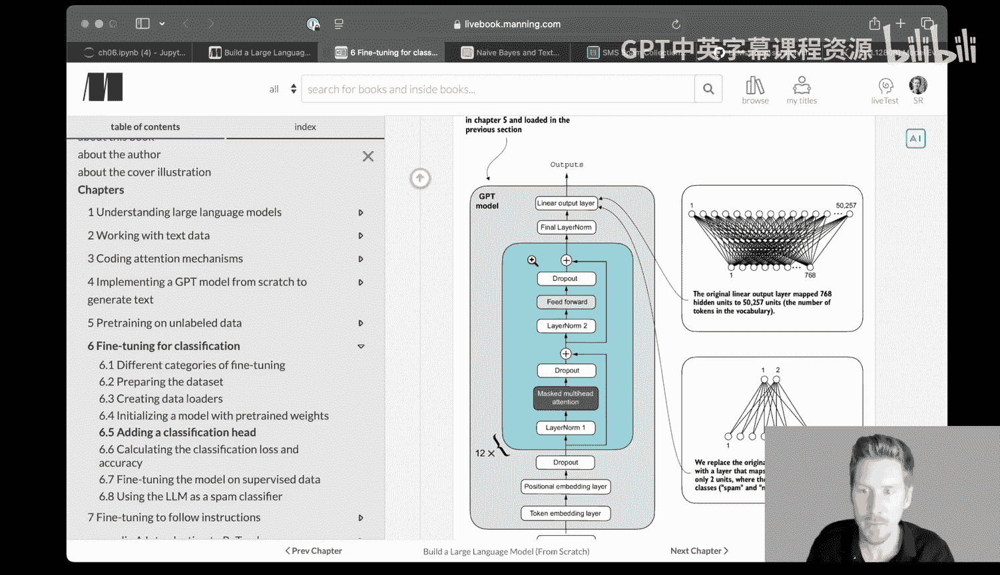

Now what we are going to do is we are going to replace this massive output layer that goes from 768 to 50。

0257 dimensions by a smaller output layer， so why why do we have this massive output layer again in the first place so we do have this token embedding layer that goes from 500257 potential token IDs。

Into an embedding space。 so we carry out the we carry through these embeddings。

 we have embeddings of size 768 where this number comes from the fact that we have 768 dimensions in the as embedding size in the smallest model if you're using one of the bigger models you might even have bigger embedding dimensions。

 but yeah we are working with a small models。 So our embedding dimensions 768。

 that's where this number comes from。 And so in the output layer we have to go back into the vocabulary space。

 So because ultimately we want the token ids。 So we go from 768 back into the 5000257 dimensions from our tokenizer and like I said before we don't actually need that many words if we just want to classify something as ham or spam。

 So for that ham and spam there are two words So we need actually only two tokens to potential output tokens。

 So we can go ahead and replace the。

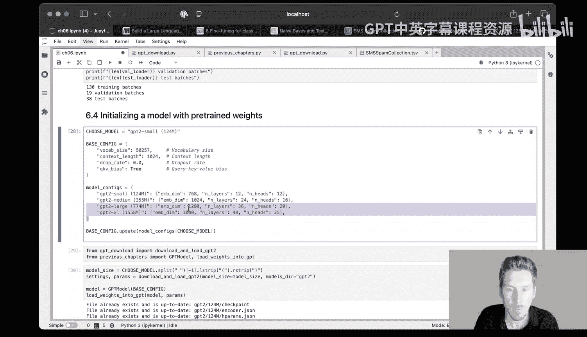

Massive output layer with this smaller output layer where we have again still the same embedding size because you know we don't really change anything inside the network。

 but then we only need two potential words， ham or spam so we replace this by these two output notes and in general we can say that the number of classes is equal to the output nodes a curious reader might note for example。

 you might know from classic machine learning or deep learning that for a binary classification tasks so classification task where we have two classes。

You technically only need one output node， but to keep the code in this notebook here more general。

 we will be using two output notes for our two classes so that we can say the number of output node is equal to the number of classes in the data set So for example。

 if you have another task so this would work also for any type of task if you have， for example。

 a task where you want to classify newspaper articles so you might have business news， sports news。

 politics and finance so you have four different types of articles you would then have four output notes so you can change this based on your task。

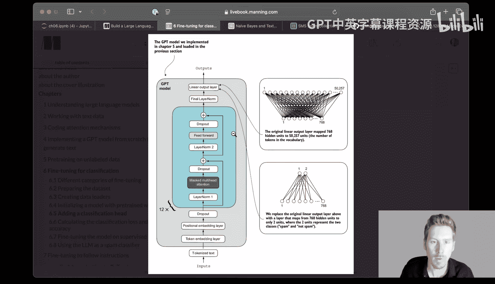

But yeah， since we only have two output classes or two classes。 we have two output node。

 So let's go ahead and make these model changes I just described。

 So first never a bad idea to just make sure the model is slotted correctly。

 So we are looking at this model here。 Like I mentioned， we have the 500257 to 768 embedding。

 And then yeah we are scrolling through the different transformer block。

 So we have oops we have 12 transformer blocks。 So up to here。 that's a 12 transformer block。

 And then we look at the output layer And this is the layer we want to replace by our smaller layer。

So before I do the external replacement， I wanted to make one more note and。

So pretrain models are actually pretty good at， you know， extracting information from the input text。

 So this whole network has been trained， you know， to do something useful in in the pretraining task。

 So we don't really need to modify anything here。 We can actually just replace this layer and just fine tune this output layer。

 and I do have an article on that it's pretty。

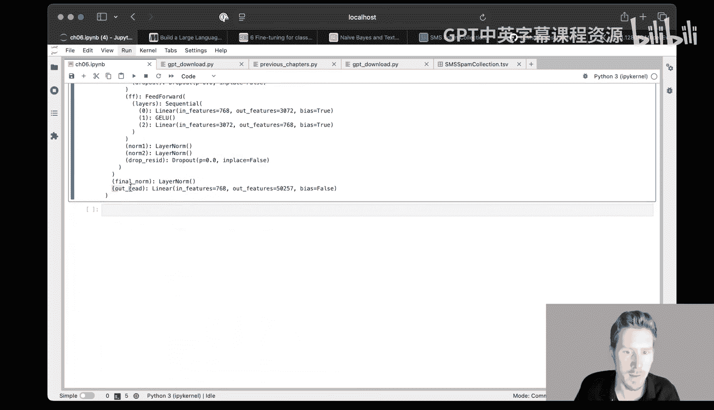

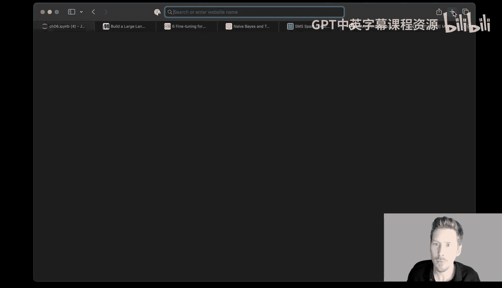

Long time ago， but。Where I analyzed。Like the trade offs of training different layers。

 So let me just see if I can find it here。Fine tuning not language models。

 and so it's a different architecture and it's a different data set so。Let me see。

So it is a different model and a different data than we are working with， but it's。

 I would say a trend that generalizes in certain aspects where what I'm trying to tell you here is kind of like transferable to our model in our data so。

What we are looking at here is the classification accuracy it's on a different data set but it's similar I mean that sense that we are classifying two classes and that's the accuracy here and there are three bars。

 there's the test accuracy， the validation accuracy and a training accuracy for you know keeping this discussion brief let's just focus on the training accuracy。

 the first bar and this accuracy is achieved if we train only the last layer so the last layer means this one here。

Now。If we train the last two layers and the last transformer block。

 So let's say this corresponds to like。These two and in the transformer block， if we train this part。

 we get better accuracy， so we train more things we get from， I would say， 76% to 87。5%。Now。

 if I train。Even more like the two last transform blocks。 so if I train。This whole park here。Oh。

 sorry， what happened？😔，One moment， I somehow pressed some wrong button on my keyboard。okay， so if I。

Up to here， if I train this whole part here。We see we get even better performance。

 now we have something maybe around， I don't know like 90%。 and yeah so the more we train。

 it seems like the better the accuracy。 but then we hit a point where we have diminishing returns So you can see here there's not much improvement really。

 I mean we still keep it around 90% here and moreover， also when we look at the training time。

 how long it takes for the fine tuning here we are around， I would say what is it like 2。

5 minutes or something if we only train the last layer。

 if we train the last layer and the last transformer block it's about the same training two transformer blocks its bit's lower 3。

5 minutes but then if we train the whole model here， all the layers yeah， we see it's  seven minutes。

 it's almost like two to three times what it takes here to train only the last layer or the last two layers。

 but you know it's not that much better So we spend especially in this range more time training even though we don't really get any。

And so this is generally true， the simpler the data set， the more this applies essentially because。

For a small simple data set it's kind of overkill to train everything。 in fact。

 the more we train typically the more data we need to avoid overfitting and so if we have a small simple problem like the spam classification problem it's not really necessary to train this whole model so we can get away with only for example。

 training the last layer layer norm here maybe and the last transformer block so。Long story short。

 Before I go ahead and replace this layer with the smaller layer that I mentioned here。

 Let's actually go ahead and make the model non trainable。 So in order to do that。

 we can freeze the weights， so。What we can do is， for example， we can iterate。

Through the model parameter。 So for each parameter。

 so that would be a weight tensor or bias tensor in the model。

We set the requires gradient argument to fault， which then means this way tensor or biastensor won't be trained when we are training the model。

 So we are freezing the model。 So this means essentially another word for that is freezing the model or the model parameter。

 So they won't be updated during the training。 And now we can go ahead。 and replace the output head。

 So what we go here is output head。 And so we will replace this。

 So this one will be trainable because we initialize it with new random weights and by default。

 they are trainable。 So we are going to use 768。 So to make this a bit more general。 let me。

Go ahead here and copy this name so we can add the embedding dimension as a。Configuration here。

 So it will also work in case you choose to fine tune in a larger model。 so that dim。And then。

Let's define the number of。P。Classes to2。 And then we can say in。Classes， and then also， let's set a。

Random seat， because we are initializing it here with random weights。Okay。

 so now we should have a new output layer。 So you can see now the output layer is improved sorry you know improved replaced and now。

Yeah， this would be what I just showed you。 One thing is。According to this， you know， training。

 the last transformer block is not not a bad idea。 Maybe the two last transformer blocks。

 that's maybe a reader exercise for you。 but I would say we should probably train this last transformer block。

 at least。 So what we are going to do is。Oops。I don't need to scroll that much。

 So what we are going to do is this is already unfrozen。

 We are also going to unfreeze this one and this one。 So unfreezing means making it trainable。

 basically。 So first， we made everything untrainable。 Only this is trainable。

 Now we make these things also trainable。And why this last layer norm， I mean， you don't have to。

 But I feel like it's natural or more natural if And when when we make this trainable and we make this trainable to also make things in between trainable。

 Otherwise it would be a bit awkward。 So what we are doing now is we are making this。

Transformer block here， trainable by setting this again to true。

 So this would be the last transformer block in our model。 And then the final layer norm。

 So this layer norm， we will also make that trainable。 And so now， yeah， only the。Output head。

 the final layer norm and the final transformer block will be trainable before I end this session。

 I wanted to show you one more thing。 and so。What so what happens when we give it some input now now after our modification。

 So let's just assume we have some simple input here。

 And so this input is four input tokens corresponding to， let's say， text message someone asking us。

 do you have time here again I just add the batch dimension like I usually did So because our model expects input batches because without that this would be to our size of just four but our model expects batches during training and everything。

 And so。Let's say our model receives this input so when we do torch。 no。Grads。The context。

And then let's say， oops， outputs。😔，Moern。Inputs。So if we get that。

 so let's see how outputs looks like so you can see it's now again still four rows right each row corresponds to each token ID or token input here。

But now we only have two output dimensions before in chapterpt 5。

 we looked at this massive output sensorsor because before we had 50，0256 output dimensions now。

 as expected， we only have these two output dimensions。In particular， we are also， by the way。

 only interested in fine tuning。The last position。So here what we are looking at is the last token。

 we will talk more about this， but so technically we are only considering this last token here。

So this one。We are going to not fine tune anything related to those tokens。 And the reason is。

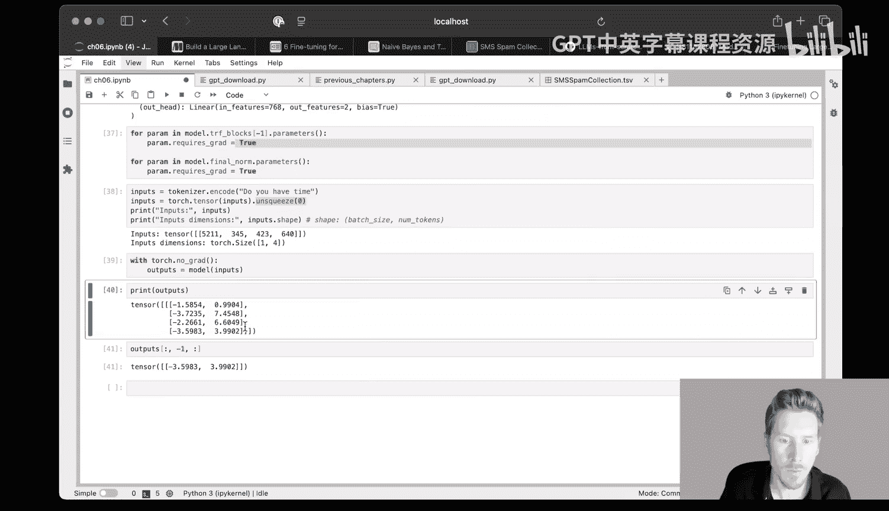

That the last token contains the information about all the other tokens， so。

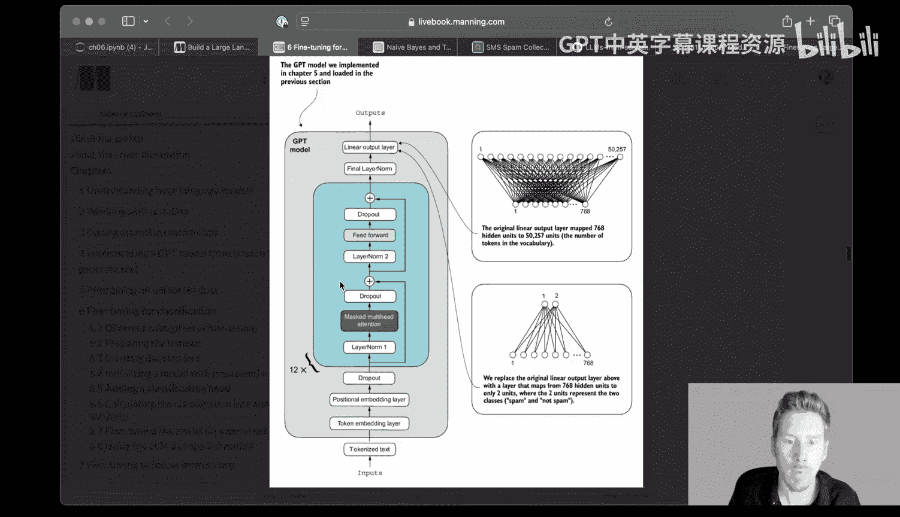

Yeah， so here's just like a figure showing you what we just did if we have some input text。

We get this tensor and then we only focus on the last row corresponding to the last token and the reason is。

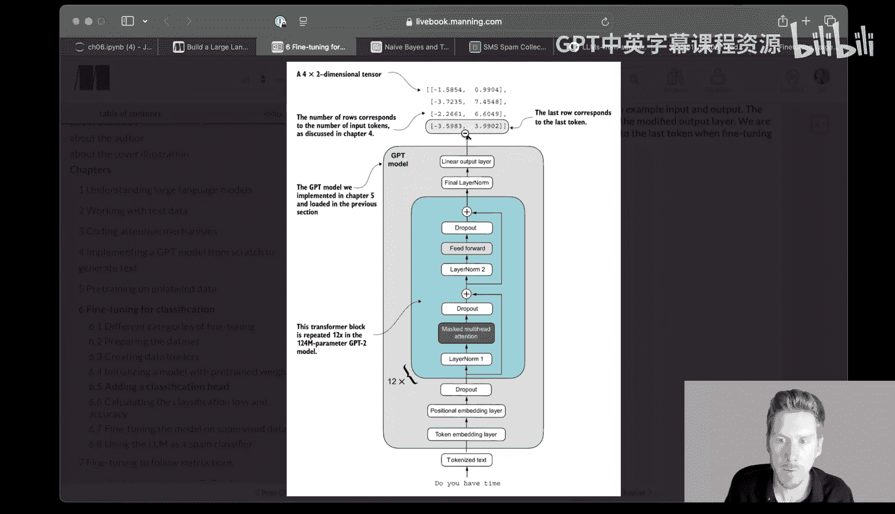

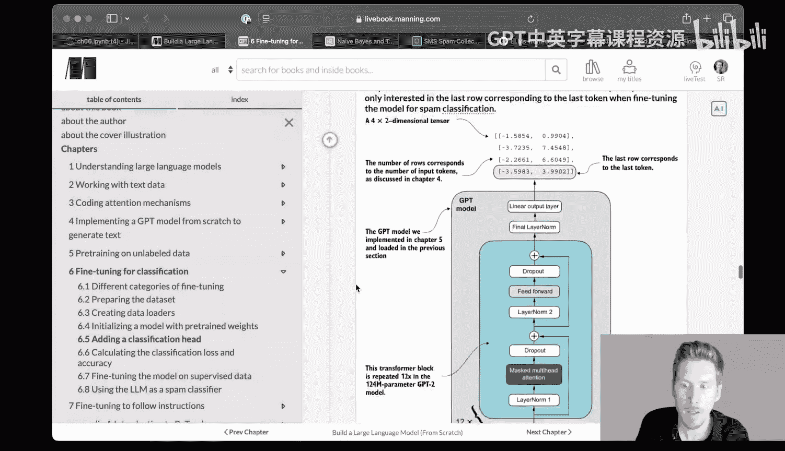

it's due to the attention mechanism so if you remember it's been a long time but from chapter 3 how attention works。

 we have this causal mask， so if you consider these rows as the input so when you look at the first input position do the self attention is only between do and do itself and then if we have these do u so the u the word u the context vector for that one contains information about do and u so we have attention weights for do and U。

But it so it can't look into the future because of this causal attention mask。

 so it can only always look to its current position right？

 And so if we consider this token here and we make our decision。 So maybe going one step back。

 So our task is based on these numbers to classify whether something is spam or not spam。

 So we could look at this whole thing， we could look only at the first row or the second row。

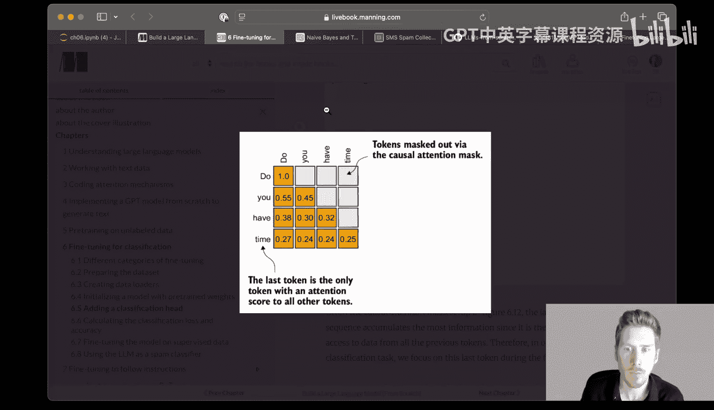

But the most efficient way to do that is to look at the last row and use these numbers to determine whether the input is spam or he because this one contains information about everything else so。

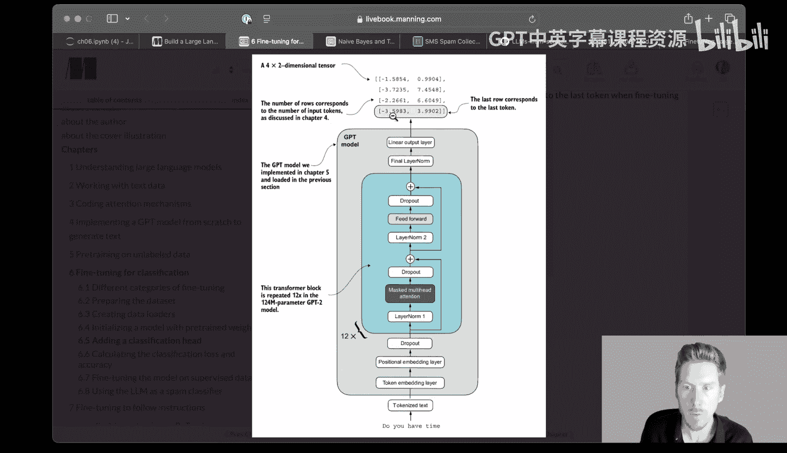

Going here again， the last token。

Do you have time？It has information about all the other tokens。

 So the context vector has all the information because we have the attention weights for that。

 And so the model。When we findune we'll learn how to use these attention weights effectively for making the decision whether something is spam or hem。

 And so that is why we only need to focus on the last position here。 But yeah。

 this is what we are going to do。 So we are going to next fine tune。

 the model to do this classification task。 And I think yeah。

 this will maybe then also make things a bit more clear。

And yeah， and so with that， we have modified the architecture and we will just in a few moments fine tune it。

嗯。So at the end of the previous section I mentioned that we are now finally ready for the classification fine tuning however there is one more thing we have to take care of and that is the calculation of the classification loss and accuracy and so we will be using the accuracy to track the progress during training and the classification loss is used similar to what we have done in chapterpt5 for optimizing the model weights so yeah in the grand scheme of things where we are we prepared the data set we initialized the model we lot the pretrained weights and then we modified in the previous section the model for classification fine tuning now this one more thing entails that we implement the evaluation utilities before we can move on to the fine tuning。

So I'm yet to just conceptually explain what is going to happen。

 So here's a figure that is maybe somewhat familiar to you because here there are similar elements to a figure that you have seen in chapter5 except that this is a bit smaller and simpler So in chapter 5 we explained how we go from the model input to the logicits to the softmax probabilities and then to the token IDs and here what we are looking at is the similar flow So we have。

 for example， you want the lottery as text input which goes into the LLM and then what we are looking at here is the logicits vector of the last row of the logics so。

Going back to the previous section， we had， for example， four tokens as input。

 This could be a text similar to you won the lottery and then we are looking at the output logics for each of the four token Is and what we said is we are going to focus on the last row so we are going to focus on this row here and so this is what you are seeing here。

 So these are the logicts corresponding to the last row in the logics tensor and then we could apply the softmax function to convert this into probabilities and then in chapter5 what we did is we looked at the position where we have the highest probability and that was our predicted token ID Now this is exactly the same concept except that instead of 50257 dimensions we only have two dimensions。

 one is not spam and one is spam that are shown here at the bottom So index position zero is not spam。

In exposition one is spam。In this case， the highest probability is at the first position。

 So the model would predict 0， not spam for this particular input。 As you might guess。

 this is not correct， right？ I mean， I'm guessing here， but I would say if you。

Receive a text message that says you want the lottery。 it's probably going to be spam。

 And so the model thinks with 99% probability that this is not spam。

 That's because the model is not trained yet。 we want to train it So that this probability becomes higher that this is spam and then the model outputs a1 and vice versa vice versa for the second input do you have time I would say this is probably not spam it's maybe a message by a friend asking us if we have time And then here in this case。

 the highest probability is at spam and so the model would output spam and also again。

 our goal is to you know shift the prediction more to what's not spam assuming that this is really not spam。

Yeah， and so we are going to implement this now in code where we essentially have the same workflow or similar workflow that we had in the previous chapter。

 And then when we have these predictions， these labels， we can compute the accuracy。

 So the accuracy is a measure that tells us how often the model is correct。 So for example。

 if we have00 let's say 100 text messages and the model makes 50 correct predictions。

 that's a 50% accuracy， It's basically random guessing。

 we want the model to get a accuracy that is close to 100。

 That means that it gets almost all the00 out of 100 messages classified correctly。 And so。

Let's first before we code the accuracy， let's first code what we are seeing here in this figure。

 this conversion from logicits to probabilities to the labels so。

Let's yeah work with the last row here like I mentioned before。

 and that was for the reason of the causal attention mask， as I said before。

 so let's go ahead and just call that our logicits So in reality these are the last row logics right so it's not the whole logics it's just the last row here that we get with the minus1 here。

And then let's compute the probabilities。 So we do Torch dot softmax and logics as input。

And minus1 because we have a 2D tensor。And then that's just。Look at this。

 and so we can see this is a very small number， something close to0 where this is， yeah， 99%。

 essentially 0。999。 So this means basically shifting the dot。By one position。 So we have 0。99。

 a very high probability。 So if we then used our torch arc max on。Probus。

 you should see a one because this is a much higher value than this one， for example。

 you can call that our label。For instance， like this。 And so this is our predicted label。

 If we want this as a regular Python integer， we can also yeah use the item method。

 which will just extract this as an integer。There's one more interesting thing maybe to mention。😊。

So we are executing this here on the Pro。 But as I mentioned before in chapterpter 5。

 So when we look at。

The lodges and the softmax probabilities， you might notice that the softmax is a strictly increasing function。

 so that means when we apply a softmax function to any vector。

 the ordering of the magnitudes will be the same， so what I'm trying to say here is if the largest value is at the first position。

Before the softm， it will also be at the first position after the softm。

 So the it preserves the position of the largest element， essentially that we are looking for。

 It's preserving the whole order of the values。 If you would sort them。

 the sort order would be the same before and after applying the softm。

 which means that so the softm becomes redundant here， So we can actually just。

Do los here and you will see it will be the same label。 So in a sense， we。

 we skip one relatively expensive， I mean， not that expensive， but we we skip a computation here。

 which is nice。 so we don't really have to apply apply this function here。For training。

 it is necessary， but as you remember， we also pass the logics directly into the cross entropy loss where the cross entropy loss is internally using softmax essentially。

Yeah， long story short。 When we just care about the label。

 we don't need the softmax because the relative ordering of the elements is the same。

 so we can just apply the arc max to the logics and save one computation。

 So now let's get to implementing the accuracy laer so that we can see how yeah how often our model is correct before we start training it。

 And then， of course， we want to see that it improves during the training。

 So let's call that Kc accuracy laer。 And so this will be analogous to the Calc loss laaughter。

 We implement it in chapterpt 5， except now， instead of computing the loss。 we compute the accuracy。

 By the way， we will also。Implement the car loss laer again later。 But let's for simplicity。

 just focus on the accuracy laer for now。 so we will。

Be able to pass a data loader that could be the training validation or test data。

All order then the model itself， I like to also pass the device here so that we can put data onto the correct device where the model is there are different ways to implement this。

 but you know I prefer to do it this way the number of patches so。Similar to the carg loss loader。

 sometimes we don't need to calculate the loss over the whole data set。

 so for example if we just need a quick estimate of the validation set and our validation set is very large。

 it would be pretty expensive to iterate over the whole validation set。

 so sometimes it's sufficient to only take two batches or three batches to estimate the accuracy。

So with that， we can control how many batches we want。

 So it's never a bad idea to put the model into evaluation mode。

 We might have done this at some earlier point， but just doing it here explicitly to make sure things like drop out。

 and so on are disabled all the random things in the model。 And then we can。

Keep track of the predictions。 So the correct predictions。I'm just seeing I made atypo here。

 the correct predictions and the number of predictions in total that will be used later to calculate the accuracy。

And then we could have yeah， just like a little。Senity check， so if the number of fetches is none。

 then。Let's just use the whole data set。So here we will do the length of the data loader。

 So that means use all the data points in the data set。Yeah， and so so far as so good。

 And let's say otherwise we。Take。😔，The nu batches。 but we let's make a small modification。

 So we say nu batches， the minimum value between this and also the length in the data load。

 So this will prevent issues where， for example， our data set only has two batches。

 but we specify 10。 and then you know， it would crash or something like that。

 So here we say whatever number is smaller。 So if we define 10， but our data loader only has two。

 then we only use 2。 It's just like a little safeguard here。 And then we say for I。Let's say input。

Btch。Target。Bch in the data load enumerate。Oops data lower So here for each of them。

 we will say if the number is smaller than fetches。We keep working on this right。

 so if I number sorry smaller than the batches。Then we will first transfer。The data。

Onto the target device。So to device and target。But， also。To。😔，Devicice。So yeah。

 right now I'm just double checking， I just want to make sure one， two， three， four。

 everything looks correct。Yeah， usually don't code in a Jupyter notebook I usually use Vi Studio code with torch。

nograd。😊，That's maybe you make a。Yeah， computer logics。 So here logics equals to model， and then。

The input batch where we have it here。And like I said before， we will only use the last row。

And then yeah， we convert convert this to predicted labels。 And this will be using。

Our computation here。Um since we have similar， yeah， I mean， I think it doesn't hurt just too。

At the minus1 here， similar to what we have done here。I think it's not strictly necessary。

 but not a bad idea。forgotve a T here。What else？ So now we have the predicted labels。

 And so we can increment the number of。Let's say。Call this example。

 It's a number of examples we have。Encountered so far， nu examples， class equals， and then。

The number of rows here， the shape0 should contain the number of examples。

 So this is just we could also get that from the input batch。 It's the same。

 It's the number of rows or number of elements in that case。What else， So now， of course， the。

Important part would be the correct predictions， so。Here。Simplesst way， how we can say。

How if we have some correct predictions is just to compare it to the target batch。 so for example。

If I have a torch tensor， let's say labels one，23。😔，we have， let's say， just 0，1，0，1。And this is our。

Let's say correct， or let's call that target。And then we have predictions。

Let's take this one and change one number here。And so if I compare those two。

 I can use the equal sign and it will give me a boolean。

Aray where true means it's similar and false means it's not similar So maybe just lining them up here then it's a bit more clear So we are lining them up here and so what I can do is I can then use the sum to calculate how many of them are correct so in this case this should give me a four because I have for correct predictions and I can return this as an item for example and what I can do is。

I can say target that shape0， this should give me1，2，3，4。

5 divided by oh let's do it like this sorry4 divided by5 and this gives me essentially the accuracy if our data set only consists of five examples so here。

This gives me 0。8 or 80% prediction or accuracy，4 or5 are yeah。

 calculated or predicted correctly and so。We can use that to。Compute the accuracy here。

 we can say the number of correct predictions。Oops， is equal。Oops。So sorry。

 the accuracy is equal to the number of correct predictions。

 similar to what we have here divided by the total number， which we kept track of here。

So this is the number of correct predictions divided by the number of examples or total predictions。

 I'm just double checking if everything looks correct。 I would say this needs to be indented because。

We do this yeah， for each case where this is true。 If this is not true， then we want to， of course。

Exerit。So I think this should work。 I'm pretty sure I made a typo， but we will see in a few moments。

 So let me also define because we're going to need it here。 the device。

 So the device I usually like to do torch device and then。C up。I have tor dot ka os。Is。宝贝老公。😔。

And otherwise， we will use the CPU。 And yeah， like I mentioned in chapter 5。

 you might also want to use just the MP device， but。Again。

 numbers might slightly differ if you use the MP S device。

 And then let's put the model to the device。And let's just use a random seatd。

Should not be necessary because we are completely or if we are completely iterating over the data set。

 we don't need random seed， but if we want to， for example。Only do it for 10 batches。 How many。

 by the way， do we have。Let me double check。We had somewhere。Checked the length of the dataset set。

 It's been a while here。 So if we only want to take 10 batches just to you know accelerate this a bit。

 the if we have shuffling in the training set， it will of course， give us a different 10 batches。

 So in that case we are setting a random seat so that you should hopefully get the same accuracy that I'm getting so let's say train accuracy and then we initialize our cal calculate accuracy lot on the training set。

Train order， the model device。 And then let's say nu。Bts， let's say 10。So in this case。

 this hopefully gives us the training accuracy so let's see if this works or whether I made a typo here somewhere。

Yes， so there is something that is not working correct prediction。

 So I think this should be correct predictions。And this is it seems to be working。

 So let's see what the calculation gives us。 Okay， so I forgot one more thing。I should have。

 of course， applied the。😔，Some item here。Looks better。 Or I hope it， it works。 Okay， so point46。

 So this is our accuracy。 So this is essentially 46。25%。 and we can do the same thing also for the。

Validation accuracy。Well。Loaughter and then the test accuracy。So， 45%。And then the test accuracy。48%。

 so they should be all very close together。 however。

 note that we are estimating the accuracy of the training set by only sampling 10 out of the 130 batches。

 So if you want to get the exact training accuracy you can do yeah non batches none but yeah this is just like a rough estimate to estimate how accurate the model is and you can see it's roughly you know 50% it's kind of like guessing here because it has not been trained。

 So it's just guessing whether income input example is0 or1 and if you are just guessing and you have a yeah 50% chance being correct or incorrect。

 it should roughly be 50%。Yeah， and so this is what we have here for the accuracy laer。

 Now let's take care of the loss laer because that is also what we need to yeah optimize the model。

 So for that， let me go back to chapter 5。So we had the death。😔，Ca Loslaughter somewhere here。

 Los patch and lostlaughter。 Let me just， let me copy just this one for now。

So here we have the loss loader。 And notice we make one modification。 Of course， we do。

The last row only instead of everything。 and then I can actually get rid of the flatten。

 We don't need to flatten anything anymore。And this should be my losslaughter。

 And then we can use also the same。Sorry， the last batch。

 we can use the same loss order notice we can't really import this technically from the previous chapter。

Because this one is now different， right？ So this， we， we have changed this slightly。

 So if you just import this from the previous chapters file。

 you might get unexpected results because your clock loss loader would be using the clock loss batch from。

That file。Which is。Slightly different。 maybe it's not even in here。 Okay。

 so it's also maybe better that it's not in here that it haven't copied it in here。 But yeah。

 so I recommend just defining it separately here and here for this particular chapter。Yeah， okay。

 And so this hopefully works。 And then we can use。It's similar to what we have done before。

 so we can calculate the training set loss。Like this。

 And then I can also do the same while it's calculating for the validation。And。嗯。Tested。

And these are our initial values。 So what we want is we want to reduce this to0 and we want to increase this number so it becomes one。

 so 100% accuracy。 So yeah so this is so far what we have set up in terms of how we evaluate our model and then in the next video like I promised earlier。

 we will be finally finening this model。So we are finally ready to finet the model here the headline says fine tuning the model on supervised data supervised data is just you know jargon deep learninging machine learning jargon where supervised means that we have a labeled dataset in our case it's the spam classification dataset so essentially what we are doing in this section is we are fine tuning the model on the spam classification data So yeah in the grand scheme of things we took care of these seven steps already so the remaining steps in this chapter fine tuning the model evaluating the model and then using the model on new data So if I go to the fine tuning section there should be a figure here so and this figure is almost identical to the figure we looked at in chapter 5 when we set up the training loop so what we are doing is we are still iterating over epochs where one epoch now is one pass over the spam classification dataset then in。

For each batch in each epoch。We reset the loss gradients from the previous iteration。

 we calculate the loss on the current batch， so that would be the cross entropy loss。

 it's still the same cross entropy loss。Then we calculate loss dot backward。

 So this will calculate the loss gradients that we need for updating the model and then the optimizer do step method。

 So the step method of the optimizer will apply these loss gradients to update the weights and then yeah we then we train sorry。

 then we print the training and validation set losses to make sure the model makes progress。

 And yeah， I'm just seeing。It's funny so I'm just seeing this is exactly the same figure we had in chapter5 So when I submitted my draft figures for the manning layout team maybe the figures look so similar that the layout team use the same figure also in chapter 6 but there should be a subtle difference so here in step8 it should say calculate the training accuracy and validation accuracy because yeah our model now it's not a text generating model so our model won't write text it will only return class labels0 or1 so it would make sense during the training to yeah calculate the accuracyacies to see how good the model is at a current epoch and also track it over the epochs to see if the model is making progress or not so yeah theres there should be a subtle change here where it says compute training and validation set accuracy so maybe my figures look too similar and they just copy and pasted it anyways。

I'll let them know and hopefully they can update this。Yeah。

So what we are going to do now is to implement the training function and the training function is actually almost identical to the one we used in chapter5 so I'm just copy and pasting it here and then I will talk through it yeah like I said it's very similar to train model simple in chapter5 now it's a classifier that we are going to train and I do have something also here like to more lists where we are tracking that training and validation acuracies in addition to the losses so we can also plot them what else is new I mean everything here is exactly the same so if anything is new here I would say check our chapter 5 so then yeah otherwise if there's no question you know。

You can ignore this for now because it's exactly the same as we discussed already in great detail。

 There's only a little change that I annotated here here we are tracking the number of training examples instead of the tokens because here we need the number of examples to calculate the accuracy essentially so we will。

Yeah， not to calculate the accuracy， but when we are plotting things in chapter 5。

 we looked at how many tokens we have seen how we can say how many examples we have seen because yeah。

 the the accuracy calculation happens inside those。

 So for that this will already do the tracking internally like we have defined。Here。

 so here we will already also track how many examples we have in the la。

 This is really just later for the plotting。 Okay， and then like I said， this is just。

Printing the training and validation loss so that we can see whether we are making progress during training and we do the same thing for the training and validation accuracy。

 but we only do that that for each epoch so here this is every so in so many steps where this is something we can specify。

 for example， every 102050 steps but we only calculate the training and validation acuries after each epoch because that is relatively expensive。

And we have an e so that we can say only for two batches or four batches to keep it a bit cheaper to make the training loop a bit faster because like I said。

 if we have a large training set this might take a long time and ultimately it's not that important to have a super accurate training accuracy calculation during the training it's here just for a rough estimate later on once the training has finished we can compute this on the whole training set but right now yeah it's sometimes useful just to keep this relatively cheap。

 maybe do this only for one，2，3，4，5 batches or something like that instead of all the what we have 130 batches because that would be slowing down the training quite a lot yeah so this is our training function。

There's one more thing we have not defined。 This is the evaluate model method or function and this function is the same function in terms of the code that we used in chapter 5 we just have to redefine it now because the car lost loader has changed So this one is also the same as in chapter 5。

 but we changed the car loss batch here。 So we only used the last token and this one is used。

Somewhere in here right and so and then because this has changed based on this。

 we also have to redefine this one because if we import it from the previous chapter it will use the old Calliclos loader which uses the old Calliclus patch so I just recommend for this chapter to redefine this one this one。

And。This one but the code here you can see it's exactly the same Okay so let's execute that and then we can finally look at the code for executing the training so what we are looking at here is I'm importing the time module in Python so I'm just using that as a rough estimate of how long the training takes I just wanted to know how long does it take you know instead of using my stopwatch using Python to calculate how long it takes to execute this training and so how it works is I'm getting the start time when I start the training I'm getting the end time so here's the training function and then I'm computing what is the end time after the training has finished and then I compute the difference between the end time and the start time and so this is in seconds and then I'm dividing by 60 to get the time in minutes and I'm just printing this just you know for my own。

And so I got about five minutes when I was executing this。

 and this is an on an old computer Mac mini。Sory， a MacBook Air from 2020 and yeah so it might be a bit slower when I'm executing it now because I'm running the recording。

 the screen recording and I'm also running the camera here for the camera recording all on that small little laptop which might get pretty hot when I'm running this but I think it should be somewhere between five and 10 minutes we will see in a few moments I'm setting the random seatd here So because yeah for the shuffling of the training set and so forth we have evaluation frequency 50 that means every 50 steps we will see the loss and then we will calculate the accuracy of the validation set and training set for five batches like I mentioned before to keep it relatively cheap we will only use five batches and we will train for five epochs。

And the optimizer is exactly the same that we used before。 I think I updated the learning rate a bit。

 So how I determined this I was running this multiple times and was just observing based on the validation set accuracy。

 what is a better setting So yeah hyperpera tuning by observing the validation set accuracy and this weight decay to reduce overfitting。

 So let's execute this and I'm just thinking what I could talk about in the meantime。

 So I do have some bonus material I can maybe show to you but let's maybe for a few seconds。

 stay with this execution。 I just want to make sure that the model is training correctly。

 So how do I make sure I will look at the initial loss and then I will wait for the 50 steps essentially to see what the training and validation losses are and I want to see that this is going down and if it's going down then it's looking good then we will keep training this in the background and I will maybe go over some of the bonus material So let's。

Give it a few seconds here。IThink it should not be too long just looking at my device stats so the computer is getting a bit warm。

 but it is in moderation here， so should not be too bad， I hope。I mean I'm here we go。

 So we have02 and then 0。62 sorry 2。1 and 0。6 and 2。3。6。

 so we can see the training set loss is improving the validation set loss is improving so our settings are good here everything seems to be on the right track so let's keep training and I will talk maybe through some of the bonus material。

 So if I go to my Github repository。

Here， so I have a bunch of bonus material。 by the way， the bonus material is stuff that。

Didn't quite fit into the chapters itself because yeah a book can't be infinitely long。

 There can only be so many pages in each chapter。 There are some guidelines by the publisher too。

 so there are some interesting topics which are interesting but not essential and some readers also honestly might find them distracting so I just had some additional bonus material that that I'm sharing here and there were also some questions by readers where I felt like okay。

 instead of just writing this answer in an email let me put together a notebook upload this so that I can reference it in the future and so for chapter 6。

I have three sets of bonus material here。 So first。

 additional experiments on fine tuning with fine tuning different layers and using larger models。

 So here this is quite a lot。 So I ran one。19 additional experiments。

 So using the same code you are seeing here in this notebook， I put this code in。To this file。

 And then I made modifications。 So it's， I mean， I would say it's a lot here because I'm having 19 different experiments in this file。

 but I made it so that you don't have to really， unless you want to。

 you don't really have to read the code。 you can execute this from the command line。

 So for each of the 19 experiments here， I'm showing you how you run the experiment。 So for example。

 this would be exactly the same code that we are running in the notebook。 and then。For example。

 we might want to change the position of the trainable token。 So here trainable token， the first one。

 as wait。 So what that means if I go。it's already， no， it's on epoch2 so。Let me。Well let me go here。

 So here we have the los and then we say we go to the last token and the reason why we are doing this is because of the causal attention mask。

 like I explained here， that the last token has the information about all the other tokens。

 The first token only has information about itself。

And so。What you are looking at here is a control experiment where Im。

 you know only training the first token， so what I'm essentially doing here is I am replacing this by a0 where I take this first row and what we would expect is pretty bad results because like I mentioned before。

The first token only contains information by itself。 And so when you run this row2。

 we can go to row 2 and see what we get。 We get still 78% on the training set and 75% on the test set。

 So this means that So it is still actually。Classifying certain cases correctly。 Why is that。

 It might be that in certain cases， the spam is like very obvious based on the first token。

 maybe if it's all capital letters。 or if it's a dollar sign or something like that。

 So there is apparently enough information to make classification that is better than a random prediction。

 So we get 75% for balance data set with 5050% non spam and spam。

 we would get or expect a 50% accuracy。 So it's actually quite interesting。

 So the first token contains quite a about information。 But compared to the baseline here。

 the baseline is 95% when we train the last token， of course， it's worse。 So yeah。

 I'm just explaining。 So this is a control experiment。 I would not recommend it。 But yeah。

 this is one thing to do then。Trainable layer last layer。

 So this would be training only the last layer instead of also training the last transformer block so we can see when we only train the last layer instead of the last transformer block here。

 this trains the last transformer block this only trains the last layer we get only 70% accuracy row 4 so I can also just read it from here here we are training the last two blocks so remember I showed you this here。

 this figure。Where we looked at training only the last layer and here the last two transformer blocks in our code we only train the so last transformer blocks sorry and last two transformer blocks in our case we are training only the last block。

 what happens in our case if we train the last two blocks and。

What we can see the accuracy goes up slightly， so from 95 to 98%， but also the time increases。

 And by the way， here， I think I was using a different machine。

 not the MacBook air I'm running this on right now。 I think I was turning this on a GPU a 100。

 So that's why it's faster on the laptop。 It takes about 5 to 10 minutes。Yeah。

 so there are all bunch of experiments。 Here's an experiment where I'm running it on all。

 So I'm updating all the。Permatus instead of only the last two blocks and you can see there are diminishing returns so here we have 98% here we have 96%。

 I suspect this is because of overfitting because you can see here the accuracy the training accuracy goes up validation accuracy goes down compared to here so you might someone might expect or I would expect this is probably due to more overfitting so we are training too much because the data set is too simple here。

yeah and you can go through all the other ones。 there are a lot of experiments。

 so there's also a technique called Laurara which stands for low rank adaptation Let me by the way see how far we are in the training。

For so were almost done。 So yeah， I encourage you maybe to go through this on your own time then。

 So there' is also Laura in。Appendix E， which is。A technique for parameter efficient fine tuning。

 So here also really nice accuracy。 Yeah， lots， lots of experiments。

One I think important thing I should say is we will get back to that later when we prepare the trainings that we so that's what the longest train stands for。

 we had 120 characters and we were patting everything to the same length。So that means。

Position 120 is important because that's the token that's trained and if we have new examples。

 let's say we get new text messages， even though it has nothing to do with the training anymore。

 we still have to pad them to 120 characters because we only train this particular position token position essentially。

And so if you don't want that， if you want to have a variable length。

 you could technically set the batch size to one。And if we set the batch size to one。

 we don't need any petting。So because in a training set。

 we did the padding to fill up a batch with multiple examples and then a tensor needs to have the same row length for each row。

so here， yeah， so here if you set a batch size without padding， essentially， you can say batch size。

 batch size one and you won't have padding。You can also here do this with a batch size of8 without padding and how I did this is I was so maybe too technical。

 but I was simulating a batch size with a technique called gradientd accumulation。So let me see。

 I hope I， so I have not prepared anything here。 So I'm doing this very spontaneously。

 but I do think I have。

Gradient accumulation。

I do have article an article on that。 So if you're interested how gradient accumulation works。

 you yeah maybe want to read through this。 so it's simulating。

The batch size by iterating multiple times。Here， by iterating multiple times， but then。

Not using the step and the zero gridd。 So some people might have wondered why is this zero grid necessary when we train a model in Pych so why does Pych not take care of this automatically for us。

 Why do we as users have to worry about it And the reason is that it allows yeah more flexibility so that we can experiment with different things as researchers and here if we want to accumulate the loss over multiple batches we can use the zero gridd in the step only every so many epoch So for example。

 if I want a batch size of 8， but a batch size of 8 doesn't fit into my computer exceeds the Ram or the GPU Ram I maybe I want batch batch size 8 because it's a more stable loss but I might have to do a workaround where I。

Have an actual batch size of one。 I treat the model with a batch size of one。

 but I I do only the epoch update。 sorry， the batch update every eight examples。 And in that case。

 I simulate the batch size of8 by not updating after each step。 So if that is confusing。 sorry。

 it's also not the topic of this video。 I maybe encourage you to check out this article。

 it will probably be more clear if you， yeah。

Sit down and read through this article I can maybe in the future also make a separate video on this sometime。

 it's just like a simple trick long story short and this is what I was doing here so with that I have still the same batch size that I had before up here but now I don't have any padding and you can see actually it's good for the accuracy so the reason why we are doing the padding is just to keep things simple in the next chapter in chapter 7 we will take also a slightly different approach and so there are more experiments if you are curious and here are the commands to run these experiments and then here is also like a write up where I explain in words what each of the rows is doing and what the baseline is so the first one is the baseline row 1 the default and then versus row 17 I'm explaining what I did there and what it means and so forth。

So if you are curious about certain things， why we are doing the things we are doing in this chapter。

 this bonusous material might answer some of your questions because yeah。

 these are additional ways how you can train it also with larger models。

 what is the accuracy here and so forth。So this is one set of bonus material and then I do also have this bonus material where Im applying this to a bigger data。

 so this is the IMDB movie review data where there are 50。

000 movie reviews positive and negative movie reviews and the task is for the model to predict whether the reviewer like the movie or not based on the text。

Yeah， and so I'm running the model from this chapter only for one epoch because it's a larger data set。

 It's more expensive。 And then I'm comparing it to a model called B。 So bird is。 so if I go to the。

Attention is all you need paper。

So GPT models， I think I mentioned this before， GPT models。

 all the LLMs that you're using like in chatt GT Anthropic cloud， Google Gemini， Deepse。

 they are all deco decoder modules， so the decoder is what you're seeing here on the right hand side。

 so this is the whole transformer architecture and the transformer architecture consists of an encodeder。

And the decoder。 and the encodeder。So this was originally developed for language translation and so here the encoder was encoding the input sentence creating a representation。

And then passing it to the decoder and the decoder is generating the output text。

 It turns out that the encoder is not necessary because as you might know。

 the chat GPT models are really good at text translation。 So it's not necessary to have this encoder。

But a long story short， the birdRT model。On the other hand。

 so chattGPT and the GT model we implemented Deepepsek， Google Gemini and so forth。

 they are this decoder part。But birdt models are models that are just the encoder part。

 So bird models can't really generate text。 They are more meant for generating a representation of the text that we can work with in terms of classification and so forth。

 And so the birdt model I am training here is an encoder。 and encoders are traditionally。

Slightly better at text classification。 So I'm comparing this G model to this birdRT model here。

 and you can see in this case， it's not necessarily true。

 So this birdt model is actually worse than this G model yeah。

Distilled bird is a smaller version of that。 This is actually quite good。

 So for some reason the smaller distilled bird model is better than a big bird model。

 And so here you can see it's almost the same accuracy there is something called Roberta which is another flavor of an encoder and this gets 92。

95% theres actually a few weeks ago there was a new model called modern bird。

 which I think is also really great， it's just like a modern version of the encoder but yeah I'm saying that because if you care about classification you might want to check out encoder models here in this chapter。

 the reason why we are training the G model is first it works quite well right so we see it is actually working quite well and secondly it's a good introduction to fine tuning before we do the instruction fine tuning in the next chapter。

😊。

Okay， so this is one more bonus material you might find interesting。

And a third one here is a simple user interface。 If you are interested。

 taking the model that we have just trained， putting a user interface around it so you can interact with it similar to Che youp。

 You can so you can write this text here and it will say spam or not spam。

 So it's just like a nicer interface than our Jupyter notebooks。 if you are curious。

 It's just very simple code here based on chainlet。 So just very simple。 Okay。

 I think I talked for a long time。 I see our model finished training。

 It just took 11 minutes on this computer。 It used to be faster。

 I think it's all that recording stuff。 I'm running here。 but we can see that。

The training loss went down it almost went down to yeah0， which is really great。

 The validation loss2。 So they are both in the same ballpark， which is actually really great。

 So this indicates that there is minimal overfitting and the training validation acricacies are also relatively similar。

 indicating that's only very minimal overfitting in this case here。

 based on that we might say there's even no overfitting because validation loss is smaller than the training loss if there was overfitting usually we would see the training loss being better lower or better than the validation loss this could also be。

 though， because we estimate based on the number。😊，Of patches。 and that is in our case。

 a very small number。 it's just5。 So one question now that I'm thinking about this could also be that you might ask why do we actually not optimize the training accuracy correctly directly So why do we minimize the loss。

 Why don't we just maximize the training accuracy with a loss function and that is the simple answer is because accuracy is not differentiable So that would require talking a bit about calculus and so forth。

 How we calculate gradients。But since accuracy is not a smooth function。

 we can't really calculate the gradients of the accuracy。 And that is why we don't。 Yeah。

 directly optimize or maximize the accuracy。 Yeah， so we have now。Our results。

 So one more thing before ending this probably very long video is to calculate sorry to plot the results so that we can also visually see them。

 So here I have a general function to plot the values。 Nothing really interesting。

 It's just based on that plot lip similar to what we have done before。

 and then let me first plot the losses So we can see the loss goes down So I'm just looking at things we were looking at here but it's always a bit simpler to look at it in a plot so we can see things much more easily because yeah here we would have to track the numbers and look at them and here we can see oh。

 the loss goes down， which is great。 and they stay approximately the same。

 which is also great So thats minimal overfitting the model yeah learns to generalize pretty well。

 And then let's also look at the aquaacies。😊，So here we can see they start off a bit shifted。 This。

 again， is only an estimate based on five batches。 So when we calculate the accuracy。

Over the whole training order and validation order might look a bit different。

 But here we can see it's relatively similar。 So minimal overfitting， some overfitting may be here。

 but not too bad。 So if we then lastly compute。It might take a while。

 So let me just start running it。 and then I'll talk through this。

 So here we are now computing the accuracy over the whole training set。

 the whole validation set and the whole test set。 So what it will do is it will use the default parameters。

For。Where are we here for the nu batches and then we can get an idea what is the actual training accuracy。

 what is the actual validation accuracy and what is most importantly the tested accuracy so it might take a while So yeah and then once we have finished that there is only one more section left in the next video where I will tell you how to use this on new data but I will do it separately let's just stay patient maybe the meantime。

Coming back to this chain is just like one way of building a nice user interface。

 you can run it locally or also remotely and then yeah have a nicer interface。

Because everything in the book here we are doing to understand how the internal work。

 so if I were to develop an app， for example， I would take a different approach so a notebook it's a great way to have plots and everything in the same place。

 but if you are developing an application。

You might want to structure the code a bit differently。 So， for example。

 having Python scripts and in this case。Where was I。

Sorry， organizing it like I've done here or even differently and。

Yeah， here everything otherwise is the same。 So I am defining the path， the tokenizer and so forth。

 I'm loading the checkpoint。 I'm loading my model。That I have trained。

 and then I have a function to basically execute this。

 I I also should say I'm not affiliated by any means with Chanet。 I just found that this is a nice。

 minimal example。 Some other people use streamlit， for example。

 Also lightningI has a great litur library where litserv is also really s。

So I used to work with Lisservf a lot。 I still do。 It's a very nice， fast way of serving model。

 So also something worth checking out。 it's a open source library。

 So there are lots of options Our approach here is focused on looking at the code to understand how things work without using any external libraries if possible so that we get the maxal understanding。

 And so the calculation has finished so I can finally stop rambling on about coding design and talk about the results so we can see we get a 97% training accuracy。

 We get a 97% validation accuracy and 95% test accuracy。

 So based on this I would say there is no overfitting but maybe。

Because that is usually what happens when you use a validation set。

 I tweaked the settings so much to get a good validation accuracy that I have some slight bias towards this validation set And if I have a totally unbiased data set。

 a new data set I have not worked with before like here I can see this is slightly lower it's expected usually because I used the validation set quite a bit when I was。

 for example， determining the learning rate， the weight decay and so forth。

 and that's why it's usually a good idea to have a test set where it's like an independent evaluation and the same can be set about。

These additional experiments。 So here I am looking at the test accuracy。

 And if you were to do that and select the best model on。But based on the test set here。

 you would again。Yeah， introduce a slight bias。 So in that case。

 it would be a good idea to have a second test set to evaluate the performance of the final model after new selected based on this test set。

 And yeah， if you' are interested in model evaluation and selection。

I did have this paper here that I recommend I'm pretty both there and explain all the different trade offs and everything that might be a good companion if you are interested in building a classifier。

 but for now let me take a short break and I will be back with a next video on using this model in practice on new examples。

So we have arrived in the final section of this chapter using the LLM as a spam classifier。

 This essentially means that we are now implementing a small convenience function so that we can use the model that we have just trained on new texts。

 for example， if we have a new text message that we can classify whether this text message is spam or not spam So in the grand scheme of things where we are right now is we are。

Here in step 10， we prepared the data。 We downloaded the data set。 We loaded the pretrain weights。

 Most importantly， we fine tuned the model。 We evaluated the model。 and now we get to use that model。

 So for that， let me define。A function called， it's call it classify。Oops。That's my text。

 One of these days， I have to find a better keyboard position。 I'm usually not such a bad typer。

 It's just because of the recording。 I have my keyboard at an awkward height here。 So， of course。

 what we want to classify as the text。 we will need the model。

 We will need the tokenizer to prepare our。😊，Input data。

 we will need the device to make sure the data is on the same device as the model we can。

 or we should define a max length。So that we can say how much padding we need to make sure the examples are padded to the length that we or that our model expects based on the training。

 And then， of course， when we talk about paddings or padding， we also need the pad token。Id。

 and for that， we are going to use the。You're going to use the end of text to token 500256 Now of course。

 the first step to preparing the text is of course， like always encoding it， tokenizing it。

 getting the token IDs here。Then we， let me make a。Hel a variable here。

 let's call that supported context。leength。So here I will just assign this length of the inputs that the model supports based on our configuration file。

 we know it's 1024， but to keep that function a bit this variable。

 the way we extract this information a bit more general， we can actually just。

Get that from the positional embedding matrix， right， because the matrix here。

 the number of rows is the context length。 So that's what I'm assigning here。

And then we can accordingly。Prepare the length of our input Is。 for example。

 if it's a very long tensor right So if it's very long。

 we might want to truncate this right so we want to truncate it down to supported context length because otherwise the model will crash and if we have a max length defined So its like this if we have max length it will use that one assuming that the max length is smaller then the context length So here it will now I think I mean a type of it will now get whatever of those two values is smaller。

 So in case in our case max length is 120 So it will use 120 and trunnccate them to 120 if the input ids is let's say 200 or something like that Now we also have to take care of the case where the input ids are smaller right so if we have input ids of token id20 of them in an text message。

We want to pad them to 120 to make sure it's similar to what the model has seen in the training set。

 So I mentioned in the bonuss material in the previous section that there are different ways of doing it。

 but in our case the way we have set things up the model always expects the last token ID at a certain position so we have to make sure we apply the padding to make sure position is always at the same point。

So how do we do this， let's do， I mean， there multiple ways， let's just do it simple here。

 we used the token ID。And then， we calculate。Let's do it like this。

 How many do we need the max length。 So if we have max length120 and our actual length is。

 let's say 60， it will add 60 tokens so we can calculate the size。

Just using length because this is still a python list。 So if our input is 60， max length is 120。

 it will add 20 pad token Is to our input。Tsors， token ideas。 Okay， so far so good。

 So one more thing， our model。😊，Doesn't want Python list。 It wants Pythwatch tensors。

 So we have to convert this to a tensor。Inputs， IDs and then can also specify the device。

 So it's directly initialized on the device instead of doing it like this。 I mean。

 we can also do it like this， but。Doing it like this is even better because it will initialize it directly on the device。

 And then our model also likes batches。 So we are adding the batch dimension here。 Next， of course。

 the model needs to generate the logics。 So let's do no gra because we're not training anymore。

 we get the logics based on the input I。 And then， of course， we are interested in。The last token。

 Okay， so that's what we have here。 Most interestingly， we want the predicted。

Label and for that similar to before， we can use the torch arcm on the logics and then of course it's 2 d dense。

 so we do a minus1。What else， So next I think this is it so we can based on that。

 we can actually return the prediction so we have the predicted label so we can just return it。

I mean， we can return 0 or1， we can directly return this， for example as。嗯。The number。

 we can also just say if， if it's one return spam， it's maybe a bit nicer spam if predicted。

Label equals one。And else。Not spam。And I hope this works。 It looks good so far。

 and so we could technically now。Give it some sample let me just prepare some sample here So here we have you are a winner you are a winner。

 you have been specially selected to receive $1000 cash or a $2000 award。I mean。

 might be legit that to me， this sounds pretty much like spam。

 maybe I'm just like this person who always deletes these messages。

 but my first intuition will tell me in this day and age， this is spam。

 So let's see how good our model is doing。 If I have notypo this time。

 if I have implemented correctly and it does seem like I did everything correctly here。

 So we or the model predicts that this is spam。 So let's do another one。😊。

So let's classify I have some other text here and I will just provide let's classify another one。

 Hey just wanted to check if you are still on for dinner tonight。

 let me know and this is usually in my opinion， something that sounds legit of course depends on the sender but yeah let's see what our model things So in this case it's not spam and so with that we have now a spam classificationifier that we can use I mentioned before you can put a nice interface on it like this chainlet interface or you can develop your own independent interface。

 if you know some basic you know web interface programming and so forth。

 whatever you like so but this is how the code works。

 this is what underlies our spam classifier and it should yeah work now on text messages Of course you can also if you're interested extend this to other problems like email spam classification document classification all kinds of things but one thing if you want to use this later one thing that might。

Be useful is saving the model。 So similar to what we have done in chapter 5， we can use the model。

Not state died here and save the model。 we can give it some name， like review or。Text。

Classifier dot PH in case you are wondering in the book， I think I always say review classifier。

 it might be an artifact because I first worked with this movie review data set so and I figured out okay。

 this is too large It takes too long to train。 It might be nicer for readers to work with a spam classifier。

 So maybe I should have just called it text classifier instead of review classifier。

 but in case you are wondering and then yeah this will save the model。

So we can go in here and see it should have。嗯。I don't see it right now Oh I'm in chapter5 actually because I think I had it open for something else here we can now take a look and see it's saved here as text classifier and then we can load this in a new session so if I were to initialize a new notebook for because I'm lazy right now I'm not doing it but you have seen how it works in chapter 5 so we can load the state detect with a torch lot function and then the name。

Text classifier。Here， and then we can also say。Where we want to load this on our。

Deevice that we have specified， and then。This will lot the state dictate。😔。

Like this and hopefully this works all keys matched successfully and yeah with that we have now our spam classifier that we can use and this I hope was a nice introduction to fine tuning how we update a model that has been pretrained just scrolling up because in the next chapter it's actually my favorite chapter we will be fine tuning the model for becoming a personal assistant like instruction fine tuning the model to do other things not just returning class tables but answering with full sentences and doing different types of things and so forth。

 so stay tuned for chapter 7 where we will be instruction fine tuning the model。

