# Sebastian Raschka《从零开始构建大语言模型｜Build a Large Language Model (From Scratch) 2025》 - P7：-7-Build an LLM from Scratch 7： Instruction Finetuning.zh_en - GPT中英字幕课程资源 - BV1BCfdBqEVv

Hi and welcome everyone to part7 of the supplementary codinglong video series for theBuild a largege language model from scratchtbook。

 My name is Sebastian Rashka， I'm the author of this book and in this video I want to teach you how to teach LLMs to follow instructions。

 It's essentially one of my favorite topics you of course probably are familiar with ChejiBT where you know we can ask ChetyBt simple questions like translate maybe hello world。

😊。

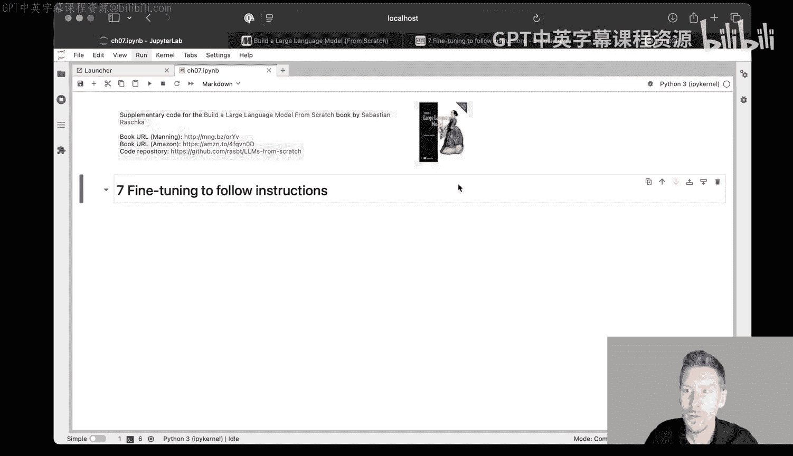

To German and other simple things or even complicated things。 And the LLM will assist us with that。

 And so we are building in this chapter a small personal assistant that can do similar tasks。

 And in my opinion， that's one of the most fun things one can do with LLMs so。

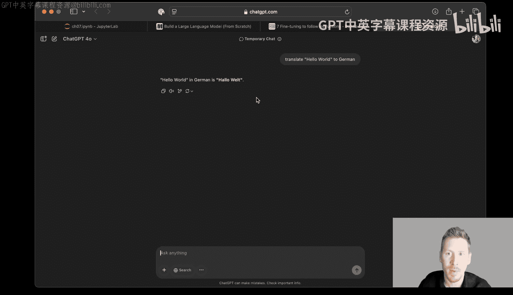

The grand scheme of things where we are。 and we are here in the final section of this book。

 So previously， we coded the LLM architecture， set everything up to pretrain the model。

 And then we allotted the pretrained weights from Opi。

 And using those weights in the previous section， we fine tune the model as a classifier。

 which was fun。 And so the model was able to say whether a text message was spam or not。

 but it was also pretty limited。 It could only say spam or not spam。 So in this chapter。

 we will be making the model a bit more general that it can。😊。

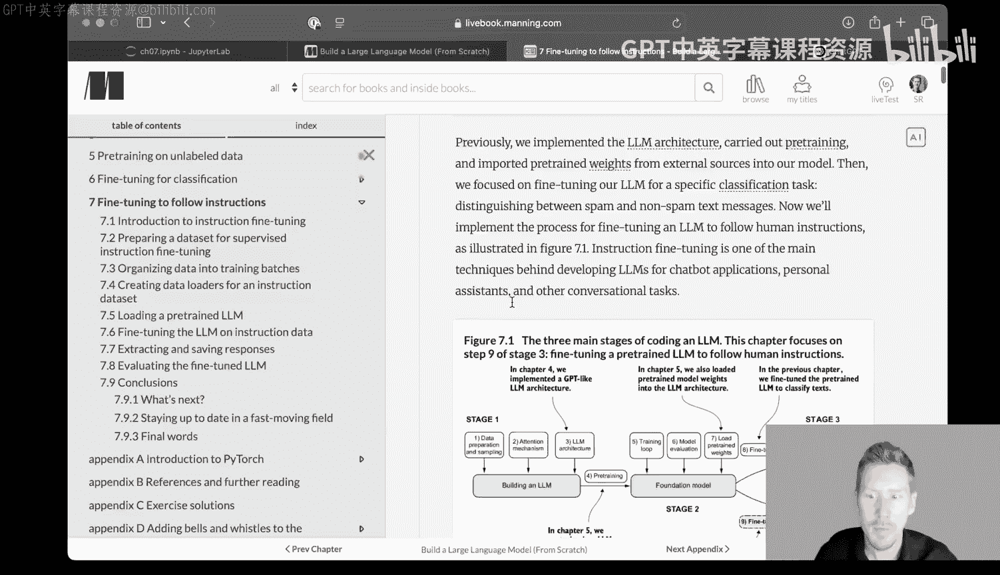

That the model can respond with free form text and it can also process multiple types of queries so it's more able to understand what we want from the Lm and it is more flexible and can do more things。

 Of course the model we are going to develop here won't be as powerful as something like chattGPT because you know that would cost us millions of dollars and we want to keep it a bit simpler for educational purposes so that you don't have to spend millions of dollars but the concepts are similar。

 So here we are just doing it for smaller model with a smaller data set and so forth。

 And yeah I think it's a lot of fun and it also helps us understand essentially how these technologies or how these techniques work that we use to develop these technologies。

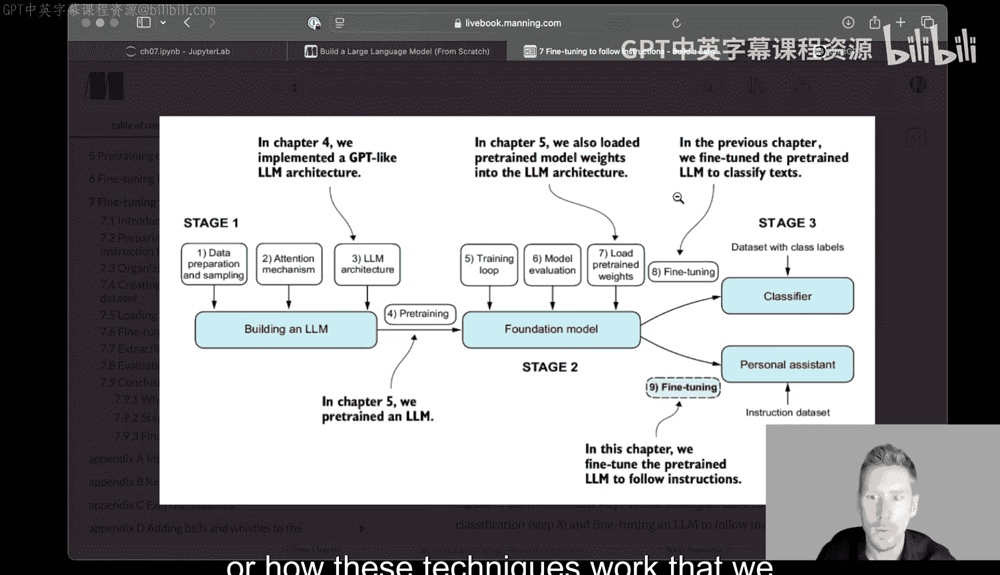

So for that like I start every notebook I will first show you the software libraries。

 the Python libraries I'm using， so here there are no big surprises everything here is the same that we used for chapter6 and by the way just going back here this chapter is independent of chapter 6 so you can see here in stage2 we had the pretrained model and then we loaded the pretrained weights and then there is this fork here where we either fine tune the model as the classifier or as the personal assistant but it you can see there is no arrow going from here to here so it's totally disconnected to chapter 6 it's just that some of the ideas in chapter6 like the fine tuning。

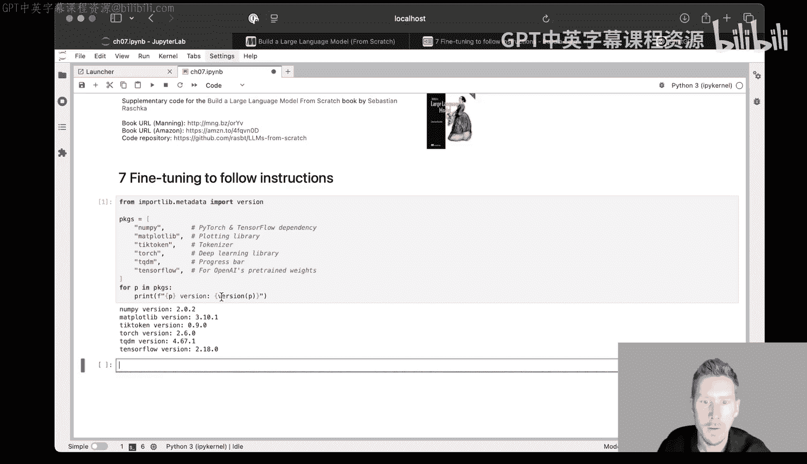

That， of course， also applies to personal personal assistance where we。Start with a pretrained model。

 but similar to chapter 6， we will start with a pretrained model。 But yeah if you have watched Cha 6。

 these libraries are the same because we still need briefly Tensorflow for loading the open eye weights。

 But then the other libraries here metpotlip for visualizing a loss function。

 TikToken for tokenizing our inputs torch as our main deploying libraries library this is still the same。

 So everything else should be similar to what we have used before。 and then。

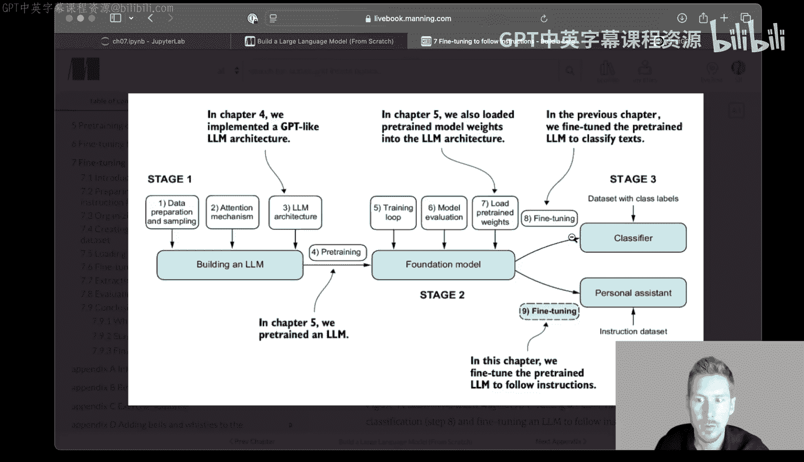

Let me show you also the different steps we will be going through， so it is gonna be。

 I would say a relatively long chapter， but I think also many of these concepts are quite familiar。

 so in chapter6， for example we spend a lot of time setting up the dataset again we have to set up a dataset it will be a different dataset but many of the ideas also still apply so even though it might look a bit like it's a long chapter a lot of this will be quite familiar because we already spend so much time working on these things。

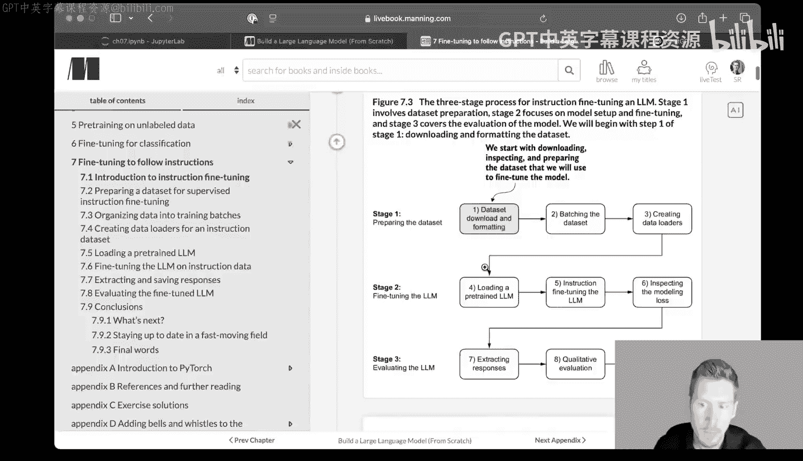

Yeah after preparing the data we will be loading the open weights from openAI similar to what we have done in chapter 6 and then the fun part will be instruction fine tuning the LLM and then I will also show you how we evaluate the LLM because yeah if we have free form answers like this it will be a bit trickier to evaluate how good the answer is because in previous chapters we could just you know compute in chapter 6 the accuracy we can see oh 50 out of 100 predictions are correct so we can say it's 50% accuracy now it's hard to say because it's more free form。

 it's hard to say what is correct or not especially if we have trickier answers where there can be multiple correct solutions So if I say what is the synonym for happy it might be multiple synonyms it has no one correct answer for example so it will be a bit more challenging to evaluate the LLM but we will get to that in due time first we have to of course fine tuned。

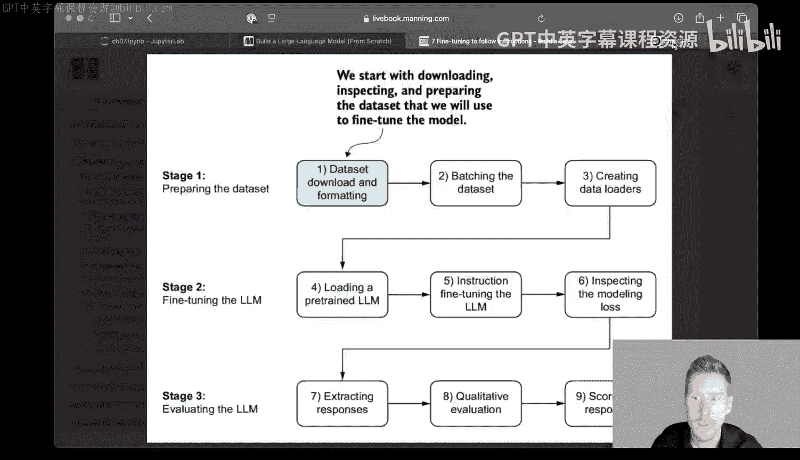

LLM。 and for fine the LLM。We do need to set up the dataset so should have added the section title。

 So the section title here is preparing the data for supervised instruction fine tuning。

 So the data set， I will just put it here because the code is not super interesting。

 So what we are doing here is we are downloading a data that I prepared。

 So I just call it instruction data， Jason and this is on Github in my Github repository here。

 and here I'm essentially just downloading the file。

 So the file has 1001100 training examples So it's relatively small and this is mainly to keep the time that it takes to train the model relatively short。

 So I think it takes about again 5 10 minutes to train the model。 of course， the more the me。 So。

Typically LLMs they are instruction fine tuned with I would say nowadays at least 100000 training examples。

 but again this would be more expensive so for educational purposes this is a simpler data I develop here and we can take a look at some of the entries to get a sense of how it looks like so Jason is essentially yeah it's a text file but it looks like a Python dictionary and so you can see each entry so here I'm just taking the entry at position 50 is a Python dictionary now and so it has three input fields it has an instruction field where yeah including the instruction identify the correct spelling of the following word for example and then the input field contains the word that yeah corresponds to this instruction and the output field contains the answer that we want the LLM to generate。

Maybe let's take a look at another one here。 so here we have one where we have an instruction but we don't have an input so the input is empty。

 so we could also have a format like that。 So for example。

 I could also technically if you look at thes。Sorry。Yeah， here we go。

 So if I look at this format and I， I can also convert it into a format where we don't have an input field。

 for example， I can。嗯。Maybe restructure it like this， and then it will be also a similar format。

 so it's not super strict。The reason also why I structured it like that is and like here。

 it's the classic format。 It's called the Atakca format。 So。

 but you don't have to strictly use that format。 I think in the。

Appendix sections here in the references and further reading materials。

 I also suggested some other dataset sets that are available on the Internet。

 and it's not all the data sets follow this instruction。 Honestly， it doesn't really matter。

 We can make it whatever we want。 We can define our own format and our own style。

 because we will be also defining our conversion style， everything。 So in a few moments。

 So I would say， yeah， don't get to stuck on how this is formatted。

 This is just one way of formatting the input。Let me maybe go back here and show you a figure。

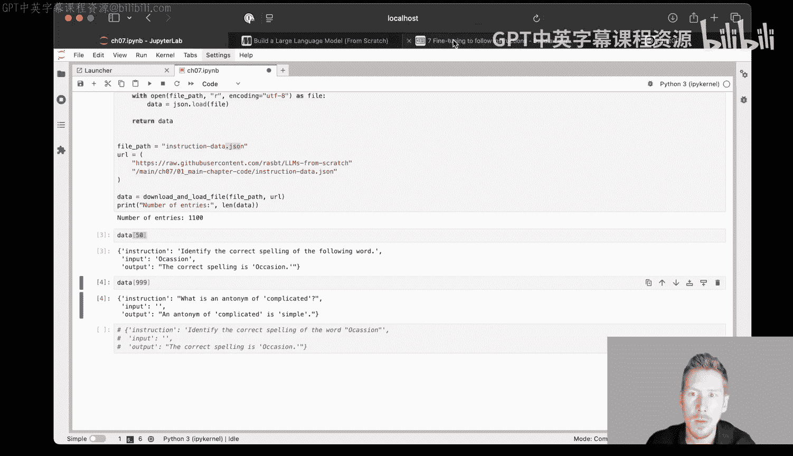

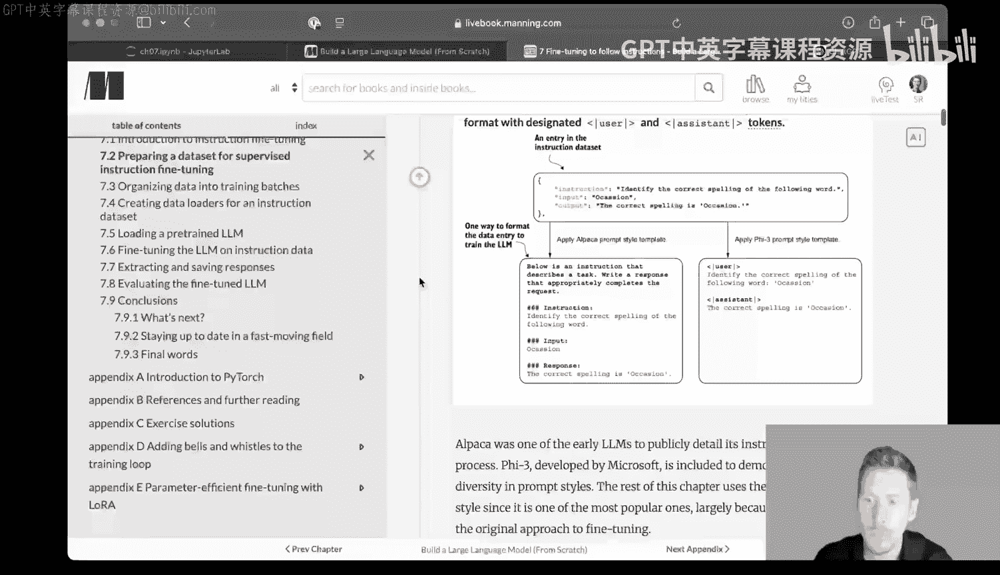

The input is in this in Json format， for example， like I mentioned。 And then next。

 what we are going to do is because we are not feeding the LLM in data in this format。

 We are feeding the LLM plain text。 So we are going to convert this dictionary structure into yeah human like text how human would provide the instruction。

 So here this is one way we can apply a socal prompt style template。

 So prompt style template takes this dictionary and converts it into text。

 and this is the alpaca prompt style template。 Alpaca is one of the first。

 I would say publicly available。Resources that did something like that So it's kind of like a classic And here I'm using the classic just because you know it's the foundation or the original that most people are familiar with or it's just like you know one of them one popular one。

 of course there are also other styles， but focusing for the Alpaca on the Alpaca prom style for now。

 it works as follows。That we take an entry here and then we preent something。

 so we preent this boilerplate that says below is an instruction that describes a task write a response that appropriately completes the request and then we have an instruction field so it takes this line here at some markdown synthetic syntax sugar to it and then we have the input field and the response field and again this is just one way of preparing this there are many many other styles actually each LLM nowadays has its own style if you think about other LLMs like meta AI Islamlama model Googles Gema models or Microsofts P models for instance here actually have an example of the Microsoft Phi3 style。

So here they used something simpler where instead of having the boilerplate。

 they don't do you in any boilerplate， they just have the instruction directly here。

 There's also no input field。 They merge the instruction and the input into one。

 And that is like user user designating the user input。

 And then this is what the LLM should respond under an assistant field。

 So that is another way of formatting the input， actually。

 I like this because it's shorter and shorter is cheaper。

 So because if you think back of how the model generates text the model is generating one token at a time。

 And so if you have twice as many tokens。 It will be requiring twice as many iterations。

 So it will be more expensive to run the LLM。 And so the shorter， usually the better。

 So yeah we are using the classic here because。I think it's good for educational purposes to you know use something that is quite popular and this could be a reader exercise in fact if you read the book there are a lot of exercises throughout the chapters and I will leave you to this exercise to you know try out different style templates and see how it affects the performance but yeah so this is what we are going to code now so we are going to convert this into what we have just looked at this prompt style。

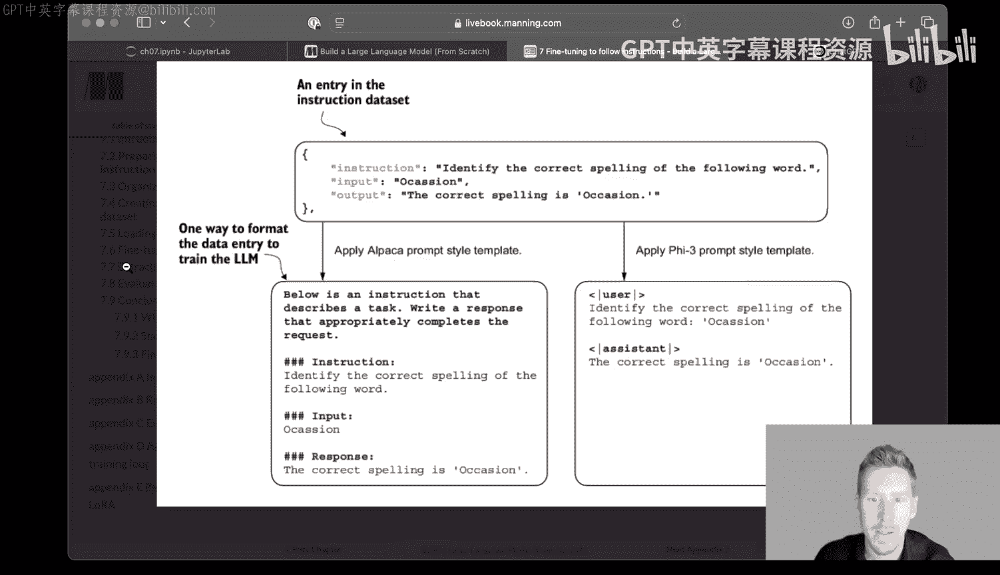

So let me show you the function。 This is a very simple function of format input where we have the instruction text and we have here the boilerplate that I just showed you and then here。

We insert the instruction， this part， the content here。And then if we have an input field。

We will provide the input。So we will create this if， if we have an input， and otherwise。

 we will just leave it empty。And so， this will be。Giving us the the instruction。Plus， the text。

 So let me。Call this。On our example above。The one we have here。Of course， I need parentheses。

 I don't know what I was thinking。 Okay， so here this is how the LLM will see the input。

 You can see we have these new line characters。 so this is how the LLM would see it for us humans。

 Of course， it's a bit easier to read if we actually render these new line characters。

 So let me add a print here。 So this is how the LM would see it。😊，And then we also need a response。

 So， for example， we can write a desired response。 So let's also maybe check out the other one here。

 So this would be。That one。 So we can see here there is no input field because the input is empty。

 So that worked。 And then， yeah， we can also。Add the desired response。

 So the desired response is only provided， of course。

 during training during inference when we use the LLM， there won't be a response。

 So because the LLM is supposed to generate it。 So here， but for the preparing of the training data。

 we will include the response。 And by the way， I wanted to mention one more thing。

 maybe if that's confusing because。

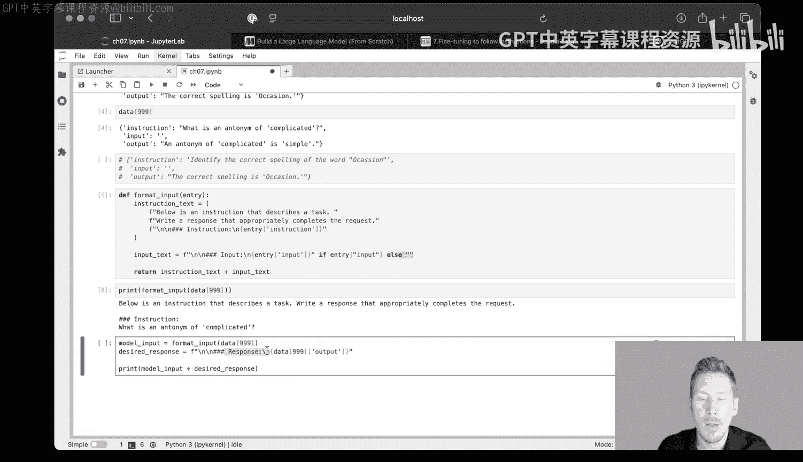

When we use this year， the Che Gp interface， we didn't provide anything like that。 So we didn't。

 you know。

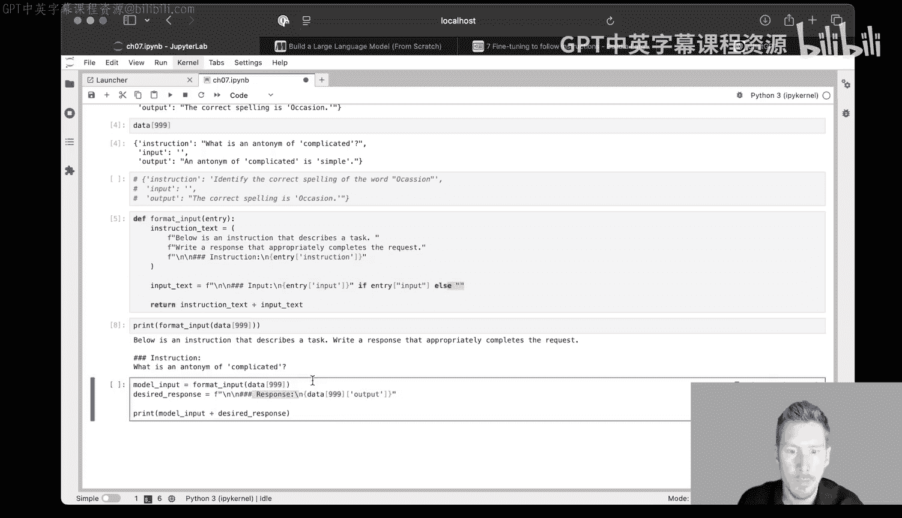

We didn't input it like like this， right， so we could have。Te this。 but we don't write it like this。

 right， because it would be really tedious if we as a human write the style out every time。 And so。

 in fact， LLM providers， they do this already， in a sense， internally。 So behind the curtain。

 So it's similar。

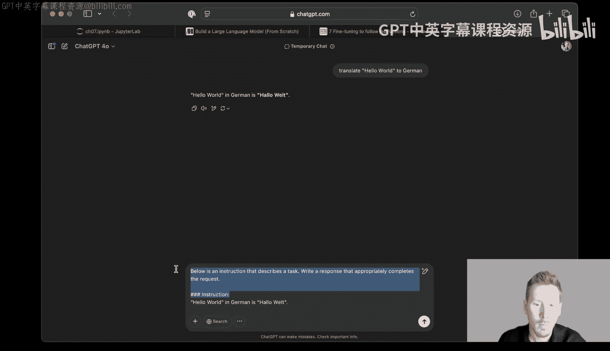

To what we are doing here， when we only provide an input。

 and then we have a function that takes care of the formatting。 Similarly， other services。

 they also do this behind the scenes。 So we， as a user， when we will get to that later。

 when we write the。

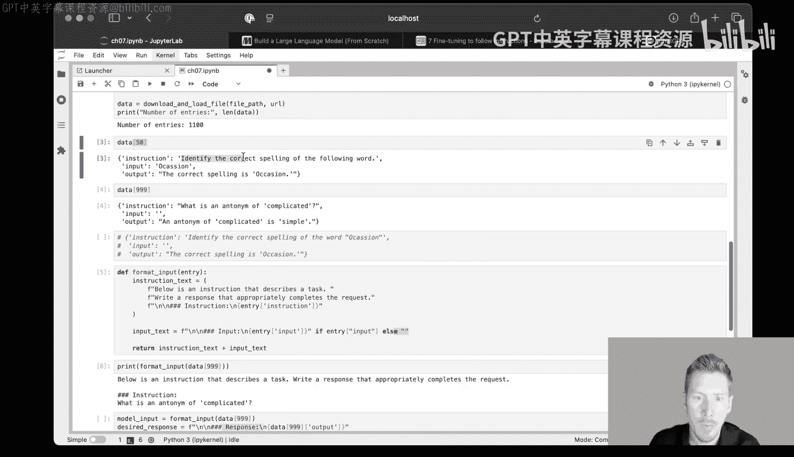

Instruction there will be something that will be prepared in the background。 But， you know。

 we don't wanna bother users typing this。 So this is why you don't see it， why。

 why something like this works and why we don't need this whole thing here。 But anyways。

 getting back to the topic。 So how we would prepare the training data。 So this would be the data。😔。

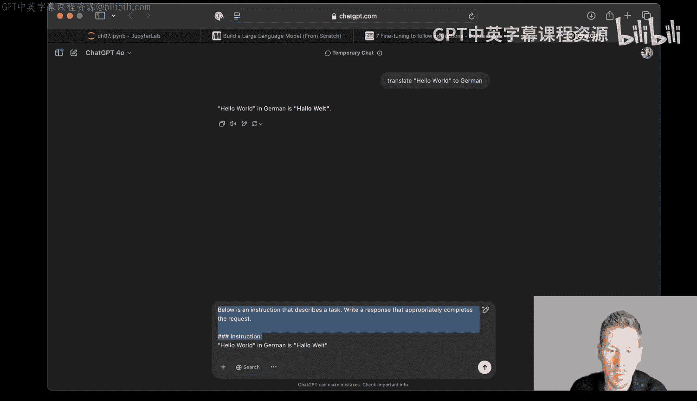

For pretraining the model and then lastly in this section let me also prepare the training test and validation splits so we will be using 85% of the data so we have 1100 entries we'll use 85% for training 10% for testing and then the remaining 5% for validation and yeah and so let's just briefly look at how large these sets are so we have 935 training data points 55 validation data points and 110 test data points and so in the next section this will be I would say it will be very important and next section I will show you how we prepare this in terms of the batches we will define the data set class and then also later we will talk about preparing the data load that we can then use during the fine tuning。

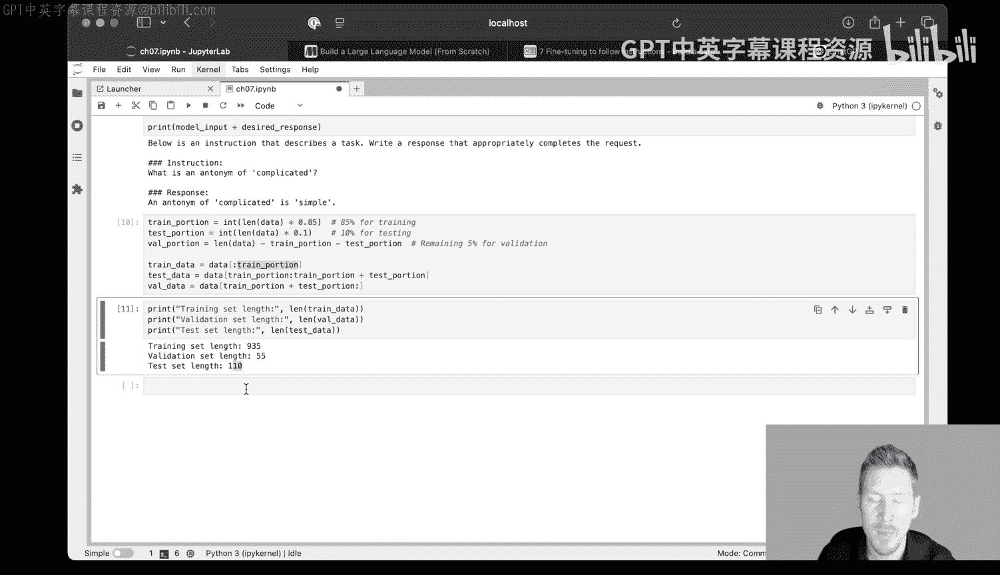

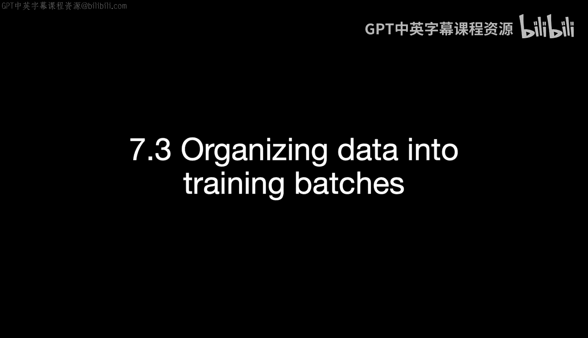

Yeah so now after loading the data， the next logical step is to prepare the training set batches that we will use in the data laer when we are training the LLM So here is just the brief overview again where we have all the nine steps in this section we are at step2 and then later we will load these batches into the data laers it looks like it's a small step in the grand scheme of things。

 but it is I think I would say the most crucial aspect when instruction fine tuning and LLM because everything down here like loading the pretrained LLM instruction fine tuning the LLM we get to reuse functions from chapter5 because the instruction fine tuning is still training the LLM to predict the next token in the data so here it's really important that we set up the data correctly so that the model can actually learn like we wanted to learn and so it looks like a small section but there are quite a few steps involved like I mentioned。

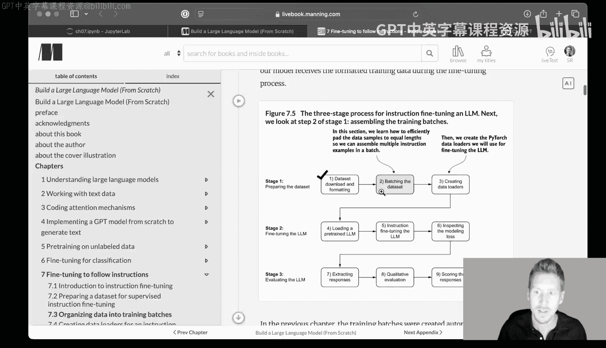

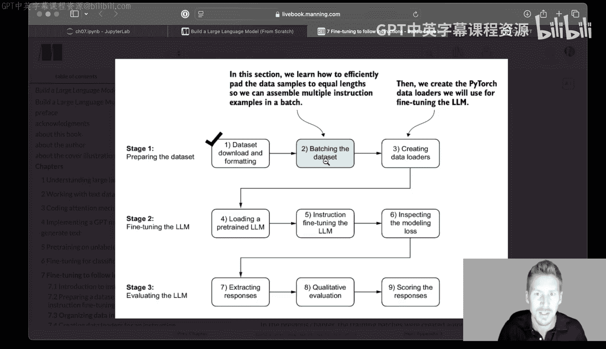

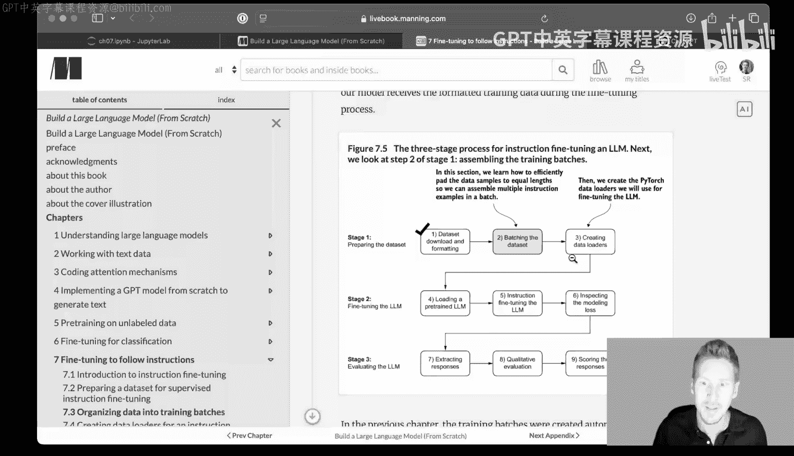

One of the most crucial sections here。 So we have five steps that we will implement in the data set set up。

 So we have。Step one formatting the data， so essentially applying this format function that we developed to convert the J entries into this text。

 then we will use the tick token tokenizer to turn the text into token IDs then we will be padding the dataset to the longest sequence。

 we will apply this here on a batch basis in chapter 6 we padted it based on the longest example in the dataset we will be a bit more efficient here and we will pad only to the longest element in each batch because it's a bit excessive if we would batch it or pad it to the longest example in the training set we will have a excessive amount of padding tokens and to avoid that we will apply the padding on an individual batch basis for example this could mean that one batch has the longest example consisting of 80 tokens one could have 1000 tokens like another batch could have 500 tokens and so forth。

But we will get to this when we implement this， so the idea here or the step is we have the input token IDs and then we are padding them to the longest element in the batch。

And input token IDs here means this whole input text。

 so I realize it might be confusing because it contains the response here。

 but it is similar to chapter 5 where we are interested in training the LLM on the next token later when we get to use the LLM on new data this will only include the boilerplate here and the instruction input it will not include the response the response is only necessary of course during training because that's what we want the model to learn so in this context input IDs means everything up here and so we have the input IDs here and the next step would be creating the target token IDs for training。

So the target token IDs are the input token IDs shifted by one position again， similar to chapter5。

 So if our input token IDs are 318。281， 12064 or target token IDs are 3 at 18，281。

 12064 you can see these three are here， basically so we are shifting it by one position that means we are removing this first token here and to make the input Is and the target Is the same length we add an additional patting token ID this is why you only see three here。

 three patting tokens and here are four because yeah we have to if we remove one token here at the front we have to add one more token to have the same length again and yeah but the concept here is the same as in chapter 5 that it is shift by one position。

A new concept here compared to let's say chapter 6 when we do padding is that we at the end here in step5。

 we are replacing this excessive padding amount by mask tokens here minus100 and this will help us to ignore padding tokens during training so padding tokens are used to make everything the same size so that we can create these nice tens sourcers for training。

But we don't want the model really to learn based on how many patting tokens we have because imagine we have an example if it ends up in a batch where the longest example is 1000 and our example is 100。

 we have 900 patting tokens and then it might influence the loss function and compared to a different batch where there are only fewer patting tokens。

 So we don't really want to make our loss or anything dependent on how much padding we have。

 So by replacing these by these so-called mask tokens。We can ignore those in the loss。

 so the loss will not。Let's say consider those when when creating in computing the cross entropys。

 but we will get to that later in the section so here I just wanted to briefly outline the steps that we are going to take。

 so formatting the prompt template tokenizing then adding padding tokens creating the target Is and then masking the excessive padding tokens at the end by the way we will keep one padding token here because we want our model to generate a response with a definitive ending so pretrain models they always keep on generating more text if we let them here we want the model to generate endof textex token。

 this padding token 500256 if the model is finished with a response and so this will also allow us to be more efficient so that the model that we don't have to iterate a max number of tokens and then we know exactly when the model is finished so one padding token is always kept but we will get to that when we look at the code here。

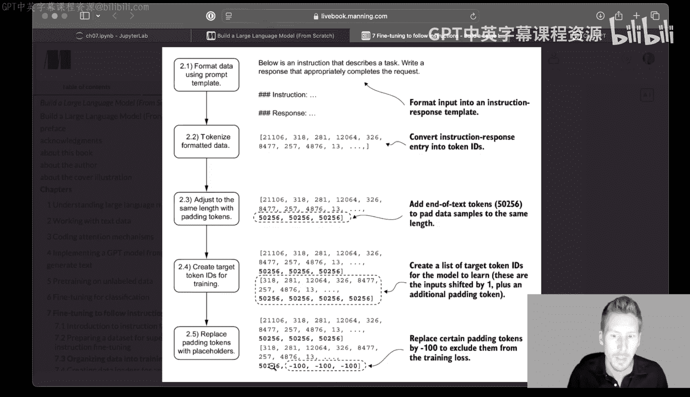

うん。So let's start with the instruction data set that we will set up。

 So one more figure I wanted to show you。 So here we have these five steps one to5 and we will be first coding steps 2。

1 and 2。2 so these。These first steps where the first steps include applying the prompt formatting template and then converting them to token IDs So essentially going from from the Jason format entry into the text and then creating the token IDs。

 So let's code this up。

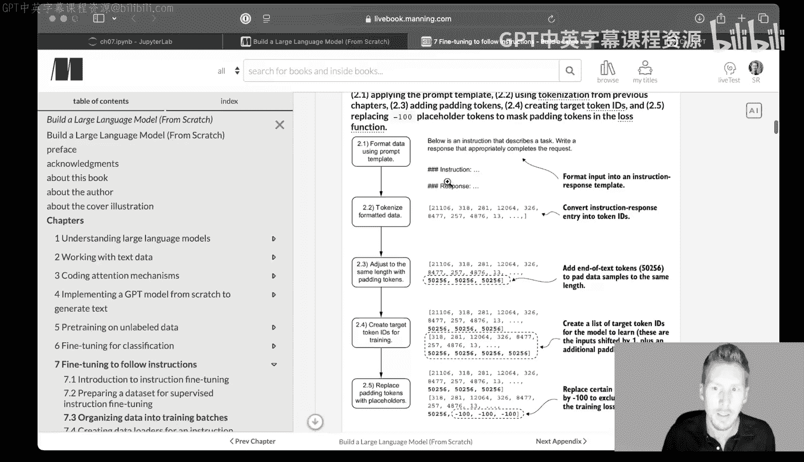

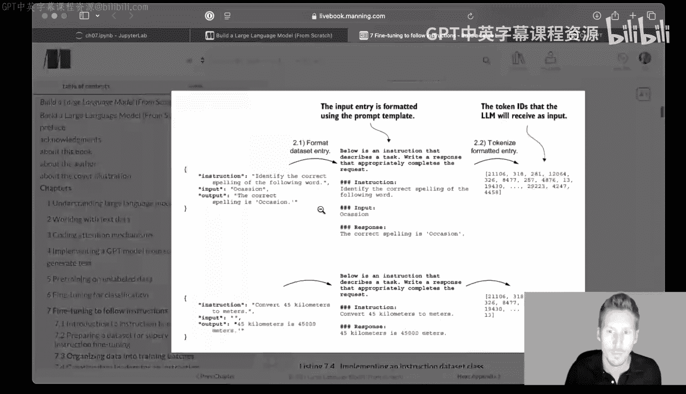

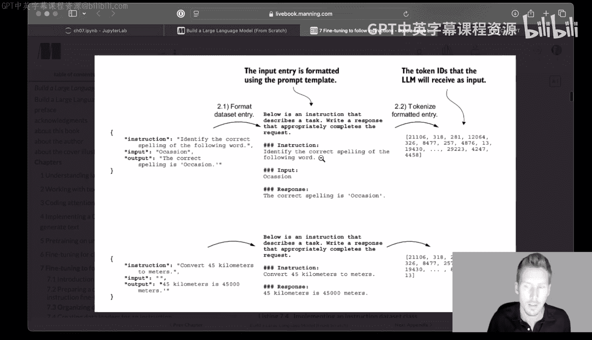

So for that， we will create。An instruction dataset and this instruction dataset uses the dataset class it inherits from the dataset class similar to what we have done in chapter 2 and chapter 6 and here we just assign the data the dataset here is the JN dataset we have a list the list will keep collecting our token IDs for each entry so if we have thousand training entries this will be a list of thousand token ID lists and so what we are doing is we are applying our familiar format input function that is the function we used before on the entry that we iterate over so that we create this format here in the center so we are going from entry to this formatted entry。

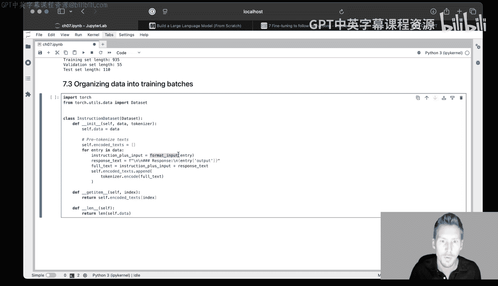

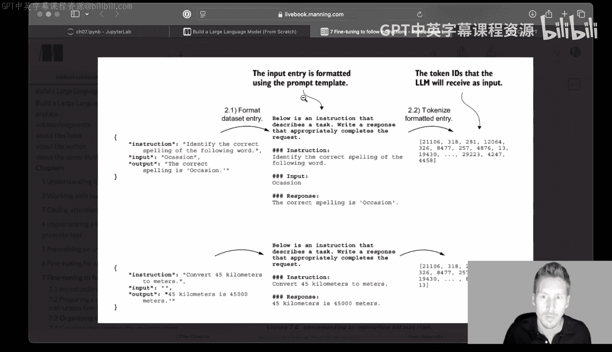

Next， we will also add the response text， So this is the response that we add to the input and then we will encode this。

 So the encoding here means that we go from text into token IDs Okay so this is what we are doing we are collecting them in the encoded texts。

 And then here the length function will give us the length of the data。

 whether we call length on data or encoded text that does matter， just gives us a length。

 which the data laer requires for the shuffling and so forth。

 and here they get item will return one item from our encoded text at a time And so this is something that is used by the data laer to build the batches similar to chapter 5 and 6 So yeah this is our instruction data here。

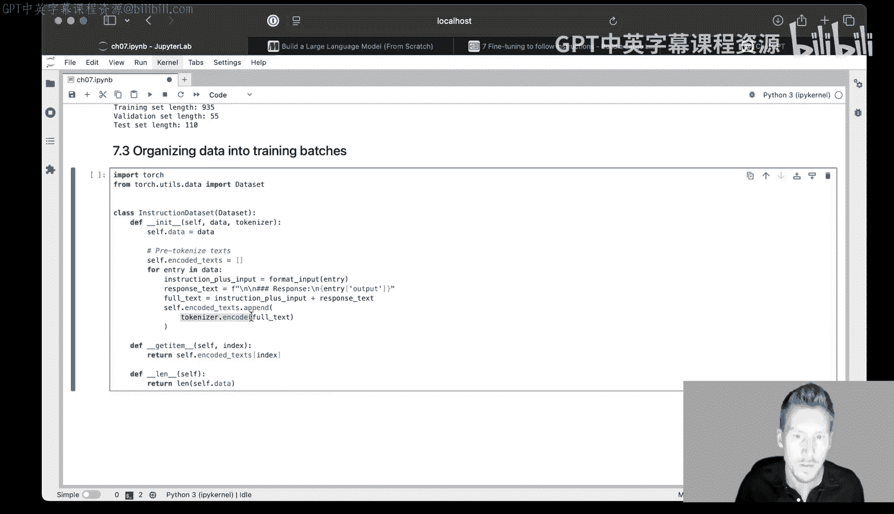

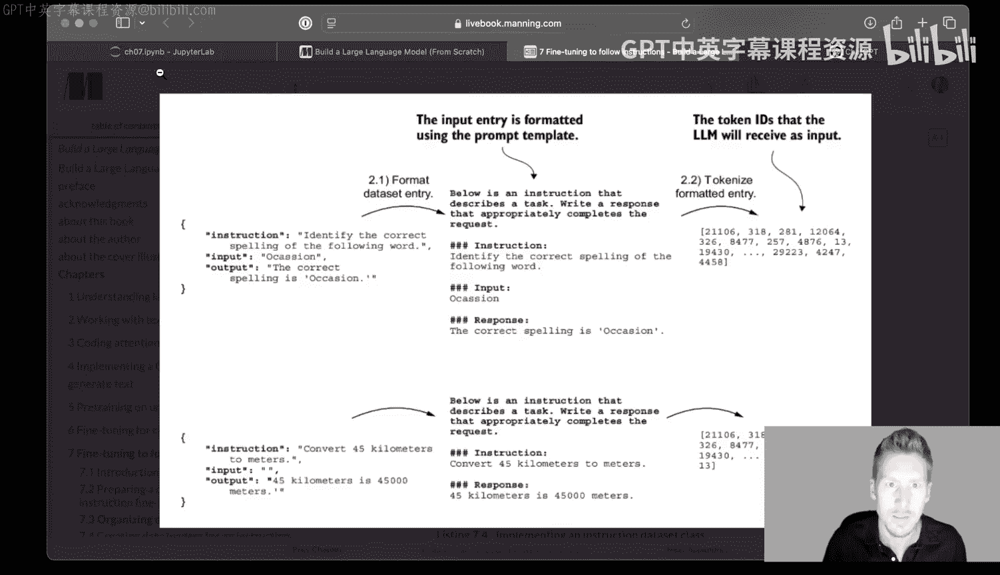

Oops， and so this one will be based on the Tik token tokenizer。 So let me just。

 so that I don't forget this later。 Let me just。Import this。Oops。Tick token。

 and then we will have tokenizer not to get encoding。GP2。嗯。Sorry， I made a mistake。This should be。

Oops。Tokenizer equals。😔，Tik took and。Get encoding。 Okay， so this is our tokenizer。

And that is going to be used here。

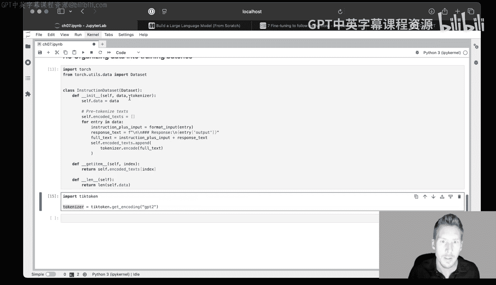

Now we have completed steps 2。1 and 2。2。

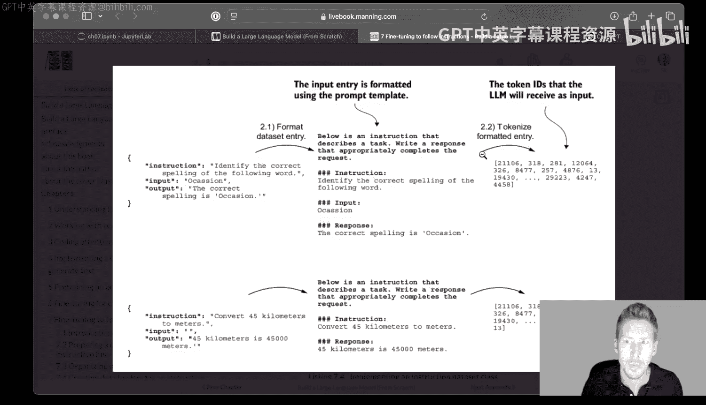

And next we will create a collate function。 So what is the collate function First。

 this is just a draft I call it draft one because we are going to refine it。

 but this is a function that will operate on each batch that the data loader generates。

 So later we will have the data loader like before when we create our let's say train load。

And the data data will accept the training data set， which will be based on our instruction data set。

And in addition， we will also provide a col function。 So here we would， for example。

 provide this one。And this will do certain operations on each batch because right now we only implemented steps21 and 22 next we want to take care of steps。

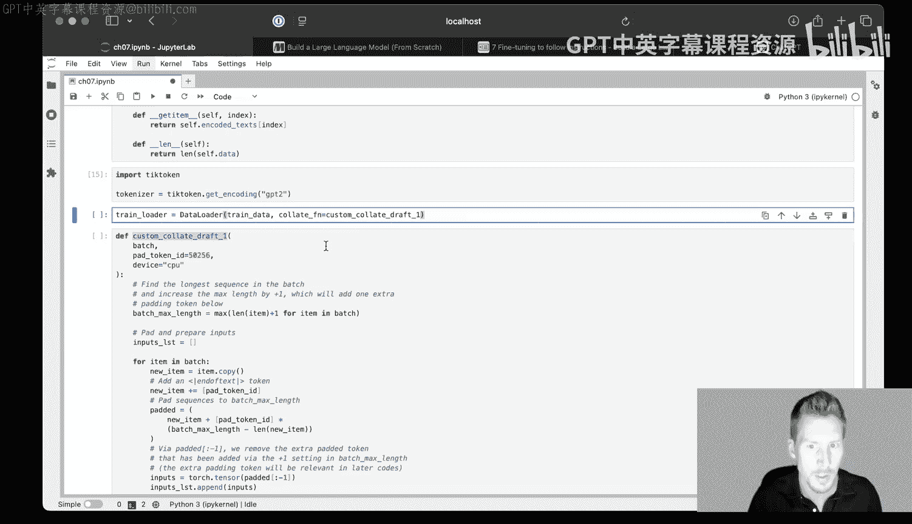

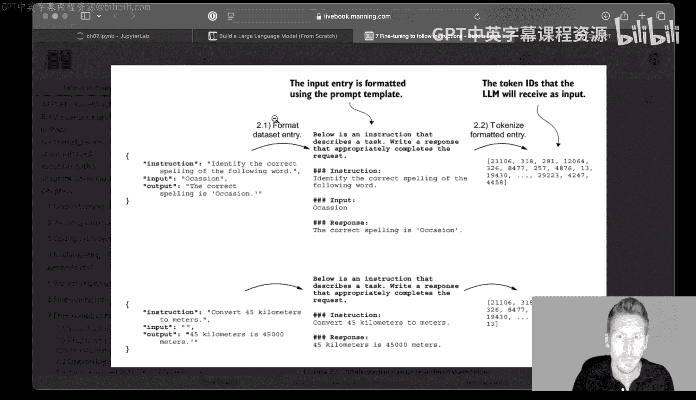

2 3 to 4 and2 5。 And like I mentioned， we only want to apply the padding on a batch basis so that each batch is independent of the other batch so that we don't have this excessive amount of patting tokens and so forth。

 And so the collate function will take care of steps 2。32。4 and 2。5。

 Our first draft here draft version 1。 There is a very simple one。

 This will only do the padding here。 So this will only。

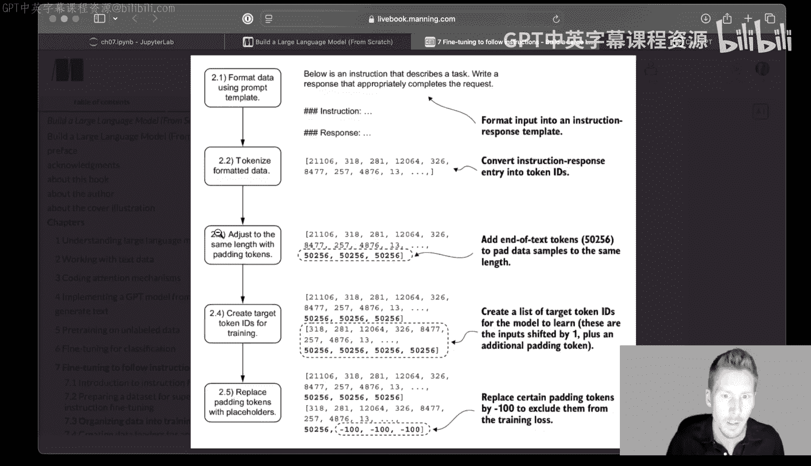

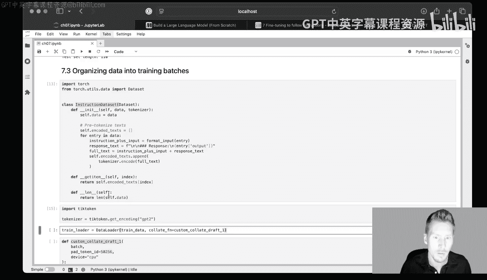

Do step 2。3。 I will modify it shortly to also do step 2。4 and 2。5。 but stay tuned for that。

 let's do one thing at a time。 So in that case we won't technically use it like this we will use a different collate function later so let me just also comment this out So it's not too confusing So how does the collate function work this particular one。

 So here it receives a batch This batch is created by the data load by the way。

 so we'll get to the data load later， we will work with a collate function here in isolation and we'll also test it in isolation and later we will test it again with the data load。

 but conceptually this receives an input batch。

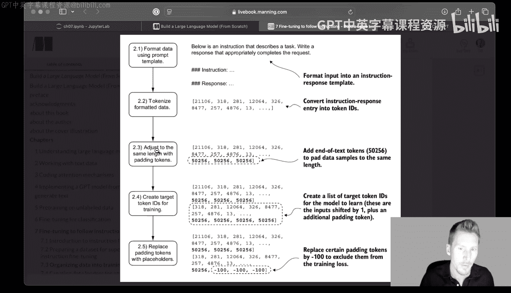

We define what token ID we want for the padding and then what device the data is supposed to be on。

And here we determine the longest item in the batch。

 This is similar to what we have done in chapterer 6 in chapterer 6。

 we did that for the whole data set here。 We do it for each item only in the batch。

 We have an input list here， and the list will。Collect our padded inputs。 So here encoded text。

 collected our tokenized inputs。 This is similar。 but now we will have these these padded input。

 So before we had just the regular token Is。 now we will have the padded token Is that we will collect here。

 And yeah， maybe you can pause and look through this。

 There might be different ways you can implement this。 This is my way。

 how I implemented this essentially。

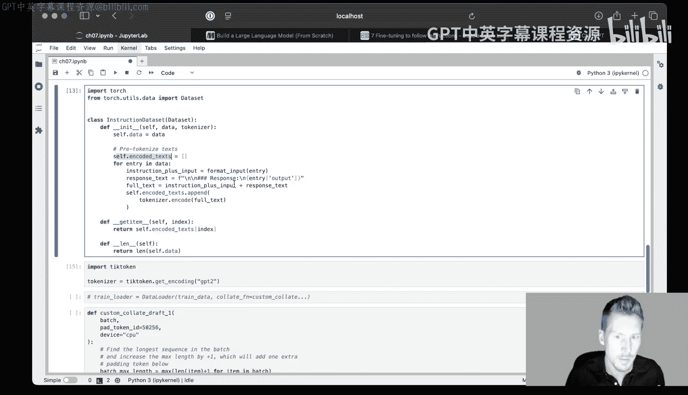

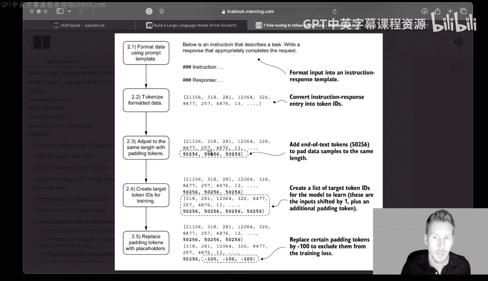

So。Maybe before I。Explain all the details why the plus1 and the minus1。

 So this is just one way I found that worked because I did some experiments and I had sometimes an extra patting token I was missing a patting token and with this implementation I made sure that I always have the right amount of padding where the padding is also determined here essentially by the difference between the longest element in the batch and then the actual length of that item similar to what we have done in chapter 6。

 So when we add the patting token Is and then we keep adding the patting token Is to our input list So and then at the end。

We stack those so because。These are just lists， but the data loader expects batches， right。

 So the data loader passes a batch to this one。 that is in a tensor format。

 and it also expects as output a tensor。 So here we are stacking those lists as a tensor。

 We are essentially just converting them into a tensor and then also putting them on the target device that we can choose CPU GPU。

 for example。 But yeah so。Maybe a lot of code here， if it's confusing。

 let us just test this in isolation， I mentioned in the next sections。

 we will be plugging this into the data orderer。But it's not a bad idea to test this before we get to the next stage。

So I hope also， by the way， it's not too loud in terms of background noise。

 theres really a big thunderstorm outside。 So hope I don't lose power。

 We'll see So here we are testing now this collate function in isolation on some inputs。

 So we have an input consisting of five tokens， two tokens and three tokens and ideally what we want this to do is we want this to so by the way。

 let's also just assemble this as a batch here。 we want to。

Assemble this in a way that we have the correct amount of padding for each of these items。

And this will be determined by the longest element here。 So ideally。

 we want to see that this will have。3 padding tokens so they are not x they will be token ID 500256 And by the way。

 where you if you're wondering what these token IDs here mean。

 I just made up some numbers from 0 to 9 just so that it is a bit visually easier to read Of course these would be in reality when we apply to our data loader。

 these would be the actual token Is of the input right So I'm just having some sample here to play around with。

And then what we can do is， we can call。This on our。Btch， and hopefully。

 it generates the correct tensor。 And we can see。 so everything has the same length。

 Now we have padted the other one so that everything has the same length。

 So that is essentially what our first draft of the collate function is doing。 The next step will be。

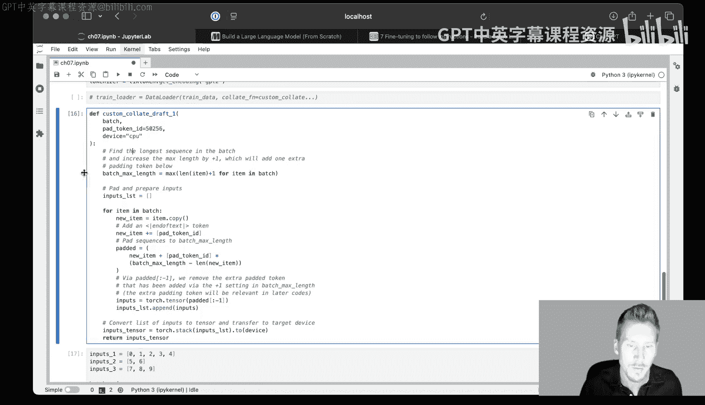

Creating the target I here。 So for that， I could technically just copy this。 maybe call that draft2。

 and then I create maybe。

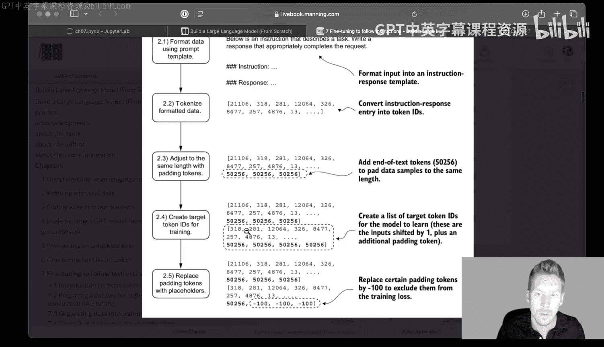

Targets list。Here。Let me see what else？here down here we will be also including the targets and the targets are shifted by one position。

 so if I do targets torch。Tensor oops。Ped it， and then there should be a parentheesis， of course。

And then， we are。Tncating we are essentially removing the first item from the input。

 which will mean that we are shifting everything over by one token。

 and then we keep collecting them in our list。Targetets。

And then I think here we should probably also return those might be a good idea， right。

 otherwise we do all the work and it is for nothing。

 just double checking I wrote targets as a plural。Making sure everything looks okay。Okay。

 so there we go。 So yeah， we mentioned returning， so。Let's not forget this。

So now we have our draft to， let's see if that works。So。嗯。Shouldn't be a pent。Here。There we go。

 So now we have our I， it's a bit hard to read。 So we have input and the target。 So that's maybe。

Also called O make two variables and then then it might be easier to read So let's just do this。

 let's look at the inputs first。So the inputs are the same inputs that we had before， ideally。

 because we didn't really change anything， we just added the targets， right， And so the targets。

Are now shifted by one position。 So instead of 0，1，2， you can see it's 1，2，3。 So so that's it。

 So we have now created the target list And the next step will be finally the masking。

 and that should be our last step in the collate function that we need。

 So then let's just call that custom collate here。 And yeah there are a few new parts I'm going to add。

😊。

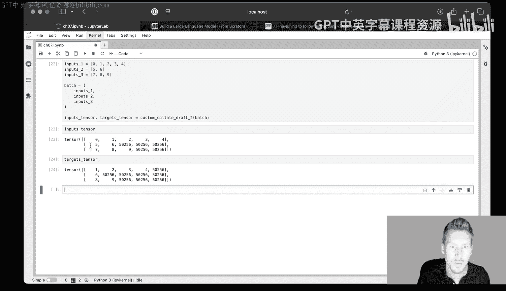

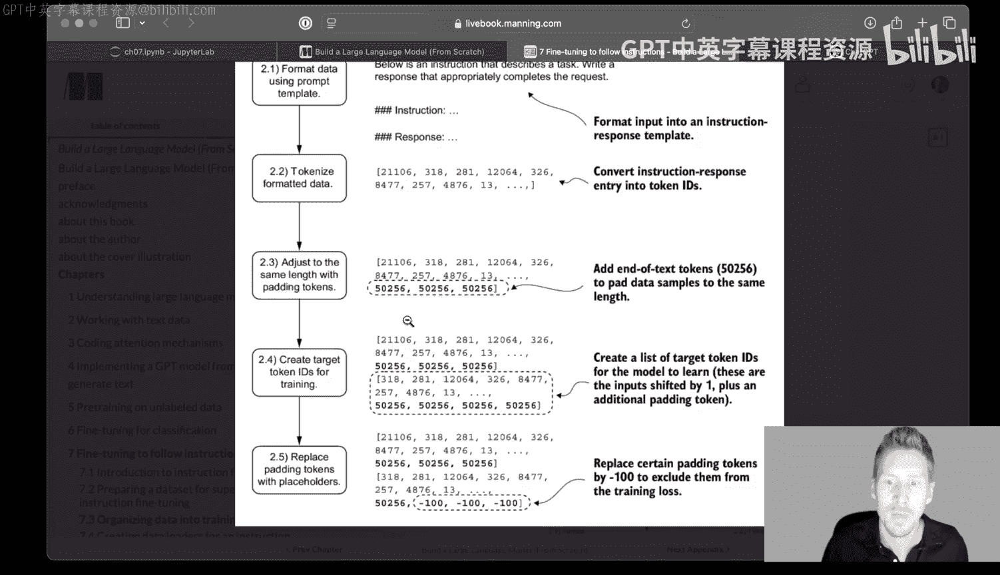

So first， what we need is let's say the ignore index。 So for the ignore index， I'm using。-100。

 because that's the default value that the cross entropy loss will ignore。

 or we could use a different number， and we can then change it in the cross entropy loss if we wanted to。

 so you can choose 99 or-1。 but you just have to then make sure you update also the cross entropy loss。

 personally， I just find it easy and more intuitive to just use the -100。

 which is the default ignore value in the cross entropy loss。 And then let's also add a allowed。

M length to trunccate in case we have inputs that are exceeding the context length that our model supports。

 So first， let me add the code for modifying the targets for with the mask token。

 So here what I'm doing is I'm replacing all the target。Pdding tokens by the -100。

 except one of them。 we keep one of them because we want to teach the model when to stop generating text。

 So this one will be used to teach the model。 Okay， this is the stopping point。

 So then in the generate function that we have we can check if end of sequence token is 50256 or so if current。

 sorry， if the current token we are generating is the end of sequence token， which is 50256。

 then stop generating。 And that is why we want to have it in here。 The other ones we can ignore。

 like I mentioned。So here that's what we are doing， so we create this mask。

 we check if a given token ID is a petting token ID and then for each but the first one。

We insert this minus 100 here。And that is one thing we do。

 The other thing I mentioned is we are also truncating to make sure that none of the tokens have more so none of the training examples have more tokens than our context length of the LLM supports。

 So here we are just truncating by the longest sequence。

 this is really similar to what we have done before。 and I hope this works。

 So I hope I didn make a mistake。 So if this works， let's just use。This example again。

And see what we get， so。We call it now。Custom Col it。

Call it on the batch and then let's look at the inputs tensor。

Looks exactly still like it looked like before， which is desired， right， We didn't change the inputs。

 but the targets they should now contain our yeah our -100。 So we can see everything。

 but the first padding token got replaced with a -100。

 and that one will get ignored in the cross entropys。 So before end this video。

 let me briefly show you what I mean by that， because maybe are a bit confused by that。

 What is happening， Why-100。 What is this magic number。 So I have a simple example here。

 So this is just so that we don't have to run the model， which we haven't lot it yet。

 I just have two example training examples。 So one example， just two token Is another example。

 to token Is and sorry， these are the。Is one token I D with So it's basic just a simple training example。

 Don't even think about it in， in terms of token I Ds。

 Just think of it as the logics that the model outputs for the first training example。

 It could be similar to chapter 6， where this is the。Logt vector corresponding to the last token ID。

 I just want to illustrate something in the cross entropy loss here。 So we have labels。

 think of it similar to chapter 6。 we have labeled 0 and 1， for example。

 and then we compute a certain value here。 What the value is it doesn't really matter。

 What I wanted to show you now is if。I add a new entry here。 So just copy paste to that。

 if I add a new entry， let me。Do it like this。A third entry。And let's do minus。6 and 1。

7 or something like thanm 1。6， I just type it， it doesn't really matter and let's give it also and we need the target。

 right？It's nameless too。 so it's not overwriting our first example。

And so what we'll get is a different number makes sense because we have added a new training example。

 when we compute the loss， it will probably be different from this loss。

 we have not three training examples。And I wanted to show you now the-100 illustration here。

 so let's increment this again， so we're not overwriting this。

So what will happen if I now replace this by minus100， so if I replace this minus with minus100。

 you will see this value is exactly like this value because now the minus 100 tells the cross entropy loss ignore this one。

So that's just like a little trick that we can use to ignore certain token IDs。

 And here we apply this trick to ignore these excessive amounts of padding so that the model is not the model training is not influenced by these excessive amounts of padding tokens。

 So it's as if we didn't have any padding tokens。 padding tokens are still there because we need to make sure everything has the same length。

 but they wound influenced the training。 And so with that。We now have yeah。

 we have explained how we batch the data in the next section we will talk about preparing the data la。

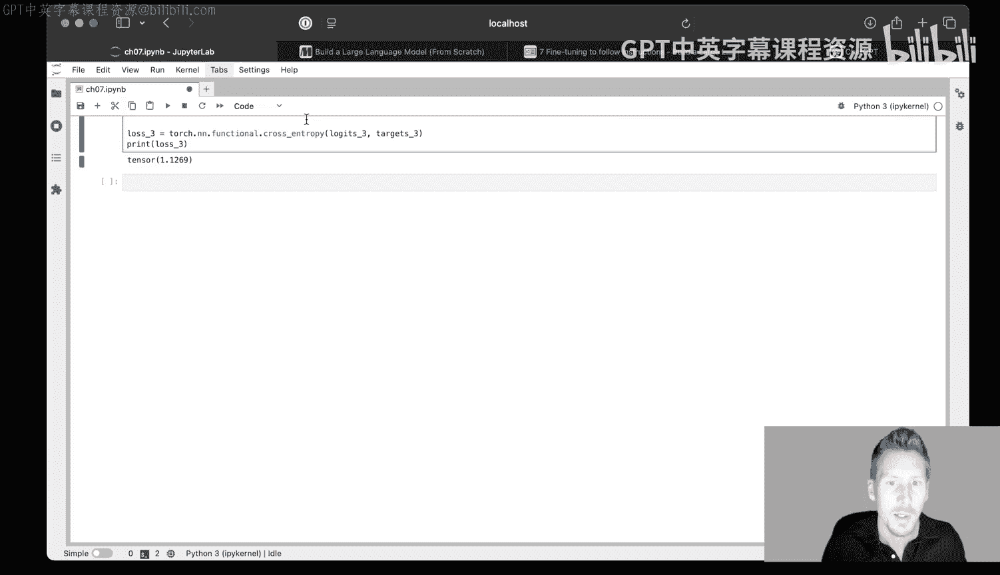

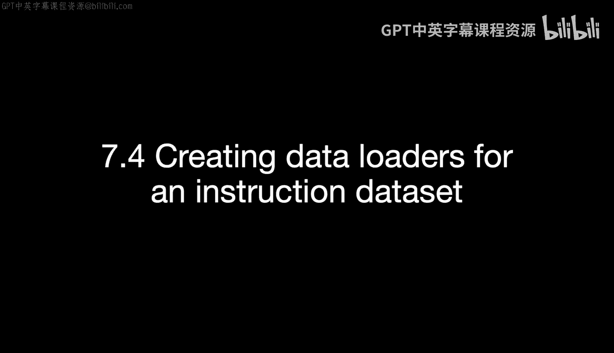

嗯。So yeah in the previous section we did already most of the hard work that means implementing this custom collate function in this section。

 we are now using the instruction dataset， the Pych data that we created earlier and this custom collate function。

 put them together and then we have a way to lot the training and validation data for the actual fine tuning So we will begin with defining the device that we will be using。

 So everything in this notebook from now on will also work on a GPU， if you have one， for example。

 Qa GPU， you can also replace this with M if you have Mac which supports Apple silicon Now I think still based on my last experiments。

 you get slightly different numbers， if you use themp device。

 M is the GPU in the Apple silicon chips So it's basically on your own I wouldn't say risk but you if you are open to get slightly different。

Results you might want to experiment with MP， which will be faster than CPU if you are using a Mac。

So here I will be running it on the CPU though so that the values shown here should be similar to what you are getting on a GPU or a different type of CPU and then one thing I wanted to also do first is defining my or defining a custom colate function or a customized one so we defined the custom collate function before and remember there were a few settings we had。

For example， patting token ID， we don't need to change that， the ignore index。

 we don't need to change， but we maybe want to change the device and the lot max length。

 And so this is just like a Python basic you know just use fun tools to make use the partial here to make a customized version of that。

 So that means。It's just like a Python basically。 that means if I use this one now。

 So if I call this one。As a function， it will have the default values for the all max length of 1024。

 and it will use the device we define here。 So that is all we are doing。

 It's really like just like a python basic。 If you don't want to do it like that。

 you can also just go up here and modify those values here up to you。

 So but that's usually how I prefer prefiling function arguments with partial。

 So that's what we are doing here。And then we are ready to use the data loader so here that's just the Pytch data loader that we used in chapters 5 and 6 we will again use zero workers for maximum compatibility we use the batch size of8 the random seat for the shuffling and so here I'm creating the training data set by passing the training data that we just generated earlier in this chapter to the instruction data set class that we defined above together with a tokenizer and this then goes into the data loader and so everything you are seeing here all these settings except one are the same that we used in chapters 5 and6 so I'm not explaining again what drop last means and also what the batch size means that you should be I guess already be familiar with that what's new though is the custom collate here so here we plug in our customized version which uses max length of 024。

And then also the device on in this case， the CPU。 So yeah。

 so that's what I'm doing here I'm setting it up for some reason it's complaining。

 so let me go up here。 Maybe I made a typo or did not execute it I did not execute this cell So this is the instruction data set from the previous section。

Now it should work。😔，Y so there we go， so this is our training order and we can do the same thing for the validation and the test set so here the same thing。

 the only difference is that we don't need to shuffle and we don't need to drop the last entry here so。

But otherwise similar to what we have done in chapter 6， same code as for the training set。

Okay and it's not a bad idea to take a look at like the results that what the data load outputs just to make sure everything looks okay。

 So like usually I just tend to iterate over the data doing the iteration just to make sure everything looks okay remember now that each batch has its own longest entry so one batch might have size 61 so 61 tokens as the longest entry some batches have 7673 and so forth and yeah it doesn't matter because what we are doing is we are training the model。

To predict the next token so not。Like in chapter 6 fixated on a certain token position。

 we are really more general。 We have a free form answer and it can have different lengths and it doesn't really matter how many patting tokens we have also because we have this  minus-100 here to ignore excessive padding in our loss function。

 However， we still have to make sure that each entry in the batch itself has the same length Otherwise we can't create a tensor right。

 so that's yeah looking good here。 so we can see about。

Yeah most of the example have about like 7080 tokens， so it's a very small data set。

 1100 entries and each example is also very short I did that by design also to speed up the training yeah in addition to that also maybe not a bad idea。

To take a look at one of these entries to see that they look okay。

 so we can see this is the first yeah training example。 So here we see that so this。

 if I iterate through this inputs。Will default to the last inputs targets in the training order。

 So we are looking at the first example of the last batch。 So I said， yeah。

 the first example in the last batch。 So we are looking。At the first row in this one。

 And so let me just do the length here。I can also do shape， but yeah， you can see that's 60 69。Yeah。

 and we have the patting tokens， as we would expect。

 Let's also check the targets corresponding to this one so we can see here it's shifted by one position。

 right， So this。Is here so that's looking good and for the padding tokens。

 we still have that one padding token that we want to keep so the model learns when to stop generating text via our our generate function。

T generate function。 And then here， the other ones。

 we have-100 because we don't want to have them influencing the loss during training because they are really just placeholders。

 Yeah， and this is our data data now。 it works。 Looks good。 And in the next section。

 we will put it to action。 or maybe not in the next section。

 but in a few sections because we still have to lot the model itself。

 and then we can find you in this。

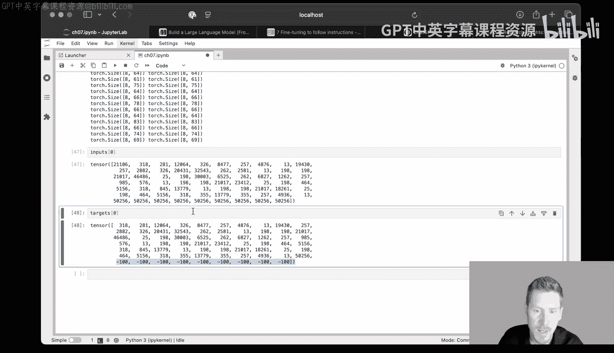

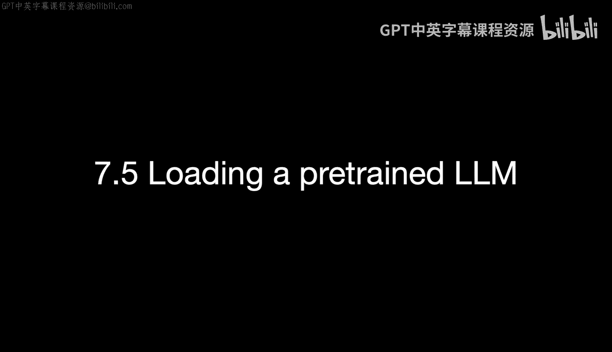

Yeah。So the hardest work in this chapter is now done。

 We prepared the dataset Now the next step is yeah loading the pretrained LLM that we want to fine tune in the upcoming sections。

 So for that this will be actually pretty simple because we will be using almost the same procedure that we used in chapter 6 So that means we are loading the pretrainwined ratess from Omei and for that I'm using the download node and node GT2 function from the GT download file So this is just something I copy pasteed in here。

 This is the same one we used in chapters 5 and 6 you just have to make sure if you're importing it like this。

That the file G donor pi exists next to this notebook where you're running this notebook。

 And then also from the previous chapters， we are importing the G model class and then the lot weights into G function。

 and these are exactly the same things we used in chapters 5 and 6 the only new part So everything you're seeing here is the same as we used in chapters 5 and 6。

 The only new part is that we are using a slightly bigger model now。 So in chapters 5 and 6。

 we worked with 124 million parameters。 Now we are working with a slightly larger version。

 And that is because I tried out the small version。 and you know it didn't do great。

 So when I trained it， the responses were really not good。 And I thought。

 okay I can't even tell that I trained this model。 So I went one model size up and the results looked slightly better。

 So we could also go with these larger models。But the problem then is it's gonna be slower。

 I'm running this on a MacBook air computer。 So you know there's only so much you can do with a small old computer。

 So I think 355 is a nice sweet spot where we don't necessarily need a GPU to run this。 Of course。

 ideally， I would run this on a GPU。 and I actually did。

 but I wanted to make this code accessible to yeah everyone to most people So I wanted to have a example that works also on yeah on older hardware。

 And so yeah， this is a nice tradeoff。 I actually just run this code cell before I was recording this section so that it doesn't take too long。

 It takes about I would say four minutes to download。 It's 1。4 gig。

 And yeah so I have the files already ready。 And this is essentially equivalent to what we have done in chapter 6 except now we have the larger model。

And then next， I wanted to just double check how how the model performs before we are training it。

 So here just showing I should probably import。Torch。So， here。I think I， I see what happened。

 So what happened is I。'cause I mentioned before I downloaded all the code I restarted the notebook。

 sorry， I， I mean， I downloaded the model， and I must have accidentally restarted the notebook。

 So let's try this again。So we are just looking at some example text here。

 And so that's the input and then the instruction。 And then let's use some of the。

Things we have defined in chapter 5 the generate method。

 the text to token ID and token ID to text utilities and so the text generate that was the one where we applied the temperature scaling and the top K sampling So it's just like that function we had to generate new text and so this receives the model we have our utility that converts text to token IDs using the tokenizer we create 35 new tokens and in reality we could actually set this number larger if we have a fine tune model because yeah remember how we set up our data set it will be generating or learn the model will hopefully learn to generate end of text to token right so where the targets So ideally a well-trained model will generate this token and then with how we set up this generate function it will stop generating text once it encounters this end of sequence token however our model is not trained yet so it might not。

Amit this end of sequence token。 So we will just limit it to 35 so it doesn't keep on generating a lot of text so that it is a bit faster here。

So here we are just generating text。 and then let's see how it looks like。

 can see it takes a bit longer。 It's a larger model now。 and I'm just running it on a CPU。 So， yeah。

 so it might be here we， here we are。 So let's just maybe add。Sprint statement here。 So it's nicer。

 and you can see， yeah， it puts a response on a response， which is kind of good。

 but then we can also see。Yeah， that doesn't do anything。

 So we have an instruction write a response that appropriate completes request。

 the request is convert the active sentence to passive。The chef cooks the meal every day。

 So a passive voice would be the meal is cooked by the chef every day or something like that。

 or we can see the model doesn't really do that。 It's just repeating， it's just repeating this。

 right， So， and then it keeps yeah， keeps just repeating。 So in that case。

 this model is not very useful。 I wanted to show you how it looks like before it's fine tuned。

 And so our goal is to make sure that the response looks okay。And by the way。

 the way we set up our generate function is it's also printing the input。

 which we don't have to show to the user right， So if we use something like chattyPT。

 it doesn't show us the input again。 It just gives us the response right So in that same way。

 we can also set up our function that it strips off everything after the response。

 So yeah what we are doing here is we are we are replacing this。 So what we' are doing is。

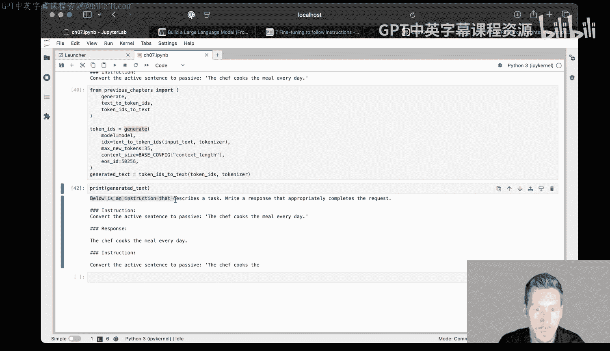

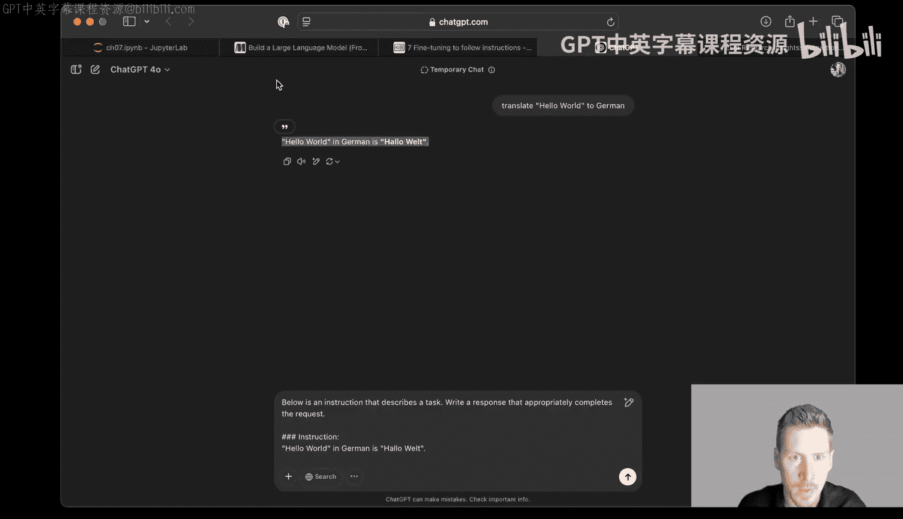

First， we truncate this。 So if we have our input text here， right， So the input text has oh， sorry。

 has length。Let's see。Thanks， input。Thanks。Length 200。 So in the response in the generated text。

We are first truncating this off。嗯。Yep。There we go。 So also。Print this。

 so we are stripping off the input because we don't need this right？

 So JGPT also doesn't repeat the input。 it would be very distracting。

 So here we have now the cleaned response。 And then still you know we don't need really this tag here。

 This is kind of like boiler platelate。 it's just a formatting style。

 So we can actually replace this by an empty string and then also strip all the unnecessary new line characters。

 So if we。

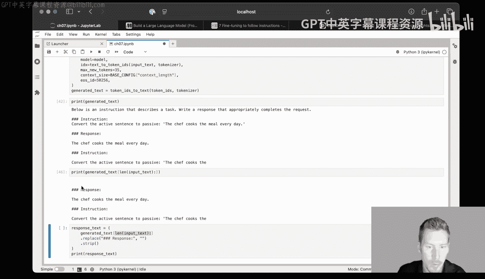

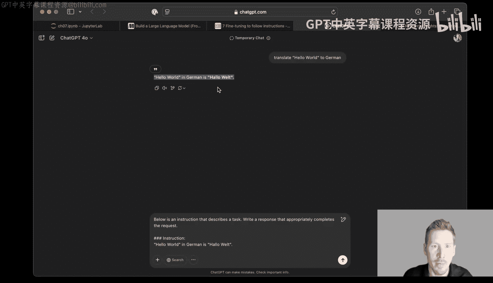

Prepare our output like this。 It's much cleaner。 So this is how the model would respond。

 And we can see the model doesn't really give the correct response。 So fine tuning。

 the model will be hopefully making sure it gives us a better response。 But yeah。

 I wanted to highlight。That something like this is done also behind the curtains when we are using something like chattu。

 where it also only gives us a response without any formatting boilerplate or any。

 you know input repeated in the output and so forth。

 And so this is usually done by LL M apps in the background。 Okay， so we are now set up。

 We have our model， which doesn't do perform well。 So we want to make it perform well。

 And that is the topic of the next section where we are going to find you in this model。

So now we are ready to take advantage of all the hard work we have done so far in this chapter when we prepare the data because now we can use all the functions we have defined in chapter 5 to instruction fine tune in the data on the dataset we have just prepared。

 So when I started writing this book， I put a lot of thought into designing these functions so that we can reuse them because that will make it more readable。

 and I hope also more easy to follow。 however， also in reality， it happens to be like that。

 that instruction fine tuning uses exactly the same loss that we use during pretraining namely predicting the next word in the text。

 The only difference now is， of course， that the text is slightly different structure from compared to pretraining and pretraining it was just raw text。

 Now we have。😊，These response and instruction fields and so forth。 So。

 but the loss function is exactly the same， which is nice。

 So when we look at our previous chapters code file here。When we go to。Chapter5， we can。

Reuse certain aspects。 I mean， we already reuse the generate function just in the previous section。

 we can also reuse the train model simple function because it's exactly the same loss function。

 And then inside there， of course， we also have。The car loss batch and clock loss loader utilities。

 When you are running this， please make sure you are using the code from chapter 5 for the lost loader and not the code from chapter 6。

 because the car loss loader in chapter 6 was using a car loss batch version that was based on the last token。

 And here we are interested in all the tokens， not just the last tokens。 So yeah。

 please make sure you are using the correct code from chapter 5。

And then what we can do is we can yeah simply import our utility functions here so I'm importing the CA loss load because before we started training I wanted to just briefly double check what the loss is before we started training so here I'm just iterating over five example batches to calculate calculate the loss to start with and ideally yeah we want to improve the loss as always and I should also say for the runtime So this will be a bit slower than in any of the previous chapters because。

Yeah， it's a bit more expensive。 We have also a larger model。 Now。

 we have the 355 million parameter model。And I did run some experiments just to show you。 But yeah。

 just to complete the thought here， we have a loss of about 3。8。 and we want to get that down to 0。

 basically， well close to 0。 So here just showing you some numbers。 I got when I was running this。

 So I was running this with a small model。 It took about5 minutes with this 355 million model。

 It took about 15 minutes。 And this is on M3 MacBook Air。

 So I'm running this right right now on a M1 MacBook Air。 So as you can tell， I like MacBook Air。

 It's actually my favorite computer because they are relatively cheap and light and portable I would say at home。

 You know， if you don't travel you。I mean，It's very overkill to get a separate MacBook Air。 But yeah。

 I like these computers because they are so light and versatile and fast and everything。

 So in any case。So I was running this for two epochs， and it took about 15 minutes。On this model。

 And so if I'm running this example here， it will probably be taking 20。

25 minutes because it's a lower computer and I'm running all that recording setup here and everything。

 but just you give you the reference numbers and expectations。

 If you are running this on an a 100 GPU。It just takes one minute。

 So it's actually super fast and super cool。 You can optionally also run it on the MacBook GP。

 like the MP。 then it's gonna be faster than on the CPU。

 but the results might look slightly different。 Also a bit depending on which Pytorch version。

 when I started working on this book the newest version was Pytorch 2。0 or 2。

1 where I got really much different results。 And then every time there was a new Pytorch version。

 I tested this。 And right now in 2。6， the results are very close between CPU and GP on the MacBook。

 But not still not exactly the same。 So I'm running this on a CPU here。 But yeah。

 if you're interested， you can see these numbers and these expectations。

 if you want to run it on a GP， for example， using Google callllap or something like that。

 it's gonna be much faster。Then me hear what I'm doing。 But so yeah， let me execute this， run this。

 and I will probably just。Oh edit this video。 I you should don't like editing videos because it's a lot of overhead。

 and so I will maybe make an exception where I will train this， walk away。

 make myself a tee and come back。 And so but before I start the training here。😊。

I wanted to show you what I'm doing。 So I'm again timing it option similar to what I've done in chapter 6。

 we are using again a Adam W different learning rates。 I was tweaking the learning rate a bit。

 this was a good one two epochs you can do more but then at some point the model will also overfit two was better than one and based on what I observed again。

 similar to chapter 5， we will be printing out some sample that the model generates to just make sure or to track if the model is making progress during training and that's essentially it it's essentially the same training function we used in chapter 5 nothing。

Too interesting so I will run this and before I walk away and make myself a tea。

 maybe I can also go over some of the bonus materials so。

If you go to my Github repository R S B T L Ms from scratch。

 I do have some bonus material for each chapter。 It's like material that is optional。

 but might be interesting。 and so。I have some utilities here for how I created the data set for this chapter。

 so I made a few examples and then I found near duplicates， remove them。

 it's not something you have to use it by any means but it's just you know something I find useful and so I just shared it here。

Then there are some additional evaluation utilities。

 I would say let's not talk about them now because we will be getting into the evaluation later on。

 but just so you know， there's an API as a way to use the O API to evaluate the model and we will be using a tool called O Laama。

 also a fun bonus material to generate an instruction data set。Using Lama。

 so this is using a Lama model， Lama 3 to generate instruction data。

 so there are some instructions for doing that if you are interested。

What else then utilities on improving the data set for instruction fine tuning And here one point where we generate a preference data set。

 So what is preference data。 So right now we are tuning the model on instruction data。

So instruction data is what we have seen before in this format。But。

Users might have a different preference。 Let me see if I have a nicer figure in。This one。So。

I should say instruction fine tuning is always done for any LLM， usually like Chet GPT LLMs。

 all the LLMs are available in ChegPT for example， or currently also anthropic clouds and Google Gemini。

 instruction fine tuning is a very common step that follows the pretraining。

 but after the instruction fine tuning there is another step。

People often do and that's called alignment or sometimes it's also called preference tu so there's pretraining。

 the instruction fine we are doing and then there's also often an optional alignment step and this uses usually RLHF which stands for reinforcement learning with human feedback or DPO which stands for direct preference optimization so the original first Chet GPT model which was I think GPT 3。

5 it was based on a paper called Instruct GPT。And that proposed this whole reinforcement running with human feedback procedure。

 and then Lama 2， for example they used RLHF as well。

 and then later LMs used something else called direct preference optimization because it's a bit easier to implement and so Lama 3 is based on direct preference optimization。

And in general， you can think of both of them as alignment methods。 And which one is better。 I mean。

 the jury is still out。 I do think I had， I can find it here。I did have a post on that。

 I would have to search for this right now。 But yeah， so I。

 I did write about this at one point where。Here， how good are the latest open elements and is DPO better than PP PO。

 So PP PO stands for a pro proximal policy optimization， which is a technique used in R L H F。

 long story short。 Also， maybe I can also scroll down and I haven't。

Here， I just saw it。😔，R LHF and its alternatives， if you want to learn more， but long story short。

 these are two methods for aligning an L M。 So it's essentially nudging the LL M to generate preferred responses。

 So here's an example。

Where you might have a prompt， an input prompt where it says what are the key features to look for when purchasing a new laptop。

 and there could be two types of responses。 One could be more technical。

 So it says here when purchasing a new laptop focus on key specifications such as the processor speed Ram size storage type。

 So this would be a valid response that a chat what might give to a user who asks about what to look for when purchasing a new laptop。

 However， a different answer could be more， I would say general。

 like think about how it fits into your daily life。

 choose a lightweight model like I do with my MacBook。 So if you travel frequently and so forth。

 So there could be different preferences。 And I wouldn't say one is more correct than the other。

 It's just a human preference。 And so with alignment。

 This is one way when you have the LLM generating different responses to get the LLM to。Yeah。

 generate a more preferred response。 And it's a whole process where you have to prepare the data set and so forth。

For RLHF or DPO。 And here I have a notebook that goes through the steps。

 Oh here actually I wish I had known that before I started talking。

 So here here is also the whole RLHF pipeline So here RHF is more expensive because you have an additional reward model that you have to train but maybe that's a story for another time。

 So you can do this as an optional step here in this notebook in the bonuson notebook。

 I am implementing DPO which is simpler than RLHF because it doesn't use a separate reward model。

 If you use a separate reward model， that means you have to have two LLms in your compute memory which is more expensive and often people prefer DPO because it's simpler to implement performance might not be quite as good if you have a fixed data site but you can iterate over more data points faster So in that sense。

You can compensate maybe for the slight lag in performance compare modeling performance compared to our HF and both R or and both remain popular options。

 And if you are interested after our instruction fine tuning here， if you are interested in。

Aligning you LL M， I highly recommend you to check out this additional notebook， which I have here。

 So chapter 7 preference tuning with DPO and then this notebook and here I'm implementing this from scratch。

 I did not include this in the book itself because。

There's also some math involved and it's a bit trickier。

 I would say and it's a long notebook and it's very technical So I thought， okay。

 this is maybe nice bonus material because it's not。

 I would say essential So the model we are training in chapter 7。

 it will already be sufficient for answering responses。

 this is more if you have two types of responses to kind of refine the LLM。

 So let me see if I I have an example of the data。So that for each data point。

 So we are essentially including a rejected response and a preferred chosen response could also be called preferred response。

 And the chosen response is usually the same as the output。

 and then the rejected one could be slightly different。 So this is what we had in chapter 7。

 And then I was using the output as the here in this case as a chosen one。 And then I added a。

Different one。 And you can see this one is slightly less friendly。 So if a model response。

 the correct spelling is obviously occasion， it might be a bit， you know， I wouldn't say offensive。

 but it's it sounds a bit weird if it kind of like almost like scolding the user or something like that。

 And so a preferred response might just be like this one。 And in fact。

 this preference tuning is also often used to yeah， to prevent the LLM from doing sensitive things。

 you know， giving people instructions to build a bump or something like that。 So in that case。

 the LLM would recognize this and say something。 sorry， I can't help you with this request。

 So making the LLM a bit safer in that sense。 but also。

People use preference tuning to reduce yeah the usage of swear words and cursing and these types of things。

 So and as you know， there are different types of LLMs out there。

 there is CheyT anthropic cloud models and then there's Google's Gemini X Goc and so forth。

 and I've not really used it myself， but a Gok， for example。

 is known to be a bit more offensive compared to CheypiT And so this is some behavior you can achieve with preference tuning if you give yeah preferred and。

Reject responses。 and then yeah， train the model。 So here， if you're interested， bonus material。

 relatively relatively similar。Then we have to set up our data set and so forth。

 it's just a bit more code because it's yeah normal procedure and then we fine tune the model So it's yeah if you're interested quite interesting and then the model will generate responses with a certain preference essentially。

Okay， so this is one of the bonus materials。 Let's see how far we are said I'll mention I wanted to make myself a T。

 maybe I don't have to because the model is almost finished fine tuning here。

What else do we have let's see？If I go to chapter 7。

I of course the exercise solutions I will not go over those。

 These are really meant for you if you read the book and want to do the exercises。

 One more thing here I wanted to mention is the interface so this is similar to what I already showed you in chapter 6 so here we have an interface based on chain lid where you can interact with the model similar to chattBT so you can write the query here and it will give you the response so what I'm saying similar to chattBT here that means that it looks like that in terms of the interface。

 the user interface so this looks quite similar to this one。

Yeah， okay。 so another bonus material， let's just check out the code So how it works is similar to what we are doing as we are loading the LLM。

Here。And this will be based on the LLM that we have fine tune so I will show you later how we save the LLM and then we can use the loading function ats similarim to chapter 6 actually and then here when we extract the response that one trick I showed you where you just truncate and then replace the response tag so that when you look at the response I close it now but that it doesn't show you all these alpaca formatting styles and yeah and this is also another nice optional material if you want to build a nice little chatbo。

Okay， I see it's。Trained for one epoch。 I will probably take a break here。

 edit the video if I don't forget and be back with my tea then。Yeah。

 so I was able to make myself some tea and even finish it because the training took much longer than expected。

 So in this case， it was about 29 minutes， almost half an hour。

 and that it' just due to the fact that this is 2020 MacBook Air。

 pretty old computer running all the recording software and so forth。 But yeah in reality。

 also 30 minutes。😊，I'm a bit impatient because I'm recording here， but in the grand scheme of things。

 this is actually not too bad because people train LLMs usually for weeks or months even。

 And so here， you know， getting results in half an hour is actually quite cool。 it's of course。

 a very simple model， a very simple data set。 And so let's take a look at what we got。

 So we see that the training no goes down， which is nice。 The validation noise goes down as well。

 it's also nice。 And we can see based on our。😊，Intermediate output that we print during the training that the model is doing an okay job。

 so we have the instruction convert the active sentence to passive。

And so the active sentence input sentence is that a chef cooks the meal every day and the model response is the meal is prepared by is prepared every day by the chef。

 So I would say this is a correct answer So this is now the sentence converted from active into passive voice And so yeah with that we do have the model generate good text we also have this end of text token so we can use that to stop generating text when we use our generate function as otherwise yeah models tend to just keep on generating text。

I was training it for2 epochs you can see the training loss still goes down the validation loss it goes also still down a little bit but yeah I think this is kind of like reaching overfitting territory so to see this more easily I also just reused the plot losses function from chapter5 and here we can see the loss goes down in both cases and then the training loss。

'm sorry the training loss here is lower than the validation loss that's quite the gap so there's a bit of overfitting it's not too bad but yeah so we can see model trains well the next challenge is really to find out how well because the loss is only one way of judging it but what's more important is also to make sure the model generates appropriate text So one way is yeah looking at these here but this is just one example and another example we want to see how well does it actually do on new data for example the test set so the next sections will be concerned with that so the next sections we will be getting the model ready for model evaluation。

So now we have this fine tune LLM and the next challenge will be evaluating numerically how well the model is doing because if we have a numeric。

 let's say value that we can attach to this model， this will allow us to make progress right？

If I change hyperparmeters here and try different things， try different model。

 try a different prompt template， different data set。

 how do I know that the model is actually getting better compared to this model So one way would be just as a human looking at these responses but that would be pretty challenging to do this for a lot of examples and keeping in my head I feel like this one is better than this other one and so forth。

 So we want a more systematic way of evaluating the model and for that we need ideally like a score or a number and so that is what we are going to do in the remaining sections here So we checked off the data preparation。

 the fine tuning now the last stage is evaluating the model This comes in three steps This first step this section would be just concerned with extracting the responses and saving them so that in the next section I can show you a away to evaluate the responses that we have saved。

So the code for that is yeah relatively simple。 We are going to just use our generate function to generate new text。

 So the text that the model receives is the input text for each test samples So here just for simplicity I'm iterating over three test samples So let me test data its data that the model has not seen before。

 and so we are formatting it similar to before we use the model to generate the response and the response text is then also cleaned similar to before So we are stripping out。

The input so that the response doesn't include the input that was already there。

 So were stripping out this one。 and then we also remove the response text so that it looks like nicely formatted text。

 And so let's just see how that looks like。So here。😔，We are looking at the first response。

 and the instruction is rewriting the sentence using a simile。

 And here the input is the cars very fast and one。Potential response。

 The one that is provided in the test set is a car is as fast as lightning。

 and the model response is the car is as fast as a bullet。

 So I would consider this to be a good response。 So let's say here the the model。

 it didn't exactly write。Is lightning， but I feel like this is a similarly good response So this would be valid my in my view。

 looking at the second example， the instruction is what type of cloud is typically associated with thunderstorms。

The correct response is。I don't know how to pronounce it， but maybe cumullo nimbus。

And then the model response is cumulus cloud， so here I'm not an expert in clouds。

 but I think the model made a mistake so here the model generated essentially this answer where I think this is the correct one so。

However， I would say the model is still。It's generating something。 So it's not just gobble egoook。

 So if we go back to an earlier stage here where we had the model， it generated。

 it was just generating part of the input。 It， it didn't make sense at all。

 That was the pretrain model。 So I feel like our fine tuning did something useful。

 So the model is at least responding in a。You know， human readable way。

 but the answer is not necessarily correct in this case。

 And the last and third one here is an instructionist named the author of Pri and Prejuice。

 and the author the correct answer is Jane Austen。 and the model writes the author of Pride and Preju is Jane Austen。

 So I think this is young。 I would say this is a correct answer。 It's just a bit more of abo。

 So the model uses more words or more tokens。 And this is fine。 This is to me， a correct answer。

 But you can see the challenge now。How do we evaluate that， right？ So here。

 how do we check that this is correct， because you can see that's a slide。I mean， difference， right。

 you have this versus this。 Maybe you can write an automated way of doing this， writing some code。

 But then how do you deal with cases like this where you have a different word and in this case it's not correct right And so this will be the challenge of the next section。

 I will show you a way of yeah automatically evaluating it the gold standard， of course。

 is to have a human expert going through these and then figuring out whether these are correct。

 but that would be a lot of work if we have hundreds or thousands of test samples so。

For this sections of for the remainder I will just save these responses here so that we can reuse them later in the next section so for that what I'm doing is I'm using the TQDM progress bar library and here in the progress bar library sorry what I'm doing is I'm iterating over it setting the length to the size of the test set so this will make a bar that is as long as the test set I think it's 110 examples and then here this is exactly the same code I have above here where I'm just using a format to generate and then the preparation。

And the one new thing that I'm adding here is that I'm assigning this response to the data set instruction so that we can save it to the to the JO dictionary。

 So let me execute this and I can talk a bit more about this because this might take a few minutes。

So here what it is doing is essentially generating all the responses for the whole data set and then just saving them。

 So if I go up again， maybe to the top of this notebook。When we looked at the data set。

 it had only three fields， instruction， input and output。

 and now we are adding this field model response for each of these entries。

 and then I'm saving this reason why I'm doing this is because in the next section I will show you a tool that I recommend。

 I mean you don't have to， but you can run it outside this notebook you can， for example。

 even run it on a different computer， but for that you would need。Yeah。

 the dictionary right you need to model responses one way could be of course generating them on the fly。

 but it's not a bad idea just to you know since we have the model here in memory。

 we have trained the model it's sitting in our Python session actively so we can just use that model since we have it and generate all the responses and then we can shut down the model we don't need it anymore。

And yeah I'm seeing that's also why I like TQDM as a progress by library。

 it'sestimating it takes about eight more minutes， seven， eight more minutes。

 so maybe I will just make myself another tea or sparkling water and we'll be back in a few minutes then。

So the model has finished processing our test dataset， so let's take a look at one of those。

And see how it now looks like。 So similarly before we have the entries instruction input and output and then we have also now the model response。

 So we have that now for the whole test data set which consists of 110 examples here One more thing before we move on since the training and everything is quite expensive before let's say we evaluate the model in a new session and you know things might happen。

 things might crash or something like that。 it's never a bad idea to also save the model So here this is just some boiler platelate to save the model with a respective name in this case if we experiment with 124 million and 355 million version this will use the model size as the name SFT for supervised instruction fine tuning So I should say this is also jargon SftT。

Stands for supervised。Fine tuning。And it's just like a different word for instruction。

 fine tuning in this context。 So some papers， books， they just say SFT。

 which means doing what we have just done here in this yeah notebook。

 And so then we are saving it as the model diict like we did in chapters 5 and 6。

 And if we want to load the model in a new session。 we can do it like as follows。

 So the name here will be G2 medium 355 so and so。 So let's just see that it works。

 So here can go to our。Browser， and we can see this has been saved now。 it's 1。

6 gig and then I had this one bonus material that I showed you。

 this user interface where you could technically now use this model to build an interface like that if you are curious So the code is here and this is loading that model somewhere here。

We see a lot。Yeah here， so we are loading that model here if you are curious Okay。

 and so with that we have the model， we have the responses and then in the next section I will show you how we evaluate that model。

Yeah。Yes， somehow we have done it。 We are now in the final section and the final section is concerned with evaluating the fine tuned LLM that we have just fine tuned。

 So here we are in step 9 scoring the responses in the previous section， we save the responses。

 Now we are going to evaluate them systematically with another tool。 And so in specific。

 this will be another LLM。 We will be tasking an LLM to take a look at our responses。

 and to give us a score for each of the answers。 And this is like one popular way of evaluating LLMs。

 So there are different ways we can evaluate LLM。 maybe a topic for future resource on model evaluation。

 One of them is using another LLM to yeah to score the responses。 And so for this LLM。

 We will be using a tool called。😊。

O Laama so O Laama is one of my most favorite open source libraries。

 It's like one really nice and simple way to run LLMs locally on your computer。

 so it's an open source library and even though it's called O Lama which is likely inspired by the Lama models it also supports other models like Deepepse R154 Gema and many many others so they are keeping this model this code up to date to also always support the latest models。

So yeah， and the first step would be of course， installing Lama。

 I would suggest going here to the download section， so the website is  lama。

 co going to download and then yeah for your operating system selecting the respective one。

 I'm running this on a Mac OS computer。

So I am now noting this。And it's just wait a few seconds until this is downloaded and then I'm moving this here to my applications。

 If you're running this on a different computer of course this might work differently so here we can start it like this。

And it will then give us some instructions how so we want to install it so that it works on the command line。

 Click install or type my password for this computer。And then。Yeah we。😔。

Can run the model like shown here。 So by default， this will run the Lama 3。2 model。 Actually。

 there are multiple Lama 3。2 models。 If I go here， it's like a list of all the models they support scroll down to Lama 3。

2。

This is the 3 billion model。 if I run this command。 I mean， of course。

 I mean I'm just using this because it's suggested， but the first choice。

 but you can use any of those models， usually the bigger and the new and the model， the better。

 for example。These would be， of course， more accurate to Lama 3。3， the 7 B or 4 and5 B model。

 But chances are that you might not be able to run it on your computer。

 The 3 billion model is actually quite nice。 It's a relatively small model that will hopefully work on this computer for sure。

 So let me make a new terminal here。 And then I can。

Enter  Lama run  Lama 3。2。 and this will first download the model。

 I already had it downloaded on my computer once it's downloaded， it will yeah then run it。

And so I can then ask questions like what is your favorite？Ice cream。Flavor， for example。

 And then hopefully this generates a response。 And so we can see this model is working。 Yeah。

 let's let's exit this model。 So by is exit exiting this model and we will use this model in oama dot surf mode。

 So it's cut off in this recording， I think but if you have in your menu bar， this ama icon。

 when you run ama surf， I think this will say something like this。

 So this means your model is already likely running in in my case on this my computeruter。

 let me quit this in my menu bar。😊，So I'm showing you one way we can run the O Laama model in the background that it is ready。

 So right now it's essentially running and then we can use it as the API it was not necessary to execute it like this if the app was already running on my Mac computer。

 but it might be different on Linux and Windows So that's usually how I start  Lama instead of you know going here to applications and launching the app usually just type O Laama Sur and this will make the O lama app available in the background so that we can now query the model with an API interface so we can see。

How much RA is available， I think is what it means and so forth。

 so I'm running this on a very small computer。

If you have a bit bigger and better computer， I encourage you also to explore using bigger and better models and let me also so。

I would highly recommend shutting down this kernel here of this current notebook because you already had this 355 million permeter model in your memory。

 so this will save some memory。 You can then run everything down here or optionally you can also make a new notebook So it's maybe better to keep it more separate。

 So here I'm first running some code to just make sure O laama is running。

 And you know this is just boiler plate code so it's just printing out whether the  lama app is running or。

This surf is running。 So just very yeah， simple boiler platelate code。 and the next。U。

So if I'm running this on a new notebook I'm just loading the JSON file。

 So this is the file we have just generated in the previous section。

 so we have this instruction data with our responses， So here we have the instruction， the input。

 the output of the model response that's the modified JSON file unfortunately can make this I can make it writer like this。

 so this is this file。And we are just loading it here and on into our Python session and I'm also redefining the format input function。

 This is the same function we had here。 But since I'm using a new notebook。I'm redefining it here。

 And then I will， it's a lot of code。 Just copy it here and then explain it。

 So then I will have some code for querying the Lama model， but by default。

So here you can also use Lama 3。2 like the one we used before。

 So here we provide a prompt and this would be the prompt generated by our format instruction function。

 We define which model we want to use。 So this has to be a model that is available here in an  Lama。

 So when you go here like I said before， you can find a list of all the types of models you might be interested in。

 So here this would be an numberma 3。2 the 3 billion model。If you want to use the 1 billion model。

 you have to append code 1 B。Yeah， and then this is。These are just some settings。 So we have the。

Model and this is like an API interface to aama now。

 So we have the model we have the messages field where we provide the prompt is input and then we set a random seed。

 the temperature for the sampling to reduce the randomness and then the context size。

 So here we use 2048。We prepare the payload for this API。And then yeah we create a request here。Yeah。

 and then we add this header。 So this is all very boil up plate code。

 This is something I got from the O Laama documentation。

 So if you are curious where this is coming from， this is basically how you interact with the O lama app with an API interface。

 I think it's kind of almost like similar to using the chat GPT API。

 if you are familiar with with that。 So I have my response data。

I add my message and content and return the response data。 So here。

 this is essentially what the model。Would respond to us。 So what you are seeing here。 This one。

 we use a 。3。2 model。 and what did we ask it before， we said what is your favorite ice cream flavor。

 So all I'm doing here is I'm interacting with a model in this Jupiter notebook instead of the command line。

 the reason why I'm doing this is So if I have it set up like this， I can。

Ask it to evaluate my responses。 Right， so here now I have this interface instead of using it on a command line in Python so I can iterate over my Json。

Contents， my test data and ask it to evaluate。So how do we do that and so I have prepared a prompt here。

And so I just did some trial and error， and you might want to improve this prompt。

 but so what it does， it's like given the input。 and so this would be the formatted input entry。

En the correct output。 so this would be the response field。I'm saying， or I'm asking the Lamma 3。

2 model score the model response。 So the response that our model generated。 So if we go here。

And we look at one of the results。 We have the output， right， and then the model response。

So on a scale from 0 to 100 where 100 is the best score yeah score my response or my model response。

 So let's see how it performs on three examples and see if this is roughly doing something useful so it might take a few seconds。

And by the way， this is just a very simple and short prompt。

 a user actually recommended who tried a lot of different prompts， recommended a better prompt。

 so I will have it here and willll share it with you in a few moments。

But let's look at some of the results。 So we can see for the data response。

 the car is as fast as lightning。 the car is as fast as a bullet。

 This score is 100 because it is essentially a correct。Response to say this。

 So what is it saying the model response to cars is close， but not perfect and so and so。

 But it's still giving it a pretty good score of 100。Here。

 this one is only a 20 because the answer is wrong。And in this case， it's giving it a 100 because。

The model response is Jane Austen is correct， basically， So it's giving it a 100 out of 100。 So yeah。

 this is one way instead of us humans looking at all these inputs and outputs or the model responses and the targets。

 It's one way to get some number out of it。 So now the problem with that is it's not perfect。

 It really depends on what model you choose here。 This 3B model is not very strong。

 It's a very small model still。 So it won't be you know100% accurate。

 It is relatively simplistic So don't expect miracles from a small model like that。

 but I think this is a nice model to just show the idea behind this method。 little insertion here。

 I wanted to highlight also one great reader contribution I just remembered there was one reader who provided a good analysis if you go to the Gitthub repository and discussions So a reader provided good analysis of the quality of the evaluations and also suggested a better prompt template。

 so I recommend checking out this discussion thread here So here the reader did really an amazing job checking out different prompts and everything and then finally provided a better a prompt for evaluating the responses so this includes a rubric that gives the model a bit more structure in the response evaluation and then also instead of using a scale from0 to 100 is just using a scale from one to5 and this helps a bit with a consistency but yeah personally instead of in general in addition to just improving the prompt template I would say the best bang for the buck is also just to use a。

model。So in the  Lama repository， we can see there are multiple different models。

 We were only working with this very small 3 billion parametermeter model。 So as a rule of thumb。

 the bigger the models usually the better they are yeah more capable。

 they give better evaluations also and better they have better capabilitiesities to analyze the inputs。

 Also as a rule of thumb newer models also tend to do better。 So， for example。

 something like deepse R1。So especially the larger models。

 if you can run them on your computer as Bos material I also is also very popular is to run or use Opmii to e8 models。

 So in fact they are specific models that have been developed to develop other models。

 One is fudge the other ones I forgot the names I think Prometheus is one but I remember reading the papers and essentially what they did is they used Opmii I forgot which models I think G 40 and created these scores and then they fine tuned another open weight LM to match those scores。

 and the goal was essentially replicating G40 behavior， but you could also just directly。For example。

 directly train sorry not train but use G40 so I do have some bonus material in the chapter 7 folder where you go to model evaluation and then here I have yeah some instructions on how to use the open AI API and so this of course would not be free this would cost some money because there's a usage cost that comes with it like I mentioned。

But this would be the canonical way how people evaluate models， but yeah， back to this one。

 like I mentioned， check out if you want to the different prompt。

Suggestion by the user to get more stable responses here。

 This is honestly just a very simple approach using a simple model with a simple prompt just to keep things simple and conceptual。

 So please don't expect miracles from this small model。 But yeah， I wanted to show you。

How this in theory can be used。 So here it's a slightly modified version。

 So we are generating the model scores using a prompt similar to this one。

 The modification is that we are now iterating over the whole test set instead of only the three responses。

 And here you may notice that the model generates a whole long response。

 So I'm adding what I'm adding is essentially a little。

Addition that says respond with the integer number only。 So if I go up again。

 let me just add this here。So the model will then only give us the integer number。

 And you can see actually， the response has changed， I think to before the scores have changed。

 So they're not super stable right， So it's small model。 And also honestly。

 sometimes I find that depending on the  lama version。

 even though I set a random seat in the temperature charge of 0。

 I still sometimes get nondeterministic results。 So if I run this again。

 sometimes I get different results。 Now， it seems like they fixed it in the recent version。 So yeah。

 so this is。Stable now。 so we can see we get a score here。

 slower score here because the answer is incorrect and then almost a perfect score here。

It's not perfect， but it is still useful if we have a good model that can evaluate other models to get a rough ballpark number。

 And so that when we tune hyperparmeter， we can see if it's improving the model or not。 So here。

What I'm doing is I'm applying this to all the 110 entries。And then I'm computing the average score。

 so here this is generating those scores。And then。So I'm just looking at this when。

 the models contains the error。 Okay， so yeah， sometimes。The model。

 even though I have this request respond with the integer only sometimes it will still respond in a oh I have deleted this。

 will still sometimes give us the long response and then of course it's not a number。

 So in this case it will fail when we convert here， could not convert score。

 it will fail when we try to convert it as an integer， So that is what we are seeing here。

 sometimes it still prevent providing this long response。

 So I'm hoping that for most cases it will give us a number， and then when we have these numbers。

 what we can do is we can compute the accuracy or the average score。

 So this is not like the accuracy as we have seen in chapter 6 in chapter 6 it was purely based on whether the model was creating a correct response or not。

Here it is just summing the scores and dividing by the length of the scores that how many numbers we have。

And so this will be a number on the average score will be a number between 0 and 100。So yeah。

 so that is what we are looking at here when we get the results。Like I said before。

It is a bit flawed。 It's not perfect。 It's just a bit more automated than having us reading the answers and us judging the model when we do hyperpermat in the model。

 But this is also almost like how the real world works。

 we have these benchmarks for LLMs that different benchmarks like M M L U is the benchmark that is just a multiple choice question answering。

 which is not super useful because usually when we have an LLM。 we want the LLM to write actual text。

 And so this is one， I would say one of the most frequently used ways to evaluate models by using another model or a human team to assign scores。

 So in this case， we get an average score of 51。696 out of1 10 answers could be scored。Some of them。

 as we see here， so should be 14 answers。14 could not be scored， which is a bummer。

 but that's what it is because it's not a perfect prompt。 We get a score。 What it does a score。

 tell us tell us is is that the model is not great， but it is okay， maybe because we see it is。

 it does sometimes give good responses。 So as an encouragement to the readers， you know。

 maybe try to。Use the different prompt here， the1 I recommended。From this discussion board。

 this might be something to try out and see if it gives you you know stable results and then more interestingly also when you fine tune the model。

 for example， when you go through the exercises to compare the model quality before and after the fine tuning see how much better it does after the fine tuning and then also yeah it would be interesting to try if you can some of these larger evaluation model So this there's a lot of stuff that you can still try out so it's maybe the last section here。

But it's not the end of you know LLM fine tuning。 there are many more interesting things。

 One other interesting thing I mentioned was in the bonus material， the DPO。Notebook here。

 the direct preference optimization， which will additionally choose preferred answers。

 And yeah with that， I hope you found these videos useful。

 I hope yeah they were a bit illustrating how LLms work under the hood。

 how techniques work again I must highlight that this is only a very small LLM。 It's very limited。

 It's in a sense like I mentioned before when we are curious about how cars work。

 We are not building a Ferrari。 we are building a older simpler car to understand how the motor works because for these new Ferraris。

 you need a whole team millions of dollars in the same sense real not real L。

 this is a real LLM but bigger LLMs like Chechipit cost millions of dollars to train so we are not doing it here。

 but I still hope this gave you a glimpse into the world of LLMs and I hope yeah you do interesting cool work with LLMs in the future。

 maybe if you have a cool project。Posted on the forum。

 there's also this discussion board here where readers post interesting cool project ideas in the show and tell section。

 So you have also like some cool reader projects。 people worked a lot on low resource languages。

 for example， there's a lot of stuff you can do with small Ls that has interesting。

 And so with that have fun and happy tinkering。

