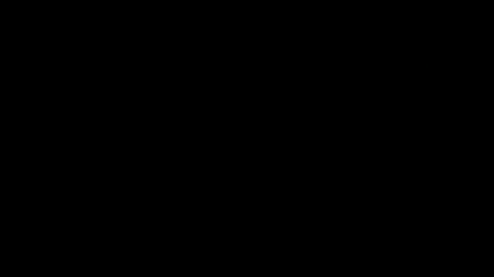

# Stanford CS221 ｜ Autumn 2025 p01 Stanford CS221 ｜ Autumn 2025 ｜ Lecture 1： Course Overview and AI Foundations [ya [BV1XuPrzwEes_p1]

嗯。Hello everyone， welcome to CS221。 This is artificial intelligence principles and techniques。

 I'm your instructor Percy Liang， so if you're new to Stanford， welcome if you've old to Stanford。

 then welcome back So this is believe it or not my 14th year at Stanford and this is my 13th time teaching the class however。

 this year we've decided to make a number of quite large changes to the course given how much AI has changed by at the same time many of the key ingredients about the foundations are still the same and hopefully this will become clear as I go through the lecture。

Okay， so what I want to start with today is asking the question， what is AI。

 we're here to learn about AI， so what is it？And you by now， compared to 14 years ago。

 I hardly have to motivate why we care about AI， it's all around us with AI assistance that probably many of you use daily。

 many of you probably have written in autonomous vehicle。

 we've seen success stories of gameplay agents that have been humans。

 more recently there's been language models that can excel even the most elite competition。

 math and programming folks at their own game， and we've seen AI also make quite a big impact in sciences notably biology。

So these are examples， but what exactly is AI？And so if we break it down， AI。

 in case you don't know stands for artificial intelligence。

 there's an artificial part which is straightforward。

 it means we're building something that runs on a computer or a robot and the intelligence thing is a little bit more nuanced。

And this has been a subject of debate for millennia。

 and often people tend to think about it in terms of humans。

 but we actually want to maybe seek a definition from general principles so because intelligence I think is just general maybe fundamental property of in the universe in some sense。

So here's how I would break it down， so what are the ingredients you need for intelligence？

In other words， if you have an agent that is supposed to be intelligent。

 what should the agent be able to do？ And here agent could be a computer agent or it could be a human。

 for example。So there's four things， there's perceiving the world。

Reasoning with the information that it has， acting in the world and learning from experience。

so just as an example， suppose your auto tonoous vehicle perception means taking in all the sensor recordings。

 visual， LiDarR， whatever you have， and making sense of it。

Then reasoning about what's going on in the scene is this person crossing the road where are these cars likely to do and coming up maybe with a plan。

 and then there's acting， which means are you should you speed up， slow down， stop， turn and so on。

 and finally learning which is after you see this experience next time you should be better。

 it would be not intelligent， if you saw the same you were making the same mistakes over and over again。

So this is fairly intuitive and each of these four ingredients。

 if you were to unpack it unpacks into a whole subfield's worth of research， so in this class。

 many of the methods that we are going to talk about fall into one of these four categories。

So for example， in perception， this is about processing raw inputs from the world and turning into some sort of representation or understanding。

 so this includes things like visual see understanding， making sense of images and videos。

 speech recognition or more generally audio perception， making sense of sounds。

 natural language understanding， text。On the web or in messages making sense of that。

And then there's reasoning， which is using the knowledge and the perceptioncepts that you have to draw inferences about the world。

 so we're going to see a number of techniques in this class starting with things like uniform cost search。

 so if you have operating a deteristic world， how you can find the shortest path or valuationeration as we'll see when we talk about Malarov decision processes。

 this is modeling the fact that the world is unknown and has uncertainty and how do you make optimal decisions under uncertainty and this is really a kind of elegant mathematical frame around that。

And then in some cases， you're playing against the adversarary， for example， in chess， for example。

 and you want there's principles called minimax， which allows you to play optimally even against a worst case opponent。

And finally， we look at cases where when we talk about Bay networks。

 we have models of the world which capture all the uncertainty around them。

 and we're trying to reason about things probabilistically。

So there's a lot of the classes about actually how you reason with information you have in this quote quote unquote  rational way。

And then if you go to act， this is where you actually prove to the world that you're intelligent。

 so there's outputting actions that actually affect the world， so you might generate text。

 a chatbot returns some response or returns an image。

 you might be generating speech or if you're controlling a robot。

 the robot actually moves and does things in the world。So without ahen。

 you don't know whether you have intelligence or not。And finally， learning。

 so this is as the agent is proceeding。Through life it should be learning from experience so the most simple example of learning as we'll look at very soon is gradient descent when we look at reinforcement learning。

 we're going to look at technique Q learning and then when we look at Bayesian networks we're going to explore algorithms like expectation maximization so learning is a general principle of updating agent beliefs or state based on experience and it manifests depending on which situation are you in and different algorithms。

😊，Okay， so perceive reason， act， learn。And the trick is that all of these things have to happen under resource constraints。

By resources， I mean two types， there's computation。

 your algorithm has to be finished in a timely way， especially for example。

 in real time applications you're driving a car， you can't take an hour to think you have to act in a split second and this also includes amount of memory or communication costs you might have。

And finally， other type of resources， which is important is information。

So an agent that's acting in the world is always going to have limited information。

 limited experience and limitedd inputs that capture what the situation is。

 you can't see around corners， for example， and these constraints prevent the agent from acting as optimally as you would like。

 but the name of the game is to deal with a limited amount of information and still be able to do something sensible。

Okay， so these resources and constraintss are going to really make our life challenging。

 and that's why we need clever and sophisticated algorithms to actually solve these problems。Okay。

 so we've talked about what an agent sort of does。 But you know， what is it actually trying to do。

And this is， in some sense， sort of the deeper part of the conversation。

And then it can be broken up into two questions first is。

What do we want the developer of the AI agent to achieve。So， what does a developer want to achieve？

RightSo one note， and this is like a general comment is that an agent either explicitlyly or implicitly encodes some sort of values or somewhat similarly goals or objectives or utility functions。

Right， often these objectives are stated maybe explicitly。

 but even if you don't state them explicitly， they're sort of in some implicit thing that it's trying to do。

 so that's something to keep in mind。And some of you might heard of the term alignment。

 alignment is about how do you make sure what the agents values are。

 are correspond to what the developer actually wants。 So a simple example， the conical example。

 is chatTPT， for example， is。The developer， Open AI， wants to make chat to be informative。

 avoid hallucinations， refuse harmful queries， and so on。

So that is a certain value that the developer is trying to instill in the agent。

And whether that alignment procedure is successful， well， that's another question。

 and sometimes you'll see that you have examples of misalignment where despite the developer's best intentions。

 the AI does something that is unintended。Okay， so that's from the developer's perspective。

But then there's a broader question of what do we want the agent to do to the society？

And this gets beyond just a single developer deploying a product into the world。

 this has to do with social concerns such as protecting people's privacy。

 thinking about the role of copyright and intellectual property。With respect to generative AI。

 the impact on jobs， inequality， even geopolitical considerations。So towards the end of the class。

 I'm gonna go a lot more into this。 but I think it is worth saying from kind of day one that these are really。

 you know， top concerns。 And this is a really kind of deep social technical problem， right？

 There's a question of who's we， right， Is it me， Probably not。 I it you know， the。

You know somehow the population of the United States is that all of the people in the world。

 the problem is that there's fundamental tradeoffs between different people's values and even independent AI as you can see with in politics。

 there's just tension between people want different things and that's sort of an inevitable part of life and then there's unintended consequences where you might think you're putting out an AI that those reasonable things but it actually has unintended consequences and there's many kind of examples of that。

Okay， so let's kind of summarize here。So what is AI， Well。

 there are some examples of AI that hopefully everyone's familiar with。

 but breaking it down into the foreign ingredients of intelligence， perception， reasoning。

 action and learning， All of this has to happen under resource constraints。

 limited compute and limited data。And then we have to think about developer goals， how do we。

 as a developer， are going to build AI to do something。And then more at the societal level。

 how do we， as a society， make sure that AI is actually benefiting society as opposed to maybe one。

 particular developer only。So the question is， are we going to understand more about the limitations of AI technology today？

 Absolutely， we're going to go through。As you'll see。

 we're going to start at the bottom and build up our understanding of what AI is。

 and we can see very quickly when it works and when it doesn't work。

So the next thing I want to talk about is this class。

So this class is called artificial intelligence principles and techniques。

 so the emphasis is going to be really about these timeless foundations。 for example。

 gradient descent or stochastic gradient descent has been around for at least since the 50s but it's still widely used today。

 of course the world changes and there's many the examples of AI all change and where our standards for intelligence might change。

 but most of the class is going to be foundations。 So when I was going back and think about what needs to be changed as you'll see later。

 we made some changes but many of the things are actually the same。

And one general philosophy which has been there since the beginning since I created this class is learning by doing。

 so a lot of the homeworks are going to be very much like building things。

 coding things up and seeing things work， because at least at this point AI is a very empirical and an engineering oriented field。

 so without maybe unfortunately too much much theory。

 but there is a sense in which you need to just need to do things to really understand。

So in terms of changes for this year and this might not be so relevant。

 but in case you you talked to your friends and you had some ideas of what the class is going to be。

 the biggest changes that we are going what I call tensor native which means that the course will be mostly in nuy and ptorch so this is obviously the main kind of the framework that people use and again。

 many of the concepts are the same but it's just allowing us to be kind of more modernized in that sense and of course tensors are very prevalent in deep learning。

 but actually if you think about all the other techniques we're going look atvaleration in the Bayesian network inference。

 all of those computations can be expressed just as tensors so tensors are actually this much more universal tool than just deep learning or machine learning。

 so it's a good step up I think。We had to cut constrain satisfaction problems， which is it's sad。

 but that's life。And we instead we're going to do a deep dive into the societal impact of AI and I feel like this is a really important。

 you know the right tradeoff to make because AI is compared to 10 years ago having a much more outsized impact on our daily lives and it enters the sort of public discourse and talking about that in AI class feels right Constraint satisfaction problems。

 I know all of you were dying and are very disappointed that we cut that。

 you can always read up about it。Okay so finally just as a tipbit。

 you might be wondering what is this program that I'm going through so this is what I call executable lecture。

 it's a program where by executing your program we're delivering the content of the lecture and if you think it kind of looks like code you're right。

 it is actually a program underneath all of this， it's just that it's been rendered for your viewing pleasure。

So it's codes so we can actually know write code and define sort of step through code。

 this will actually be really useful not for the first lecture。

 but for later when we actually get to the more details。

 because then we can walk through examples in a very crisp way。

So because it's code lectures have this hierarchical structure so you can see at any point in time where in the flow。

 which function you're in now we're talking about this。

 what is the program function code is also very precise because you can't certainly more than English but even math I think the problem with math is that people you can write a lot of symbols but then you have to understand what the symbols mean whereas if you're writing code and the code actually executes has a welldefined semantics and of course at the end of the day。

 if you're building actual AI system you're going to have to write code anyway so why don't we just start doing that from day one。

All right， so let me actually show you that on the lectures page， this is the GitHub repo。

 this is where all the executable lectures live， and today we just did welcome next I'm going to do a brief history of AI and then we're going to dive deep down into Tensors。

You， we see what AI is today， but I think it's useful to kind of to always for the same reasons you learn history in general to understand a bit of the context of how things develop because history can also inform us about the future。

So one natural place to start with the history of AI is the Turing test， so in 1950。

 this man by the name of Ellan Tin published this paper。Od。And this paper， Ellen Turing asked。

 can machines think？So it's a very simple question。But more to the point， the question is really。

 how could you even tell if a machine could think， because at that time there was actually hardly computers were hardly a thing and so this is really kind of within the realm of philosophy almost。

And he A came up with a really clever idea， and it's called the imitation game or more popular known as the Tin test。

And the idea is that we set up a game where a machine and a human are each trying to convince a human that it is actual human and a human can't tell which one is machine or which one's human。

So you're basically trying to convince a human that as a， as a machine， that you're human。

And there's all you can complain about the Turing test。

 Many people have written extensively about how the tu test is imperfect。

 but I think the significance of this is that it grounds this philosophical question about what his intelligence and what does it mean to think in objective measurement And this idea of objectivity is actually what has really been a very strong driving force in the development of AI。

 I think about benchmarks and in measurement is a way that the community has used to make progress。

 and it kind of starts with T in a sense。 Now Turing deliberately left openness solution。

 he of course he was brilliant， but of course， he didn't know how you could get there was that he actually suggested something like machine learning or at the time。

 a lot of folks were thinking about kind of logicbased methods as well。

 but he didn't know which the solution was but that's the kind of nature of research。

You don't know what the solution is， but you can define a North star in some sense。

So then after 1950， the history of AI， I'm going to tell in three different stories， symbolic AI。

 neural AI and statistical AI。So 1956， John McCarthy。

 who founded actually who was at MIT at the time， but later found the Stanford AI Lab。

 organized a workshop at Dartthmouth College and convene the leading thinkers of the day so these were kind of the brightest minds and the goal was to come together in two months and make a significant advance in AI。

U。They didn't exactly solve， I think， too much， but they did coin the term artificial intelligence。

 which has stuck with us。So in general， the 50s， I think was a time of high optimism。

 there were folks like Arthur Samuel who created a checkers playing program。

 they actually used somerudimentary machine learning at the time he played the checkers program was playing at a strong amateur level。

 which is not bad for 1950。 you have to realize in the 50s it was hardly computers so this is actually pretty pretty good Ne and Simon。

Fairly large giants in the AI space developed a program that could prove theorems in。

And Russellss and Whitehead a principal of PM Mathematica。

So automated theroving was a thing back in the 50s so of course you see a lot of success stories these days about theorem proving。

 this actually kind of goes back all the way to the 50s they actually had their program come up with a new proof that was more elegant than the human proof they actually wrote up a paper and submitted it but the paper card rejected because it wasn't a new result。

 I think the reviewers failed to notice that the third author of the paper was actually the logic theorist。

😊，So like I said， this was a period where people thought they could you know。

 solve AI in a matter of years， right， So sounds a bit familiar here。But in as we know。

 that didn't happen。 There's this folklore example from machine translation。

 This is probably not a real example， but it's it's it's a good example。 So， you know， supposedly。

 people were interested in translating between Russian and English。 This is height of the Cold War。

 So they took an English。S， a spirit is willing but the flesh is weak translate into Russian。

 which is something I don't speak Russian and translate it back and it says the vodka is good but the meat is rotten so you obviously the machine translation maybe it didn't work so well in 1966 there was a report that said machine translation isn't really going anywhere。

 we should just cut off funding and this led to the first AI winter。

So this is a period where funding for AI basically dries up and people sort of don't try to use the word AI too often。

So what went wrong here？Well， you know， back then in the 50s。

 there was just not that much compute right So a lot of these problems were formulaative search problems and the search base grew exponentially and outpace hardware and they just had no idea how to deal with it。

 Even the theory of incomp completeness was like from the 70s。

 So I think it it was just not very well manage， I think and there's also limited information。

 So one thing is that it's one thing if you're doing chess。

 but if you think about machine translation， there's just a huge number of words and objects and concepts in the world。

 and if you don't have all that knowledge in your system， you just don't have the intelligence。

 So a lot of intelligence just has to do with knowledge。

But the silver lining was that despite not having solved AI。

 there were really useful things that came out of it。 for example。

 LispP was the world's most advanced programming language probably still is in some sense。

 and many of the ideas in LispP have only kind of more recently been adopted into more modern programming languages。

 garbage collection。If you don't know what that is。

 that means it' succeeded because you don't have to think about allocating and delocating memory。

 time sharing the idea of multiple people using the same computer at once。

 this was a radical idea back then and all of these things people had to develop in order to tackle this more ambitious problem of solving AI。

So then fast forward through the 70s and 80s， folks were interested in knowledge。

 So remember one of the problems with with previous generation systems is that there was just not enough information in these systems。

 So then people said， okay well， why don't we build these expert systems where we just go out to a domain expert。

 and then experts are gonna sit down and write all the rules。

 So you go to a chemistry expert or biology expert and they just write down the rules specifying what they know about biology。

 And there were a bunch of systems that were built back in to diagnose blood infections or convert customer orders。

And and the good thing is that the knowledge did actually help both the information computation gap。

 because you have more knowledge in the system and because you have more knowledge。

 you don't have to search widelyly through a huge space。😊。

And this was actually the first time that AI actually had a real application that impacted industry and was solving real problems in the world。

But the shortcoming was that these rules really didn't deal well with uncertainty of the real world。

 and these rules， furthermore， became too complicated to create and maintain。

And it sort of just kind of resulted in kind of spa A code and fell apart。

And so there was a lot of hype and underdelivery on results。

 which is a good way to get your funding cut off and that led to the second AI winter at sort of end of the '80s Also there was economic recessions and so on and so on that didn't help either。

Okay， so let's now go back and chart out another trajectory through the history of AI。

 So this is neural AI。 So back in the 40s， Mcllan Pis。Mathematician and。I'm sorry。

 logician and neuroscientists。Basically developed the theory of artificial neural networks。

That was a theory paper， there was no way of learning the network。

 it was really exploring the properties of how a mathematical model of a neuron could work and what kind of logical computations it could do。

The first actual what you could call a learning algorithm comes from Heb in 1949 with an idea that cells that fire together wired together。

 it was just a sort of ad hoc rule， there was a perceptron algorithm which was a bit more principle。

 theres outline for linear regression， but by in 1969 there is a book that published by Minsky and pepper called Perceptrons and they showed that these linear models were limited。

 they couldn't represent very sophisticated functions and that book was cited to have killed off neuralette research or at least kind of made people less excited about that。

Minsky happened to be he actually worked on Roette's research during his PhD。

 but then he transitioned more into the symbolic AI School of thought。

So in the 70s things were kind of dead， in the 80， things came back。

 coughf nets were developed in the '80s and back propagation was popularized by Romahart Hinton and Williams。

 so back propagation which has been actually invented and reinvented many times。

 but 1986 was I think where it got really mainstream and the machine learning community。

 and by the land of the '80s there was some modest successes in using neural networks to do actually real things like recognizing Henrywritten digits for USPS。

But still， neuronas were really hard to train and were generally unpopular in the 2000s。

And then things started changing towards the latter part of the 200s to 2006。

 there was this paper by Hinton talking about how you can train actually deep neural networks。

 because people had really struggled to train deep neural networks back in day and then things kind of snowballed。

 2009， deep learning started having impact in speech， then in computer vision with Alex Ne。

 then in language with machine translation and seek to seek model lane， there was new optimizers。

 new attention mechanism was developed and then we have events like Algo。

 which showed the power of deep learning combined with reinforcement learning that could solve problems that people thought were a decade away and finally the transformer architecture came around in 2017。

 which actually lays a lot of the groundwork for what we'll see a bit later。

So then let's go back to the other thread， this is I call it statistical AI。

 but really it's more kind of mathematical ideas that have come from just in general。

 maybe even outside AI。So one thing to notice is that many of the core ideas that we'll talk about in this class actually are not really about AI at all for example。

 if you think about linear regression， which is the simplest maybe arguably the simplest place to start in machine learning。

 this is like from Gauss in like 1801 this is definitely before computers and you had to solve least squares by by hand。

 1936 linear classification， sarcastic gradient descent from the 50s。

 there's uniform class search also from the algorithms community in the 50s。

 Markov decision processes from control theory， so this is really kind of people who weren't necessarily trying to solve AI in the same way that John McCarthy was trying to solve AI。

 but nonetheless developing really valuable mathematical tools that then AI community leaned on。嗯。

There is a period through the 80s and up until the 200s where statistical machine learning。

 these are techniques which are rooted in kind of mathematical principles such as Bayesian networks and support vector machines。

 very inference， conditional random fields， topic models。

 these things were very very invogue in the machine learning community。

 this is also a period where neuralnets were a really small fraction of the machine learning community because it didn't have any nice mathematical properties and also it was hard to to train。

But， you know， I think。knowingwing where we know know now， I think it's clear what has happened。

 I think that。You know， many of the ideas from statistical AI were still like for example thinking carefully about optimization were still useful。

 but the model architectures really kind of became much more about the deep learning style now there's a sort of more recent trend in the last five years I guess this is now history in some sense。

 even though it was only five years ago， which is the era of kind of foundation models started with with in language with pretrained language models with things like Ellamo and Bt and Google's T5。

 and the general idea is that if you take a large body of raw text and you train a model that essentially learns to predict the next word。

 then that model has really useful representations of language that can be useful for solving a bunch of other tasks。

 So this idea is actually also not you know。New it comes at least 20 years ago。

 but the idea of coupling that and executing that in the Pan modern deep learning framework lead to new and surprising results。

And then there is a period of large language models。

 foundation models where with folks like Open AI and Google。

 Ameta and Deepse and many others scaling up larger and larger models。

 and this is kind of what gives rise to the kind of modern foundation models of generative AI boom。

One note about reasoning is there has been a lot of。Emphasis on solving more ambitious problems。

 and it's sort of maybe kind of trivial that answering hard questions require thinking。

And so the idea with reasoning models is that language models can produce thoughts。

 which are tokens that illustrate what it's trying to do before producing an actual response。

And this has been led to another series of kind of improvements。

 and that's how you get to things like。Moels that can get gold medals at the IO and the II。

Another kind of general trend that has happened is。You know， the industrialization you know， of。

 of AI。 So， you know， AI used to be kind of this really cute niche thing and research where a bunch of like daydreamers would come and try various things out。

 and maybe some things would work。 And most of the time it didn't。 And now。YouG4 supposedly has 1。

8 trillion parameters， costs 100 billion to train， XI builds this cluster of 200k H 100 GPUs。

 and there's hundreds of billions of dollars of investment going into AI at the same time。

 the amount of openness about what is happening。 AI has also decreased quite a bit。

 so the G4 technical report says that there's due to a competitive landscape and safety implications。

 there's no information about how these models were trained。

 which is in contrast to even five or six years ago where companies and we' publishing openly。

AI has also emerged from research and now shaping businesses and policy discussion。

 but one thing that iss interesting is that a lot of the open research problems around intelligence are still remain。

 so it's not like we've solved AI， I think we just made so much progress that we can actually see it having real impact in the world。

 but there's more research to be done。Okay， so some thoughts here。

 So I talked about these three kind of paradigms of thinking about AI。

And you know throughout history there has been a lot of fierce debates right so Minsky and Papper。

 were promoting symbolic AI and sort of deliberately tried to kill off neural nets research in some sense and statistical ML in the 200s really thought neural nets were dead。

 people would say like， oh， really why are you trying to use neural networks。At the same time。

 there are some deeper connections so for example， the first paper that you really set the groundwork for neuralNes is really about how to implement logical operations and go is a game that's defined purely in terms of symbols。

 but deep learning is actually the key to playing this purely symbolic game。

 which is kind of weird if you think about it。嗯。And then deep learning。

 I think during the first decade was really about perception and this understanding of the world。

 but now it has turned much more into reasoning， which was one of the goals of symbolic AI from the very beginning So AI I think is just this kind of melting pot from the beginning。

 I think symbolic AI really had the vision of what it meant to be kind of to create intelligent agents。

Neurural AI provided really the model architectures and the way of how you create models。

And then statistical AI provides the rigor， a lot of how we the modern language we use to describe optimization and generalization from training and tests。

 this comes from kind of statistical thinking。In this class we see elements of all three traditions。

So the third part of this lecture is going to be on tensors。

 and this is we're going to roll up our sleeves and see some code and try to build some foundations。

Okay， so if you hear the word tensor， you probably think of something that looks like this。

 So tensors are what I think of as atoms of modern machine learning。

 so they're used to represent data， model parameters， gradients。

 intermediate computations like activations of deep neural networks and basically anything。

 So everything that we are probably going to touch can be thought of as some sort of tensor。

And as I mentioned earlier， tensors also show up very broadly in science and engineering。

 So even if you don't。You're never going to do any AI in the future。

 This is still probably a useful lecture to learn some of these foundations。

So in this lecture I'm going to introduce some of these core ideas through lumpy examples。

Okay so let's start with creating tensor， so tensors are essentially a multidimensional array which generalizes vectors and matrices。

 the simplest tensor is a scalar which is a rank0 tensor here x so MP is just nupy and the array is it's a zero dimensional rank zero array which is just the value 42。

And every tensor has a shape in which case there's zero dimension， so it's just empty list。Okay。

 so a vector is a rank1 tensor， so here's a vector， 1，2，3。And its shape is three。

Because it's length three。A matrix is a rank2 tensor。

 so you have this matrix and its shape is it's a two by three matrix。Okay。And then finally。

 a tensor can be any rank， so here is a rank3 tensor。嗯。So this has three。G dimensions。

 the first dimension， there's two。You know， two parts， the second dimension， there's also two。

 and the third dimension， there's three。Okay。So given this tensor， you can extract slices。

 so for example， you index into1， it takes this is the zeroth element and this is the first element of x。

 and so y is this。You can further subset slice into the zeroth component of that。

 which will give you the row zero of this piece， and then you can first slice into that and you get the second element of that。

 which gives you9。Okay。So generally you don't create tensors by writing down all the entries because most tensors are kind of huge so you can use these special commands to create tensors。

 for example， zeros， you pass in the shape and it gives you a tensor of that shape。

 ones gives you the all ones， tensor a R end gives you a tensor filled with random numbers from a Gaussian distribution。

And there's identity matrix， you can take a vector and populate a matrix where the diagonal is that vector。

You can also read and write。A tensor is from disk， so if you're loading data sets。

 you get a tensor that's loaded from disk and then you can probably create a tensor which is randomly initialized and you can do some training and then write out the parameters。

So let's look at some hopefully motivating examples of tensors。

 so these are some tensors that show up in machine learning。In machine learning。

 we're talking about data points and typically data points are represented as vectors of some dimension D。

 So here I'm just using MPO1s。 It's arbitrary。 You could put zeros。

 We're just trying to get a tensor of the right shape here。 So this is a two dimensional data point。

We often will batch examples together for efficiency， which we'll explain a bit later。

 So if you have three examples you can represent a data set of n examples each d dimensional。

As follows， so we have the first row is the first data point， second row is second data points。

 the row is third data point。Okay。So in language modeling。

 this is where you actually get into higher order tensors because each example is a sequence。

 think about a sentence， it's a sequence of length L。And so if you have a data set of。And examples。

Each length owl and each。Position in the sequence is D dimensional。

 then you have an n by L by D tensor。Okay， so here's three examples。

Each example is actually a matrix where the dimension of that matrix is the length by the dimensionality of the vector at each position。

Okay， so in vision， you actually get more dimensions because there's a height。

 images have height width and a number of channels so if you have an examples。

 which each example is an image，Then you have a n by H by W by C tensor。Okay。

So that's to represent data in neural networks。 you have weight matrices。

 typically that transform an。D D n dimensional input into a D out dimensional output。

 and generally this would be a matrix which is D in by D out。Okay， so in general。

 the parameters of a neural network model are just a collection of tensors。 so for example。

 if you go on hug face and you look at the deepse V3 model。

 so this is a 60070 billion parameter model and you look at the the parameters。

 you'll see that this has for every layer， I guess there's a bunch of。

Marices or I guess these are matrices where each matrix has， let's this one's 7，168 by 16384。

And so in general， the parameters of a model are just a bunch of tensors。So。So if you have a tensor。

You can extract parts of it so you can just get the first row or get the first column using this notation。

 you can transpose it， note that these operations do not make a copy of the tensor。

 they're just producing different views。So that means if you mutate- so I have x equals the transposeive y so if I mutate x。

 y also changes。So they're different objects， but they're pointing to the same underlying storage。

 So in general， be very careful about mutation。 and generally， you generally don't have to mutate。

 but if you do mutate， please really be careful。 otherwise you might get some bad bugs。

Okay so I'll go over this part fairly quickly， element wise operation。

 so you have any sort of tensor， I'll just using rank1 tensor for now。

 you can apply a bunch of standard element wise operations such as raising to some power taking the square root you can add tensors of the same size。

 you can multiply and divide by scalrs there's other special operations like triangular upper tri U and try L or take the upper or lower triangular part of a matrix so if you have all ones3 by3 matrix if you if you look at tri U that'll give you zero out everything under the diagonal if you do try L it'll zero anything above the diagonal。

So we'll see later that this is useful for masking parts of the input， for example。

 if you're defining transformers with a causal mask。

 then you have to use these matrix to mask out certain parts of the input。

But right now I'm just giving you the sort of the primitives and the building blocks。

 and then we can have some fun putting these together later。

You can also take a tensor and just create another tensor that has the same shape。

 but is's filled with zeros or ones。Okay， so let's talk about matrix multiplication。

So the bread and butter， of deep learning。 And generally， the main operation you do with tenss is。

 you know， matrix multiplication。 So hopefully you guys should be familiar with matrix multiplication。

 but just let's kind of make sure we。I'm on the same page here。

 so I have a4 by6 matrix and a 6 by3 matrix。If I multiply these two matrices。

What I'm doing is I form a4 by3 matrix where each element is in a product between a six dimensional vector。

Okay。So just through。I think everyone knows this， but for example。

 all this six is the inner product between the first row and the first column。Okay， so。

Remember that we want to pack everything into tensors for efficiency so we can actually batch multiple matrix operations together。

 so suppose we have a tensor which is2 by4 by 6 so effectively we have two4 by6 matrices。

And remember often the first dimension is a batch dimension。

 so you have like two data points or n data points。

 and you want to often do the same operation to every data point。

So a nuy makes this fairly easy just。Write the same thing。And implicitly。

 what this is doing is that it is taking for every slice with respect to the first dimension。

 we're doing the same thing that we did before， we're doing the matrix multiplication。Okay。

 so that gives us these two matrices， each of which was a matrix multiply from each of these matrices。

Okay， so in other words， for every slice for x0， x1， we multiply by W。And in other words。

 a w is broadcasted to each slice of x。W is a lower rank object， and x is a higher rank object。

 so what NI does is it sort of copies W multiple times one for every index into the first dimension。

Okay， so this is generally a useful pattern that you'll see in a lot of you。Learning code。Okay。

 so let's any questions so far about this？So the question is what do I mean by more efficient。

 so it will be more efficient in terms of computation and it's also shorter in terms of code。

 So I'll talk about efficiency actually right now。Okay。So the question is。

 does this broadcasting only work if the first dimension is a batch dimension。

 So I'm calling the first dimension the batch dimension just because that's like what it represents usually in machine learning。

 Nie just sees this as like a rank3 tensor， There's no meaning to whether it's a batch dimension or not。

 It's just taking the first dimension and know just doing it。

So the question is if you have a rank for tensor like the one we saw for images。

 you know what is what can you multiply on the other side。 So in general。

 the rule is that you have like n rank and tensor， you can multiply by a scalar。

 which if that case is easy to see because the scale is rank0。

 So it just gets broadcasted to every single element you can multiply by a vector in which case it's also broadcasted to each piece or matrix and so on。

 So actually hold that thought when we talk about inops。

I'll show you a different way of thinking about this， which is far less confusing。Okay。

 so let's move on to answer the question about efficiency。So in general， when you're writing code。

 there's multiple ways to compute the same result and。

Different ways will have different computational costs。In the case of tensors， in general。

 you want to express your computation as we're using few tensor operations。

 So let's take a kind of a very simple example。 So I have two。N by M matrices。

If you want to do a matrix multiplication， you could just implement it in Python。So for every IJK。

 Ij equals IK times Kj。So this is also a good refresher of what my matrix multiplication is。

 but that's what it is。嗯。Or you can just do it in nonp。

 So there's this handy utility called timeit that allows you to see how much time these operations take。

And it turns out that if you look at the Python time or nupyy time， it's， know， a lot slower。

And the reason for this is that， well， first of all this is in Python。

 Python is not the fastest language it's interpreted。

 it's not really optimized for performance and whereas NI。

 it's not only kind of written if it's on CPUs in C， but it's also been really。

 really optimized and furthermore， if you were running this on GPUs。

 you would definitely want to use NI because that would even give you further acceleration especially for large matrices。

And just to say a little bit more， once you are able to write things in tensors。

 then not only can you put on GPUs， but there if you think about distributed algorithms。

 there's automatic tools that can actually shard up your tensors across multiple。

 GPUs and it can go even kind of faster， whereas if you're writing sequential code that's just not a good way to do it。

Okay， that does mean however， sometimes your code is going to be actually potentially less readable because you're like doing basically gymnastics on tensors。

 but so there is a tradeoff here， but often in machine learning code， if you're scaling up。

 you want things to be fairly fast。O。So now I'm going to talk about Iops。Okay。

 so here's the motivation。So let's suppose I have this  two by 2 by3 tensor and another two by 2 by 3 tensor。

And I want to basically for every index into the first rank。

 I want to basically multiply this matrix by the transpose of this matrix。

 So the way I would do that is this actually I should say another thing whenever you define a tensor。

Or at least when I define a tensor， I tend to annotate what the dimensions mean。 So for example。

 the batch dimension， this indexes positions in a sequence and this indexes like the hidden unit in a neural net and so on just so that you don't get confused。

Because if you have like a four or five rank tensor。

 it can be really confusing to keep track of where the dimensions are。Okay。

 so if you wanted to do that operation。You would have to do X。

You know multiply y dot transpose -2 minus-1， and that gives you your result， which is going to be a。

2 by two by two tensor。Okay， so if you're wondering what is going on here， what is this -2 minus-1。

 that's exactly the question you should be asking because is it can get confusing。

 Now this example isn't that hard I can explain to you。

 but I won't because theres I'm going to show you a better way to do this。So Einops is this library。

 just like Nmppy is a library for manipulated tensors where the dimensions are named。

 and it iss inspired but not identical to Einstein summation notation。

There's a nice tutorial which you can go through， but I'll just give you some of the basics。So。

So the first。You function is einsome and it basically is a generalized matrix multi location with good bookkeeping is what I refer to it as。

 So again， here is here's a simple example。 supposeupp I just want to do X Mamal Y。

So I should get a 3 by3 matrix， so I could just multiply the matrix。

So if it's really just a matrix that's what I would do。

 but here's what it would look like in Iops notation so Ein sum is going to take two arguments。

 the two tensors， and it's going to take a string and that string specifies how I want the matrix multiplication to go。

Okay，If there's two， then I have two sequences of essentially named axes， sec1， hidden， hidden C1。

 you'll see that these match the names of the dimensions up here as well。Okay。

 and then on the right side， I basically specify。What the names of the axisx should be。

 and generally the labels over here are going to be a subset of the labels over here。

So if you remember in matrix multiplication。If you have IK and KJ， that goes into IJ。

So basically a row dimension of the first tensor and the column dimension of the second tensor。

 that is used to index the resulting tensor。And any variable that， like hidden。

 that's not mentioned is or is going to be kind of some doubt。

So I'm going to take a sum over all possible values of K here。

And that's I'm going to add all those up， and that's going to get accumulated into the appropriate entry。

Let's try a more complicated example。 So here's the motivating example。 So this， for this， I mean。

 this is a little bit overkill。 You don't really need this。 But here。

 I'll show you where this can come in handy。 So imagine I have these two。Tensors now。

 and now they share a batch dimension。So remember before I was doing this and you're wondering okay's what's happening so here's how we would do it using IOs。

 you would again write down the labels of each tensor， batch sec1 hidden， batch sec2 hidden。

 and then you would just write down the dimensions of the resulting tensor， which is batch sec1 sec2。

Okay， so I find this like you，100 times easier to read because I know exactly how the different you know。

 indices correspond to each other。 They're also named instead of having numbers like -2 and -1 and so on。

Okay， so you can be a little bit fancier if you have basically tensors。

 Often you might have like a matrix， but there's an unknown unknown number of like a batchor batch dimensions。

 and you can just write dot dot dot as well。 So instead of writing batch， I can write dot dot dot。

 And that's that's fine too。Okay。So that's Einstein， that's mainly the thing that you'll need。

 it might take some getting used to and at first it might seem a little bit kind of cumbersome。

 but hopefully you'll grow to like it。 It's kind of like you know writing Python with type hints。

 you know sometimes it's kind of annoying you have to write this thing but you know it's much。

 much easier to read with type hints instead of just having like F of X， Y and Z。Okay。

 so very quickly， two other operations I want to talk to you about， IOs reduce。😊。

You can reduce a tensor into by performing some operations， so suppose you have this tensor。

 two by 3 by four， tensor。m， so this。The traditional way of doing things is basically。

 I'm going to create a tensor where I'm summing over the last dimension。

Okay so for the first dimension and for the second dimension， which is a row。

 I'm going to sum over to the last dimension， which is the column。

 and that's why I get two by three of fours。So there's a function from IOs called Red。

 which allows you to take now a single tensor， and it allows you to basically you specify the operation。

 which could be sum or min or max or and it allows you to basically again， any。

Dimenssion that doesn't get mentioned on the output gets sort of like processed away。

And here the processing operation is sum， so it's going to sum all the elements across the rows。

 whereas if this were max， I'm going to take the maximum across the rows and so on and so forth。Okay。

 and the final thing I'll talk about is rearrange。 So this is a Bboard advance， and you'll see it。

 know， it's used。If you think about building a transformer where there's some kind of more gymnastics yeah you have to do with different attention heads。

 so the general idea is that sometimes you have a dimension that actually represents two dimensions and you want to only operate on one of them so here's an example。

 so suppose I have a three by eight matrix。So it's seek by total hidden， but secretly。

 total hidden is actually a flattened representation over like heads times hidden one。

 so these are just names of dimensions。Okay， so really each row of this is like a two by four matrix is the way that I should think about it。

And I wanted to basically multiply each of those two secret2 by four matrices by this4 by four matrix。

And I want to put it back into that。In the flat， so basically I can use rearrange to unflatten。

So here what I'm doing is I can use this parentheses notation to say that this thing is actually one dimension。

And over here， I remove the parenthees to denote that those are actually two dimensions。

And the way I'm going to split it is heads get2 and hidden gets basically to the number of dimensions divided by2。

 Okay， so concretely what that looks like is I've broken。Remember， this was a3 by8 matrix。

 I've broken。This into a three by two by4 tensor。Where the heads hidden one corresponds to this eight dimensional vector。

 and that's been broken into a two by4， so heads 2 corresponds to this dimension being two and hidden one is a four here。

Okay， so now I have this tensor， I can perform this operation on each of these matrices。

So here I will show you， you know， I have hidden one and hidden one， hidden2 mapping to hidden 2。

 So again， this dot dot dot is basically same for each of these things in the batch you know in the sequence dimension。

 I'm going to do this kind of matrix multiplication。 and every。Actually， bro。

 I'm going to do this matrix multiification by hidden one times。Hidden one times Hi two。

 and that results in a tensor of the same shape。And then finally， I can put this back， so I use。

Sorry， I say hidden， this is a three by2 by4 tensor， so heads is two and hidden two is4。

 and I can group that into basically a single dimension here。So this is kind of a way to。

 if you need to sort of have a flatten object to sort of unflatten， do an operation and put it back。

Okay， so just to summarize， we've thought that we're using tensors in this class to basically represent everything。

It can be advantageous for computation reasons to express computation everything in terms of tensor operations。

 this will be a little bit like a puzzle， so you often get these puzzles like how do you compute this and you have to think about how you can structure things into the matrix so you can do the right matrix multiplications。

And to help you with this， IinOs will make the computations more legible because you can annotate the dimensions。

And finally， this does take some practice， so even though you've seen nuumpy， maybe some tensors。

 I think getting more and more practice with this will just make you better at doing this kind of thing。

