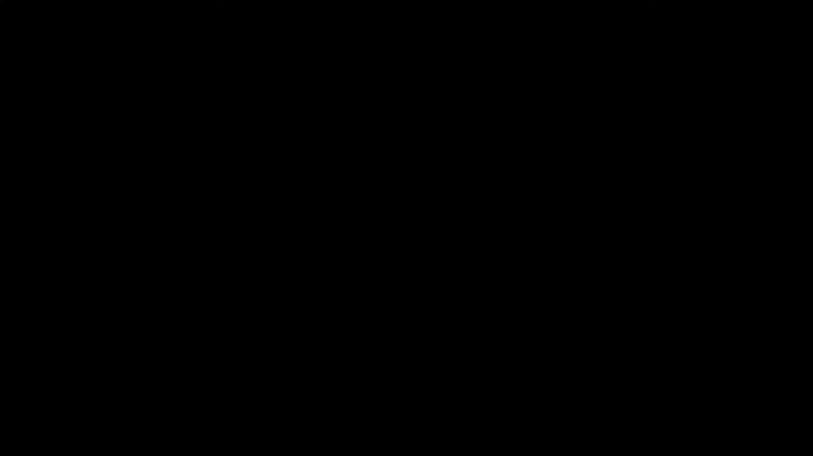
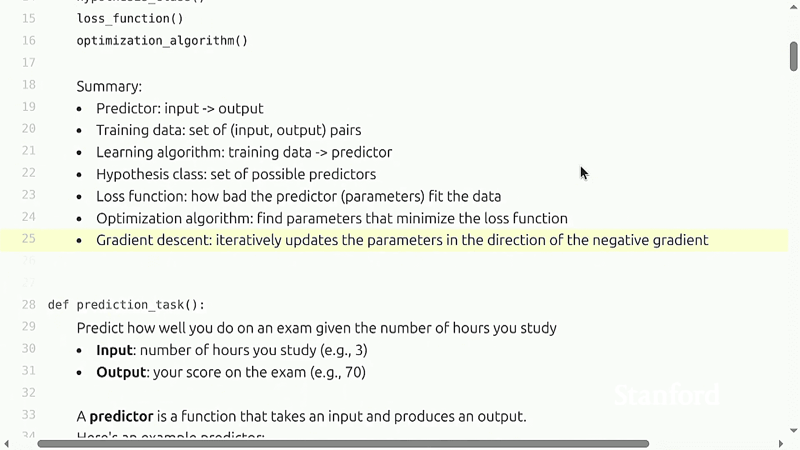
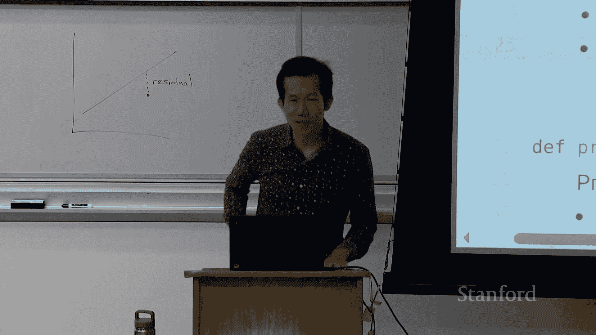

# Stanford CS221 ｜ Autumn 2025 p02 Stanford CS221 ｜ Autumn 2025 ｜ Lecture 2： Learning I [ypZJaTqrNdk] [BV1XuPrzwEes_p2]

So today， I'm going to be talking about back propagation and linear regression。So remember。

 we introduced tensors。 tensors are meant to be the atoms in modern machine learning。

 They're used to represent everything from data to parameters， the intermediate computations。

 everything basically is a tensor。One of the things we talked about towards the last of last lecture is IOs。

 which is a library that is meant to make computations more legible。

 I realized that I probably went through that fairly quickly。

 so I want to try to slow down and maybe walk through a little bit more since I think this is probably unfamiliar to most of you。

Okay， so we'll spend a bit of time reviewing IOs。So we call that a tensor has an order。

 sometimes this is also known as a rank but I find that a little bit confusing because when you talk about rank of matrices it's a different notion。

 so we'll just use the word order to refer to tensors。

 so special case of tensors are order zero tensors which are in other words numbers or scalrs。

 order one tensors are vectors and order two tensors are matrices。

 but you can have tensors of any order， we saw order four tensors order five tensors and so on。

So a tensor has an order number of axes。 So for example， if you are looking at matrices。

 which are order two tensors， axis 0 corresponds to rows and axis 1 corresponds to columns。Okay。

So this is just a bit of terminology， so we're all very grounded。So in inops， what do we do。

 We name the tensor， sorry， we name the axes of each tensor。And how do you name them。

 This was a question that came up。 Well， it's kind of like how you choose variable names and code。

 you choose the name to be it doesn't the program will run regardless whether you call it strawberry or X。

 but you should choose the name based on what that access represents。 So for example。

 if a matrix is meant to represent a data set where the rows are data points and the and each row has a feature vector。

 then you might name the axes example or and feature just to give you an idea。

 And then we talked about the ein sum function， which we're going talk more about is there' one kind of master function that essentially does not everything but a lot of different things。

So last time it introduces as a generalization of matrix multiplication。

 but it actually does maybe more than that。 So we'll basically go through some examples to just give you an idea of how Einstein works。

 because that's a central operation。 Okay， so let's start really basically。

So imagine you have this vector， okay， so order 1， tensor，0，1，10。Okay， so what can you do with it？

So the first thing we'll look at using Einom is to just look at the identity function。 Okay。

 this is not very interesting， but hopefully it'll tell you how the start building intuition for what the notation is doing。

Okay， so another way I can think about identity is that I'm going to create a vector output。

 which I'm going to denote y， and each element of that Y I is essentially X I。 So yeah。

 I could have written equal here。 You'll see why I wrote plus equals。 and this is true for all I。

Okay， so the way I'm going to denote that simple operation in Einsome is I have on the left hand side of this arrow。

 I'm going to have the named axes that are the input axes。 And then on the right side of thearrow。

 I have the output axes names。OkaySo in this case， the input axis，'s only there's only one axis。

 which is the， I'm just going to call I。And so this basically says over for all I。

 I'm going to take the X here， and I'm going to just map it to the output， which is Yi。Okay， so。

 and then so this is a string that basically specifies which axes should go where。

 It's kind of like a routing mechanism。 so to speak。 And then the input tensor is x here。

 and the output tensor is one。Okay， so here is another example。

 So suppose you want to sum all the elements in a vector。Okay， so what this looks like is for each I。

 I'm going to index into X， and I'm going just add that to y。

So this looks a little bit funny over here， but basically the input is still over all I。

 so I have an I here， but the output is just empty。

 I don't have anything because y here is going to be an order zero tensor， it has no axes。

 it's just a single number。And this basically tells Einom while there is no。the the output。

 basically the the name tensors on named axes on the output basically determines the order of the tensor。

 This is an order  one tensor。 This is order 0 tensor。

 and basically everything gets dumped into that order 0 tensor。

and you see that output here is indeed the sum of 01 and 10， which is 11。O。

This will get more exciting， I promise。 Okay， so let's suppose you want to do element wise product。

Okay， so what that means is that for each dimension in your single axis I。

 I'm going to take two vectors。 I'll just use x and X for now。

 but you can use x and x prime if you want， I'm going to multiply them and dump it into Y I。Okay。

 so what it looks like here now I'm some I'm passing in two tensors， X and X。

 They happen to be the same tensor， but I could pass， two different tensors as well。

And then over here， I have comma now because I have two input tensors and for each input tensor。

 I'm going to write down the named axes， so order matters。

 so I have I and then I and then on the right hand side。

 it's kind of the same as the identity where I just say for each I， I'm going to have the receptacle。

 which is Yi that gets the value of Xi times Xi。So you can see Einom is really acting kind of as a。

 if you pass in multiple things， those things get multiplied， essentially。Okay。

 that's why it's sort of generalization of matrix multiplication。

 because that's what you do when you multiply things。All right。So let's do dot product now。

 You should be able to kind of figure this out by interpolating the previous examples。

 So dot product says you have two vectors， X and。X， in this case， for each element。

 I'm going to multiply the corresponding components。

 and I'm just going to dump that into order zero tensor y here。So here it's I comma I。

 and then there's nothing on the output。Okay。So you can see sort of start to see the flexibility of Eom。

 right， So normally you think about dot product and sum and element wise product。

 These are distinct operations。😊，But this is what I mean when I say Einstein is sort of kind of a。

So meta operation that allows you to subsume all these things as special cases。Okay。

So let's do out a product， so what is ourer product of two to vectors， it's basically you take， well。

 it is exactly this for every pair now of indices I and J， I'm going to say y Iia J is Xi times Xj。

Okay， so you， you can think about this as。Basically， 01， like a tall skinny matrix。

 vector x times a kind of a row vector x x transpose。So one thing to note here is that。

There's no transposers anywhere。Right， and in fact。

 I find personally transposees get really confusing because I'm always wondering like。

 I see a symbol。 But like which， which is the row and which is the column。

 and you have to do all these gymnastics。 I think Einstein is really nice because you sort of look at this and you kind of immediately know where what what your kind of output is and where your your input is。

😊，Okay， so here I have， this is the first time we're seeing two indices。And so in general。

 if you have a set of input axes， you're just going to loop over all possible combinations or assignments。

 So I equals0 to whatever the dimensionality is J equals 0 to dimensionality。

 And I'm going to basically take you know X the X I and X J and dump it into Y， I J。

 So that's the way to interpret that。Okay， so let's do something kind of， I think， sort of useless。

 but it will illustrate a point。 so you can go kind of crazy。 You can add three tensors into Einom。

 and so this is a triple element wise product。Basically。

 taking the cube element wise cube of every element。 So you have I common I， common I。

 and that gets dumpumped into I。So whenever you see I come I that kind of thing。

 it's kind of element wise operations。Okay， so triple outer product， let's try that。

I J K mapping to I J K。 So this creates a three order，3 tensor now indexed by I J K。

 And in order to get that I JK element， I take X I times X J times X， X K and multiply that。

And here's the result。So this is tensor。 if I were doing the outer product。

 remember it's just this matrix。嗯。And then for the third product， basically。

 it's this matrix times 0 times 1 times 10。Okay， so， so so far， that was just with vectors。

 input vectors。 So let's try matrices now。 So here is a matrix。😊。

Okay so I have this matrix and this vector。So just to warm up。

 let's sum all the entries in the matrix。So for H I and J， I'm going to access MIIJ。

 and I'm going to dump it into this order zero tensor y。So， and I got 14。Here。I can do row sums。

 which is for every IJ， I dump it into YI。Because I is indexing the row。Of rows of M。Column sums。

 it's， it's the same thing except for I have J here because J is indexing columns of M。Okay。

 so this is a fun one， you can do transpos， matrix transpos by simply IJ to JI。

 should be fairly intuitive because this is the saying， why JI。Equals MIIJ。

So hopefully this description should be fairly intuitive what's happening for all the pattern always for all the input indices。

 I multiply all and the input tensors together， access appropriately。

 and then I dump it into whatever the output indices are telling me。Okay， so again。

 transpose as you think about a different operation， it's just a special case of Einom。Okay。

 so matrix vector products。 Okay， so this is you know， common in。

And I guess just linear algebra in general。 So here I have a matrix M and I have a vector X。

 So I say for all I and J， I'm going to look at MIJ and multiply by Xj and that gets written to accumulated into Y I。

Okay， so two more examples。 So matrix， matrix product。 So there's two ways to when you have a matrix。

 you can multiply it。M times M transpose， or you can do M transpose times M。

 And here I'm looking at for every。嗯。IJK。 so I look at I MI IK。And MJK。And I。You， put that in Y IJ。

So notice here and also in the previous example that k does not appear on the right hand side。

Which means in particular， it doesn't show up here， which means that this particular entry， like y 2。

5 is going to get multiple values here coming into it for every value of K。

 So this is what I mean when I say sum out to K is you're literally summing over all possible values of K for a given I J。

 And then you're putting that sum into Y I J。So this is only slightly different from the normal matrix matrix product in that normally you would see IK。

 K J， IJ， and this is JK because I'm trying to computeM transpose rather than MM。

And then we can do it in the other direction， which is basically flipping the order of IK and JK。

Okay， so here's the general principle。So as input， you have a list of tensors with named axes。

And in general， these axes were going to overlap。Especially when you。

 unless you're doing outer product， outer product is basically a case where they don't overlap。

 and the output is a tensor with a set of named output axes。

And this is gen always going to be a subset of the input axis。

so for every assignment of the input axes， so for example， in this case， I look at the input axes。

 there's I， there's J and K， so I'm going to loop over all assignments to these three variables essentially。

And I'm going to multiply the corresponding elements of the tensors， so I look at M and M。

 so I use the first named a to index the first M， I use the second named a to index the second M。

 I multiply them together， and then I add this accumulate this into the corresponding element of the output tensor。

 which is y here with named these variables， YJ。Okay， so at the end of the day。

 it's just additions and multiplications， but just with a lot of bookkeeping here。Okay。

 I'll pause for a moment。And take any questions。So why is this plus equals instead of setting it In this case。

 I could just write equals。 I'm writing plus equals everywhere just for uniformity。

 So the idea is that you initialize y to be0。 and then you're adding things into it。

 It's only useful for cases like this where the set of named axes in the output are a strict subset of the named axes in the input。

If it's not， then you don't need plus equals。It'll take some practice。

 but hopefully this was helpful。Okay。So I'll move on now to talk about the purpose of this unit。

 which is talking about gradients。 So what we typically do with tensors is we're going to start defining objective functions。

 which are essentially functions that map tensors into potentially other tensors。

 but usually a scalar。And then what we're going to do is take gradients of these functions and the gradients will tell us how to improve the function。

 So for example， if you're trying to minimize the training loss on some examples。

 you define a loss function and then you take the gradient of that loss and you can move to improve the loss。

We'll show you that there's this really nice idea of using computation graphs that allow us to compute gradients efficiently。

 and this leads directly to the back propag algorithm。Okay， so let's provide some motivation。

I'm going to start with linear regression。 So， we're going to talk about linear regression in the second half of this lecture。

 so don't worry too much about understanding the intuition behind it。

 Just let's just focus on the mechanics here。嗯。Okay， so。So let's suppose I have。

 let's define some tensor。 So I have an X tensor matrix。

 which is usually the rows are the data points。 So I have two data points each three dimensional。

 I have a y， which is a vector of targets。 So I have one target for each data point。

 So I have two dimensional y here。And then I have a D dimensionional weight vector， W。

 And I've just put some arbitrary numbers in。 It's not。 The numbers aren't so important。

 It's just an example。So remember that we can define tensors directly or we can derive tensors from other tensors。

And that's where all the fun is， so let's build some new tensors by applying operations。

So if you take X and W and you do a matrix vector product。Then you get。

 so you have two by three times3。 that gives you a two dimensional vector。

 which I'll call the predictions of of the model。And then I take the predictions and I subtract Y off。

 and that gives me something called the residuals，1 and minus2。Okay， so 1 minus0 is1，1 minus-3 is。

Min-2。I'm going to do an element wise square， so for every element in residuals I'm going to square it。

 so I get minus-2 squared is 4，1 square is1， and then I'm going to sum the losses up and I get five。

OkaySo again， don't worry too much about why I'm doing this， it's just some operations。

 and that defines another tensor total loss， which happens to be a scalar。So， in general。

The best way to kind of think about these computations is you define an objective function。

That takes a vector input and returns the scale output。 So all that computation。

 I can sort of pull out W and say that's a parameter into this function， input into this function。

 And I've just written the same computation as as a one liner。

 So I can define the the loss X times W minus y squared and then sum。😊，So now I have this function。

 I can think about evaluating at different you points。 So for example， I can feed in 1，0，1。

And I get a loss of five。And I can feed in 1，0 minus-1， and I get loss of 17。Okay。

So an objective function is just right now it's a Python function， but actually conveniently。

 it's also the same in math where you' take a tensor and you're returning a scalar。

And for different inputs， you get different output， I guess that's how functions work。嗯。

So ultimately， we'll see that we're interested in finding ws that minimize the objective of W。

 either approximately or exactly。 But for now， let's just think about if I'm at a particular weight vector W。

 how can we change it a bit to improve。 So I'm going to settle for local improvement。

 not immediately trying to get to the the minimum。😊，Okay， so this is where gradients come in。Okay。

 so remember your multivariable calculus course for some of you， this might be last year。

 maybe some of these for you， this is a while ago。The remember。

 the gradient of a multivariate function tells us the direction that decreases the function the most。

 And I'll make this clear a little bit later。So what is what is optimization actually useful for？

 So the most obvious thing is you're optimizing the parameters of a model。

But there's other things just to stretch your imagination a little bit。

 So there's a whole field of adversarial examples where you're actually trying to optimize over input perturbations to an input image that maximizes the error of your model。

 for example， and some of you might have seen adversarial examples where you see images that look like pandas。

 but they're actually classified as school buses。 That's due to the ability to optimize using gradient descent。

And then you can also optimize other things。 For example， if you have a heterogeneous data set。

 you have multiple data sets and you want to find the relative proportions them to produce the best performance。

 you can optimize over that as well。 instead of just the the model parameters。 So this is very。

 very general。 it has， you know， literally very little specifically to do with machine learning。 But。

 you know， of course， we you're gonna you walk through really linear new regression because this is an AI class。

😊，Okay， so let's warm up。 We'll start with 1 D， go to 2D， and then generalize from there。

So suppose I just have a function， which is x squared。Okay， so I can plot this function。

 so I'm going to generate some x's from 2 to 2， and you can see these these data points here and it looks something like that。

 Okay so this is just x squared。So the idea of a gradient。

 we're gonna go back start with the derivative derivative。 the。

 the key thing is that if we change X slightly， how does， how much does the function change？

 So I'm gonna change defined slightly as D X， which is 10 to the -4。 I'm gonna start with1。

 So I'm gonna be here。And at one， the value is1，1 squared。

 And if I evaluate it add just a little bit of 1。0001， I think then you get that thing squared。

 which gives you。Slightly different value。Okay。So。So which makes sense， I've changed X a little bit。

 this is a smooth function， so the output also changes。So， so for every D X change。

 I for small enough D X， we get a D Y change。 It idea。 So actually。

 I should probably name this the D Y D X。 So if you divide the change in y by the change in X。

 then you get approximately 2。Okay， and if I made this smaller， it would be even closer to two。Okay。

 so as， as we take the limit， this is the derivative。 Hopefully this should all be very familiar。

 but you know， just in case。We can also compute this analytically。

 this is kind of basic high school calculus， you take x squared， you take the derivative。

 that's just 2 x， and you get also get2。I just want to show you that， you know。

 sometimes when you do calculus， you're doing mine kind of lot of derivations and you lose fact like what is actually the gradient。

 The gradient is just the the slope at the tangent line。 But it's also importantly。

 if I take a small step， you know， how much was my function value going change。O。

So this is the 1D case。嗯。Now I'm going to do the 2D case。

So suppose now I have a function that takes two scalar arguments， x1 and x2。

 and adds them in squares it。Okay， so。So if I punch in one and two， I add them up。

 that's three squared is9。Alright， so here we can analytically compute the the partial derivative for each input。

 So there's two inputs here。 and partial just means that I'm not taking the derivative with respect to all the inputs at once。

 It's just a subset or one of the inputs。So the partial derivative with respect to x1 is。

Is know again， remember your calculus， you have this expression， you take the derivative。

 the two goes down here， times whatever inside the base。

 and then times the derivative of this expression with respect to x1， which is going to be 1。

And if I do the same thing with x2。嗯。That is also the same thing because the derivative of the inner expression with respect to x2 is also1。

Okay， so I have。So if I take the， the partial derivative of F evaluated at 1，2 with respect to x1。

 that gives me 6。Because it's two times one plus two， it's three times1， that's6。 and then。

The partial derivative with respect to x2 is also6 in this case。Okay， so this means if I'm at。One。

 two。Moving in the direction of 66 will increase F the most。

 and the 6 also the magnitude also tells me how much the f is going to increase per unit of movement in x。

Which also means that if I want to decrease F， I just run in the other direction。

 So I take the direction of -6，6，-6， -6。 that will decrease F the most。Alright。

 so now let's essentially do the same example by using nuy。

It's going to be the same thing Now suppose we have a general function， it takes a vector。

 but actually this could be a tensor because some works for tensors as well。

 and it just sums all the entries and squares up。So for example， if I put in12 then I get9。

 this is just the same different way of writing the same thing than I have before。

 and we have also a partial derivative1 for each dimension of the input。

 so dfD x0 is if I change x0 by some infinite does F change and dfD X1 is if I change x1 by infinite tsimal map。

 how much does F change。And the gradient is you just put all the partial derivatives together and you get a vector。

Okay， so for to compute the gradient here we can。Do this analytically。So。

So this is a I'm going to pass in1，2， and I get the the gradient is 66。

 but let's walk through this a little bit more slowly。

 So remember the function is sum all elements of X and you know square at。And here。

 if I take the gradient with respect to x， then have two times whatever that quantity was and then。

Multiply， so this is so far a scalar times。One， so remember up here， I had one。For every component。

 so this is why I'm putting just a vector of one， so this is basically a vector of ones with the same dimensionality as x ones like remember we saw that last lecture。

And so this is why I have basically6 times1，1， which gives me know，6，6。

And just to check that this actually does work for multiple dimensions。

 if I have a four dimensional input， I've rigged the number。

 so I also get nine here and the gradient is 6666。Okay。

So maybe I'll summarize this as a very brief refresher hopefully for a calculus but in Python。

 So we're going to talk about functions that take an input tensor， usually a vector matrix。

 but it could be fancier and outputs are generally a scalar。

 so the partial derivative measures how much the function changes when an element of the input and tensor changes。

And the gradient is the full tensor of partial derivatives。

 And one thing that is actually pretty nice is if you think about a function as mapping an arbitrary tensor to a scalar。

😊，So it might be a 2 by 3 by4 tensor。 Its partial derivative tensor is actually going to be of the same shape。

Because for every input， I'm going to have a corresponding partial derivative which says。

 if I move this input by a little bit， how much is the output going to change。

So that's just like kind of a sanity check if you were thinking about shapes of various objects。Okay。

So let me go to computation graphs now。So。We， for every function。You know。

 if we if they gave you a function and I go compute the gradient。

 you could lock yourself in a room and you could， I'm sure you could just like do it。

 It might be very tedious， and it could be error prone， but it is possible。But， you know。

 if you think about what's happening here， you know， at the end of the day。

 even the most complex functions that we typically see in， you know， machine learning， especially。

 but more more broadly in engineering。 they're composed of essentially basic operations。

 you have addition， you have multiplication， you have X log。 Sometimes you have cosine。

 we don't really see cosine as much。 maybe division subtraction are kind of similar。

 So there aren't that many。 I can count them on one hand。

 essentially the number of operations you really need。

So the idea here is can we have a more general purpose solution instead of painfully going through the function。

 So any of you have kind of seen to the transformer。

 you know it's a fairly big kind of complicated object and imagineagin if you had to go and write down the partial derivative of every single parameter by hand。

 that would be a very annoying endeavor。So fortunately。😊，People have figured this out。

 So there's this。People call Autodiff， but more precisely in this context is called reverse mode automatic differentiation。

 It was developed multiple times。 I think I don't know if if this is even the earliest instance。

 but Merbo says PhD thesis is about using building computational graphs to train neural networks。

 It was also popularized by themahar Hinton。In the '80s。

And the basic idea is we're going to actually build the computation graph explicitly。

And then run an algorithm by traversing this computation graph and just compute all the partial derivatives。

And this is this is great because now you never have to apply the chain rule manually again。

 Now I still recommend that people go through the manual exercise and working these things out a little bit。

 so you understand what the piece you get some more intuition when you do that rather than just calling you know。

 X stop backward in Pytorch。 but but if you once you understand the basics。

 you don't have to do it for every single application you're working on。😊，Okay。

 and fortunately today， there are many nice libraries， Pytorrch jacks。

 I guess previously there was TensorFlow， F and others。

 which make it so much easier to do machine learning than， 20 years ago。😊。

So we're actually this lecture， I'm not going to do Pytorrch。

 what we're going to do is implement a mini pytorrch so to speak。

 so we're going to see how actually Pytorrch works under the hood， which will be fun。

So let's start with an example。 So suppose we have this function that we looked at before。

 I have two scarrs。 I add them up and I square it。Okay。

 so now I'm going to build a computational graph and I'll just walk through this。

 The basic idea is that a node in the graph represents either a value input like X。

 or I'll show you is a value that's derived from other values。Okay， so I've defined this class input。

 which all the nodes I'm going to name just for readability。 it doesn't。

You don't need a name for functionality。So input is just going to be take a name and a value and a node in general is going to have a bunch of things which I will skip for now。

 but it's just I'll show it to you because it's not oops。

 it's not terribly complicated it has some names， some dependencies of on other nodes。

 a value and a gradient， and that's it。Okay。So for the input， I。

 am just going to set the value to whatever I passed in。And the gradient is none。

 I'll deal with that later。Okay， so x2， I'm going to define as another node， which has value 3。Okay。

 so now I have two nodes in this computation graph。Correspond to x1， x2。 So if I look at over here。

 I need to add them together。 So I'm going to create another node。Called add。

 And this is a class that is a subclass of node。 It's called sum and。It has these dependencies。

 which are the arguments that I'm passing in。 So X1 and x2。And so when I look at this sum。

 this is an object in Python that says， okay， well。

 this is corresponds to operation of taking the values here and summing them。

Notice I'm not actually adding these right now。 The value is none。

 I'm just constructing the expression。 So this is kind of like almost like a a symbol I haven't evaluated yet。

mOkay， so then。To evaluate， I can call the forward function on this node。

 So let's step in what is forward do for add， it takes the the two dependencies。And adds them up。

And then writes the value into self dot value。 Okay， so before it was 5 and now sorry。

 before it was none and now it's 5， which is  two plus 3。Okay。So， so now have X 1， x2， sum。

So I have three nodes。And now， finally， I need to square this thing。 So I define another node。Y。

 which is going to be the square。 and it depends on sum。So this is why is the square of sum？

And when I do y dot forward， it calls the forward function of the square class。

 and it basically squares5 to 25。Okay， so now I get。25 written into the value field of the。

 the root node here。Okay， so this structure。Res the computational graph。Okay so this is a node。

 and I mean， it's not it's more， it visually doesn't look like a graph。

 but conceptually it's a graph where this is a node and dependencies are you can think about as edges going to these other nodes。

Okay so summary so far， each input node also called a leaf node， represents some fixed value。

 so for example， these are x1 and x2 of fixed values each non input node represents a primitive operation that is performed given the dependencies of input。

Forward actually computes that based on the values of its dependencies。

And the result of the computation is the whole computation is whatever is at the root node。

 In this case， it's y。So the question is， why does the input a leaf node if the arrows are going away from it？

 So I guess maybe I should actually draw this as a graph。 So here I have X1 and x2。

And I guess you can draw the arrows in whatever way you want。 So this is a plus and then。

I guess let let me write just to be。Add， and then this is you know what do I have again， sum okay。

 I had sum in squared。 so I have add and then squared。Okay， so this is the root。

And these are the leaves。Am。I mean， I don't yeah， I think by convention。

 we're just pointing down because this node has access to its parents。I'm sorry， it's not parents。

 it's dependencies。Okay， so now the funar part begins， now we want to compute partial derivatives。

And if you kind of remember from multivari calculus。Whenever you have。

Something like you want to compute a partial derivative of C with respect to a where a C is basically a squared squared。

 so I'm using the squared as a primitive here that's applied twice。

This can be written as the partial of C with respect to B times the partial B with to A。Okay。

So in this example， the partial of C with respect to B is 2 B。

 and the partial with respect to B with respect to A is 2 A。

So the chain rule says you multiply them together and you get 4 a cube。

 which is the derivative a to the 4。Okay， so just a refresher。 there's in the past。

 I've done this more visually。 So if you， if the code thing isn't for you， then you can look。

 look at the the more visual representation of the back prop algorithm。

So now let's compute a D Y dx1。 So remember what is y here， Y is x1 plus x2 squared。Okay。So。

So I'm going to look at。This structure。And so far， I've basically run through and done forward。

 So I compute the values。 Now， for every node in the graph， I have the value。

 Now I'm gonna go through and compute all the gradients。

Where each node gradient in it's going to be how much changing the value at that node is going to affect the roots of value。

Okay。So in other words， if we just look at this。O。Basically， thisops。

This gradient is going to be basically， if I change value by epsilon。

 how much is this root value going to change times epsilon。

 and that's supposed to be what the gradient is representing the gradient here is if I change this value by epsilon。

 how much is this root values of going to change times epsilon。Okay。

 so hopefully we'll see that soon。 So so far， I'm going to just initialize all the grains to 0。

Because I'm going to start accumulating。Okay， so now I'm going to say， well。

 I initialize a gradient of the root to1。And so why is this one？Exactly。

 so remember the general rule， a gradient of a node is if I change this by epsilon。

 how much does root change and if I change this by epsilon， Well， by trivially。

 this changes by epsilon。 Okay， so that's one。 And everything else is 0 initializes 0。

 that 0 is not the gradient yet。 So now I do y dot backward。

 So I'm calling backwards on the root first。And what backward does is it's going to basically push。

Credit or blame to its dependencies。Okay， so。Here， we'll look at the backward of the squared function。

It is basically。You look at。So remember， the forward direction is x squared。

 what x is the dependency？And so the backward， I need to compute the gradient。

 which is two times the value。Which is the derivative of that。

 And then I have to multiply this by self dot gradient。Because remember， I'm interested in that。

 this is the chain rule， Right， So this is like how much X。Is going to change self。

 And this is how much self is going to change the root。Okay， so remember， the names are not fully。

Depicive representative of what it means。 But the grad is。Is basically how much changing the。

 the value of this node affects the root's value。Okay， so in this particular case。

I have y here x is 5 times 2 is 10， and self do grad is 1。

 so that means I added 10 to the grad of sum。Okay， so which means that if I change this value by a little bit。

 the value is up here is going to get， you know， multiplied by 10。Essential。

 if I change this by epsilon， this is going to change by 10 epsilon。Okay， so now I。

 I've completed the。AComp， the gradient here。 I still need to do these。

 So now I call sum that backwards。And some that backwards is going to push credit and blame down us to its dependencies。

So here what this。Does is， if I'm adding to。valuealues together。

 then whatever change happens in X is going to have a direct impact the same impact on value， right。

 So I'm just going to basically add the self do grad。Into the gradient of each of the dependencies。

Okay， so hopefully this makes sense which because if X 1 changes by Epsilon。

 that means the basically this is saying that the root also changes by Epsilon。

 because if X1 changes by epsilon， then some is gonna change by epsilon。

 and we declare that if some changes by epsilon， then the root changes by 10 Epsilon。

Winning out the song。So I think the question is around maybe the selftagrad。

 whatever first because talked about the X for X1 NX2 would be how much the group note which was changes。

哦，But now it's something up proud changes too。De gradient of some。

 So are we assuming that the root not for ex。I see so before self that grad refer to the root and now self that grad refers to this node。

 the root is always going to be the same The root doesn't change so self is not the root here self is just the sum node。

The， the meaning of self do grad is always with respect to the root node。Yeah。Okay。

 so now we've completed the the picture here。 We have the gradient computed for every node in the graph and this by calling backwards。

Okay， so。In general， node backward updates the partial derivatives of the dependencies of the node。

So it's pushing blame kind of to its dependencies， and this assumes that， of course。

 the node gradient is already computed and all the values everywhere are computed as well for this to work。

Okay， so now let me go through the back。Pro algorithm in a bit more generality。

 I'm going to walk through the same example， but with more general code。

So the back propagation algorithm basically says， I'm going to give you a computation graph。

 I'm going to traverse the graph from the inputs to the leaves to the rootte and call forward on each node。

And then I'm going to go backwards in the opposite direction from the roots to leaves and call backwards。

OkaySo let's do the same example as before， so here is the computation graph。

 Everything is done except for the leaf values。And so let's call backpro。Okay， so first。

 this topological sword basically gets me the order in which way I'm going to process the nodes from the leaves X1 x2 some y。

And so the floor pass， I'm going to go through each of these nodes。And I'm going to call forward。

Okay， so forward on the leaves doesn't， you know， do， do anything。

Now I'm going to call forward on some。And that's going to give me。Five here。

AndI'm going to call forward on the rootte。And that's going to square this and give me 25。Okay。

So I've now computed all the values for all the nodes。

Now I'm going to go and initialize all the gradients to0。Except for the root。

 which I'm going to have the gradient B1。As we did before。And finally， in the backward pass。

 I'm going to start at the root， and for this route。

 I'm going to update the grads of my dependencies。So that gets updated to 10。 and now I'm going to。

Update the the call backward on some， which。I'm going to update these dependencies to 10。

 and then finally， the two other nodes don't do anything because there's。

Calling backward on leaf node doesn't do anything。Okay， so then， so then I'm done。Okay。

 so this is the back prop algorithm。And I'll just show you what the end result looks like。

 so every node has a value and a gradient。 and remember the value and a gradient have the same dimensionality。

And the gradient interpretation， I'll just say it again， is if I change this value by epsilon。

 that means the root is going to change by two epsilon。Okay。Okay， just to summarize。

 so computation graphs are this really nice way of representing any function you want using primitive operations。

 We're interested in computing the function value but also the gradients with respected input。

 if you didn't care about gradients， you don't need computation graphs。

 you just use normal code normal nuy and the key mathematical property that means all of this is the chain rule so you can thank Sir Isaac Newton for that。

 and the back propagation is a general algorithm that leverages this mathematical fact to organize the computation of the gradients and values along the way。

😊，I would encourage you to think in terms of computational graph because I find it actually personally very helpful to deepen my understanding of calculus and the chain rule because you can kind of see things more visually。

嗯。And， you know， so we， we did it。 we implemented。 This is basically what Pytorch does， right。

 It wasn't。 It's not that complicated。 Of course， Pytorch has many more bells and whistle。

 But that's its core is just building this graph and doing form backward。

So the question is why is the gradient of the root to be1。

 So the gradient of the node is if I change the value at this node， how much does it affect the root。

 So if you're already at the root， changing the value directly has just the same effect on the root。

And the reason is you do topological sort instead of just like doing a note knife traversal because it is actually a graph。

 all these things we're showing are trees， but you the same inputlicate show up multiple places and you want to make sure you're doing your accounting imp properly。

Okay to summarize， we reviewed ininSom， hopefully it makes more sense now。

 so remember for each assignment of the index input axes。

 we multiply all the input tensors and add an acculating and dump it into the corresponding output tensor。

We create computation graphs to create tensors， we didn't use EinSO but you could。

 and actually there's a very nice way to if you have EinO calculations that in the forward pass。

 there's a very nice way to think about the EinO corresponding einO calculation in the backward pass as well。

But that's more advanced gradients and partial derivatives， intuition。

 if we change a function by sorry if we change the input by a little bit how much this function value change。

 and then we to look at back propag as a general algorithm to compute gradients。Okay。

 so that concludes the back propag part。Okay， so we look at tensors and back propag。 again。

 this is like very general machinery。 and it's， it's a useful tool， even outside machine learning。

 And now we're going to focus much more on the machine learning setting and understand how to what it means to learn models。

😊，So， I'm gonna focus on。Supervise learning。 So the first place to start is defining what the task is。

 So the task， for example， could be something like predict how well you do an exam given the number of hours you study。

 So the input is could be a number like the number of hours and the output could be a score。

 for example。And a predictor is a function that takes an input and produces an output。

So here's an example predictor， two times x plus1。So if I put in one， then I get out three。

If I put in two， I get out 5。 Okay， so nothing fancy going on here。

 If I put in all the numbers between 0 and 5， I get out a bunch of y's， and I can plot this。

So this is a particular predictor。In particularly， it's not a very good predictor because obviously your exam score is not going to scale linearly in the number of hours。

 but it is a predictor。So the key question of machine learning。

 if you're trying to solve a task is how do you come up with this predictor。

So then we talk about the machine learning problem。Which is。You start with data。

 which demonstrates what the task is about， so in particular you get a train data which is a set of examples。

 each example consists of input output pairs。So for example， here's a set of training examples。

 I have input1 goes to output 4， input 2 goes to output 6， input 4 goes to output7。

So there are three examples of。Intended behavior。So a learning algorithm。Takes this training data。

And this training data produces a predictor。 So predictor， remember。

 is a function that maps new inputs to new outputs。So to do this， you have to ask three questions。

So which predictors are you know， possible， because I just said predictor is any function。 Well。

 that's， that's not super helpful。 So you have to restrict that somehow。

We have to talk about how good a predictor is if we're going to choose between predictors。

 and we're going to introduce more formally， a notion of a loss function。And then finally。

 how do we actually find the best predictor， and this is going to be in the realm of optimization。

Okay， so let's go through each of these three pieces for a linear regression。So the hypothesis class。

 the question is， which predictors are we considering？So before we only looked at this one predictor。

 which was not very good。What we instead want to do is define a set of possible predictor and let the learning algorithm choose the best one。

So this is a whole point of machine learning， as opposed to you know。

 handcrafted rule based systems where you don't try to solve the problem directly。 You give。

 you don't micromanage the， the predictor。 You just say this is the space of predictors and let the learning algorithm choose the best one from data。

So to define a set of predictors， I need to introduce this notion of parameters。

So for linear predictors， the parameters。Are going to be a weight by a vector and a bias。

 Okay so I'm just these are just like data classes in Python。

 just just like a structured way to represent some composite information。

So that's a set of parameters。And then given a parameters， I can define a parameterized predictor。

 so I'm given parameterss， which is the structure which has a weight， know it's a scalar for now。

 but you imagine it could be a vector and an input。And it applies this predictor。 So， for example。

 if I feed in one。So okay， so here I'。If I feed in one。

 then I'm looking at the parameters and I say three times1 plus1 is four okay。嗯。

Here's another predictor。Whi is has a different set of parameters， weight 2 and 0。2， I feed in one。

 and I get2 times 1 plus 0。2 is 2。2。Okay。So for the same input， if I change the。

 the predictor the parameters， I get different values。

So the hypothesis class here is the set of all predictors you can get by choosing different parameters。

 so the infinite number of parameters， therefore infinite number of predictors。

 but you can' all of these predictors here that we're considering our linear functions。

 you can't have squiggly lines。So just a piece of terminology， often in deep learning。

 people talk about modern architecture that's essentially synonymous with hypothesisthe class。

 When you define an architecture that defines a particular set of predictors。

And a particular predictor is a model， which is the model architecture plus the parameters。

 which are the weights of the neural network。So in general。

 the parameters is a collection of tensors， so last time we always saw that if you look at the deepC V3 model。

 it's a crazy number of very large tensors， but it's just。

 you know I think don't let that conceptually it's just a set of tensors。Okay。

 so that's a hypothesis class。 Now， let's think about the loss function。

 So this is about how do you decide which of these predictors is good or not。

So let's consider a particular predictor has weight2， which is the slope time plus the bias。

 or which is the intercept of the line。And it looks something like this。

And remember the training data。So the key question is。

 how well does this particular predictor parameterized by parameterss here fit this training data？

And so we're going to define a loss function and a loss function in general intuitively measures how unhappy one of these points is。

Based on these parameters。Okay， so we're going to compute the loss。And for linear regression。

 the loss function is going to be。Looking at F， remember， is the predict parameterized predictor。

 which takes parameters and an input and makes a prediction。

And I'm going to subtract that with to the output。Okay so in this case。So， the。

You the parameters are a 2，1， I put in one， and I get three out。So then this three。

-4 is gives me -1 as the residual。So the residual essentially is how far I am off right。

 So the visual here is just to be clear， is you have you know， a particular predictor。

You have a particular point and the residual is。The distance from the prediction to the point。

Alright， so if you square the residual， you get the loss。

 and that is going to be the squared loss of this parameter with respect to this example。Okay。

 so now I can， I have not just one point。 I just did it for the first training point。

 I can do it for all of them。And that's going to be called the training loss。

 which is I'm going to compute losses。 I already computed one here。

 This is also going to be one for this example， it's going to be four。

 so I compute a loss for every example， and I'm going to take the average。Which gives me two。

So this means that for this particular training set and this particular parameter set of parameters。

 the loss is the number two。Okay， so now I can take another predictor，1，1 instead of 2，1 now。

 and it can also compute the loss， and it gives me 5。6。Okay， so which one would I prefer？

The first one right so remember loss is bad， you don't want to lose things right loss is loss is bad。

 so you want to minimize the training loss。 Now there's many other predictors I only showed you two of them。

 but hopefully this in principle tells you for every now you have an oracle that says I hand you a parameter vector and you tell me how good it is based on the data。

Okay， so the final part is optimization。And we've already laid the groundwork for this。

 So this part should actually be a bit more breezy。So remember， for every set of parameters。

 parameters， we can compute the training loss， and we want to minimize the training loss， Okay， so。

So we can compute the training loss。So for this set of parameters and this training， I get this loss。

So we want to find parameters with the lowest loss， and this is an optimization problem。

And in general， trying， if I hand you a function and say find the minimum。

 it could be finding a needle in a haystack。s， this is pretty hard。嗯。

So we're not going to try to solve it directly。 We're just going to look at these local methods like gradient descent。

That。Can solve a problem。Approximately sometimes。 So recall that the gradient。

At a particular point of the function is the direction that would increase that function the most。

Okay， so we just have to run in the opposite direction of the gradient。 Okay。

 so let's compute the gradient here。So for this set of parameters and then this training loss。

 compute the gradient。嗯。So the grad loss is I'm not going work through the details。

 we already did enough calculus I think for today， so I'm just going to give you the answer。

 but this is basically the gradient for the first example， gradient for the second example。

 gradient for the third example， and then I'm going to average that and that gives you the gradient with respect to the entire batch of examples。

And this is two dimensional because I have two dimensional parameter here。Okay。

 so if I take this gradient now and I take a little step in that direction， let's see what happens。

So here remember the training loss is 23 and I'm going to just update the weights。

 I'm going to subtract， remember I'm running away， I want to go downhill。

 not uphill times the learning rate， which is how far I'm moving times the gradient grad0 and then grad 1。

 that updates the weights， so from 01 to 0。24 1。09。And then if I compute the training loss again。

 now now it's smaller。 Okay， so I've made incremental progress towards minimizing my training loss by choosing a different set of parameters。

Okay， so if you rinse and repeat， this is essentially a gradient descent。So gradient descent。

I'm just going to heurically choose to run this 10 iterations。I am at a particular point， pras。

 I compute the loss， I compute the gradient， and I'm going to update the parameters。

And now I'm going to now step one， I'm going to compute the loss， which has go down。

 I compute the gradient， which is changing and I update。And then step two。

 you can see over time that the loss is going to go down in general。

 the gradient is also going to shrink in norm because when you get to the optimum the gradient should be0 and we'll just keep on going until step 10。

Okay， so this， if you let it go longer， it should， I don't actually know if it'll converge to zero。

 but converge to it'll keep on going down for a while。Okay， so a few notes。

 the learning rate essentially controls how fast you drive and with driving。

 there's a tradeoff between getting to your destination faster versus not getting into your destination at all because you crashed and we'll see that in learning basically the same if you set a too high level learning rate。

 you can actually diverge and everything goes haywire。

There's a lot more to be said about optimization。 There's a whole field on it。

 I'll just say simply that gradient descent works for convex functions。

 but in basically everything in deep learning， it's not convex。

 So you're not guaranteed to actually find the global minimum， although in practice。

 it seems to work pretty well。 gradient descent is only one of the algorithms。

 there are there's stochastic gradient descent， which we'll talk about。 and then atom。

 which is this other。optimizeptimizer， which performs a little better in deep learning。

 so we'll maybe to touch on that。Later as well。Okay， so just to summarize。

Predor is a function that maps input to output。 training examples show you behavior of the desired predictor。

 Learn algorithm takes training data and turns into predictor Hy class is you first define a set of predictors。

 specify how to evaluate a predictor against the training data。

 and then you define the optimization algorithm in this RK gradient descent which actually finds parameters that tries to minimize the loss function。

Okay， so I think we actually went through all of this。 So this is linear regression in a nutshell。

 It also gives you the general flow。 This is general principle of hypothesis class。

 loss function optimization algorithm is a template that you'll see over and over again when you approach machine learning problems。

😊，Okay， that's it for today。

