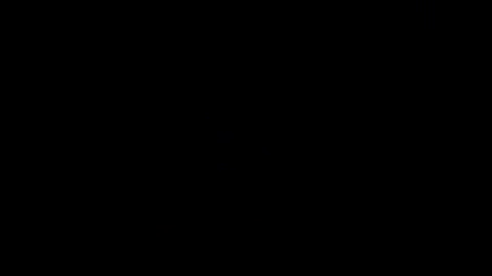
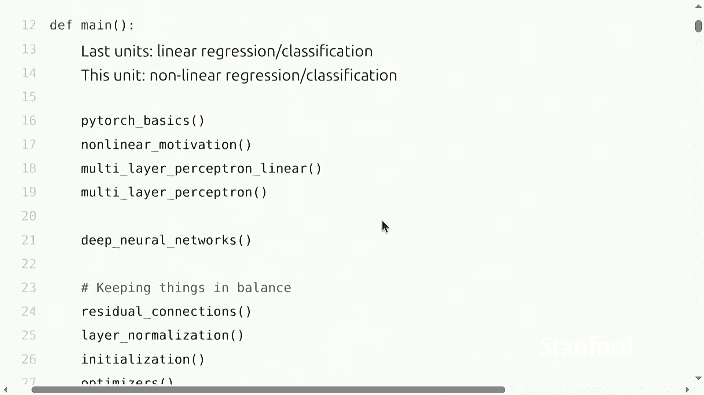
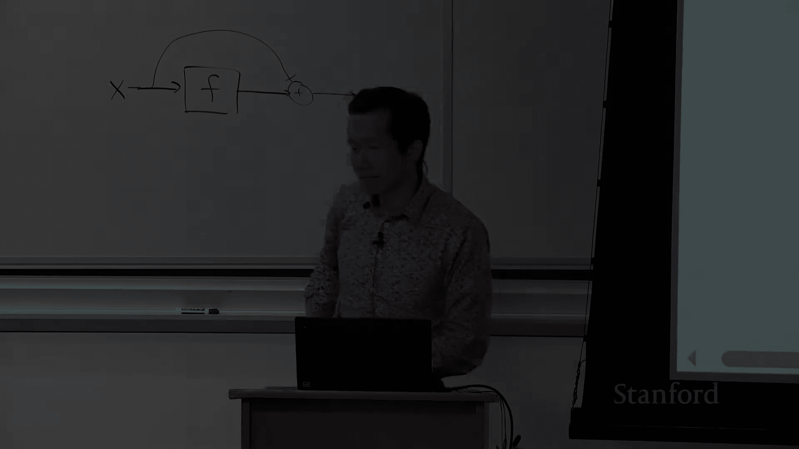

# Stanford CS221 ｜ Autumn 2025 p04 Stanford CS221 ｜ Autumn 2025 ｜ Lecture 4： Learning III [89NND-Ca0yY] [BV1XuPrzwEes_p4]

So this lecture is going to be about deep learning。In particular。

 last time we started talking about linear classification。

 and we've also done linear regression in last week's lecture。The goal is to do nonlinear regression。

 and classification， which is going to give us more powerful machine learning methods。

So here's a agenda I want to start transitioning us to Pytororch and we're going to talk about the motivation for nonlinear methods and then go through sort basic multilayered neural networks and then talk about all these tricks that you have to be aware of when you're doing deep learning。

Okay， so let's start with the basics。 So so far what we've done is we are hopefully fairly comfortable with Ny at this point。

 which gives us a way to create tensors and do operations on tensors。

 and we showed you how to build our own computation graph library and implement back propagation。

 which allows us to not only compute forward with tensors。

 but also be able to compute backwards with the gradients and we did this not because you would actually do this in your life。

 but to really understand what's going on under the hood， if you remember we constructed the。

Computation graph。 and it wasn't that bad， I think in practice。

 you would use a standard library such as Pytorch or Jx。

 which is going to be much more efficient than what we've rolled out by hand and also more robust and also implements many of the common operations that you'll want to use。

 So implementing things from scratch， I think is a good way to build understanding。

 But if you're trying to just get work done then you should definitely use Pytorch or jas。

So let's try to make this transition conceptually you should already understand- some of you probably have already worked with Pytorch。

 but you should understand all the pieces， it's just a bit of kind of syntactic and convention that we'll have to adjust。

Okay， so remember， when we rolled our own library， we were able to create nodes in the computation graph。

 each node has a name， a value associated with it， and a gradient。And in the。

In the in the forward direction。 So okay， so now we have this this graph， which we can。

They picked us this， so we have x and Y， and they're added to produce Z。And then remember。

 in back prop， what we do is we。Go and we update the gradients of X and y。Okay。

So the way you would do this in pytorrch is as follows， so now you call torch。

 tensor instead of creating this node。And requires grad just means that this is a node that I want to compute the gradient of。

 So by default up here， because this is simple， we assume thatre requires grad is basically true for every node。

 but we can add that feature if you want。And y is another tensor， you take the dot product。

 and when you do Z dot backwards， you stuffed inside x and y are the gradients of x and y with respect to Z。

So why the question is why is there a dot after these entries so one dot is a floating point number is and one is a integer so whenever I write one dot basically this is treated by pytorch as a float vector and you can only take gradients if it's going to be floating point so if you try removing this it's going to throw an error。

Okay， so this is the same computation graph as Pythtor。

 So if we reflect on what's different and what's the same。So torch tensors are。

 you really should think about the in nodes in the computation graph。

RightIf you're not really thinking much the by design torch sensor just looks like a nuy array。

 and you can just do operations on it。 but I think it's really conceptually important to think about these as nodes in a graph rather than just a value。

will make it less mysterious and if things go wrong， you'll hopefully understand why。

Torch has done a nice job making this transparent so you can add and you can multiply。

 you can make dot products sort of similar like you would do in Ny。

 So a mixer seem like you're just like operating on numpy values。 but again。

 think about these as nodes in a competition graph。

There's some minor naming differences and you just have to。

 it's kind of learning a slightly different language。

 but there's no underlying conceptual difference between a torch sensor and an NPO array aside from the fact that they're nodes。

Not that values are computed eagerly through the construction。

 So as the moment you do this stop product forward is essentially called， whereas up here。

 we could have done that as well， but we decided to delay the forward computation until the back propagation when we do forwards and backwards just to make it explicit that you can construct a graph without actually evaluating anything。

 And then some other kind of frameworks。This is actually useful because you can construct a graph and you can actually have a compiler that manipulates a graph and makes it more efficient before you actually operate on it。

So but that's for another day。We call backward here on the root node to back prop gate gradients throughout the entire computation graph to the nodes that have requires gra equals true。

whereasas before， again， this is just convention， dot backward just operated on a single node and back propagation is the thing that actually calls dot backward on each node。

Okay and as I mentioned before， you specify requires grad to on the node that you want to compute gradients for。

 So in general， you have a computation graph。 It's going to muge parameters and data together and。

As a general rule， you want requires gra on the parameters and not the data。

 unless you're trying to find adversary examples or optimize over your data somehow then you want gradients on your data as well。

One thing I will mention， and this is a bit of a subtlety to just make sure you understand is that whenever you have a node。

 you can use it in two ways， you can use a node directly and that's what we've kind of seen。

 you take a node， you build on top of the node， you could build a larger graph。

 or you can just use the pluck out the node's value。

And then use it for down some downstream computation in the latter case。

 the values aren't going to backproagate through the node it just kind of it's like you copy the value out to show what I mean by this。

 I'm going to construct a simple example， so I have an x as a node y is x squared z is y squared。

And here I'm noticing that I take z is y the node squared。But I can also do something like this。

I take ys value。And then I create a separate node which is detached， and then I square that。

 I add that to you and I get L2。Okay，So in the first case， X Z builds directly on this y。

 whereas in the second case， I've essentially copied or taken Y out。

And it's just a new node whose value is why value。 The reason I'm writing it like this is to make it very transparent what what's happening here。

Okay， so。What happens when I do back prop now？ So when I do back prop on L 2。

Then it's only looking at the descendants of this graph here， right， So the back so X。

X's gradient actually doesn't get affected。Even though I've used X has been involved in this computation。

 I've deliberately taken only wise value and not the identity of y。

 So you can think about this as kind of like pass by value or pass by reference if in programming languages。

Okay， so U docrad is computed when I do backpro。But X stock grad is not。Okay。So in Pytorrch。

 what this looks like is a little bit more subtle because in this very verbose language。

 you could kind of you know what you're looking at， you're looking at a node and not its value。

 whereas in Pytorrch， it's sort of the two notions are deliberately， minimized， the difference。

So in P towards， you use the， the tensors directly as you know as values。

 So you don't do things like X value。 So how do you actually kind of do this detaching。 Well。

 there's a， there's a。Actually， so let me show you this example。

 So suppose weve built up y equals x squared z equals y squared。

 And here is the way you would do in pytorrch。 you would say y dot detaach。

 which essentially detaches y from the previous computation and then you can build up you know computations on top of that。

 So that's identically doing this。 So you take y， you detach it from this。

 this X and you're just kind of using it。And in this case， again， notice that U dorad is populated。

 but X do grad。I not because y has been cut。So why is this useful。

 It's because sometimes you just want to compute values forward and have control over whether you are computing gradients or not。

 for example， if you train a model and now you're serving at to customers test time。

 you don't want to be updating your parameters。 So there's no reason to compute any gradients。

So in that case， would there's a flag called or a context called a Torch on Nograd。

 which basically says in this context， I'm just going to compute forward。I'm telling pytorch。

 I don't care about gradients。 Don't keep track of anything。 Just treat them as values。

 And this is good because it minimizes the the overhead， reduces overhead。And it also is， you know。

 it also is safe in the sense that if you try to back prop through Z。

 it will throw an error and say that you don't have。

Pytorch uses this thing called a grad function to basically the equivalent of our dependencies。

 and it basically says， well， I don't know how to backpro because I don't have the graph anymore。

Yeah， so the question is， can I explain things in terms of this graph？So。嗯。

Let me just do it in the context of this example， so when do you have。

 this is basically the equivalent of detach。So I take wise value and I'm just using it。

Instead of just putting Y， if I put Y here， then I would be using the actual node。

 and as if I were to do that， this y would connect to this Z2。And instead， I've detached it。

 so I create a separate node who only takes on wise value。 And I'm using that instead。Okay。

 so that's all I'm really going to say about the basics of Pytorch。 Let's start using it。

 and hopefully we'll get more intuition for how it works。

 So I'm going do linear models just as a kind of a review， but also using Pytorch。

 So nice thing about Pytorch has a bunch of built in stuff， like models。

 loss functions and optimizers。And that'll make it just easier to do things。

 So I'm going to start with。One example。 So I have。An input，1，2，3，4。And。

I'm doing multiclass classification。 So the target Y is going to be the one hot representation of that label。

 So this label is representing the label 1 because the position1 is set。

So I'm going to define a linear model。 So torch has this。嗯。Built in module called N N dot linear。

 which takes in basically the input dimension and output dimension。

 You can think about this as basically a weight matrix multiply plus a bias。这erm。And using that。

Moule， you can call it like you would call a function。 and that gives you logics。

 So I've taken a four dimensional vector。 I multiply by this weight matrix。 I add this bias。

 and I get the logic。 Okay， so we did the exact same thing last time。

 But now it's just using Ptorrch。Okay， so so that's。If you remember。

 that's what we did in linear classification。We just take take the input。

 multiply by for every class， you have a weight vector。

 and then you also have a bias and you just multiply add， and then you get logics。And then last time。

 remember， we talked about the loss function， in particular， the cross entropy loss。 Now。

 this cross entropy loss the， the notation or terminal the the arguments are different than what we had before。

 Usually if you see cross entropy， it's the target distribution， comma。

 the predicted distribution In this case， this loss function is the。The predicted logics。

And the target distribution。 So it's flipped。 And also。

 you're passing in logics directly instead of the， the softmax version of the logics。

 but nonetheless， it's a function。 It returns a number。And you can call Los step backward。On this。

 and that produces gradients for all the model parameters so。

There's two tensors inside this model modeled our weight and modeled a bias。

 and those have gradients that are computed。And then using these gradients。

 you can define an optimizer， which we also did by hand。

 so this is SGD which stands for a stochastic gradient descent。

 but here we're actually using it like gradient descent because all we're doing is computing a gradient and then taking a step and here the gradient is over the entire or just what one example but the entire data set。

Okay， so when you update the when you call optimizer dot step。

 basically this goes and reaches into the model weights and updates them based on the gradient。Okay。

 so just to review， loss step backward sets the gradients on these model parameters and then optimizer step takes these gradients and applies the update to the actual model weights。

So the question is， can you pass the number of steps， This step just takes one step。

 If you want to take multiple steps， you， you wrap it in a loop， which I'll show you。All right。

 so I think we have all the pieces。 Let's complete the full training loop。

 So I'm going to load my data of three examples here。And I'm going to take this call this function。

 which I've written called Tra。Marlow。And train model takes actually a generic N endO module。

 So this is basically any。Function that takes some inputs and produces a loss or actually not a loss。

 but just logics。 And I'm going to。You know， try to learn， learn this model。

So the first thing I'm going to do is I'm going to stack these x's into a matrix and stack these y's into a matrix as well。

 So this is the natural way that you would operate in。In Pytorch。

 because you remember you want to always batch things into tensors for efficiency。

even though I find it much more natural to think about the x and the corresponding Y group together。

Okay， so I have the cross entropy。Function， which is also a module that you can， you can call。

 And then this I instant the optimizer。 So by default， the optimizer is S D。

 but I could also pass in at if you want。 And these are essentially drop in replacement。

 So once you kind of set this up， you can actually play around with different versions。

The optimizer takes a learning rate， which is how fast you move。

 it also takes this modeled parameters， which essentially。

 as we'll see this can actually be a fairly complicated thing。

 so it recursively goes through and gets all the tensors and puts it there。Okay。

 so now I'm going to step through。The code， so each step， I'm going to take a forward pass。

Which computes logics。Loss， which is， remember， the cross entropy at loss apply to the logics。

 which is essentially the prediction against the target， and then in the backward pass。

 I'm going to zero out the gradients and apply loss to the backwards。

Okay so remember that each time you do this， you have to zero out the gradients。

 Pytor doesn't do this for you。 This is a feature not a bug because sometimes you are iterating over a bunch of examples and you call backwards and that is meant to accumulate the gradients over multiple examples。

 but here you don't want to accumulate gradients over multiple iterations of training。

 so you need to zero it out before you each at the beginning or end of each step。So now。

 remember a loss that backwards populates the model parameters with docrad。

 and then I call optimizer step。Okay。And then if I look at the the parameters。

 this might be a little bit bit。 Okay， it's not too bad。 So the parameters are。Updated accordingly。

Okay， so this is basically what I went through， but just you know one step。 So typically。

 every machine learning pipeline essentially looks like this。

 You do inference to figure out the predictions， you do in the forward pass。

 you backward to get the gradients， and then you update the parameters。

So now we can go through step two， different loss， different parameters。

 and then you keep on doing this， I'm going to skip forward because this I don't want to count up to 80 but you can kind of see as as training proceeds。

 the loss goes down， the logics are also changing， you can see that the logics are hopefully。Getting。

 if you imagine exponentiating this and normalizing， you'll see that this is meant to match this。

 so if you take the softm of this， this is putting a lot of probability mass on the first one。

 this one is matching this and this one is matching the label too。So which is good。

 the loss is going down， the logics are matching the labels， the weights are changing。

 the weights you can't really easily understand just by looking at them。But， you know。

 we'll keep on going。Okay， so let let me just， I think we're almost done here so we just jump out and then you can see over a number of steps the loss is going down and whenever you're doing machine learning。

 you monitor the loss and make sure it's going down if it's not going down。

 then you have a bug probably。Okay， so the question is， what is the difference between the optimizer。

Step and backward， actually， let me， let me do it over here。

 So what's the difference between lost that backwards and optimizer step。

 So lost that backwards populates the gradients。Inside the parameters。

And optimizer step takes these gradients and updates the actual parameter weights。

 so you're for every。You're always looking at。Multiple quantities here， there's the parameters。

 weights， and then there's the gradients。Loss of backward computers gradients。

 Optimr step uses those gradients to update the weights。Yeah， so the question is。

 isn't it wasteful to keep all the gradients around And yes。

 there are things you can do to optimize this， I think if you think about computing the forward pass。

 you compute all the values and on the way as you compute gradients。

 you can sort of throw them out because once you've computed a gradient in the backward pass。

 you can you don't need anymore。I think if you're not really， if you're just doing normal things。

 generally you don't like it's it's， it's not it' it's in general。

 a little bit hard to make sure you're doing this right。 and it introduces a bunch of complexity。

 which obviously， for the first lecture， I'm not gonna do。

 if you're training very big models and you're really compute constraint。

 you can do all these fancy tricks。 There's also even fancy things like activation checkpointing where you can throw away activations。

 which also take a lot of memory as you're computing it forward。

 And then you can save on memory that way。Okay， so we've successfully trained a model here。嗯。And。

You know， just some things to call out。Pytorch makes it fairly modular。 You can define a model。

 In this case， we've defined a linear model and a model takes input。

tenensors or vectors in this case and produces logics。

 and the logicts we correspond to essentially the strength of a prediction for every class in their case of multi class。

You can use a loss， in this case， the trusts entropy loss。

 and that takes logics and the target and maps them to a scalar loss。

And then you can look at optimizers， which updates the parameters using the gradients。

 So you have sort of this menu of， of options， which essentially corresponds to the three questions that we start out when we do machine learning。

 What is the design space of model， predictors， What is the loss function and what is the optimizer and for each of these things。

 you can just choose your own adventure。Okay。So that is a bit of pytorrch and hopefully a review of the previous material in。

Py land。Okay， so now I'm going to move on to the core part of this lecture。

 which is let's tackle nonlinear regression and classification， actually only be classification。

So you can look at these slides。 if you like slides from a previous quarter。

So far we've looked at linear classifiers， so these remember classifiers are predictors and you can visualize a predictor in terms of the decision boundary。

 a predictor cuts up the space into two parts in the case of binary classification。

 a part where of input space where the predictor returns one and a part where it returns zero。Okay。

 so if you think about a set of all linear predictors， you're limited to。

A classifiers that essentially have straight cuts through the space。Or in linear regression。

 your predictors look like lines as well， which map some input to some output。

But sometimes your data might look like this。 And in that case。

 it would be a little bit strange to fit a line。 I mean， you could fit a line here。

 but that doesn't seem intuitively on this particular data set why very wise thing to do。

 At least you're not going to get a very good fit。So in these cases， we need nonlinear models。

To make the basically create a larger set of predictors。So what should would use here？

There's actually a lot of things you can do here and things that you might have heard of are in a place of classification or decision trees。

 Ne neighbors， neural networks， but it turns out that actually even linear models can do the job。

So you're probably thinking， wait， that seems like an apparent contradiction， right。

 How can linear models represent nonlinear decision boundaries。So there's a trick here。

 and this is actually kind of a cool core trick。Suppose you wanted to define some nonlinear classifier。

 We'll call it a quadratic classifier， and it looks like this。

 It's going to classify everything outside the circle。

 positive and everything inside the circle negative。

And the way you would define this is through this function so suppose I have the input 11。

 so that's here in right in the center and what the classifier does is it's going to compute a logicit which is essentially the square distance from 11 minus2 so if you put in11 you're going to get them value minus2 and that's going to be a negative logic so it's going to predict minus1。

So if you put in 30， so 30 is here， so that's outside the circle。

 what happens if I have30 so that's 3 minus who squared 4 minus1。

 5 minus2 is 3 so I get three and that's going to be a positive prediction okay so everyone understand what this no quadratic classifier is doing。

So now clearly this is not a linear function。But here's， here's what I'm going to do。

 I'm going to define a nonlinear feature map first。

 which is going to be a transformation that takes X into some。

It's going to take x0 x1 and essentially the squared norm of this vector。

And then now we're going to define a linear predictor。

 So the way it's going to work is when I get11 in。So I'm going to first compute this feature map。

Which is going to give me one， one。2。嗯。And now， with this fee。

I'm going to define a linear function on top of this。

So if you take this and you expand all the terms out， you'll see that this is the same。

 so if you take minus2 times p1， minus2 times p phi2 or sorry0 and1。

 and then you add the last component， then you get minus2。So minus2 minus2 plus2 is minus2。O。

 which is exactly what we had before。So that is going to be a minus1。 if you take 30。

 feature map maps it to 309， and if you compute the logict， you get three。

 which is going to be a plus one。So all I've done is I've rewritten。

This apparently very nonlinear classifier in terms of a feature map that is definitely nonlinear。

 it does some stuff， but there is a linear map here。So in other words。

What I have is this linear classifier in this higher dimensional fee space。

And that leads to a nonlinear classifier in the original space。Okay。

 so what this means is that we now have a very， very simple procedure。If were lazy， we basically say。

 take our data and we're going to just preprocess it with a feature map。

 I'm going to define some feature map and I'm going to just transform the x's into phi of x。

And then now I'm going to hand it over to the part of the code that just knows how to deal with linear predictors。

 and I'm done。So this is a super lazy way to do in London and linear classifiers。

 you don't actually have to write any new code really， except for your feature map。

the reason I'm saying this is that I think a lot of people when they think non nonlinear classifiers。

 they jump immediately to， oh， I I need to train a deep neural net， well。

 it turns out you don't have to because depending on your problem maybe something as simple as just applying a nonlinear transformer of your data will suffice。

And that's something to remember。Now， of course， we are going to talk about neural nets because there is a limitation here。

 Feature map is fixed。RightSo then the question is。

 how do you design your feature maps so that when I in the feature space， things are linear。

And that's sometimes clearest， but not always clear。And so one might wonder， well， know。

 how can we actually learn the feature map as well？

Because the the idea of machine learning is youre you're being lazy。 Like。

 I don't know what the feature map is。 I just like let learning algorithm figure it out for you。

Just like， I don't know what the weights are。 I'm just going to let the learning algorithm figure it out。

So the question is， what kind of transformations you typically apply。 So in this case。

 this feature map takes a two dimensional factor and returns a three dimensional factor。 In general。

 you can。You know， return a two dimensional。 You can return a one dimension。

 You can return a 100 dimensional。 There's actually， if you heard the term kernel methods， Actually。

 the feature map is infinite dimensional。 And there's a mathematical tricks that allow you to not actually take infinite time or memory。

So it's a pretty interesting， powerful， framework。Yeah。Okay， so let's move on now。

 so now we're motivated， we know how to create some nonlinear classifiers。

 but we want to learn the feature map。 Okay， so let's go and try to learn the feature map。

So what we can do is we can define a two layer network where the first layer is the feature map and the second layer is the linear predictor。

So I'm going to talk about two layer neural nets and the way you should conceptualize this as a first layer is a feature map。

 and the second layer is the linear predictor。Okay， so start with some training data as usual。

 so I have four dimensions and going down to three classes。

 and I'm going to define this module called linear MLP。And so the way that modules work。

 if you haven't seen this before， is you define a class and you set member variables to be essentially the submods。

Which themselves have parameters， or you can have parameters directly。

 So W1 is going to be the linear map from input to hidden。

And then W2 is going to be the linear map from the hidden to the output logics。

and the way I so you can visualize that here， I have w1。 weight and w1。 bias and w2 weightw2。 bias。

 so you can see the dot notation， it gets automatically constructed for you by Pytorrch and that is basically correspondingwin to the hierarchy of the parameters that is eventually is going to come up。

So if you look at， now I have this model， I can call it on the first data point。

And that calls the forward function， and so I have X。

 I apply some transformation to it and to get a hidden dimension。

 so I've set hidden dimension to five here and then maps the hidden dimension to the logts via another linear transformation。

 and then I'm going to return the logs。Okay。So now I have this model。

 I'm going to just train the model， I'm not going to step through it because we already did that once for linear it's the same。

 and then I get this nice plot。Yeah， so the question is what is the role of the hidden dimension。

 So hidden dimension just means it's it's just a name and the reason it's called hidden because it's not the input in output。

 which is the only thing you observe。 if you're not given the hidden dimension。

 but you can think about this as the hidden。Is an analog of Phi from before。

 We have the feature map that takes X and produces a vector。

 and then you take another linear predictor on top of the the feehi to reproduce the logts。

 And here I've renamed it hidden because we don't。 We don't have it ahead of time。Okay。

 so I've trained this model， seems to work great。But。

Does anyone see any sort of something weird about this？Something is missing。

Especially if you've seen。No that before。Basically。

 my claim is that this is actually the same as trinial linear classifier。

RightSo it looks like I'm doing something fancier， but it's actually just a linear classifier。

So the reason is that because matrix multi because of math， matrix multiplication is sosociative。

 So if you have the input。And you have your first layer weights， second layer weights。

 and remember the logicts are just you multiply by W1 first and you multiply by W2 and you get these lots。

But we know from matrix multiplication that you can also group W1 and W2 together into a single wave vector。

And do it this way。And you actually get the same thing， 78，78。Okay。And if you interpret it like this。

All this is doing is you're just。You knowYou're just taking a dot product with a single matrix。

 So that is a linear predictor。There's some biased terms which I'm not showing。

 but it's also kind of the same。Now you're parameterizing the linear predictor in a sort of a funny way because you're。

Essentially。parameterizing instead of a single matrix， you have two matrices。

But it's still essentially a linear predictor。 There's one caveat。

 which I should say is that this requires the hidden dimension to be at least as large as the input and and the output dimension。

 otherwise you actually it's not exactly the same because then you're restricting to low rank matrices。

 but in this case it is。 and it's just a linear predictor。So just a caveat。

 when you have a really complicated model， it might actually be。Brit at something simpler。Okay。

 so we actually didn't make much progress。 No wonder this kind of looked like the same plot。Okay。

 so how do we actually go beyond linear classifiers？Well。

 clearly we need to put something nonlinear in there because if you just have a bunch of linear things。

 it's just going to be linear。And the linear networks are not more expressive because they're just the same as sorry。

That's a taology， I have a linear network and it's as expressive as what I had before。

 although interestingly people still study linear deep linear networks because the training dynamics are sort of interesting。

 this is mostly for theoretical purposes。But what we need to do is make more things more expressive by adding a nonlinear activation function。

So what is the activation function， it's basically a function that maps a number to another number that's not linear。

 that's literally the only， I think requirement。And there are many choices here。

 these are just names sigmoid， which you know10h， reluge， Galu， Swish， etc ceter。

 we're going to focus on the value just for simplicity although it's not necessarily the best one so ra as for rectified linear unit and RE basically takes a number actually you can also pass in a vector it just applies element wise。

 and take the max of that and zero。Okay， so what it looks like is that here's the input x。

 if it's less than0 then I zero out， if it's greater than zero。

 then I'm just going to return the identity， return the same number。

So this is clearly a nonlinear function。嗯。And just as an aside。

 where is the name ML multilayer perceptron comes from。

 so Perceptron comes from this 1950s Frank Rosenblt paper。

 which is essentially introducing linear classifiers， and then in the 60s and '70s and '80s。

 people stacked perceptrons into multiple layers and that's why they're called multilayer perceptrons。

 neural networks are another name for the same thing。Okay。

 so let's put stick this value in and see what happens。 so I have my data。And。

I'm going to define this model called multi layerer perceptron。

 notice that it has the exact same parameters as the linear version。I still have W1 and W2。

 but the difference is that when I call the model， I'm going to first。

YouComp a transform version of x by applying the first linear layer。

 and then I'm going to apply a value to this to produce a set of hiddens。

 and you notice that any of the negative pre activation values get zeroed out。

 whereas the other ones are still there。And then I'm going to apply the logics。

 a W2 to get the logics。Okay， so all I've done is snuck in this value there。Okay。

 so it seems like a kind of a small thing， but that makes all the difference。 Now。

 you have something that's truly non nonlinear and much more expressive。Okay。

 so just a few notes on terminology， so activations。

 generally NeNe speak corresponds to the values of the intermediate values that are computed in the forward pass。

They're also called hidden units， or sometimes you'll hear the word neurons forra。

 it's all referring to intermediate computations of the for pass。

So one thing you might I want everyone to be paranoid about is that the R does have a zero gradient when x is less than equal 0。

 So in this region， if you're out here， then the gradient is 0。

And hopefully we we've been burned once by this already with a zero loss， right。

 and we know we should say every time you see a zero gradient。

 you should like panic or maybe not panic， but just try to think carefully if that is okay or not。

So normally this is okay because this part is still not zero。

 but there is a problem that where if you're over here，And this is for a particular neuron。

 and this is always zero for every single example， then it's just going to stay zero。

And this can result in what are called these dead neurons where you're computing everythings through the network。

 but there's part of your network that's just like not doing anything。

And that's bad because you're wasting model capacity。

So there's a bunch of fixes and the most obvious thing is well。

 don't make this the gradient zero just and there's other things called leaky relu。

 gellu Swwish that essentially bend this a little bit so you can basically think about like just sliding this down or rounding this out or something。

Okay。And one note is that I write near zero gradients。Gradients that are close to 0 are just as bad。

 So near 0 is also bad。 So remember the sigmoid function。

It is very flat when you go far away from zero right。

 So even though nowhere in the sigmoid function is a gradientd exactly zero。

 it can get pretty close to zero， and which means that you're not not moving。

 but you're also not moving very much。 So that's also a problem。

 So it's not literally zero is that problem， but being very close to zero is a problem。

So in some sense， the name of a game for activation function is that you have to balance this trade off between things that are linear。

 which have better gradients with things which are non nonlinear， which give you expressivity。

 For example， you might be y and say， well， you know， this is zero。

 So why don't I just make it y equals x。So that has a great gradient， it's always one。

But then you're back to， well， that's a linear model。And that doesn't help you。Right。

 so that's why this looks like this， because you get this nice linear region。

 which allows the model to do stuff。 But you do need to put in some sort of non nonlinearity to get expressivity。

Okay， so let's train this model。 So now this loss function is going down。

 you'll see that you know it's maybe going down a little bit slower because neural nets are generally take longer to train than linear classifiers。

 but nonetheless， it seems to be working。Okay， so the summary of we've introduced two layer neural networks or multi layer perceptrons。

 and you take your input， linear layer， top plus and activation value。

 and then another linear layer to produce the logics。 And then notice that。

We're calling the same train model and we can put in basically any function here and Pytororch will do its whole thing and compute the gradient and compute the truckcentroppy loss and train the model。

 which is really nice because you can just go and brainstorm different models and then just use the same training code。

Okay。Okay now let's move on to deep neural networks。

So the problem is that maybe you're not even satisfied with a single MLP。

 there's some theorem that says even for a single two layer neural network。

 if you have infinite or as the number of hidden neurons goes to infinity。

 you can represent any function you want， but you might need a lot of hidden units。

So the solution is， well， you just stack multiple MLP layers。Maybe more helpfully。

 the intuition is that each layer learns more and more abstract features of the input。So this is。

A story that people tell there's nothing rigorous or mathematical about why it's learning more abstract features。

 but this empirically seems to be borne out。 And this helps us understand what these models are doing。

 so in computer vision， your input might be just set of pixels。

 And if you have a deep neural net that computes things on top of it。 you might you empirically。

 you see that the earlier layers pick out edges and then object parts and then objects and so on。

 which is actually pretty cool that these models just if you train them on some task。

 it'll actually learn these various fairly abstract features。😊。

So this is why I said that we're learning the feature map， we started out by handcoing feature map。

 and people in computer vision and in NLP used to hand code a lot of feature maps。

 and then the idea with deep learning is that you could actually learn the feature map directly。Okay。

 so mathematically， what we're doing is we're just composing multiple MLP layers。So。

So we're going to define a model， a deep neural net。And。Here， actually。

 I should have done it a slightly different way。 But anyway。

 you can just take two MLP and you stack them on at top of each other。And os。

And then we'll skip this part， you can do the forward。

 you just apply the two layers and you return some value。 And then when you train the model。

 you get something like this。Okay， so you notice that sometimes you'll find that this curve doesn't look as nice as the one from before。

 In particular， the loss isn't going down as fast in the beginning。

 So this is gonna be typical as you get fairly a larger。

You know neural networks that learning might be a little bit slow。

And you can think about this as the the problem is that you're just asking the model to learn a lot。

 right， I think you guys all take a granted that we can just do a gradient descent on some deep neural network and it works。

 But I think for decades， people thought this was essentially kind of impossible。

So there's also a problem with deep neural networks that we should talk about。

 which is vanishing and exploding ingredients。So。For a long time。

 people struggle to train deep neural networks。 And the problem is has to do with what the values of gradients are。

 So I'm just going to look at a single dimensional problem。 So suppose you have the input X。 It's1。

And I have a wave vector that's initialized to 05。And then I have a bunch of layers。

 this is going to be a linear layer， but if you can put in on linearities it's kind of the same idea and you're just going to let's say you have 20 layers right and you see what happens is that the x's get really。

 really small and if you compute backwards， this is actually not identically zero but it's like very。

 very close to zero。So now remember， gradient0 bad。

 So if you have gradient that's very close to  zero and you have this deep network。

 then your update is going to be really， really small。 and you're not going make any progress。 right？

 So this is called the vanishing gradient problem。 if you have deep networks。

 you can think about them essentially a bunch of matrix multiplies。

 And if you multiply the same number， you know 20 times if it's less than one。

 then it's going to go to zero。On the other hand， you also have this exploding gradient problem where if your weights are initialized to two。

 and then you do this over and over again， you get something ridiculously large。

And then if you try to take a gradient step with that。

 then you're going to move too far and then you're going to overflow and that you're， you know。

 things are going to go to infinity， essentially。So that's no good either。

So this this simple example illustrates the core problem if you have deep neural networks。

 is that each layer essentially is multiplicative。 You're multiplying something over and over again。

 And the only thing you can multiply a lot of times and not have things blow up or go to zero is what。

1。so you can think about this as somewhat fragile。So ideally， you want W to be one or close to one。

 So it's， you know， it's not that bad because you're not multiplying literally infinite number of times。

 if you have 20 times， maybe if W is like 1。1， it's probably， you know，1。01， it's probably okay。Now。

 this is for a scalar case。 The matrix case is， it's the same idea， except for now。

 instead of taking just talking about the。The magnitude。

 you have to think about the eigenvalues of the matrix。 But you， we'll save that for another day。

Okay， so that is the problem with deep networks。Now。

 what I'm going to talk about next is things that one can do to cope with this， this problem。

 So at some level， this is fundamental。 Like you're trying to basically。Really。

 I think in deep learning， you're really pushing yourself to the limit in terms of what you can possibly learn and you're always at the danger of like kind of falling off a cliff in some sense。

 but there's things you can do that can help。 So the first thing is this idea called residual connections。

And it addresseses the vanishing gradients problem， not the exploitding gradient problem。

And the idea is has shown up actually in multiple places since the beginning of deep learning。

 but also LCMs for sequence modele residual networks from computer vision。

 And this is probably the most popular version。 that's why the name residual connections has stuck if you think about them in the concept of transformers they also called skip connections and highway networks。

 And the basic idea is is very simple。 So normally each layer of a network applies some function to its input X goes F of X。

And the idea with a residual connection is that you're just going to add the input to the output。

Okay。So the way to think about this is you have X that goes into some F and here's the output。

 That's normally what you do。 Now instead， a residual connection takes this and adds it and that's your new output so that's why it's also called a skip connection because you're sort of like take there's a path thats sort of skips F。

And the reason that you want to skip F is that if you're gradient。

 if you think about like the computation graph， the gradient goes backwards。

 And if your F has a zero gradient。If you don't have a path here。

 your basically gradients are multiplicative， the chain rule is multipliccative。

 and then everything else gets zeroed。But here you have an escape hatch where even if F is messed up and has zero gradients。

 your gradients can still flow backwards there。Another way to think about it is if F is just multiplication by w。

 we were really worried about w equals0。 what we're going to do if w is really too small。

But in this residual， if you add a residual connection， each layer basically computes one plus w X。

 So it's kind of like a smoothing。 So even if w is very close to 0， this quantity is close to 1。

 And remember one is our friend here。 we want to keep things close to one。Now， of course。

 if W is like a million， then we still have problems， but we can deal with that separately。Okay。

 so what happens when we， let's try to train a model DNM with residual？

So what this does is I'm just going to add a residual connection。嗯。And。If I， it's a very， you know。

 kind of very simple thing。 I just adding like three characters。And the result is that actually。

 the training improves quite a bit。Before， if you remember。

 this training curve wasn't so great because I didn't have a residual connection and now I have a residual connection attorney training is a lot faster now。

Why does this look loss function look like a linear loss function。

 I think part of it is that this this data set is very simple。 It is three points。

 and I have actually。Like 20 some parameters。 So in some sense， it's a bit overkill。

 The actual function is probably you know， different。 but I mean。

 a lot of loss functions kind of look something like this if you're doing things properly。Okay。

 so let's look at a layer norm。 So the second idea here is normalization。And because remember。

 we one is our friend。And normalization makes things。One or close to one。Okay。

 so we don't want the magnitude to grow too big or too small。 So there's an idea。 normalmalization。

 I think， shows up in deep learning。 It shows up in batch norm for computer vision。

 but that's annoying to deal with for various reasons。

 So there's a more simpler idea called layer norm。 And here's the basic idea。Is you take a you know。

 input， X， a tensor， and we're just going to。Compute the mean， compute this standard deviation。

 and then just standardize。Okay。So basically subtract mean divide by standard deviation。

So then I get something that。You know， in this case， fine， it just shifted it down。

 If I have something that's a lot bigger， normally this might cause some trouble because these are fairly large numbers that if you see large numbers like this and you're learning。

 then something is， is probably going upwright。 But if you apply layer norm。

And you get the same thing。Okay， so it just normalizes the。The activations。Okay。

 so the real layer norm adds a few bells and whistles。That丢。Just make it a little bit nicer。

 but the essence is the same。 So first of all， you have this epsilon， which anytime you're dividing。

 you should be scared that you're dividing by 0 because if you're dividing by 0。

 that's're going not be helpful。 that's gonna get you infinity or something or naan And then I'm going to add some you know。

 just these are bells and whistles。 you add some scaling parameters to shifting parameters to give it a little bit more expressivity。

And what happens here is that so gamma is a shifting and beta is the scaling。

 so later norm you take the mean， you compute the variance and you divide by the standard deviation but it's been smooth a bit and then you add this extra thing you shift every element by gamma and you add beta。

 so normally you would initialize gamma to be 1 and beta to be0 and which。

Kind of reproduces the original layer norm， but then you will let gamma and beta be actually parameters that you can learn。

 so it can give you a bit more expressivity。Okay。So in Pytorrch。

 there is also a layer norm function you can call and it has inta and gamma。

 it's called weight and bias， but you can apply your。

This layer norm to this input and you get something that's much more reasonable。

And the way you use layer norm is you just stick it in。Now。

 exactly how you stick it in does matter for transformers， but I don't have time to get through that。

But the idea here is that layer norm just keeps the magnitude of the activations away from zero and away from infinity。

Okay。Okay， so another thing I want to talk about is initialization。So again。

 we don't want magnitude of activation to be too big or small。 So at the very least。

 when you start out， if they're too big or too small， then we should just stop and fix that problem。

 So initialization of your network is actually pretty important。

 So suppose we have I'm deliberately making this a large network because that's where problems generally arise so you have your 16。

3，4 by know 32 vector。 and。And you have your X， which is this， you know， input。

 And this is even for linear models that you can have problems。

 So then what happens when you multiply this。Matrix by this vector。

You get something that has pretty large values。 Again， if you see values this， you know。

 like in the hundreds， you should probably go and address it。嗯。And you this is- so why is this？

This is because what is this for every output， you're taking the dot product between two input dimensional vectors。

And input dimension is 16，000。Which means that you're adding 16。

000 standard normal variables and if you remember your， I guess probability。

 the magnitude of that scale is roughly a square root of that， which can be quite large。嗯。And again。

 that can be unstable。 So what you want to do is initialization that's invariant to the input dimension。

 And so you just divide by this square root。 And then things will be okay。

 So now these numbers look good， right， So if you see numbers like this。

 then you should feel you can sleep at night。Okay， so this is also known as essentially Xavier initialization。

 and if you're super paranoid。You know that in a normal。

 there's some tail probability that you can get a fairly large value。

And if you just want none of that， you can just truncate the normal at something like minus-3 and3 to just avoid any chance of outliers。

Okay， so this is another way you can do things is you look at initialization and you make sure that all the。

you're dividing by essentially the input dimension so that any sort of activations are kind of controlled。

Okay， finally， let me talk about optimizers。 this part， I was going to talk about at。

 but I don't think we have time to， because at is another way that can keep your training stable。

 Instead， what I'm going to talk about is difference between stochastic and gradient descent and gradient descent。

So so far。We've just done gradient descent， which means that you pick up all your training examples。

 you compute all the gradients， you sum them or average them， and then you take a step。

 But if you have 10 million examples， you're doing a lot of work just to create one update。

And instead， what we should do is use what is called a stochastic optimizer where each step。

 you just take a random subset of the examples and you compute the gradient and then you update on that instead。

 So that's why it's called a stochastic because in expectation if you take a random subset and compute the gradient。

 you're essentially getting this is an unbiased estimate of the actual gradient。

So let's do an example here， suppose I have four points and I've computed the gradients of these four points。

1，2，3，4，5，6，7，8， obviously these are not real gradients， but that's fine。

So if you were doing gradient descent， I would average all of these and get a gradient of 4 or five。

If you are doing stochastic gradientcent， you typically have a mini batch size or a batch size。

And suppose I said it to two。Then what you would do is。You would choose from your batch。

 I'm going to choose two indices， let's say， one and3。And I would get this batch of gradients。

 so one and three。 so I have3，4，7， eight。And then I would just average these。So notice in this case。

 a stochastic gradient isn't the same as the actual gradient， but it's somewhat close。

 and if I average over multiple trials， it will actually be in expectation， the actual gradient。

So you could do this every step you just sample a set of a batch and you update。

 and that would be exactly stochastic gradient decent。

One problem with this is that sometimes you might get unlucky and there's like a data point you just don't even look at and you might get duplicates。

 so what you essentially do is you sample with this is basically with replacement and now we can do it without replacement where implementation wise。

 you just permute the training examples。At the beginning of every apoch where you're taking a pass over your examples。

 so you take a random permutation and you batch it。

 group it into batches and because this is random you can just take consecutive indices in this array and then you。

Let's say for the first。You know batch， so the storcchastic gradients are。

For every batch you have a schastic gradient。And then you you look at the actual。

If you look at the mean of the p sychasastic gradients， you actually get the real gradient。O。

So notice that。The the optimizer， it's called， again， I'll say it's called SGD。

 but it's actually agnostic to what your what the gradient gradients come from。

 If your gradients come from a batch of examples， then it's you're running a stochastic gradient。

 if your gradient actually represents all the examples， then you're doing gradient descent。嗯。

Separately， you can， you know， I'll let you kind of read up about this and experiment in your in your your time。

 But if you replace the optimizer of SGD with at， it's like a one line change。

 you can play around with the the different。The different learning rates， you'll see that in general。

 but not always your learning curves are going to be better。

 The loss is going to go down faster and so on。Okay， so summarize。

Pytorrch gives you essentially nupy plus automatic differentiation via dot backward in a bunch of predefined modules like layer norm。

 cross entropy， linear， and so on。We talked about how we introduced multiple layers。

 nonlinear layers。To get more expressivity， this intuition is like you're learning your feature map and then you have to do a bunch of things to make sure you can actually train these networks。

 so you choose the activation functions， to avoid dead neurons。

 use residual connections to make sure that you don't have vanished ingredients。

 use layer norm to make sure your activations aren't blowing up。

 use initialize properly to make sure that your activations are not too large or too small out of the gate。

 and then you can so use better optimizers。Okay， so that was a whirld tour of deep learning。

 hopefully you have some intuitions， but at the end of the day it really takes kind of time and experience to develop an understanding of how to train networks。

Okay， that's it。'll see you next time。

