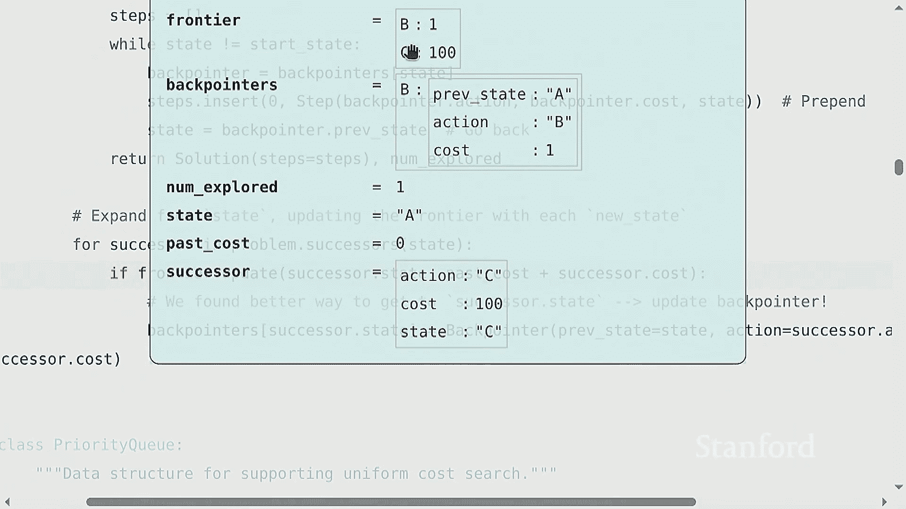
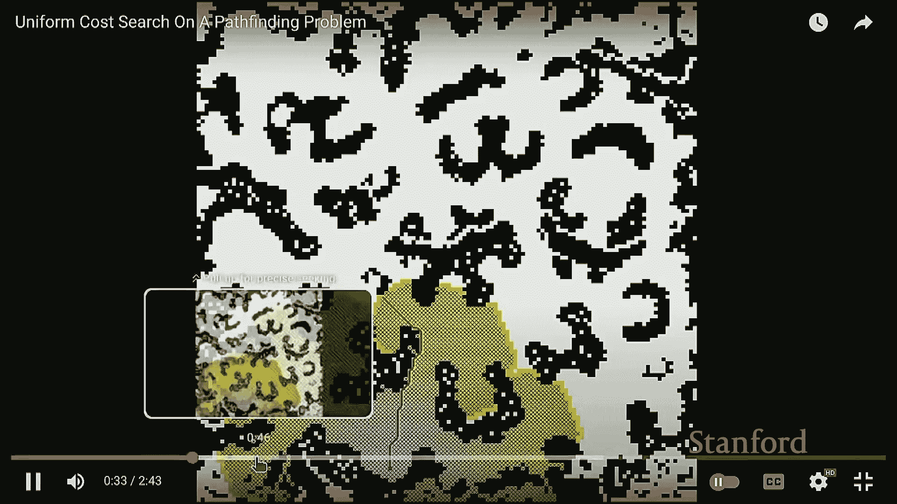
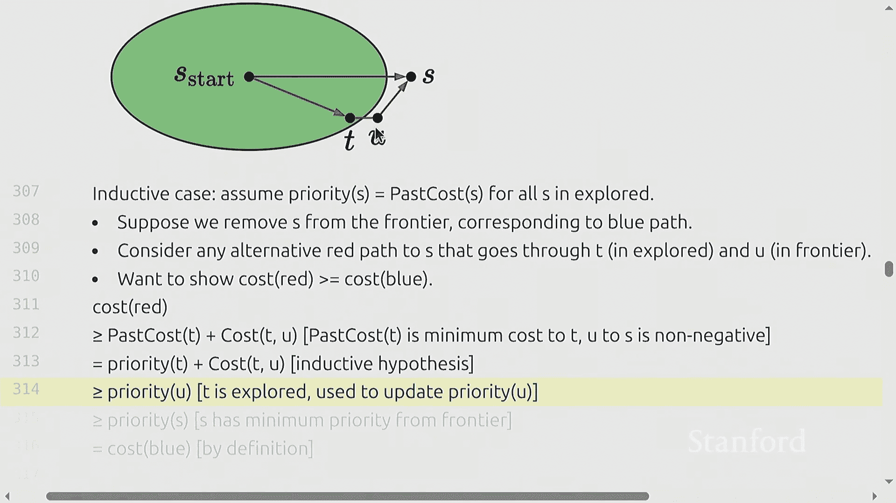
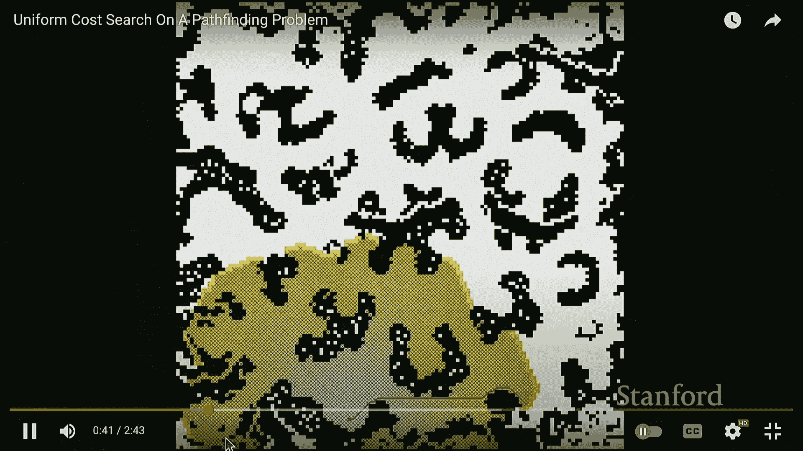
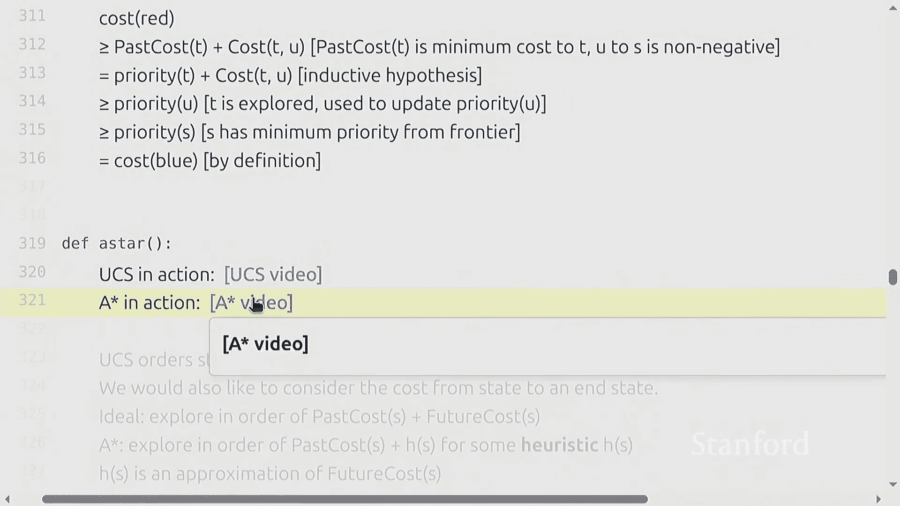
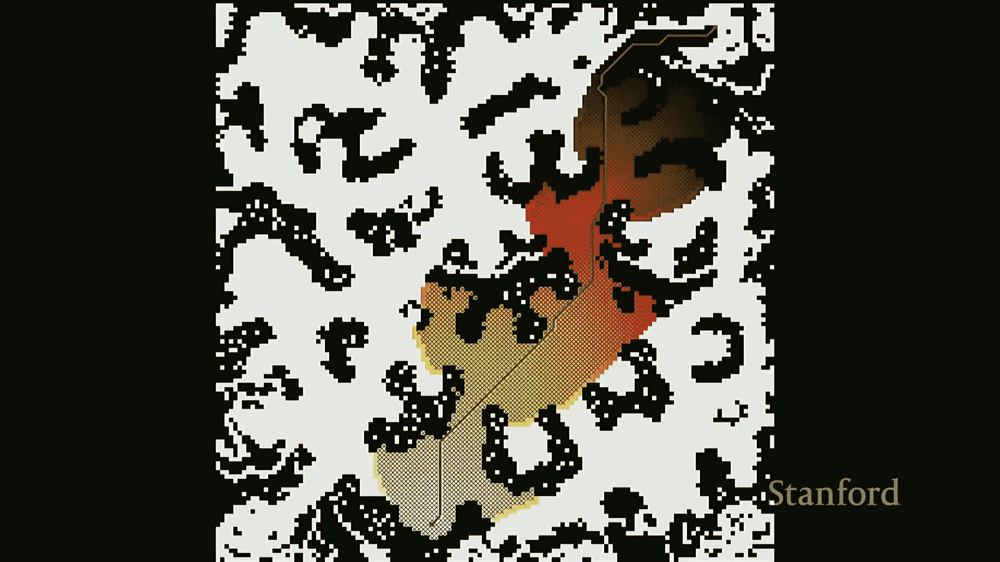

# Stanford CS221 ｜ Autumn 2025 p06 Stanford CS221 ｜ Autumn 2025 ｜ Lecture 6： Search II [4Iu4KPVbnAY] [BV1XuPrzwEes_p6]

Remember。We said we needed search， not just learning。

 because we want to solve complex problems that require thinking and reasoning。

We defined what a search problem was。 Remember， we had this simple tram example。

Where we have a certain number of locations in this case， six。

 and you're trying to go from one to2 six by either walking or taking a tram。

We can define the search problem formally。By。Defining as a start state。A set of successors。

 which are actions that you can take from each state， each action has a cost。

 and each action also takes you to a subsequent state。And then finally。

 there's a test that takes a state and returns whether we're at the end or not。

And the objective in a search problem is to find a solution that minimizes the total cost。

 which is the sum of the cost of all the actions。last time we saw four different algorithms。

 we saw two exact algorithms doing exhaustive search or doing dynamic programming。

 which is essentially exhaustive search with caching。

 and remember we framed exhaustive search in dynamic programming as computing future costs。

 which is the minimum cost way to go from each state to anN state。

And then we looked at approximate algorithms， best of N。

 which just samples a bunch of solutions independently given some policy and takes the best one。

 as well as beam searcharch， which builds up this kind of beam of possible solutions and taking the best and truncating at each point in time。

Okay， so that's a review of what we did last time。 So this time。

 we're going to continue doing exact algorithms， but we're going to explore search problems that have cycles in them。

We're going to look at two types of algorithms， uniform cost search。And a star。Which is。

 we'll see that is actually UCSN disguise。Okay， so let's begin with uniform cost search。

 So to motivate this。I want to step back and think about these two idealized mathematical concepts in search。

So the first we already saw last time， which is futures cost。 So this says from a given state。

 what's the best way to reach an end state？And then you can also define analogously a pass cost。

 which is the minimum cost solution from the start state to that state。

So here's a picture you should have in your head if you're at a particular state you can look backwards and you can look that gives you the past cost。

 what is the best way to go from start to that state。

 and you can also look at future cost which is the best way to go from that state to an end。

So each state has a pass cost and a future cost。Okay。And of course。

 if you have future costs plus pass costs， that gives you the best solution that goes through a particular state。

All right。So in dynamic programming， we computed the future costs for each state using a recurrence。

And what you notice is that future cost of a particular state depends on the future costs of its successors。

Which means that you need to first compute the future costs of all the successors before you can compute the future costs of a state。

So。When you run down impcr， it's written as a recurrence。

 But if you look at the ways in which the cache is populated。

 you'll essentially start from the end and you start computing future states until you reach the start state。

 and then you're done。So this might seem a little bit familiar。

 it's actually very similar to what we did in back propagation。

 where you start at the end and then you compute backward gradients until you get to the beginning。

 So there's a deeper connection here， but it's this kind of the same idea。And， importantly。

In dynamic programming， you can't have cycles。What happens if you have cycles。

You get an infinite loop in code and mathematically is's just not defined， right。

 because the future costs of state depends on state prime and vice versa。

 then it's just not well defined， okay。So suppose there are cycles in your search problem。

 so here is an example， you have four nodes in a graph and here are the edge cost and these edges are undirected which means that you can go from A to B and you also go from B to A and assume that the cost in both directions is the same。

Okay， so given this， you know， what do we compute first， do we go。ABCD or ACBD。

 it's not really clear， right because there's no topological ordering of the notes that make sense。

So what can we do， any ideas？Okay，It's maybe not obvious。 Well， the obvious answer is UCS。

 but maybe that's。Not helpful as answer yet。 So UCS， it's also known as Dtras algorithm。

 which was developed in the 50s。And in the UC S， we're going to make a trade here。

 We're going to say we can handle cycles。But all the costs are going to be non negative。

There's actually a way also to do negatives edge weights as well as cycles that's called the Belman Ford algorithm。

 which we won't talk about。So there's two differences between dynamic programming。

 which we've seen and UCS， which we're going to introduce。

The first is that instead computing future costs， we're going to compute past costs。 So remember。

 the past costs of a state is the minimum cost way to go from the start to that state。Okay。

And we're also， and here's a key insight。 We're going to process the states in order of increasing past cost。

Instead of using the graph structure to give us a top logical ordering。

 we're going to just go in increasing pass cost。ok。So here's the high level strategy of uniform Cos。

 by the way， who has seen Dtra's algorithm or UCS before， Okay。

 so I think this will be somewhat of a review， but it's important because how many of you have seen AR before。

Okay， so maybe half of you， Okay， so。Here's a high level strategy。

We're going to look at all the states and partition them into three buckets。

The first bucket is explored。These are the states we've already found a minimum cost path to。

 and we're done。The frontier， which is states that we've seen in our algorithm。

 but we're still trying to figure out the best way to get there。And then finally。

 unexplored are states that we haven't seen yet。は。So what we're going to do is we're going to start with explore just being the start state。

And then we're going to kind of expand out into the frontier。 And once we。

Explore an end state than we were done。Okay。So let's go through some examples and walk through code to see how this works。

So we're going to use this very simple search problem。

 it's going to be defined by this graph that I just showed。

 so a is connected to B with cost of1 and to C with cost of 100 and you can just read that so let me actually draw this on the board so we have a reference。

Okay， so we have a。We have B。We have C， and we have D。And this is one， this is 100， this is one。

 this is one and 100。Okay。All right， and this is what it's a less pretty way。

 but a more accurate way of representing the state graph。So we defined this problem， successors of A。

 just so we're on the same page from A， you can take an action to go to B with cost 1 and action to go to C with cost 100。

Okay。So let's run UCS on this example here。Okay， so this is the first time I'm going to introduce UCS。

 but I'm going to walk it through on this example， so hopefully it'll ground things out for you。

So remember， there is the frontier。We're going to use a priority queue to denote the frontier。And。

The priority of。So each element of priority Q is a state and its priority is going to represent the minimum costs that we've found so far to get there。

Okay。And the reason we were going to make a priority queue is what do you do with priority cues？

What can you do with priority care？Anyway， yeah， always want the minimum or maximum Yes。

 so you can find the minimum element。 Okay， so what we're going to do is to take the frontier and find the state that has the minimum priority。

And we're going to move that to explored， okay， so that's just foreshadowing that。

So for each state we've reached， we're also going to have a back cornerer that tells us how we get there。

So this is technically not necessary if you just want to know the number。

 which is how you know the cost of the solution， but in general。

 you don't just care about the number you actually want the solution in which case you have to remember which actions you took to get to a particular state。

All right， so in the beginning， we have a SART state。嗯。

And we have a frontier and the frontier is just going to have one element。

 this is the priority queue。 it has says a， I know how to get there with cost zero， which is true。

 empty set of actions gets you there。So now I'm going to loop。

 and I'm going to remove the state from the frontier with the lowest priority。Later。

 I'll show you a theorem that says this priority is actually the past cost。

 so priority is just the mechanics of the algorithm。 it's being computed。

 Pass cost is a mathematical quantity， which is the minimum cost way to get to a state。Okay。

 so in this case， the priority only Q has only one element， so that's a and has a past cost of zero。

 And then what I'm going to do is I'm going to look at all the successors of a。

 Here's a possible successor I can go to B。And I'm going to update the frontier。

So from this explored， freshly anointed explored node。

 I'm going to try to reach out to the the frontier。Okay， so I can get to B with cost one。

 and I'm going to update this priority to queue。嗯。With pass cost， which is 0 plus the successor cost。

 which is one here， which gives me a B of1， which means I can get to B。With past costs with cost one。

 and the way we do that is I'm going to represent keep track of this back pointer。

 which says the previous state was A， I took action B， that was cost one。

 and that's how we got to be。so that's just remembering the last action。Okay。

 so here's another successor， C as a cost of 100。 I do the same。 I can update the frontier。 Now C。

 I know how to get there now before C was unexplored。

 now C is on the frontier with cost of 100 and I add the back pointer。

 so I keep track of how I got to C via a。

Okay， so now that's all the successors of a。 I go back， I look at my priority queue。

 and I see which one has a lower priority。Should be be。So I take。Be off the frontier。

 It has a past cost of one。And then what I'm going to do is look at the successors。

So notice I can go back to a。 theres cycles， but it doesn't matter because I'm gonna try updating the frontier with A。

 But you know， the A was already in the explore。 So I kind of skipped that。

And then I can also go to C。 So now there's somethings interesting。 C is already on the frontier。

Things out on the frontier are things that we visited， but they're not necessarily the。

 the optimal way to get there。 And here， what we've seen is that we're at B with past cost of one。

 we can take a successor C with cost of one。 And that means we can go to C with cost of two。

 So we update that frontier。So we're not adding new node to frontier。 We just update its priority。

And once we update to its priority， we also update the back pointer。

 So before C was getting there via A。 and now I'm getting there via B。Okay， so finally。

 I have action D。 So from B， I can go to D， and D is a new node that was unexplored。

 Now it's on the frontier with cost 1 plus 100。 and that's 101。

And I also keep track of the back pointer。Okay， so now go back to the top and let's take the lowest priority on the queue。

And that would be C。So with C， I look at places I can go。So I can go to A， but A is already explored。

 I can go to B。 B is already explored。 I can go to D。 And D。 Let's see。 Should I update D。O。

 so up D was on the frontier with 101。And now I found a new way。 I can go2 plus one。

And that gives me a way to update D。And now I update the back pointer for D， which says。

 I can go to DVSC and that gives me a cost of three。Okay， so finally， I empty the frontier。 I'm at D。

 D is an end state。 So then I all I have to do is I'm done。 I really know how to。

 I know that I can get to D with cost 3。 I just need to walk back the back pointers。😊。

To reconstruct the steps。 So I get the back pointer， I basically。

 I'm at D and the last action I took was going to D and。Now I go back to C。

 the last step to get to C was this action， now I go back to B。

 and the last action to get to B was this action okay。

So I can reconstruct that solution and then I return it so in the end uniform cost search produces this solution which is going from a。

 which is the start state to B to C to D， and that gives me a cost of three。Okay。

 any questions about that？Alright， so lets let's look at some other examples。

 so here's another search problem。 So states are going to be points on a grid and you're going to be able to move up down left right and each action costs one。

 So here's the grid。 Okay so I have five rows and five columns。And here S is the start state。

 E is the end state。 hash means a wall， which you can't go through。

 So it looks like this should be something like this。 Okay， so let me just solve it。 I mean。

 normally you can't solve search problems， but this is actually not that hard。 So let's see 1，2，3，4。

5，6，7，8，9，10，11，12，13，14。 Okay， so it should be 14。 And here is the。

Uglier but more accurate representation of the graph。Okay， so the start state is 0，0。

Successors from zero zero are just。Going to the right has a cost of one。

 And you can see the reason is that I can't go down because that's blocked off。

And then I'm not at the end either。 it's okay， so let's run UCS on this example。Okay， so I indeed。

 I get a cost of 14。And it。It goes right， right， right， down， down， left， left， and so on。Okay。

So okay， so that's just another example。 I'll come back to that later。So hold on to that。

 So here is a nice visual that illustrates how UCS is operating when you have a much。

 much larger search problem。Um so。So， basically， here。Here is， if you can see this down here。

 this dot is a start state。 This dot over here is the end state。

 Each pixel here is a state in general， and actions are just moving consecutively。 Its necessarily。

 this is essentially the grid problem， but much larger。Okay。

 and what I'm going to do playing this video is it's going to show the progress of uniform cost search。

And what I have here is the the explored state。 The yellow is the frontier。

Everything in white is unexplored。 And you can see this kind of lightning green thing。

 And that basically tells me the path to the node on the frontier that I'm taking off。

So as you see as you run the uniform cost search， you can see why it's called uniform cost search is because it's expanding out kind of uniformly from the origin or the star state。

Because Uniform So Search doesn't really know anything about where end is。

 it's just kind of uniformly trying to find states that are close to the start state。

 and eventually you'll get to the end state if your graph is connected。Okay。So hold on to this。

 we'll come back to this picture when we look at newstar。Okay， so let me。

 I guess we can go a little bit further and eventually it will get to the end。There you go。OK。

All right。So that's how uniform cost search works。 Now let's revisit one important property here。

 which is I made some sort of handway claim that the priority that was computing un for a cost search was actually the pass cost。

 In other words， is this actually compute the minimum cost path？And this is going to be a， you。

 it's a proof， but it hopefully is a short proof。And remember， all the costs have to be non negative。

 otherwise it doesn't work。And intuitively， you can see why this assumption is necessary for the algorithm。

Because the idea is that I have this exports at， which I'm growing out and。

I sort of declaring without seeing anything else that the explorelord set is the optimal way to get to a node。

Now， if you have negative costs， you can essentially maybe go out very far and get like a negative a million and then come back and that use CS obviously wouldn't detect that。

But if all the costs are not negative， that can happen because going out far is just going to only increase your costs。

Okay， so here's the theorem。So suppose that UCS moves a state from the frontier。To the exploredat。

Then I'm going to claim that。Then the priority of S is equal to pass cost。 Remember。

 priority of S is what's computed by the algorithm。

And pass cost is mathematically defined as in the search problem。

 the minimum cost path of getting to S。Okay。So if you could show this， then you're done because。

This holds for all states in particular and end state。 and once you get to end state。

 then if when you pop that up， that it actually gives you the pass cost。

 that's the best way to get to the end state。So let's prove this by induction。 So the base case。

Is priority start equals past cost equals0。Okay， done because at the start。

 priority is0 and pass cost is 0。 so。Nothing to say there。Okay。

 so now I'm going to assume by induction that this property hole priority is actually past cost for everything in explored。

And then I'm going to show that this additionally will hold for the S that I removed from the frontier and put in explored。

So remember a proof by induction， if I have the inductive hypothesis。

 then I just kind of iterate this and it holds for all S。Okay， so in particular， when I look at S。

 there is some path from star to S。And there has to be because otherwise。

 I wouldn't have found out about S。 I'm going to call that the blue path， which corresponds。

 and that cost of that path is the priority of S。Now。

 in order to show that this is actually the path of past cost。

 I have to show that any sort of alternative way to get to us is not going to be better。

 it might be the same， but in general it's going to be worse。Okay。

 so I'm going to call that the red path and it goes through and without loss of generality。

 it starts at start。It goes to some。It start is inexplord， S is not inexplord。

 so it has to cross over at some point。So let's suppose it crosses over this bridge from T to U。

 you could be S， for example， T could be star， but in general it looks like this。

And I want to show that the cost of this red path is at least the cost of the blue path。

 And if I can show this， then I'm done。Okay케。So there's a few inequalities here。

 which we'll just step through。Okay， so let's look at the cost of a red path and try to lower bound it。

So the cost of the red path is at least。The past cost of T plus the costs from T to U。

And why is this because。Past cost of tea is a minimum cost of T。

 So that is going to be smaller or at least no larger than whatever random red path you took to get to T。

and also from U to S， because all costs are non negative， this is。

 I can just throw away and make this number smaller。Okay， so now by the inductive hypothesis。

 past costs of T equals priority of T because T is explored。Okay， so the next step is。

 I'm going to say this is upper bounded by priority of U。So the reason is when I。

T was added to the explored set， you know， some time ago。 And at that time。

 I remember when you add something explored， you go check out the frontier you look at successors。

 and therefore， I would have updated if T is connected to you。

 I would have updated the priority of U with this number priority of T plus cost of T U。

Which means that whatevers in the priority of view has to be no larger than that。

Okay。All right。Prior U is a larger equalta priority of S。Because。I chose S over you。

To take from the frontier， I always choose the smallest priority from the frontier。

And then the priority of S。Is by definition， the cost of the blue path。O。

So I've shown that the cost of the red path is at least equal to the cost of the blue path。

 and this holds for all red paths， therefore priority of S is equal to the past cost of S。Okay。

 any questions， I'll pause a moment there。Okay， so the upshot of this is UCS is correct。

 you can all sleep at night and use it with cycles， it's great。All right， so summarizing UCS。

It computes past costs for each state in non- decreasingecreasing order。

 so remember there was a key dilemma we had， how do we order the states in which we're going to compute things and in UCS it's increasing past cost。

We use a priority queue to efficiently find the state with the lowest priority， and that priority。

 as we just proved， is the pass cost。And it has nice guarantees。Okay。

 so that's all I'm going to say about UCS。Well， directly about UCS。

 actually A star is all about UCS as we'll see as well。So UCS works。Okay， so。

I really like this video， so I'm just going to play it again。You see， UCS works。

 it's guaranteed to find the minimum cost path， so what's not to like about it？Yeah。

Wherere going think。Yeah， so it's uniform， which means that it's exploring everything kind of without regards for where you're going。

In particular， these nodes over here seem like not a useful use of resources。

But uniform costs search， it doesn't know about the end state。

 so it can't know that this is a waste of time。

So what we're going to do is introduce an A star algorithm。 A star is actually。

 and I'll show you what the video for a star looks like。😊。

A star。Is going to start exploring。 And you'll see that it's， it's really prioritizing。

This in this direction。Now， of course， it can't just immediately jump there because there's still things in a way and you can see kind of this pattern where it starts like running in that direction and then realizes。

 oh， shoot， there's a barrier so that it has to like kind of almost backtrack I mean there's no backtracking。

 but it's visually， it looks like it's just trying to kind of figure out how I get around this。Okay。

So you might think that， well， sure， thats， that's fine。 You know。

 I can come up with a bunch of heuristics that like， maybe I can。

Like put another weight on the algorithm to get to go in this certain general direction。

 There are many ways you can hack UCS。 It turns out Astar is the right way to do it and by right way。

 I mean that it actually is guaranteed still to find the optimal solution。

If you think about that for a moment， that's， you know， pretty， pretty cool， right。

 because you can put in some。😊。

Heuristic。And it still has the same guarantees as UCS。In general， if you do heuristic stuff。

 you don't have any guarantees。But there's a few places in machine learning where you can do it。

 for example， when you do like use proposal you know， functions in like sampling， for example。

 as another place， you put it in heuristic。 as long as you do your math properly。

 it it will actually work out。Okay， so let's see how this works。

So UCS order states by increasing pass costs， there's no knowledge of the end state。

We would like to consider， ideally the cost from a state to the end state。

 that's the piece that's missing。Ideally， if I could wave a magic wand， I would say， well。

 I just want to explore in order of pass cost plus future cost。If you're able to do that。😡，Then。

In some sense， you are always exploring states on some minimum cost path。So， you know。

 that would be great， but of course you can do this because you know。

 past costs are you can only go in one direction， right， So if you have past costs。

 then the states near the SART are really easy to compute。But the states， you know。

 the future costs of those states are as hard to compute。

 like future costs of star state is solving the problem。 So that's not super helpful。Okay。

 so the idea of a star is we're going to approximate future cost with some heuristic H of S。

And now I'm using heuristic in a very technical sense。

 Heuristic is a function that map states to a number， which is。

Sposed to be an approximation of future cost。So for the rest of the lecture。

 you should think about H of S is a heuristic， and it should try to represent the minimum cost path to the end。

And I'll show you that， what the heuristic might be or some examples later。But first。

 let me just introduce the ACR algorithm。The star should be here， I think markeddown， messed up here。

It's just run UCS with these costs。So what are these costs。

 I take the original costs from state taking an action A。And I add this thing here。

Which is the heuristic at the success sur state minus the heuristic at the current state。

 so if you think about what this is doing。I'm adding a pen so H represents how far I I'm away from the end state。

 how far I think I am， not actually how far I am。So I'm going to add a penalty。

For how much the action A takes us away from the end state。So remember， I want cost to be small。

 which means that I want this to be small。And this relative to H of S。

 So if I'm moving very much closer to the end state， this is going to be。

 this quantity is going to be negative。Right。And if I'm moving farther away。

 then this quantity B is going to be positive。Okay， so let's do a simple example here。

So here's a line search problem， so I have a state zero， I can go left to right and I can go to one。

 if I go to the right， I go to one， if I go to the right， I go to two， if I go to the left，-1， left。

 minus-2， left， minus-3。Okay， so the start state is0。And the successors at the start state are， you。

 I can go left。I can go right。And。And so each everything has cost one。 So if I go left， I go to -1。

 if I go right， I go to one。And I can also have a is n function， which is2。 So2 is an n state。

 I start at zero， and intuitively I want to go to one to2。But if I were doing uniform cost search。

 I would expand out kind of in both directions。 I would go to negative 1。 I would go to 1。

 I'd go to negative 2。 I'd go to 2， and so on。Okay。So I'm going to show uniform cost search。

 eventually does the right thing， but it explores a bunch of states that are not really necessary。嗯。

And let's run A star on this example。So I'm going to show you how A star is going to help here。

So first I need to define a heuristic function， so I'm going to define this heuristic function as2 minus state。

 which means that at2。I have I say the heuristic is，0 because I'm at the end state。At zero。

 I'm going to say that heuristic is2 and at minus2， the heuristic is four。If you're paying attention。

 you realize this actually is the true future cost。 but you know， so we'll see。

 I guess in this very optimistic case how。TheseR works。

 Let me actually just draw this picture so we have it as a reference up here。

So I have the start state which is at zero and I have one and two and minus1 minus2 okay so these are the states。

And this is the。This is the end， this is the start。Okay。 so just have that mental picture up。

So remember， UCS， sorry， A star is just UCS with different costs。So implementation wise。

 what I'm going to do is define a modified search problem where I pass an original search problem and a heuristic。

 and I'm just going to define a search problem that uses that heuristic。So。

The modified search problem is going to have the same states and actions， only the costs change。So。

What are the successors now？So from the original problem。I look at each successor。

And I'm going to modify the cost。So the modified cost is the successor cost。Plus。

 the heuristic at the successor state minus the heuristic at the current state。Okay。So in particular。

 let me just do this as a example。 So let me write。H， which is the heuristic here。 So remember。

 the heuristic value was 0，1，2，3，4。 right， It's trying to favor。You know， things to the right。Okay。

 so if I'm looking at zero and I'm looking at the modified cost， the modified cost is one。

 which is the other cost plus 1 minus2。Okay， and。That should， oh， sorry， that's going to the right。

 So if I'm going to the left， that's one plus 3 minus-2， which is gives me two。Okay。

So if I go to the right。That modified cost is zero。Okay， so if I were to。

 let's see if I have other colors here。Okay， so。So in the original。Problem， everything has cost one。

But in the modified problem。So Mo， I'm going to use blue to denote modify costs。

 So this was a cost of。0。And this was a cost of two。And you can also see， you know。

 I can just fill in the rest。Okay。So notice how the costs were all 1111。

 which was uniform cost search and now because of the heuristic function。

 I've sort of tilted things so that things over here are much lower cost。Okay。So， my modified。

successucors。Our left has two and right has zero。Okay。So now let's use this run a star。

What does Astar do， It creates a modified search problem。

 It takes a search problem and heuristic and makes this modified search problem。Which is actually。

 I mean， it's really nice。 this is a general function。 It's not just for this line search。

 I take any search problem， any heuristic。 and you have at your hand a modified search problem。😊。

And then I'm just going to call Uni cost search on this modified search problem。So in some sense。

 it's like a two line implementation here。Okay， so it immediately finds。

The optimal solution is called right， right。Okay。Wwhich is the correct action sequence。

 the only site annoyance is that， well， the costs are all zero here。

 which is not the cost in the modified solution， not in the original solution。

So then I just have to go back， this is sort of kind of bookkeeping work where I basically go through these steps and just like update these costs to the original cost。

So for each step here。I。Remember this step has the modified cost。

 which is zero and recall that the modified cost is the original cost plus the success heuristic at the successor minus the heuristic at the state。

 so then I just invert basically this， not invert but just negate this。

 so I subtract instead of add add instead subtract to get the original cost。And if I do that。

 then the original， I get the right sequence action sequence as well as the original cost。Okay。

 any questions about A star？Yeah。Huristic function。ちた。

So the question is how did I define the heuristic in this example。

 so the heuristic is defined like this。And I just you know， in this simple example。

 I just made it up and I'll show you how you can define it in general。

 but this is usually a domain specific question。Yeah， question。Okay。

 so that's going to be my next point。 So the question is， if you're subtracting the heuristic value。

 is it possible getting negative modified cost， And you're probably thinking， well。

 that's bad news because UCS can't accept negative modified costs。Okay， so。So in general。You。

 not every heuristic works。 so here's an example where it you know， fails。

 So in in red here is the heuristic values at each of these states。

 In blue here are the the edge cost of the original problem。

And in purple are the modified edge costs。Okay， so what's going on here is this is 1000。You know。

 here's the optimal solution。 like 2 plus1 is better than one plus 5。 and this。Hristic is bad。

 It's almost adversarially bad because it's saying， like， don't go here。And this will definitely you。

 screw up。 And if you compute the modified cost， you see that， well， this you get a -9，9，9 here。

Which UCS won't even accept。Okay， so definitely you can't put any heuristic function in。

And even if you think， man， this is such a great heuristic function， I thought a lot about it。

 it's how do you know if it' houristic is going to work？Fortunately。There's actually a very simple。

You know answer here。The answer is something called consistency。

So we say that a heuristic in a star is consistent when。Essentially。

 the modified edge costs are non negative。Okay， and。H of n equals zero。Okay。嗯。Okay， so。What is。

 actually。I think。Let me， let me check something。嗯。Just want to make sure I have the latest version。

嗯。 it's updated。So these are the modified。 It's almost like too convenient。 right， You know。

 this gentleman said， wellow， what happens if the non the edges modified edge costs are negative。

And its like， okay， well， let's make them not negative。And it turns out that that is necessary。

 but it also turns out to be sufficient in the right definition for ASA to work。Okay。

 so and h of n equals 0， that is。Just kind of a triviality。 Remember。

 H is supposed to be future cost。 And if you're an end state， the future cost is always 0。

 So you might as well make it 0。 There's no reason to not set H N equals something other than 0。Okay。

 and the way to remember consistency。Is I think it's easiest to remember this as just modified edge costs are non negative。

So you have to remember what the modifiedified edge costs are。 and that's it。Okay。

So now a simple proof that shows a star is correct。

 meaning that it's going to you define a minimum cost path。If H is consistent。Under this definition。

So the proof is， I'll just explain to words， and maybe I'll give an example。

 so consider any path from the start to the end。The sum of the modified costs is going to be identical to the sum of the original cost minus the heuristic at the beginning。

And， therefore。Max minimizing the modified cost is the same as minimizing the original cost。

 if you go from start to。Let me do an example， I think， which will make this a bit clear。Okay。

 so maybe I can do this example up here。So。Let's see。So， I have a。嗯。Okay。

 so let me actually do a little bit more abstractly。 So suppose I have。Just。You know，3。Oh。

 let's do four node。 So here's the start。And here is the end。 so this is one path。

It's not necessarily even the optimal path， but just like any path。 So I'm going to have costs， C1。

 C 2， C 3。And then I'm going to have heuristic values。 so let's say this is S。1， S2， S3， S4， Okay。

 so the modified cost here is C1 plus H of S2 minus H of S1。

And the modified cost here is C2 plus H of S3 minus H of S2， and the cost here is C3 plus。

H of S4 minus H of S 3。Okay。So if you look at the original cost， it's just C1 plus C2 plus C3。

So this is our original。And then if you look at the modified。If you add these up。YouWhat do you get？

You get C1。嗯。你。One thing， the thing to notice is that there's telescoping sums。

 which means you're adding H2 and you're subtracting H2。Okay。

 you're adding H3 and you're subtracting H3。And H 4 is， is as 0。 Okay， so what you end up with is C。

 C 1 plus C 2 plus C 3 minus H of。Ss1。Okay， so H of S1 is a constant。

Because all paths have to start at the star state。Which means that for any path， the original。Cost。

 if you were to solve the original problem， is identical to the modified costs offset by this constant。

So UCS on these costs is going to find the minimum of this。

 and that's going to be the same as finding the minimum of that。Okay。Intuitively。

 what's going on with the heuristic is that， yes， you're modifying every edge by some。

sort of weird amount， but you're doing it in a very coordinated way where once you stream these up。

 you're sort of like undoing the heuristic as you go along。Okay。Yeah。

Everyone GiHub is updated because I don't see that through。Oh， okay。Okay， it's not updated。 Okay。

 well， I'll fix it after。That's where that's where。Okay。All right， okay， so that's about correctness。

So just to recap， if you have a consistent heuristic。As defined as follows， you run a star。

You'll get the correct answer， minimum cost path。Okay， so now the question is。Does it help。

 because the whole point of doing this is to be more efficient。Now， in general。

 I can't tell you exactly how efficient it's going to be because that depends on your heuristic。

 but here is a way to think about it。So remember that UCS explores all states in order of pass cost。

Okay。And A star is going to explore all states in increasing know modify pass costs。

 which is is going to be。嗯。You know， the， it's going to be。

The pass costs with the heuristic at the S minus heuristic at the start。

So UCS will explore all the states that have pass costs。

Less or equal to pass costs of an end state without this H of S term。

 And HR is going to explore all states satisfying。This with the minus S term。

And the minus S just reflects the fact that the modified problem， all the costs are smaller。

So which means that。嗯。You， this is is a stricter definition。

 That means there's fewer states that it can explore and the larger H of S， is the。

the more efficient you are。Right， because if you。If you set H of S equals zero。

 that's actually identical to just running UCS。Because you're not actually getting any leverage there。

In the extreme， if you set H of S equals to the future cost， then as I mentioned before。

 A star explores only nodes on the minimum cost path。Which is great。

 except for future costs is in general hard to compute because if you could compute it。

 you wouldn't even bother with A star。Usually， H of S is going to be somewhere in between。

And the game is always choosing the heuristic that gives you most bang for your buck in order to make it H as large as as possible。

 but still。嗯。Still efficient to compute。Okay so there's another notion which I'm just going to mention。

 we don't actually really need it for this class， but you might have heard it in other contexts I'll called amissibility H of is admissible when H ofS is lower bound on the future cost where H is always underestimating the future cost。

 consistency implies amissibility， consistency is a stronger notion which we'll need for a start to work in graph search。

 amissibility is enough for tree search but we're not talking about street search right now so you can feel free to ignore that。

 but I just put here for completeness in case you've seen this elsewhere。Okay， so so far， we've。

Introduced a star， its UCS with a heuristic， which modifies the edge costs。

And now there's a question of。You know， how do you come up with this heuristic？

We know that the hereic has to be consistent， but。Yeah， that doesn't really。 I mean。

 that doesn't really tell you what its， it's hard to check。 If I just write down a heuristic。

 how do I know whether its consistent or not。Okay。There turns out to be a very powerful and intuitive tool so that you're always constructing consistent heuristics。

And this is based on the idea of relaxation。So who doesn't like relaxation？So just to。

 just to remember， right， suppose。H of S was the actual future cost。

Then this would definitely be a consistent heuristic。But。

That's just as hard as solving the original problem。

So let's just relax the problem to make it easier。Okay， so here's the winning recipe。

You define a relaxed problem by getting rid of some constraints of your original problem。

You compute the future cost。Under that relaxed problem。 So for every state。

 you have a future cost that's with respect to a different problem， the relaxed problem。

And then you're just going to define。Run A star using a heuristic。

 which is the future cost under that relaxed problem。So remember， H star really， H sorry， not H star。

 H really wants to be future cost， but you can't compute it。

 So what you're going to do is you're going to compute the future cost of something else。

 which is hopefully easier to compute。Okay， so what is the relaxed problem。

 I'll give you some examples， and then I'll generalize。So。There's first outlook。

Talk about through the lens of how does a problem become easier to solve。

There are some cases where it actually has a close form solution。Okay。

 so remember this grid problem where you're trying to go from STE。Well， how do you relax it。

What's getting in the way here？The walls， so let's just throw away all the walls， okay？

So who can solve this problem， like what's the minimum cost path？What's the number。8， okay。

 so it's pretty easy。In fact， it's so， so easy that I can just write down the close form solution。

 which is that future costs have we relaxed which problem at some。Your state。

Is just the Manhattan distance between。My state and the end， so n is 44， I'm at 00。

 so I'm just going to compute the distance and the L1 distance and that's 8， and that's it。O。

It doesn't get any easier than that。 You don't actually have to search because you。

 if you understand the structure of a problem， then you can just write down the closed form solution。

Okay， so this now you can go round and you can evaluate this heuristic。

 which happens to be a future cost at various places。 So 01 is 7。And indeed。

 you're moving once closer to 44，2，4 is pretty close， 30 is a bit farther away。

Notice that the heuristic isn't， you， perfect。 Remember， so 2，4 is。Sorry， do I set you4。2，4，2。

4 is here。And it really seems really close to end。 Heuristic says it's2， but it's actually， you know。

 not that close because because they have to go around。Whereas you know，0 I think，3。

0 was looked farther away from the heuristic， but。It's actually closer in the actual original problem。

So you the heuristic is not going to be perfect， but it is helpful。

The intuition here is your favoriteing states that are just closer to E。Formerally。

 it is the future cost of a relaxed problem。 And I want you to always think in terms of， of。

You whenever someone hands you heurick， if you can interpret it as solving an easier problem。

 then you get consistency for free and you don't have to do math。Okay， so using the heuristic。

 I can run uniform cost search。 that gives me a cost of。Im sorry。

 this is this is a relaxed problem which gives me8。 Actually。

 I'm not sure why I ran on the relaxed problem， but。Yeah， I actually。

 I think I meant to run run this on the original problem。 I'll fix that later。 Okay。

 so in this problem， I think A star doesn't really give you much of a win here because the original problem wasn't that hard to solve。

 right， It's kind of linear in the number of states， I guess which is。You know， it's not that bad。

So let me show you some examples which I think give you more dramatic savings。

So there are cases where you can't get a close form。 That's too good to be true。

 You often have to relax the problem of time to get a。Get a close form solution。

 but you can make the problem easier to do searching by reducing a number of states。

So remember from last lecture， we had this limited travel problem where you're traveling from one to n by either walking one step or trimming with doubling your current position。

You can only take the tram the number of times you have tickets for。Okay。

 so remember that you have to define this limited travel problem and you have to keep track in your state the number of tickets you have And because you have to keep in track here of your state。

 the total number of states you have gets blown up， which is the number of locations。

 times the number of tickets。So you imagine， you know，10 locations and you know 100 tickets。

 then now you have like 100 x times the number of states and dynamic programming you from Co search all scale in the number of states。

 So that's not great。So now let's come up with a relaxation。So the relaxed problem。

 the tram is free again。 You can take as many times as you want。

 So now this was the original travel problem。The number of locations is 10。

 and I don't have to keep track of a number of states。 sorry， tickets。Okay。

 so how do you define a heuristic？The hetic is always the future cause of a relaxed problem。

And so what I can do is I can just solve this。R relaxed problem using dynamicynna programming。

This is actually what I did in the previous lecture。And now I can define this heuristic。

 which allows me to plug in any state of the original problem。

And there's only one kind of subtlety here， which is that the original problem。

 states were location stay tickets and in a relaxed problem， states are just locations。

 so I just have to kind of project my state down into the form that the relaxed problem takes。Okay。

So here， the heuristic。Value at this location is the cost from going to 4 to 10。

By taking walking or taking the tram where I can take the tram as many times as I want。

And that gives you a cost of three。So the whole point of this is that。

I can solve this smaller problem。 I'm just going to solve it quickly。

 and now I go and solve the original problem， so I could have done this using uniform cost search。

 That's fine。 number of explored states as 23。 And now if I use a star， now it's 8。

Which is pretty good。Now， I can't just compare 8 and 23 because I have to also account for the cost of solving the relaxed problem。

 which was another 10， so it's 18， which is still better than 23。Okay。

 so let me just kind of summarize what I did here。So here is a original problem。

 I had some constraints that I didn't like or， or made my life difficult。

 Rela the problem to not keep track of tickets。 I can solve the。

I can solve this problem and use that to define a heuristic。

 and then I go back and solve the original problem using that heuristic。

So there are a few different moving parts here， but hopefully conceptually it's clear。

 maybe I'll pause and take any questions。Yeah。If we know something about the constraints。

 is there a way to implement new that way after that？The question is。

 if you know something about the constraints， can you implement the heuristic tooth？

Because we thought it's good。Like at Manhattantan business， for example。

More complex risk function that takes into account constraints of the environment that you might know。

So in the first case， it was a Manhattan distance。And that was because I was using fairly direct knowledge about the geometry of the problem。

In this case， I'm not using that much。You know， I think this fewer states approach is probably the most general because all you have to do is reduce the number of。

States， and then you're solving the problem。 So you're still using general machinery to even solve the original problem。

 You don't have to。You， think too， too much about that。Now， of course。

 there's many ways to reduce the number of states。But that's kind of the idea。有。得这。

Numb of explorations between UCS and ASA， because for the HRR approach。

 we have to do dynamic programming just to get。Right， so the question is。

 is this unfair to compare these two because didn't you have to compute this heuristic using dynamic program and the answer is yes。

 so this I'm adding number explored to this account so yeah I did that kind of quickly but here I get 18 without it would look really good。

Great question。Okay， so moving on。嗯。Herere we use dynamic programming to compute future costs。

For the heuristic。But， remember。If we have cycles， we can't use dynamic programming。So what do we do？

So there is a solution here。Which is to reverse the problem。

 I'll just sketch this out in your homework， you'll be able to explore this more。

So the idea is that you define a reverse of your relaxed problem。 So a goes。From A to B。

 if there's an edge from A to B， then you go you add an edge from B to A in a reverse problem。

The idea behind reversing the problem is that the past cost。

In the reverse problem are the same as the future costs in the not reverse problem。Okay。

And therefore， if you run UC C S on the reverse problem。

That gives you past costs of the reverse problem。 and that's equivalent to future costs in the actual problem that you want。

So it's a little bit of a trick just to get。All the past costs。OrI guess get all the future costs。

 but while computing past costs。So maybe one kind of general thing to。Keep in mind is that。

We are introducing to a bunch of algorithms。They all compute the minimum cost path from the SArc to an end。

However， some of these algorithms also produce other things。 For example。

 UCS perdes produces past costs， and inventory produces future costs。

And so what we're doing is leveraging the intermediate computations。For for a star。

 And because and the reason is that a star needs a heuristic。

 basically needs future costs or at every state， not just the end。Okay。So to summarize。

We still have to run search on the relaxed problems sometimes。

But the relaxed problems have fewer constraints and therefore fewer states。

So they're faster to solve than the original problem。

And so it's an empirical question when this is a good idea。

 It depends on the number of states of your original problem， the number of states of Europe。

Your reduced problems， how tight that is。 I think the best case scenario is， you know， when。

There's some constraint which is not， I mean， technically there。

 but most of the time it doesn't really matter， and if you're able to remove that。

 then you might solve a much cheaper problem that gets you like 99% of the way there。

 and then you let the search on the original problem do the rest。Okay。

 so let me let me go through this the rest quickly now。 So independent subprom。

 So here's another insight here。 So suppose that you have a search problem which is solving the a puzzle。

 So here you have a bunch of tiles arranged one of them as a whole and the actions involve moving one of the adjacent tiles and swapping that with the hole。

Okay， so in the original problem， the tiles cannot overlap。Okay。But in a relaxed problem。

 you invent your own rules。 You can say the tiles can overlap。

 So I can just like drag this8 over here。Obviously makes it a lot easier， and as a result。

 it actually breaks up into eight independent subproble。 and then furthermore， in this case。

 but not always， each submar can be solved in closed form。Okay， so you for each tile。

 I just have a number of places I need to move it， I add it up。

 and I get the heuristic value of this particular state。Okay。

 so this is generally useful when your state in general， has a bunch of。You know。

 people or cars or objects。 and each you're trying to essentially move a bunch of things around。

 and there's some constraints between them。And if you get rid of those constraints。

 you actually get a bunch of independent problems， which then you can solve。Okay。

 so what's the unifying principle here behind relaxations， I showed you three examples here。

 knocking down walls， adding a free tram tile to an overlap。

 intuitively these are all reducing constraints。From the original problem。

The way to think about constraints is。Mathematically is reducing the cost of actions from infinity to a finite value。

Okay， so this is it's sort of。Maybe it's a slightly strange way to think about it。

 But if you think about before it was impossible to go into a wall in the grid problem。

You can also equivalent think about that as it costs infinity to go to that wall。Okay。

 so what you're doing is saying reducing that cost from infinity to one， essentially。

The reason I'm doing this is that it exposes a more general problem， that of reducing costs。Okay。

 so a relaxation formally of a search problem is a modified problem where all the states and actions and successors are the same。

 but the costs are now reduced or at least not larger。Sometimes it's infinity to a finite value。

 Sometimes it's some finite value to some other finite value。Okay。So。If you have a relaxed problem。

And you define the heuristic to be a future cost， then。This is going to be a consistent， heuristic。

So here's the proof， it's three lines。So， the heuristic is。嗯。Remember。

 the heuristic here is the future cost of the relaxed problem。This is going to be。You know。

No no larger than the cost of a particular under the relaxed problem plus the future cost。 Okay。

 so this is basically the tri inequality I。Do that very quickly。So you're at a particular state S。

 and you can take。An action a to some S prime。 And if you look at where the end state is here， right？

So。This is H of S prime， this is H of S。This is the cost。嗯。And。

So basically H of S is essentially it' you know the future cost here， this is the future cost here。

 and I'm saying that this H of S is at most cost plus H of S prime so one way to remember this is just the triangle inequality。

And that。By the definition of relaxation， it is at most the， the cost of。

Because relaxed costs are smaller。 So cost of essay is the upper bound。Okay。So， of course。

 a relaxed problem isn't automatically easier to solve。

 you know if I go around and just like reduce the cost will nily everywhere。

 it doesn't make it necessarily。 So costs are generally have to be reduced in a structured way so that you can either reduce the number of states to search and。

 you can get close form solutions or you can break things into independent problems。

So this is more of a kind of a mathematical framework that allows us to prove correctness when you actually design heuristics。

 you should still think about these three principles。Okay。

 so one final note really quickly is if you have two heuristics。Which one do you pick。

 And the answer is you don't have to pick。 If you just define a new heuristic。

 that's the max over the two heuristic。That gives you a consistent heuristic。

 So there's a proof of this， which I'm going to skip， but it's pretty straightforward。To summarize。

UCS and ASA are exact algorithms that allow for cycles， but not non negative costs。

 so we made a trade here。They compute the minimum cost path。

 they order states by increasing pass costs either under an original problem with a modified problem。

In general， UCS is you can't do better than it。The idea of A star is that you can incorporate domain knowledge via these heuristics to speed up the search。

And the heuristics。😊，Or you should think about as future costs of some relaxed problem。

 which is you get by lowering costs in a structured way。

Okay so that's all I'm going to talk about for search problems Next time we're going to talk about what happens when actions have nondeterministic outcomes。

 like if you roll a dice， how can you find the equivalent of an analog of a minimum cost solution。

 we're going to talk about Markov decision processes and policies。Okay， that's it for today。

