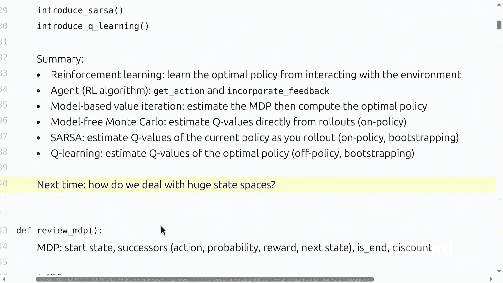

# Stanford CS221 ｜ Autumn 2025 p08 Stanford CS221 ｜ Autumn 2025 ｜ Lecture 8： Reinforcement Learning [34Hk2v2kwg4] [BV1XuPrzwEes_p8]

Okay， let's get started。So last time we started talking about Markov decision processes。

This time we're going to talk about reinforcement learning。

 but first let's review what a Markov decision process is。

So when you define an MP or a Markov decision process， you specify。start state。

 successors which specify the actions， probability rewards， and next states。

 is end test and a discount factor。So we look at this flaky。Tram MDP。

 where the goal is to go from state 1 to state 10。 and each at each point。

 you could either walk from I to I plus1。 You could take a tram from I to2 I。

 except for 40% of the time。 it fails。 and you end up in the same state。 Okay。

 so the start state is one。The successors of a particular state are a set of。things。

 successors where in this case if state is one， you can walk with probability1。

 you go to state2 with reward of minus1， remember reward is just minus cost so that's a cost of one and you can take the tram and with probability 0。

6 you go to state2 and with probability 0。4 you go to state1 and in both cases a cost2 or minus2 reward。

And then is end is a test that given a state determines whether you're at the end and the game is over。

Okay， so MDPs can be best visualized。By a graph where nodes are states and edges are either actions or transitions。

 so there's two types of nodes， there is our state nodes， such as this and chance nodes。

So the agent makes decisions at these state nodes， for example， to walk or to tram。

And then from the chance nodes， nature decides what happens。 So if you took a tram。

 then with probability 0。4， you go back to state 1 and with probability 0。6， you go to state 2。

And when you transition， you pick up your reward。Okay， and so you can see。That this is a graph。

 and our goal is to figure out how to go from one all the way to the end 10。

So we also defined what a solution to MDP is， which is a policy， a policy maps。

 a state tune an action， in search problems we could just have a sequence of actions and that was a solution but in MDPs there's randomness。

 so we have to know for each state what to do。We look at one particular policy。

 which is take a tram if always possible and。You can call that policy if you want when you。

Take a policy and MDP。 You can generate a rollout， which is。

A sequence of steps where you're using the policy to determine what actions to take and you're letting the MDP。

 you're choosing a successor from the MDP based on the probabilities。

We also looked at the utility of a rollout， which is the discounted sum of rewards in this case the discount one in which case the utility is just the sum of the rewards。

 if this discount is 0。5， then you're waiting each successive step by 0。5 or 0。5 squared and so on。

The value of the policy is the expected utility of the policy。

meaningan that if you do infinite number rollouts， what will be the average over your utility？

We look at an algorithm called policy evaluation， which computes the value of a given policy。

And policy evaluation defines a recurrence， kind of like when we do the dynamic programming where。

You'd compute the value for each state as a function of successor states。

And then we also looked at value iteration， where if you just insert a max in there。

 you can compute the value of the optimal policy。And also， you can extract the optimal policy。

 which happens to be walk all the way to state 5 and take the tram。Okay， so I'll pause there。

 hopefully that should all be review yeah。need the control in that。And。真个刨心。So the question is。

 why do we have this partial， This is just a syntactic trick here。 So tram。

 if policy takes two arguments， an MDP and a state。

So this is a partial application of this function where I've called it with only one argument。

 so then this object here policy is still a function that takes the second argument， state。

So it allows you to do partial application， yeah。Okay。Any questions about MDPs？Okay。

 so I'm going to give you another way to if you like code， I guess this is good， if you like math。

 then hopefully this part will help as well。So。The way to think about where value iteration and policy iteration come from is the recurrences that they're computing。

So， in particular。The policy evaluation recurrence can be visualized as so。So the idea is that。

You're at a state。嗯。What is the value of that state under the policy pi。

 so remember the value at a state is what is the expect utility or the value that you get if you start at S and you follow a policy pi？

Okay。And so this can be expressed as simply。Well， you follow policy pi。

 you call pi of s that gives you an action， and that takes us to this。Chance node。

Which is Q pi S of pi of s。So this node is s pi of s， a state in a particular action。And from there。

 what is a Q value？The Q value of a state in action in general is the value of taking an action A in state S and then continuing to follow the policy pi。

Okay， so this can be expressed as。Let's consider all the possible successor states as prime。

I look at the probability of going to that successor state S prime。

And using that to weight the reward that I get from making a transition。Times oh， sorry。

 plus the discount factor gamma times the value of underp of this state S prime。

So hopefully this visual helps you understand the recurrences。

If you want to calculate the value here you take an action， and then to understand the value here。

 you consider all possible transitions。Okay， maybe let me pause there to see if there's any questions about the recurrence for policy evaluation。

好。So then value iteration is very similar。嗯。So I'm using Op and start kind of interchangeably here。

So valuation， remember， computes the optimal value。V star。

Which is the value of following the optimal policy from state S。

 So if I ask what is the optimal what is the optimal value at state S， Well， I。

 I want to choose the best action。 So I take a max over a of Q star essay。

 So instead of following a particular policy pi， I'm going to take the max over these possible actions。

And then this part is the same as before except for I have Q star instead of Q pi。

 so what happens when you add a particular chance node。

 you consider all possible successors weighted by the transition probability of the reward plus the discounted future value。

Okay。All right， so then the optimal policy。Once you have Q star， then you're basically done。

 you take the action with the highest Q value。 So pis of star of S is just the arg max of a over Q star SNA。

So you're basically looking at。You know， what is the optimal policy from here。

 you're looking at which of the successors gives you the most value。

 and then that is the action you choose。Okay。Questions about these recurrences。

So one way to think about these recurrences is that you。

So of once you have a very crisp understanding of what a quantity is。

 then you just write it in terms of other quantities。

And then when you go to policy evaluation and policy iteration。

 it's essentially writing these recurrences down in code and iterating as we did last time。Okay。

So now we're going to do something new。So。Can we find the optim policy if we don't know the MDP？

so if we know the MDP， we can run value iteration， we can compute optimum policy。

 but what if we don't know it？And that is going to be reinforcement learning。

So reinforcement learning， in some sense is。MDPs where you don't know the MDP。

 hopefully that'll make more sense in a second。So here's the general reinforcement learning setting。

Does you have an agent？And you have an environment。The agent takes actions。

And the environment gives the agent rewards and observations。And you iterate and you iterate。

 and stuff happens。Okay， so agentnt produces an action。

 environment produces a reward and observation， agentnt produces another action。

 environment produces reward and observation。Okay。So it's very simple。

 which is one of the beauty beautiful things about reinforcement learning。And intuitively。

 what it is happening。So you might think about， okay， how do I design an agent that does well。

 a good agent should try various actions。Essentially， to find the good ones and then。

It should learn to keep on doing those actions。In other words， those actions are reinforced。

 So the word reinforcement learning kind of shows up in the way I describe what an agent should be trying to do。

Okay。So an important aspect of reinforcement learning is that in the beginning the agent doesn't know anything。

So the agent really has to try different actions。And along the way。

 hopefully the agent will learn what's good and what's bad， as well as where do actions take me。

 for example？So one thing is that I like to think about reinforcement is really a metaphor for life。

 So in MPs。Already， it's kind of tricky because you don't know what the outcomes are going to be。

But at least you know their probabilities。 So for example， you don't know if when you roll a dice。

 if it's going to be three or four or five， but you know if assuming it's a fair sided fair dice that it's going to be 1。

6，16，1，6，1，6，1，6，1，6。In reinforceforment learning， we don't even know what the probabilities will be。

But that's kind of real life， right， Like you， you take some action。

 but you just don't even know what the chance of success of a particular action is。

So you sometimes just have to try it out and then learn from your mistakes。Okay， so in this lecture。

We're going to specialize a little bit and assume that the environment is defined by a Markov decision process or MDP and that the observation is the state that you get when you take an action in the MDP。

So in real life you don't get the false state of the world， you only observe part of the state。

 and that falls into the category of partially observed MDPs or PoDPs。

 which we're not going to talk about。I would say that reinforcement learning is actually fairly general。

 All of these algorithms apply to。Well， maybe not these algorithms or algorithms I'll talk about next time。

 well can be applied generalized to P VP， but we're gonna to stick with MVP because it's simpler to think about。

Okay， so let's define an example here and see how R works。 So again， we have this flaky tram MP。

 So that's going to be our environment。And we're going to define an agent。

 which I'm going to use interchangeably with RL algorithm。

So agent isn't to be confused with you know language model agents， which you hear all the time。 Now。

 it's a RL agent。And。So。So let me define the simplest agent possible。

 A simplest agent is you have some policy such as take the tram， if possible。And。

I'm going to define this static agent， which just takes a policy。

So I just the agent just remembers the policy here。And then the agent。

Remember there's two things that it does。You can call get action on it。

 and you call incorporatecor feedback on it。Okay， that corresponds to these two arrows here。

 so get action takes gets an action and incorporate feedback。

 lets the agent consume the reward and observations。Okay。

 so what does get action do in this static case， all the get action does is it just calls its internal policy。

Okay。嗯。And incorporate feedback， what does the In feedback do here so this is an example of feedback that the H might get。

 which is I was in state1， I walked， I got reward minus1， I ended up in state two。

 and I'm not at the end。Okay， so that's like a little fragment of， of。

Data that is an observation that the environment' is going to send back to the agent。

And the agents can do whatever it wants with it。So in this case， it's a simple agent， static agent。

 so it doesn't do anything。O。So given an agent。Which is the static agent and the environment。

I can simulate by generally rollouts。 So we already did this a few times in this， in this class。

 Last lecture， we。Use rollouts to determine the value of a policy， So we're going to do that here。

So this function simulate is going to take a number of trials。

 and I'm going to just try multiple times and take the average。Okay。

 the environment state is the state of the， of the MDP。And then while I'm not at their end。

While I haven't ended， I'm going to ask the agent for an action。A says traRAm， okay， great。

 And then I'm going to ask the environment。To sample a particular successor state or step in general。

 given the state and the action。And then now， I have the。So maybe the environment gives me this。 Now。

 this is a piece of feedback that I'm going to give back to the RL agent。

So I have a particular state， I took action tram， I got this reward。

 I ended up in this new state and is end， which is false here。Okay래。So。嗯。

So I'm also going to just keep track of all the steps here。

 So this kind of goes round and round and round。 We saw this last time。

 So I'm going to just jump over to here。嗯。And。Oops， I didn't mean to jump there。嗯。

Let's see what happened here。嗯。Okay， so I'm simulating， I'm going to jump。Here。

So one rollout gives me tram， tram， tram， tram， walk， et cetera， et cetera。

 and that gives me a utility of minus 10。And if I do this over multiple trials。

 then each trial gives me a different utility。Okay。And this should be very familiar。

 this is what exactly we did in policy evaluation， so in some sense this piece of code simulate defines the rules of the game。

嗯。Okay， so now。嗯。So the simulation is going to yield some expected value。

 estimated value of the utility。And notice， again， that the agent doesn't do anything with the feedback。

So the main difference between a policy which we talked about last time and an agent。

 which we're talking about today is that the policy is something that's static。

 It just maps a state to an action and doesn't change over time。Whereas an agent， in other words。

 on an R algorithm。Also takes states and maps them to actions via the get action function。

 but it can change over time。 and it's dynamic。 In this case。

 this particular agent didn't change over time。 but you。

 we call incorporate feedback and the agent can do something else。

So now what we really like is for the RO algorithm to use that feedback to improve its own internal policy。

 that's a whole point of reinforcement learning。So how should we do this update？s a question？Okay。

 I'll maybe stop there any questions about the reinforcement learning setup。What an agent is。

Yeah so for this current setup， were using only the inverse of the cost as the reward。

Don we have to like set up that we for reaching the end？

So the question is the cost is the negative reward here。

So you can either think of in terms of costs or think of in terms of rewards。everything。

 all the algorithms， all the math will be the same。 you just have to negate it。Yeah。

And we are currently just define the reward of each。to decline。Were reaching them full。

So do you have to define the reward for reaching the end goal， you do。

 because reaching the end goal via action is just another。Another。um。So for example， here。

 reaching the end goal has some reward。It's not really special。Every。Transition in the MDP。

 there's some reward。You could say there's no rewards on everything except for that at the very end。

 so some problems are like that and those are called kind of sparse reward problems。

 but in general you can have reward at any point in time。Yeah， I just understand the agent as。

就 change这个。嗯。Yeah， so can you understand the agent as changing the policy dynamically。

 I think that's a great way to think about it。So maybe I'll draw a picture here。

 so here is the agent。And here's the environment。And you can think about inside the agent。

 there is some you know policy。 And we'll， we'll talk about what's inside the agent later。 So far。

 we've seen this picture where there is some policy and the logic of the agent in general is going to be。

When it says get action， it's going to go and ask the policy for the action。

 and then when it gets feedback， it's going to do some stuff to update the policy。嗯。Yeah。

 hopefully this will be clear once I actually describe some RL algorithms that are not just do nothing。

Okay， so I'm going to talk about four different R algorithms， model based value iteration。

 Model3 Monte Carlo， SArsRSA and Q learning， and each one has a slightly different。

 all of them are very similar in some sense， but there's some important differences which I'll try to motivate along the way。

Okay， so the first thing， if you have already studied MDPs like we have。

 then this model based approach is the very natural one。

So what makes RL hard is we don't know the MDP。Otherwise， if we didnt know the MT。

 we can just use value iteration to compute the optim policy。So here's an idea。

Why don't we just learn the MP or estimate MP from the feedback that we have。Okay。

 so because the feedback tells us， I'm in state。I took an action， I got some reward。

 I ended up in a different state。RightThat information should allow us to get an idea of what the MDP is。

Okay， so this approach is called model based value iteration。And what we're going to do。

 there's three stages here， one is an exploration stage where we're going to use some exploration policy。

 which might be as simple as just choosing random actions。And use that to estimate the MDP。嗯。

And then I'm going to compute the opt policy of the SMMDP using evaluation。

So this is once I have an MDP， I know I just go back to last lecture and that's what I do。

And then finally， I'm going to just follow this of this policy that I just learned。

So there's a sort of exploration phase， and then there's an exploitation phase。Okay。

So let's define this MDP again。嗯。So what should the exploration policy do。

 I'm going to call this walk tram policy。And it's going to be。嗯。

A policy that just essentially samples of valid action。Okay， so for example， from state1。

 if I can take the tram， then I'm going to choose either walk or tram with equal probability。

So sometimes I get tram， sometimes I get walk。From S 6。

I can't take the tram because six times two would go over 10， so I can just walk。Okay。

So the reason why I'm using this as an exploration policy is that I want to explore。

 So this is an exploration phase， so I want to try all the actions。Okay。

 so now I'm going to define the agent。As a model。 so this is an instance of the R algorithm。

And I'm going to keep track of the exploration policy and also an exploitation policy。

 which is going to be estimated soon and also an MDP。Okay。So this is， you know。

 now I can maybe try to flush this out。 So in the case of。嗯。Model。Basedase value iteration。

 So if I'm model based。Then what I have is I have the exploration。Policy。

And then I have this MDP that I'm trying to estimate。And then I also have this exploitation policy。

Okay。So what is this MDP？嗯。So this is this class。 So normally when I defined MDP。

 it was essentially hard coded， right， I just said， here are the states。

 here are the actions and so on。 But now I want to learn this MP。

 So I'm going to make it a little bit more flexible。 So in particular， there's some star state。

 which I don't know。 there's some rewards， which I don't know。

 And this is just going to be a mapping from state actions next state。You know triples to a reward。

And then transitions， which I also don't know， and that's going to be state to action to state prime to some count of how many times I witnessed this transition。

嗯。And。An end state is going to be just a set of states that I saw where is end is true。Okay。

 so initially I don't know anything， so all these are just going to be empty。

And discount I'm going it's just a number， I'm just going to remember that。Okay。

 so the model based R algorithm starts up with exploration policy。

 empty MP and exploitation policy that is also empty right now。Okay， so let me give some examples of。

嗯。A calling get action and incorporate feedback on this RL agent。So if I call get Age state1。

 what does it do？Well， this is what the agent is going to do。So if I have an exploitation policy。

 then I would use it if I don't， I call the exploration policy。Okay。

 so exploration policy is just going to choose a random valid action。Okay。

And then incorporate feedback before I didn't do anything， so let's see what this。

 how do I incorporate feedback here？I'm going to call the underlying MDPs， incorporate feedback。

 just pass all the feedback to the MDP， and here I'm going to update the MDP now so if I't haven't seen a start state then I set the start state。

嗯。I'm going to set the reward。 So I saw this piece of feedback。 I was in state， took action。

 I got to next state， and I got this reward。 I'm just going to remember this reward。

And then I'm going to note that I saw this transition from state action to next state。

 and I'm going to add one to that。Okay， and if I'm at the end， then I would add it to an end state。

 but I'm not at the end here。Okay， so after incorporating this particular feedback。

 then this is my representation of MDP。 I know that I started in one。

 I know that if I took the reward of this particular transition is minus-1。

 and I saw that if I am in state1， I walked， then one time I got to2。Okay。

 any questions about what is happening here？So maybe just two。Fleshes out there。

 this is every agent has two functions， get action and incorporate feedback。Okay。

 so I went through what it means。 So I'm going to define a bunch of agents。 So for each agent。

 I have to tell you what its get action does。And in this case。

 it's just follow the exploration policy as long as we we're in the explore phase。

And incorporate feedback just updates the MP。Yeah， so did you we not need to worry about the probabilities when we do it？

So the question is， do we have to worry about probabilities。

 We will have to worry about probabilities， and hopefully I'll show that。

 but this is going to come in through transition counts。 So in walk it's deter termministic。

 So it's always going to just be there's one possible choice here。 But if you take the tram。

 you'll see that you know， four times you end up in the same state and six times you end up in。

knowTwo times the current state。And then we'll use that to actually measure estimate the probability。

Okay。So。So let's see what happens when I simulate the MDP using RL。

 so I'm not going to step through this function since I already showed this is basically if 10 times rolling out this R algorithm on this MDP。

And I get a reward of or expected utility of minus9 here。嗯。

And so what I can do is now I can compare the true MDP。

Which was used to simulate and the internal MDP。So you can think about this as a the environment has an MDP。

 which is not telling the agent， and the agent is trying to make its internal MDP match the true MDP from the environment。

So in this case， I think。Let's see。 So let's look at the internals of this MDP。

So this is after doing 10 rollouts， the SA say is 1， and here are all the rewards that I saw it。

I think I probably saw everything， but maybe not everything。 And then here's the transition counts。

 So to your your question earlier， so if I'm in state  two and I took the tram。

 then two times I ended up in state2 and five times I ended up in state four。So then later。

 we'll see that you can estimate the probability of this transition to be five out of seven and two out of seven。

So you notice that the counts are not fully accurate because it should be。You know，60% and 40%。

 but because these are small numbers， sometimes it's bigger and sometimes it's smaller。Okay。

 so that's the internal representation of MP。 That's this， this guy over here。 Now， let's see。

When we call the true MDP。嗯。Okay。So the true start state is1 and the estimated。

 so let's say I have this MDP。If I want to get its estimated star state。I just returned the start 8。

That's going to be。The easy case。And now。嗯。And MDP， if the true MDP has the successors。

From state one。And let's see what the estimated ones have。 So how do I compute estimated successors。

 This is where I'm going to go compute the probabilities， right。

 because the MBVP class currently only starts the count。So what I'm going to do is for every。Action。

I'm at a particular state and for every action， I'm going to look at where I kind of end up。

In case of walking， I always end up in two。 So then the probability is is one。

 and I add walk with probability one。 So now for。The action tram， I have these these counts。

 so one time I end up in one two times I end up in two。 So when you go。Compute those successors。

 then the estimated fraction will be 0。6667 and 0。333。

So this is the way I'm using the counts to define these successors。

So you'll see that the estimated successors。This is the true MDP。And this is the estimated MVP。

 and it's somewhat close， but not exactly correct。Because it's just an estimate。Okay。

 and then you can check that the is and function。呃。Y works as well， his end is generally pretty easy。

Okay， so the more the agent will explore， the closer the estimated MDP will be to the true MDP。

Assuming that the exploration policy actually tries all valid actions。So obviously。

 if the exploration policy only tries one thing， then you'll never learn about the other actions that you didn't try。

Okay， so that's stage 1。 what we've done is learn the。Estimated the MP。

Now we need to compute the optimal policy of this estimated MP。And。

We're just going to run value iteration and all value does is， well。

 remember what value iteration does from last time it computes the optimal value。

And as well as an optimal policy。In this case， it actually turns out to be the optimal policy。

 even though the MDP was slightly wrong。That sometimes the policy actually I ran another one earlier today with a different random seatd and the policy was wrong as well。

 So there's definitely some schasticity。Okay。So notice that when you run value iteration。

 this policy is optimal for this particular MDP。But if the MDP is wrong。

 then the policy is also going to be wrong。But if MP is close to the true MDP。

 then hopefully the policy will be close to the true MDP as well。Okay。

 so let's just compare the policies， I think in this case， the two policies are the same。

Which is great。嗯。Okay， that comment is because of a different random seed well。

So using this estimated policy now。We can go and exploit。Okay， so what I do here is just。Run this。

You know， it's the same agent。 But now inside the agent， it has the updated M estimated MP。

 It has the exploitation policy。 And now I can get a much higher reward of- 6。6。Okay。

 so this -9 was I'm just going to randomly explore。 And， of course。

 that's not going to be very optimal。 once I estimated a。AndMDP and computed optimal policy on it。

 Then now I'm getting much better。Okay。Questions about this。Yeah。

 this cold didnt Mark didn or something。The question现 is错误。

Is this called hidden Markov or partially observed MDP。 This is fully observed。

 So fully observed means that the， the R L， everything we'll do doing here is fully observed because the R agent。

 if you remember the getting。Getting the feedback， it actually gets the state。

So if you only got part of the state， then it would be partially observed。Okay， so just some notes。

So notice that the， the utility or the value that you get in the exploration phase is suboptimal。

 It's -9。 but this is critical because， you know， we're learning。And so you invest in learning。

 and then you can exploit later。In practice， you don't have to have these two phases where you're exploring purely and then exploiting。

 I'm just doing this for simplicity right now。 What you can do is you can always continue continue refine your MDP。

 and then once in a while， you call value iteration and you update MDP。 and then you can even。

As we'll see later， use the exploitation policy to explore as well as long you're careful。Okay。

So summary， so model based Rl is what we're doing here。And model based means。

Estimating the MDP or the model of the world from from feedback。And then once you estimate MDP。

 you use value iteration to compute the optimal policy。Of the estimated MP。

 it's not the optimal policy overall， but you get you take what you can get。

 And then once you have the estimated policy， you just exploit that。Okay。Yeah。

 know all of the stakes that are possible right， like at the very beginning。

 we just don't know what to start or the end state。

So the question is do you know all the states up ahead of time， so you don't， if you remember。

 let's see， up down up here。So in this MDP， when you initialize it， there's no transitions。

 there's no rewards， there's nothing。 you only start updating this incrementally when you get incorporate feedback from the environment。

我新的。TheRe before， and then。Right， yeah， so that's a good question。

 So when you run your policy after you've estimated your MDP。

 it's possible that youll encounter new states。 And in that case。Yeah。

 you just generate a random action。Or in this case， the code probably just crashes。Okay。

 any other questions？Okay。Now let's think about the next thing， which is。

Can we estimate the optimal policy more directly。So at the end of the day。

 we just care about the policy。And so the MDP that we estimated was just a means to an end。

 We did that because we knew like how to get a policy from MDP。So now can we do this more directly？

Okay， so the next three algorithms are going to be doing that。 And in general， if you're。

These methods are called model free。 Model base means that you're estating MDP。

 model free means that you're not estimating MDP。Okay。

So before we estimate MP first and then you use value iteration to compute the optimal policy of the estimated MP。

Okay， so let's just review this as the recurrence that we just saw 30 minutes ago。

 the optimal policy is。The a max over the Q values。嗯。

And so the Q values is this other recurrence in terms of transitions， rewards， and future values。

So the thing to。Note， based on these recurrences is that。All you need to know is Q， right？

Like if you know Q， then you just can get the optimal policy。When we did the model based approach。

We estimate a T and R。 And then we use that to compute Q。 But maybe we can just get a Q directly。

Okay， so let's try to do that。And the idea is actually very simple。

 We actually saw it last time when we were doing policy。

 the first thing we did when we said we're going to evaluate policies。

 we just rolled out a bunch of thingses and averaged。 so that's what exactly we're going to do here。

Okay， so there's going to be a slight。You know， a nuance here， but we'll get to that。So。

Let's suppose that you did a rollout and you have， you you walked， you took the tram。

 you took the tram， and the first time the tram got stuck。

 so you ended up in the same state the second time you ended up in state4。So。So I'm going to。

 for every step。I'm going to compute a utility。So normally when we're computing a utility of a rollout。

 we just compute a single number， which is the utility at the beginning。

 but for reasons I will become clear， I also want the utility at each step from that point on。Okay。

 so step 0。I have minus1， which is this reward plus the discount times minus2 plus discount square times this minus2。

Okay， that's my utility here。And then here at step 1， I'm just going to pretend this。

 this first step0 doesn't exist。 and the reward is just going to be -2 plus discount times -2。

 And then for the last step， I'm going to。Assume that the first two steps don't exist and it's just going to be minus2 plus0。

Okay。So there happens to be a nice recurrence between the utilities。 so utilities。

At step zero is the reward at step0 plus the discount times the utilities of step one。And similarly。

 for each。Step， it's going to be the reward at that step plus the discount times utilities at the next step。

Okay， so this recurrence is going to be helpful when we generalize the algorithm。All right。

So now let's go to a question of， you know， which policy should we use to roll out if we roll out a bunch of。

 we get a bunch of rollouts， we can estimate Q。嗯。So。For model based value iteration。

 we had a purely random exploration policy。嗯。Here， we're going to do something a little bit more sophisticated。

 It's called epsilon greedy。And the way Epsilon greedy works is that。With probability epsilon。

 let's say 0。1。You're going to choose a random action according to the exploration policy。

And with probability1 minus epsilon。I'm going to choose the best action。

 according to the current estimate of the Q values。Okay。

So what Epsilon is generally small and it controls how much exploration you do。

 the larger epsilon is， the more exploration you do， the smaller it is， the less exploration you do。

So what's going to happen with？Let's see， I'll。Draw maybe another one of these diagrams。

So now we have an。You know， agent that's。I guess model。3e。Mte Carlo。

And what I'm going to do is inside it， I'm still going to have the exploration policy here。

 but instead of estimate the MDPP， I'm going to have an estimate of Q pi。Okay。So let's see how。

You know， I do I do that。Okay， so the same MP as before。Exploration policy is the same。

 So in model Freere Monte Carlo， I'm going to。Keep track of my SMNFQ and the way I'm going to do that is I'm going to。

 whenever I see a state action pair， I'm just going to remember essentially all the utilities that I've gotten。

At that point， I'm going to sum them， I'm also going to remember how many I have。

 so essentially that gives me a way to keep a running average。

Okay so some utilities means for every action and state， some of all the utilities I've gotten。

 and count is the number of times I've seeing that state in action。Okay。

So I'm also going to keep track of the current rollout。

Because the feedback I'm getting is in is sort of in chunks。

 I only get one step of feedback at a time。 and in order to compute the utilities。

 I need the whole sequence。 So this is sort of annoyance， but no， I think well， it's fine。All right。

 so let's see。What happens when it call get action on this particular agent？With state one。

There is a case where I haven't seen the state before or I haven't taken any actions from the state。

 then I'm just going to call the exploration policy。And what happens when I do incorporate feedback？

This， this part is the same。 I have to keep track of this what the start state is and I'm going to。

add to my rollout this particular step。Okay， so I remember the action。

 I'm just sending probability one because I don't need actually the probability here。

 reward and next state。So if I'm at the end， I'm going to actually update my Q values。

 but I'm not at the end yet， so incorporate second piece of feedback so on'm not at the end。

 and now the third piece of feedback。Now my rollout is walkTm tram and assuming that the end state is you four just to keep things simple now I'm going to I'm at the end of the episode and I'm going to update the statistics needed for computing the Q values so I look at the utilities and I want to compute a utility for each element of the rollout where the last element is just like at the very end it's always going to be zero。

So I'm going to walk backwards and compute the utilities for every step and remember that recurrence I had。

 utilities of I is the reward of at step I plus a discount times the utilities of I plus1。Okay。

 so so at this step， I have the discount is one， so I have essentially minus2 plus0 and then。

I'm going to update that the sum utilities with the utilities I've seen。

And then remember that I update this counter to say I visited state action once more。And then。

So here the reward is minus-2 this is。Basically， -2。Plusus minus-2， which is minus4。

 update the running sums， and then finally this reward is minus1 plus minus4。

 so each utility at each position is essentially the discounted sum of all the rewards from that point on。

Okay。So this gives you an unbiased estimate of the utility at a particular state action pair if you just were rolling out the policy。

Okay， so when that episodeil ends， I'm going to reset the history。Because when I reach an end state。

 then I just wipe out the history and I can start over。Okay。So。Now， if once I have theseQ values。

 let's see what get actionction does。So before I didn't see any accounts。

 so I just followed exploration policy， and now I'm doing Epsilon greedy。

Which means that with probability epsilon， I'm going to choose the exploration policy。

 and otherwise I'm going to choose the best action according to the Q values。Okay。

 so let's dive in to see what Pi does。So。Remember， I have。Okay， so this sorry。So。So， for each action。

I'm going to compute the Q value of that state in action， and'm going to take the best one。

So how do I compute the Q value， it's just looking at the sum over the utilities that I've seen as the state in action pair。

And dividing by the number of times I'm seeing that state action pair。Okay。

 so I do that for all the actions and I can。Just take the maximum。

 the action that gives me the maximum Q value。Okay， so rewinding back， that's what get action does。

So inside I have Q values and Q values allows me to quickly go to a policy。So let me try to maybe。

Flesh out the rest of this。So， here's environment。Get action。

So this pie is going to be used as get action as well as this exploration policy。And then this。

Incorporate feedback。Is going to be whatever that feedback is is going to be updating these accounts。

 so actually let me do it this way。So I have these counts that I'm remembering and the counts。

 if you normalize it， you get the Q value from the Q value。

 you get the policy which you can use to drive get action。So and notice that the MDP still exists。

 it's the same MDP， but I never have to explicitly try to estimate this MDP。And just to maybe。

Make this more symmetric。 You can think about this when I have this MVP， I also can get a policy。

So I guess that's what I've been calling exploit， a policy， exploitation policy。

 and either in the first phase， I'm using Explorer to get action or I use this exploitation policy。

And then incorporate feedback goes to this MDP。Okay。All right。

 so let me skip these other calls for now。Okay， maybe I'll pause for questions。Yeah。

 just another style of the MP。The question is， is the Q another style of MDP？It。

Has information that's kind of like what you have in an MDP， but it's not this， it's not an MDP。

 MDP has transitions and rewards and all that stuff。

 you can think about as maybe a compiled version of MP that tells you how what the value of certain actions are。

嗯。The model free one will be more efficient than the model can。So the question is。

 why is the model free one better than a model based one。

 This is actually a really interesting you know， question。 So one， okay。

 so I'll give you one piece of intuition， which is that if you think about。You know。

 often you might know what the right thing to do is， but you don't necessarily。

 you can't predict what's going to you know， happen。 So if you think about the real world， right。

 there， the state is super complicated。 And so in general。

 it might be easier to just learn a policy that takes the current。

You observations and just you know what to do。嗯。Like if you're playing tennis or something。

 you might have the policy to go and hit the ball， but you can't really predict everything that's going to happen in the scene。

嗯。Now， one thing that's kind of so the Q value basically and also pi。

 you should think about these as essentially you know synonymous with each other， right。

 you can just quickly get pi from Q， this just tells you what to do essentially。

 like or at least the value of each action whereas MDPs are more general and powerful。

 they tell you not only what to do what they don't tell you what to do。

 but they tell you if you did something what would happen。So these days。

 a lot of people talk about world models and the idea of a world model in the context of R is that you actually want to go back and build the MP or some sort of model of what's happening in the world because。

You。Even though it's harder。Now that we have foundation models and you。

 better models of the world that can actually in the long term， give you potentially better results。

 But this model free versus model base is like an ongoing debate。

 So there are cases where you want to do one versus the other。没。

I thought we were trying to estimate two star， but basically taking the average of utility then was it。

Ppon directly。Yeah， that's a good point。 So you call me on this one。

 So we're not even solving the same problem here。 I was trying to pull a fast one here。

 So we are computing Q pi。😊，And Kpi is。The value of。So what is Q pi？

Let me just be very clear about it， Q pi of SA is。Value。If you take state S and you take action。

 and then。Follow pi。Okay， so this is not what you actually want。

 It helps you estimate how well you you're doing， but。You。

 later we're going to see how we can actually get to Q opt。

 It's going to take two more steps to do that。Okay， so let's。Simulate this MDP。

We're using this monic。Model 3 Monte carlo agent and we get -9。

 and I think this relates to your point that know you see that the value here actually isn't very good。

 It's basically in the exploration phase and that's because we're not actually computing the optimal policy。

So， so the way you would actually use this is you would。You estimate the current policy。

So Q pi gives you some information because you can take the Arg max over this and in essentially it gives you one step improvement。

 so this is called policy improvement， which we didn't talk about and that gives you a slightly better policy and then you can try to estimate the value of that and you can improve that policy and so on so there is a path to improving the policy if you can estimate Q pi。

Okay， so to summarize modelto free Monte Carlo。Estimates Q values of the current policy。

 it directly uses rollouts bypassing the need to estimate MTP。

 and we're also using Epsilon greedy to balance exploration and exploitation。Okay。

So there's one problem here。Is that in life， you only get one rollout。Okay， you will go to the end。

 then you die， and then that's it。 So you know， you can't really do model free Montecolo in real life。

So。Now， the question is， can you update the Q values before the rollout is over。Right。

 the pro with model of Monte Carlo is that you're gonna to be you。

 100 years old and you're gonna to look back across your。

 your life and you're gonna estimate the Q values。 and it' will be sort of too late。

 You kind of want to estimate Q values as you， as you go。

So that's going to be this new algorithm called SArsa。

And we're going to try to estimate the Q values as you roll out。

So this seems like a little bit tricky。Because。If you don't rule out completely。

 how do you even get the utility？Because the utility is defined as going all the way to the end。

So the trick here is。This idea called bootsottrapping， which is common in RL。

 is you combine your immediate reward that you got with a model estimate of the future。Okay， so。

Remember the。Let's see。 Okay， I'm going to go over here。 So now I'm going to do maybe。

I'll talk about SARSa。So remember the In feedback， what it gives you is state action， reward， state。

嗯。You know， pears， right。And。So you don't see everything。

 so let's see if we can do something with that knowledge。So in Monte Carlo， Model3 Monte Carlo。

 we compute a utility and that's just going to be the discounted sum of the rewards。

 and the idea of bootstrapping is that we're going to take the immediate reward。

And then we're going to substitute it with our current estimate of the the rewards。

 So gamma times Q pi。remember， a Q pi is。Essentially， the。You our current estimate of the value。Okay。

 so。And then algorithmically， what we're going to do is we're going to perform essentially a gradient update to move our current estimate of the cubeI towards this new piece of information we got。

Okay， so let's go through our favorite example again。So SARSa， we're going to keep track of this Q。

 these Q values directly。And。When you call get action on SArsa。

 its it looks kind of the same as before。 You if you haven't seen anything。

 you try the exploration policy and now incorporate feedback， this is the core SAa algorithm。

 So the idea is that you have。Your state action reward， next state。And next action。

That's kind of a part of a rollout。What we're going to do is we're going to take this next state and we're going to simulate gettinga next action。

So at this point we have also an action that we sort of simulated。

And now hopefully you know why this is called the SArsSA algorithm。嗯。

So then you can compute your utility as the reward plus the discount times Q of the next state and the next action。

Okay， so remember I'm before in Monte Carlo all incorporate feedback did was add to the rollout。

 and then when I'm at the end， I can compute the utilities。

 but now I'm going to just compute the utilities as best I can immediately。And now this update。

Is going to be， take my cue。Current estimate of Q， and I'm going to nudge it with some learning rate。

In the direction of utility minus Q。 So if the utility is equal to that， then I don't move it at all。

 And if the utility is greater than that， then I'm moving it kind of towards the towards the utility。

Okay。So I can once I incorporate the feedback。Then。I can。Okay， in this case。

 I got unlucky and I'm just exploring as well。 But， you know， let's see if I can see pi。

 So pi is determined as in terms of the Q as simply the arg max over Q state action。

So I choose the action that gives me the best cue。Okay， so let's try it out again， minus 9。6。

 which is around this kind of the same。And again， you know。

 there's observation that what I'm doing is estimating the Q values of the current policy。

Just as you roll out， so it's not going to do better。 It just allows you to update sooner。

We were able to do that by using bootstrapping， so substituting part of the utility calculation with the actual model itself。

And then to estimate the Q values， we do these gradient updates。So now。In the last minute。

 I'm going to try to get you to the optimal policy。 So this sounds familiar from last last week， so。

This is called an on policy algorithm because the Q values that you're computing are of the current policy。

What we really want to do is estimate the optimal policy。So in order to do that。

 we need to have an off policy algorithm because the policy that we're following has to have some exploration and we don't know what the optimalum policy is。

 so we want to estimate the optimal policy。But not follow it。Okay， so that's going to be Q learning。

 It's basically。You know， a few characters change from SArsRSa。

So SAr estimates the Q values of the current policy。

 Q learning estimates the Q values of the optimal policy。So。Everythings going to be the。

 the same here。 So this is actually what I've done is。呃。Q， okay。

 so this is actually a Q learning and SArsa are。Are basically the same algorithm。

 So actually this implementation， I've subclassed SAa is now a subclass of Q learning so。

Let's see In feedback， this is a part that's different， so just to show you how similar there is。

 Q learning inherits everything from SARSA， except where I'm overriding In feedback。

So what am I doing here？So。The only difference here is that now I'm using pi instead of get action。

and pi represents。If you remember the optimal policy given these Q values。And。

And the rest of the update is identical。Okay。So。What I'm doing， I should have had， so let's see。

So let me do Q learning。Here is in Q learning。I'm updating。嗯。Q star。And。I'm doing an update。

So plus the learning rate， and then I have the utility， which is some reward plus smma times。

So the value。Which is going to be。嗯。Sorry， Q， sorry， this is going to be the max over a prime of Q。

S prime， a prime。And then minus。This Q star。S A。And then in SArsa， I have Q pi of SA。

I'm estimatedd Q pi of essay， and this is going to be the reward。Plus。嗯。The Q of value of S prime。

A prime。Minus Q of。Q pii。Of essay。So in the code， where you're seeing is that this is。

This is coming from get action。Which is basically the action that that pi is giving you。

 your surgery your policy is giving you。 and this is coming from。You know， a selftop pie。Okay。

 so this is。On policy。And this is off policy。Okay， I realized I was a little bit rushed。

 so maybe next time I'll try to review this a little bit more。Okay， so maybe just to summarize。

What we learned today。So reinforcement learning， we're learning optimalim policy with interacting with environment instead of being handed to MDP。

The kind of the contract here is that we have an R algorithm that takes actions in the world。

 incorporates feedback。 We looked at four algorithms。 First， you can just estimate MP。

 and then you can compute optimal policy。 You can estimate the Q values directly from rollouts using Model3 Monte Carlo。

 you can use SArsRSa to do the same thing。 but with bootstrapping so you don't have to wait until the end。

 And then finally， you can switch everything over to estimating Q values of the of the optimal policy。

Okay， so next time what we're going to do is consider the case if you have huge state spaces。

 so here everything you assume this number of states is small because we're just indexing。

 computing the value for every state。

But in a much more realistic setting， you can't see all the states and then so what do you do in that case？

Okay， that's it for today。 I'll see you next week。

