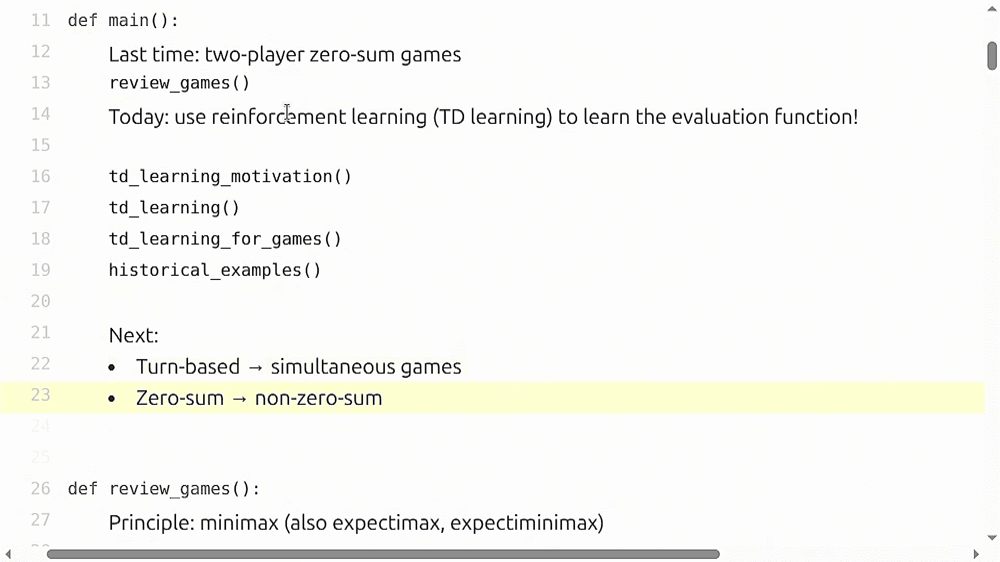
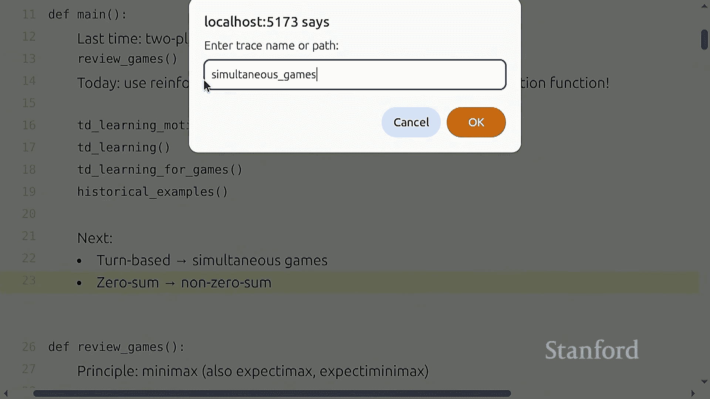

# Stanford CS221 ｜ Autumn 2025 p11 Stanford CS221 ｜ Autumn 2025 ｜ Lecture 11： Games II [9CKRoKFdS5Y] [BV1XuPrzwEes_p11]

So welcome back， everyone。

Last lecture， we talked about two players zero sum games。

And so we're going to review that a little bit and this time we're going to start bringing together reinforcement learning and games。

 and then we're going to actually play a few games in this class， so hopefully that'll be fun。Okay。

 so just as a review。Last time we talked about the minimax principle and this is the way that we solve games so remember in a game you have different players being control at different states which means that you can't just max over everything or take expectations。

 you actually have to min max and min so this was a game tree that we looked at last time where at the root node。

 the agent is trying to maximize its utility and at the next level the opponent is trying to minimize the utility。

So at these min nodes you take the minimum over the outcomes of each of these subtes and then at the max node you take the max。

 so the mini max value of this game is one， which corresponds to the agent choosing the action B here。

 and then the agent choosing action1。Okay。So we talked about ways of speeding up minimax search if you want to keep it exact。

 you can use alpha beta pruning in an alpha beta pruning。

 remember you keep track of lower and upper bounds on the possible values of each of the states in your ancestral tree and for example here after you've explored this part of the tree。

 you know that this is at least one， and you come over here， this is at most minus5。

 these don't overlap so that you don't even need to look at the 15。Okay。

 so we also looked at evaluation functions， and this is if you want to bring in domain knowledge and you don't mind being approximate。

So then you can just define an evaluation function to assess whether a state of the game is good for the agent or not。

 so we looked at this one in chess， which combines a variety of different factors related to how many pieces you have and how much mobility and control of the center you have and so forth。

So this was very much about manual heuristics。 So now the question I want to pose is。

 can we learn the evaluation function？Because if we can learn it。

 then maybe we can do better than a hand coded system。So indeed that's what we're going to do today。

 we're going to use reinforcement learning， in particular TD learning to learn the valuation function。

So you have to bring in back your memories of reinforcement learning and let let's dive in so just as a refresher in reinforcement learning。

 there are two quantities of interest， so this is value based reinforcement learning。

 so you have V pi of S， which is the value or the expected utility that you obtain if you follow policy pi from state S。

So we're in a state S， you follow some fixed policy， and this is how much value you would pick up。

And there's also a Q values which are have an extra argument which takes the action here。

 and this is the value of a utility when you first take action A， when you're in state S。

 and then you continue to follow policy pi。Okay so these are the two quantities that show up over and over again。

 we saw them first for policy evaluation in MDPs， and then we saw them in SArsSA and now they're going to come back again。

So。Remember the SARSSA algorithm from reinforcement learning。So this was an on policy algorithm。

 which means that it's estimating the value Q values of the current policy that you're following as opposed to the optimal policy。

 which might be not the one you're following。And SArsRSA was also the main insight was Botrapping。

 remember， where you're updating the Q values towards a target and the target rather being just empirical utility of the full rollout。

 it's an immediate reward plus an estimated future reward。Okay， so here's the SARS algorithm。

As you run the reinforcement and learning algorithm。

 every time you see a state and you took an action and you got a reward。

 and then you ended up in state S prime and then you took another action。

Then you perform the following update first you look at the reward。

 that immediate reward that you just got。And then you form an estimate of how much reward you would get after that。

 So you after this reward， you ended up in state S prime。 And now you're taking action a prime。

 So that。Estimate sort of packages up your belief of how much reward you're going to get。Okay。

 and then what you're going to do is you're going to nudge a Q pi of essay。

 which is your current Q value estimate in this direction by some learning rate eda。

OkayAnd you keep on doing this over and over again。so in code， it looks something like this。

 so I instantiate an R algorithm SARSa。And then。In。And remember the Ral algorithm。

It implements two functions， get action， so I'm in state one and I get an action。

 and then the environment does something with that action， and then I incorporate feedback。

Which is tells the agentM what happened， so incorporate feedback state1， I walked。

 I got a reward of minus1 and I ended up in state two and I haven't finished and so on and so forth。

 so you got action incorporate feedback， get action incorporate feedback。Okay。

 so one thing that's interesting。I want to emphasize is that the strong connection between Q values and policies。

So SArsRSA computes Q pi， which is the Q value of the particular policy pi。But given this Q value。

 I can read out a policy。And the policy I read out is simply， well， I just take a the。You know。

 the best action here。So arg max of a over Q pi of Sa。

 and that gives me a particular action to follow。So you can think about this as one step of policy improvement where。

Here is the value of this particular policy。 and a new policy is simply， well， I'm just going to。

You know， myopically optimize over the next action。

 and then I think about following the best whatever values I get after that。Okay。

So the whole point of this is that given a Q value， you can read out a policy just by arc max over a。

Okay。So now I'm going to invoke another thing。We looked at policy evaluation from MDP。

 So remember in MDPs。You get the transition and the rewards and you know how the world works in reinforcement learning。

 you don't。So in MDPs， we had these set of equations。

 so we defined a value of a policy to be simply the Q value of the and the action given by that policy and then separately you can also define a recurrence for Q pi of SA。

 and that just corresponds to sum over all possible successor states when you take action A waiting by the probability of that transition and then immediate reward plus an estimate of the future。

So just as a recap， SAA is a reinforcement learning algorithm， it computes Q values。Q。

 which is a function of SA， I can get a policy out very easily。Now， the question is。If I。

 let's say I just gave you V pie。Could you compute a policy from that directly？

Can you read out the policy if I only told you essentially how good various states are？

Can I get a policy out。Well， I guess the question is like， what do you need to get a policy out。

 right？ And in some sense， well， you look at this and you say。Well， if I'm given V Pi S， I can just。

Compute Q pi essay using this formula， and then I take the a max over a， and then that's my policy。

So I'm only given V， so I don't have Q， but I can the Q is in some sense。

 a one step transition from V。But here's the catch。

 is that computing this requires knowledge of the MDP。So this is why in general。You can't do。

 you can't just estimate a value of states。Because if I don't know how the world works。

 you can tell me this state is great， this state is bad， this state is great。

But that doesn't it tell me what actions， how does that connect with actions？

And the thing that connects actions in states are things like the are the transitions。

 But I assume I don't know the transition。 So that doesn't help me act。

 whereasas if I have a Q value， this sort of binds the action into the value。

 So I know that in the state， not only is it good but I taken a particular action and that gives me some value。

O。So that's why when we started with reinforcement learning and its full generality。

 we only looked at SARSA and Q learning。Because we need policies。Now， however。For games。

We actually do know transition and rewards unless you're in a cruel game where you don't know the rules。

Most of the time you're playing a game， you know perfectly the rules。

 you actually things are might be even deterministic as we've defined it， for example， chess， go。

 everything's deterministic， everything's fully observed。So there's no uncertainties。You。

 given the V value。It's actually pretty trivial to compute the best policy。

You simply look at the action， you're in a state S， you look at the action。

 you basically consider all actions， you see where they go。

 so remember there's a determined successor function that takes a state in action and tells you what successor state you end up and you just evaluate how good the resulting state is。

哎。Well， wait a minute。 So， but if we already know the MDP。

 then why are we using reinforcement learning。I thought the whole point of reinforcement learning is that you don't know the MDP。

If you know the MP， just do evaluationeration。So in principle， you could also do evaluation。

For games。Because there's not theres in some sense， no need to learn anything。

 you already have everything in front of you。But the problem is usually for games。

 besides Ti ta toe or something， this number of states is just vast。

 It's going to be exponential and you won't be able to do value iteration。

 which grows with a number of states。Okay， so。Therefore， we're going to use reinforcement learning。

 and it's important to know why we're using reinforcement learning。

 It's not because we don't know the MP。 We actually know the VMDP quite well。

But it's because the number of states is exponential and reinforcement learning allows you to use function approximation and effectively reduce the number of states。

Okay， let me pause there。 We did a bit of review of Q values， V values。

 policy evaluation and SArsa and， and some motivation for。MDPs and reinforcement learning。

How does the first policy update simplify to this one。Is that the question。 Yeah， so in the game。

 the transition probability is one for one particular S prime。

 And that particular S prime is suck essay。 It's a function。 Okay， so the summation goes away。

And then in a game， all the reward is at the end， so this is zero for essentially all transitions。

And then this count is one， so then you end up with just V pie。Okay。

 so now let's actually talk about turning this into an algorithm。So TD learning。

 the way to think about it， if you either just kind of remember one thing is TD learning is as to V pi as SARSa is to Q pi。

Okay， so SARSA estimates Q pi， TD learning estimates V pi， and basically that's the only difference。

Okay， so in SARSa， Q pi tells you how good each action is from a given state。And in T learning。

All IA VPI is going to tell you is how good each state is。

And since we know the action to next state mapping。

That's all we need because we just need to know how good states are。

So this is good and it simplifies things because we have a function of just the state rather than the state and the action。

So' a minor point， but it does make some things easier。Okay。

 so now we're going to assume we do function approximation。

 so remember in functional approximation and reinforcement learning。

 we take instead of keeping a tabular representation。

 meaning for every state we have a separate value that has nothing to do with any other value。

 we're going to define a function， a parameterized function， also written V， which take as input S。

And then depends on some weights W， so these are the parameters of that function as as you vary W。

 you get different functions。So in deep reinforcement learning。

 typically VP of S is called a value network。Okay， so here's the nutshell， TD learning nutshell。

So you get a piece of experience。小。R in state S， you took action A， you got reward R。

 and then you ended up in state S Prime。So， the model。

Predicts that this state has this particular value， V S given some parameters。Okay。

 so based on this new piece of information， how can we compute a refined estimate of that value？

So we define the target。Which incorporates this piece of experience。

By this bootstrapping where you have the immediate reward plus some discount gamma times。

 the value of the successor state， given the same set of weights。Okay。

So this is very similar Q learning， it's just you have V's instead of Qs。

 and now I don't need a a prime because this is just a value function， not a Q function。So now。

To move the model's prediction towards the target， I'm going to define a loss function。

In the loss function， I'm just going to use the square loss here to be the different square difference between the model's prediction and the target。

And then if getting that loss function， I can just take a gradient step by moving the weights in the opposite of the gradient。

OfOf this loss function。Okay케。So so to put that in more I guess summarize that in equation。

 So on each piece of experience， I'm going to look at the model prediction， look at the target。And。

 I guess Ive。Yeah， so if you differentiate this。You'll find that there is a sort of natural form where you have the difference times you know the gradient of what's inside。

 which is just the gradient of the value function at W。Okay， so one actually。

 one important point is that this term also depends on W， but I'm going to treat it as a constant。

So remember in the second lecture or so， I had this。

 we were doing computation graphs and you could detach。

 so this is where you would detach this because this is when I backprop through this。

 I only want to backprop through this first W。Yeah。

 so let me explain that again so you can think about the target as just a value a constant。

And then all you're doing is you're saying your model prediction move it towards the target。

 the target effect， you don't change it。And that corresponds to this gradient。But however。

 the target also depends on W， implicitly or or actually explicitly。

 But for the purposes of computing a gradient， I'm not going to differentiate through that。Okay。

 so let's see a code implementation。 So we're gonna do TD learning for this tram problem。

 So I'm gonna define the MDP exploration policy， which either walks or takes the tram。

 And then TD learning。 I'm going pass in the MDP now。 so。

If I just want to evaluate a value of a policy， I don't need this。

 but I need the MDP to be able to compute the policy as I argued earlier。

So this is for a general MDP， not just gamess。So in the R algorithm implements two things， as usual。

 get action， incorporate feedback。 So when I get action， TD learning。

 if I'm doing Epsilon greedy exploration， I either with probability Epsilon Expr or with probably one minus epsilon。

Return pi。 And what is pi。Pi corresponds to the policy that are given by V Pi。

 which are the values I'm estimating。So what I'm going to do is I'm going to compute the Q values because I only have V。

 so I compute the Q values。For every action。So for every action。

 I'm going to sum over all the possible successors。Of that， of that action。

Waiting by the probability of that transition times the immediate reward plus the discounted future reward。

 So this is where V comes in。 So if I take V， I， I I combine it with my knowledge of how the world works。

 the transitions。And then I'm going to get a Q value as a result。

And then that is going to give me a set ofq values。

And then I'm just going to take the action with the highest Q value。Okay， and in this case。

 this is walk。So given these V values， I can compute a policy， okay， that's going to allow me to act。

And now when I。Act in the environment sends me feedback。 This is what I'm going to do。

 I'm going to look at the predicted value of a given state。I'm going to look at the target。

 which is the reward plus discounted of the next state。

And then I'm going to just perform this update。 So notice I'm not doing any function approximation here for simplicity。

 If there were function approximation， I would form a loss function and take the gradient。

 but I'm just keeping it simple for now。And in the tabular setting， this has a simple interpretation。

 which is I'm just moving it towards the target away from predicted at some learning rate。

And in this example， I predicted zero， the target was minus1。

 so I'm going to nudge the value of state one to be minus 0。1， which is in this direction。Okay。

 so then I do this over and over again， and that is essentially TD learning。Okay， to summarize。

TD learning estimates V Pi from experience。Okay， so remember。

 V pi is the value of a particular state under some policy pi。

 So this tells me basically if I'm following a policy， how good are various states。

And it is on policy。Notice that we're only rolling out with policy pie and we're not considering any other actions whenever you see a max over actions that usually means something like off policy or queue learning if you don't see that it's probably on policy that's a good rule thumb。

And then we're using bootstrapping where we're looking at the target consists of the model。

 that's a sign that it's bootstrapping。Now let's specialize TD learning for games。

 what we did is TD learning in general for any MTP。Now we're going to adapt the two games。

So what's special about a game， well， as we discussed earlier？Transitions are deterministic。

 at least in the games that we've looked at so far。So when you make a move。

 it does one particular thing。And there's no utility until the end of the game。

 and then there's two players， agent and opponent。Okay， so in some sense， maybe I lied a little bit。

 It's not a necessary special case， but it is the fact that you have the transition。

 That's a special case。 no utility at the end。 That's a special case。 But this idea of two players。

 agent and opponent。 remember that is a thing that's actually special about game。

 So how do you deal with that。And the way you deal with that in the context of adapting reinforced mal learningney is actually quite simple and elegant。

You just let the agent and opponent use the same value function。So this is known as selfplay。

 where you're essentially saying agent， an opponent， your minds are I guess， wired in some sense。

 and you're just going to use the value that I'm going to estimate to drive your decisions。

But of course， the agent and opponent are not doing the same thing。

 the agent is trying to maximize and the opponent is trying to minimize。

Which means that there's a small tweak that we need to do。

So this we saw earlier that given an estimate of V pi。

We can read out a policy for the agent by just choosing the action that leads to the best state under VPI。

But what is the opponent trying to do？It's trying to do the opposite， right， It's trying to minimize。

 So you just replace the arg max with arg min and you say that's the opponent policy。Okay。

So it's actually pretty nice that。All you are focusing on in TD learning is estimating these VP。

 and once you have VP， you can play either an agent or the opponent。

And this is generally true if you know what's good and what's bad。

You can choose to do the good thing or you can do the bad thing。

So let me instantiate this just as a fun example for the game of backhammon。

So here's the way back A works， so you have this board， it consists of these triangles called points。

There's two players in this picture， there's a red player and the white player。

 each player has a set of pieces。And the goal is to move your pieces off the board。Okay。

 so if I'm the red player， I have my pieces here， I'm trying to basically move all of these pieces around clockwise。

To my home board and then off and the white is going to take all these pieces and try to move it counterclockwise and off the board。

Okay， so how do I move pieces？There is dice involved， so I rolled2 die。

And let's say it's White's turn。Okay， I roll two die。

 and the dye determine the number of spaces I could move。 So if I roll a3 and a5。

 I could say take this piece and I could move a 3， and then another 5。Or I could take， let's say。

 this piece， I move it 5 and take this piece and move it 3。Okay。

 so what makes this game interesting is that if you land on a point with one opponent piece。

 I guess there's no examples here， then you move that piece to the bar。

 you sort of crush the piece and that goes to the bar and it sort of has to start over so that's bad for your opponent good for you。

But if you have but you can't land on a point with。More than one opponent pieces。Um。

 so generally the strategy is that you're trying to put your pieces in tall stacks so that they're safe from your opponents。

But at the same time， you have to move everyone across。

 So this is probably a better move because this allows you to have to。

So you don't have any exposed single tents， essentially。Okay， so I think there might。

 I'm not sure if there might be another role， but that's basically the the gist。

So notice that this game has randomness in it， so it's a little bit different than MDP or a classic game。

 but remember we shouldn't be afraid when there's sort of slight variations because as long as we understand the principles。

 we can write down these recurrences and then everything kind of makes sense。Um， so。

The first thing is to think about the dynamics of the game here。

 so we're going to use pi dice to denote the dice as a， I guess， a player in some sense。

 which is a fixed policy and just generates the values of the two die。

So the Pidce is going to move first and then it's going to be the agent's turn。

 and then when the opponent rolls， that's going to be another Pidce and the opponent is going to move and then agents going to roll and then agent moves and so on。

And the reason that the dice has to be before the pi agent is because the agent's move depends on what the outcomes of the dice were。

Okay， so when we do TV learning for backmen。We are trying to learn pie agent and pie up。

 At the same time。 Remember， this is self play， but pie dice is fixed。If you were in a cruel world。

 then you could also play against adversarial dice。

 but I imagine that would be a much harder game to win。

So one example of how you could perceive then is。If you want to apply TD learning。

 you have to define what the value function， how the value function is parameterized。Okay。

 so typically you have a game。 It has a game state。

And you have to turn it into a vector for machine learning to work。

So here is an example of how you define a vector for each state。

 so we remember we did this in the machine learning section of the class。So you have a state。

 let's say the simplified state。Typically， you can define a set of features that capture the state。

 so for example， a feature might be the number of O's in column 0。

Is that number equal to1 that's true， so that's a1， number the o's on the bar， that's a1。

 the fraction of o's that are removed， so two out of four。

 that's a half number x is in column 1 equals1 number x is in column 3 equals3 that's a1 and it' a o's turn and it's one here。

So every state of the board gets mapped into a feature vector。Okay。

 so now if you have a feature vector， you can do many things。 You can define a linear value function。

Which we talked about。 So this is basically linear regression here。 Or you can do something fancier。

 You can define a multi layer perceptron and have multiple layers。 you can。You know。

 do number things。Okay， and then you just apply TD learning。

So next I'm just going to go through this part isn't technical。

 but I think it's interesting to reflect on some historical examples where machine learning and reinforcement learning have been useful in gameplay。

So I think I have mentioned this on the first day of lecture Checkers was a very early example of where learning was helpful。

 so Arthur Samuel in 1959。😊，Train a chess program。And it learned by playing itself repeatedly。

 so this is perhaps one of the earliest examples of self play in action。嗯。At that time。

 compute was limited， so you can't really do that much deep learning。

 so you had to invest time in getting features so the type of。

 you know I gave you a very simple set of features for backcaM but you can define much more complicated features。

They use a linear evaluation function， a linear value function。

 and then also define some intermediate rewards， remember in games。

 the true reward is only if you win or lose。But that is a very hard thing to learn from because it's a delayed reward problem。

 So they essentially added some intermediate rewards to make the problem easier。

They also did alpha beta pruning with some additional heuristics which are domain specific。

 which alpha beta pruning we talked about， and this reallyleached an amateur level of play。

So it could probably beat me probably and this， you， we got to remember 1959。

 so this is on nine kilobytes of memory， so pretty good。嗯。Okay， so backgamin。

 which we just talked about， so the big result in backgamin was this program called TD Gamin made by Gerald Tsarro in '92。

And this was an agent that also learned by self play， except for it 1992 instead of 1959。

 so they could do it a million times。And because it was the compute was more plentiful and you can get more data。

 they actually use fairly simple features。😊，And they used a neural network and had no intermediate rewards。

Okay， so you could see the kind of the direction as you get more data， more compute。

 you don't have to engineer features quite as much。And now this reached a human expert level of play。

 not just an amateur level and。One of the earliest examples of providing new insights into the game。

So it provided new insights into how the first move should play out。

Okay and then there's goal which I think is more of in recent memory so in 2016， there was Algo。

 I want to highlight Algo zero because it's much more bullish on reinforcement learning This learned by selfplay as well so they played about 5 million games here at this point it was also dumb features and you just had the stone positions。

Right， so in go， there's a lot of complexity about， you know， what's。

What pieces are live and how everything's connected and how many degrees of freedom there is and previous programs you would try to encode all that knowledge into features。

But here we're just saying。Machine learning algorithm。

 these are where the pieces are go figure it out and this was obviously using a deep neural network。

 no intermediate rewards。 they did have to use multicollo treese which I'm not going to talk about。

 but it's a search algorithm that allows you to etc get a better policy rather than just taking the action that gives you the next reward so you can think about this as a less greedy version of the types of policies that we've been looking at。

So this actually beat Alphago the version from 2016， which beat Leido in 2016。

 so of course at this point goplan systems are much better than humans and similarly this also provided new insights into the game。

Okay， so these are three examples of just ground out how these techniques that we've been seeing in the class map onto real world examples of gameplay。

Okay， so that's all I'm going to talk about in terms of TD learning。Okay。

 so next we're going to look at two generalizations or extensions， if you will。

 of the types of games that we're looking at。 So we've been looking at turnb games。

 we're going to look at simultaneous games and we're going to also go beyond the zero sum assumption。

Okay。So so far， we've been talking about term base games。

And now we're going to talk about something called simultaneous games。And you know。

 Simon Roane' games， a famous example is Rock Pa scissors， two players have to play at the same time。

And so here's a question for you to think about。Can you still play optimally if you reveal your strategy to the other player？

ok。So obviously， if I am playing rock paraacers and I say， I'm going to play rock。

 that is not very smart。But is there a way to play optimal of you still reveal and still review your strategy？

And the answer turns out to be what kind of strategies you're allowed to do。So in turn based games。

we have that nail， right， we just compute the minimax policies using a game tree。

And so the game tree naturally models the turn taking where each node， only one player is moving。

Okay。But in simultaneous games， two players have to move out the same time。

So we can't use a game tree anymore。You can't have this if two players are trying to move here。

 then it's confusing， or are you maxine or are you min？And that doesn't work。Okay。

 so we're going to focus first on zero sum games， zero sum simultaneous games。

 and then we're going to do the nonze setting。Okay。

 so we're going to start with a few definitions and then there's a theorem that essentially solves it。

Okay， so I'm going to present to you another game， which is hopefully more obscure than rock paper scissors。

Okay， so here's how the game works， So have two players A and B and each is going to show either one or two fingers。

If both show one。Then B gives a $2。If both show2。Then B gives a $4。And otherwise， A gives B $3。Okay。

So intuitively， A wants both people to play the same number of fingers。

Because that's where A can win。And there's a。A really wants it to be more two than one。Right。

 but if A always plays two， then B is going to play one， and then A is going to lose money。

 so there's sort of this balancing act here。Okay， so while I'm going through this。

 maybe in the back of your mind， you could just think， hm， how do I， what's the strategy here？

All right， so let me introduce some formal notation。

 So this is called a single move simultaneous game。Okay， so it involves just playing the game。

 single move， you're done， There's no state。There's two players， A and B。

We're going to define this payoff matrix。Whi is essentially going to be the equivalent of the value function or the reward function。

 and it takes two arguments， A and B， and for each action pair I'm going to give you a value and that value is a's utility and because it's zero sum。

 B's utility is just the minus of that。And again， there's no state there's only one action。Okay。

 so this is what it looks like for two finger mora。Let me just write this on the board。

 so this as a handy reference。So I have。Yes。So A can play either one finger or two fingers。

 B can play one finger or two fingers。 And then if they both play one， then a gets two。

 they both play two， A gets4， Otherwise A might loses three。 Okay， so that's the payoff。Mattrix。嗯。

Okay。So just to。Ground things out a bit， so there's two actions one and two。

 and this is the payoff matrix， so V of one and one gives you two and then so on and so forth。Okay。

 so that's a game。 Now what is the equivalent of a policyier in game theory it's known as a strategy。

And there's a pure strategy。Is a deterministic policy。And determin equality just is a single action。

And a mixed strategy， also known as a storcchastic policy， is a distribution over actions。

So for example， in two finger moura。Always one。Is a strategy？

And this means for the action one finger， I'm going to have probability one。

Another way I'm going to write that in math is pi， the policy is a vector of probabilities of each action。

 so for one， I have probably one for two， I' have probably zero。And for always two。

That is the strategy。Where all my probability mass is on two fingers。So written in math。

 it pi equals zero comma 1。And if I were playing uniformly at random， then I put 50。

 50 probability on each action。Okay so I've defined the payoff matrix， the policies。

 and now I can define the value of the game， which combines them and in math， the value of the game。

 according to two mixed strategies， pi A and pi B is I'm going to consider each every pair of actions。

 A and B。The probability of A plane this action and B plane this action。

Notice that they're independent and at times the payoff matrix value of action A and B。ok。

So encode code， if I have this payoff matrix V that I'm going to pass in with， let's say。

 the uniform policy for both players。This is what I'm going to get。So I have this payoff matrix。

 I have two policies， and then you know this is pretty straightforward for every possible action with A with probability A。

 for every action B with probability B， I'm just going to sum up the values。

 probability A times probability B times the corresponding entry in the payoff matrix。Okay。

 so if I do that， then I get。A value of zero。ok。😊，And this sort of makes sense if I take the average over all these four values。

 I should get0。Okay， so everyone's playing uniformly the value of this is zero。Okay， so now。

What happens if I？Player A plays always one。And player B plays uniformly。Okay。

 so that the value is going to be minus-0。5。So you can think about this in this case。

 player B is uniform between these two and player A only plays one。

 so that means it's going to be average of these two values， and that's going to be minus 0。5。

 always 2 means I'm always 2 down here， but uniform over these one and 2。

 and that's going to give me the average of minus3 and4 which is 0。5。And then you can look at。

If A is playing uniformly and B is playing one， then it's going to be the average of these two。

 and that's going to be minus 0。5， and the fourth case is uniform A is playing uniform over one and 2。

 and B is playing only  two， and that's going to be the average of these two and that's going to be 0。

5。Okay。So hopefully a game evaluation is clear and just to build some intuition， it makes sense that。

 for example， player one wants to play two more。And if。B is playing uniform。

 which is a sort of generic strategy， you can kind of get away with playing two and getting some value。

Okay so in some sense， it's much simpler than having states and actions and transitions and rewards and discount factors。

嗯。But the solution is actually kind of more subtle here because of the simultaneous nature。All right。

So how do you come up with an optimal strategy here？So just to have a bit of fun。

 why don't you I want everyone to find a partner and try playing like a few rounds and see if you're getting any insights。

あ。All right， so how did people do anyone figure out a good strategy that worked for them。

It shouldn't be that this is fairly subtle，Very impressive if you guys came up with the optimal strategy。

And one other caveat is that this is meant to be a single move game right。

 so you play once and you're done right， What's happening obviously when you play an iterated game now they' state because now you have the history of what the other persons doing and that changes the dynamic。

 So it's not quite the same game anymore， but anyway。Okay， so let's try to solve the game。Okay。

 so probably you're thinking now you're dying to know like what's the optimal strategy， So the game。

 remember the game value。It's's very simply defined as V of pi A and pi B。

 So but the problem is that player A wants to maximize this quantity and player B wants to minimize and they want to do at the same time so you get into this sort of jam where you don't like how do you move forward。

ok。So how do you break out of jam， well， you just have to let someone go first。Okay。

 so we're going to see what we can do here，' let someone go first。So。First。

 let's consider pure strategies， so when playerss are just playing a pure strategy。

 what happens because this case we know how to do， right this is just normal minimax。

So let's say player A goes first。 Okay， so player A is trying to maximize。

 player B is trying to minimize。So if player A goes first， then whatever happens。

 player B can just play the opposite and get you -3， right， So player。

 the mini max value of this game is -3。 So it's pretty bad for player A。But if player B goes first。

Then player A can just match the number right so if player B goes with one。

 then a is going to play one。 if player B goes with two， is A is going to play two。

And then B knowing this is going to play one because two is clear B's trying to minimize two is less than four。

Okay。So we solve this， but for these like weird games that we don't really care about。

 but this process hopefully gives us some insight and there's something that's worth commenting on。

 which as in this setting and in general， going second is no worse and often better。So in particular。

 this value is smaller， equal to this value， and minus3 is less than equal go to 2。Okay。

 so in more generality， max over a minme over B is less or equal than min B max a。

So going second is going to give you a higher result for player A。

This sort of materially makes sense because if you're going second。

 you see what the opponent does and you can react。And since there's no state， it's not like the。

 the player A takes the card from you。 now you can't take the action。

 You can take the same set of actions and it's pay off the matrix is the same。

 So all you're doing is getting more information if you go a second。Okay。

 so that's for peer strategies。 Let's see what happens for mixed strategies now。Okay， so suppose。

Player A plays a mixed strategy。So this is a little bit of a kind of a strange thing。

 but you say play by what this means is that player A says。Announces this strategy。

 I'm going to flip a coin and with heads。 if it's heads， I'm going to play one。 if it's tails。

 I'm going to play two。That is what is meant by player A playing a mixed strategy。He's not revealing。

 he's not flipping the coin yet， but they're announcing the strategy。Now player B。

 suppose player B knows player A is going to do this， what is the best thing for player B？

So now I'm going to do some very simple algebra to figure out the answer here。

 So just expand the definition of。The game value into four terms where each of the four terms corresponds to a different combination of actions。

 so each term has probability of under A， probability of under B， and then the payoff matrix entry。

And then I'm going to you know start simplifying this So actually， I can。

Let me let me actually do this on the board here since I think it'll be easier。 so in this case。

 player A A is half half right， player A is uniform And so the question is like what is the best thing for player B。

So player A is half over these two。 Okay， so which means that if I play one。

 I'm just going to get the average and that's going to be。inus1 half。 if I'm plane two。

 I get the average， and I'm going to by half。 So what should the optimal。P B。Yeah。

 you should always play too。 So it should be 0 or1。Okay， because。Half is greater than minus。Okay。

 so this points out another important fact。Is that。The second player can always play a pure strategy。

In this case。So if the first player plays either a pure strategy or a mixed strategy。嗯。

If the second player is trying to minimize this。It can always be tamed by a peer strategy。

And the reason here is that suppose this word not half half， but anything。

Then I can do the same math。 I average， take away to average。 I get some number。

 take the away to average， get some other number。 And I look at which one's bigger。 And that's。

 I'm gonna put all my eggs in that one basket。Sure， sure， yeah， you're right。Okay。

I got a bit confused。 So， okay， so player B wants to minimize so。So this is the preferred choice。

Okay。So no matter what player。If the first player does。

 the second player can always play a pure strategy。Okay， so hopefully we're making progress。

 We've made two observations。 One is that going second is no worse。 And if you go second。

 you can just。You know， choose one item， you don't have to randomize。Okay。

 so now let's try to do this more generally。 So I'm going to do mini maxs。

 but where the actions are actually mixed strategies。Okay。

 so player A is going to play go first now and play a strategy with is P。

With probability P play one finger， with probably1 minus P play two fingers。Okay。

 so the way to think about this is you have an uncountably infinite number of possible actions that player。

A can take。And then at this node， player B。Remember from this observation。

The optimal thing is just to play a peer strategy， so there's only two possible values， one or two。

Okay， so now we just have to compute what the value of the leaves are。 So if。

Player A plays P1 minus P， and player B plays1。 then the game value is basically p times2 plus 1 minus p times minus3。

Okay， so just to write this out here。 So now I'm going to assume that。This is a P 1 minus P。

So I have。P 1 minus P here。 And so now this。This quantity is 2 p-3，1 minus P， which is。

Which is 5 P-3。Believe。And this is going to be minus-3 p plus 4， y minus P。 that is of。

What is that that is minus 7 p plus 4。Hopefully that match is what I have， okay。Okay。

 so I have the game values here。 and then then I'm going to choose， you know which one is。

 I'm going to take the max over these two。And that's going to be。

That is going to be the mini max value of the game。

 So it's exactly what we did before now with P instead of plugging in half and half。O。Sorry。

You're right。 I should be taking them in。So maybe we'll consult this equation now。

 so the mini max value of the game is I take a max over P the continuous value。

 and then I take a min over these two values。It's a bit weird because I have this like infinite number of actions here。

 but hopefully if you can generalize all our intuitions for mini Max into this setting。Okay， so。Just。

Jump in ahead here。The way you solve one of these things is this minimum is obtained when these two quantities are equal。

Let's see if I can try to draw it。 Maybe I'll draw it。 I don't think I can get exact lead to scale。

 but you know， basically， you're taking the， the， taking them。The men over two things。So 5 P-3。

 So kind of looks like this。 And so this is P。 and this is。Let me try to use it in one color here。

Look something like this。This is definitely not the scale。But I'm taking the men。

 which means that I erase these two pieces。So this is like 5 p minus3。

 and then this is minus m plus4。And if you set them to equal， you get basically this max value。Okay。

 so when you set them equal。If you have 5 p minus3 equals minus7 p plus 4。

 then you find that P equals7 over 12。And then if you plug in the actual。嗯。P into one of these。

 either one of these， then you get that the mini max value of the game is minus1 over 12。Okay。

 so a bit of algebra， but the upshot here is that we are still doing making this term based where player A goes first with a mixed strategy and player B goes second with a mixed strategy which can also be a peer strategy because they're going second。

And then we compute the mini max value of the game， which is minus1 over 12。

 where the player A is playing 712。So this favors。Player B， right， because player B goes second。

So now it lets just to be fair， let's give player A a chance to go sack ahead。

So now let's let player bele first。And do the same calculation。And if you do it。

 which I'm not gonna to do a gad。You're going to notice something remarkable that happens。

Which is that the mini back value of the game is exactly the same。Mus1，12。

And the probability is7 over 12。Okay， so you might think， okay， I rigged all these numbers。

 So we just kind of got lucky here， but this is actually not a coincidence。

 It turns out that there is a very important theorem in game theory called a minimax theorem。

 this comes from John Voon Neman from 1928， which says that for every simultaneous two player。

 zero sum game So long as you have a finite number of actions。 we have two actions here。

 So that suffering counts。😊，Going first and going second is the same。So which in other words。

 max max over pi a， min over pi B is the same as min over pi B max over pi a。

And it's important here that pi A and pi B has to be over mixed strategies。

 As we saw in the first example， if pi A and pi B are of pure strategies， this is definitely false。

Going second， if with a peer strategy is going to be always favorable。Okay。

 so the proof of this is actually you linear programming dualli。

 it turns out this is a linear program and there's some really nice math that shows you that this is true and furthermore you can compute the optimal mix strategies very efficiently using linear programming as well。

So we just solve the Leer programming sort of manually for this example。

 but you can solve this for number， any payoff matrix and any number of actions。

But the upshot of all of this is that。Revealing your optimal mix strategy doesn't hurt you。

 So answering the poll question from before。You can go ahead and announce to all your friends that you're for two finger Mora。

 this is the strategy you're going to play 7，12 on one，5，12 on two and you won't。You know， suffer。

Okay。So it's sort of bizarre that it works out， but it's math， so you can check the math。

 but then once you've checked it， you kind of have to trust that。Okay， I'll skip that part。Okay， so。

If you go back to the minimax principles， which we covered before for turn base games。

 the same thing applies here。If you're at a minimax， these are minimax strategies。Okay。

Which means that if your opponentiates deviates from that strategy。It can only be good for you。

And furthermore， if you deviate from your own strategy， you can only make it worse。Okay。

 so minimax is this really nice setting where you want to be playing minimax so that your。😊，You know。

 opponentponent can't， you， there's nothing your opponent can do and you can't do any better。

And of course the same idea of know minimax being optimal against a perfect player makes sense if you。

 for example， knew that your player was all your I'm player A and you're always going play two fingers。

 then of course I can do better I can just play two fingers as well so remember expect max is the best thing if you know what your opponent is going to do。

 but if you don't know what your opponent' is going to do doing the minimax thing guards you against any sort of potential huge downside。

So let me cover non zero sum games。 So this is going to be just a brief overview just to get you a some exposure。

 We're not going to have time to go through it。 So the idea with non zero sum games is that。

It's not zero sum。 So the utilities of the players are arbitrary before we had always so far in this class。

 we have assumed the utility of player A plus the utility of player B is 0。 In other words。

 utility A is minus utility of player B。😊，So there are many possible settings you could be in。

 if you're playing competitive games， that's zero sum。If you win， I lose， if I win， you lose， okay？

There are cooperative games where the utility of all the players are the same。

There's nothing really to be said there because there it's just pure maximization。

 it's just search because everything is a max。And real life is somewhere in between。

So here is an example， how many of you know about Prizno's dilemma？Okay， so this is more popular。

 So the idea here is that you have two players。 they the prosecutors asked both of them to testify against each other。

 Both are accused of doing something bad。If both testify。

 then they're sentenced to five years in jail， both of them， if they both refuse to testify。

 then they're both sentenced to one year in jail， which is， I guess better than five years in jail。

 and if only one testifies， then they get out for free， and the other one gets a ten0 year sentence。

 which really sucks。So this is going to be captured by a payoff matrix where now I have to have a subscript P to denote the utility of a particular player。

 so for if the utility's minus number of years in jail。

 this is what the payoff matrix looks like for the prisoner's dilemma。

 if they both testify minus5 minus5， if they both refuse minus1 minus1。

 and then on offdia if a testifies and B refuses A gets off and B gets thrown in jail for 10 years and vice versa。

Okay， so we don't have time to let you guys play this， but that's fine。

So how do you solve non zero sum games？So we can't apply von Nean's mini maxax theorem anymore because it's not zero sum。

But it turns out we can get something， and that's called a Nsh equilibrium。So in a N equilibrium。

Is a pair of strategies， pi A， star and pi star B， such that no player A or B has an incentive to change his or her strategy。

So in other words。If。If pi A tries to change， that's going to only make it worse。

 and if pi B tries to change， that's also going to make it worse。Okay。

 so this is a national equilibrium and in 1950。Nash proved this really beautiful theorem。

 the existence theorem， which says that for any， if as long as you have a finite number of players and finite number of actions。

 there exists at least one national equilibrium。So there is at least one solution。嗯。

So here are some examples just to give you some intuition what na equilibrium looked like。

 So we looked at two finger mora before。And the minimax strategy is also a a equilibrium because no player has an incentive to move off what they're doing。

If you consider a fully collaborative version of this， where both A and B have。The same reward。

 then the there's two Nash equiria。Either both play one。Or both play  too。

RightAnd it's stable because if you're here， even though it's not optimal， if B tries to move off。

 then it's just going to make it worse for everyone。So this is a local optimum。

 so local optimum are also Nsh equilibrium。And search problems。And then finally。

 the national equilibrium for。Preser's dilemma is both players testify。Okay， because。

No one has a incentive to move off。Okay， so。So the point here is that both refusing is not a lash equilibrium because if you're in this state。

 you know， someone's going to like Im， if I'm here， then。You。

 both A And B are going to want to testify and get out for free。 So this is not stable。嗯。

And of course， if you're here， then that's also not stable because B is going to try to move here。

Okay， so this is only stable point。 And the whole point of prisoner's inma is that。You know。

 sometimes unfortunately。Because if you have agents that are only after their own selfish interest。

 you could get into situations which are suboptimal， clearly this is better for both of them。

 but it is not a Nsh equilibrium。Okay， so just to contrast， simultaneous zero sum games。

 here we have a one norm miniax theorem， we can produce a single game value。

And in non zero sum games， we have Sash's existence theorem and that can lead to multiple Nash equilibrium and multiple game values。

So the way to think about nationalco is that they're just stable， they're locally stable。

 so no one can change， no individual agent can change something。

It's not really about optimality in the same way that we've been pursuing in the rest of this class。

And it sort of makes sense because everyone has different utilities。

 what is optimal with multi objective even mean？And fortunate， they do exist for non zero sum games。

Okay， to summarize， we looked at simultaneous games， two players move at the same time。In general。

 second player has an advantage and play a pure strategy。

 but the minimax the says if you allow for mixed strategies。

 then second player doesn't actually have an advantage， both players can be optimal。

And then we look at Nash equilibriumria exists for non zero sum games， but it's not unique。

And in general， there's a huge literature in game theory and economics。

 so if you like this second half of this lecture， you should go take a game theory course and learn more。

Okay， so that concludes the game unit and all our work on safe space models。

 and I'm going to start a brand new unit on Beijingian networks。 Okay， see you next time。

