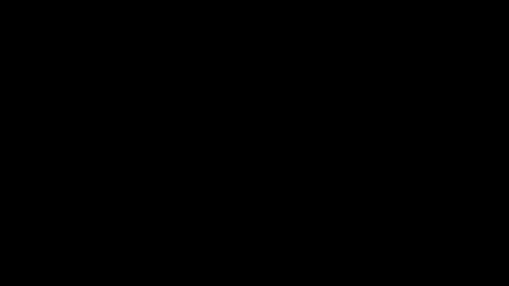
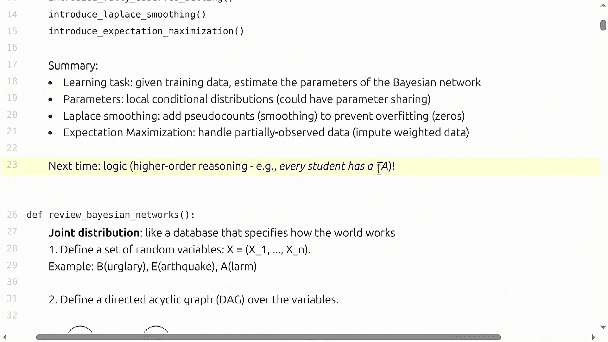

# Stanford CS221 ｜ Autumn 2025 p14 Stanford CS221 ｜ Autumn 2025 ｜ Lecture 14： Bayesian Networks and Learning [4d9V6 [BV1XuPrzwEes_p14]

So we're going to continue talking about Bayesian networks today， in particular。

 learning the parameters of Bayesian network。 So let's do a quick review of Bayesian networks。

 So remember。When we talk about Beijing networks， really it's a means to define a joint distribution over a set of variables。

 and you could think about it as a database that specifies facts you know about the world。

So in particular you define a set of random variables， for example， in the alarm example。

 you would have three random variables， B， E and E for burglary， earthquake and alarm。

Then you define a directed acyclic graph over these variables by connecting variables that you think are related to each other。

 in particular， one causing the other。And then for every node you define a local conditional distribution。

 Xi， given the parents of Xi。 so in particular， this is for every node， not every edge。

And in this example， you have probability of B given nothing， probability of E， given nothing。

 and probability of A given B and E， which are A's parents。Okay。

 so each probability local conditional distribution looks like a little table also can be represented as a tensor。

 which specifies for every possible value of。That this variable can take on， what is its probability？

And for a condition of when you have parents， it's for every possible assignment to its parents。

 a distribution over that value。So for example， here，4 B equals 1 and A B equals0。

 I have a distribution over a， which puts probability1 on a equals 1。Okay， so finally。

 you have these local conditional distributions。You multiply them together。

And you get the joint distribution over all your random variables。 So in our example。

 you multiply P of B times P of e times P of a given B and E， and that gives you the joint。Okay。

 and the joint distribution is this example looks like this， if you sum all of these numbers。

 you should get one。If you sum all of these numbers， you should not get necessarily one。Right。

Because this is a conditional distribution for every B and E。 If you sum A， you get one。

 and here this is a joint distribution。 If you sum over all the assignments， you get one。Okay。

 so that's a Bayesian network。 We've seen this twice already， So now。

Then we started talking about probabilistic inference so once you have a database what do you do with it。

 you query it and that is the task of probabilistic inference so you might ask questions such as what is the probability of a burglary given that the alarm went off and we did work on this and we tried three different algorithms we did exact inference where we directly worked with this probability table you select a equals1 so all the rows where a equals1。

 you marginalize out E which are the variables that don't appear in your query where you collapse rows that differ only in E。

And then you divide by probability of the evidence。 Okay， I'm not going to go through this again。

 but that's the way you do exact inference。Then we looked at two approximate randomized algorithms。

 rejection sampling， where you write a probabilistic program that spits out samples of B， E and A。

 according to this joint distribution。And then you just reject all the ones that don't satisfy a equals1。

 and you count the number of times B shows up to be 1 versus zero， and that's your estimate。

And we also looked at Gib sampling， where the idea is that you start out with a full assignment to B E and A。

 and then you iteratively change the value of each variable condition on the rest。

 so you fix E and A， you update B， you fix B and A。

 you update E and you don't update A because a is fixed B1。Okay， so。

Those are probabilistic inference algorithms that we cover。

 there's many more that you know if you take 228， I think you can get more depth in that。Okay。

 so then we talked about conditional independence， which is more about understanding the properties of this condition。

 this joint distribution。So the question is， are two variables A and B conditionally independent given another variable C？

And。I'm going to present this in a slightly different way today than what I did last time。

 Hopefully this will be a little bit clear。 and I'll go through some more examples as well。

 So the answer is yes。If and only if every path from A to B is blocked， presumably by nodes in C。

Okay， and a path is blocked if it contains one of the following patterns。

 So if you're trying to get through from here to here and you have X going to C going to Y for some variables X and Y。

 which could be A and B， but they could be other other variables。

 And so if you're conditioning on something here， then you can't get through， it's blocked。

Or if you have a C， that's。Pointing out to both X and Y。 If C is condition on， it's also blocked。

And then， finally。Whenever you have this V structure where the arrows are going into some variable Z。

 it's the opposite。So this is blocked。Unless。You condition on something unless you condition on Z or descendant of Z。

Okay。So。I'm going to go through some examples， so I'll come back to these this rule in a second。

 Okay， so last time we talked about two different examples。

 let me just write them on the board again just to make this clear so A and B and。And let's see。

 okay。嗯。So in this case， are A and B independent。Yes。Okay。A is independent of B。In particular。

 I don't condition on C， okay？And。And this appeals to rule three here because this is blocked。

If you're conditioning on something。But you're knocking this， sorry。

It's blocked if you're not conditioning on something。Okay。

So that means you can't get across if you're blocked， that means you're independent。Okay。

 and if you have a。C。And B。This is， is this and you let's say you condition on C。

 So I'm going to use shading to denote that I'm conditioning on a variable。

 So is A and B independent given C。Yes or no。Okay， no， right。And this is explaining away。

 remember the burglar earthquake and alarm， if you see the alarm that makes the burglars burglary and the earthquake correlated or anti correlated。

Okay， so that's one set of examples。 And the other set is if you have C。pointed to AM B， so here。

Are A and B independent？No。Okay。😊，And the way to see that is that there's a path here。Right， so。

If you look at the case2。This you're able to get through， which means that they're not independent。

 whereas if if you condition on C。Then these will be independent condition on C because this shade in no blocks。

Okay， so if you just remember this sort of these contrasting pairs。

 then I think you get basically 90% of what's happening。Lets let's play a game。 Okay。

 so I have A and B。And I'm going to add things to this network and you tell me if A and B are independent or not。

 Okay， so independent， maybe let's do this。 raise your hand if you think these are independent。Okay。

 good。So。Raise your hand if you think these are independent。Okay。Are they independent？

Are they independent？This is not independent anymore。

And remember the third rule here is that if you condition on this。

 they're definitely not independent， but it also holds for any descendant。Okay。Okay， how about this。

 so they're not independent。So let's undo that。Okay， so what about？This。So are they independent？U。

Okay， this's too easy。 I'm going to try to make this。嗯。Yeah。Okay， so I need to get rid of that。

 So are they independent。Okay， they should be independent， right？Okay。

Because if you ever see kind of these unobserved leaves， you kind of pretend they don't you know。

 exist。 and then there is no path over to B。Because D is blocking both this path and also this path。

Okay， and。嗯。And this is clearly not independent。And if you block it， it should be independent the。

Okay， I think hopefully people get the intuition。And the whole point of this is that given a Beijing network。

Generally， what you do with a Beijing network， you have a query， you condition on some variables。

 and then it allows you to see based on that evidence what is independent or not。

And this also has implications sometimes in when you're doing inference because independence is great。

 a great thing because that means things can be paralyzed， you can do。

 they don't interact and you can just like do each one independently so often when you condition on a variable and it makes a bunch of things independent and therefore you can do things separately just give you another fun example so often you have a Bayesian network where you have some let's say you some have some variable here and there's like x1 x2。

 these are your data points。😊，And。And let's say you're doing Gib sampling。So if you condition on。Z。

Actually， all of these are independent。Because Z blocks the path from any x to any other x。

 which means that you can sample all of these conditional on Z。Okay。All right。Okay。

 so that's all I'm going to say about conditional independence and probabilistic inference。

 and now we're going to move to the main course here。Which is。

Where did all these probabilities come from？Okay everything we've done。

 assume that the probabilities are just given to you or we write them down or we just pop them out of thin air。

But this is not a very principled way of doing things。

And so the natural thing to do is to try to learn these parameters from data。Okay， so first。

 we're going to consider the fully observed setting。And by that， I mean I'm given a set of examples。

Where each example is an assignment to all the variables。 So I see what， for every example。

 what all the variables are。 Later， I'll show you what happens when you only see a subset of the variables。

 which becomes much more complicated。And the output of learning is always the parameters of the model。

 in this case， what are the parameters here， it's the set of local conditional distributions。

 it's all the numbers in these probability tables。Okay。

 so what I'm going to do here is I'm going to walk through some very examples。

 and I'm just going to show you an algorithm to estimate the probabilities。

 and then I'm going to under explain what the general principle is。All right。

 so let's start with the world's simplest Bayesian network。And to tell a little bit of a story。

 so suppose you're trying to model movie ratings， so you have a single variable R。

 which represents the rating of a movie。Okay， so the rating can be either one， two， three， four。

 of five。And the Bayesian network is just depicted as one node， no edges。

 so world simplest Bayesian network。And the joint distribution is simply equal to this local conditional distribution of P ofR。

 I've used this subscript R because later we're going to see how we want to name each of the local conditional distributions。

So just to spell it out， the parameters of this Bayesian network is the probability of one。

 probability of two， probably three， probably4， probability of5 so there's five numbers that represent this distribution。

 there's five numbers Id estimate。If you're clever， you think， oh， okay。

 you only need four because once you know four of them。

 the last one is given because they have to sum to one， but let's not worry about that too much。Okay。

 so what does the training data look like？So here is an example of a training data for this。

variableable， so remember a full assignment to just one variable is I saw a movie and I rated one。

 saw another movie， it was rated three， saw another movie， it was rated four， and so on and so forth。

Okay。And so now， okay， so let me ask you this， how would you estimate the parameters？

Just intuitively， what would you do？Yeah， count all the normal observations and normalize okay great so that's exactly what we're going to do so if you're just kind following your nose this is this most sensible thing to do so what we're going to do is we're going to keep count of the number of times we saw a rating。

So for every x， I'm going to increment the rating and its count， so I saw three。

 so I'm going to update three， I get it one count， four， I get one count for four。

 I get another four， so I get four gets bumped up to two， so another four。

 four gets bumped up to three， and so on and so forth。Okay。And so now I have these counts。

And then I normalize these counts to get a distribution。Specifically。

 I sum the counts all together and I divide。Okay。So so that's it。

And this is this is basically the primitive that we're going to see and everything else is this is the theme and we're just going to do variations on that on that theme Okay。

 so this is very simple， it's just count and normalized you probably' even need to come to lecture to probably have a guests how to do this。

But now let's do something slightly more complicated and we have two variables。

 so let's say that you're modeling not just the rating of the movie but also the genre of the movie and the genre。

 let's say can be two values， either a drama or a comedy。

 so this is the two variable Bayesian network for this situation here。

The joint distribution is a probability。Of genre times， probably of ratingign given genre。

And here I'm using the subscripts， as you can see， because I have two distributions I have a。

The probability of a genre and the probability of rating， and so I'm just using GNR for those two。

Okay， so what does the training data look like？Every example has。A genre and a rating。 So。

 for example， this one says。There's a drama movie that was rated 5。

 There's a comedy that was rated one。Okay， so how do I estimate this invasion network？

It's also going to be count and normalize， but we have to do a little bit more bookkeeping now in particular。

 I'm going to count the number of times various genre show up and I'm also going to count the number of times a genre shows up with a particular rating。

Okay， so when I go through my training data now， I pick up a drama that that was rated for。

 I increment the count， okay， so I got one drama and I'm also going keep track of that for a drama I saw a movie that was rated for once。

Okay so another example I get drama4 and so I get another drama that's now drama4 is twice。

 I get a drama five， so now there's three dramas and five showss up once now I get a comedy and comedy I'm going to keep track of comedy was rated one。

 one time and then there's two comedies now and second comedy was rated five okay so this is just a counting。

And now。I get to normalize。 Okay， so here。This counts G is exactly the same as before。

We're just going to normalize these counts into this distribution。Okay。

 three over five and two over five。And then。What do I do with this？

So there's actually two distributions here to normalize。 One is when G is drama。So for G equal drama。

 I'm going to normalize this distribution。Two3 and one third， and then when G is comedy。

I'm going to take this distribution and normalize。Okay。And then so that's it。Okay。

 so to estimate a local conditional distribution。Just ignore the other value variables， right。

 So to estimate P of G。嗯。I don't care what the value of R is right so in particular for every local conditional distribution。

 I'm only potentially looking at a small part of the assignment that's relevant for my estimation。

Okay。And then other than that， it's just count and normal。

Now we're going to go to three variables here。So suppose we have a genre。A variable A。

 which means that did the movie win an award or not and the rating of the movie。

 okay so this is what the Bayesian Network looks like。And you might think， well， these V structures。

 I hopefully I haveve taught you to really be careful of them because they're a bit tricky。Here。

 I think for learning， it's actually going to be， pretty mundane。So here's a joint distribution。

 P of G， P of A， P of R given G， so there's three parameters or local conditional distributions。

 one for every variable。So here's the training data。

 so each example is a full assignment to all of the variables。

 so this one was a comedy that didn't win award， but somehow it got rated still very highly。Okay。

 so if we just try to pattern match and think about what we have to do。

 we have to count all the local assignments。So hopefully you see the pattern right for every local conditional distribution and mention some variables。

 I need to basically count the number of times that local that assignment occurs。

 So if I estimating P of G I need counts of G。If I measuring in P of A， I need counts of a。

 If I measure estimating probability of。Rating given G and。

 I need to count how many times GA and R show up together。Okay。

 so then then I just go through my training data。I pick up， you know， here's a driver。

 no award ready3， so an account update G。Update accounts for A。And then update the accounts for。For。

A given G or。And the way I've structured this is very suggestive of the probability that I'm going to estimate。

And in particular， I bundle the， the values of the parents together。So for every value of drama。

 sorry of the genre and whether I won an award or not。I have a value for the node itself。

 the rating and the count。Okay， so there's a few levels here。

 So most of the it's counter normalormalized， but with some bookkeeping， right。So in particular。

 the first level is which local conditional distribution are you looking at？

And then for each one of those， there's the values that you assign to the parent。

And the value assigned to the node itself。And then that maps to the count。ok。😊。

So we can go through this the rest of the training data set。We've get some counts。

So there's a account for G， counts for A and counts for this no triple。And then finally。

 you normalize so you take。Counts of G， you normalize it， as we've done before。 counts of A。

 you normalize it。And then for each of these。You normalize and you get a probability。Okay。

 so one thing to note is that the number of distributions that you're normalizing is equal to。

The number of。Parent value combinations you have。Okay。

 so here I have one distribution for drama and 0， another one for drama 1， comedy  zero， comedy 1。

Okay， and importantly， remember to condition all the parents simultaneously。

 the parents work as a unit， even though they look like individual nodes， I mean。

 they are individual nodes。And the edges look like these are sort of separate。

 but you should really think of these as a unit。So let's move on。嗯。

So now let's do the other type of examples， so inverted V structure。

So here the assume we have a genre variable， G， and then we have two users。

 R1 and R2 representing the ratings of the two users。

And so this is what the Bayesian network looks like。

 So I have probability of G times probably if R1 given G times probably of R2 given G。

And the parameters here are one local conditional variable for each node。Okay， so the training data。

 hopefully this should be， you know， fairly。You know， straightforward by now， so for example。

 this last one says I have a comedy and user one rated of five， user two rated of four。

So now it's count and normalizedize again。And remember， for every local conditional distribution。

 I need to count the number of these local configurations I've seen。So Ive counted for G。

 GR1 and GR2。And so I go through my training data。So I pick up drama， user one rated at four。

 user two rated 5， so I got it one drama， user ones count。

 I note that drama with a ratingdium four occurred once and for user two。

 drama with a rad of five occurred once。And then I go through all of these。 I'm going skip forward。

 and I get accounts for。User one。As well as user too。

And notice that the counts for G R1 only depend on G and R1。

 so they don't depend on the value of R2 and vice versa for counts are GR2。Okay。

 so now once you have these。Accounts， then you normalize。

 So I'm going to normalize this distribution， this distribution， this one， this one and this one。

 So there's five distributions。 And remember， every distribution is。

Given by the local conditional distribution and also the values of the parents。Okay。

 so here I normalize the genre as before and then for， let me just compute the answer and show you。嗯。

So then I compute essentially the same structure as the counts。

 except for that now these accounts are all normalized。

So hopefully you've seen enough examples that this should be。

 I should be able to give you any Bayesian network and you should be able to estimate。 Now。

 let's do something a little bit different。So， to motivate things。Now， imagine you have 1000 users。

And so if you're building this patient network。You might initially think well。

ll have a genre and have R1 through R 1000， and then I have the number of parameters is given by a local conditioning distribution for every user。

but one problem with that is that you might get。You know。

 if a user only watches one movie that's not going to give you a very good estimate。

 you won't be able to estimate that user very well。

 so the idea of prehiim parameter sharing is to estimate one distribution over rating given genre instead of 1000。

Okay， so I'm going to have the same Bayesian network as before。Gra， rating for user one。

 ratinging for user two。But what I'm going to do now is。

And this is where the indices become important。 I'm going to have probability of G。

 probability of R1 indexed by R and probability of R2 also indexed by R。

 So the parameters here are just P， G and PR。So remember before they were G andR1， PRR2。

 so it had two local conditional distributions， one for every R1 and R2， and now I only have one。

 even though the Bayesian network is the same structure。So。

So the picture you should have here is this idea parameter sharing。

And the idea is that you have this Bayesian network， and so far we haven't had to really。

 we just think about the probabilities as sort of in placeit， they're like in the edges or something。

But when we're doing learning， it matters where these parameters come from。

 and the real way to think about this is that you have these local conditional tables that are floating out and these tables are connected。

 you hook these tables up to nodes to power them to give them probabilistic life。

And so here what we're doing is that we have one table that's powering both of these nodes。

Whereas before we had two tables that was powering each of these nodes respectively。Okay。

 so that's the mental image you should have。Okay， so how does that change the estimation？

So we're going to present the same data as before。And now count the local assignments and remember。

 the counts that we keep track of are associated with the parameters。

 not the variables in the network。Okay，And the parameters here。

 we only have two parameters of two conditional distributions， P of G and P R given G。

 so we're just going to have two counts here。And when I go through my training data。

 I'm going to increment the， the count over genre。 So drama was seen once。 and now。For R1 and R2。

 I'm going to increment the same counts。As before， so before these ended up in completely different low code conditional distributions now。

 both drama4 and drama 5 end up in the same one。So it's almost like I have two examples。

 many examples for this given assignment here。good question。

 So how is this different from just combining these two nodes into the same variable。

 The idea here is that these are still two users。So when you collect data。

 I'm going to collect genre and the rating of user one and the rating of user2。Right。

 so here the data is exactly the same as before。 If you collapsed it into one node， you wouldn't。

I a place to write down both the rating of user one and user two。Yeah， so up until now。

 we've kind of thought about the variables in the network and the distributions as kind of one to one。

 but now for the first time we're。Explaining them。There's a question of when this makes sense to do and the suggestion is that when the two users have a similar probability distribution of R given G。

 then this makes sense to do if the two users are very different。

 then this is probably not a very helpful thing to do。Okay。

 so we estimated these counts and then we normalize and normalization is。You know。

 just taking these counts and dividing by the total。So now we instead of having five distributions。

 we have three， so one for G， one for R given G equals drama and R given G equals comedy。

So another intuition to help you out here is that imp probabilistic inference。

 which is what we did in the previous lecture， we're only reading from the local conditional distributions。

 right， we're not changing the local distributions we're just。

Reading them and using that to make inferences。So in that case。

 we don't care whether P of R1 given G and P of R2 or a G are the same distribution or not。

 they're just numbers。And but when you're learning the parameters。

 you can think about what we're doing as writing to the local conditional distributions。

 So it does matter in this case， whether the same or not。

 because when you're writing to something it's like in programming right when you pass an object by reference or by value it matters because if you're。

You know， passing by reference， then mutations here can cause mutations there。's a， it's a same idea。

Okay， and then to kind of the earlier point， when do you do parameter sharing。Um， so。

So there's a few considerations here， one is that when you share parameters。

 you have fewer parameters to work with， which means that you need fewer examples to learn。

RightIf you have 1000 users， each one with its own bespoke distribution。

 you need to see a lot of data from each user to be able to learn that。But on the other hand。

 having more parameters provides greater flexibility， if the user all very different。

 then you do want more parameters to be able to model what the the nuances of the user's preferences。

So which one you choose is a modeling decision， so on one hand you're training off are the two users similar。

 which is the point brought up earlier。Also， compared to how much data you have on user。

 if you have a lot of data， you can afford to kind of split and have many more parameters。

 but if you don't have very much data， you need to be very stingy with your parameters。Alright。

 so let's talk about another model where we're going to do parameter sharing。

 This is the final example before I give you the general case。So。

We talked briefly about the hiddenden Markov model on the first lecture with a products program just to remind people what it is。

In a hidden Markov model， you have two sequences of variables。 One is a set of hidden variables， H。

 H1 through H T， let's say， which might be the position of an object at time T。 and then。

The observation or evidence or emission， which ET， which you can think about as sensor reading at time T。

Okay，H Markov， so the reason why it's called hidden Markov is that this is kind of a Markov chain on the hidden states。

Hitden Markov models are used commonly in a bunch of places that used to be used in speech recognition and computational biology。

And they can be used for object tracking as well。So the idea here is that the joint distribution over all these nodes。

Is equal to。Remember， it's always the probability of。Each and no condition on its parents。

 so we have probability of H1。Probability of E1 given H1， probability of H2 given H1。

 probability of E2 given H2， H3 given H2， E3 given H3， okay？

And here there's three types of parameters， one is the starting distribution， P star。

 which is only used to give you the distribution over H1。And then there's a transition probability。

 P trans， and that gives us the distribution over one hidden state condition on the previous hidden state。

 and then we have a PE MI， which gives me a distribution over the sensor reading at a particular point in time given the corresponding hidden state。

Okay， so there's parameter sharing here because at every point in time I'm using the same distribution over a sensor reading。

 given it's the object position。And then， for every。Timesha， except for the first one。

 I'm using the same transition between the previous state and the current state。

So the way I would say it is that there is a H H， H。

Is given by a distribution condition on its parent。

But this distribution and this distribution are the same。Because of parameter sharing。

 I only have one P trans here。So this is the same distribution that I'm using twice here。

And similarly for the emission， this should be P emit， but this is the P emit， this is P emit。

 this is P emit。系。All right， so what does training data look like。

 So I'm going to assume a fully observable case where I actually do see the hidden state。

So here I have H1， E1， H2， H， E2， H3， E3， and that is some set of values。

 and then I get another sequence and it's another set of values。So to count。

I keep track of counts for every。Local conditional distribution， so here there's three of them。

 so I have three counts。And notice here that。You start to see the quite a big difference between these parameters and the variables because this is only three steps。

 but this could be 100 steps。It doesn't matter how many steps there are。

 but I still only have these three local conditional distributions。So then how do I count。

 I go through my training data the first sequence， I count you know H1 is associated with start。

 so I update okay so H1 is a0 that gets incremented by 1， emit H1 and e1 okay H1 and e1 those are0。

 and I add1 here， transition H1 to H2 H1 to H2 so that's a0 to a1。

 so for transition01 and I increment that count and so on and so forth。

And I do it for the second example， and then I get a bunch of counts。And then I normalize。

 so this might not be so interesting because these counts are so sparse but I normalize P start and then for each of these local conditional distributions I'm going to normalize them as well。

还不是。Okay。So this is the same as before。Once you。Have accounts。

Then normalized doesn't look at the structure of the Beijingesian network anymore。

 it's just looking at these local conditional distributions and normalizing each one。Okay。

 so let me move on。 Okay， so this is a general case。 So by now。

 we've seen gone all the way from 1 to 2 to 3 to 3，3 with parameter sharing HMs。

 So we've seen a lot of different examples。 And now I'm going to show you the general story for how to estimate Bayesian network。

 So it's exactly this the same。 But hopefully， I'm going。😊。

giveive you the code that makes it look a little bit more general。Okay so。

The way to think about this is that there is a set D。

 which is a set of types of local conditional distribution。 So， for example， for the HMM。

 D would be start， trans and emit。 You can think about D as a set of labels almost。Okay。

 so D in particular are not。Variables。It could be variables。

 but they're not in general variables because the parameters in the variables are。

Two separate things。And the parameters are simply a distribution for each element of D。

 So for example， in HMM， you have P start， P trans and PM。Okay。

So now the joint distribution is going to give by as follows。

 So for every so I have variables x1 x1 through X N。 So for every X I。

 I look at basically D I is going to be。The element of D。

That gives me tells me which local conditional distribution to use。

 So remember that picture where each node is powered by a local conditional distribution。

 DI tells me which one to go fetch。OkaySo so I'm indexing that distribution and now have XI given parents of XI。

 so this part is the same as before。And the way parameter sharing manifests here is that two different variables。

 Xi and let's say X3 and x7。Might have the same DI， so D3 equals D7。Al right。

 so let's go through estimation with this H MMM example again， so the same training data。

 each data point is a full assignment to all the variables。

 I'm going to define this network structure here， so this is my way of encoding the structure of the Bayesian network。

 as well as which parameters power each node。Okay， so I'm going to say for every variable。

I have the parameter name。 So this is the element in D。And also the list of parent variable names。

So H1 has no variable names， and it's given by P star。H2 has one。Parent， which is H1。

 and it's driven by Ptrans。It's three。Is given by driven by P trans from H2 and emit is E1 is driven by P emit and it depends on the parent H1。

 Okay， so this is basically a representation of the structure where in addition I tell you which parameters I'm using。

Okay。So now with this network structure， there's a very simple function that takes this network structure。

 takes the training data， and just gives me parameters。Okay。

 so let's walk through what that looks like。嗯。So ignore the pseudo count。

 I'm going to come back to this later， so I initialize count to nothing。

And then I'm going to loop over the training data。And for every variable。

 that's assigned a particular value。 So here， H1 is assigned 0。 I'm going to look up the。

 look up the network structure and tell me。Who are my parents？And what parameter am I using？Okay。

And once I do that。I can。Access the assignment， indexing the parent variables to get the value of the parents。

So here there's no parents， so the parents's value is also empty。And then I increment this counts。

So there's multiple layers here， right， one is the parameter name。The value of the parents。

And the value of the node。Mapping to the count。Okay。So let's go through E1 here， so E1 has value0。

 and its parameter value is parameter name is emit。The network structure tells me that。

And its parent is H1。So what I'm going to do is I'm going to say， okay， well， each one。

 let's look up that value。And that value of each one is zero here。So now I update P emitm。

So the count for emitm because that's the parameter name。Parents value。

 which is0 that was given by parents variables indexing into x。

 and then finally the node value because E1 is0。And I increment that by one。

So before I had counts underscore G， counts underscore R。 but now I'm just replacing this with one。

NestA dictionary， which is counts and I'm using the names as the first key。

 and that gives me basically this conditional distribution over nodes value given parents value。Okay。

And then I'm just going to skip ahead。 And at the end of the day， I have a set of counts。

So this should be the exact same as what we computed for HMM using a slightly more manual way。

 and then to normalize， I have theta is's going to denote all the probabilities here。

 I'm going to go through each parameter。Name。嗯。P， you know， start。Emit and trans。

 and then I'm going to go through every parent's value so remember this is a tuple for all the in general for all the parents。

 and then I'm just going to normalize。 so for every parameter name and parent value。

 I have a distribution that I'm normalizing。And that gives me this distribution。Okay。

 so there you have it， this is about 15 lines of code。

 and this estimates parameters in any arbitrary Bayesian network。So it's count and normalized。

 but you just have to do some bookkeeping and make sure you're counting the right thing。

So this assumes， you know， the network structure and it's fixed。

 There are methods where you can learn the structure as well。

 but we're not going to talk about that in this class。

So good question why is this called supervised learning So the idea here is that you're fully observing all the variables here。

 I should probably call this more accurately the fully observable setting。

The way to think about it is that this is in contrast with potentially unsupervised learning。

 which we're going to see an example of where some of the variables are unknown。So it would be。

 I guess you could think about this as fully supervised and later we'll see partially supervised。

Okay。So， let me talk about the。Principle here， So so far， we just had counter normalizedize。

Seems believable that this is a good thing to do。But it's more than that。

 It actually corresponds to exactly maximum likelihood estimation。 So what is maximum likelihood。

It's a very simple and powerful principle in statistics。In all of machine learning， really。

 And if you think about training a large language model， that's what you use。

 minimizing cross entropy， minimizing perplexity is exactly the same as maximum likelihood。

So the principal says。Find parameters that maximize the likelihood of the data。

So it's kind of transparently in the name in symbols。

 what this looks like is that if you have data of data set X。

And you have a model that defines a distribution over assignments。Given by some parameters。

 what I want to do is。Choose the parameters。That drives this likelihood as high as possible。Okay。

 so in other words， another way to say it is that。If I let's say I give you a set of parameters。

 so I specify the probability of G equals0 is G equals comedy is 0。

7 and I fill out the condition of distributions， so given that I can evaluate the likelihood of my data by just multiplying the probabilities over each data point。

And now， for every。Probability I have a number。 and so I can think about this as an optimization problem。

 I just want to find the conditional distribution probabilities that maximize that the likelihood of my data。

Another way to write this is if you take the log because log is monotonic。

 this is equivalent to sum of the log probabilities。And this is the negative cross entropy。So。

It turns out that the solution to this is in the fully observable case is just to count and normalize。

And this is really interesting here because normally you think about optimization is， oh dear。

 I need to like compute the gradient， I need to like take steps and what about the step size and what about convergence No。

 so in this particular instance。😊，You can actually， you don't need to optimization at all。

 there's a closed form solution which is called count andorize。

So let me try to show you briefly why this is by some quick examples。

So maximum likelihood with one variable here。 So we're going to go back to this really simple case。

 There's one variable R。 It's the ringing of the movie。And let's say I have training data are 1，5，5。

So if you write down the maximum likelihood objective， it's probability of one。

 probability five times probability of five。Okay。And theta here is going to be the probabilities of each of these ratings。

Now， the one thing is you have it has to be a probability， so all these have to sum to one。ok。

So I'm not going to go through the math formally， but the way you do this。

 you solve this optimization problem is that you introduce a Lagrange multiplier for the sum to one constraint。

 you set the gradient， compute the gradient， set it to zero ands solveved。

 and then you get that the probability is essentially equal to the number of times the particular rating occurred over the total number。

And intuitively， you can think this is， this makes sense because if you see。Five。

 you want to drive up like you want to increase the probability of you want to increase this number。

Right。You didn't see four， so probably four can be just zero。

You don't want to waste probability mass， but you see this one， you see this twice。

 so you probably want to place more probability on these。

That was a little bit of kind of sketchy intuition， but if you do the math， it kind of works out。

So now in the two variable case， let's say you have a genre and a rating。Then what happens？

 So if you look at the probability of your data， it's probability。

Drama times probability of four given drama。 So for the first example。

 probability of drama for the second example， probability of five given drama。

 probability of comedy and probability of five given comedy。 Okay。

 so there's six factors corresponding to these three examples。

Now the observation here is that you can rearrange these six factors into groups that actually have something to do with each other。

 so I'm going to put all the probability of genre together so I'm going to group this drama。

 drama comedy， I'm going to put it all together， and then I have probability of some rating given drama。

 so this guy and this guy go together and then finally this probability of five given comedy。Okay。

 and。You now notice that each of these。Is an independent optimization problem。

Because the probability of comedy。Ha can be very independently of the probability of five given。

呃drama。So this gives you three separate optimization problems， one for this group。

 one for this group and one for this group。And that corresponds to each solving each of them by the one variable case where you're just counting and normalizing。

So maximum likelihood means finding the parameters that maximize the likelihood of the data and count to normalize is a slow form solution。

 So this set of ideas is really nice and you can now sleep at night in comfort that all your intuitive counterormalizing thing is actually principled。

Okay， so let's move on now。Let's talk about Laplace smoothing。 Okay， so。

 so let's go back to the one variable case。 We have just one variable R。 and the training data is。

 I just see or one rating， and I see a four rating。Okay。

 so if I do supervised learning on this in a standard way， maximum likelihood。

 and we have fancied terminology to talk about it， then you would say that the probability of 1 is 0。

5， probability of 4 is 0。5。So you look at this and you say， okay， well。

 that means the probability of  two is 0， right。And do we really believe that if you got two points and you said one was four and one is one。

 you know， putting zero probability on two seems a little bit close minded。

And it's probably just because you don't have enough points。

Rather than actually it being true that there were no。

The probability of two is like two is impossible for some reason。

So this is in some sense like not a very good estimate if you have fewer samples and if you have a lot of samples。

 it's probably fine， but fewer samples， maximum likelihood is overfitting in some sense to this data。

So the solution here is Laplace smoothing。 and it's a very simple idea。

 The idea is that you just add some quantity smoothing factor or lambda to all the accounts。Okay。

So here's。What we're going to do。We're going to say lets just we're going to call these pseudo counts。

 let's just assume that let's pretend we saw this movie and we saw one， we saw it two。

 we saw it three， we saw four， we saw it five。We didn't actually see this data。

 but let's just pretend we saw this data。And now I'm just going to take these pseudo counts and add them when I do supervised learning。

 I'm just going to add them to my my count and get you know theta。 So remember before this was。

This was one and four， let me quickly do this on the board to make it a little bit clearer。

So the data is R1， R4。Data。And so。If I have one， two， three， four， five here。And I have count。

So what I'm doing here before I just had。Rating  one， rating 4。

 And then I would just normalize these two。 and it put zeros everywhere else。

 But now what I'm doing is I'm gonna to pretend I saw a。One。Everywhere。And now I normalize。

 So this is really a two。 So now this is 2 out of 7，1 out of 7，1 out of 7，2 out of 7，1 out of 7。

 So there's still more likely， more weight on the ones that I did see。

 But the other possibilities why I didn't see aren't exactly0， but they're just a smaller value。

 Okay， so and that's what exactly these probabilities are。Okay， so a few properties about smoothing。

 One is that。As smoothing。The ghost is zero， we get back to the original maximum likelihood。Okay。

 so if。If the student count are zero， then if you do maximum likelihood， sorry。

 if you do supervised learning， then you get back the original maximum likelihood estimates。嗯。

And if you smooth to really big， then。It'll get to a uniform distribution so if I do put 20 here as my pseudo counts。

 then my distribution is pretty much uniform。 there's still a little bit more weight on one and four。

 the ones I saw， but it's pretty uniform。But the thing is that no matter how what the pseudo accounts are。

 if you have more and more data， let's say you get 1000 examples of  four than。

Then eventually this will give you， this will get closer and closer to one。

 and all these will get closer to zero。Okay。😊，So generally when you use Laplace smoothing。

 probably Laplace smoothing with one or even 0。1 is right， you wouldn't use like 20 unless。Yeah。

 I don't think you would use 20。Okay， so summary， littleplace smoothing。

You just add the pseudo count to all the count， and then you count and you normalize。

So you can think about it as almost like an initialization and it prevents these zeroes or overfitting your probability estimates。

Alright， so let's do expectation maximization。 This is one of my favorite algorithms because it sort of is a bit magical。

😊，So so far， we've assumed that the training data consists of four assignments。

But now what happens if some of the variables are unobserved so remember the fully observed setting。

 let's just take this as an example I have G R1 and R2。

 and my training data therefore would be full assignments of G R1 R2。Okay， I have two examples，  one。

1 and 22。So network structure G R given R1 given G R2 given G， and baM， I get my estimate。

 and this kind of makes sense， I have one drama and one comedy。

 so the probabilities are split for R1， I have probability of rating one given drama is one。

 probably of rating two given comedy is one and so on and so forth。Okay。

 but in the partially observable setting， I still have the same model。But now my data is different。

 Now， I don't have a G anymore。Okay， so now what should we do？So， I can't count。

Because if I don't know the value of G， I can't count G。And everything actually depends on G。

 so I can't even estimate anything。So that's not good。

But now this is the idea of having principles is that you can always go back to your principal and think。

 what would maximum likelihood do？And Max likelihood says。Obviously， maximize the likelihood。And。

Of the observed data。 And here the data is whatever is observed。

 So let's try to maximize the likelihood of this。And then so what we have is。

Here's the probability of my full assignment。 In this case。

 its it's going to be probability of R1 equals R 1。 probably of R 2 equals R2。 Okay。

 so this is the max likely of the data。And because I have a Bayjaian network。

 I know that this is actually。Summation over G over probability of G equals G， right？

So the cool thing is that I don't see G。But I can just。marginalize it out。

And get the probability of R1 and R2。Okay， so what we have going on here is we have the observed variables。

 R1 and R2， we have unobserved variables， G， and we have the parameters。

And the challenging thing is that we don't know either we only see R112。

 we don't know what G and theta is are。So what E M is going to do is it's a way to maximize this likelihood。

 I'm not going to formally show this， but you know。

 you have to trust me on that is it's sort of a chicken egg problem。 If I knew the parameters。せータ？

So I know the probabilities， then I can actually compute the distribution over the unobserved variables。

 G， given the observed variables， given the parameters。And then if I know the unobserved variables。

G here I can then I'm back to the fully observable case。

 and I can just count and normalize and estimate the parameters。

So whenever you have a chicken egg problem？What you typically do is you just bootsrap up， right。

 You just initialize the parameters randomly， and then you're going to iterate。

 And the E algorithm consists of two steps， the E step。

Where you guess what the unobserved variables are， and by guessing， I mean more formally。

 computing the distribution over all possible values that the hidden variable could take on， P ofG。

And that is going to give me a set of weighted。Full assignments。Okay。

 I'm going to show you an example， so hopefully that'll make more sense。 So given the ETP。

 the E output of the E step is essentially stuff that looks like fully observable data。

And then in M step， I'm just going to count and normalize using these weighted full assignments。Okay。

 so let's walk through an example here。 So expectation maximization。

 This is not a general function It applies to just simply this model here。

 but hopefully it'll be illustrative。嗯。Okay， so I first initialized the parameters。

So the probability of G， probably of R。Given值。嗯。Here I actually am doing parameter sharing here。So。

Now I'm going to iterate。Okay， so this is my current guess。And in the E step。

 I'm going go through all my data here。So my first data point was 11， second data point is22 okay。

Okay， so I'm basically going to now see compute。The probability。

 I'm trying to guess what the value of G is。 I see 1，1。

So let me just kind of write this out a bit more。Okay， so I have G， I have R1， R2。Okay， and。

I have one，1 here， I have two2 here， but I don't know what the value of g is。 Okay。

 so what I'm going to do is I'm going to guess zero， I'm also going to guess1。

And I'm essentially going to replicate this once for every possible value of G。

And then I'm going to give。Each of these a weight and the weight of this is going to give be given by my current guess of how likely this zero is。

 So in particular the weight。Here is going to be probability of g equals0， given r1 equals 1。

 r2 equals。1， okay， and this is given G equals1， given R of 1 equals1 and R2 equals1。

 This is probability of G equals 0， given。R1 equals2， R2 equals 2。

 and this is the probability of G equals1， given R1 equals2， R2 equals 2。

 Okay so what I'm doing is I'm using my model to essentially assess how likely zero and ones are for every data point where I don't see the value of G。

And I think by0 and1， I meant comedy and drama。嗯。Okay。

 so what I do here is to compute now I have to compute these values。So what I do is。

 while that is simply the joint distribution divided by normalized。By the marginal。

The probability of evidence。 Okay， And to compute the joint。

 I have the probability of G times the probability of R 1 given G times the probability of R 2 given G。

Okay， so that gives me drama。 And then for comedy， I get some number。 These。

 This is all based on these sort of parameters here。 And then I normalize。I normalize。

 So basically here I have， this is my guess based on these parameters that the first data point 1，1。

Is 0。69 and 0。3。Okay， so let me actually just make this comedy and drama。So for a consistency。

Comedy drama， comedy drama。 Okay， so what I note is that for this first example。

 I have probability of drama。 Comedy is 0。3。 probabilityb of drama is0。 you know 69。Okay。And then。

Then what I'm doing is I'm collecting this weighted data set。

 So what Im this is what I have on the board。 So I have this data point where I didn't see G。

 but I'm just guessing a value of G and I associate with this weight for comedy。

 I associate with this weight。Okay， so now I go through the second example。嗯。And similarly。

 I'm going to compute。A distribution。And I'm going to normalize。

 and this one has higher weight to comedy than drama， and I add two additional examples here。

So I have one， one drama， one one comedy，22 drama， 22 comedy。Right， and so the values here are。

The probabilities are the weights are 0。69， 0。3， 0。3。69， so let me fill this out。0。69 and this is 0。

3。Oop sorry if you can't see that。Okay， but whatever is on the board is just in this picture here。

Okay， so now I have this weighted data set。 Now I do the M step。

And the M step is should be familiar now。 the the only thing we do is instead of adding one。

 we add the weight。So before everything， every data point counted once。

 now every data point counts the number of times according to its weight。Okay， and then I normalize。

And。This is a little bit。Okay， so I normalize and now I have an updated set of probabilities。

Instead of 0。6 and 0。4， I have now 0。69 and 0。3。OkayAnd if I iterate this。You know。

 let's say iterate this。 You'll see that the probabilities start changing， iterating。

 and eventually they get to。Herps。So iteration four。

 they get to something pretty close to one and zero。Okay。So。It's a few notes。

 one is that the model doesn't see the hidden variable。

 so it's kind of trying to set the hidden variables to drive up the probability of the data。

And in this example， the best way I see 11 and I22。

So it's sort of going to make an assumption that dramas are one， always going to give one。

 and comedies are always going to give two。Which is actually the same as a supervised data that we had。

嗯。So here's another example。 So this is where I have a bunch of ones and I have a bunch of two。

2s and some 2，1 and 1，2。 And in this case， E gives me these probabilities。 So it's about。

there's slightly more probability of drama and slightly less comedy。

 and then the probability of drama equals 1 is 0。9 and comedy is 0。75。Okay。

 so these are probably are not quite as sharp as  one and zero because now we have more heterogeneous assignments。

 not like all 1，1 and all22。Some notes about EM is that it were guaranteed to increase the likelihood each iteration in conventional local maximum。

 this is not a global maximum， so EM can' get stock in local optimum。

And you need to initialize with non uniform distributions to brickymetries， that's why I put 0。

4 and 0。6 instead of 0。5 and 0。5。And then the other caveat is that you can only recover the hidden variable up to the permutation of the labels。

 which means that in this case， if you switch the label's drama and comedy。

 you get the same likelihood of the data because these are just labels。

So this is good for clustering where the labels don't really have necessarily semantic meaning。Okay。

 so wrapping up。The learning task here that we've talked about is you're given training data and you want to estimate the parameters of the Bayesian network。

 the parameters are the local conditional distributions。

 but bear in mind that with parameter sharing the local condition。

 there could be fewer local conditional distributions than number of variables in your Bayesian network。

If you're worried about overfitting， you should use lowpl smoothing。

 which is basically adding pseudo counts。And then finally， we talked about expectation maximization。

 which allows us to handle partially observed data。

 and hopefully the intuition is clear where if I don't see a variable。

 I'm going to try to guess what that variable is。With and weight that guess by the probability of that variable given the observed variables。

 and now have fully labeled data that's weighted and I do counterormalize like I do in a supervised setting and I iterate。

Okay， that's all I'm going to say for Bayesian networks。

 Next time we're going to do something quite different。 we're going to start talking about logic。

 which is going to enable us higher order reasoning。

 So Bayesian modeling is about a certain type of probabilistic reasoning。

 but higher order reasoning will allow us to use quantifiers like you know every student has a TA so the word is something that requires a bit more sophistication。

