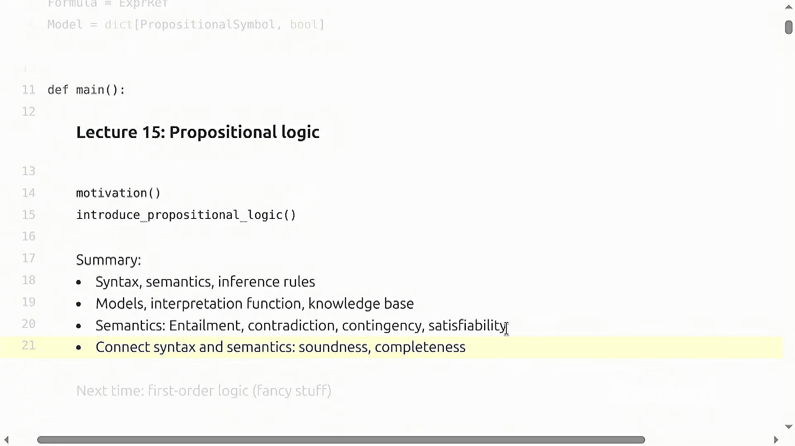
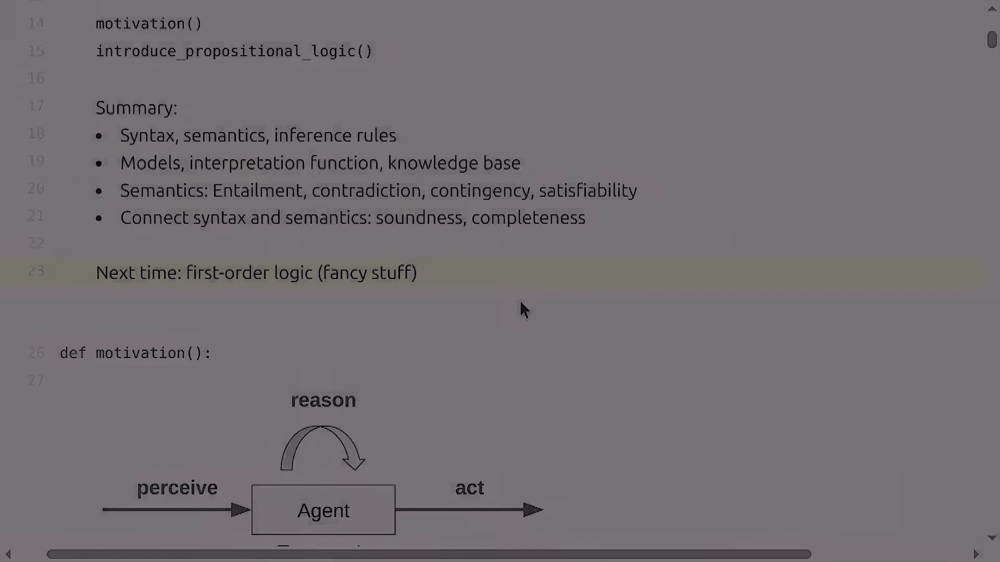

# Stanford CS221 ｜ Autumn 2025 p15 Stanford CS221 ｜ Autumn 2025 ｜ Lecture 15： Logic I [Q7V13XriJEc] [BV1XuPrzwEes_p15]

So we're going do logic today which is going to be almost the last topic before the AI society section。

 so the last technical topic of this course this is going to be a bit different I mean I think most of you probably have encountered logic and in your lives and you probably do engage in logical thinking。

 but this is going to be a bit of a different perspective on logic and hopefully it will be a refreshing perspective。

So remember the motivation of this class， we have built agents that can perceive， act。

 reason and learn， and for the last world we've been really focused on reasoning。

We've seen a lot of different ways starting with search。

 MDPs and games and then looking at Bay networks which we looked at last time to do probabilistic reasoning now we're going to focus on logical reasoning。

 propositional logic and firstso logic and in some ways logical reasoning is more primitive than probabilistic reasoning because it doesn't encounter uncertainty。

 but we'll see that that simplification allows us to do fancier things。

So I'll start with a simple example。So if a plus10 equals sorry a plus b equals 10 and a minus b equals4。

 what is a？So someone shout at the answer。7even， okay， great。 That's correct。 So， of course。

 what is the point of this is how did you solve this。

probably you didn't go and you check all possible solutions and B so you're not doing search， right。

 which is the other way we thought about reasoning is we just search through possibilities and then find the optimal thing。

Instead you probably did algebra， you probably took these two equations， you added them。

 you get 2a equals 14， and then you divide by 2 on both sides right so this is algebra。

 you all learned it since you're like babies or something right and so this is an example of logical or in symbolic reasoning and as you can see it's very powerful。

So we were able to。Find a solution to this problem。

 which has infinite number of possible possibilities， just you can do it in your head。Okay。

 so we'll see what this is an instance of something more general that we'll talk about here。

So on a historical note， so logic as I mentioned in the first lecture of class was a dominant paradigm in AI before the 1990s so logic started out when John McCarthy coined a term AI that's what logic what people had in their heads what AI was and we saw multiple problems with logic it's deterministic so it doesn't unhandle uncertainty something is either true or false。

 but the real world isn't so simple and it also didn't leverage data。

 so the amount of information you can put into geological system was limited so we had machine learning that address this so then you might wonder why are we studying this。

 especially towards the end， like we should be culminating into something like language models or something like that but I'll try to remark that logic provides this one strength which I think is sort of irreplaceable and that's expressivity in a compact way。

Okay， so the way to think about logic is as a language。

This might sound a little bit strange and the goals of the language is that you can represent knowledge about the world。

 think about textbooks as representing knowledge in the world。

 and then you can reason with that knowledge so think about like thinking in your head。

 you're using some sort of language of thought there。

So you might wonder why not you just use natural language okay， so why bother with logic。

 now we have language models， we just use natural language。

So so here's some examples from natural language and you can。

 you can do inferences directly in natural logics， Im sorry natural language。

 so a dime is better than a nick， a nickel is better than a penny。

 therefore a dime is better than a penny。Okay， so very sound logic。

 Everyone agrees is this this could。 Okay， so what about example，2， A penny is better than nothing。

 Nothing is better than world peace。And then therefore， a penny is better than world peace。Okay。

 sounds good to me。So as you can see natural language is kind of slippery right like you can't just like substitute words and hope for the best I'll let you think about why this doesn't work the way it is。

So then we think about what other languages do we have。

 so we have natural languages which are informal those are things like English or German。

 you guys are already familiar with formal languages like Python and C+ what we'll study today is logical languages which are also formal we'll look at things like first order logic in the next lecture and also description logic which we won' well we won't talk about description logic。

 but I use that as example to show that there's not one logic logic is just like natural language there's a whole set of logics each with its own language and they express different things and is useful for different purposes。

Okay， so how do you think about a logic， So there's three ingredients， which I'll talk to you。

 So this shouldn't makes sense right now， but hopefully by the end of the course or end of this class。

 it will make a lot of sense。 Okay， so when we define a logic， you first have to。

 think about the syntax。 So that defines a set of possible formulas。

These are formulas or statements that you make in a logic， think about them as sentences。

And then semantic is about what is the meaning of these formulas？

And the inference rules allows you to define new formulas given previous formulas。

 and that has something to do with what these sentences mean。Okay， so you know。

 I think the important thing is that there's three things， syntax， semantics and inference rules。

 and I'm going to talk about each of them and what they're about。Okay。

 so one important distinction is syntax versus semantics Okay so syntax means water valid expressions in the language and semantics is what is the meaning of those expressions。

So to illustrate why these two things are different。

 so you might have two expressions with a different syntax but the same semantics。

 right 2 plus3 and 3 plus 2 are different syntax。But they have the same semantics。

 they both represent the number five。You can also have same syntax， different semantics。

 so you might have three divide by  two。And that under Python 2。7， semantics is one。

 and under Python 3 semantics， this is 1。5。ok。So， this is a cause of many probably bugs as people are trying to port their code。

But there's the point of this is that。This is when you sit right 3。3 divide by 2。What does it mean。

And the meaning depends on what the semantics are。 There's something that's not contained in a string 3 divide by 2 that gives the sentence some life。

 and I'm going to make that all precise a little bit later。Okay so a quick summary here。

 logic enables very expressive representation and reasoning of knowledge。

 you should think about logic as a language and it's defined by syntax semantics and inference roles。

So now what we're going to do is talk about propositional logic for the remainder of this class。

 and next time we're going to talk about first order logic。

So we're going to introduce propositional logic， this is the basically the simplest form。

of logic you can think about and really where you're going to use this as a example to develop the general concepts such as entailment and soundness and what these means So probably some of you have heard these terms。

 but they have a very， very precise meaning in logic。And more important。

 I think than propositional logic， because it's so sort of basic is these more general concepts。Okay。

 so here's our picture here， what we're going to do is we're going to talk about syntax and then we're going to talk about semantics as it relates to syntax。

 and then we're going to talk about inference rules as it relates to semantics。Okay。

 so that's the plan so remember the question of syntax is what are the valid formulas so to the syntax of propositional logic。

 all I have to do is tell you what are valid formulas。So。

In we start out with defining a bunch of propositional symbols。

 These are also known as atomic formulas。These include just any identifier think about it as a variable name。

 you could have P， Q， rain， wet， these are just names and these are just symbols right I'm deliberately not telling you what they mean until later。

Okay， so。Now I'm going to introduce a bunch of logical connectives and or not implies and bi directional implication。

So the way it works is that if you have F and G be any propositional formulas， for example。

 F equals rain and G equals wet， then the following are also propositional formulas。

So you can take any formula and you can negate it。You can take any two formulas and you can put an an between them。

 take any two formulas， you can put an or between them。

 you can take any two formulas and put an implication arrow between them。

 and you can take any two formulas and you can put direction bidirectional implication or equivalentvalence between them。

Okay， and here Im writing them， this is a mathematical way of writing them and I'm also instantiing them in code。

and nothing else is a formula。So the set of formulas is defined recursively。

And so this gives a rise to formulas which are atomic formulas such as just P。

 or you can do not P or not P or Q or P implies Q or not P these are all examples of formulas。

These are not formulas at least in propositional logic。

 this one there's no connective between them so that's not valid plus is not a valid connective。

 so you can't do that and then there's no parent disease and propositional logic so these could be formulas in other logics but not improbaal logic。

Okay， so now we know what the set of valid formulas are。Now， what do all these formulas mean？

So now let's talk about semantics。So it's hard not to look at these formulas and have some prior over what they possibly could mean because you're probably used to thinking about like an and or。

 but I could have easily called these like F and bar。These are just symbols。

So don't have any semantics。To in to semantics， I'm going to do this fairly carefully。

 there's a lot of concepts to introduce， so this lecture is going to be a lot of terms each term isn't complicated but it's just you you just have to remember them。

Okay， so the first idea is a concept of a model， and this is a model in the logical sense。

 it's not to be confused with a machine learning model。

 and this is just like unfortunately a clash of terminology here。

And the idea in logic is that a model represents a state of the world。U。So I also use the term W。

 so you can think any time you see model， you can think about world as well。

So a model W in Proal logic is an assignment of truth values to propositional symbols。Okay。

 so remember， propositional symbols are these just atomic formula that are just named variables essentially。

And then so in this case， there are two to third possible models。

 So you can say A is false as B is false。 C is false。 You could say A is false as B as false。

 C is true and so on and so forth。 Okay， so each of these。

E things is an assignment of truth values to these propositional symbols。

 and that forms a particular model。And the way to think about this is a model is a state of the world。

And the all possible models are all possible ways the world could be。

Okay now I'm going to connect a formula， which is an idea in syntax to a model which is idea and semantics。

 and this is I'm going to use this interpretation function I and it takes a formula and a model W。

And return is either true， whether。The model satisfies the formula or false if it doesn't。

And then the picture you should have in your head is this is a space of all models。

And here's a formula that's sitting outside， so remember that the formula is in syntax world and the model is in semantics world and an interpretation function takes an F and a W and returns whether the formula is true。

 essentially。Okay， so let me work through an example here。Okay。

 so suppose you have three propositional symbols and you have this formula。

So not A and B is equal to C。Okay。And I have this particular world， A is true， B is true， C is false。

Okay， so an interpretation formula is going to recursively define。What this。

This you know the result here and the way to think about is as a tree。

So if I evaluate the interpretation function of that formula， this formula and the world or model。

 then I'm going to break this down into these two subex expressions so remember formulas are built up recursively so now you can take them apart recursively as well。

 so I have not A or and B and that breaks down into not A and B and this breaks down further into A。

And at the bottom， interpretation of a against W is I'm just going to look up W sub a。

 and that gives me true or one。 Okay， And then so if I have not of anything。

 then I just negate whatever the interpretation of this thing is。 So I negate one that becomes 0。

Here I'm adding two things， when I ever add two things。

 I take the value here0 and1 and add them and I get zero。And over here， C is a base case。

 so I'm going to look up C that gives me zero， and this returns basically whether the interpretation of this subexpression is equal to interpretation of this subexpression and zero does equal zero。

 so that gives me one or true。Okay。So I can， I've implemented this in code so we can just see how that looks like。

 So I takes a formula in the world and。This is a base case， which okay， so let's see here。

 So have this formula。 So it's say something equals something。 And here's the world。

 So it's just a lot of cases。 So is equal。Okay， so that means I'm going to call the interpretation function on G and H。

And G and H are just the sub expressions here， So G is this thing and H is this thing。Okay。

 so now I recurse on the G and now I have an not a B。

 so I'm down here now and then here this is an and， so I recurse again on not a， so I'm here now。

And here I have one argument， so it's a not， I recurse on a。So this is the base case。

 the result is true because W sub F is true。And then I go back up and then I recurse。

 and then at the end of the day， I get true。Okay， so in short。

 the interpretation function takes a formula。Which is this。

Tree structured object and a possible world， and it returns it's defined recursively。

Using these rules of what the connects mean。Okay， so for any formula however complicated。

 I can put in the interpretation function and against any world and I can get a boing。

So this is the recursive function and it's basically looking at all the other cases。

 so if this is an and or implies equal， it just recurs on the sub expressionpressions and then applies the corresponding operation。

So this might seem a little bit。Kin of strange if you're not used to languages and compilers。

 but I think it becomes less trivial， for example， you can define any language you want with different symbols and as long as you define an interpretation language。

 it's a interpretation function， you have a logic to work with。Okay。

 so recall the interpretation function。Takes a formula， which is like wet or rain。And a model。

And returns the truth value。Okay， so the way we should。

Understand the semantics of a formula is actually via this other function， which I'm going to find。

 which is called the models of a formula。 So M of F。

It is going to be the models W such that interpretation of F andW is true。

So the picture you should have in your head is that before the interpretation function gives us for every point here。

An assessment of whether it's a true or false， according to this function or formula F。

And so if I just simply take all the worlds here where the interpretation function returns true。

 I can call that a set MFF。Okay， so here， let me walk through an example。

So I'm going to have two propositional symbols， rain and what？And here's a formula。

 which is rain or wet。Okay， and so what I'm going to do is call camp models of F1。

 And here I'm just passing in the list of symbols so it knows how to enumerate the models。

And what this is going to do。Is。We're going to just iterate over all possible worlds。

 so it could be rain fall wet false。 I'm going to call the interpretation function on that world and this one doesn't pass。

 here's rain fall wet true， this one passes， so I'm going to add it two models。I'm going to consider。

Rin true what false， this one passes， I'm going to add two models and Tru true also passes。

So I'm going to add it to models。睇。So， here。The models， M of F1。Its the set of。Models or worlds。

Where the interpretation function returns true。Okay， and intuitively， you can see here。

 here's all the possible。States of the world， it could be wet， but not raining， it could be raining。

 but not wet， or it could be both。And those corresponds。

 states of the world that this formula represents。Okay so here's another one。

 so if you have F2 equals rain and wet and you try getting the models。

 then it's only this single10 model that survives。So here you see that a formula which is rather a small compactly represents a potentially a very large set of models。

 so I only have two propositional symbols here， so there's only four models total。

 but if you had 100 propositional symbols， there would be two to 100 different models and you might have a very simple propositional formula that represents maybe know trillions of different。

Of models。Okay， so to summarize。Remember， a formula is just a piece of syntax。

 It has some ans and has some ors， It has some propositional symbols in it。

We define interpretation function， which is our kind of core the way we define start defining semantics。

 but the thing we're going to use from now on is this M function。

And this has a very intuitive way to think about it。 Think of F as a sentence。

 So when I say rain or wet， it's like saying the sentence， it is rainy or wet。

And the semantics of that sentence is the set of all possible worlds we could be in。

 such that that sentence is true。Okay。So if I say it is rain or what， then。

We could be in one of these situations。If I say it's rainy and wet。

 we could only be in this situation。Alright， so now we know what models of a formula are。

Let's talk about the idea of a knowledge base。Okay， so this is just， in some sense。

 syntactic sugar in some sense。 and a knowledge base is just a set of formulas。

And we should think about it as a knowledge base as a set of facts or formulas that you add to over time。

So it's our list of things that we know to be true about the world。And again。

 this is knowledge base is just a piece of syntax。 it's just the list of facts。

 And what are the semantics here？The semantics MKB are all the models that satisfy every formula in KB。

And this， these are all the possible worlds we could be in given our knowledge knowledge base Okay。

 so let me do an example here， so we rain and wet。So if the knowledge base contains two formulas。

 rain。And rain implies wet。Okay， so that corresponded， we know it's raining。

 but we also know this information that whenever it rains， it's wet outside。So。

The way we construct the models of K B is。We just take one way to do it is take the intersection of the all the models of its formula。

 So you take M of RA。Okay， so this gives us it's rainy。But， you know， it could be wet or not wet。

And then we also look at the models of rain implies wet。So this one's a little bit more interesting。

 so you see that it could be raining and sorry， not raining or not wet， not raining and wet。

 or it could be raining and wet。So only one that's missing is which one？It's raining。

 and it's not wet， right， That's not consistent with。It if it's rainy， then it's wet。

Okay so notice that this doesn't say tell us whether it's raining or not。

 we have both raining as false when raining goes true， but it does say whenever it's raining。

 it has to be wet， it can't be the case that it's not wet。

So that's the way in which the models here represent this formula's restriction。

So now when you intersect them。Whathich you take on， then you get just rain。

 equal goes true and white equals true。And this sort of makes sense if it's raining and also if whenever it's raining。

 it's wet then it has to be both rainy and wet， which is exactly what we have here。Okay。

 another way you can think about this is a knowledge base is equivalent to semantically to the conjunction of its formulas。

 which means that you can just。Take a knowledge base。Which is rain and rain implies whatt。

 And we just put an and between all the formulas。So that gives us this formula。

 rain and rain implies wet。And if you call get models on that， you also get the same thing。

So you can either take the models of the individual formulas and you can intersect the models。

 or you can just like take the conjunction and you just get the models of that single massive formula。

So we'll go back and forth between this intuition of a knowledge basis a set of facts or as a single formula representing the conjunction of those facts。

So now I'm going to introduce some other terminology here。

So the way you should think about it is I have a knowledge base here。

 and I want to either ask questions or add to that knowledge base。

So as I now add more things into this knowledge base， this knowledge base in some sense grows， right？

I have five facts， I add another fact， I got six facts。Okay， so the KB union。

 this new formula that I added， is a superet of KB。But notice what it does to the set of models。

The set of models shrink。 So as I get more of facts。

I am intersecting that restriction onto my previous MFKB。And therefore。

 that set is going to shrink over time。And this makes sense because at any point in time。

 M of KB is the set of all possible worlds we could be in。 So the larger it is。

 the more uncertain we are as we add more facts， the more certain we become because we can only we rule out things that don't kind of match our。

Our knowledge。So， you can think about。KB is representing a set of constraints on the set of possible worlds。

 and the more constraints you have， the more constrained your space and the smaller your set of models。

OkaySo as we gain more knowledge， we narrow down the possible worlds we might be in。Okay。

 with that in mind。Let's okay， we're going to go back to our example。 there's rain wet。

 and I'm just going to define this helper function that takes the knowledge base。

 converts it into a single formula and gets the models out。

 So I'm just going to call that M to match the mathematical notation。So the key question now is。

 how much does MFKB shrink？Okay， so we know it can't grow。

So how much does it shrink and depending on how much it shrinks。

 theres sort of special meaning to what happens。So there's a notion called entailment。Okay， and。

The idea behind entailment is that it doesn't shrink。 So K B。

 the knowledge base entails F also written K B with this， this particular notation F。

If and only if the set of models of the augmented knowledge base is exactly the same as the set of models of the original knowledge base。

Okay， so prely it looks like this， you have the set of models of the KB。

 models of the formula might be something larger， but when you intersect it with the knowledge base。

 models of the knowledge base， you get exactly the same thing。Okay。

 so the intuition is that F NAs no more information。

 it's not restricting your your set Information means that you've sort of restricted your MFKB。Okay。

 so let's walk through this example。 So I have this knowledge base rain。And rain implies wet。

That's the knowledge base。And then the formula is rain。Okay。

So I compute the models of the original knowledge base， so that's of KB。

And remember we did this before， it's just rain true， what true。

 And then if I get the new models of the new knowledge base， which is these two combined。

 then I get exactly the same thing， which means that。KB entails F。In other words。

 no matter what state of the world we are in， that's consistent with the knowledge base。

F is also true。So this is the entailment symbol。So KB entails F， whenever you see this。

 you should just read KB entails F。Okay， so that's entailment， adding new more， no information。

 the models don't change。And now in the other end of this spectrum， we have contradiction。

So the contradiction says KB contradicts F if the new set of models with Kb and F is the empty set。

And thentuition here is that F is just not compatible with KB。

 it's you know the set of models always shrink and this is a maximum is shrink， it syncs， okay。

 there's no solutions， there's no possible worlds in which F and KB are true。

 so the picture you should have in your head， the intersection between these two sets is empty。Okay。

 so here is a concrete example， suppose the knowledge base says it's rainy and it's wet。

And I have a formula that says， it's not w。Okay， so let's go through this example。 So the old models。

Our our rain true， what， true， and the new models is the empty set here。

Because this formula is going to be only contained models where wet is false。Okay。

 so it is the case that this knowledge base and contradicts this formula。Okay， so now。

There's a third case， which is everything else， and this is called contingency and in some sense this is the more I guess interesting case。

 at least when you're adding information， so ethics contingent with respect to knowledge base if the new set of models。

 the amount of which you've shrunk， you neither hit the empty set。

 nor are you at the original set of models。Okay， so the intuition is that it shrinks the set of models。

 but not completely。So the idea and pictures you're going to have your head is this is a set of models by the knowledge base。

 here's MFF， and it's sort of shrunk， if you look at the intersection， it's shrunk to this set。

So it's not the empty set， there's something here， and it's also not the original set。

So you've learned that we are here instead of somewhere over here。Okay。

 so let's go through this example here。 So suppose the knowledge base just says it's raining。

 and I come along and say formula equals whatt。Then the old set of models is it's raining。

 what could be true or false， new set of models is just rain and wet。

And we can check that new metal models is not empty， nor is it the same as the old models。

So that's called contingents。So there's also just as an aside。

 a relationship between entailment and contradiction。

So Kb contradicting F is the same as Kb entailing not F。Okay， so the way you could see this is that。

This， if let's say， okay， so KB entails F。Okay， so what is not F， what is not F。

 the models of not F are everything outside this pink ellipse。

OkaySo if the models of not f don't intersect models of KB。

 so models of KB contradicts sorry KB contradicts not F。Whenever KB entails F。So to summarize。

The key thing to do is you have a knowledge base。And the semans of the knowledge base is MFKB。

 of models set of possible worlds we could be in given our knowledge that we have。

You're going to consider adding a formula。And that will shrink the set of possible worlds into this new set。

And then based on how much that shrinks， we can call that one of three things。If it's the same。

 no shrink at all。 That's called entailment。If it shrinks to the empty set。

 that's called contradiction。 and if it's anything in between， it's called contingency。

Right so the question is， if there's a contradiction who's at fault。

 the knowledge base or F this logic doesn't is not opinionated about that。

 and there's no notion of who's right or wrong， This is just like the set of models it could be either more。

Allright， so let's we've built out quite a bit right so we started with defining model where then we define interpretation function that connects formulas in the syntax to models。

 then we said we should really think about a formula as a set of models。

 possible worlds and then we define a knowledge base which is a set of formulas and then we thought about adding new formulas and seeing the relationship between the added and a not added and that's entailment contradiction and contingency of the three options。

 now we're going to use all of that building up all that machinery to actually do something interesting with a knowledge base。

And that is to implement these two operations， ask and tell。Okay， so let's go through our example。

 we have rain and wet， and suppose we have this knowledge space。You know what can we do with it。

 this is the same helper function as before for getting the knowledge of the knowledge base。

We can ask yes or no questions of the knowledge base。

 and we're going to denote that as ask a formula。And we can also tell the knowledge is new statements。

 so tell a formula。Okay。And each of these is going to return a response。

 and that response is going to。Determine the relationship between is based on the relationship between KB and F。

Okay， so let's begin with ask now。So we only support yes or no questions in propositional logic because propositions are Boolean。

 yes or no。And there's three possibilities， yes now what I don't know， okay。

So suppose we have the knowledge based brain what？Rain and wet， and I ask。Is it rainy orbit？Okay。

 so I know it's raining and it's also I know that it's wet。

 So I ask the question of the knowledge base， is it raining or wet？

So the way you can answer this in general， so this function works for any knowledge base in any formula。

Is that you compute a set of old models， you compute a set of new models with K B and F。

 and then you see。아 there 있고？Yes。So that means the answer to the question is yes。Or absolutely， yes。

 because in all possible worlds and K B， the。F is true。ok。😊，Alright。

 so suppose we know that it's not raining， but it's also wet。 We ask， is it raining。

So then we get done old models， we get our new models， and it's empty， so we say no。Okay。

 so it's inconceivable that F is true。 So here to answer the previous question。

 we're assuming that the knowledge base is correct。And then F is something that we're testing。

 It's like a query。And to answer the query， we're going to pretend to add it into the KB and see what changes。

And if what changes is that we ended up with the empty set， then we say no。That is that's impossible。

So in all possible worlds that are consistent with the knowledge base。

 none of them are consistent with F。 so it's definitely a definite no。Okay， so in the final case。

 suppose I know it's raining。And I ask， is it wet。Okay， so the old models， the new models and。

In this case， I say， I don't know。Because in some of the cases。You know， if I were here。

 the answer would be false。If I were here， the answer would be true。So really。

 I guess another way of word is that it depends or which equivalently I don't know。Okay。

 so this is just using the exact same concepts as we had before， entailment。

 contradiction and contingency。And mapping them onto question answering。So if I ask a question， F。

Then I basically see which of these cases it is， and I generate the appropriate response。

 which is yes。No， or I don't know。So now I'm going to talk about the other operation tell。

 so this is about adding information into a knowledge base。

And here there's also three possible responses， it's I already knew that。

 I don't buy that or I learned something new。And it corresponds to entailment。

 contradiction and contingency， so let's walk through the examples。

So suppose I know it's raining and I also know that if it's raining， it's wet。And then then， I say。

Hey， knowledge base， it's wet。What is the knowledge base is going to do， it's going to say， well。

 these are the possible worlds that I could have been before and if I took your formula and I added to knowledge basease。

 this is what I would know and actually that's the same thing so you didn't tell me anything knew I already knew that。

Okay。So in the second case， suppose I in the knowledge base， I know it's rainy and wet。

 and I tell the knowledge base， hey， knowledge base， it's not rainy。Knowledgebase says， okay。

 this is what I know to be the possible states of the world， given my previous knowledge base KB。

 I'm going to try adding your formula in and oh it's empty。

 so therefore it's a contradiction and I'm saying I don't buy that。

There's no possible way that we exist in the world。

 so there's some possible world and it's if you're telling me this。

 there's no way I can resolve that our contradiction。So it says， I don't buy that。And finally。

 if I know the knowledge base says it's raining and I tell the knowledge base， hey knowledge base。

 it's not wet today。And the knowledge base says， okay， here's the possible worlds I could be in。

 here's the new models。And it's not the same as old models。

 So I learned something and it's not the empty set。 So it's not a contradiction。

 So then I what I'm going to do is add it to the knowledge base and say thank you。

 I learned something new。Okay， so now the new knowledge base contains rain and not wet。So now。

Of course you can， it's important to remember that just because the knowledge base tell accepts it。

Doesn't mean that the fact is is like you know correct in any sense。

 I mean you can give tell knowledge base one plus3 is5 and it'll say okay I learn something new because unless it contradicts its additional information So if you start a knowledge base without knowing anything then you can add a lot of things and the knowledge base doesn't know。

 and this is how fiction works right and you just create a world。Okay。So the summary here。Is that。

Ask queries in knowledge base with a question， tell you add new information to a knowledge base。

All both of these queries essentially are doing the same operation。

 the only thing is what string is returned。And also whether you update actually update the knowledge base or not。

So the three possible outcomes are entailment。So you're always comparing MFKB and MFKB and with F an entailment says ask returns yes。

 tell says I renew that， contradictions says no， ask is no。

 tell says I don't buy that and contingency ask returns， I don't know， until returns。

 I learn something new。Okay， so this is an example of how we use entailment contradiction and contingency in this quotequote application of knowledge bases with asking and telling。

So the third part of the question is， should I think about knowledge base of the database and absolutely that's the right way to think about it。

 it's storing facts in the database。Okay， so the question is， suppose。

You tell the knowledge base a new fact and。And it's a contradiction。

 I think this goes to your earlier question， which is it's possible that knowledge bases are strong and my new information is correct。

And so you're right that the implementation of The assumes that the knowledge base is always correct。

 if that is not correct， then you have some work to do。

And there is actually a bit tricky because you don't know which parts of the knowledge base to remove。

You don't want to remove all it。And sometimes there could be multiple options of what parts of the knowledge base to remove to make it not contradiction。

It just gets more complicated。So the question is。Is there a notion of the knowledge space being outdated？

There's no notion of time here and propositional logic。Or in logic in general。

 usually when you add formulas to a knowledge base， it's monotonic， meaning that。

You can't remove something。The set of models always shrinks。So interesting。

 this is not true with probabilities and with probabilities， actually it's not monotonic。

 it can probability something could go up or down depending on what you add。

 but with logic it can only shrink。嗯。I think the way you would deal with this is you have some external mechanism that tries to detect when there's maybe old facts that don't make sense。

 I think the thing that you were building some interface here。

 you would probably say there's a contradiction， you would probably surface the formulas。

 if there's a small set of formulas that contradictris。

 you show that to the user and the user decides what to remove and what not to remove。Yeah。

 I think that in general， these cases where you find a contradiction。

 but you don't know what is wrong is shows up in many cases， like for example， if you're coding。

Right and your tester failing。It could be that your code is wrong or it could be your tester outdated。

Or you have comments that don't match the code， it could be the comments are wrong or the code is wrong。

 so I think in general it's unknowable and you just have to surface this contradiction and then you use external information to design。

So the question is， if As and tell are basically doing the same thing， why are they separate。

 The reason is that。It's more of an inter userer interface thing like you have a knowledge base。

 you sometimes want to ask questions and sometimes you want to tell it things and that is the single bit of distinction like the only thing is basically this line where if Intel if it's a contingent you just add the fact。

Yeah。All right， so。Ment speaking of probabilistic reasoning。

 let's actually make an interesting connection to Bayesian networks。

 So thought we were done with them， but they're actually kind of pretty well connected to propositional logic。

 So remember that a Bayesian network defines a joint distribution over a set of variables。

 So here I've using rain and wet as the random of variables here。😊，And for every assignment。

 we have a probability between zero and1， okay， so this is a joint table。And。

The way to map Bayesian networks into proposition logic as follows。The random variables。

Are essentially the proposition of symbols。So before we had variables such as rain and wet。

 they could be take on values like true or false here we have propositional symbols that take on true or false。

And then what we're calling models here are just assignments in vision network speak。

 So assignment is a row of this table here， Ra1， wet1， for example。

So joint distribution actually assigns a probability over distribution over models。

 you can think about it like that。Okay， so another thing with probabilistic。

So our Beijing networks is that we did probabilistic inference， right。

 we had probability of some query given evidence。And the way to map this on is you can think about the evidence as your knowledge base。

 these are the things you know to be true about the world。

 and then the query is the thing we're asking about。Okay， so for example， before we wrote。

 what is the probability of rain given that it's wet？In logic， this is。

 I'm going to tell the knowledge base that it's wet， and then I'm going to ask， is it rainy or not。

So these are exactly kind of analogous。One key difference， however， is that invasion Bay networks。

The query and evidence are just simple assignments to variables。 So when we condition on things。

 it's always of the form variable equals value， variable equals value。And in propositional logic。

The query of evidence are arbitrary formulas， so you think it could be rain and wet or rain and snow or not snow。

And that gives us a much more expressive language for talking about reasoning。

 because sometimes you don't have the actual evidence， we don't know if it's raining。

 maybe we know that it's either rainy or snowing and we can condition on rain or snow。

 which you can't do in a vision network。I mean， an evasion network where you have to define a separate variable for rain or snow。

 so you can do it， but it's not native。Okay， and the second difference， of course， is that。

Beiian networks have probabilities and logic does not。

But the way we can draw this connection is that if you think aboutum the probability distribution being over models or worlds。

So the probability of a knowledge base。In some sense， is。U。

The summation over all possible models that are consistent with the knowledge base。

Of the probability our world。 So， for example， the probability of rain is equal to these two。

 these are the models in which it's raining。 anyway add these two numbers。 and that would be 04。

And if you look at the probability of KB union F， that's simply the sum over all the probabilities of those new models。

And then， if you divide。That gives you your probability of F given KB。So if you look at this。

 this is sort of the probabilistic generalization of logical inference that we're doing。

And because it's a probability， it's a number between zero and1， and it generalizes the yes， no。

 I don't know responses。So before we just return no， don't no or yes。

 and now we have some number know in between。And normally we would say， I don't know。

 but now if we have probabilities on everything， we can just give。A number， we can say， 90% chance。

Okay， so just to summarize， there's two ways in which they're different。

 one is that probability distributions generalize the idea of just having zeros and ones。

And secondly， with the logic， you can have formulas which give you more expressive。

Your queries that you can make。And there's a whole line of work talking about probability and logic and probabilistic logical languages as well。

 which we're not going to talk about here。Comright， moving on。

 So the final topic before we finish our propositional logic and semantics unit is satisfiability。

And。So far， we've implemented ask and tell in terms of entailment， contradiction and contingency。

 and the question is how do you do this efficiently？So far。

 we're just enumerating all possible models。And in general， this is going to be exponentially large。

So let's。Try to get a faster algorithm by first reducing into a single operation。

 So we're going to find a notion of satisfiability。

And a knowledge base is satisifiable if a set of models。

And that are denoted by the knowledge base is not empty。Okay， this makes sense if there's。

There's at least one world in which it's consistent with the knowledge base。Okay。

 so now we can actually reduce entailment contradiction， contingency。

 everything just to satisfiability。So let's try to do this。

 So let's your first instinct might be just let's call a satisfiable checker on KB Union F。Okay。

And we know that if it's not satisfiable。That means models of this is empty and we can return contradiction。

Right。But if it is satisable， then we don't know whether it's contailment or contingency。

So we need to do do another test。 So recall this relationship between entailment and contradiction。

 K B entails F is the same as K B contradicts not F。So using that fact。

 we can call the Sa checker on KB union， not F。And if this is not satisfiable。That means。

 which means that there's no contradiction， that means KB entails F。And this is actually。

 if you're familiar with a proof by contradiction， is basically like this if you want to prove。嗯。

Basically， that F follows from KB， you basically add non F。

And then you try to reason and if you see that that's a contradiction。

 then you know that KB entails that。Okay， so to summarize what we're gonna do is as follows。So first。

 we check。Whether KB union， not F is satisifiable。And if it's no， that means it's A Cab in tails off。

If it's yes， then we check if KB and F。Are satisfiable， if it's no， then we say it's contradiction。

 otherwise we return its contingency。And the reason we need two calls to satisfiability is that satisfiability returns yes or no。

 which is only one bit of information， but we have three outcomes here。

So there's no way one call can tell us enough information to know which of the three it is。

So let's do so that's satisfiability in its relationship to entailment。

 contradiction and contingency。Model checking is the task of determining whether a KB is satisfiable。

 The reason we're expressing everything in terms of satisfiability is that people have been working on model checking for for ages and they're efficient ways of doing this。

 so the idea is that you're given a knowledge base and you check whether KB is satisfiable。

 so we've been using this I didn't say this explicitly， but there's this。Package called Z3。

 it's a SMT solver， I'll explain maybe next time what that means exactly。

 but it has a tool basically to do logical inferences and one of the things it can do is check satisfiability。

So we define this solver from Z3 and we just add all of the formulas into the knowledge base。

And then we add ask it to check。And it will return Sap for satisfiable。And if it's set。

 then we can get also the model， so whenever satisfiability checkers return set。

It should also give you an example， a sort of existence proof。

RightAnd the existence proof it gives us here is that rain equals true， white is true。

And that model here is justification for why this knowledge base is satisfiable。

And under the hood Sa solves have been， there's been decades of research on Sa solvevers。

 they've gotten extremely good， so we know from complexity theory that SAAT solving as MP complete in the worst case。

 but that doesn't stop people from building heuristics and various tools to actually solve Sa instances with thousands or hundreds of thousands of variables so there's some really sophisticated things which are outside the scope of this。

This class。Okay， so to summary， summarize。We've reduced entailment contradiction and contingency to one to two satisfiability calls。

And then once we have reduced everything in satisfiability， we can invoke these model checkers。

 which are really fast at checking satisfiability of formulas。是。Okay。

 so that's the real way we actually handle these queries。

 everything here where we implement ask can tell， we're enumerating over models and that's just like a proof of concept to for understanding。

 it's not the actual way you would implement this。Okay， so now in the the last five minutes。

 let's talk about inference rules here and I'll talk more about this the next time。

 but just to give you a taste。 So we've done syntax， these are the possible valid formulas。

 We've done semantics， which connects the syntax and the space of models。

And now we have inference rules。 Okay， so in some sense we don't need to do this because we've already defined the syntax and semantics。

 We can just use model checking， a black box solver。 It'll just work。

And model checking basically goes through and finds models possible worlds that satisfy the formulas。

But remember this problem that I posed in the beginning。

Right so we didn't do any model checking there， we just manipulated symbols。

And this is normally what you do when you're thinking as a human。

 when you're doing logical breathing， for example， math， you hardly do any model checking。

 which would be like enumerine cases， you often derive things and also in natural language。

 you derive things。So what's the mechanological mechanism here？

So the idea here is that the idea of logical inference。 So here's an example of inference。

 it's raining， if it's raining， it's wet， and therefore it is wet。Okay。

 so what we've done here in general is we have a set of premises which are set formulas。

 rain and rain implies wet。And if we have these premises， we can derive this conclusion。

And in general， rain and wet can be replaced with any propositional symbols or any formulas actually。

 and this is called modus opponentents。This rule， which says that if I have P and I have P implies Q。

 then I derive Q。And this little symbol here with one horizontal line instead of two means proof instead of entails。

So the general idea of inference rule is that you have a set of premises。

 which is a set of formulas at1 through Fn， and you get a conclusion， which is another formula。

And these rules operate on the syntax。Not the semantics。Okay so given a set of rules， we can do。

 we can just iterate this。 So I give you a set of rules。 I give you initial knowledge base。

 I can just loop while there's no changes to a knowledge base。

 I take out a set of formulas from the knowledge base。 And if I find a matching rule。Then。

I add G to the knowledge base。 So if I find a rule that's shaped like premises derives。Conlusion。

 then add a conclusion to the knowledge base。And I just iterate until， you know， I'm done。So here。

 if according to this， I say we say that KB。Theives or proves F written this way。

If F eventually gets added to the knowledge base using this procedure。ok。So here's an example。

 so if I have this as a starting point， I have rain， I rain implies wet， white implies slippery。

 so I applied modpons to rain and rain implies wet， which are things in my knowledge base。

Then I derive wet。 so that's the conclusion I added to the knowledge base。

And now I can take wet and take wet implies slippery， which are formulas in a knowledge base。

 and I derived a conclusion which is slippery， and then I converge because I can't add any more facts to a knowledge base。

So when in general， you take facts from knowledge base， you apply some rule， you add new facts。

 and then you can use those new facts in conjunction with old facts to add more new facts and you iterate。

So there's some formulas you can't derive， so some of them are just false。

 so it's good that you can add them and some of them are a little bit more maybe advanced so you don't end up adding them。

So now there's a question。You know， this is all syntax now we're back in syntax lab。

 So this idea of approving or deriving is a syntactic operation。

 I have a set of knowledge of facts in the knowledge base。

 These are just symbols and have a set of rules that operates on them and can generate more formulas。

 which are symbols。And then before I introduced this notion of entailment。And remember。

 entailment means that the set of models of F is a superet of models of KB。

So what is this relationship here？Okay， so in particular。

 what is the set of formulas that are derived， derivable from KB？And the syntax。

 which is the set of formulas， which are entailed by KB。Okay。

 so the way to think about this is as follows。So we have truth。Okay。

 so semantics is what's true in the world， and that's with two horizontal lines。

 and you can think about truth as a glass。Where the space inside is the space of formulas。

 so everything in the glass is true。So when you are doing this moddiponent's derivation。

 it's like you're filling up water in the glass and so soundness means that everything you add via that derivation。

 syntactic operation is a subset of the things that are true。So you never go outside the glass。

 everything you might not fill the glass， but you don't go outside of the glass。

So soundness means that， anytime your lot derivation produces a formula。

 you know that formula is true。Or en tell by the knowledge base。The opposite is completeness。

 which means that the knowledge base。You， the set of formulas that you can derive is a super set of。

The set of formulas that are entailed。Okay， so remember this is a water that's filling the glass。

 and this basically says you filled up the glass completely every single fact that is true you've also derived。

But it's possible that you could have derived things that are outside the glass。

 You might have derived false things。 So it's not sound， but it's complete。Okay， so ideally。

 you want the truth， the whole truth and nothing but the truth。

And the soundness says you get nothing but the truth and completeness is that you have the whole truth。

Okay so hopefully that glass analogy is as good to keep in mind， so two quick examples。

 so is Mosponent sound？Okay，And the way you check whether a rule is sound is you just look at the models。

 So you have models of rain。Models of rain implies wet， so these three。

 and then you take the intersection between them。And you check that that is a whether that's a subset of the models of the conclusion。

In this case， is actually true， it is the case， so it's sound。

Whereas if you have this other funky rule， which is say， whenever it's wet。

 and I have this rule that says rain implies， where can I infer rain？And this is， let's check。

 well wet， the set of models that are wet are here， the set of rain implies wet is over here。

 intersection is the dark red， and that is not a subset of rain， so this is unsound。And。

Never do this in practice， so this is a kind of doing reverse implication and it's not valid logical reasoning。

Okay so just to summarize， so we did a lot in this class we talked about syntax semantics and inference rules on the semantics side。

 we introduced models， interpretation function， which allows us to induce a set of models for a formula。

 introduce the knowledge base， introduce the notions of entailment contradiction and contingency and satisfiability and then finally we connected syntax and semantics。

 we have notions of soundness and completeness so these notions are not specific to proposition and logic。

 these are general ideas and logic and next time we'll see graduate to first order logic we'll actually do some really interesting things。

