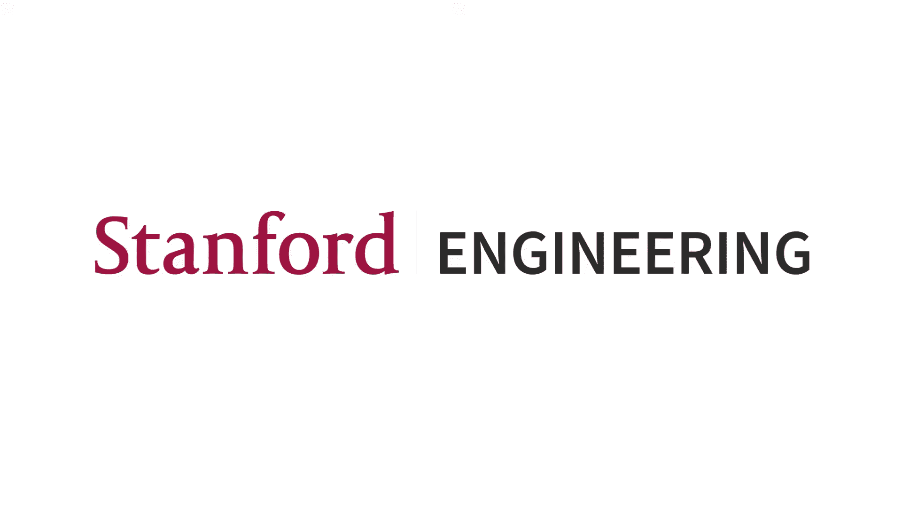
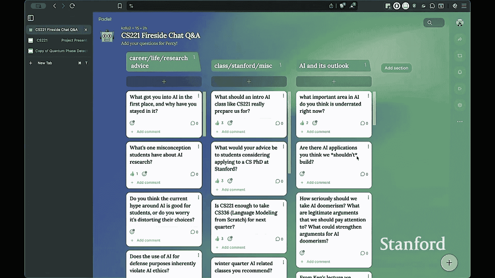
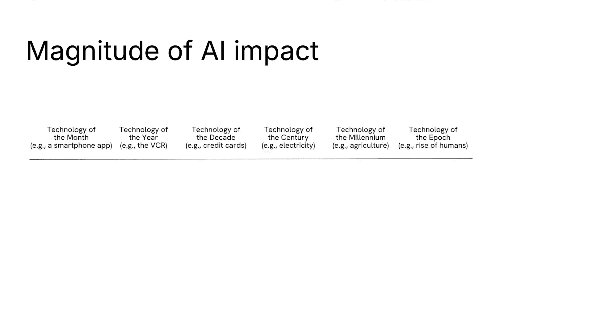
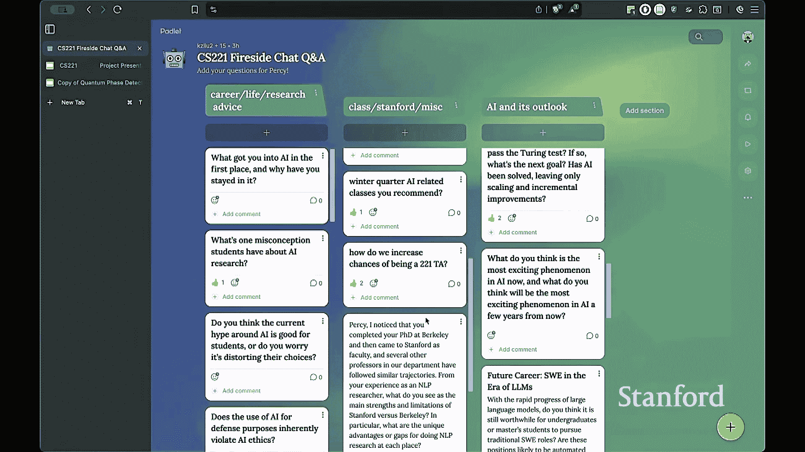

# Stanford CS221 ｜ Autumn 2025 p20 Stanford CS221 ｜ Autumn 2025 ｜ Lecture 20： Fireside Chat, Conclusion [5u5I5jvWR5 [BV1XuPrzwEes_p20]

So， we're gonna have。Going to have our fireside chat session。

 going to have Percy come up is our lovely instructor for this class and。

We gonna let me change this to this window。 So all of you have submitted a lot of interesting questions and we'll try to hit as much of them as possible。

 but there is a schedule and there's no guarantee on what questions we will ask。

 but please there will be live Q and A sessions and you can raise your hand and like shout and I signal when that is Try not to know to be too eager asking new questions So the way this will run is that we have three sections。

 We have career life and research advice， we have class。

 Stanford and miscellaneous questions and then we'll have a section on AI and its outlooks。Okay。

 and then we'll go through them kind of like one by one。

 and then we'll like itll be more like a guided interview per se。

Okay， sounds I mean， we can also go off script if needed。 Okay， so we're doing something different。

 This is a nice shot。 this is Percy。 Percy is a very good way to get the， you know。

 personal perspective to， you know， Percy and ask questions。

 We'll start with the background introductions。 So what's your first AI class when you were undergrad。

 what you take， which you learn， is it similar to 221 is not。 Yeah。

 you're asking me to remember something from quite a while ago。 Yeah。

 so I would did my undergrad and MIT。 So I did take the undergrad AI class there。

 I remember it I don't remember。😊，It been at that time I was much more interested in theory and algorithms so it wasn't like I took the class and I was like。

 okay， I'm gonna be an AI researcher per se I think part of what I remember is that back then machine learning wasn't as kind of pervasive or important as it is now and so a lot of the more you know classical AI techniques I could see kind of limitations in how they could scale so I remember taking a。

A class on NLP and doing grammars and we were just writing grammars by hand which didn't feel very satisfying。

 it wasn't until later during my undergrad when I did algorithms and then got into machine learning and statistical language processing which was this was like early 2000s。

 this is when it first started kind of really taking off then I found this is like the way to combine really kind of interesting math with kind of more scalable academic approach。

So you mentioned that there were techniques like grammar and some old techniques that didn't work as much。

 were there a turning point where you were like， look at these techniques， they don't work that well。

You could could have switched to do something else。 And why did you sit with AI back then。So I mean。

 I got into AI when I was already doing machine learning， in fact。

 the first project I did back in 2005 was essentially what you could call training a language model that back then of course it wasn't a transformer。

 it was hit a Markov model and there was a particular way you train it but the idea was the same。

 you would take a large amount of text back then it was you know I think maybe 100 million words instead of you trillions of words and then you would。

Maximum likelihood it's the same thing we do now but with a different architecture and a different learning algorithm and at the end of the day you get this model which had features it would basically cluster the words and I remember seeing how it would automatically figure out here's a cluster of city names or here's a cluster of date of the week and so on and that was a moment when I thought wow。

 this is really I guess you could call it emergent capabilities and that's why I decided to go pursue AI That's an interesting journey 10 years later even 20 years later now the world is very。

 very different did you expect any of this to happen like language models to dominate the AI paradigm where you know were you back then still thinking about other kinds of techniques and so it's interesting because even 20 years ago there's this idea that training generative models on large amounts of data。

Be useful， but I don't think I or really， I think anyone had the imagination to think that if you just kind of certainly well I'll just speak for myself but but I think most people did not as well have the imagination to think that if you just really stuck with that idea and carried it to its logical conclusion that you would get you know GT GT3 and GT5 and things like that I think that the transition towards interesting word clusters to。

Like zero shouting a bunch of different tasks。 that was a pretty major leap that。

Even I think if you talk to the Open ad researchers， I think there was a。

Conviction that this was the path， but whether it came would come in 2020 versus 2030 or 2050。

 I think no one knew。Now it's a good time to transition into AI outlook we can ask about what we think about AI being happening now。

 what' is going to happen in five to 10 years and we get that so you know what's like one concrete thing that changed about all of this in your mind when you think about AI systems in the last three years seeing all this happen like maybe before you were thinking more perhaps in terms of like principles and techniques and algorithms。

 but right now you just data on compute is there anything else that really drastically change your thinking seeing this progress。

Well I think the big shift， I think if you think about AI is that before it was very much a researcher thing right AI researchers。

 they do a bunch of experiments， they write papers and now you walk on the street and everyone's talking about AI。

 you drive on the 101， there's like AI billboards and it's become。Not really about a research thing。

 but this it's about a kind of global phenomenon I mean this happens like it happen with the internet。

 for example as well， you know the I guess you know I'm probably not many people were around when that was happening but。

So that's a big shift so I think a lot of the conversations have broadened instead of thinking about just the techniques and the principles but you know think about Rishi's lecture from last time you think about data and energy and compute and resources and think about jobs and all these other things because AI has kind of escaped the lab in some sense and has been is actually having real impact in the world in the very substantial way when you have the entire policy。

 national policies being written about AI or you have AI for strategy or companies calling them like the biggest companies are call themselves AI companies。

 I mean this is like a pretty big shift I think it's important to remember that the research still continues my group。

 many people at Stanford， other universities，Fs in industry there's still a lot of open problems and things that we don't understand and things that could be a lot better。

 but that's always been the case and always will be the case。

 it just happens that there's sort of this off ramp if you will from the research highway where it's like oh okay now we can actually get a bunch of kind of impact here now as opposed to always thinking about the future。

You mentioned a lot of things here about like the role of like research and then the public perception hang billboards on 1 on1 let's start with the public perception because we're talking about how AI is happening today。

 you know what's something that you think is very correct and very incorrect about the public perception of AI today when people think about AI。

 what's something that you want to tell them that you know is the wrong way to think about it。

 this is the right way to think about it。I think a lot of AI perception。

 unfortunately has been kind of shaped by you know science fiction。

 you know Termininator and all this like actually it's interesting because in the US so it's very cultural。

 like the way that people think about AI is very different in the east than in the West。

 which I think there's much more of a kind of a dark bleak outlook here than whereas in Asia I think it's much more of an optimistic well this is a technology that can really transform so that's a kind of a first thing that's interesting。

I personally think that there's a lot of baggage associated with kind of science fiction。You know。

 I think things could be either better or worse， but in very different directions than what people typically think when they're anchor to。

 you know， the idea of a sentient agent that comes and either you know destroys I think that。

The way I think about it is that AI is already everywhere right it's making decisions much in the background。

 so think about it more as you know infrastructure right like what recommendations you get on your phone now I think with ChaP it's more kind of user facing but I think the way that AI will influence our lives。

 it's much more pervasive and much of it might be hidden compared to you know some AI walks through the door right that's really good for movies because it's hard to have like I don't know some abstract thing kind of walks in the A working on your spreadsheet you know that doesn't Yeah that doesn't seem very Hollywood on that note what's the most overhyped capability and underhyped capability of current AIs。

Well。I think I'll start with the underharped one， and this is specific to language models。

 right I think we language models。If you think about for much of it， their existence。

 there are probabilistic distributions over the next token， given the previous token， right。

 so they're mathematical objects and you can study them as such。

 and now they've transformed into essentially more like a system that you given an input。

 you get an output。 So one of the。Things that I think is underappreciated is that how much that kind of probabilistic view and how much like minimizing perplexity and having strong foundations。

 it really enables all this right There's a lot of you know people think about this pre traininging and post training。

 So Ken's lecture。 I think give a good overview of that and a lot of the visible things come from post training like you teach the model how to solve math problems or do coding or give。

You know， analyze financial documents or what have you， but I think the it's maybe。

Obviously hidden that many of the things that make AI tick is the ability to predict the next token and one way you can see this is if you look at the ability for AI language models to predict the next token as a function of sequence length like a good system or a good model should really be able to kind of。

kindind of deeply understand the context and lower your loss as you predict the next token even to。

 let's say a million tokens and measuring that loss is something that really gets at the true underlying intelligence or capability of a system。

 which doesn't really， I think， show up， I think when you look at these public leaderboards。

maybe overhype thing is obviously， a lot of people are interested in thinking models and reasoning。

 honestly， if you look at， at least when I look at some of these thinking traces。

 it just seems like it's a very long sequence of very raly a lot of inefficiency there， and yes。

 you get eventually to the right answer and you get good scores， but it's like。

 this must be a scam to get you to generate more tokens that's what In fact， even today。

 we don't we can't even be sure that the thinking， like we don't even understand how the thinking trace precisely house the model is it just more budget or is it just actually guiding the thinking。

 Sometimes the thinking trace can be just wrong。 but still get you the right answer。 Okay。

 now let's look forward a little bit。 You mentioned that there's still a lot of research to do Some people would agree with that。

 Some people would not agree with that in particular， some students。😊，may may think that。

 you know the role of academia is in the missioning like there's there's just not too much work to be done at school because we don't have the resources we don't have to compute what do you have what are your thoughts on that and you know is AI already solved really。

 we have the bulk of it already are there really more breakthroughs needed Yeah。

 so I guess this is where being order helps you can see that over the last。You know，20 years。

 I think academia has always been a very small fraction of like what's happening in the world right。

 we're always like this kind of forward thinking， weird group of people who do weird things and if you look。

 let's say even 10 years ago or maybe let's say 20 years ago and if you were to go at Google and say like oh。

 I have this really great machine learning algorithm and we should use it and search you just no they'll show you through the exit because that it was sort of understood that well。

 these things aren't reliable they don't work and and so。AI。

 I mean research has always been in this position where it's like barely working。

 right that's the definition。And what has happened over the last five years is all this very methods that people are working on with scale。

 of course， and data and compute start working。And now there' is a sort of now if you go to Google。

 of course， they'll welcome you in it's like， oh， work're kind of jump that but。

There's a sort of we're at a sort of transition period。

 and it's not that academia is being less relevant， but more that the techniques were suddenly。

Becoming more relevant there's a sense in which many of the techniques graduated from school。

 I guess that's kind of apt， but there's always more things like some of the fundamental questions about how you can really generalize well and how do you become more data efficient and all these things are not solved by kind of any means。

 but that doesn't stop you and it shouldn't stop people from trying to productionize the current best。

So one class of things that academia is still really， you know should be doing。

 I think and can be doing is kind of much more longer term kind of blue sky research。

I think some of the feeling that you might get when you talk to peers is that。You know。

 they don't see where that is because I think part of the thing is that the thing that everyone has looking at。

 which is。These particular transformer models， if you follow them while they're graduating industry。

 but if you're looking over there， of course， you're not looking at the new opportunities。

The other thing else， other class of things， I think is is that there are a whole class of problems that academia is very well incentivified to do。

 but industry is just not For example， we've been doing a bunch of work on。

Understanding copyright how much memorized content can you get out of language models right so clearly labs are not going to go do this sort of work because they're already getting sued and so any academia since we have no skin in the game here is the only ones that can actually do this work or if you think about evaluation。

 how do you evaluate models in a fair way or expose problems with these evaluation with these models。

 this is something again which is harder to do in in certain contexts in industry because there's a conflict of interest like you have to。

You'll always be pushing the capabilities and showing that your model is great rather than finding necessarily flaws with it。

It's very interesting on the role of academia there's both research and education。

 so you touch on a lot of research problems that are not yet solved， but on education side。

 you know a lot of us are CS students， we have lot of undergrads here and one of the things that students commonly worry about is that I'm gonna to graduate and go into the software engineering market but today the AI is already very。

 very good software engineers， they can implement law of things much faster than the average graduate what do you think about that and with the rules university to prepare them Yes market yeah so so Rihi showed a nice slide from last lecture which is it is true that the number of entry level software engineers as it's currently defined by the skill set that has been traditionally the case for the last 10 years is going down so you can't expect to just do business as usual learn the same take the same CS classes assuming that they haven't aren't changing and。

get a job， I think that this is very much a transition period where you know I as an instructor and others in the department are really trying to figure out what education and the workplace should look like and it's sort of a joint problem I think at a general level I'm not concerned that you people wont have jobs I think that。

the types of things you might have to do will necessarily change。

If you look at previous generation of technologies like， you know， from being able to do， you know。

 before you， if you could do。You know mechanical computation really quickly that earned you a job right and then calculators came out and theyre like okay。

 you can't get a job by just like multiplying numbers all day day long。

 but that doesn't mean that there are other things to do and in fact I think there's once you get the primitives where oh yes。

 I just have to you know specify what I want and the AI will just write it freeze up opportunities to build other things right in the limit if you think about think about the CEO of kind of a company right it's probably the busiest person。

 It's not that and and there are people kind of underneath which have who have many more at least technical and maybe other depth in terms of depth have way more skills。

 but they're still sort of a job and not just the CEO but probably the whole management chain of essentially directing and also。

decidingeciding what needs to be done。So I think long story short， there's a shift more towards。

From doing to actually figuring out what to even do in the first place。That is actually really。

 maybe that's one kind of takeaway is that， you know， figuring out what needs to be able to build。

 like suppose you had a tool that can build any app in like five minutes like what would you build？

Right and thinking about that question， which is not a， I mean that's not a trivial question。

 like what Apple would actually take off or be useful to the people， that's a very deep question。

 so focusing on those problems like the people who can do that well or people probably going to be able to survive in this new environment。

So you mentioned like。Finding what to build is a very important question。

 So from your perspective in the next five to10 years or even next three years。

 what are the application areas that you think are undervalue that people and students should think more about building in you know。

 they have the skill set of the CS education， but what should they do like what's undervalue right now。

 Yeah， I mean one perspective is that a lot of AI is almost synonymous with these like frontier models which are essentially everyone gets exposure to AI systems like Gemini or ChaTBT。

But I think if you think about the underlying technology。

The idea of training a foundation all along tons of data and unlocking new capabilities。

 this is an incredibly general purpose technology right and could you've seen it successfully applied to DNA sequences。

 and if you think about the amount of other data out there。

 whether it be climate data or time series or kind of other satellite imagery。

 there's many other data sources where the same type of intuition should be able to carry over。

And I think there's a lot of， we're just I think just scratching the surface of this technology that can be I can unlock a lot。

 So I encourages people to think outside here's yet another。You know。

 an AI assistant and think more about all the other areas outside CS in other disciplines。

 like you know， in the sciences， physical materials， neuroscience。

 and think about where there are opportunities to apply the same techniques。

We now have a slot for live questions， if anyone want to ask a question。So the question is。

 what is your projected impact of AI， Is it just a tool is it going to be like a drasticpy transform society？

 Yeah， so if you look at a rich slide from last time。

 is it the technology of the year to technology of the the decade or the century or I guess or ever。

 I would say yeah， century would be kind of my guess I mean I do think that this is a pretty like the general purpose nature is is pretty know powerful in a way okay I guess well I think about computing as other thing computing was like a huge deal and that was what I guess 70 years ago so this is probably a kind of a similar magnitude of unlock。

Do current FLMs pass tuuring test， if so， what's the next goal has AI been solved or only scaling and incremental improvements？

Yeah， so， I mean， I guess the first thing to address is whether the terrain test is the right way to measure and how it's defined。

 I mean， in terms of。嗯。You know I think on the first day of the lecture I mentioned the touring test and I think it's historically been kind of important in many ways to shape the development I think right now I don't think it's like very a good measure of what it means what progress means。

 both the imitation part and also humans being the benchmark I think that AI should be。

We want AI to be kind of way better than humans at certain things。

 which should be much more reliable， for example， so putting humans at a bar doesn't seem particularly it seems like a bit short sighted。

 I think would there be a easy to understand test like a new test new touring test that you have in mind。

I think in some sense。Often tests are static， which means that you have to。

You know you have a system that enters a room and then you get a score out。

 but I think that obviously has kind of problems because they're gamemable and so on。

 I think a better metric is just kind of in an online sense though so the way I think I would propose is you know how many new scientific discoveries is AI you know producing。

And that is not gameable， right， because of AI。Cs cancer or does some， you know。

 invent some kind of new light material or figures out， you know， you know。

 fusion or something that's going to be。There's no one can disagree with like， oh okay。

 that was that was cheating because if you cheat it somehow and you figure out how to cure cancer。

 well good for your all right， we're now just scared to talk about Stanford and classes and CS2 to1 in particular。

 so we're starting with the class that you're all in right now So you know when CS21 started 10 years ago almost and you know this year we're thinking about how to make it better we're trying to design design better。

So when we design it when you designed it trying to make it better， what were you thinking。

 what problems were you trying to solve to make this class better as an introduction to AI class Yeah。

 yeah so。There's a few years along the way where we've made large changes to their class。

 and this was one of them。There were multiple objectives here and in hindsight I was probably a bit ambitious in terms of how much we wanted to do。

 but first thinking more about the social impacts of AI， that has always been。

 as I mentioned a few minutes ago， hard to kind of incorporate because from the ground up when I designed this class from scratch like 11 years ago。

It was a technical class we didn't worry about or think about the societal impacts as much。

 and so the whole structure of how the class is built doesn't really naturally incorporate that in。

But at the same time， it's clear that an intro to AI class needs to confront some of these issues。

 so one of the things we did is then the latter part of the class have dedicated a homework and some lectures to that。

 you know obviously this is kind of work in progress and we can continue making it better and if you have feedback we'll love to hear it。

The other major thing we did was I've always founded the disconnect between kind of lectures where you're looking at abstract diagrams and you there's sort of like you know you look at something you think you get it and then you go to the homework and you try to code it out realize where actually they don't understand how this connects and one of the things that was successful in when I taught the 336 class language models from scratch is to use this executable lecture format where we walk through code so there's no ambiguity about what objects we're you know talking about and so this year has been a bit of a pilot in terms of bringing that format to this class now obviously there are for the first time something happens there's always kind of some rough edges so I appreciate everyone's patience。

With that， I do strongly believe that iterating on this will produce just a much better experience which combines the both of being to have intuitive concepts but also grounded in the code so you can kind of see the whole ho stack。

So 11 years ago when this class was designed to some extent we didn't have quote unquote working AI so AI is a concept。

 it seems to be applied in narrow domains， but right now every one of you have this chatGBT。

 this UI thing， this cursor that are actually working and we spend a lot of time on things like search MDPs Gal models and logic and none of that seem to be connected to this abstract AI product that everyone's using today。

 you know how should students mentally connect these pieces to this large language models paradigm that we're in right now。

I think as hopefully I've tried to convey that many of these concepts are actually quite relevant。

 So in search， for example， you know we think about states and we think about actions and exploring different possibilities This is exactly what kind of test time compute with language models is about it turns out that you can't just train a model and then be done there's an inference time problem of given a model how do you search over different kind of solutions and if you think about solving really really hard problems like I guess an imO problem or doing some sort of scientific discovery or writing a you know。

Of doing some data science problem， it's going to require trial and error， right and that' search。

So and Markov decision processes， MDPs， which is it's very much like in language models when you pre train a language model and then you do reinforcement learning。

 that's basically trying to。Learn a policy that can give you good results。

 So that's clearly related Any other ones I should define Well， I mean， that cover a lot of them。

 but the other part we want to cover is more on on a more meta level C S to the one is a introduction to AI class。

 But AI is here an AI is like very productive。 What should such an introduction to AI class really prepare students for apart from just a concepts and knowledge。

 Is there anything else， such a class should do for students。 Yeah。

 I've always been a strong believer that you should understand the fundamentals of how things are you know built and kind of feelinging。

Over the layers until you get to the bottom， I think there's。

Many things you can do if let's say you just want to get a job right there's many online resources tutorials。

 you can basically learn how to do ML engineering or whatever you want and be just fine。

 but in some sense the whole idea of having you know why。

You're a Stanford and having your kind of a general education is is the sort of a longer term thinking of both the breadth of topics。

 like things that you would just like never encounter in the short term if you're in in a kind of a job on the job。

 learning on the job， but also thinking about，Kind of a layer above that kind of okay。

 I need to get this byytorch program kind of working。 And so2 to1， try to lay out， you know。

 some of those abstract ideas and also ground them into intercode But now ask some very quick questions on classes。

 these are very common ones。 How would you compare2 the one to other intro TI classes。

 such as 2 to9 is 2 to1 enough to get students to the next level of classes such as 36 or 2 to4 n。

Yeah， yeah， I think by now I think a lot of these classes。

 so the short answer is yes here after you take 221， certainly you can take 229 and 224 and in fact。

 a lot of people also take them in different orders because some of the topics are sort of orthogonal I think that。

You know， as for 336， this is probably a kind of a different level of a class where it does require a bit more kind of not so much knowledge but just experience and I guess some amount of grid to go through building all of the whole language modeling stack from scratch。

 but certainly this provides a grid foundation。So the question is。

 what's your approach to research and how you come up with topics？Yeah， yeah。

 figuring out how to do research I mean it's a it's definitely not an easy thing and certainly I wouldn't say that I automatically know what research topics are going to it's like kind of betting on the future right and you can only。

To try your best， the way I think about it is research is about taking bets。

So I think zooming out and looking at the world and seeing okay。

 what is like a big hole that doesn't that needs to be filled right now。

 right I think the best research are ones where there is some sort of vision on what you're trying to do and at the same time there's a concrete first step you can take。

m， so。I mean， just one example。You know， just the first thing that comes to mind is a few years ago was working on thinking about like decentralized training。

 So the idea was that instead of having current language model training， which is every all the。

Compute has to be in one place， imagine if every one in this room and everyone in the world could plug in their own compute and you could have this peer-to-pe network and could you train a large foundation model so this is obviously what very much change the the kind of power dynamics and what it means to even train a model and has implications of AI policy in all of these things and I think of that as like a very it's interesting research direction and now you can work on that kind of first technical problem which is more of kind of a systems problem。

嗯。😊，And so。There's， I guess the other perspective。 and this is more about research taste is that I often try to think about research problems where I generally don't know the the answer。

 right， And this is like if I basically。Like things that are in the boundary of like what could work and what could not work。

 because research， part of research is about information gain is not about necessarily， oh。

 I can do this really quick thing and I can get on， you know， get a 5% improvement because。You know。

 there's that's in， let's say， 10 years， you know， no one will care about that unless there's some sort of more generalizable lesson you can take away。

Any other questions？On Stanford classes。To the one。And take one from the list。嗯。

So there's some questions about advice the CSPD， which we'll get to in the next section。

 career life and research advice， we hit on hit this one already。Okay， this is an easy one。

 how do we increase the chance of becoming a 221 CA？

U。At this point， perhaps perhaps next next cycle， unfortunately， well， I mean， yeah。

 doing doing well in the class and being you know proactive I think is something that we like or people like these people in the front。

Or B Percy's PhD student？😀Yeah。😊，You get signed up you don't you don't apply Okay。

 so let's switch here to the next section about career life and research advice So here I think is where we get the most questions。

That's let's just start with like something simple like today。

 what would your first job be if you were under thegrad here at Stanford， you take these classes。

 you learn how to do CS， know implementations and little bit research， you know about all this。

 what would your job be。What would I wanted to be or， what would you， What would you do。

 So I graduated from Stanford， Yes，25 25，6，6。 Yeah， and then I， I go and。Apply for jobs。そさ。

That of a strange。Question， I mean， I think。嗯。I mean， okay。

 so what are the options right you can go to kind of a big research lab and do build you know the next generation of AI。

 I think you can you can do a startup。嗯。Or you can go to grad school。

I guess you could go to a law school or business school in face， but that's not a job， I guess。

I think that。嗯。I mean， I guess。嗯。I mean， this is going to sound a big clicched， but I mean。

 I do think that there's a lot of interesting。okay， so backing up， like I think， you know。

 when I graduated， I had like zero interest in startups。

 maybe that's because I graduate from MIT in something。

And recently I have been more engaged in the startup ecosystem and I do think that there is something kind of really cool about a small set of people working closely together on some you problem so I mean it doesn't have to be a startup but I think the idea of kind of being very mission driven and trying to work on something that requires a bit more than just kind of an individual level contribution seems most kind of interesting。

嗯。And then， I think the。I am obviouslym a researcher。

 so I think being able to work on interesting research problems would be something I would want to do。

For for many students here， I think students are facing this choice between you know research。

 industry， startups， all of things that you mentioned。

 but you know they wouldn't know what to what to choose is all feels very， very exciting。

 it all feels lots of possibility there like what would you do。

 like what's your you know value function there or what would your rule of thumb be。Yeah。

 I mean probably I'll try to answer the question I think people want to answer。

 which is less about what I would do， but it would be like what's the framework to think about things I think when you're graduating right this is your first job it's most definitely most likely will not be your last job so you're not you're not like getting married or something it's like something that is probably you're gonna to spend a few years there So the thing I would prioritize most is growth。

Right， I think。You graduate here， you learn things at Sanford。

 but the next part of your journey is still education， it's learning。

 it's just a different type of learning。So I would heavily prioritize。

 I guess maybe the more to use a LL analogy exploration rather than exploitation part and okay。

 so what based on that， what would you do like being like with good people who you enjoy working with。

 I think is the most important thing， I think it。Everything else is， I think， actually。

knowSecondary in some sense。You it could be an academic setting， it could be in a startup setting。

 it could be in a group， but in a larger company， as long as you feel like you are learning what you want to learn。

Now， of course， I think if you have a mission like you want to go you do invent and you know solve the world's energy problems or like you have a mission。

 then I think it's actually much clearer， but I think that question probably comes from a point where well there's a lot of interesting things I could do。

 what do I do and then I think using like where would you learn the most would be my top choice。

That makes a lot of sense。Commonly students would also feel that you know。

 if they' are not doing this or this by， you know， sophomore year， they're doing not doing X， Y。

 Z by their junior year， they feel that they're lagging behind you know。

 it's almost like a competition It's almost like I have to you know try this or else I'm too late Do you have any advice to that kind of like mindset or feeling。

Yeah， I mean， I get it how there's a lot of， you know， pressures and yours you can it's。

You look at people around you and they're doing all these crazy things。

 I think to put things in perspective， though， if you look at top researchers at labs or people who are like doing or CEOs or people are doing very well。

 you realize that I mean many of them took a very circuitous path and maybe they went to a different field altogether and then transition。

 like how many people are transitioned into AI and they're doing something completely unrelated。

 So I don't think that what you what internship you get in sophomore year is really going to have a sort of meaningful impact。

 I think it's。嗯。Still about kind of you and what your skills are and what you learn and your outlook on the world that is the most important thing and I think any of these kind of honors so to speak like it becomes very clear I think when it's just like oh this person has just racked up a bunch of like good sounding names but actually isn't as qualified as someone who maybe hasn't done as much but know they're actually skillwise better position to have two follow ups to that one follow up is you mentioned skills and like knowledge and applying them but the world is changing so fast right now there's so many like things that AI couldn't do six months ago that they now can do as junior students you would worry that your skills would be outdated so what would you say to that and second is from your perspective how do you then evaluate skillsre saying？

Saying that maybe some person had this shiny C， but that might not be a better person compared to someone who hasn't done all these things。

 Yeah I。Well okay， so maybe the first part， so one skill that will never go away is the ability to learn and adapt right。

 I mean， that just almost by definition， right in a fast-chan world the only thing that matters is how fast you can quickly adapt like if the model can do your job Okay。

 how can you learn something new， which is why I emphasize so much like can you learn not just learn deeply but also you know quickly because that will be the most kind of important thing I think in a fast moving world。

And there's a second part。 same as how do you evaluate skills and learning， So basically。

 how do you interview people and San。 Yeah， that that is a tough。Tough problem。I think there is。You。

 there are some like obviously there's the usual tech screens and know getting a sense of how you can do work trials to evaluate how people work together。

I mean， I think there's a bunch of other。You know， softer skills， for example。

 there's a sense of which。I know having。You know， great and passion and those type of things really do kind of matter because the difference between someone who like really is into something and cares and someone who's just like kind of doing a job is pretty。

 pretty date and night and day。嗯。Also， you know， working， I mean， again。

 this is you kind of a pleasure but like working well with others collaboration is something that。

Actually， I mean， it's just like they're so important in any sort of context and this is something that I think。

 you know we don't train students that， wow， I think。

 at least not explicitly because most work is individual and evaluation is supposed to be individual ensure sure there's some group projects。

 but those are not really I think the main focus， so but in the real world。

 everything is collaborative and you have to be able to interact with other people。That makes sense。

 what what's a common piece of advice that you hear for a career that you actually don't agree with that people say。

 you know you should do this， you should do that but you don't think that's true。嗯。

I don't get very much advice these days。Um，I mean。Yeah， I mean， maybe along the lines of like， oh。

 advice you have to go apply to this internship， otherwise you'll be left behind or something。

 I think that are。Yeah， maybe it's kind of the same answer as before see。

Um so you know AI is very very hot right now， is there a bubble and does the bubble if there is does the bubble distort student choices and do you have any thoughts on that I mean surely there's a bubble there's a I mean that's like you want to think there's not a not a bubble。

I and certainly that this， I mean， it not just student choices。

 but it distorts like everything in the world right。

 like if you look at the investments that are made in big companies and decisions that governments take coming。

 it's just like very much shaping how the entire world is operating。I don't think yeah。

I wouldnt say that it's necessarily all kind of bad because I do think that AI is real。

 like if you think about the internet revolution， right， I mean。

 that's I think a prime example where there's clearly a bubble and we know what happened in you know 2099。

2000 and yet internet is like completely transformative like's there's like just very much changed the way that we've we've do things every aspect of our lives is now kind of you know digital not every aspect but many aspects are most aspects are digital in some way。

But， you know， obviously， there was， it was a。I think there's a period where you just overprom you under liver and then you kind of recover。

 So I do think that， yeah， AI， a bunch there's a lot of， there's a lot of like real things there。

 and there's a lot of things that are。You know， kind of bubbly and at some point that stuff will get cut out and then the real stuff will you know。

 continue， make sense。The question is， what are you studying on the grad， how do you decide to do it。

 why does it lead to where you are now？嗯。This is going to be a pretty boring answer。

So I studied computer science in undergrad， I did also， I guess it was。I did a math major as well。

 but it was really you had a lot of overlap between CS because I was doing a lot of theory and math。

 and then I did a PhD in computer science when I got into kind of research。And。

And now I was professor。 So I guess that's kind of a， kind of boring answer。 I mean。

 I think there were。😊，Maybe periods where I was you know looking at。

 I was really kind of fascinated by physics at some point， but didn't really。

Maybe I didn't really pursue it as much because I was kind of。I don't know。

 it just felt very comfortable to be able to build things in software。

So the question is about why are these companies also non transparent？

What are the outlook on down around that Yeah， yeah。

 so the amount of transparency over the last five years has really gone down。

 It used to be that open AI which publish on what they're what they're working on。

 release models and now there's no information and。I think that so to answer the question directly。

 why does this happen， it happens for a few reasons。

 one is that competitive advantage this is a usual reason companies have trade secrets if I reveal how I did this training then my competitors are going to find out the second is you lawsuits if I companies are I mean obviously training on a lot of internet data with some of it might be kind of dubious and if this is all kind of laid out then that's just kind of inviting lawsuits and the third is a more mundane answer is that some things that。

Companies would probably be fine with revealing， but there's just it's not a priority。Right。

It takes actually a fair amount of engineering effort to dig up certain types of information and put in a report and get it past approval。

 And all these companies are just kind of the first priority is to race to build the best AI。

 So no one has time to do that， which is unfortunate。

 So the idea behind the transparency index was that at least you call this out and you make it people aware of it。

 and that's the first step to at least stimulating some more transparency。

 And over the last two years， there have been companies that have you move quite a bit。

 And we've engaged with a number of companies and they've done their best。

 But some areas like data are just there's no incentive。

 It has to be kind of regulatory to really get them to move。The question is。

 how do we get end users to care more about the ethical implications of AI？Yeah。

 that's a really great question。 Well I think the first point as maybe related to the transparency is that end users generally don't even maybe think about where。

Their AI， how it's made and so on so just being transparent about that allows them to actually point to something I mean I guess there's an analog between how do you get consumers to care about like ethically grown you know sustainable food and all these organic food and so on it's kind of a very similar analog and so having nutrition labels and like I think it takes advocacy on behalf of。

You know， other organizations to push for certain things to be in place so that they can be put in front of。

 you know， users because users most of the time are just trying to get their。You know。

 haveve worked on or do whatever they and don' aren't really thinking about like， oh， is this？

Ethical or or not。 or many people don't even probably realize that how much of。You know。

 what are even the possible concerns like the fact that there's so much human labor that goes into that I and wondering about like you know。

 wages and and and so on and condition where conditions to。

How much compute it takes and the the strain on the environment。 So just making people aware of that。

 I think is a is a first。Question is you won some competitions when you're young。

 does that changes or influence things down the road， I haven't won any panel competitions lately。I。

 I think。嗯。So I've always been active in piano and I still play a bit these days and for a long time it was always a parallel track and it was nice because there was a sort of a hobby aspect of piano there was a few years ago I had you two postdocs who I really wanted to figure out how to do combined music in AI so we had a number of papers on essentially training music foundation models。

 which was you know pretty cool because then for the first time it got me to really。

Kind of the two parts of my lives which are important， kind of crossed。Any other questions， last one。

 yes。Yeah， so general advice on getting involved in research at Stanford。Yeah， so in terms of game。

Involve in research there are definitely official channels。

 for example there's a curious program that people can apply to and then there's unofficial channels where know the nice thing about research is that everything is open so you can see what research is happening who's working on what and one recommendation is to just engage with that you look around people's websites。

 you find a paper that you like， you read it and then try to engage with either the professor or the student and like you email Ken it's like oh。

 I read your paper， this is so wonderful and have these other ideas and you can you can try to try a more bottom up approach the other thing is the final project in the class can sometimes be a way to try to do some research which。

And continuing something bigger， There's no， one size fits all solution here yeah。All right。

 we're at time Thank you so much Per， we can also read one more questions。

 but I think we're at time Okay， yeah we should probably stop there Keep that yeah。

Well thank you so much for taking the time to answer all these questions Okay thanks Kim for moderating yeah and thanks everyone for sticking with us through this class it was a pleasure of teaching and you know also thanks to the teaching team here for helping out hope you enjoy the class and yeah enjoy the rest of your your luck with the rest of a quarter。

😊。

