# TrevorHastie／RobertTibshirani《统计学习导论｜An Introduction to Statistical Learning》中英字 - P12：P12 StatsLearning Lect5e 111713.zh_en - GPT中英字幕课程资源 - BV1jN4y1Y7JR

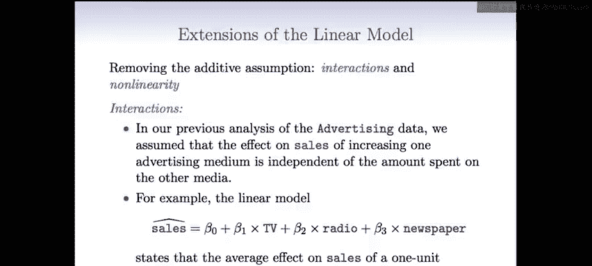

So that's one extension of the linear model。 Another extension is a number of extensions。

 or interactions and long linearity。

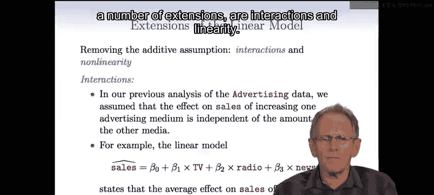

So in in well talk about interactions first。So in our previous analysis with advertising data。

We assume that the effect on sales of increasing one advertising medium is independent of the amount spent on the other media。

So for example， in the linear model， we've got TV， radio and newspaper。

 it says that the average effect on sales of a one unit increase in TV is always beta one。

 regardless of the amount spent on radio。

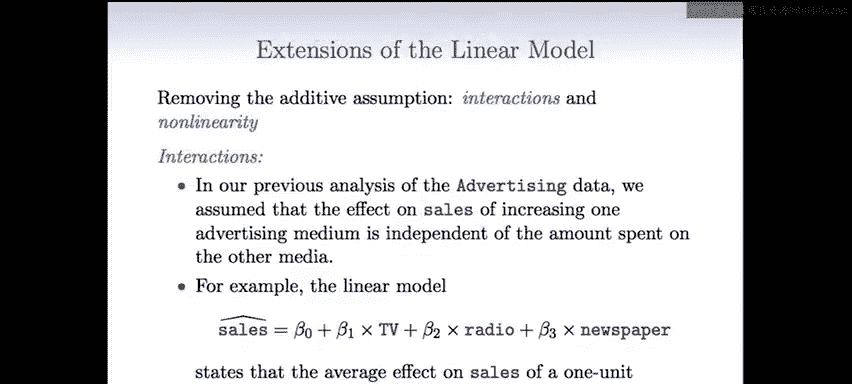

But suppose that spending money on， on radio advertising actually increases the effectiveness of of TV advertising so that the slope term for TV should increase as radio increases。

So in this situation， suppose we've given a fixed budget of 100。

100000 spending half on radio and half on TV may increase sales more than allocating the entire mountain。

 either TV or or to radio。So in marketing， this is known as a synergy effect。

 and in statistics we often refer to it as an interaction effect。

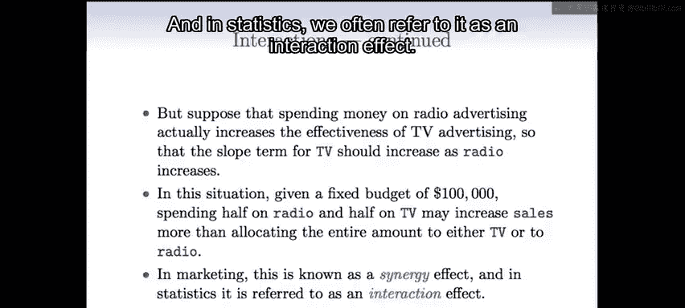

So here's a nice， pretty picture of the regression surface as a function of sales as a function of TV and radio。

And。We see that when the levels of either TV or radio are low。

 then the true sales are lower than predicted by the linear model。

But when advertising is split between the two media， then the model tends to， to underestimate sales。

And you can see that， by the way， the points stick out of the surface at the two ends or below the surface in the middle。

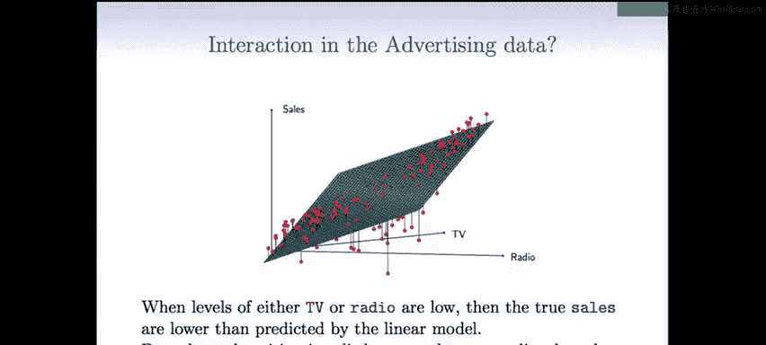

So how do we。Deal with interactions or include them in in the model。

So what we do is we put in product terms。 So here we have a model。

We have a term for TV and a term for radio。And then we put in a term that is the product of radio and TV。

So we literally multiply those two variables together and call it a new variable and put a coefficient on that variable。

😊，Okay， now， you can rewrite that model slightly， as we've done in the second line over here。And。

We've just collected terms slightly differently。And the way we've written it here is showing that by putting in this interaction。

 we can interpret it as the coefficient of TV， which had been originally beta 1。

 is now modified as a function of radio， so as the values of radio changes。

 the coefficient of TV changes by amount beta 3 times radio。Okay。

 so that's a nice way of interpreting what this， this interaction is doing。

And if you look at our summary of the linear model below， Indeed。

 we see that the interaction is significant， which we might have guessed from the previous picture。

 So in this case， the interaction really is significant。

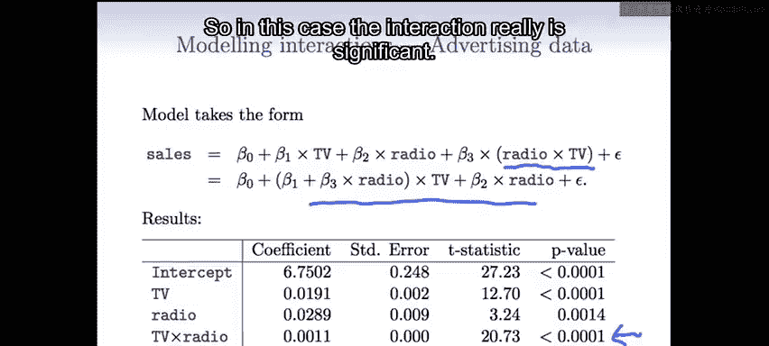

So the results in this table suggest that interactions are important。

The P value for the interaction is extremely low。 So this strong evidence in favor of the alternative here。

 that beta 3， which was the coefficient for interaction， is not0。

We can also look at the r squared for the model with interaction。And it's jumped up to 96。

8% compared to 89。7% by just adding this one extra parameter to the model。

And and we get that by adding an interaction between TV and radio。

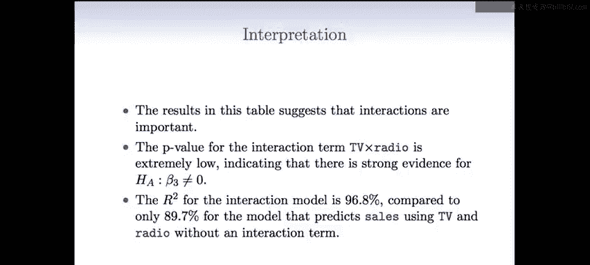

Another way of interpreting this。Is that we have a 69% of the variability in sales that remains off foot in the additive model。

 as been explained by the interaction term。Because we went from 89。7 to 96。8。

 And if we think of that in terms of the fraction of unexplained variants。

 that's 69% of the unexplained variance。The coefficient estimates in the table suggest that an increase in TV advertising of $1。

000 is associated with increased sales。Of。And we plug in the numbers。For beta 1 and beta 3。

It's 19 plus 11 times radio units。Sorry， 1。1 times radio units。Alternatively。

 an increase in radio advertising of $1000 will be associated with an increase in sales of。

So now we've written it the other way around， we've factored it the other way around。

 and now thinking of the coefficient of radio as changing as a function of TV。And it'll be 29 plus 1。

1 times TV units。 So you， you can bake， make either of those interpretations when you put an interaction in the model。

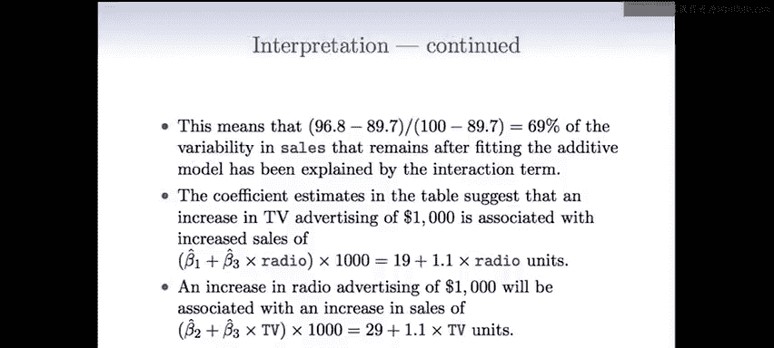

Sometimes it's the case that an interaction term is a very small P value。

 but the associated main effects in this case， TV and radio do not。But when we put an interaction in。

 we tend to leave in the main effects。 And we call this the hierarchy principle。

And so there it stated if we put in an inter interaction， we put in the main effects。

 even if the P values associated with the coefficients are not significant。

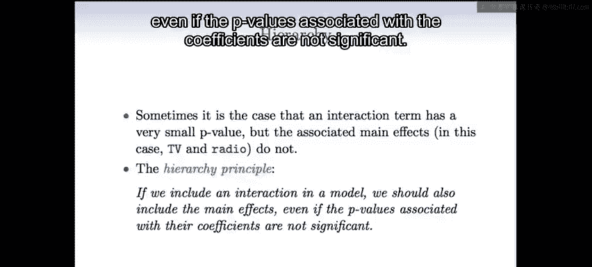

So why do we do this？It's just that interactions are hard to interpret in a model with art main effects。

 They meaning actually changes。 and so， it's just generally not a good practice。

Another way of saying this is that the interaction term also contains main effects。嗯。

Even if you foot the model with no main effect terms。

 so it just becomes more cumbersome to interpret。

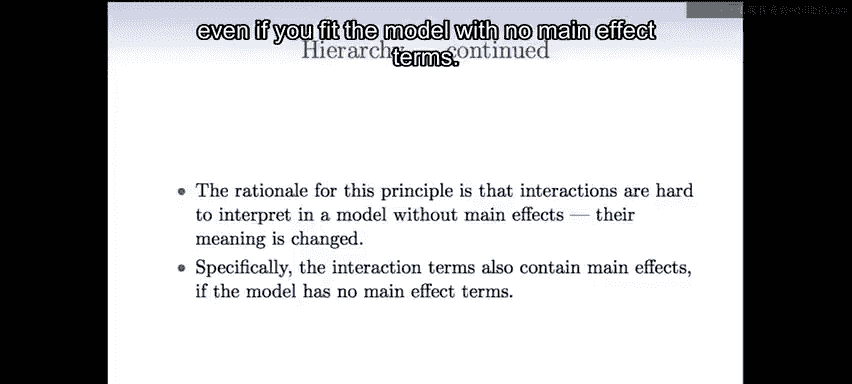

Now， what if we want to put in interactions between a qualitative and a quantitative variable？

Turns out that's actually easier to interpret and and we'll see we'll see that now。

 so let's look at the credit card data set again， and let's suppose we're going to predict balance as before and we're going to use income which is a quantitative variable and student status which is qualitative and so we'll have a dummy variable for student。

Which will be one if the person's a student， otherwise is zero。So without an interaction。

 the model looks like this。And we see we've got an intercept， we've got a coefficient for income。

 and then we're going to have beta 2 if the person is a student and zero if the person is not a student。

And another way to write that is。A coefficient on income。

 And we've just lumped together the intercept and the the Dm variable for student。

 And we can think of this by grouping them like that。

 We can think of this as having a common slope in income。

 but a different intercept depending on whether the person is a student or not。

And if a person is a student， the intercept is beta 0 plus beta2。 And if the persons not a student。

 it's just beta 0。

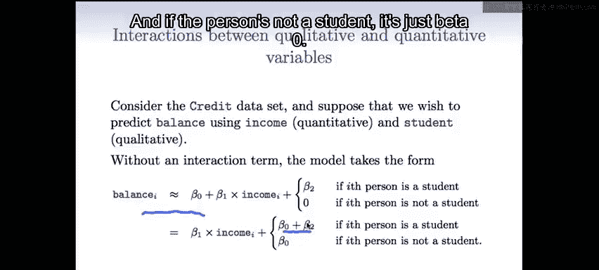

So that's without an interaction。WithWith interactions in the model， it takes a follow in form。

 but before we study this， let's just look at a picture of these two situations because that'll make things clear。

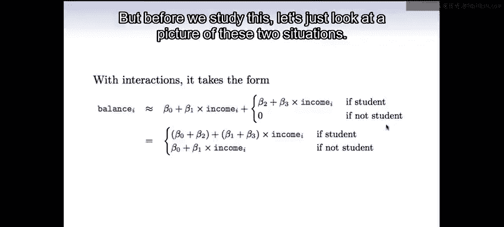

So in the left panel， we've got no interaction。 and we see very clearly that。There's a common slope。

For whether you're a student or not， but just the intercept changes。

But if you put an interaction between the slope of income and student status。

 you're going to get both a different intercept and a different slope。

And so that makes a really simple explanation in this case。And if we look at the actual model。

 it looks like this， and we can write it in several different ways。

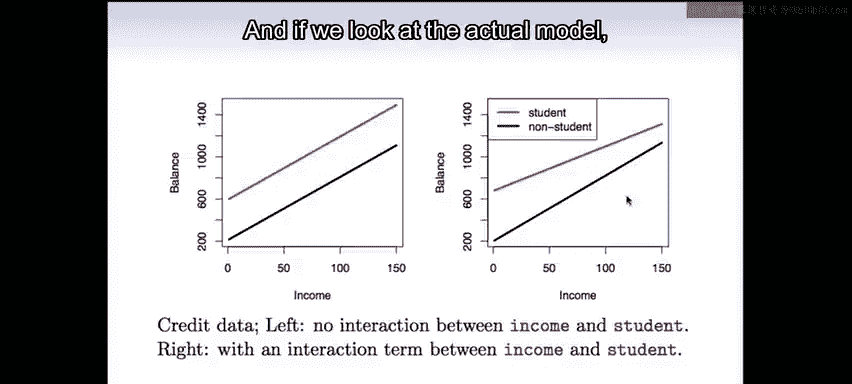

And so。This year， this， the second term over year is showing us what happens with the interaction。

And so if you're a student， you get both a different intercept， that's beta 2。

And you get a different slope on income， which is beta 3。And if you're not a student。

 there's there's 0， which means you get the baseline intercept and slope。And you can rer。

 rearrange those terms in in the following fashion。 and it's telling you the same thing。So。

The interpretation of interactions with categorical variables and the associated dummy variables actually simplifies is more simple than even in the quantitative case。

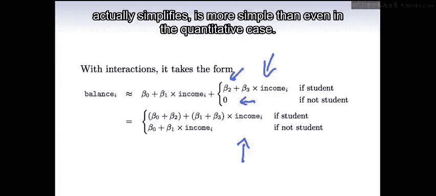

The other。Modification of the linear model is what if we want to include nonlinear effects。

So here we've got a plot of two of the variables in the auto data set。

So we've got miles per gallon against horsepower。And we've included three fitted models here。

 We've got the linear regression model， which is， is the orange curve over year。

And you can see it's not quite capturing the structure in the data。And so to improve on that。

 what we've actually done is polyial two polynomial models。 we fit a quadratic model。

 which is the blue curve。And you can see that better captures the curvature in the data than the linear model。

 and then we've also fitted a degree5 polynomial， and that one looks rather wiggly。

So we have an ability to to fit models of different complexity in this case， using polynomials。

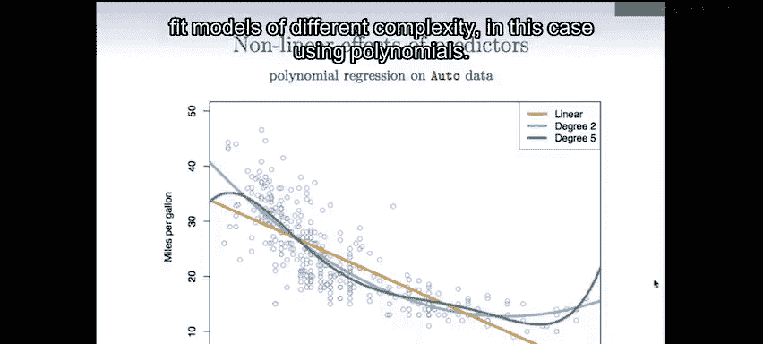

And these are very easy to do。 so just like we created an artificial dummy variable for categorical variables。

 we can make extra variables to accommodate polynomials。

 so we make a variable horsepower squared which we just include in our data and now we fit a linear model with a coefficient for horsepower。

😊，And a coefficient for horsepower squared。 And， of course， that's a polynomial expression。

 And we'll notice that that improves the fit。 We do the summary。

 and we see that the coefficient of both horsepower and horsepower squared are strongly significant。

And so you can do this， you can add a cubic term as well and in the previous example we went all the way up to a polynomial of degree5。

 so that's a very easy way of allowing forlineities in a variable and still use linear regression。

We still call it a linear model because it's actually linear in the coefficients。

 but as a function of the variables， it's become nonlinear。

But the same technology can be used to foot such models。

 So that expands the scope of linear regression enormously。

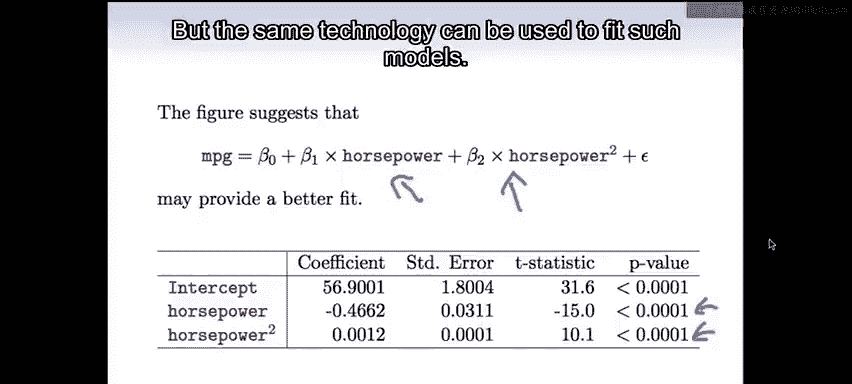

Okay， so we' we've reached the end of the session。😊，If you read in along in the chat。

 you'll see there's some topics we didn't cover。 We didn't cover outliers。

 There's non constant variance of the error terms。High leverage points， which means if you've got。

Points observations in， in X that that really stick out far from the rest of the crowd。

 What effect they have on the model。And colineity， if you have variables that are very correlated with each other。

 What happens if you， if you include them in in the model， So we're not going to cover those here。

 but they covered in in some detail in the book。 and if you look at section。3。33。

 you'll find coverage on that。

Okay， so that finishes our coverage of， of linear models。

 There are a lot of generalizations of linear model。 and as I've hinted at already， you'll see。

 it's actually quite a powerful framework。😊，So we use similar technology for classification problems and that we'll be discussing next。

 so well be doing logistic regression and support vector machines。

 which also have linear models underneath the hood but expand the scope greatly of linear models。

And then we'll cover nonlinearities， so we'll talk about techniques like kernel smoothing and sps and generalized additive models。

 some of which are also just extensions of linear models and some of which are richer form of modeling allow for linearities in a more flexible way。

We covered some simple interactions in linear models here。

 but we will talk about much more general techniques for dealing with interactions in a much more systematic way。

 and so there we'll cover tree-based methods and then some of the state of the art techniques such as bag in。

 random forests and boosting and these also capture- nonlinearities and these really bring our bag of tools up to what we call state of the art。

And then another important class of methods we' will discuss use what's known as regularized foot。

 and so these will include Rige regression and laU。

 and these have become very popular lately with especially when we have data sets where we have very large numbers of variables。

 so-called wide data sets and even linear models are too rich for them and so we need to use methods to control the variability。

And so that's all still to come， and so we have lots of nice things to look forward to。

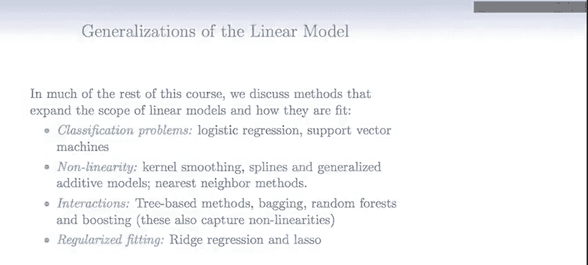