# TrevorHastie／RobertTibshirani《统计学习导论｜An Introduction to Statistical Learning》中英字 - P22：P22 StatsLearning Lect10 R classification1 111213.zh_en - GPT中英字幕课程资源 - BV1jN4y1Y7JR

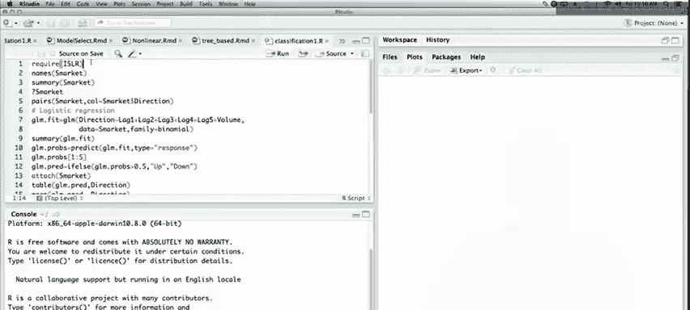

Okay， yeah we have a session in R， in our studio in fact。

 and we're going to see how we fit logistic regression models using the GLM functions in R。

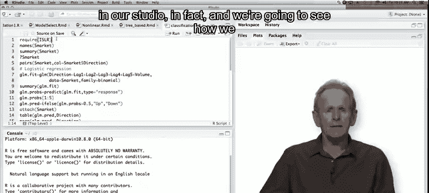

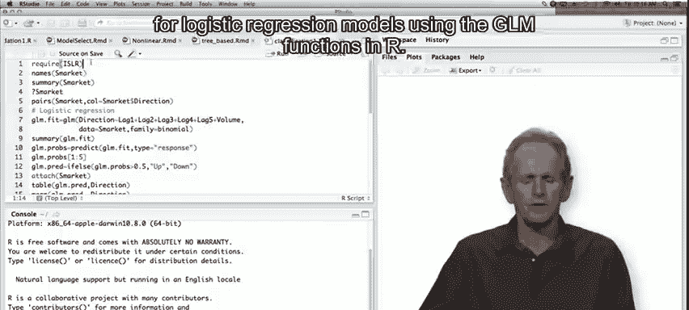

So the first were going to do is load the ILR package。

 which has all the data sets we're going to use here， we use the command require。

 which is similar to library。 I tend to use require。 it's sort of。

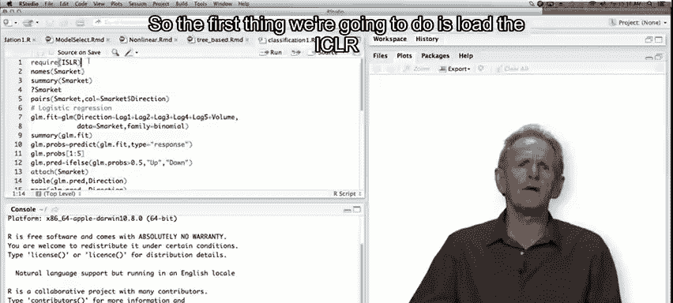

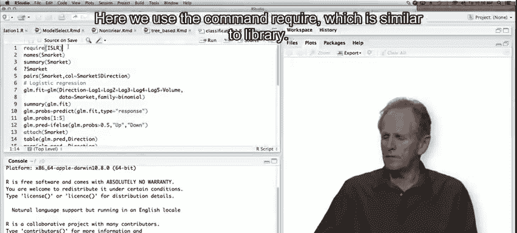

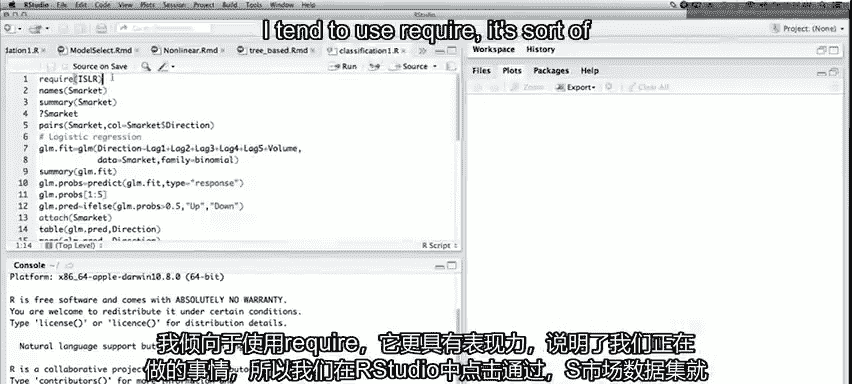

It's more evocative what we doing and so we just click through in our studio and the S market datas there and we can query it so names is useful for seeing what's on data frame and summary is also useful summary gives you a simple summary of each of the variables on the S market data frame and we see that there's a number of lags and there's volume and there's today's price and there's direction which we're going to use as a response and that is whether the market went up or down since the previous day and we can also do help on these data objects and get some details of each of the variables and so there you see in the description so we're going to use the direction as a response and see if we can predict it as a binary response using logistic regression。

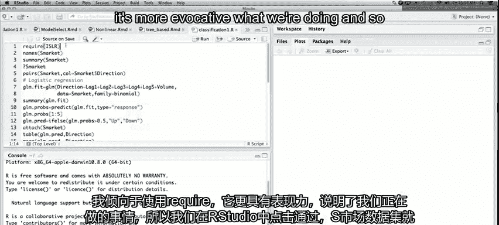

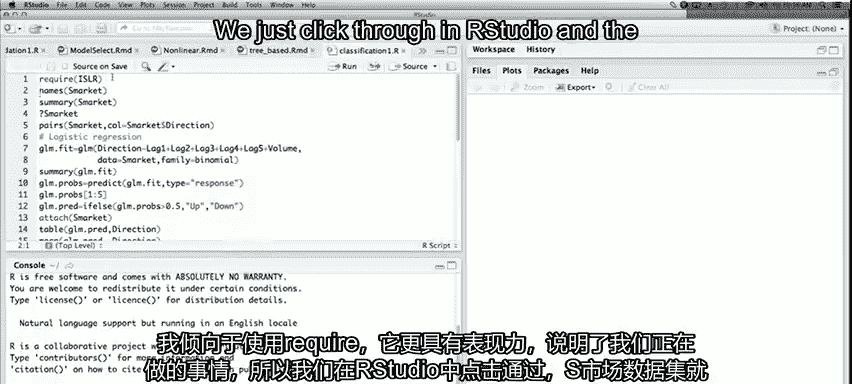

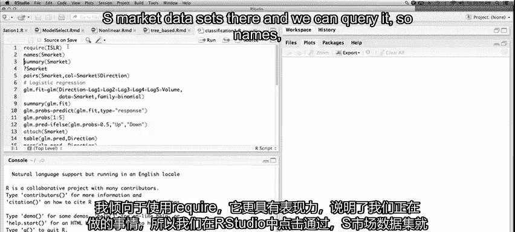

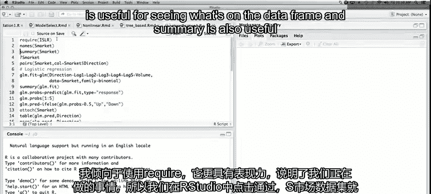

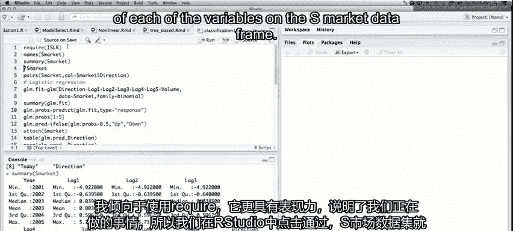

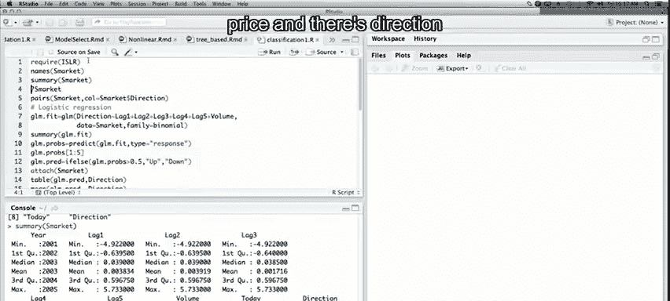

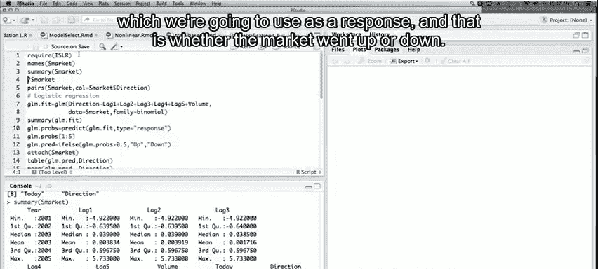

Let's make a plot of our data， so there's the pairs function。We do it。

 It's a little bit crowded in this plot。 We told it the to plot the variables in， in S market。

 and we told it to use as a colour indicator are actually our binary response。

 And that's a useful way when you've got a two class。嗯。A class variable for seeing in the plots。

 which are members of each class。And。Yeah we see them doesn't seem to be too much correlation going on Yeah。

 of course， the class variable is derived from the variable today。 And so up or down。

 it seems to make a division， And other than that， we don't see much going on。 Of course。

 with stock market data， you don't expect to see much going on because if things were very easy to predict people will be making lots of money from it and they wouldn't be given。

Lecturees on using R。So here we have a call to GLM。GlM。fi， we tell it direction is the response。

And the predictors are we going to use the lag variables so that yesterday's price。

 previous days's price and so on， up to lag 5， and we also use volume and we tell it to use family equals binomial and so that tells GLM to fit a logistic regression model instead of one of the many other models that can be fitteded GLM。

Okay， so we execute that fit。And oops。I'm skipped a line here。 So there we go。 and there it's done。

 It's two lines there。 and then we do a summary， and the summary tells you some things about the fit。

And in this case， it's given you P values on each of the coefficients， the estimated coefficients。

 a standard errors， the z score and the P value。And it seems like none of the coefficients are significant here。

 again， not a big surprise for these kinds of data。

 It doesn't necessarily mean it won't make a be able to make。Any kind of reasonable predictions。

 it just means that possibly these variables are very correlated。

 actually the plot doesn't suggest that anyway， none are significant。And it gives the null deviance。

 which is the deviance just for the mean。 So that's the log likelihood。

 if you just use the mean model and then the deviance for the model with all the predictors in。

 that's the residual deviance。 And there was a very modest change in deviance。

 It looks like four units on。嗯。嗯。How many degrees of freedom。

 We' got 6 degrees of freedom difference in， in degrees of freedom there。Okay。

So we can make predictions from the fitted model， and so we assign to GM。probs a predict。

Of GM dot fit。 And we tell a typical equal response。

 So this will make predictions on the training data that we use to fit the model。 And it gives you a。

Vectctor fitted probabilities。 We can look at the first five， and we see they're。

 they're very close to 50%， which is， again， not too surprising。

 We don't expect to get strong predictions in this case。 So this is a prediction of whether the。The。

 the， the marks are gonna be up or down based on the， the， the legs and， and the other predictors。嗯。

We can。Turn we can turn those probabilities into classifications by thresholding at 0。5。

 and so we do that by using the F else command。 So if else takes a vector， in this case。

 GM dot pros in fact， a vector of logical。 So GM dot pros bigger than 0。5。

 So that'll be a vector of trues and falses。And then ifL says that element by element， if it's true。

 you're going to call it up， otherwise you're going to call it down。And so that does that for us。

 And now we're going to look at our performance。 and here it's convenient to actually attach the data frame market so that the variables are available by name。

which we do and now we can make a table of GLM。pre which is our ups and downs from our prediction against the true direction。

 so we do that and we get a table and we see there's lots of elements on the off diagonal element on the off diagonals on the diagonals is where we do correct classification。

And then the off diagonals is where we make mistakes。And we see this quite a lot of those。

 and we can actually get our mean。嗯。classassification performance。

 so that's the cases where GLM dot pre is equal to the direction and we just take the mean of those。

 so it'll give you a proportion in this case 0。52。So on the training data。We get we。

 we do slightly better than chance。 Well， we may have overfied on the training data。

 So what we're going to do now is divide our data up into a training and test set。

So what we'll do is。We'll make it a vector of logicals。

And what it is is train is equal to a year less than 2005。

 for all those observations for which years is less than 2005 will get a true。

 otherwise well get a false。And now we refit our GLM dot foot。😊，Except we say subset equals train。

 And so it'll use only those observations for which train is2。

 So now that means we put just to the data in。In years， less than 2005。And now。

 when we come to predict， we're going to predict on the。The remaining data。

 which is years 2005 or greater。 And so we use a predict function again。 And for the new data。

 we give it S market， but index by not train。 So thats going to be not train is。

It's going to be true if， if year is 2005 or more。And we tell a type equals response。

 So we actually want to predict。The the probabilities in this case。And again， we make this if else。

 make this up down variable。嗯。And let's make a subset a new variable direction dot 2005。

 again for the test data， which is the response variable direction， which is just for the test data。

 in other words， not train。 So we call that direction dot22005。 And now we make a table。

 So now this is on test data。 There's a smaller subset of the data is test。

 and we compute our mean again。 and it's 0。48。 So now we've actually done。

Gets slightly less than 50%。So we we're doing worse than the the null rate， which is 50%。

So what are we gonna do， Well， we might fit this， We might be overfitting。

 and that's why we're doing worse on the， on the， the test data。

So now we're going to fit a smaller model， so we're going to just use lag one and lag 2 and leave out all the other variables。

 And so here we do that， the rest of the calls is the same。

And then we run through our commands again。We compute our table。And here we get an error rate of。

 of 55， correct classification of just about 56%， which is not too bad at all。And。

So using a smaller model appears to have done a better year。 And if we do a summary of that guy。

Didd see if anything became significant by using the smaller model。

Given that it gave us better predictions。And of course。

 that's what happens when you try and do commands on the type on the fly， at least for me。

 you make spelling mistakes。 Well， nothing became significant。

 but at least the prediction of performance appeared to have improved。

So that's for the logistic regression models in R using the GLM function and family equals binomial。

