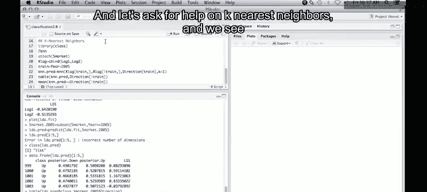

# TrevorHastie／RobertTibshirani《统计学习导论｜An Introduction to Statistical Learning》中英字 - P24：P24 StatsLearning Lect10 R B Knearest 111213.zh_en - GPT中英字幕课程资源 - BV1jN4y1Y7JR

Okay， another R session also on classification。 This time we're going to look at Can nearest neighbor classification。

 which， you know， it's one of those tools。 It's a very simple classification rule。

 but it's effective a lot of the time。 There's somebody， you know， some experts are written that。

Caneen nearest neighbors do the best about one third of the time。

 And it's so simple that if you in the game of doing classification。

 you always want to have can nearest neighbors in your toolbox。Okay。

 so we've got a little session here that we'll run and if we go to our studio session。😊。

You see we've got set up here for K nearest neighbors。And for that， we'll use the class library。

 so we go library class。And that setss us up for。Doing k nearest neighbors classificationification and let's ask for help on k nearest neighbors。

And we see the help file， which again is always a useful thing to do。嗯。

And it tells us it's got a slightly different format to the previous session where we used LDA。

It doesn't take a formula。It asks for the training。嗯。X variables， the test x variables。

And the class label for the training， and then it asks for what value of k you want。

 and then there some other arguments okay。So we'll use this again on our stock market example。

 So we'll， in this case， well。Since we're going to have to list all these variables by name in the call。

 well just attach stock market。And recall when you attach a data frame。It。

 it makes available the variables on the data frame by name in your frame。

 So if I go down into the session window year and say。LS。Well。That。Didn't do it。 actually。

 I can say objects。2， because stock markets in position 2。 There we go。

 So they're available in in location 2 on the search list。

 and there's all the variables in S market available by name。Okay。

So what we'll do is we'll make a matrix。Of lag 1 and lag 2 we' arere going to use the same two variables we used in the previous session。

 so well say x lag is c bind that makes a matrix with two columns in this case of lag1 and lag 2。

Okay。And let's just make sure that that actually did what we want。 I mean， I know it did。

 But let's look at the first。Five rows of that matrix。And there they are。 so it did what we wanted。

And then， we'll make a。We'll make a indicator variable train， which is year less than 2005。

 so that's just going to be a binary variable of truths and falses depending on where the variable year was less than 2005。

Okay， now we're ready to call KNN， so we give it our matrix x lag and right in line here we index it by train。

 which says just use the training observations。😊，And。And then for the test observations。

 we give it X lag， not trained， so those not trained will be。

 therefore those that aren't that are equal to 2005， right？For a year equal to 2005。

 So train and not train， that exclamation mark means not。

And the response is direction again in the exp train。

 and K equals one says we want one nearest neighbor classification。And again， just to remind you。

 that means what the algorithm does is it says to classify a new observation。

 you go into the training set in the X space， the feature space。

 and you look for the training observation that's closest to your test point。😊，In Euclidean distance。

 and you classify to its class。Okay， and so this。We'll do it。

And we can look at the we put the results in knn。preed and we can do a table of knn。

preed and the true response， which is direction at not train。

And we get a little confusion matrix again， and we can look at the classification performance there。

😊，And it's exactly 0。5。So it was useless。 One nearest neighbor did no better than flipping a coin。嗯。

So。What to do next？One could proceed further and try nearest neighbors with multiple values of K。

 we haven't done that in this session， but we leave it up to you and you can look in the end of the chapter and you'll see that there's examples of this。

