# TrevorHastie／RobertTibshirani《统计学习导论｜An Introduction to Statistical Learning》中英字 - P2：P2 StatsLearning Lect12b 111213 v2.zh_en - GPT中英字幕课程资源 - BV1jN4y1Y7JR

Okay， now we're going to talk about the supervised learning problem and set down a little bit of notation。

So we'll have an outcome measurement Y， which goes by various names。

 dependent variable response or target， and then we'll have a vector of P predictor measurements。

 which we usually called x， they go by the name inputs， regresses， covarits。

Features or independent variables。And we distinguish two cases。 One is the regression problem。

 Why is it quantitative， such as price or blood pressure。In the classification problem。

 Y takes values in a finite， unaudered set such as survived or died。

 the digit cluster is  zero to nine， the cancer class of the tissue sample。

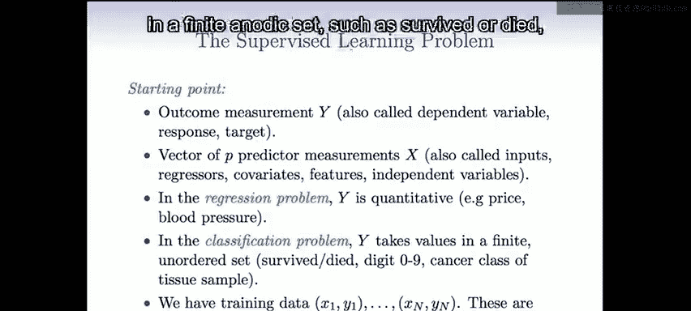

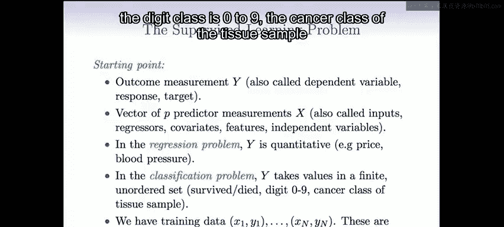

Now we have training data pairs x1， Y 1， x2 y 2 up to x and Y N。 So again。

 x1 is a vector of P measurements， Y1 is usually a single response variable。

 and so these are examples or instances of these measurements。

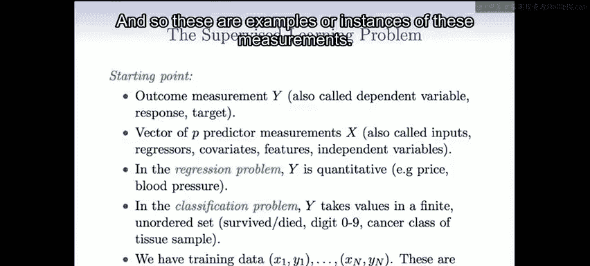

So the objectives of supervised learning as follows on the basis of the training data。

 we would like to accurately predict unseen test cases。

 understand which inputs affect the outcome and how。And also。

 to assess the quality of our predictions and the inferences。

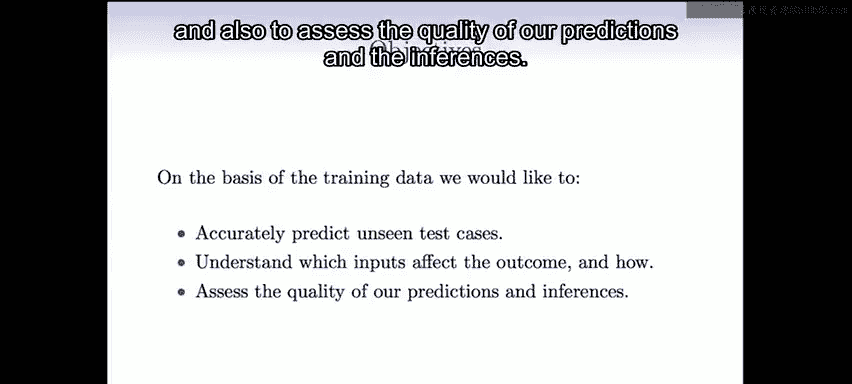

So by way of philosophy， as you take this course， we want not just to give you a laundry list of methods。

 but we want you to know that it's important to understand the ideas behind the various techniques。

 so you know where and when to use them because in your own work。

 you're going to have problems that we've never seen before。

 you've never seen before and you want to be able to judge which methods are likely to work well and which ones are not likely to work well。

As well， not just prediction accuracy is important。

 but it's important to try simple methods first in order to grasp the more sophisticated ones。

 we can spend quite a bit of time on linear models， linear regression and linear logistic regression。

 these are simple methods， but they're very effective。

And it's also important to understand how well method is doing It's easy to apply an algorithm nowadays you can just run software。

 but it's difficult， but also very important to figure out how methods is how well is the method actually working so you can tell your boss or your collaborator that when you apply this method we've developed this is how likely how well you're to do tomorrow and in some cases you won't do well enough to actually use the method and you'll have to improve your algorithm or maybe collect better data。

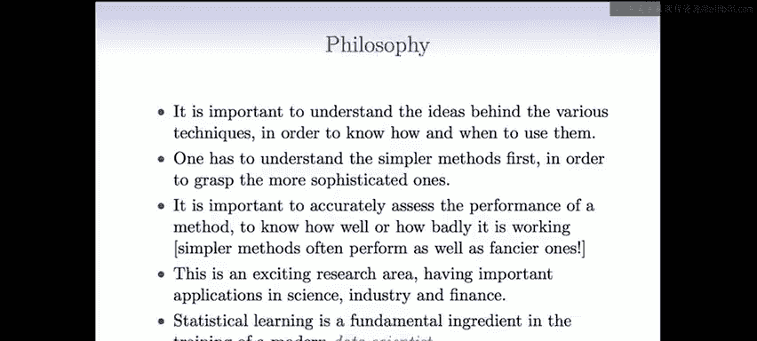

The other thing we want to convey just through the course and hopefully through the examples is that this is a really exciting area in research。

 I mean statistics in general is a very hot area， statistical learning and machine learning。

I of more and more importance and it's really exciting that the area is not gel in any way in the sense that there's a lot of good methods out there。

 but a lot of challenging problems that aren't solved， so especially in recent years。

 Rob with the onsetai of big data and coined the weird data science。Right， and physical learning。

 as Trevor mentioned， is a fundamental ingredient in this new area of data science。

So you might be wondering where wheres this term supervised and supervised learning come from。

 It's actually a very clever term。 And I would like to take credit for it， but I can't。 It wasn't。

 It was developed by someone in the， I think in the machine learning area。

 that he is supervised learning， a think in a kindergarten of a teacher trying to teach a child to classify to to discriminate between what a say a house is and a bike。

 So he might show the child， maybe Johnny， say。Johnny here's some examples of what a house looks like and maybe in Lego blocks and here's some examples of what a bike looks like he tells Johnny this and shows him examples of each of the classes and the child then learns oh I see a house has got sort of square edges and a bike has got some more rounded edges etc ce。

 that's supervised learning because he's been given examples of labeled training observations he's been supervised and as Trevor just sketched out on the previous slide。

 the Y there is given and the child tries to learn to classify the two objects based on the features。

 the X's。Now。Unsupervised earn is another thing to talk of this course in which I grew up。

I see that's the problem okay， well， so in unsupervised learning now in the kindergarten Trevs in kindergarten and the child was not Trevor was not given examples of what house and a bike was。

 he just sees on the ground lots of things right he sees maybe some houses， some bikes。

 some other things。And so this data is unlabeled， there's no why。

 it's pretty sharpper so the problem there now is for the child just it's unsupervised to try to organize in his own mind。

 the common patterns of what he sees right he may look at the object and say。

 these three things are probably houses or he doesn't know they called it houses。

 but they're similar to each other because they have common features， these other objects。

 maybe they're bikes or other things。 they're similar to each other because I see some commonality and that brings the idea of trying to do group observations by similarity of features which is going to be a major topic give this course。

 unsupervised learning。So more formally again， there's no outcome variable measure just to set of predictors。

 and the objective is more fuzzy。 It's sort of not justs not to predict why because there is no why It's rather to learn about how the data is organized。

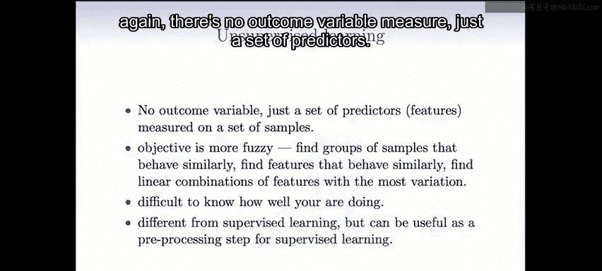

And to find which features are important for the organization of the data。

 So we'll talk about then clustering and principal components， which are important。

Teciques for unsupervised learning。 One of the other challenges is。

 is it's hard to know how well you're doing， right， There's no gold standard。 There's no why。

 So when you when you've done a clustering。Analysis， you don't really know how well you've done。

And that's one of the challenges， but nonetheless， it's an extremely important area。Both because。

 well， one reason is that the idea of unsupervised learning is an important prepro for supervised learning。

 It's often useful to try to organize your features， chooseose features based on on the。

On the X's themselves， and then use those processed or chosen features as input into supervised learning。

And the last point is that it's a lot easier， a lot more common to collect data which is unlabeled because on the web。

 for example， if you look at movie reviews you a computer algorithm can just scan the web and grab reviews。

 figuring out whether the review on the other hand is positive negative。

 often takes human intervention， so it's much harder and costly to label data much easier just to collect unsupervised unlabeled data。

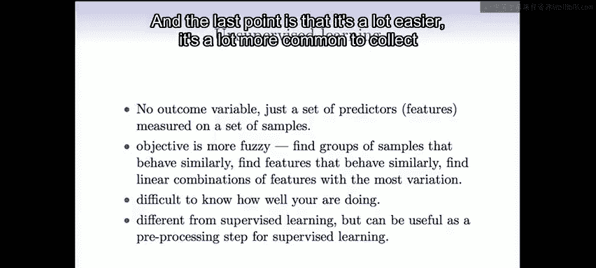

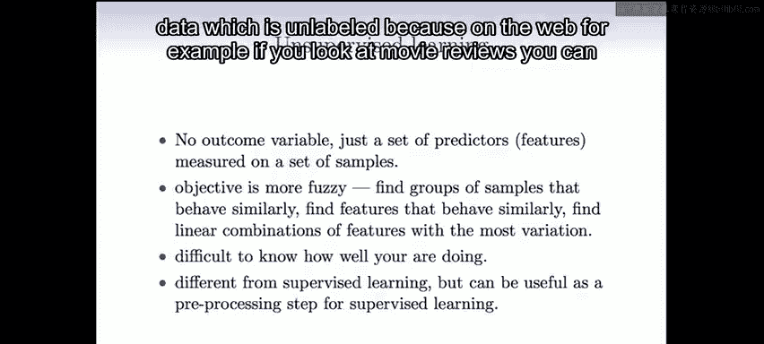

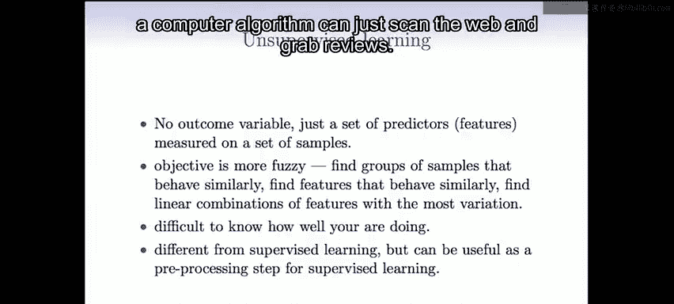

Well， the last example we're going to show you is a wonderful example。 It's the Netflix Prize。

 Netflix is is a movie rental company in in the US。 and and now you can get the movies online。

 they used to be see DVDs that were mailed out。😊，And Netflix set up a competition to try and improve on their recommendeder system。

 so they created a data set with 400，000 Netflix customers and 18000 movies。

 and each of these customers had rated on average around 200 movies each so。

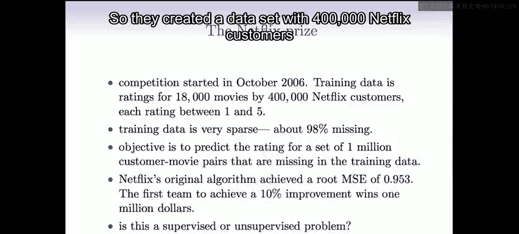

So each customer had not seen only seen about1% of the movies。

And so you can think of this as having a very big matrix which is very sparsely populated with ratings between one and five。

 and then the goal is to try and predict as in all recommended systems to predict what the customers would think of the other movies based on what they had rated so far。

 so Netflix set up a competition。😊。

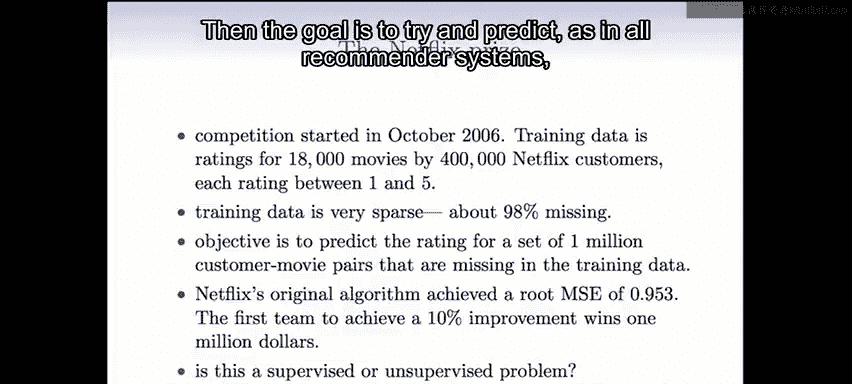

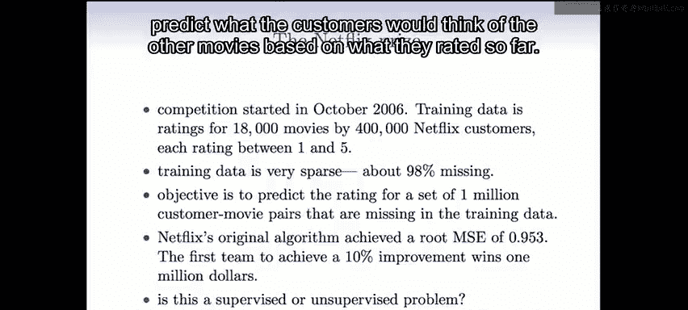

Which where they offered a a $1 million prize for the first team that could improve on their rating system by 10% by some measure and the design of the competition is very clever。

 I don't know if it was by luck or not， but the root main core error of the original algorithm was about 9。

953 so that's on a scale of 1 to5。And it took the community when they announced the competition and put the date on the web。

 it took the community about a month or so to get to have an algorithm which improved upon that。

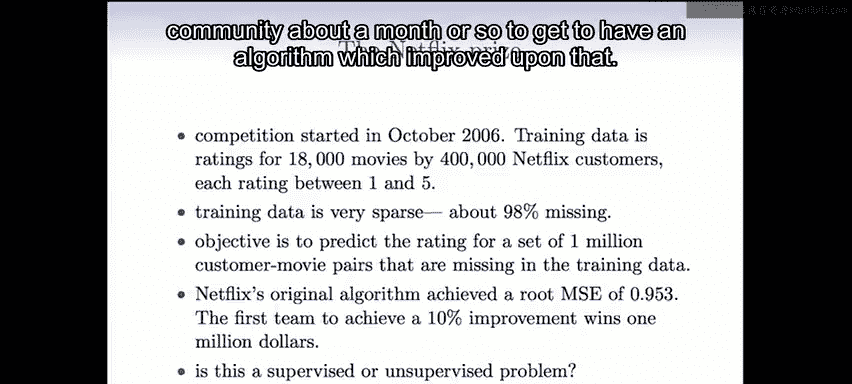

But then it took the community about another three years to actually for someone to win the competition。

So it's a great example， yes the leaderboard at the time the competition ended。

 it was eventually won by a team called Bel Course Pragmatic Chaos。

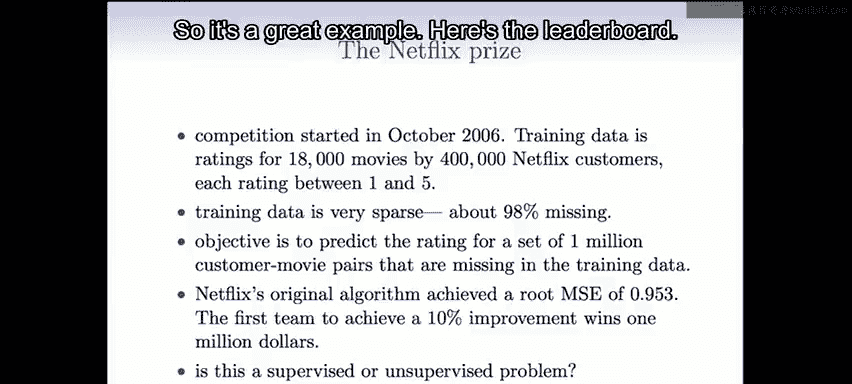

But a very close second was ensemble， in fact， they had the same score up to four decimal points。

 and the final winner was determined by who submitted their final predictions first。

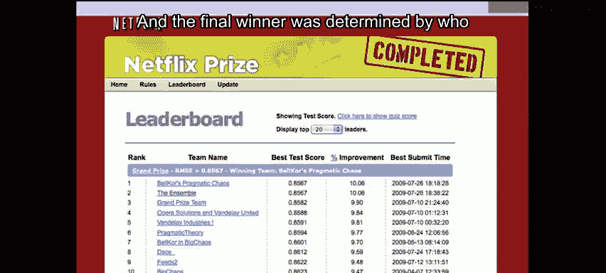

So this was a wonderful competition， but what was especially wonderful was the amount of research that had generated。

 there were thousands， tens of thousands of teams all over the world entered this competition over the period of three years and a whole lot of new techniques were invented in the process。

😊。

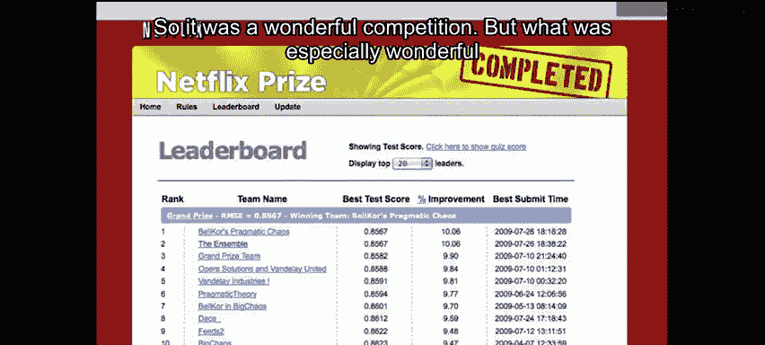

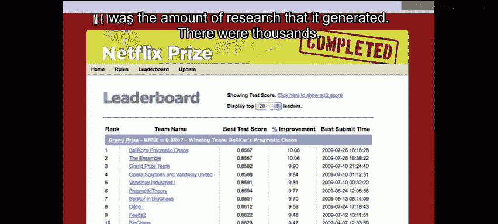

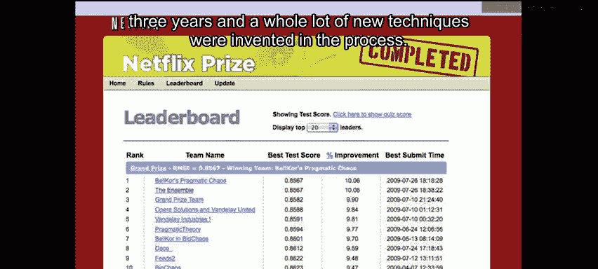

A lot of the winning techniques ended up using a form of principal components in the presence of missing data。

 Now how come our namess not on that list forever， Where's our team that's a good point。

 Rob the page isn't long enough。 I think if we went down a few hundred。

 you might so actually seriously， we actually tried with a graduate student when the competition started。

 we spent about three or four months trying trying to win the competition。

 and one of the problems was competition the data was so big and our computers were not fast enough just to try things out took too long and we realized that the graduate student was probably not going to succeed。

 it was probably going going waste three years of his graduate program。

 which is not a good idea for his career。 So we basically abandoned ship early on。

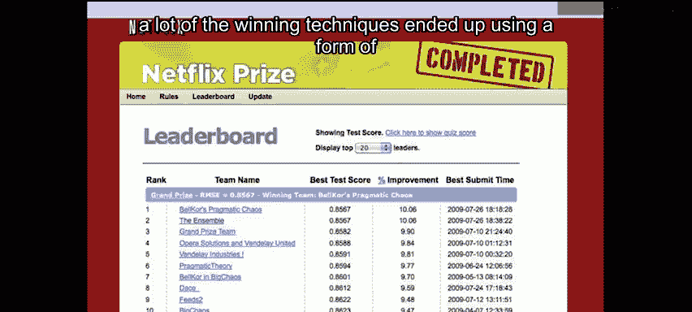

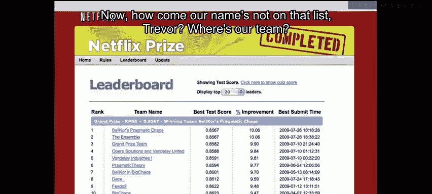

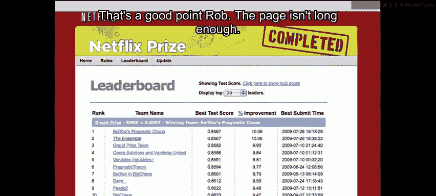

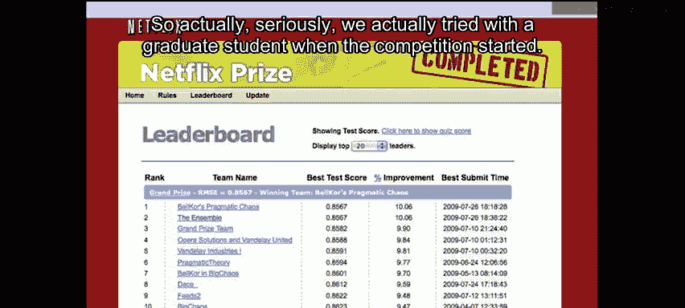

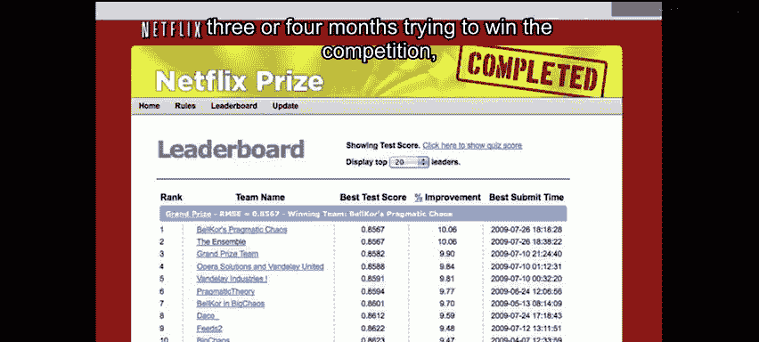

So I mentioned the beginning the idea of the field of machine learning。

 which actually led to the statistical learning area which we're talking about in this course。

And machine learning say itself arose as a subfield of artificial intelligence。

 especially with the advent of neural networks in the 80s so it's natural to wonder what's the relationship between statistical learning and machine learning and first of all。

 the question is hard to answer， we ask that question often there's a lot of overlap。

 machine learning tends to work at larger scales they tend to work on bigger problems。

 although again the gap tends to be closing because computers fast computers now becoming much cheaper。

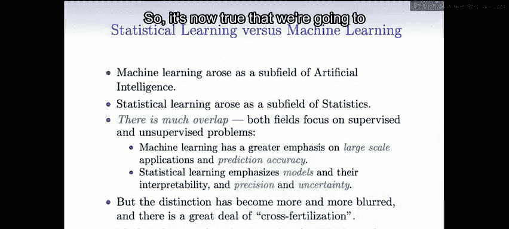

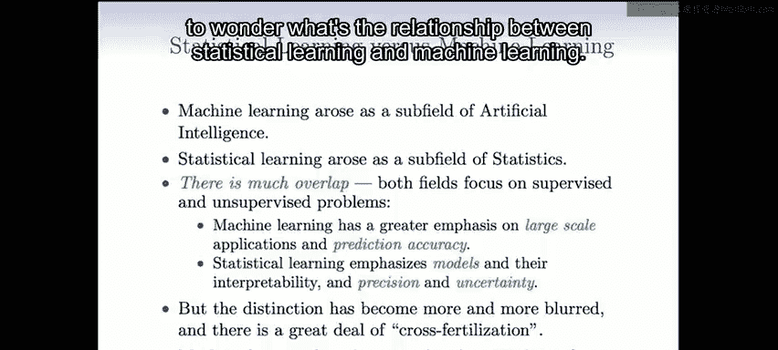

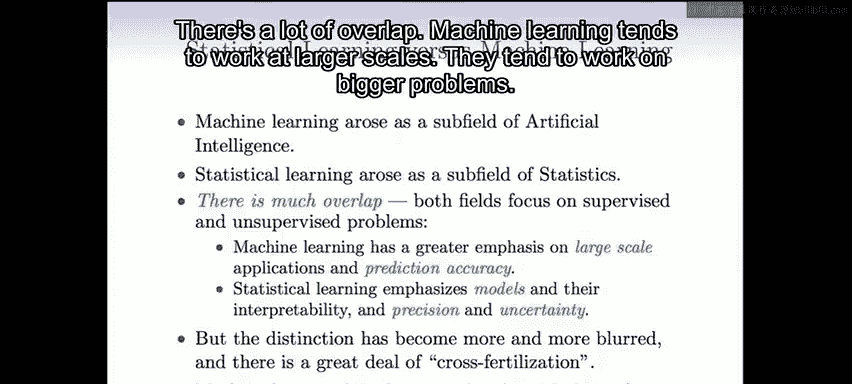

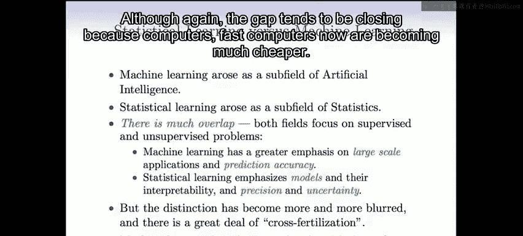

Machine learning worries more about pure prediction and how well things predict。

 Ci learning also worries about prediction， but also about models tries to come up with models。

 methods that can be interpreted by scientists and others。And also。By how well the method is doing。

 we worry more about precision uncertainty。But again， the distinctions become more and more blurred。

 and there's a lot of cross fertilization between the methods。

ieur Monsieur learning clearly has the upper hand in marketing。

 They tend to get much bigger grants in their their conferences are much nicer places。

 but we're trying to change that， starting with this course。

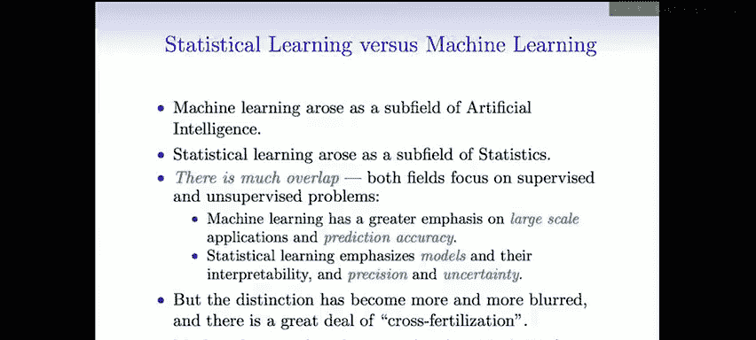

So here's the course text， Introuction to statisticalt learning， we're very excited。

 this is a new book by two of our graduate students， past graduatedu students。

 Gareth James and Daniel Le Whitten and Robin myself book just came out in August 2013。

 and this course will cover this book in its entirety。The book has。At the end of each chapter。

 there's examples run through in the R computing language and we do sessions on R and so when you do this course you'll actually learn to use R as well。

R is a wonderful environment， it's free and it's a really nice way of doing data analysis。

You see there's a second book there， which is。More advanced textbook elements of statistical learning that's been around for a while。

 that that would be serve as a reference book for this course for people who want to understand some of the techniques in more detail。

Now the nice thing is this court not only is this course free， but these books are free as well。

 the elements of statistical learning has been free and the PDFs available in our websites。

 this new book is going to be free beginning of January when the course begins。

And that's with agreement with the publishers。 but if you want to buy the book， that's okay too。

 it's nice to having the hard copy， but if you want， the PDF is available。

So we hope you enjoy the rest of the class。