# TrevorHastie／RobertTibshirani《统计学习导论｜An Introduction to Statistical Learning》中英字 - P36：P36 StatsLearning Lect8f 110913.zh_en - GPT中英字幕课程资源 - BV1jN4y1Y7JR

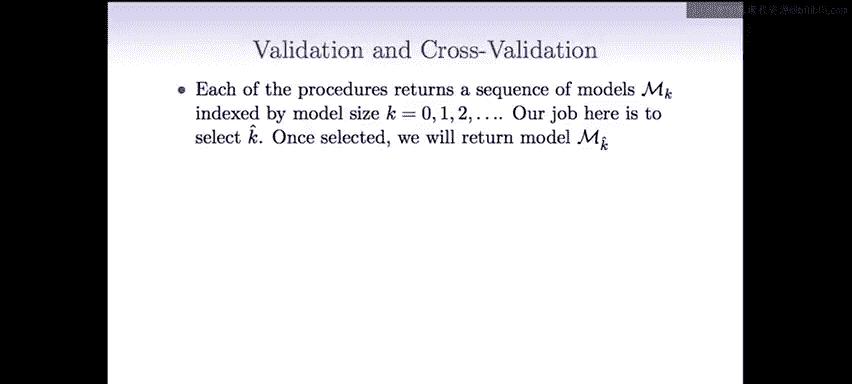

So validation cross validation we actually talked about in quite a bit of detail in the section along with the bootstrap。

 so I won't cover it in much detail now just to remind you。

 so the basic idea is now well the basic problem right we have a sequence of models like for example from subset regression forward stepwise or backward stepwise。

 each one with a model size K and we want to choose the best model size。

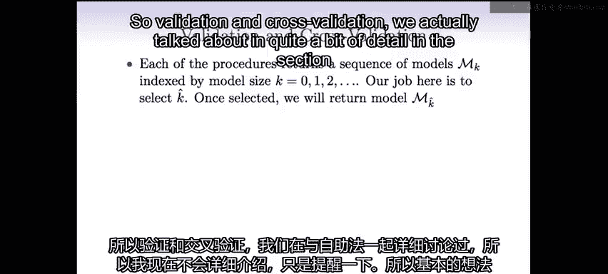

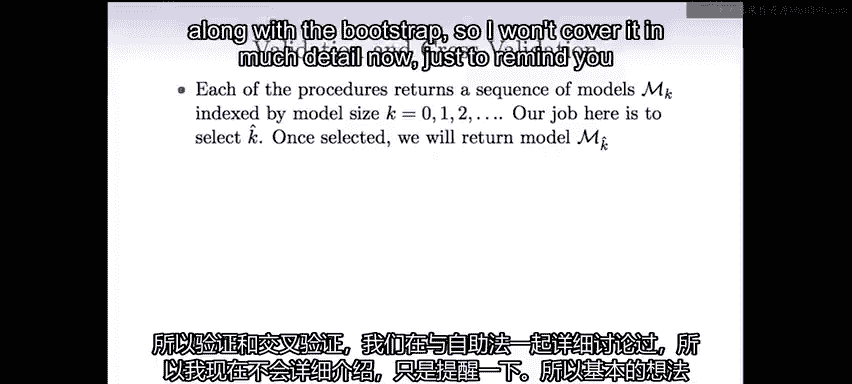

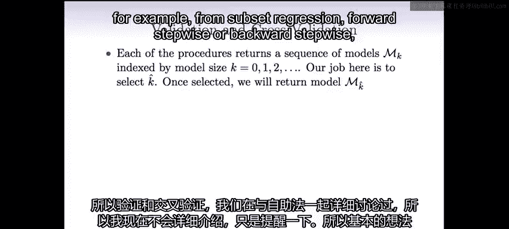

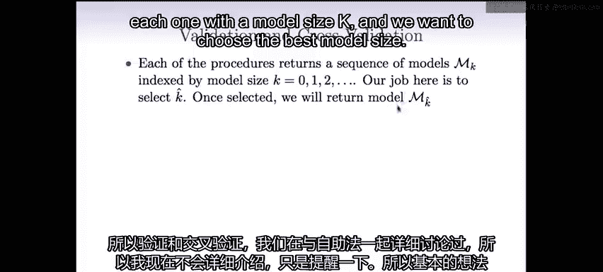

We just talked about some methods based on adjusting the RSS。

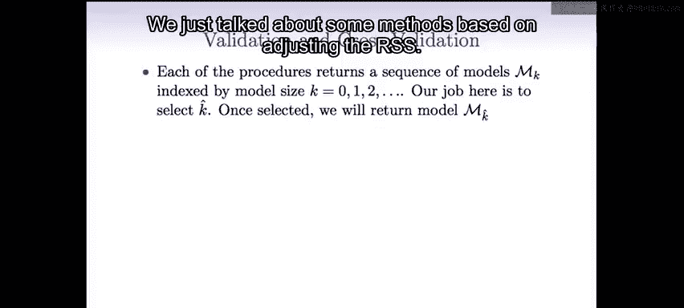

AIC and BicC。Validation across validation， rather than making an adjustment， they're more direct。

 so just to remind you what the idea of validation is。

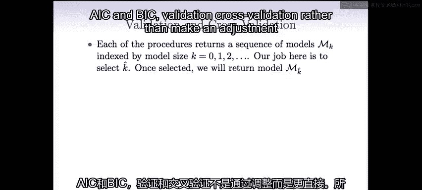

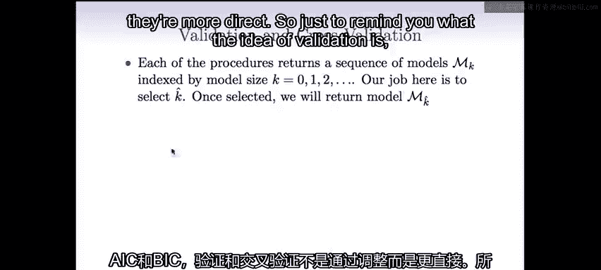

We divide the data up into two parts， a training set and a validation part。

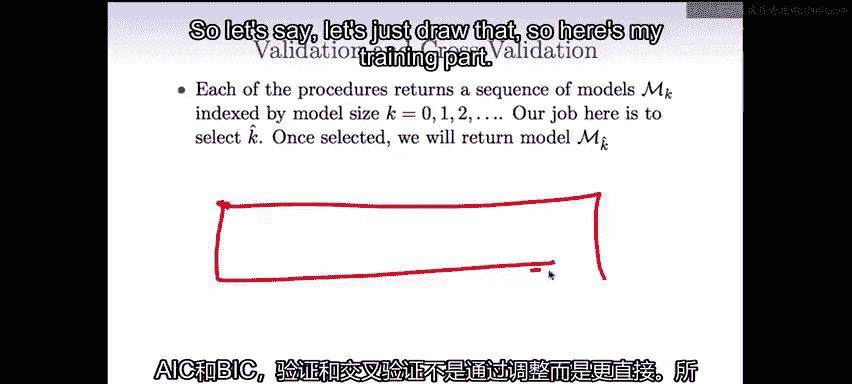

So let's say let's just draw that， so here's my training part。

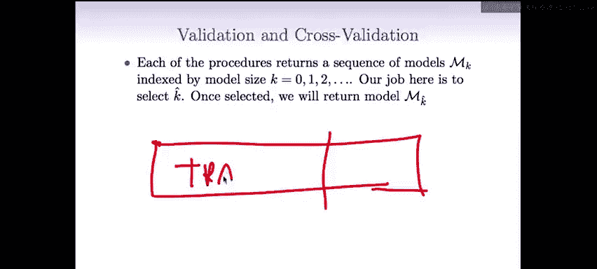

At random， maybe I'm going to choose， say a half or three quarters to my training set and the balance to be the validation set。

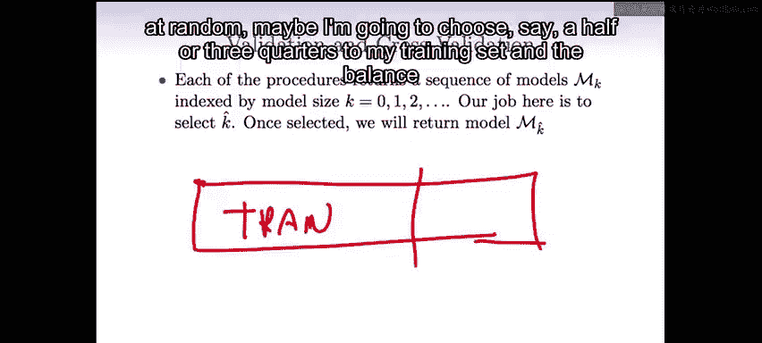

And then the basic ideas are're going to fit the models of various sizes of various k。

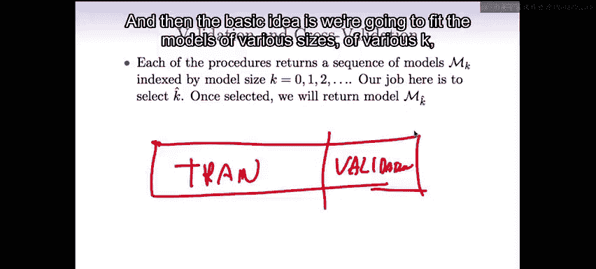

For example， if it's forward stepwise， choose I'm going to find the best model the fourth stepwise model of each size K on my training set。

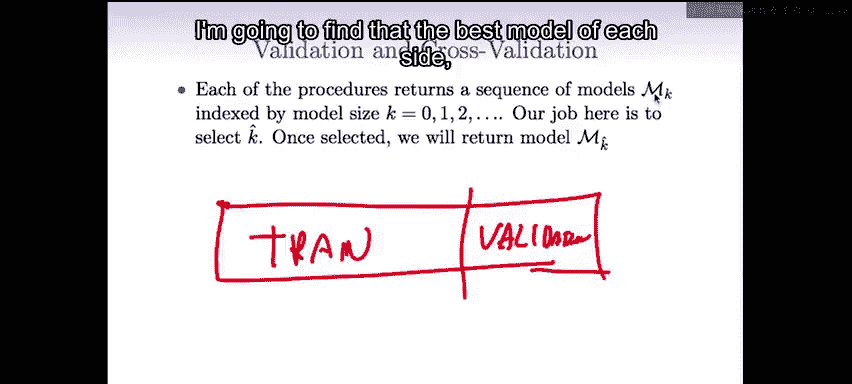

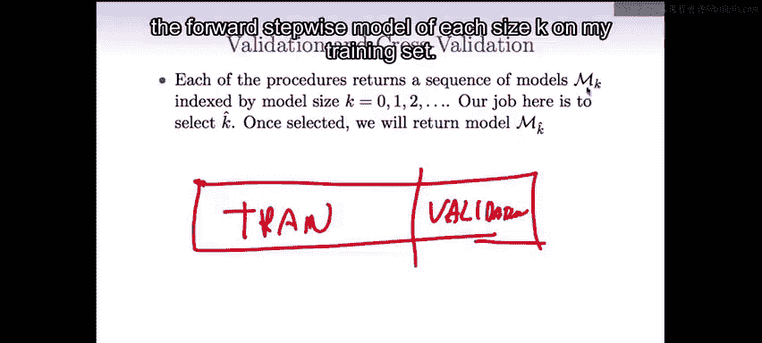

And then evaluate its error on the validation part。

And the validation error as a function of k will be my will be what I use to to estimate prediction error and to choose the model size。

 So this is validation and the cross validation is much like that， except。

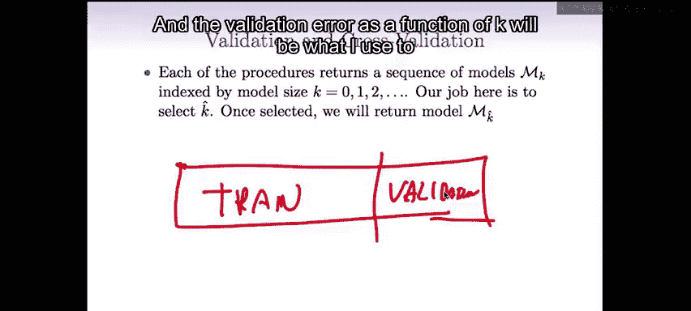

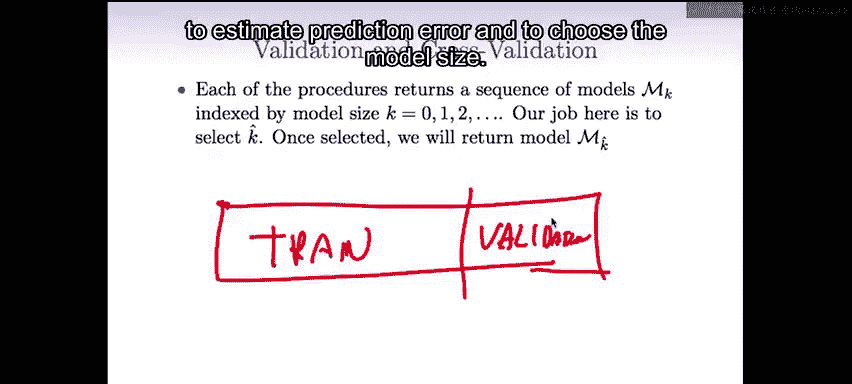

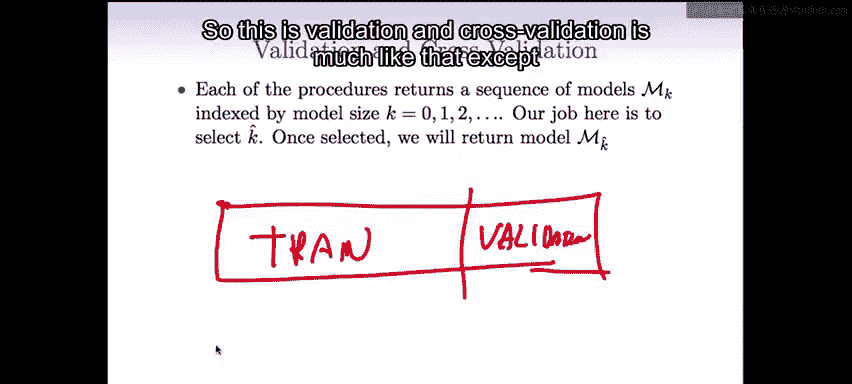

It's sort of a K， Kak play， right， So if's it's 5 full cross validation。

 I'll divide the data up into five parts to。

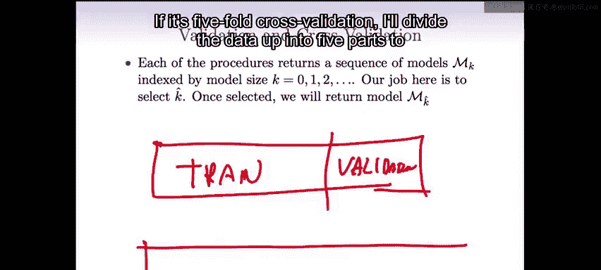

Three， four， five and then。

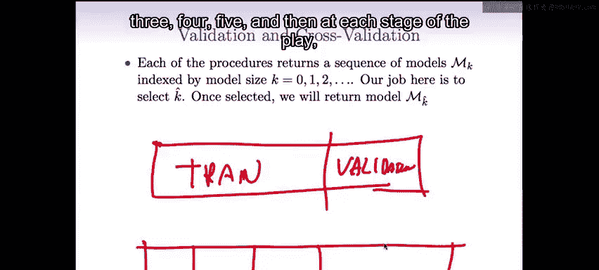

At each stage of the play， four of the parts are training sets。

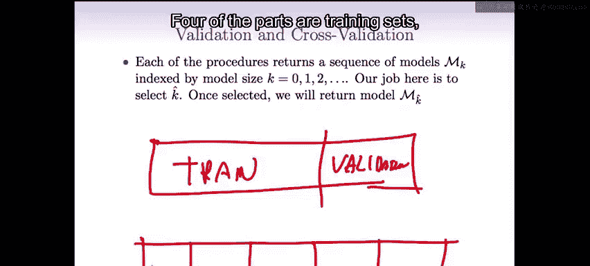

Are the training set？So let's say these first four parts are the training set。

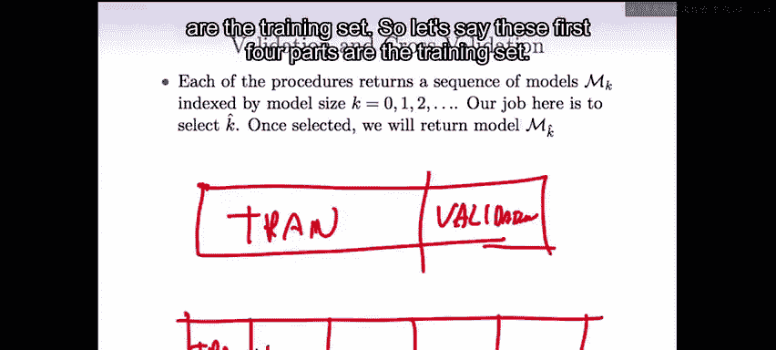

And this last guy is the validation in this。

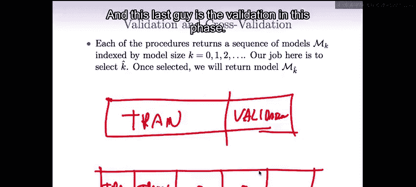

P。So I will fit the models of all size K。

To these four parts of the data， the training set。

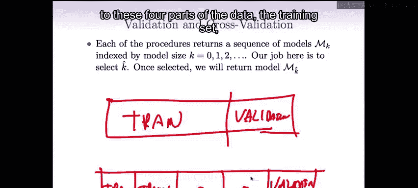

And evaluate the error on the validation part。And I'll do that in turn for the five different possibilities where at each stage。

 one of the pieces is a validation and the other four pieces of the training。

 and then we'll summarize the results together to get an idea of the error as a function of K。

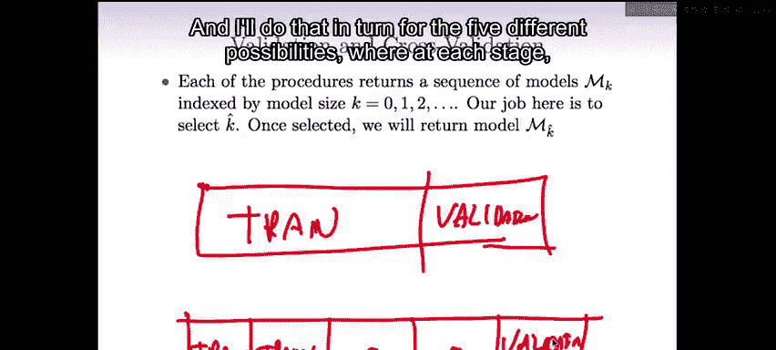

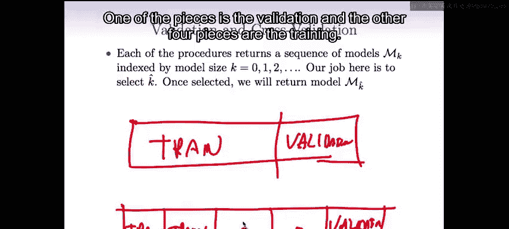

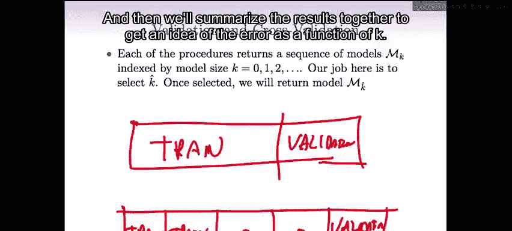

That's called the cross validation error estimate， and then we'll find the minimum of that curve。

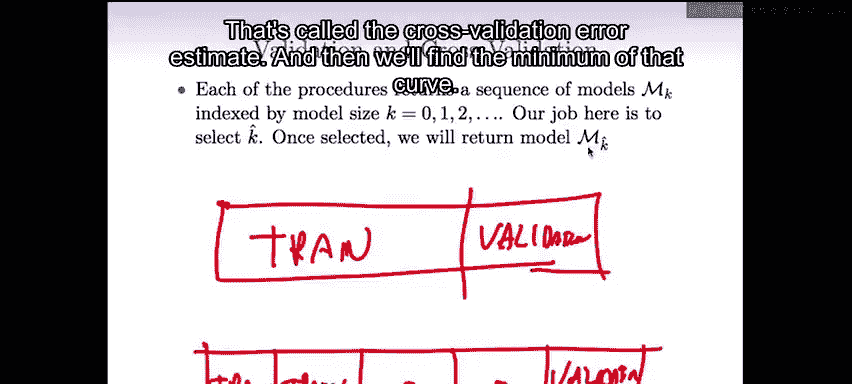

So again， I said that quickly because we've gone over that in detail in the previous section of the course。

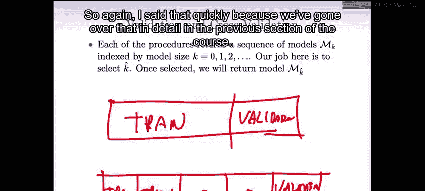

So here I have look。I've said this again in words。嗯。On the second board item。

So either using validation or cross validation， we'll get an idea of the error for each model size K and then select the K that gives us the lowest test error over the validation part of the process。

And this is actually a very attractive approach， and we've said this already。

 but it's good to say it again。Compared to the other method that you talked about， the advantage。

 there's a number of advantages that the one big advantage doesn't require an estimate of sigma squared。

You might think that's a small advantage， but it's actually quite important because if P is bigger than N as it is quite often in data that we see these days。

To get an idea of an estimate of sma squared is very difficult。

 we can't fit a full model because the full model will totally saturate and give an error of zero。

So we need we have to pick some kind of a smaller model。

 but we can it's quite arbitrary the model we pick， and it's hard to know。

We like to fit a model that has all the good variables and leaves out the noise variables。

 but we don't know， of course， what's the signal， what's the noise if we did know that we wouldn't even have to do wouldn't have to fit these models。

 so it's getting getting an idea of Sigma squared that seems like it may be a trivial matter but it's actually very challenging for models。

for situations with large numbers of features and that's actually challenging to the point where like it's an open area and statistical research so like know I'm an associate editor for a journal and we get submissions from like statisticians at topt universities who are coming up with ways to estimate Sigma squared so maybe in 10 years this will no longer be a challenge but right now it's really hard to do and that's actually one of the reason it's so much fun to be a statistician because we get new kinds of data for example。

 high dimensional data with large numbers of variables and presents challenges to to things which were simple in with small numbers of variables now become very challenging but very important so the technology and the kinds of data that we see bring new challenges to our field every day。

So cross validation helps to solve that problem by avoiding an estimate of sigma squared。

 we don't need to plug in sigma squared anywhere。 The other point is you don't need to know D。

 remember these。Previous formulas， for example， the adjusted r squared had a D in it and CP and AIC and BIC have all had the number of parameters。

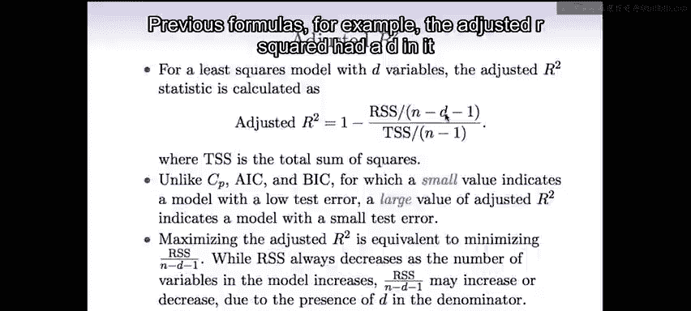

Well again， that might seem sort of a silly thing， well question over the number parameters in your model。

 well that's true when your model is a linear model and you're choosing predictors。

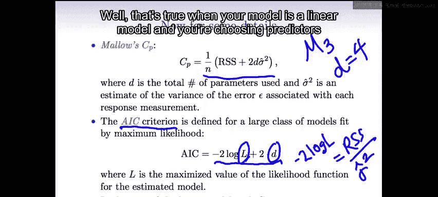

As coefficients， but for methods like Ri regression and lasso。

 which are shrinkage methods we'll talk about next。

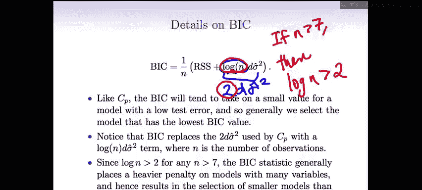

It's not at all clear what D is， and it's actually it's another whole area of research figuring out what is meant by D。

 the number of parameters in a model which is not fit by least squares。

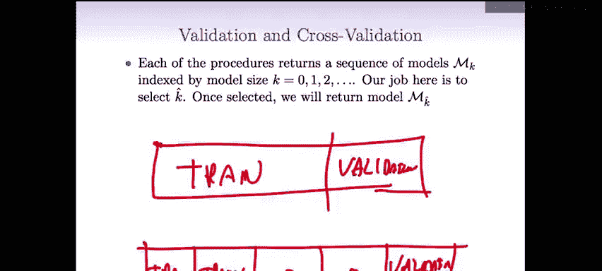

So again， cross validation。Fness is that problem by not requiring you to plug in a value for D。

 So D and Sigma squared are both challenges and cross validation relieves the worry of having to come up with good estimates of those。

So I've said all these things。So let's see what it looks like in the credit data example。

 so again the number predictors， here we apply to the square root of BIC just to make it comparable to the other two estimates。

 the validation set error and the cross validation error。

 so here we did actually validation set was three quarters one quarter。

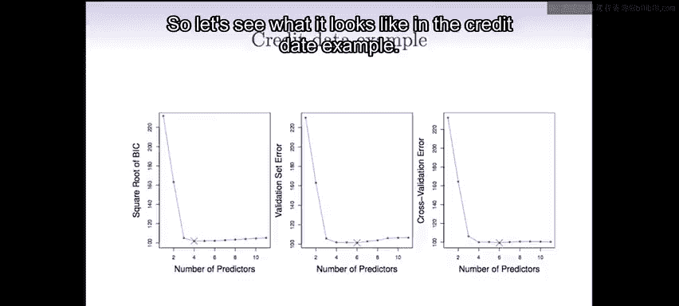

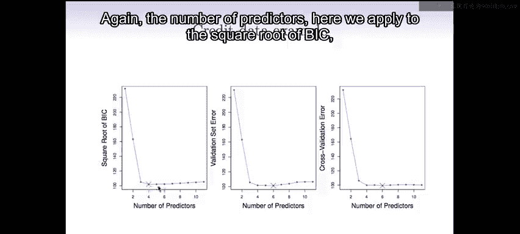

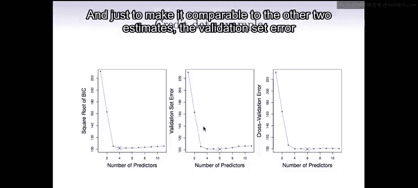

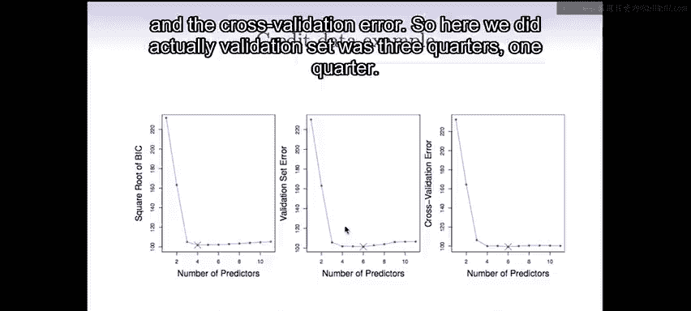

So three quarters of the data was randomly chosen to be the training set。

 one quarter is the validation set， and we see the error。

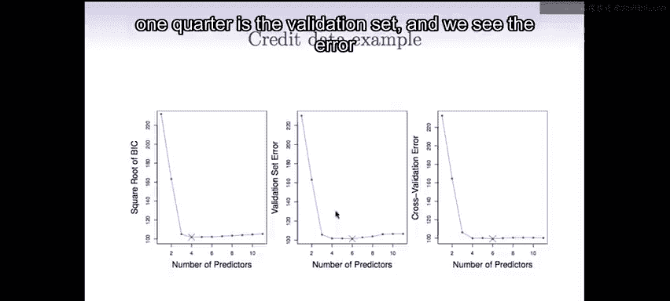

Attracted as a function of the number of predictors， we have marked the minimum。

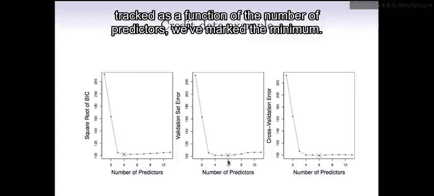

And here it's about six predictors， cross validation， I think this was what I say here， five。

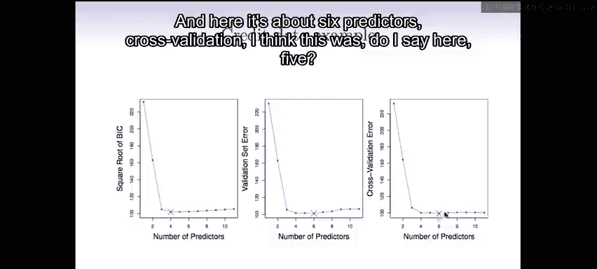

A tenfold cross validation， we like five or tenfold cross validation in general， they're good values。

It's producing about the same model size，6 as the minimum。 Again， the curry is very flat。

 It's hard to see here。 It's rising very slightly to the right。

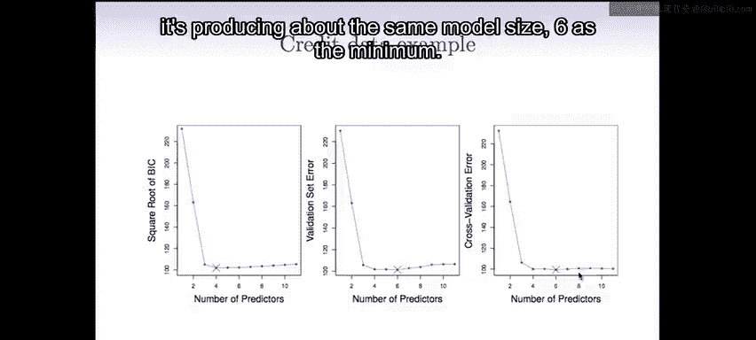

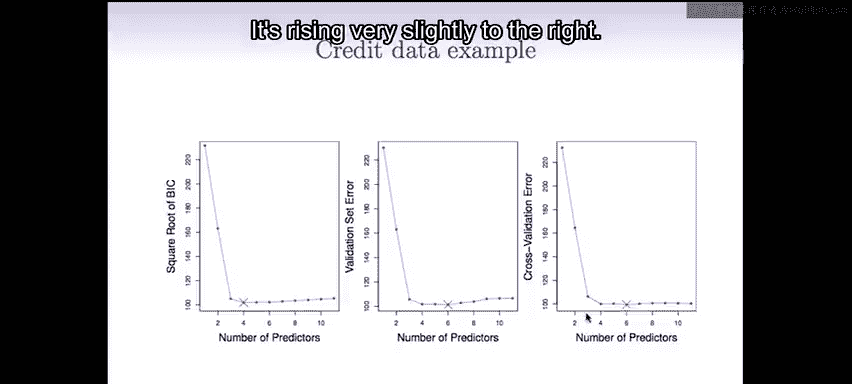

But there's not much to choose between， say。

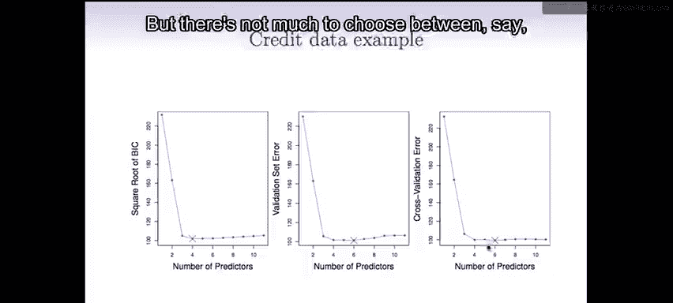

F14 and 11 predictors， right， they give you basically the same error。TheIC， as often the case。

 remember we said when compared to AIC it imposes a stronger penalty on the model size。

 it tends to produce models which are a little bit smaller and did so here here it's about four。

 but again the curve is so flat there's not much we can really say about these。

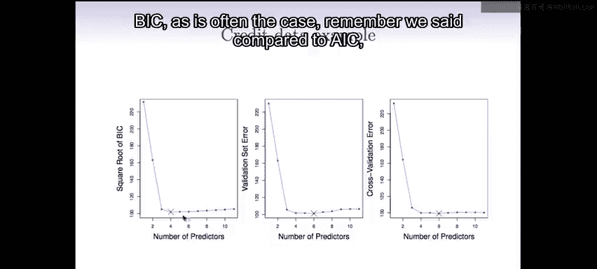

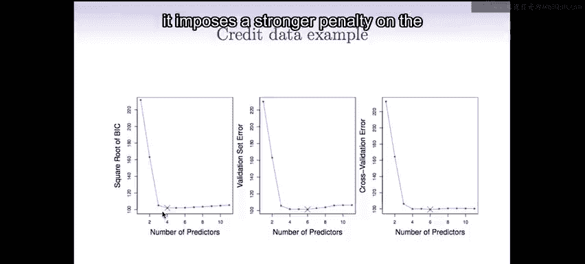

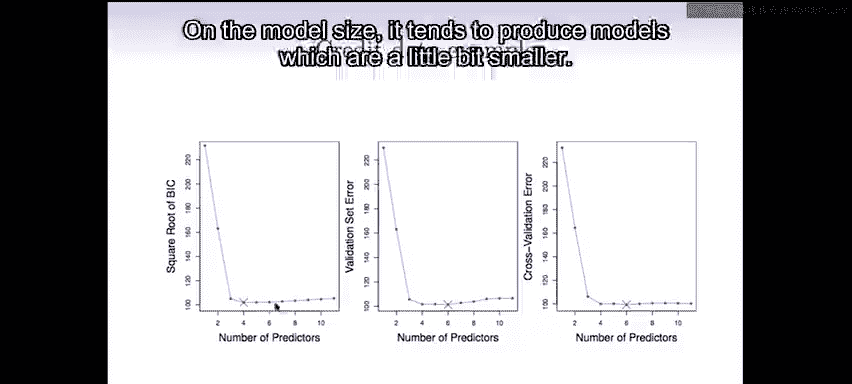

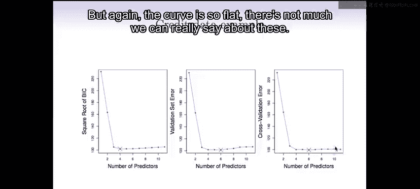

Models between three and 11 predictors。

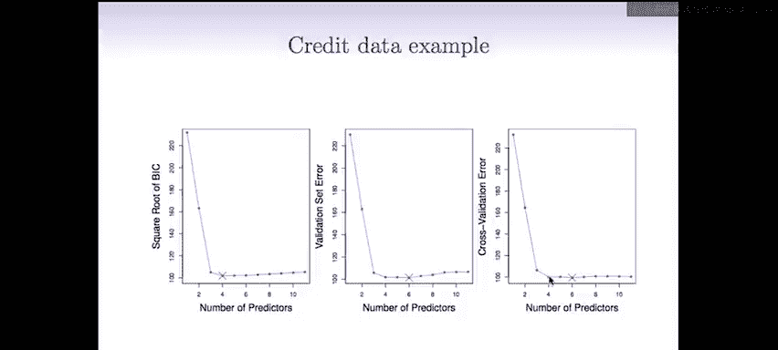

And actually， I mentioned the bottom here。The one standard error rule。

 we talked about this a bit in the cross validation section， let me just remind you what that is。

The one standard error rule says， well， we're not going to pick the actual minimum of the curve。

 but we'll acknowledge the fact that the curves have variation because they're actually their random variables。

 its like the data are the functions of the data。

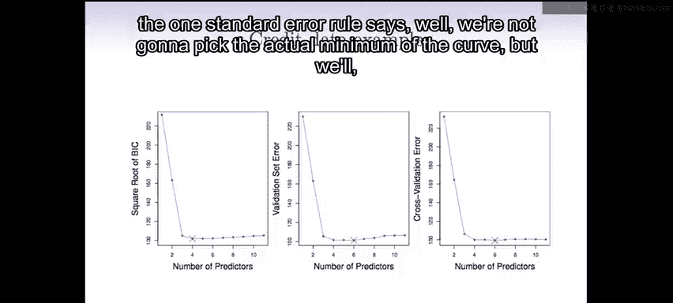

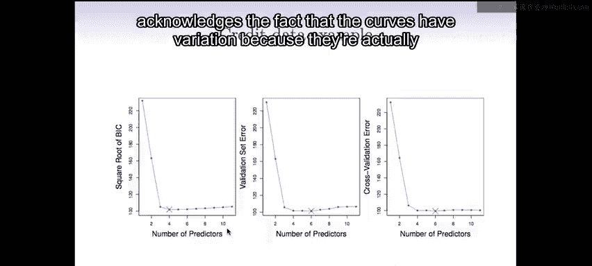

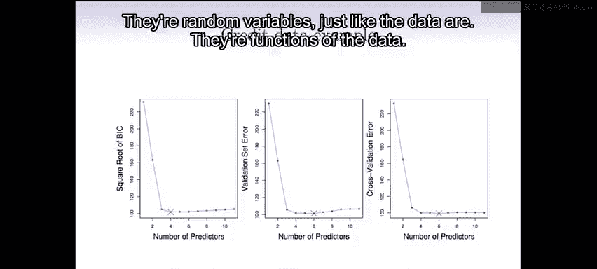

So the one standard error rule， let's draw it just in。Pictures here。

 so let's suppose you have one of these curves in the minimum， here's the actual the actual minimum。

The standard error of the curve， which we didn't indicate in these examples， but we should have。

 we can get， well the cross foundation just an average over the K folds。

So the standard error of that mean of k full things like k is 10。

 the standard error of those 10 numbers。

Gives us the standard error of this curve so we could draw the standard air plus or -1 standard errors from the minimum。

So the one standard error rule says， remember this is the number of predictors along the horizontal axis。

So don't choose the minimum。But take the simplest model that comes within one standard error of the minimum。

 so that would be， we'd come across to here and we choose this model。

嗯。

So the idea being， well， if these models are within one standard error of each other。

 we really can't tell them apart on the basis of the data because the error is almost the same。

 So all of equal， we'd rather have a simpler model。

So that's why we've moved。To a model to the left here， which has fewer predictors。

 and its error is no more than one standard of error away from them。

They of the。Are the best model。 So the one standard error， which is is pretty popular now。

 is not use the model with the absolute minimum， but use a simpler model that comes within one standard deviation。

Of the， of the minimum。

Okay。So the rationale for this， again， I've said it is that if the models are within one standard area of each other。

 let's choose the simplest one。Because it's easier to interpret。

