# TrevorHastie／RobertTibshirani《统计学习导论｜An Introduction to Statistical Learning》中英字 - P42：P42 StatsLearning Lect10 R modelselection A 111213.zh_en - GPT中英字幕课程资源 - BV1jN4y1Y7JR

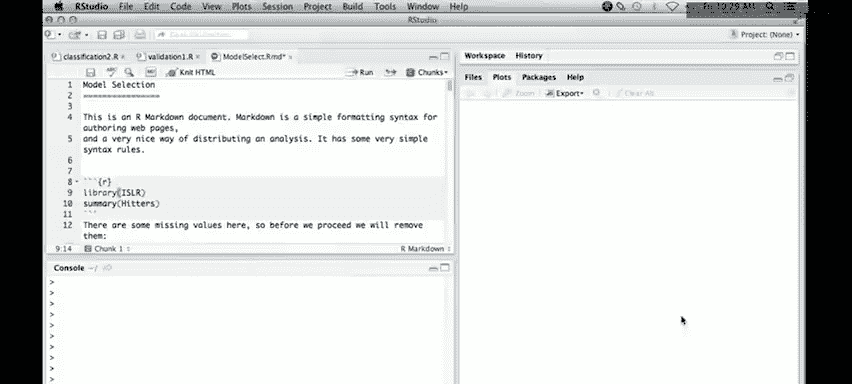

Welcome back we're going to have our session now this time on model selection so we've got a script ready we're going to look at using validation sets cross validation for selecting the tuning parameters in stepwise regression la so rid regression and the like this will be broken up into a few sessions。

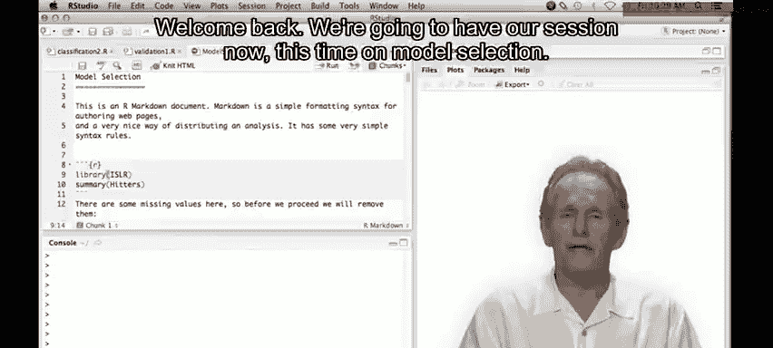

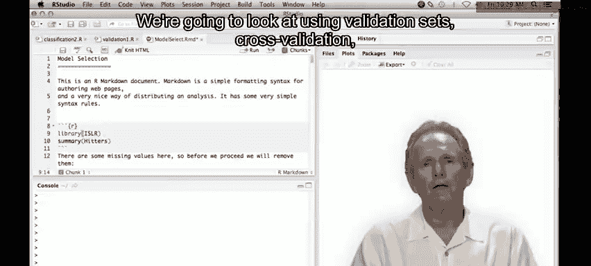

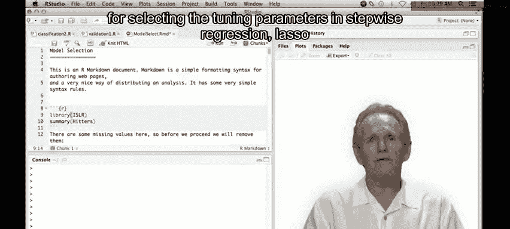

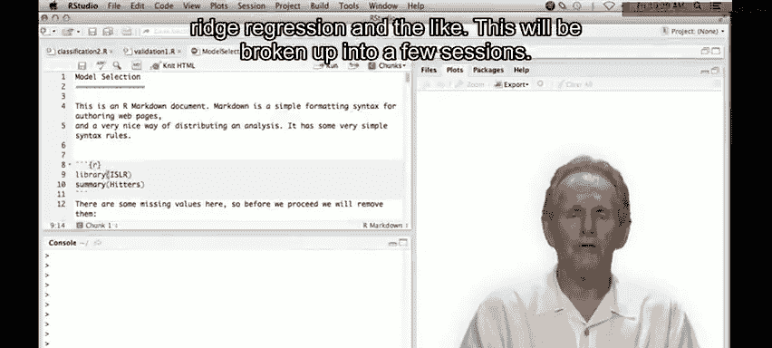

And we're going to do something a little different this time。

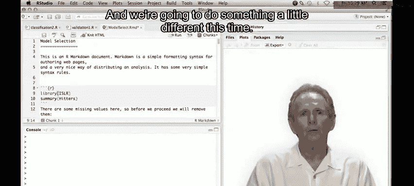

In the past I've just shown you in our script that we've used in ourSt where we click through the commands。

 well this time we're going to do it in also in our studio but using something called markdown mode and what that is is it's a way of merging text with our code and at the end of the day you can produce a document in this case a HTML document to a web page as you'll see it's just about as easy to do as using a script and it just becomes much more useful especially for making demonstrations。

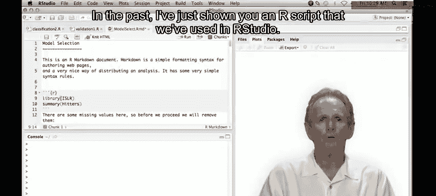

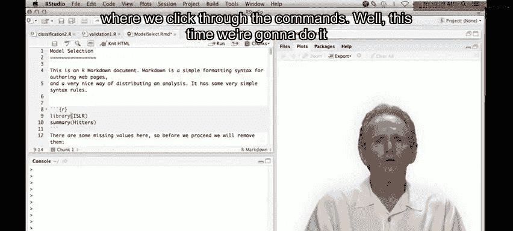

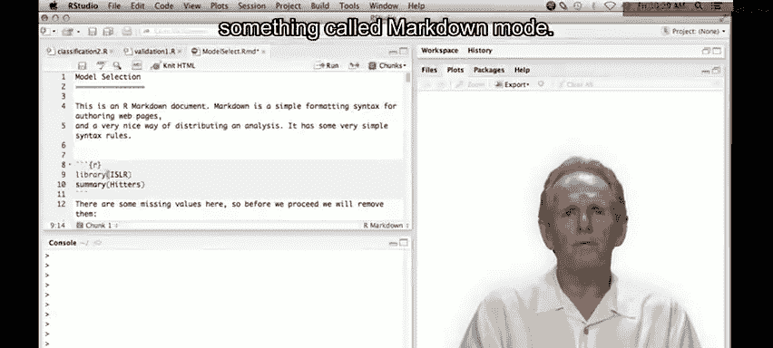

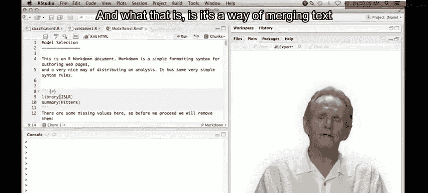

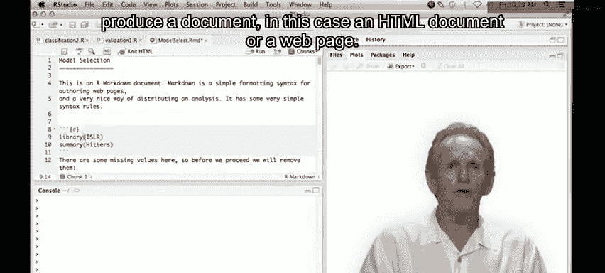

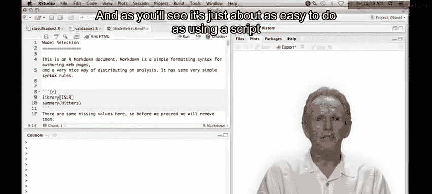

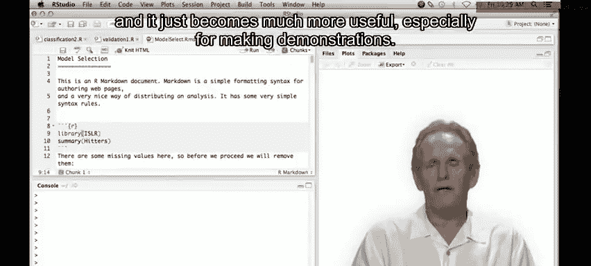

So let's see how this works。

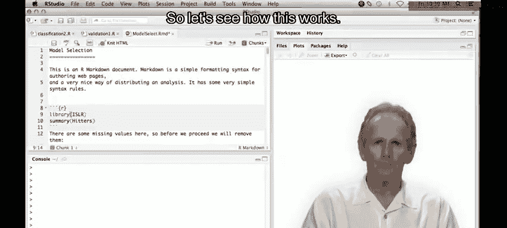

Okay， so here's our lockdown。

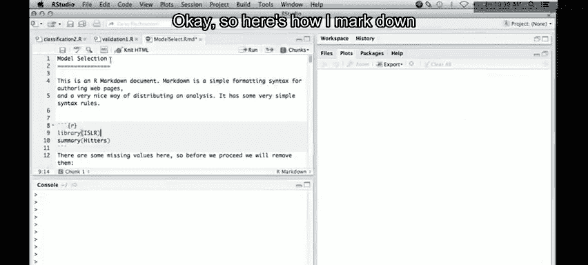

Scrt， its the beginning of it， and you'll see it's got actual just text written in the beginning that says this isn't our markdown document。

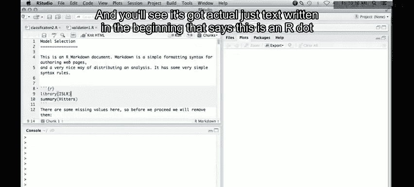

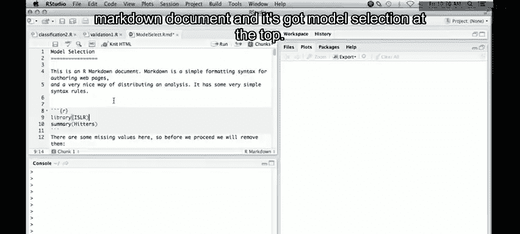

And and it's got model selection at the top and it's underlined a double with equal signs and there's a few conventions in Markdown。

 I'll just click this help pane over here and you see very simple instructions on how to structure markdown on the right。

 so it's very easy to learn。

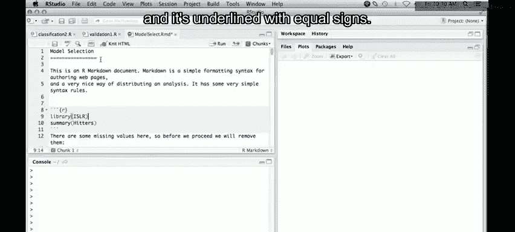

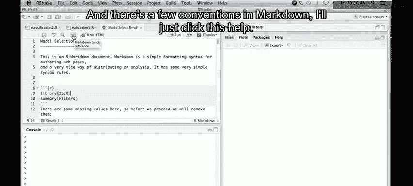

And the R code actually sits in chunks。And so here's a chunk over year。

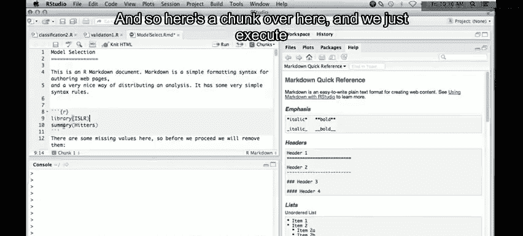

And we just execute code in the chunks just like we did before notice that chunks begin with this back back quote back back quote and then R it's a little incantation which you can invoke by using a keystroke and we execute the commands just as before。

 so here we are we go library ISLR， and we're going to use the hitters database。

 which is a baseball database which has a recording of a whole lot of statistics for different baseball players and including。

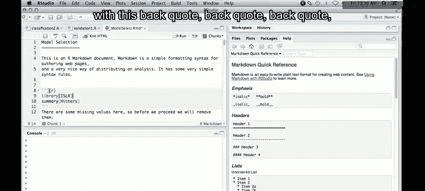

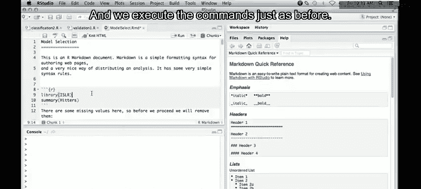

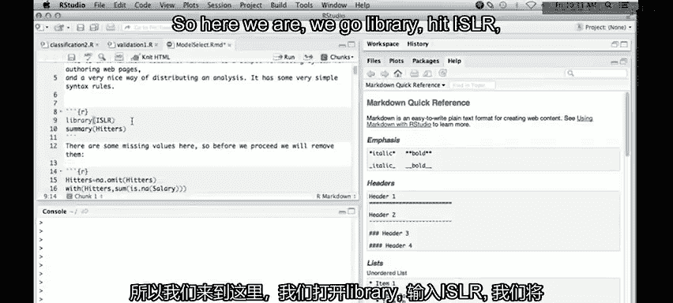

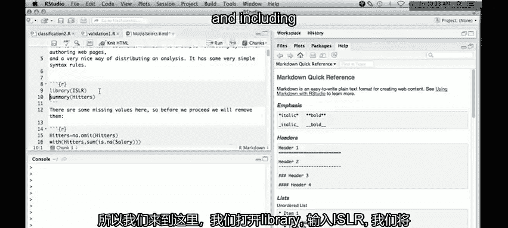

A response variable salaryry which we're going to use as the target for a regression model and so there we see salaryry。

 we notice it's got a bunch of missing values， 59 missing values which is going to be a little unpleasant for us so we're going to do something about that but just for the moment look at the summary and you can see all the names of the variables these are statistics that have been collected during the you know baseball season。

And we're going to try and use these statistics to predict the salary of the the player。So。

missing values are。There are various ways of dealing with them。

 we're going to take the easy way out here and we're going to eliminate any row in the data frame that's got a missing value in it and there's a nice function called NA dot emitmit that does that for you and we run NA dotmit and that'll produce a new data frame which we just overwrite on hitters here。

And it won't have any missing values。 It'll have less rows， of course。

And then we can just check if there's any Ns in this new data frame hitters。And yeah。

 we use our width function again， because it's kind of cute。

 So with data frame hitters look at the sum of any， well。

 is N or the any N is in the variable salary。 And when we do that， we get 0。

 which is what we expected， okay。Allright， so the first thing we're going to do is we're going to see how to do best subset regression so if you recall from the lectures best subset regression looks through all possible regression models of all different subset sizes and looks for the best of each size and so produces a sequence of models which is the best subset for each particular size。

Okay， and that sounds like a lot of work， but luckily we've got a library called Lps thatll do that for us。

And there's a function in leaps called Reg subsets that will do the best subset modeling for us and so yeah we assign to Reggfoot。

 fool this reg subsets with cery as a response， it takes a formula and the data is hitters。

And it's amazingly fast。 we've got。You know we got over 200 baseball players here。

 and it did all subsets and we got 19 variables and it did all subsets regression in no time at all。

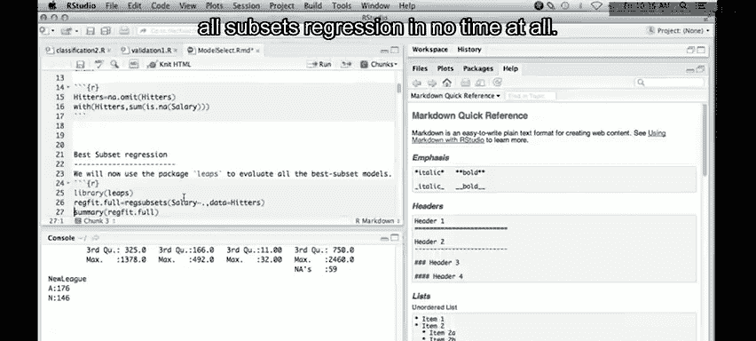

And if we do a summary， we get a kind of printout of that summarizes the best subset models and what it does is。

For each subset size， but so for example， subset size 1。

 it showed puts a star next to the variable that's in the best subset of size 1。 So that's CR R B I。

And then the best subset of size 2， of course， is going to be two with stars。And three and so on。

For the beginning， it looks like these subsets are nested， but they don't have to be nested。

 And if you study this， this output， you'll see that at some point， they're not nested。And。

So that's one way of looking at our base subset。嗯。By default it only goes up to subsets of size 8。

 maybe that's why it was so fast， but we've got 19 variables。

 so we're going to actually go all the way and get best subsets all the way up to size 19。

 So we'll run that one。 Well， that was just as fast。 It's instantaneous。

 And if we do the summary of that。Well， we didn't print it out， but we ran the summary and。We了。😔，And。

You you look at the。It's a bigger part， it names in the summary and the summary， you know。

 we've just now printed the summary， but this tells you what's on the sub and it has various things。

Like for each of the models， the best subset models， it has the R squared。

 the residual summer squared， the the adjusted R squared， the C statisticstistic， the B。

 I C statistics and a few other things， all the things that。

We're going to use to help us select a particular model。So happily， there's a plot method for。富嗯。

Well， actually， there's not。 We're going to plot the CP component of Re summary。

We'll just make our own plot， there it is。And remember， CP is an estimate of prediction error。

And here it's plotted， we plotted it against the number of variables and the Cp statistic。

 and the idea is to pick a model with the lowest Cp。 Well， in this case。

 it looks like the model with 10 variables。

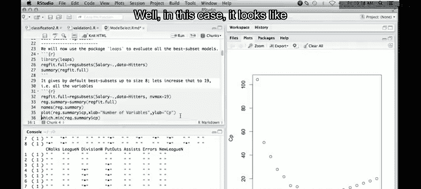

Is， is the smallest， and we can。Just use the function which dotman。To identify the smallest。

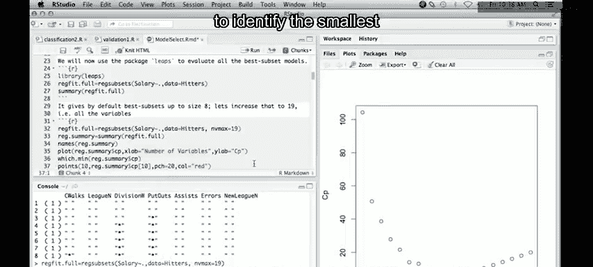

Index of the smallest element of the C P component。

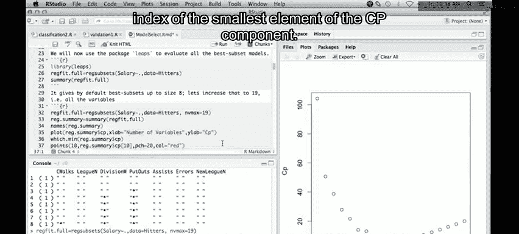

And let's just annotate our plot by indicating the point that we've chosen the best subset model there we used points。

To color the point red， the one that's going to be the chosen model。

So that's pretty straightforward using CP to do best subset selection using the function rig subsets。

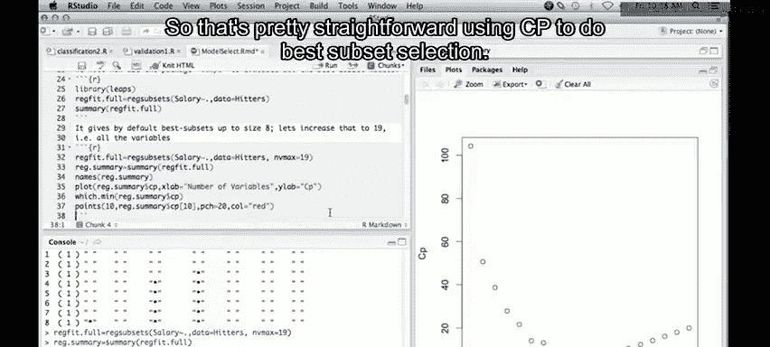

嗯。There is a plot method for the Re subset object， it wasn't the one I that we just produced。

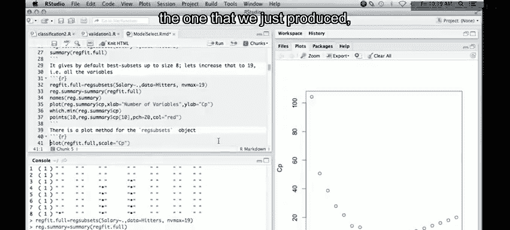

So let's use it。And it's like a patent picture。And at first you have to figure out how to interpret this plot。

 what it shows is on this axis here is the CP statistic Small is good。 So this is the smallest C。

 This will have corresponded to our model of size 10。 then you see CP getting worse and worse。

And then for each value of CP or each unique value of CP。

Black squares are ones indicating that variable is in and white squares or the variables are out。

OkayAnd so it's an interesting picture。 so what you notice is near the bottom of the CPs。

 the models are reasonably stable， like this whole band stays the same。

 there's a little bit of fluctuation over year。What you also notice is that as we should expect from that previous plot。

That bad Cs corresponded to models that had all the variables in or ones that had hardly any variables in。

And so， you know， you get used to interpreting this plot and you。

 it sort of gives a quick summary of all the models。As opposed to just seeing the CP statistics。

And now having chosen Model 10， there's a coefficient method for rig subsets。

 and we ask it for the coefficients for model。Co for the the model index 10。

 and we get a coefficient vector。And it gives you the coefficients of those variables that those 10 variables that are in the model。

And there they are。Okay， well， so that's the end of the first little session。

 we'll carry on with subsequent sessions using different methods for model selection。Before we leave。

 I want to show you how you actually get a nice。Summary the HTML file of everything that we've done so far。

 So you'll notice at the top here there's a command nut HTML， so we're going to issue that。And。

It shows us。 it's， this is the Web page that shows us everything。That we've done。

 but it's formatted nicely。 So we get all our commands， we get headings， the model selection。

 we get our commands。 the text is nicely formatted， and we also get the output。

 The our output is commented with with two hashes on the side。 and then any graphic that we。

Any graphic that we produced also appears in this plot。

 So that's a very nice way of retaining everything that you've done in in the R session。

