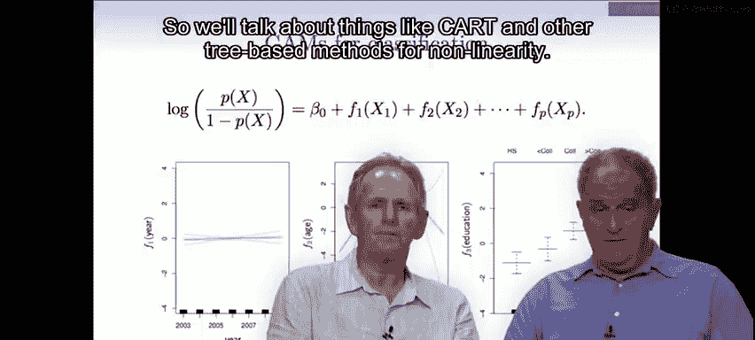

# TrevorHastie／RobertTibshirani《统计学习导论｜An Introduction to Statistical Learning》中英字 - P49：P49 StatsLearning Lect9d 110913.zh_en - GPT中英字幕课程资源 - BV1jN4y1Y7JR

Okay， well， that weve already got a long list of ways of fitting non nonlinear functions。

There's another whole family of methods called local regression。In fact， Rob。

 wasn't there a PhD thesis from Stanford on local regression。

 I don't remember Rob's PhD thesis was called local likelihoodli and was an extension of these local regression ideas to a whole range of problems and still used widely today。

 I wouldn't say widely you're two modest。So。Here we have we're not going to go in great detail into local regression。

 but I'll just give you the idea。Here we have some data。And we've got a region over here。

Where we fit a linear function just to the data in this region。

 the points in the region are the orange points。 So it's a local set of points。

And so we locally fit the linear function。And in fact。

 we fit it by weighted least squares and the weights are given by the heights of。This kernel year。

 So the highest weights are given to points at the target point， which is where this orange dot is。

 and then the weights die down as we move away。Okay。And from doing all that whole linear function。

 you'll just get one fitted value at this point over year。

But then the idea is that you slide the target point along and as you slide it along。

 the whole region slides along so here we see the target point at this point over year。

There's the weighting function。The orange points have moved， right。

 So we fit in locally at this region over here。We fit a linear function。

 and the fitted value is taken to be this orange point here。At the target point。

And so as we slide the region along with the target point along。

 this whole system slides along and we fit different linear functions。

And that traces out the orange curve over。And the reason we like to fit locally linear as you might think。

 why didn't we just fit a local constant or like a moving average is that it does much better。

 for example， at the boundaries。It， it， it gives you a much better extrapolation at the boundaries。

So this is called local regression， and it's a very popular way of fitting non nonlinear functions。

 but just focusing locally on the data。Turs it's probably fair to say that low West and cubic spine cubic smoothing spines are probably the two best ways of doing smoothing and if you set the degrees of freedom of vote to be equal roughly。

 they look pretty similar too in general， would you agree So either one of these is a good choice。

So as Rob says， low waste is the functioning R for footing this local regression and we'll play with that a little bit in the lab and you'll see it's very easy to use。

So we're not going to say anything much more about local regression。

 but the concept of local regression is important， you can read more about it in the book and in our other book elementsments of statistical learning。

 and you'll see it's actually a very rich area and allows you to do lots of flexible things。Okay。

 the final topic generalize additive models。So the general idea is that you're going to fit nonlinear functions in a bunch of variables at the same time。

But the additive in the name means that you're going to retain the addivity of linear models。

 and the reason that's attractive is because it leads to interpretable models。

So yeah our model for y is an additive function of the different x's， so we've got a function of x1。

 a function of x2 and a function of Xp， these are different variables in the model。

And once you fit this model， you can plot the different contributions to the to the fitted model。

So if the first variable is year， we've got a nonlinear function of year。

And then we got a nonlinear function of age。And the third variable in this case。

 with three variables was education， and that was a factor variable。

 and so there piecewise constant function is a natural thing to fit。

 one constant for each of the levels。But the point is the additive model gives you a picture that you can look at and appreciate the contributions of each each of the variables to the composite model。

And， and so the technology is about fitting nonlinear functions of several variables in this additive form。

So。You can fit a generalized additive model very easily using some of the earlier tools， for example。

 natural splinees， so it's as simple as this。 Let's suppose we want to fit a additive model in year and age。

 We can just have a call to linear model LM。RightAnd we give it two terms。

 weve got the response wage。 We have a natural spline in year with five degrees of freedom plus a natural spline in age with five degrees of freedom Oh。

 sorry， plus education， so that's the previous term Education is already a factor variable so it'll automatically fit the piecewise constant function。

Okay。And that'll do it for you。As we said earlier， the coefficients that you end up because this term natural spline in your degrees of freedom equals 5 will actually generate a basis matrix for doing natural cubic splinees。

 so that's a matrix of x's。Contributions to that model matrix。

 And each one of them is going to get a coefficient。

 But we're not interested in the separate coefficients。

 we're interested in the overall function that it fits。 So it's a fitted function or this。

 this part of it that for each part of it that's interest。

So this previous plot here was produced by plotot。gam。If you try to plot this model。

 which is fit by LM by just using the generic function plot。

 it'll make a plot for linear models which is not going to give you the right plot。

 but if you use plot。gam， it'll treat it as an additive model and plot a plot that looks very much like the one in the previous slide。

Focusing on the functions rather than the the， the residuals and whatever。The linear model predators。

So of course， with generalized additive models you can mix terms， so you can have some terms linear。

 some nonlinear。And you can use， for example， the A No function to compare models and test whether a term should be linear or nonlinear。

You can also use other methods for smoothing。 So， for example， yes。

 yeah we use GAM to fit the model because。In the first variable， we want a smooth in spline in year。

 So there we use a symbol S to tell gam that it wants to use the smooth in spline with5 degrees of freedom。

And just to be interesting in the second term， we want to fit with low S so there the shortcut is LO in age and there we specify the width of the window。

 the local window by something called a span， which is the fraction of the data in the window。

And then， plus education。So that's like a fully blown generalized editoritive model。

Gams are additive， which means they aren't interactions in the model。

Now you can put lower directions in and by just including them in a natural way and there's several ways of doing that。

 you do get things called bivariate smoothers that take several variables， two or more variables。

 or you can put in interactions in other forms， for example。

This is a way you can fit a bivariate function in age and year using natural splines。

It creates a tensr product of these two sets of bases and result in a bivarirate function。

So this is somewhat more detailed， but you can do this and again。

 you can look at I don't think you'll see details in the current book。

 but in elements of statistical learning you can certainly see about doing things like this。

You can fit ga models for classification。 It's the same idea。 Yeah。

 we fit in the logicit of the probability as an additive model。And。In this case， when you do a plot。

 it' will plot the contributions to the logit。RightBecause。The。

 the fitted probabilities are not additive in the functions， but the logic is additive。

And so there we get the loaded， this was actually fit using the following gam expression to call to gam。

So this is our binary response。We ask for a linear term in year。

A smooth termine 8 fit by a smoothly and sp with5 degrees of freedom。And then the。

 the education term。And we tell Gam the family is binomial， so that's just like GLM。

 wed tell the family was binomial。And it knows to fit the logistic regression model。

Interesting to see the standard error bands for the linear function。

It's given you a standard errors for the slope。 be not， there's no intercept in these terms。

 They all sent it at0。 So the slope is of interest here。 And， of course。

 a standard error for a slope is going to be like a cone shaped otaic kind of standard error band。

So that's a generalized additive model。Okay。Well， so that's a whole collection of tools you have for fitting nonlinear functions。

Some of them you can fit directly using LM and GLM。

 and for the more sophisticated ones you use the GAM package in R。There's also a package called MGCV。

 which has another package that has GAM models in it， also using in smoothing spline。

 slightly different approach to what we take， but you can use those as well。

So you go have plenty tools at your disposal。In our next section。

 I think we're going to talk about tree based methods which are。Non nonlinearities as well。

 but involving more than one variable， the interaction between variable。

 so it's a good way of finding non nonlinearities， but if variables in combination。

So we'll talk about things like cart and other tree based methods for non nonlinearities。

