# TrevorHastie／RobertTibshirani《统计学习导论｜An Introduction to Statistical Learning》中英字 - P50：P50 LearningStats R nonlinear A 112113.zh_en - GPT中英字幕课程资源 - BV1jN4y1Y7JR

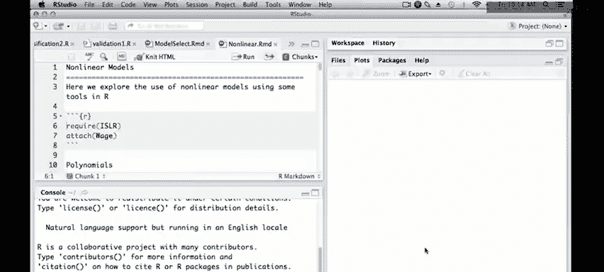

OkayWe back， we're going to have another R session now and today we're going to explore3 nonlinearar functions using R and once again we're going to actually work within the RSt markdown environment which I showed you last time which allows us to document what we do and produce a nice web document that records everything we've done。

 the output of our function calls and the graphics that we produced。

 so this is a very easy way of documenting sessions in R both for yourself and people that you for whom you do in the analysis。

So。in we go。Just to remind you， if you want to learn a little bit about our markdown。

 if you click on this button over here， up on the right。

 you'll get the help and just give you a very brief overview of all the simple。Commands and ways of。

Indenting， highlighting and so on。The main things we need to know。Okay， so let's get going。

 we'll once again require ISL or our library with data sets。And we'll attach the dataset wage。

 the data frame wage， okay？So the first thing we're going to look at is polynomials。

 polynomial regression。And we'll do a regression of the response wage on age。

 and we'll fit a fourth degree polynomial。Now normally that would require building up a matrix with columns x x squared x cubed x to the fourth。

 and then using your regression function， well this is where R really comes the four we have this lovely formula language which lets us just in one equation here。

 we've got a function poly which automatically generates that basis for us。

And we tell it to take as input age and4 is the degree that'll make the matrix and then LM will fit the model with response wage。

 and so it just all happens for us。And then we do a summary of the foot。

And you'll see below we get the summary， sort of shortened space here。

 but the usual kinds of summaries that we get from LM。

 we get the formula summary of the residuals and then the coefficients。And we see that。

Co coefficients， they all named poly age 4， and then 1，2，3 and 4。 This will be for degree1，2，3。

 and 4。 the different degree mononoials。 The first two are very significant。

 The cubic is is significant and the cortic is just barely not significant Okay。

 so it seems like a cubic polynomial would would be sufficient。Now， normally you can't。

 when you have a whole matrix， you can't。Just look at these coefficients independently。

 usually what it means is the effect of say this coefficient。In the presence of all the others。

 And if the variables are correlated， you know， you just can't make sequential decisions。 But yeah。

 it's a little different。 And that's because。The function poly generates orthogonal polynomials。

 So it's like we do a regression with uncorrelated predictors。 And we'll get back to that again。

 in a little moment。嗯。Let's what we want to do now is make a plot of the function。

 We're usually not interested in this individual coefficients of a polynomial。

 but we're interested in the function that it's produced。 Okay。

 so we're going to go through the steps now of how to actually produce that plot。

 So we tell our studio that we the next segment is going to have a figure and well we need if we want to specify the width and height of the figure we add that in the little opening incantation there。

And so now we're going to set up for our plot。 So first of all， we want to get the range of age。

And so we'll just use the function range to get age limbs that gives us returns the vector of length2 with a maximum minimum and maximum。

And now we use a function seek to make a grid of values of age。

 so age dot grid will go seek from equals age limbs 12 equals age limbs 2。

 so that's the minimum to the maximum。And by default SQL。

 just make a sequence of numbers increment in by one each time， unless you tell it otherwise。

 since ages or integer values here， that'll just be fine for us， we can。Execute this。

And let's just look at our age。t grid below here。And there you see a sequence of increment in by one each time。

Okay so now we're going to make predictions so well predict from F and then we tell it that the new data which has got to be a data frame or list at least with named variables that were used in the original fit and since age is the one that was used in the fit and that's where we want to make predictions we say new data equals list age equals age。

 grid and then we also tell it that we want standard errors。your pres now will be a component。

 a list with two components and one will be fit and one will be fit Se。t fit， okay。So。

 now we're gonna。Make the standard a bands that we're going to make a plot with a fitted function and plus or minus two standard error bands。

So here we make the standard error bands。So we we're going to make a matrix with two columns。

 so we call the function C bind， which is a way of making binding together columns to make a matrix。

And it's going to have two columns。 The first one is going to be Pre's dollar fit。

 So that's the fitteded function plus two times the standard error。It also comes from print。

And then the next column is going to be preds dollar minus two times the standard error。

 So that's going to give us our standard error bands。So we send that down to the process。

AndNow we make our plot， so we'll plot age the first plot the data。

 so age versus wage and we'll make a dark gray， so there we get the plot。

And nowll do of we'll use the lines function。To plot against age dot grid， the predicted function。

And we make it in blue and line width equals 2。Is how you control the thickness of the of the plot。

 And by default， the line with these one。And then we use the function mat lines。

 which in this case we've got a single x， which is age dot grid。

 but we've got our twocol matrix that have the standard error bands and you can use a function mat lines to plot those both simultaneously and again we want them blue and we say line type equals2 which means a broken line And so there you see the fitted function plus or minus two standard errors And so now we've done。

 So that's typically what we'd like to produce when we fitted a polynomial we'd like to see the fitted function and it's done for us。

With a little bit of work， we've had to do essentially construct the function and the standard error bands。

And well see later on that the GAm package has nice ways of doing that for us without us going through all the work。

Now。The other ways to fit polynomials we didn't have to use our poly function。 for example。

 you can fit it directly so yeah we're going to fit the polynomial directly by dis specifying age squared H cubed in H the fourth。

And so here's the call to LM。嗯。Each of the terms separated by a plus。Now。

 notice we've had to wrap age squared。In in a function， identity function。

 we've seen this one before， I believe。 And that's because the。

The power sign this carrot has a special meaning in a formula。

 And so if we want it just to mean squared， we need to protect it。

 and we do that by wrapping it in the identity function。So that'll for the degree fourth polynomial。

And。If we do a summary， what we will see is we see the forecast the。Four variables。

 H H squared h cubed and H to the fourth。And the P values。

 the coefficients and the P values are different to what we saw before。

 And that's because were using in a different basis for representing the polynomials。

So if you change the basis， you get different coefficients and therefore you'll get different P values。

嗯。may sound a little disconcerting， but the real thing we're interested in is a fitted polynomial and as we'll see that hasn't changed。

 okay。So we can just。Check that crudely by just doing a plot of the fit from our original polynomial。

 which we'll just extract by fitted。 So it just takes a fitted。

 It will extract the fitted values at the observe at the given x's， the given values of age。

 When we fit the function。 And we'll plot that against fitted of fit A。

 And you see a perfectly straight line， which says those fitted values are the same。

 So the fitted polynomial was the same。But the representation was different。嗯。

So as I mentioned earlier， by using the orthogonal polynomials。

 we can test each of the coefficients separately。嗯。And， and again。

 if we look at the summary of the foot， we can separately look at the significance of each of those coefficients and decide which ones are not needed。

 In this case， it was just the the cubic。Now， orthogonal polynomials are convenient。

 they considered a better way of fitting polynomials。嗯。

But this idea of testing separately only works if that's the only term in the model。

 and if it's not a GLM， it doesn't work， so it's got a limited use more generally if you want to test whether。

 say one degree polynomial is better than another degree。

 you need to use the more general and over function。And so that's going to be true， for example。

 if you have other variables in the model， so here we have a simple sequence。

Fit A is a linear model just with education。FootB has got education and age。

 both trying to predict wage。And FitC is a linear model with education and a polynomial of degree2 in age。

And for D is the same but the polynomial of degree3 in age。So that's a nested sequence of models。

 a nested in complexityplexity。In other words， the second model contains the first as a special case。

Likewise， the third contains the second and the first special cases and so on。

So that's called a net nested sequence。 And then we use the innova function to。

Sort out which ones we need。

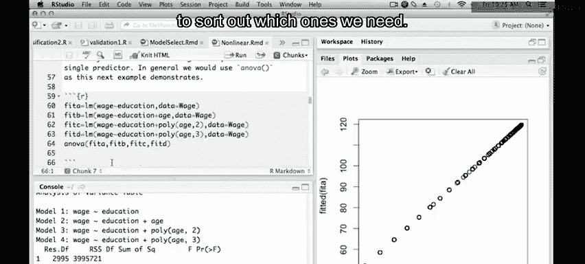

And so。This is the output of an no。And what it tells us is that certainly age is needed in the model with education。

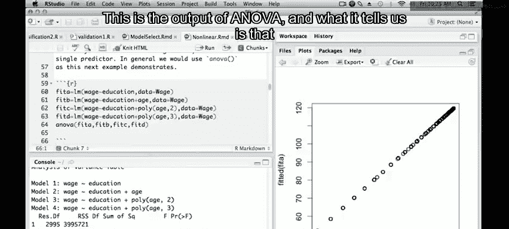

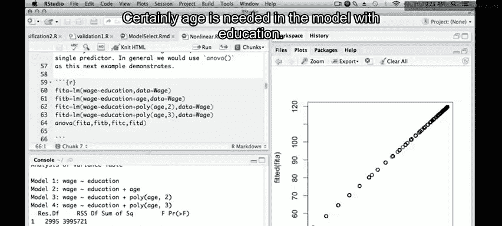

Also， age squared is certainly needed， as well as age in the model。

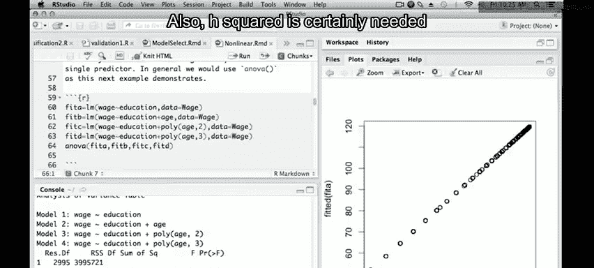

But age cubed is not necessarily needed， it not quite significant。

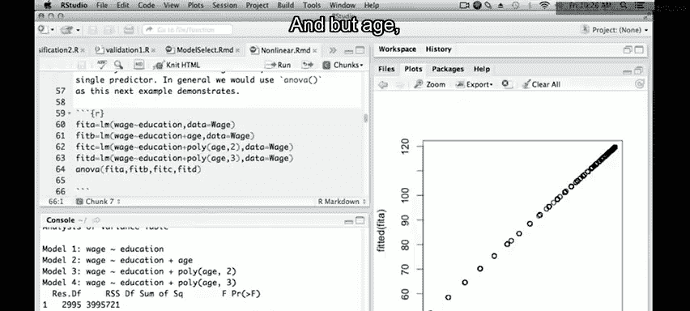

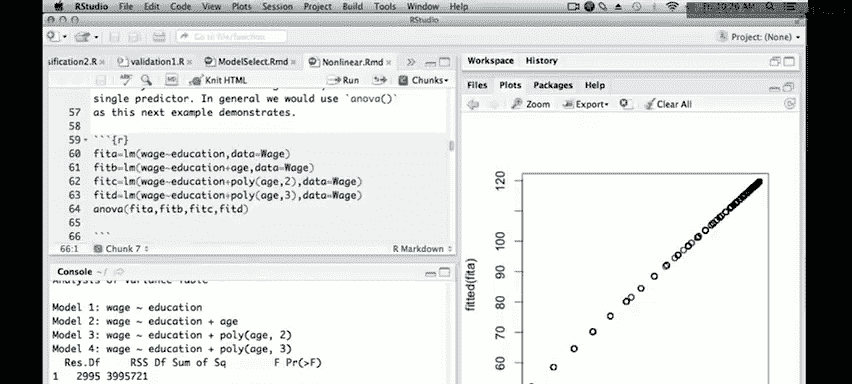

Well， it's significant at the 5% level， but it's kind of marginal。

So using a nova like this to test nested sequences of models is the right way to go in general。

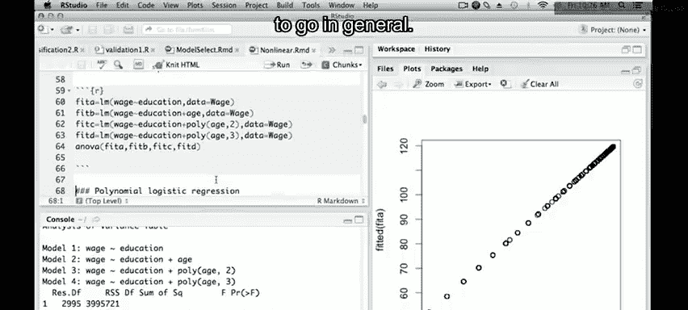

So this has all been using squared error loss and fit in linear regressions。 Now we can， of course。

 use the same technology to fit。

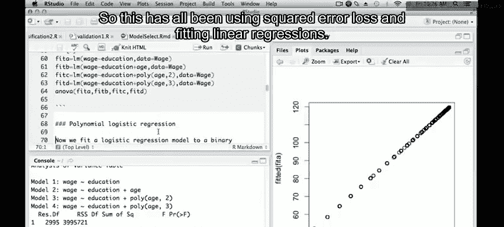

To fit other models， such as logistic regressions。

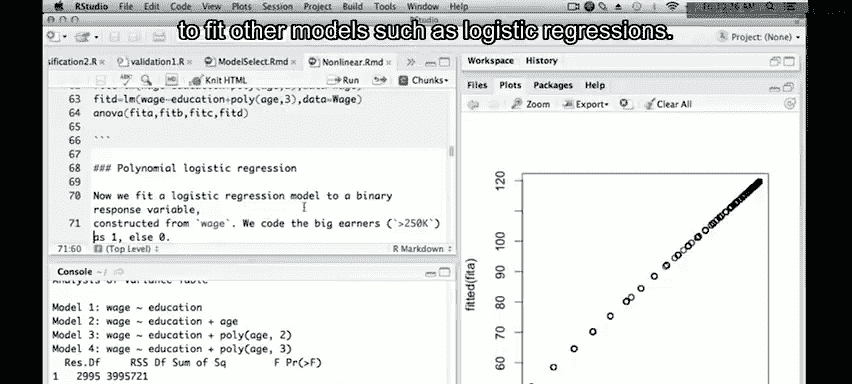

And so to do that， we will make a binary response。

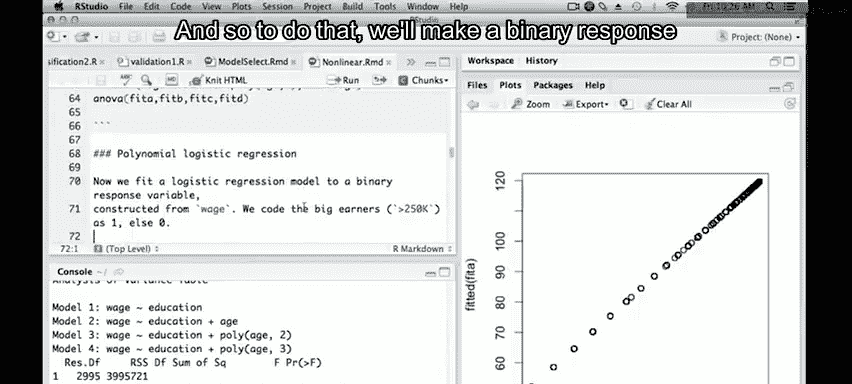

If you recall in the figure of wage versus age， there was a band at the top。🤢。

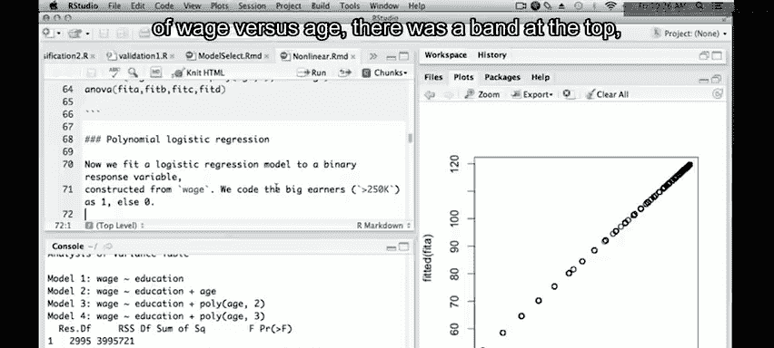

Get it back up on the screen。 There was a band at the top。

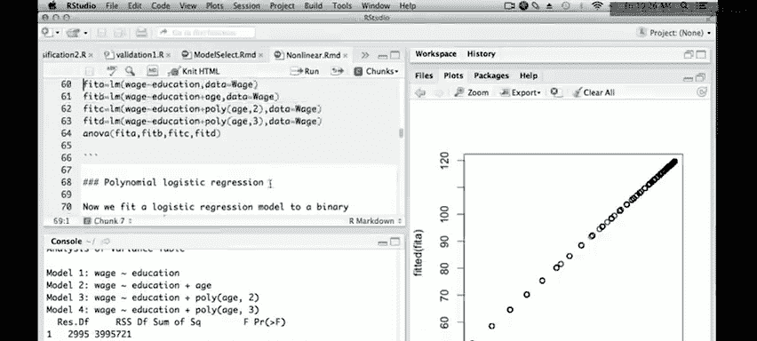

Of high wage earners， see's where's our plot。 Here we go。 We'll put that plot up again。

There's a band up at the top here of high wage earners and it looks like if we threshold it around 250。

 we'll capture those guys and we're going to call those the ones and the rest are going to be zero。

 so it' will be a relatively small group of ones that we're going to turn that into a binary response。

So let's find our place again。Okay， and so here we are。 so we can do that on the fly。 again。

 we use our indicator function and there we just provide the conditional wage bigger than 250。

 Well that evaluates to a true false variable。 but if you coerce that to numeric。

 it'll be a01 variable。 And so that all just happens for us here。

And so that is going to be modeled as a polynomial in age with degree equals3。

 and we do that and we foot that using GLM and tell it family equals binommial and again we can do the summary of the foot。

And。It。It gives us a summary of coefficients and now because it's a GLM。

 even though the polynomial was orthogonal is a orthogonal basis。

 it's no longer strictly orthogonal when we fit a GLM because there's different GLM involves having weights for the observations and so the orthogonality somewhat lost。

And so if we really wanted to test， for example， if a polynomial of degree3 was needed。

 we'd have to fit another GLM with a polynomial of degree2 and test to see if the two were different。

We can get standard a bands as well， just like before。So we'll first make a prediction。Of prints。

And well ask for standard errors。And yeah we do things slightly differently。

 we make standard a bands， some been a little trick here。

We want Pred's dollar foot to be in the middle of the standard a bands。

 so that's just a single vector。And era sea bind three things together。Just a zero。

And I name them as well。 F equals 0， lower equals-2 times per stand dollar standard error and up equals plus2 times per standard error。

 So these are just， this is a0 and the -2 standard errors and a plus2 standard errors。

So two things are happening in you。 These are two vectors of length n。

If you include a scalar like 0 in c B， it'll just replicate it n times。

 So this will make a three column matrix。Okay。And then we add to it a single vector， an n vector。

 and that'll just get replicated three times so it adds it to each of the columns。

 so it's a little bit of trickery。But it's good to learn tricks。

And let's look at this matrix that's resulted。 we will look at the first five rows and there we see it's done exactly what we said and so in the。

Over here the is the fit itself。 This is going to be the lower， and this this is the upper。

 and this is going down with values of age。嗯。So that gives the standard errors on for the fitted values。

 Well actually the predict predict fits the linear predictor for us。 so that's on the logit scale。

 We're usually more interested in the predictions on the probability scale。

 especially if we fit in against a single variable。嗯。And so we want to do the conversion。

So yeah I've got an expression， we need to do the inverse logicit。

 which I've got an expression here that's written in latex。And if you know lateEC， it says tech。

 it's a tech language， if you know tech or late， you'll know what this means。

What this has mainly showing you is that you can embed tech and late tech expressions in markdown。

And it will format properly， so instead of waiting to show you the formatted document I'm going to run it right now。

 you see it it runs through the whole document and then it produces the output because I really want to show you what that formula ended up looking like once we formatted it with lateI。

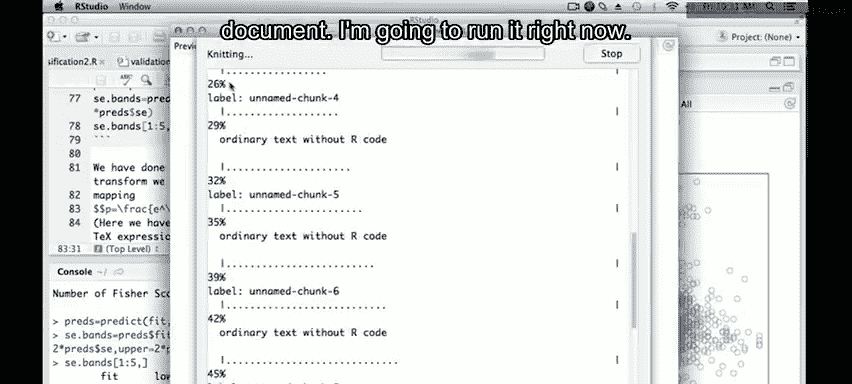

So use' all the output of everything we've done so far and there we have it。

 so it's formatted in a mathematical formula so if you know how to use tech you'll know how to do that and you'll see now you can embed that directly in the markdown。

If you didn't know about tech。Don't be worried， it's a very popular language used for most people who do mathematical work。

 convenient way of type sitting。So we want to apply that transformation。To。

Both are fitted function and the upper and lower standard a bands to transform them to the probability scale。

And so in all， this is how we do it。 And we're can apply that inverse logit function。

 So you see it's E to the。S bands over 1 plus E to the SC bands， or exponential of SC bands。

It's going to do this simultaneously to all the elements of the matrix and return a matrix for us。

Which is exactly what we want here。And now we can make a plot。And so we do it。嗯。Iive。

limitedted the rangeer because the standard a bands are new in advance。

 We're going to be very wide and we would have squashed the plot down。

 So this is the estimate of the fitted probability。And this is an estimated confidence interval。

 95% confidence interval for the fitted probability。

So now you see the value of doing it on the larger scale。

The confidence bands first computed on the Loit scale and then transformed to the probability scale and what you get for that is that your standard error bands for the probabilities all lie within0 and1 so this guy never gets below zero it's wedged in at zero but never gets below zero and that's kind of what you'd like okay。

And now we add some points to show where the data occur。嗯。And they'll appear， there they are。And。

And I've actually what I've done here is I first of all used jitter of age because there were lots of ties in age at each of the integer values of age to give an indication of how much data occurred at each age I use the jitter function which randomly adds to each element of the vector age a little bit of uniform random noise so you can get an idea of the density So therere these zeros they're the ones。

To have them fit on the page since Id limited the scale to up to 0。1。

 which means that we can see only 4% at most of the population in any given age category earned above 250k。

 limit the range， we had to shrink down the ones to make them point one so we can include them and just see them in the plot。

Okay， so this is similar to a plot we have in the book， and it shows the fitted probability。Okay。

So we've learned how to use polynomials， we've learned how to compare different polynomials。

 and we've learned how to plot the fitted functions with the standard a bands。

 and we've also learned how to use them with GLMs as well as linear models。So in the next segment。

 we're going to look at different functions， we're going to look at splines。

 which are more general functions。Usually better behaved than polynomials。

 and we're going to see how to fit splines both with single variables and with multiple variables using the GAM package。

