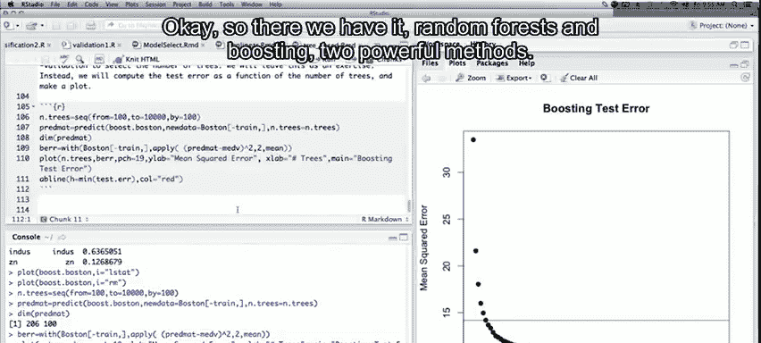
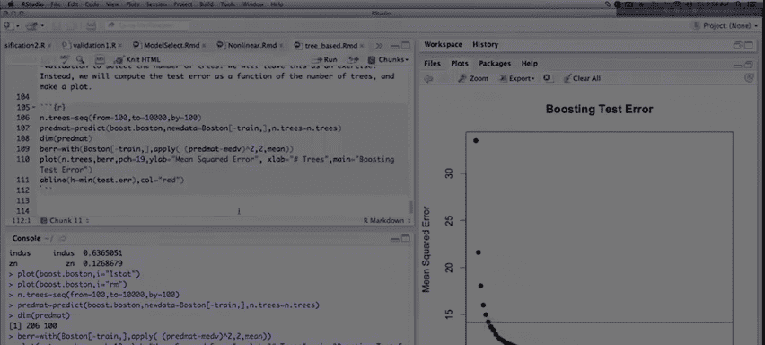

# TrevorHastie／RobertTibshirani《统计学习导论｜An Introduction to Statistical Learning》中英字 - P58：P58 StatsLearning Lect10 R trees B 111213.zh_en - GPT中英字幕课程资源 - BV1jN4y1Y7JR

Okay， yeah we are back again， we've learned about trees and how to use trees in our。

 and now we're going to see how to use trees in the context of random forests and boosting and we'll see this gives us pretty powerful predictors。

So there's two packages， random forests boost and GBM， which does boostting。

 we'll start off with random forests。So。As we know， random forests。

We'll actually build lots of trees and then average them and reduce the variance of bushy trees by averaging。

So we load the random forest package and we're going to use the Boston housing data again and that's in the mass package so we'll get that up。

 well set a random seed and。Let's have a look， we see we got 506 observations in the Boston housingous data。

And。We're going to make a training set of size 300 so we'll use the same construct as we used before and we got there we've got indexes for training let's just look at the Boston housing data so we can query we can run a help query on that and we see it's the 506。

Surs of Boston and for each suburb we got。Demographics and things like crime per capita。

Types of industry， average number of rooms per dwelling， average proportion。

 the age of the houses and various things。And what we're going to use as a response is the median value of owner occupied homes for each of these counties。

For each of these suburbs， so it's a data that's been around。

 it was based on a 1970 census in Boston。Okay，So we'll start off with the random forest and same kind of strong construct as before responses is meV median value。

 and to be modeled as dot which means as a function of all the other variables and we want to use the train subset and very fast random forests and we can just print out the random forest gives us a summary。

And。It tells us the number of trees。 so that was 500 trees were grown and they bushy trees each of them。

 So as you can see， that was pretty fast。And it gives you a summary of the fit。

 and gives you a means mean squared residual and the percentage variance explained。

And when we studied random forests in the notes we talked about the out of bag errors。

 so these are out of bag mean squared residuals， so each observation was predicted using the average of trees that didn't include it。

So these are sort of de biasased estimates of， of。Of prediction error。So。One of the tu。

 the pretty much only tuning parameter in a random forest is。The variable called M。

 the argument called M， which is the number of variables that are selected at each split of each tree when you come to make a split。

So if Mtri， for example， is four of the 13 variables in the Boston housing data。

 four selected at random。Each time you come to split a node，4 would be selected at random。

 and then the split would be confined to one of those four variables。

And so that's how random forests decorelates the trees so what we're going to do is we're going to fit a series of random forests there are 13 variables so we're going to have Mtri range through the values 1 to 13 and then we're going to record the errors and so we set up two variables to do the recording of the errors and then were go in a loop for Mtri and  one to 13 we're going to fit the random forest with that value of M and yeah we'll just restrict the number of trees to be 400。

For no good reason， except that 400 is sufficient here and we give M as an argument and of course it's fit on the training data。

And we can straight away plug in extract the mean squared error because that's out of bag error that's on the object。

 so we do that。And then we predict on the test data。

 so there's Boston minus train passed as the data in the argument to predict。

And fit being the fit of the random forest。And then we compute the test error。

 so these with construction again。Boston minus train， and we compute the mean squared error。

 So it's mean of M V minus pre squared。 M V will be picked off。The data frame Boston minus train。

So these commands are we still in the loops that's not actually executed。 and they will， well just。

In case it takes long， we'll print out the value of m as it's going。 Okay。

 so here we go and look how fast that is。So it's 13 times 400 trees have been grown here and it's done。

And now we can make a plot and so we actually use a matte plot command because we've got two columns。

 we've got test error and out of bag do error， U。 error。

 so we see bind them together to make a two column matrix then we make a single plot with mat plot。

And you can see we put some other arguments in the matrix。 We told it to use。Pttting character 19。

 which I like。We gave two colors， red and blue， and type equals B means type equals both means it plots both points and connects them with lines。

And we gave it a Y app means grid error。And we can put a legend。

In the top right corner and we see the red points are out of bag and the blue points are test error。

 Now ideally those two curves should line up pretty much and it seems like the test error is a bit lower but be warned there's a lot of variability in these test error estimates And so since the out of bag was computer on one dataset and and the test error on a different data set and they weren't very large these differences are pretty much well within with the standard errors and don't get fooled by the fact that that the red curve is smoothly above the blue curve these error estimates are very correlated because the random forest with m equals 4 is very similar to the one with m equals 5 and so so that's why these curves are each of the curves is quite smooth。

Okay。What we do see is that M round  four seems to be about the best， at least for the test error。

 for the out of bag error around about8。 so somewhere in the middle it's quite a flat plateau there and。

And and with very little with very few tears we we've fit a very powerful prediction model。

 This is the random forest here and got pretty good performance。

 So as a point two points to note here on the left hand side is a performance of a single tree。

 So this will be a bushy tree， but that's the performance of a single bushy tree and the mean squared error on the outer bag is 26 and we drop down to about just over 14 years。

 so it's almost it's just a little bit above half。 so we。😊，It reduce the error by half。 And。

 and likewise， for the test error the， these errors are somewhat different， but。

By using a random forest。And on the right hand side here we use all 13 variabless。

 so this is actually baggging， which was random forests and baggging were due to Leo Bman。

 Bagging came out earlier and random forests were a later enhancement。And so。

These are all produced using the random forest function in R。

Now randomand forests as we learned in the course notes and lectures。

 random forest reduced the variance of the trees by a。

 so it grows big bushy trees and then gets rid of the variance by a， boosting on the other hand。

Is really going off to bias。 And so boosting grow smaller stabiia trees then and goes at the bias。

So we use the package GBM gradient boosted machines in R。

 so we load up that package and we're going to use the same data set here。

There we give a call to GBM。Pretty much the same as the call to random forest GBM asked for the distribution。

 which is Gaussian because we're doing square alo we're going to ask GBM for 10000 trees。

 which sounds like a lot。But these are going to be shallow trees。

And that's given by interaction depth， so interaction depth is the number of splits。

 so we're going to say we only want four splits in each of the trees。

So it'll do best first split in and it'll stop it after four splits and then shrinkages 0。01。

 so that's how much we're going to shrink the tree step back。So I just chose these parameters。

 one would normally fiddle around with these parameters to decide which to use。And sos Jeep， well。

 look at that 10，000 trees fit in in a few seconds。So we can do a summary。

And what summary does is it actually gives a variable importance plot。And。And it's。

There's two variables that seem to be the most important， there's the number of rooms。And。This， this。

 oh， the second variable is。Ett， which is the percentage of lower status economic status people in the community。

And so those are the two most important variables they aren't all labeled in this plot here because because of the font size we using。

 if we reduce the font size we would have seen them all labeled。

 So the variable importance plot is a good way of seeing it seems like these two variables are by far the most important then the other variables play a lesser role。

嗯。We can do partial dependence plots， So let's plot these top two variables and so。This shows us。

 it's kind of a roughly relationship。 but it shows us that。

The higher the proportion of lower status people in the suburb。

 the lower the value of the housing prices。Not a big surprise there。

Reversed relationship with the number of rooms， The average number of rooms in the house increases。

 The price increases。 So no big surprise is there。Okay， so what we get I'll end off the session by。

By by predicting our boosted model on the test dataset。

 normally one would use cross validation in boosting to select the number of trees， we won't do that。

 yeah we'll leave that up to you to do you'd have to run the cross validation yourself and in fact these other tuning parameters like the shrinkage parameter is a tuning parameter one would probably use cross validation to select that as well and so there's a little bit more work and fiddly stuff to be done with boosting over random forest but often it's worth it。

So。What we'll do here is we'll just。Look at the， the test performance as a function of the number of trees。

 And so we make a grid of number of trees in steps of 100 from 100 to 10000 by。Okay， so we use。

Seek to do that。And then we run the predict function on the boosted model。

 and it takes end or trees as an argument。It was pretty quick and it's produced a matrix of predictions on the test data。

 there are 206 test observations。And you see， weve got 100 different predict vectors at those 100 different values of tree。

And so then we compute the test error for each of those and we use the apply function。

 so we use our width command again， and we use the apply function。And now premats a matrix。

 but MA V is a vector， and so this just recycles this vector so that's a little bit of trickery that I often use in R。

 it's handy， so that recycles it so this is actually a matrix of differences and then we apply to the columns of these squared differences the mean and so that'll compute the columnwise mean squared error。

😊，For these guys。And I did that， and then we'll。嗯。We' will make a plot and we see the boosting error plot and it pretty much drops down and drops down lower it looks like than the random forest。

 this is a function of the number of trees and then seems to level off and it doesn't appear to be increasing。

If you really ramped up the number of trees to a much bigger number it would slowly start to increase。

 but this is evidence of the claim that boostosting is reluctant to overfi and it certainly seems to be the case here。

嗯。If we go back and re plotot our。Random forest。Performance。So。Here we go。And。

 and now we can go back and and include。嗯。Boosted results in that plot。We see。It's doing about。

That's not what I wanted。Okay I did the wrong plot so there's what I' actually what I'm intended to do was there's our boosted plot and I'm going to include the best test error from the random forest over there so there we go and we see that boosting actually got a reasonable amount below the test error for the random forest。

Okay， so there we have it， random forests and boosting two powerful methods。😊。

Our experiences at boostosing， especially if you're willing to go through the tweak in and the tu in。

 will usually outperform random forests， but random forests are really dead easy。

 they won't overfit the only tuning parameter is the MT。

 but the number of when I say they won't overfit by increasing the number of trees in random forests it won't overfit it'll just。

Once it stabilizes， it's stabilized and adding more trees doesn't make much difference。

 It boosting not the case。 you've got genuine tu impairment， a number of trees。The。

 the shrinkage parameter and and the depth， but both very powerful methods。

