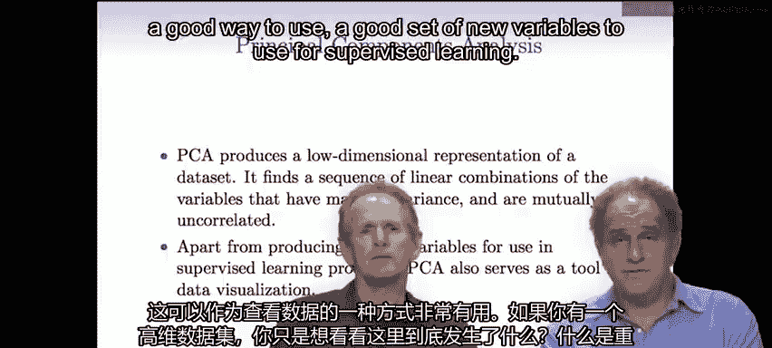
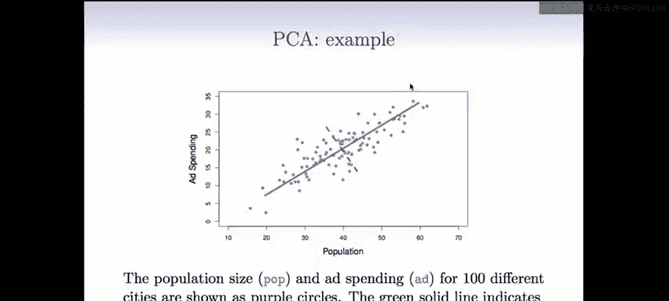

# TrevorHastie／RobertTibshirani《统计学习导论｜An Introduction to Statistical Learning》中英字 - P65：P65 StatsLearning Lect12a 111113.zh_en - GPT中英字幕课程资源 - BV1jN4y1Y7JR

Welcome back。Today's lecture is about unsupervised learning。

 so let's recall what we meant by supervised learning and contrasted with unsupervised learning so supervised learning。

 the word supervised remember refers to the fact that there's a target。

 a label that we're trying to predict from training data so we have features。

And we're trying to predict the label and the label supervises the learning。

 for example like if you're a kindergarten you can think of a kindergarten teacher who shows a child in the class a bunch of examples of say Johnny here's five examples of a house and Lego blocks here's five examples of a car and he tells Johnny that these are houses and these are cars so he's supervising the learning and the child then looks at and figures out which features of the house。

 make a characteristic of a house and which features of the car make a characteristic of a car so that supervised learning。

In contrast， unsupervised learning， there's no labels。

 so this kindergarten teacher will just show Johnny， here's 110 things。

And doesn't tell Johnny that these five are cars and these five are houses。

And the child then looks at the objects and tries to figure out some patterns。

 He says if he may realize， these five look similar。 I don't know if they're called。

 but they look similar。 So maybe I should group them together。

 These other five look similar to each other。 And I'll put them in the group。 So yes。

 so this means we have a。With supervised we have a Y and with unsupervised we don't exactly right right so in both we have features。

 but as Trevor said in supervised we have a Y that's we given in the training data that's a true label in unsupervised learning it's harder in a sense because we don't have the actual labels。

So let's move to slide one， most of the course， as we've seen focuses on the first exercise supervised learning where we have labels。

But today we're going to talk about the setting where we don't have labels and unsupervised learning。

 all we observe with the features， which as before we'll call X1 through XP。

 and we want to know how the features relate to each other。So。In particular。

 what are the goals of unsupervised learning， well then first of all they're not as clear as the for supervised learning where the object is to predict y from x。

Now we don't have a Y， so the objective is a little more fuzzy。For example。

 we might want to discover subgroups among the observations， like in my kindergarten example。

 the child may try to try to discover subgroups among the objects he's seen。We might want to know。

 is there a good way to view the data to find the important features or the features that have the most variation over the different objects？

So we're going to discuss there are lots of methods for unsupervised learning。

 but in this short lecture we're just going to talk about two of the most important ones first is principal components analysis。

Which is a tool。For viewing data or for preprocessing the features for use later in supervised learning。

 and the second is clustering， which is a group of methods for class of methods for grouping the objects into different subgroups。

Okay， so we'll talk。About those two methods today。But let's say a little more in general about about the the challenge of unsupervised learning。

 As I mentioned，'' it's a little more fuzzy because there's no simple objective like prediction。

 There's no why available。 So we don't。 We're not just we're not predicting。The objective。

 as we saw in the previous slides， a little more。A little more fuzzy。But。Nonetheless。

 unsupvised learning is actually of growing importance， and there's a number of reasons for that。

Well， first of all let's see some examples， as samples actually you'll see at the end of the lecture。

 and an actual example is we have breast cancer patients from whom we've measured gene expression using gene chips。

 and we want to group those patients into subgroups of breast cancer。

 in terms of these subgroups are actually quite different in terms of their characteristics biologically and their survival as patients。

Another example which is marketing is defined if we have shoppers and we can record their browsing and purchase histories。

 we can group or segment the shoppers into different groups。

 and then maybell be targeted with different kinds of advertising because their behaviors are different。

Another example which is quite popular is to group movies。By the ratings assigned by movie viewers。

 like a thriller， romance， et cetera，And the other。

 the other other thing it makes unsupvised any more and more important is that it's。

 there's a lot more unlabeled data available。 And that's because the the。

In order to get labels for data， it can be costly or time consuming， for example。

 there's tons of images on the web。I mean everybody's loading up images and Google and other places and mostly they're unlabeled。

 you don't know No ones told us exactly what's in the picture。

 but we have the picture right and the point is that that kind of information can be collected by a machine。

 the features， the images but the actual labeling it often requires human intervention that going to be more costly in time consuming and example of that is movie reviews on the web a lot of people they try to predict well they try to correlate movie reviews with movie quality and group movies。

 one problem there is that if you have a movie review written by a human being right it's hard to tell by machine whether or not that is actually favorable or not if the movie review could have some sarcasm in it and for a human reading the paragraph。

 it's pretty easy to say oh that person doesn't like the movie or does like the movie。

 but for a computer it's not so easy so that's example we're finding the actual label can be quite difficult than time consuming。

Okay， so let's start with the first main method for。

Un superupervised learninging principal components analysis。

 and this goes back probably to the 1930s in statistics is when it was first invented。

 so PCA produces a low dimensional representation of a data set。

 and it finds a sequence of linear combinations of the variables or features that have maximal variance。

And the same time， they're uncorrelated。So we're going to see there's a first principle component which has the highest variance across the data。

 it's a linear combination of the features， and then a second component which is uncorrelatedlate with the first。

 which has the highest variance under that constraint etcter。

 just imagine you have tons of variables and many of them are correlated。

There can be quite an unmanageable set。 What principal components tries to do is pa the set down into some important。

Varis that summarize all the information in the data and that's these principal components and that can be very useful just as a way of viewing the data if you have a high dimensional data set。

 you just want to have a look at what's really happening here， what's important。

 the principal component view is one of the most important ways of displaying the data and second of all。

 you have a lot of features you want to use for supervised learning。

 the principal component summary of those variables can be a good way to use a good set of new variables to use for supervised learning。

Principle components and the techniques related to it is one of the most widely used tools in in statistics and data analysis。

Okay， so let's talk about let's actually define principal components， so we have a set of variables。

 x1 through Xp， and the principal component， the first principal component。

 Z1 is a linear combination of those variables。And it's a linear combination defined of highest variance across the data set。

 Now， of course we're going to choose weights。 Well， it's defined by a set of weights p1 through Vp。

 but if I was allowed to make those weights as big as I wanted。

 I could make the variance of Z1 as big as I wanted。 so we need some constraint on the fees。

And the natural constraint is that they're normalized so that sum of their squares is1 that now makes the problem a sensible one to choose a set of weights that has the highest variance。

Those weights are called loadings。In some areas of statistics and other social sciences。

So the P11 through P1p are the loadings of the first principal component。

And the principle the loading vector is the set of those P numbers。 If you didn't constrain them。

 of course， you could just make them much bigger and that would just make the variance higher。

 So you need to tie them down exactly。So here's an example before we talk about how to actually compute the components。

 let's just see what the result of the first two components for this data which is ad spending versus population。

 so here's the red points are the data points， I plot them against these two variables so p is just two in this example。

 the first principle component is given by。The projection of the data under this line。

 so this direction has the highest variance among all combinations of the features in this data。

Correspondingly， this has the lowest variance right well， sorry， well， yeah， that's true。

 This has the lowest variance， so here's only two components， so I've got the highest variance。

 the first principal component。The second component is also， well， it's got the highest variance。

With a constrain be uncorrelated with the first component。

 which means it has to have right angles with the first component there it is。

 if you only have two variables， you can only get up two components exactly。

 but just for illustration， we show you two variables。Okay。

 so how do we actually compute the components， Well， now suppose we have our data。

 which are features n by P， the x matrix。And now since we're only interested in the variance we。

We we can center the variables to have mean zero， right We don't care about the mean。

 we're just worried about the variance。 So in other words， in particular in specifically。

 we make the column means of x0。And then we want to find the combination of the variables。

That has the highest variance， remember。High variance is under the constraint that these loadings have sum of squares1。

Now， since the data have been arranged to have mean zero in the first step。

 that means the z' have mean zero and hence the variance is just sum square of the z is the sum of their squares。

Okay， so to continue the computation， we have the Z which we've defined to be some of the loadings times the features。

 and so now the problem now we can replace the Z by their expression from the previous slide。

 and we want to find the highest variance now which is this expression subject to the fact that the loadings have to be normalized。

So this is not not just a computational problem where the unknowns are these fees and the optimization can be done but by the single value decomposition。

 which is a standard technique in numerical analysis， which you won't cover。

 but if you want to read about it yourself， it's very interesting and very important in a lot of areas of statistics and it's covered。

 for example， in our book E of statistical learning。So when we've solved this problem。

 weve got the best loadings。The resulting Z values are the first principle component。

 which will write a z11 to zn1。So it's like we've created a new variable now。

 we had our original P variables。 now we've created a new variable， which is the C1。

 which has n values， just like each of our original variables。Exactly so。Now we。

 we can think of that geometrically。 and we'll go back to the the picture in a moment， so。

The loading vector is a direction on which we a direction to the features that has if we project that on that direction has the highest variance。

And the the values of the projected the be data are called are the principal component scores。

 So let's go back to the picture of the two dimensional one。 Okay。

 so I said this was the first principle component。 That means the the load vectors vector the points in the direction。

From the middle to the northeast。 right， So here might be something like maybe 11 or。Roughly， okay？

So that's the combination of the features that we compute using principle opponents。

 the actual computed values are the projections onto this line so we could start say the origin could be here。

 we could just measure each point we take its projection onto this line。

 we measure how far it is it away from， say this the origin here。

So disease for these guys would be positive and disease for these guys would be negative。

 so we replaced each point by basically how far along this line is it。

And that's the first principle component。

