# TrevorHastie／RobertTibshirani《统计学习导论｜An Introduction to Statistical Learning》中英字 - P72：P72 StatsLearning R Unsupervised C 112713.zh_en - GPT中英字幕课程资源 - BV1jN4y1Y7JR

Finally， we're going to get to hierarchical clustering。Which is another form of clustering。

 but different。And this works off a distance matrix。So。

We'll use our same data here and we'll compute distance of x。

 which computes 100 by 100 pairwise distance matrix， and we make a call to H cluster。

So H class is the tool that we use for doing hierarchical clustering。

So by now you've become pretty adept at R if you want to find out more about age class。

 you just go help H class and you'll get help online if you。

Once you've computed the foot you know how to print it out。And you know， if all else fails。

 if something else you'd like to find out。Searching a web is a really good idea。 These days。

 If you search the web for R related queries， tons of stuff comes up。

 and you can often find out all kinds of interesting information。So here we ran。😊。

H class with method equals complete。And we'll just plot the data。

And it plots a denogram that shows the clustering。So if you recall。

 this is a bottom up clustering technique。

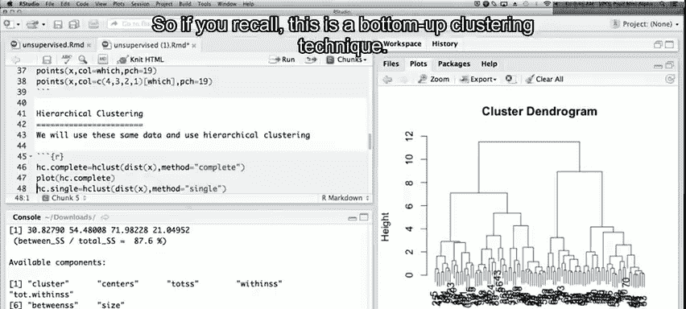

We it continuously joins together。

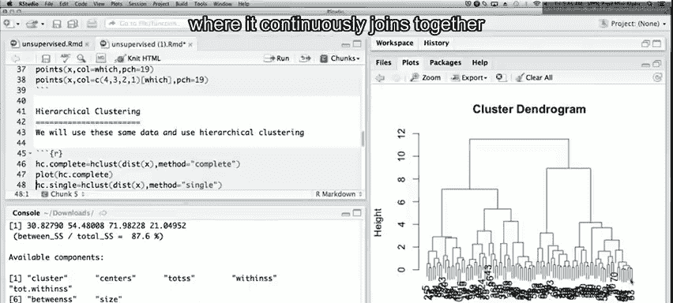

Smaller clusters to make bigger clusters until eventually you get to one big cluster。Now。

 we know there's four natural clusters in these data。

 And from the heights of the arms of the denogram， it's evident that they are four big clusters here。

 And these will almost certainly correspond to the the original。

divisionions in the data that we created。嗯。Complete is is is how decides how close two clusters are。

 and what Comp does is it uses the largest pairwise distance between a point in one cluster and a point in another cluster。

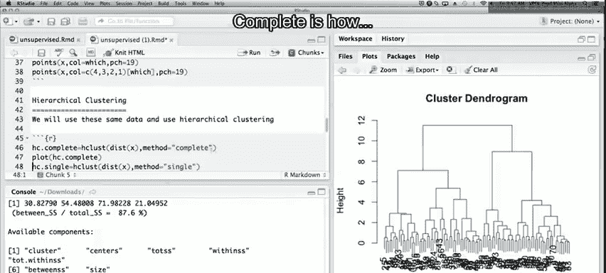

There's other methods we can use。 So single linkage clustering， it's called it's the same call。

 except method equal single。 So instead of looking at using the largest distance。

 it uses a smallest distance。And it gives you a rather different looking picture。

 and the four big groups that we saw aren't as easily evident in this one。

 It seems to have found one， two， three groups。 and then some in years。

 a division into the fourth group。So single linkage clustering tends to， to。To， to find long。

 strung out clusters， because it's just looking at the closest point between。clusters。

 And so you might not get nice， clumpy balls like， like we expect to see in this case。

Average is somewhere in between and indeed the plot for average looks somewhere in between。

 but I think for these data， I think we probably prefer the method equals complete。

So we're going to compare with the actual clusters in the data again。嗯。

We'll use the function cut tree and we'll cut it at level 4。Okay， so that's the first thing we'll do。

And， and so that。Cas our original cluster tree。 Let's just plotted。 Let's get get。

 itss plot up there again。Here's the den。 So we've cut it at level 4。

 So that means at the point where there's four clusters。

 So now we're going to identify who's in each of these clusters。 And for that。

 we use the function cut tree。 And all cut tree does is you tell it the level。That you want。

 which is 4。 You in the number of classes you want。 It's 4。

 and it gives you back a vector of cluster assignments。 So now we can use the table function。

To tabulate those assignments with the， the the what we know to be the real assignments。

 which is given by a variable， which。And so you get this little table yeah again。

 the orders are arbitrary yeah。And so what do you expect to see is。

Is some big numbers with zeros elsewhere， right？ So the big numbers are the 1731，30 and 19。

 and then the small numbers are the miss， the the misidentifications。

 So there were three misidentifications yeah。And we can also do a tabulation and compare it with K means clustering。

And with K means clustering。There were two， two miss。Two disagreements。

 So both K means and hierarchical clustering。Didn't know the true assignments。

 and they agreed mostly， but on two points， they disagreed。Now， you can。

There there's fancy ways that you can plot hierarchical clustering trees that actually tell you that color say the leafs according to the original cluster membership or some other variables。

 these tend to be rather technical I actually looked to see how to do this by searching on the web and even though I was able to do it。

 it's probably too technical to put in this demonstration。

 but if that's something you wanted to to do I urge you to have a look so people have written functions for doing that。

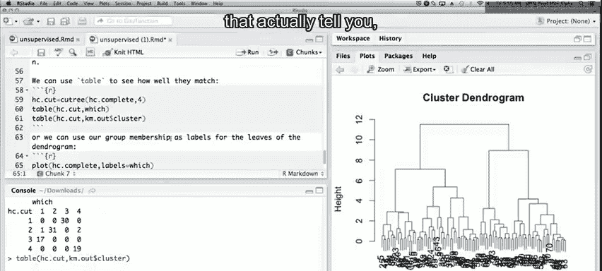

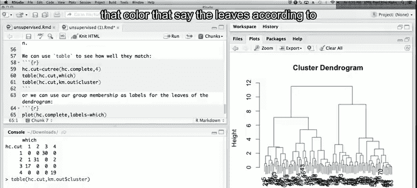

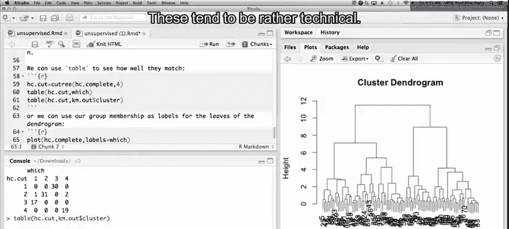

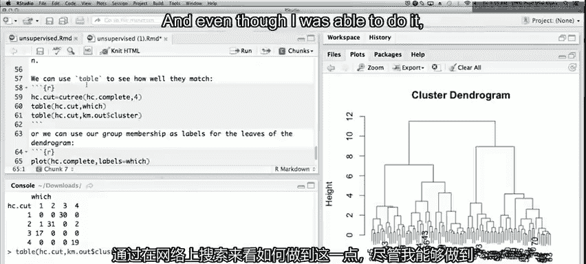

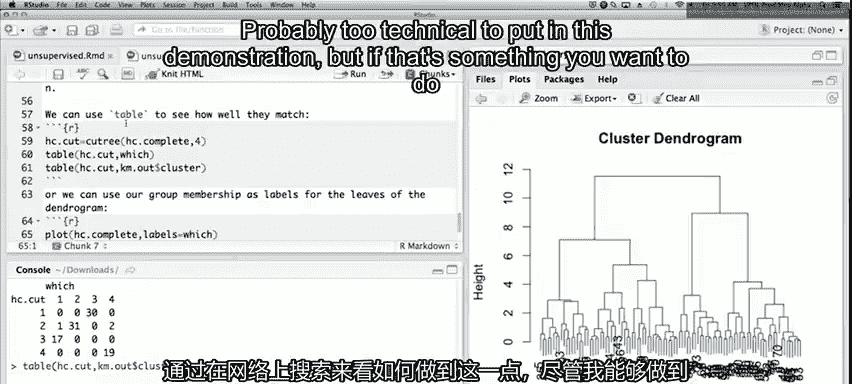

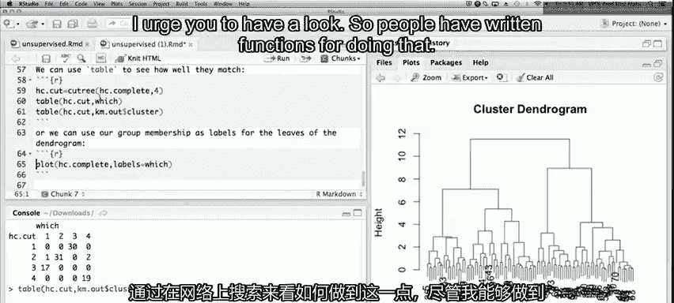

What we' will do something a little simpler， the plot command for denograms for cluster trees has a labels argument。

 and we're going to label it according to the original cluster assignment。

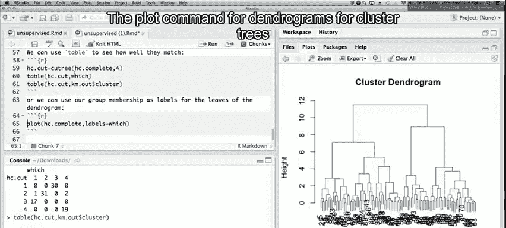

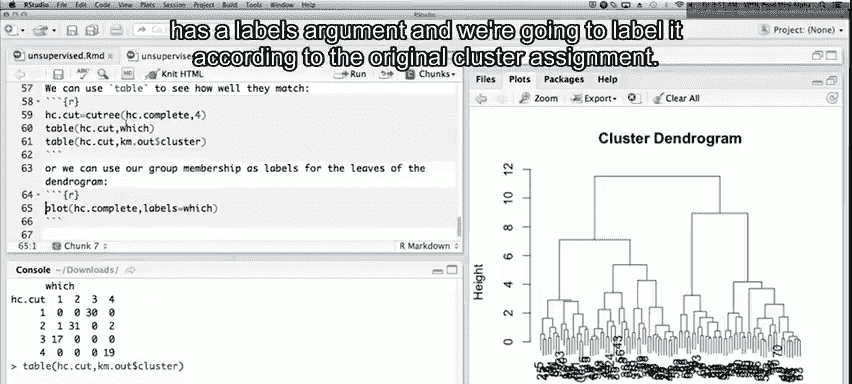

And if you can see。

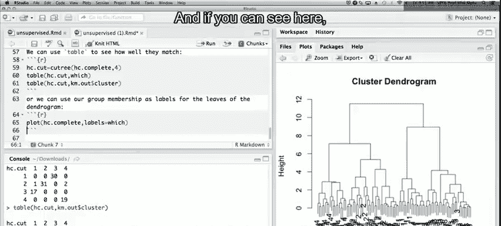

You'll see that all these guys down here are fours， there's twos。

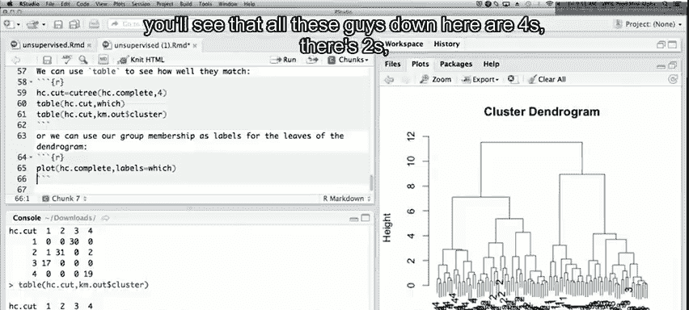

There's ones and threes。 It's not that clear。 but if we had a bigger place to plot。

 you'd be able to see which， which of the points were misassigned。

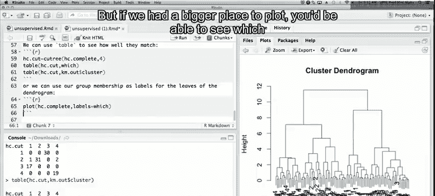

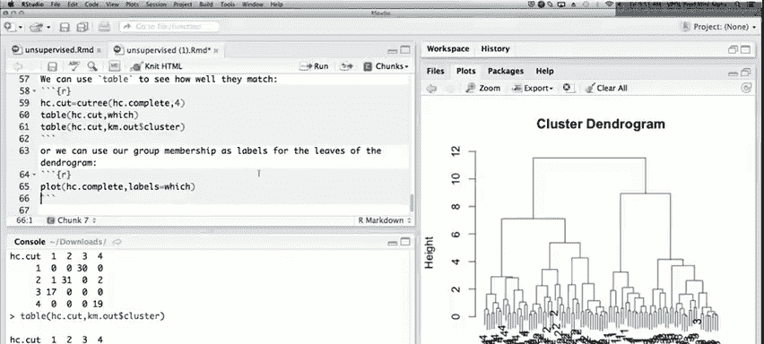

So again。Use the help， help to find out more about hierarchical clustering and， and again。

 if all else fails， go and search on the Web。 And once again， this is our markdown document。

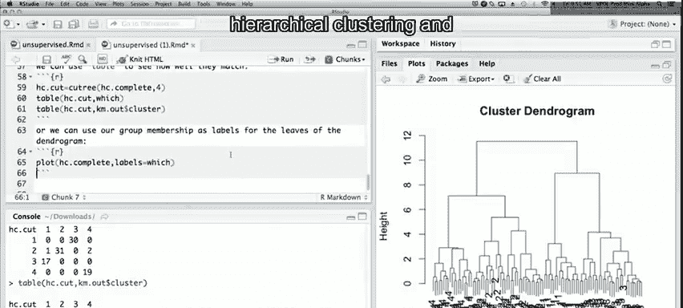

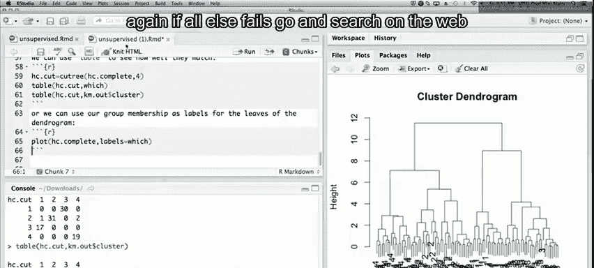

In our studio， so we can knit it and then we get a nice HTML document which gives a summary of our results and with any figures we made in one nice document and we got our figures this is something you can share with some colleagues to show the analysis that you've done for them or for the demonstration。

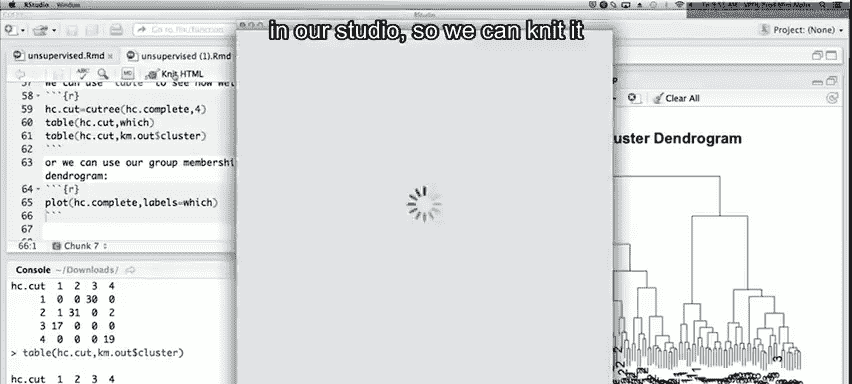

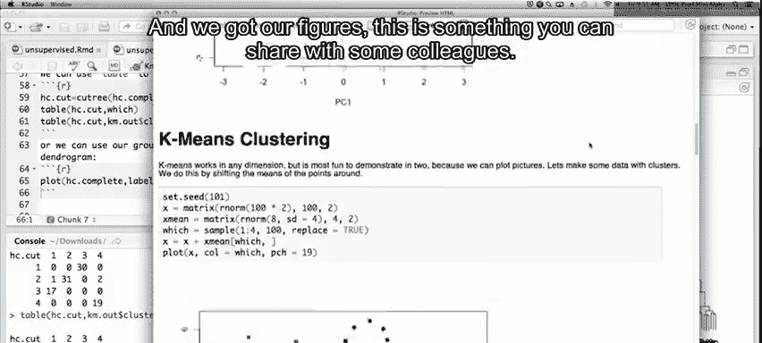

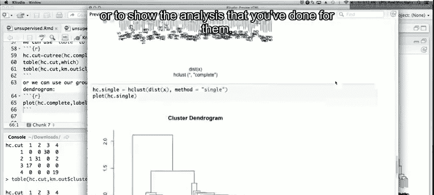

So there we go。

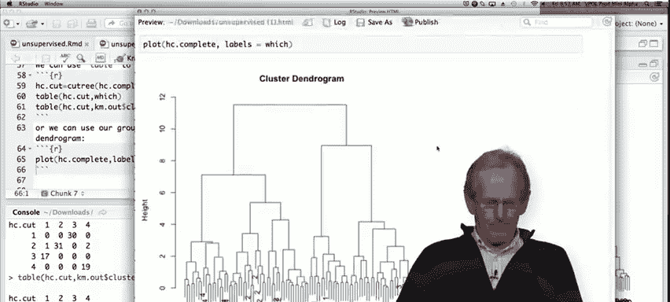