# UCB《大语言模型智能体｜UCB CS 194 294-196 (LLM Agents) 2024》中英字幕（Claude-3.5-sonnet翻译） - P1：Lecture 1, Denny Zhou.zh_en - GPT中英字幕课程资源 - BV1RsZPYsEtE

Okay， thank you。 Okay， so I will first start with some introduction and then we'll get the actual content of this class started。

😊。

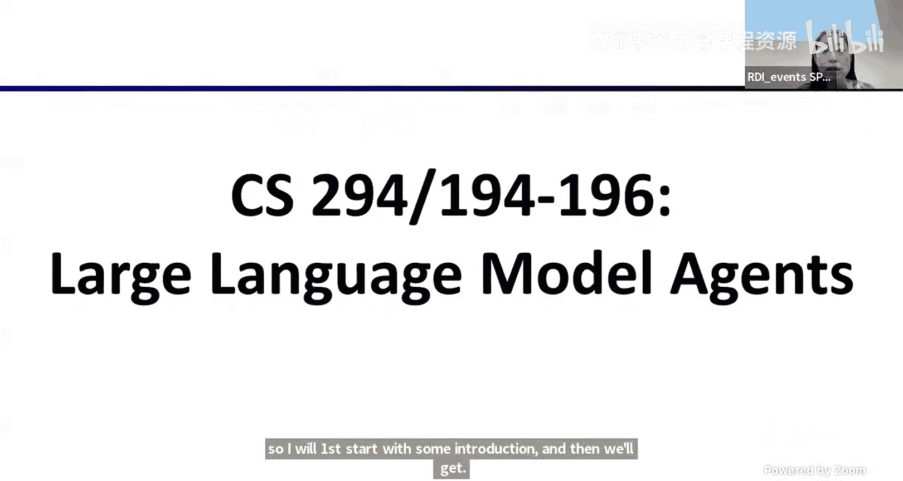

Okay so first so my name is Donng Soung I'm a professor in computer science here at UCs Berkeley and also a codirector of Campus Wild Center called the Center on Responsible decentralized Inence。

 so I'm the instructor for this class and also we have a guest co instructor Xinyun Che from Google who is also a Berkeley alum to my former student here teaching this class together and also we have our great TAs。

 Alex and Sihu and also we have our great village Tara and Alun。😊，Okay。

 so this is the teaching staff who will be working together with you this semester。

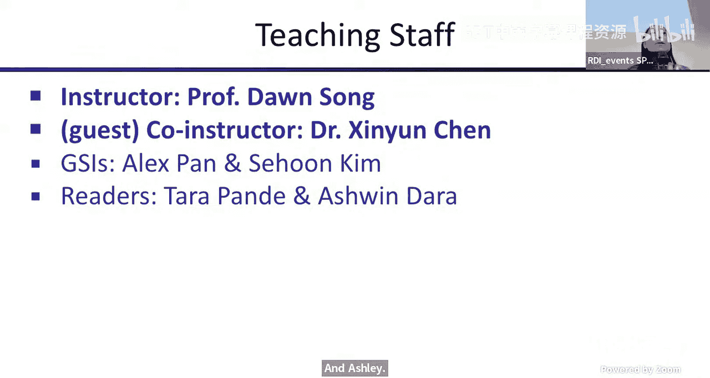

Okay， great， so everyone's here， everyone has been seeing the exciting growth of large language models。

 the speed of advancement is justish astonishing。😊，However， these large language models。

 they operate in a fairly simple manner， they take text inputs and produce tax outputs。

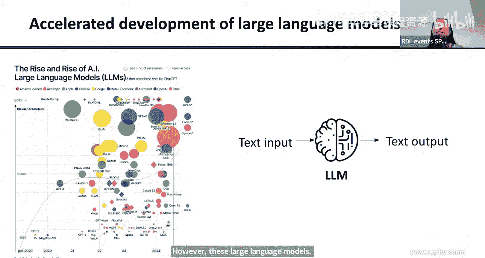

So what we will cover in this semester in this class is the next frontier。

 large language model agents。So instead of just taking texts as input and produce text as efforts。

 here we use a large life model as the key brain for reasoning and planning for the agents and enable the agents to interact with external environments。

 observe the environments and take actions in the environments。

 and the agents will be using external tools and also external database and launchb and so on for retrieval to help the agents to perform these tasks。

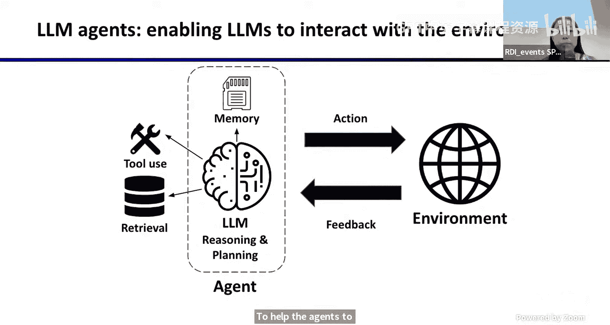

And the rich capabilities of these large ens makes these LM agents very flexible and they can easily operate in diverse environments without much particular specific training。

And these IM agents， they can interact with different types of environments。I， for example。

 surfing the web through different APIs online， and they can also be embodied even in a robot and operating in a physical world。

And they can inter sense the environments through different types of inputs。

 even in the multimodo setting， even including very sensory inputs。

 and taking actions in these diverse environments and through this interactions with the complex and diverse environments。

 they can update their memory， they can learn to do to use。

 they can interact with humans and they obtain grounding through this interactions as well。

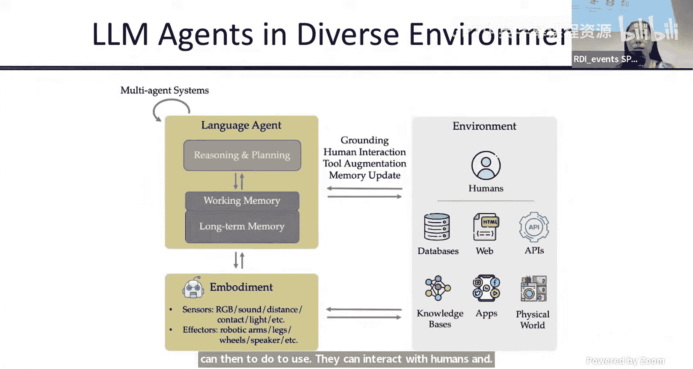

And these agents not only just interact with environments they can interact with other agents through multiagent interactions and collaboration。

 including humans as well， and these multiag collaboration can help agents together to solve even more complex tasks。

So why is our agent the next frontier， why do we need to empower our armss with the agent framework for a number of reasons？

Soing real broadcast is leverage in one goal with text inputs， produce tax outputs。

 oftentimes involves a trial error process。And leveraging external tools and the retrieval from external knowledge can help expand LM's capabilities。

And more important today。This dynamic agent flow， this agent workflow can facilitate solving complex tasks。

Through enabling task composition， allocation of subts to specializedize modules。

 division of labor for project collaboration， and throughout the course we also see that multiag generation can help inspire better responses。

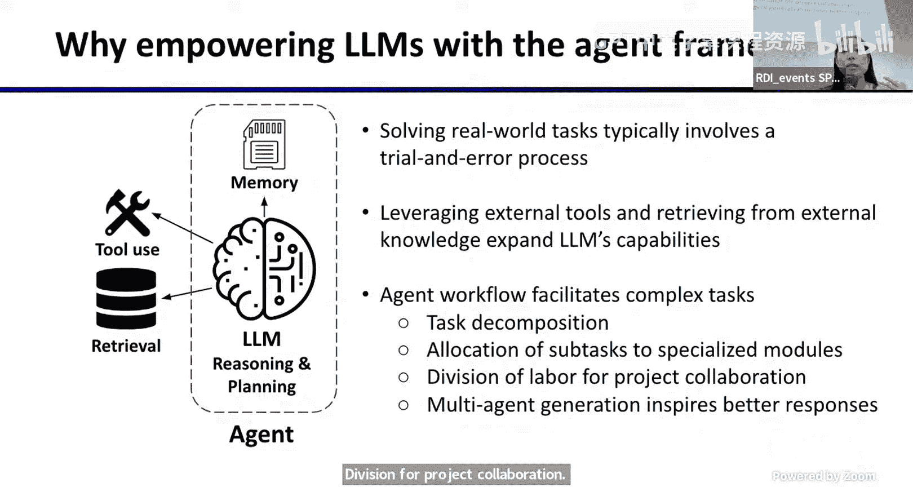

Even though IM agents has been a fairly recent developments。

 we have already seen IM agents helping transform different education domains。Through wide rang。

 including education， law， finance， healthcare care， cyberse， you name it。

And the development is really exciting and is fast improving There are many different leaderboards for different agent benchmarks that you can see online and you can see the really fast improvements on all these different agent frameworks。

😊，So overall， to better to enable agent deployments。

 there are a number of key challenges that we still need to address。

 so first we need to improve the reasoning and planning capabilities of agents。

LM agents tend to make mistakes when performing complex tasks and you end。

 and it's important to improve the reasoning and planning capabilities。

And also in to improve embodiment and learning from environmental feedback for these LM agents。

 LM agents are still not efficient at recovering from mistakes for long horizon tasks。

 we need to further develop methods and capabilities for continuous learning and selfim for these LM agents and also improve multimod understanding。

 grounding and world model capabilities of these agents。And also as I mentioned。

 multi agent can really help agents to provide better solutions for tasks and developing theory of minds helps multi agents to better develop as well。

And safety and privacy these issues are also very important for agents。

 LOMs are susceptible to amateial attacks can even harmful messages or leave private data and so on solving these challenges are also really important for deploying IM agents safely in the real world。

And also enabling human age interactions and ethics。

 how to effectively control LM agent behaviors and design interaction modes between humans and LM images to best enable L images to serve human needs is also really important。

😊。

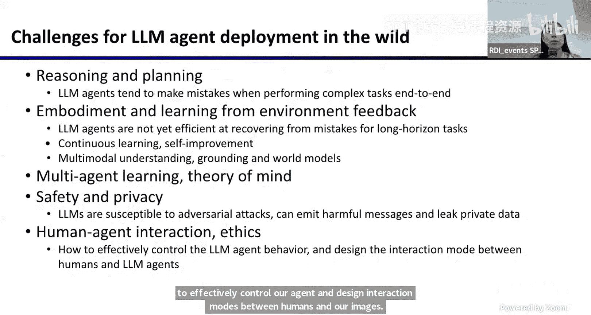

So to help students learn and better develop methods to address these challenges。

 the course has been designed to cover a broad spectrum of topics actually throughout the different layers of the agent's framework and also the domains。

So first， in the class， we'll cover key model capabilities， including reasoning， planning。

 multimod understanding， we also cover popular real world Asian frameworks to enable students to learn how to better design agent applications and use various agent flows easily。

And this will help students to also learn to use aation frameworks for workflow design to use retrieval augmented generation RA and multi agent systems。

And we'll also cover a number of exciting application domains using these RM agents。

 including software co development， workflow automation， multimod applications。

 and enterprise applications。And finally， we'll also cover important topics on our agents safety and ethics。

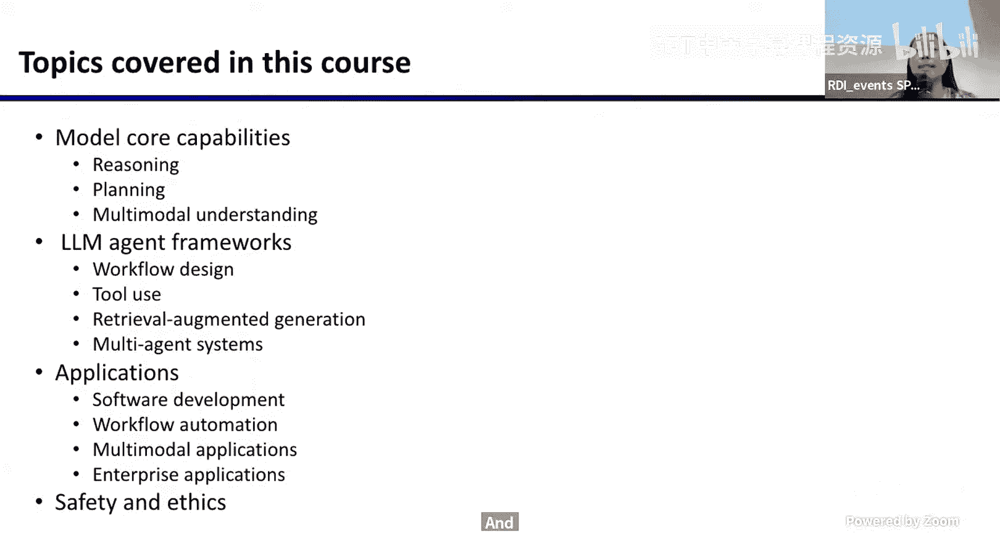

To cover this wide ranging topics， we have assembled an amazing team of guest speakers and researchers to cover these topics。

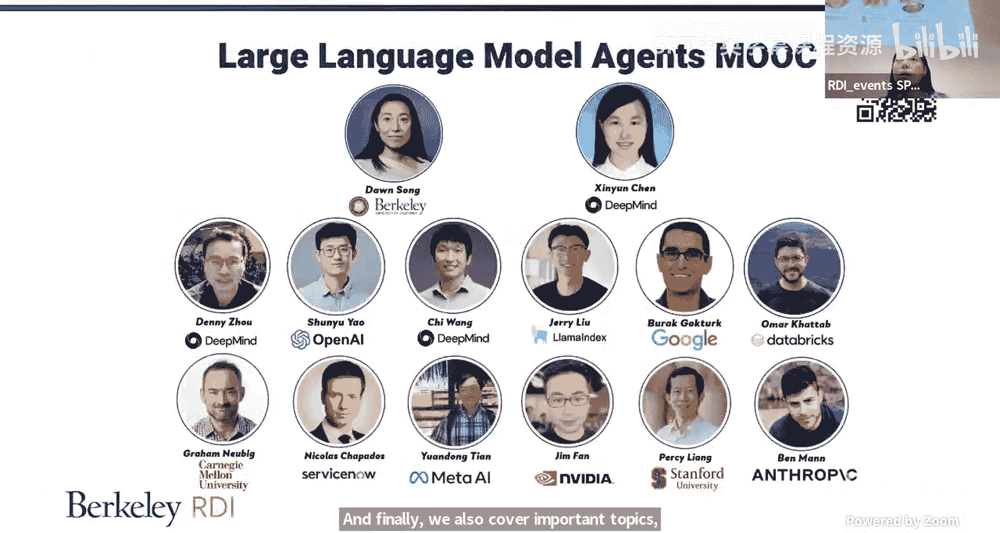

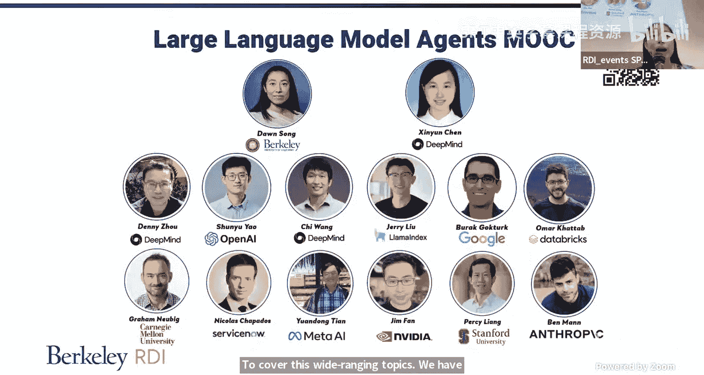

So the class will be led by me and Xin Yun， and we have this amazing crew of guest speakers to help cover these important topics in class。

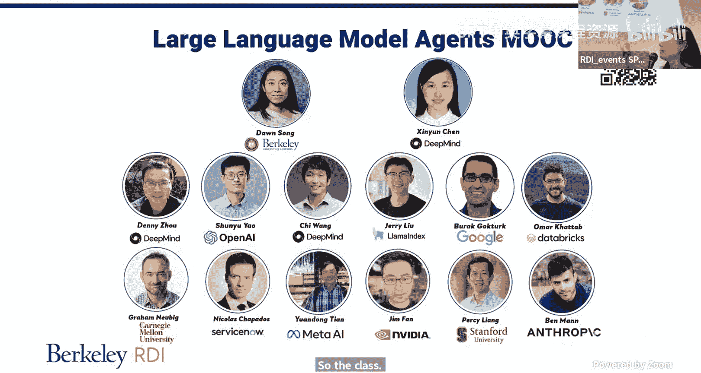

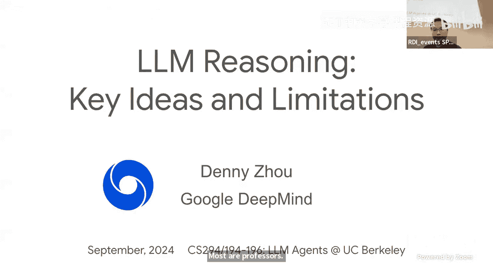

Before the talk， I want to ask one question for everyone。So what do you expect for are。咩踢小细。

S about it。So I can imagine many different answers， like。

Solve the hardest domestic problems that a humans can solve， for example。

 even period heart can solve， right？Or discover new scientific theory。哦你 can扫ATI。

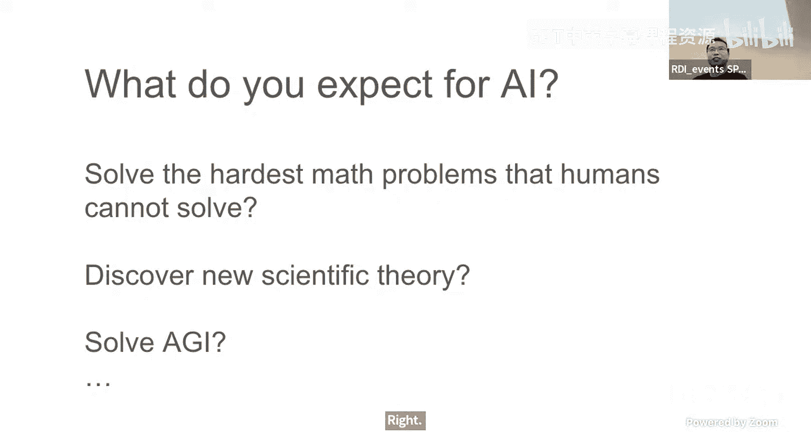

嗯。My background is a mission of learning。I don't know in the kind days。

 do have many people study measure N codes or not because it's why transformform is OED， right？

And any person， I have really talking about about year。AI should be performed from just few examples。

Like what humans usually do。

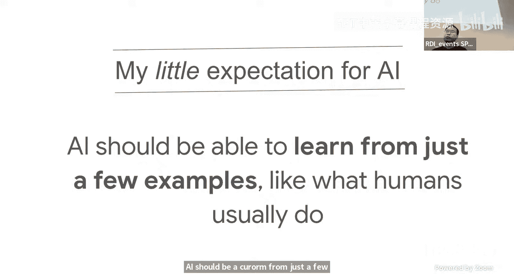

In the past decades。The machine learning community spent great efforts。

To develop data efficient methods。Like Cy of the learning。active warningning客户的性创新。And对。You know。

 if you look at newspaper in the past decade， the people always excited about one point of coupon games in the that's all paper。

So in practice， I actually I nervous saw data efficiently approaches。I that is。missson failed。

You know little feel bad about that， I' a presentation shouldn fair bad because I started Michigan it almost 20 years ago。

我系。I a in failure， actually， that would make me to think a different problem。

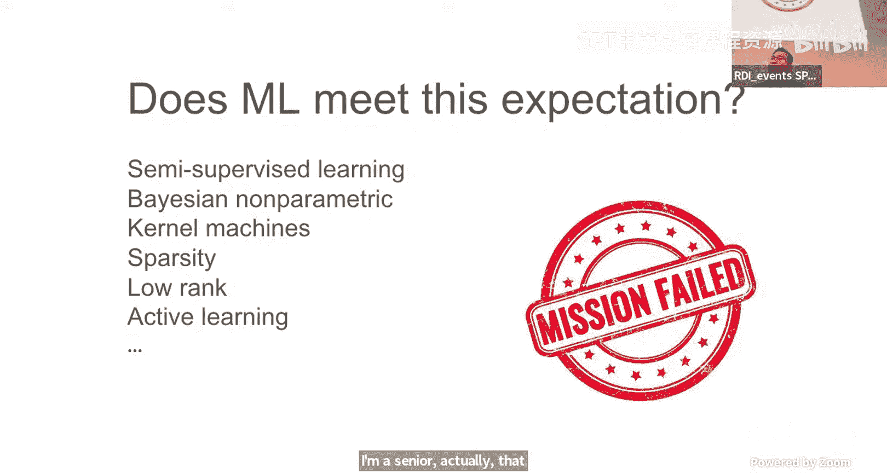

What's missing information。So I sort of carve them for years。And， finally。I find out the answer。非着你。

In the candidates days。InPo powerful people in the coast today， the island seems so obvious。

Bless are about reasoning。Humans learn from just few examples。Because humans can raise。

Not because of data statistics。

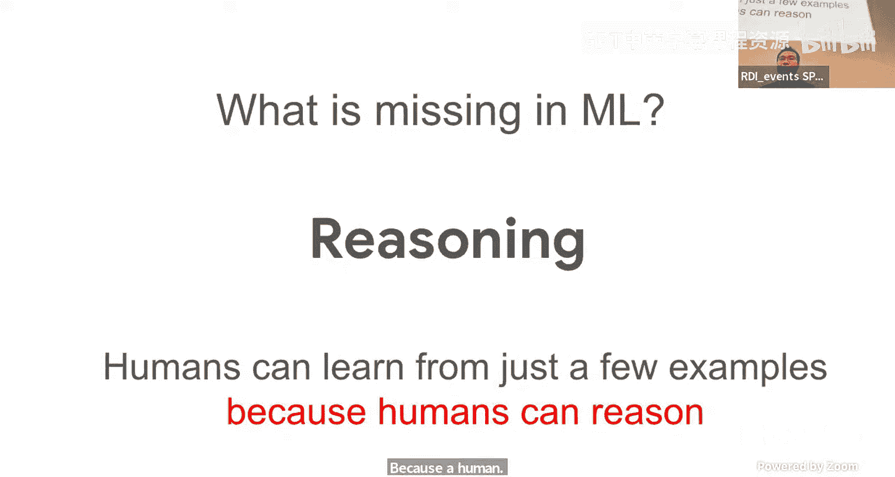

So6 straightforward4。Let's start from a toy problem。In my research。

 I only prefer a very simple problem。But it contains all detail， all challenging places。

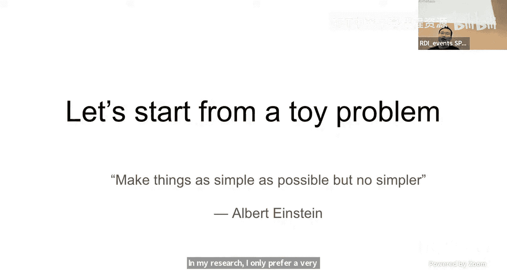

So this play problem is called a last letter can。If you are familiar with neuros symbolmotic literature。

 youll find similar problems。So for this problem。几份你啊。People name。但是您不多。The output will be the c。

Of the of the last letter。Over the first name and the last name。For example， like middle mask。

The last letter of yous end。The last that of a mouse is key， output the key。

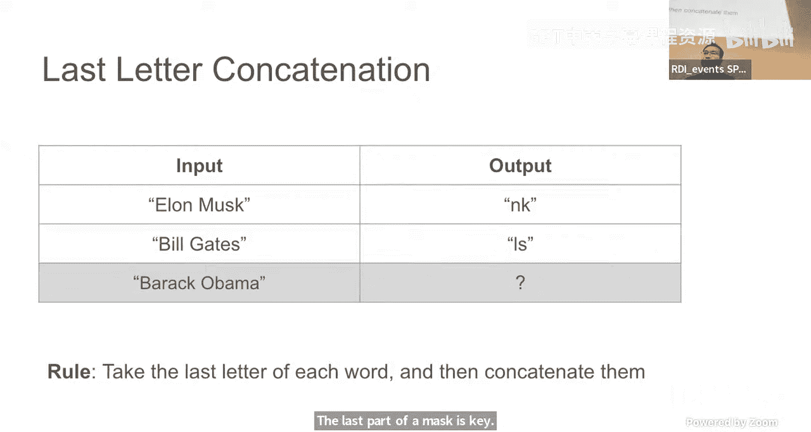

This is so simple。And if you have this problem。A years ago。

 you're probably able to try to solve the bio emission in model。For example。

 you could use transformal model is why the decoder theta is encode why the encoder deta is the decoders。

And then you will find that， okay， youll probably need。Pent of labeled examples to change the model。

And finally， you look at accuracy that。Its 5% or 9% or something。那一是觉是个8的没行了呢。Methods。

For such a simple task and simple for humans， okay。

And if the message requires a vast amount of labor data to earn。

And if you like to call it as AI or not， AI means artificial intelligence。对。

I suppose a intelligent model should be able to learn this part as you one or two group examples。

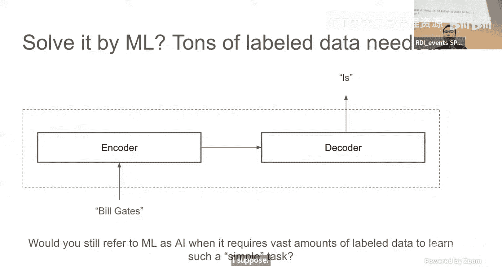

Now let's see how this problem can be solved by using large loan models。

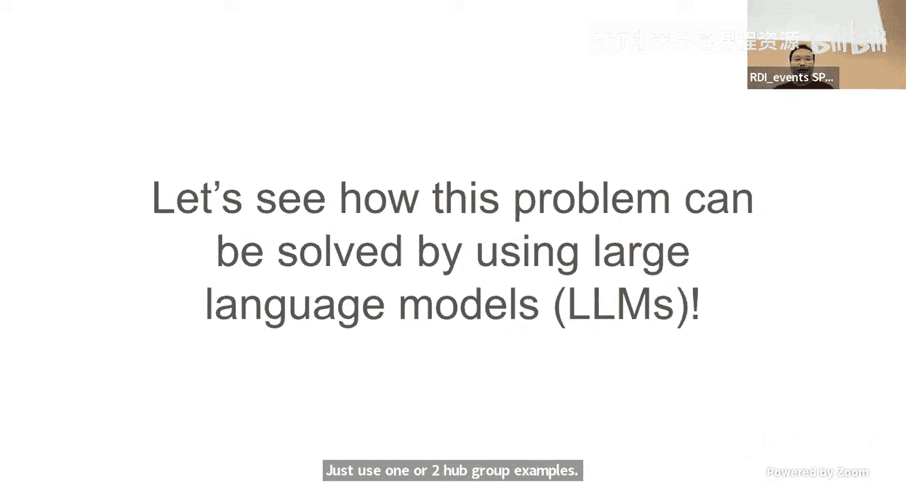

2。I suppose most people are。No large one models。把 professor上可以啊前。诶Explain what I am啊 okay。

LMSs is a transformer model channel to predict next word。For example， given the tax。

 AI is the future。We must future， just with AI as well as input。With that amount of critique。

 what will be the next work。If the net prediction is not the world future。

 we need to adjust parameters。it is correct。You mentioned money that's called back part。Of course。

 yeah， you can change your model with many sentences。For example。

 you can use all texts from the internet。

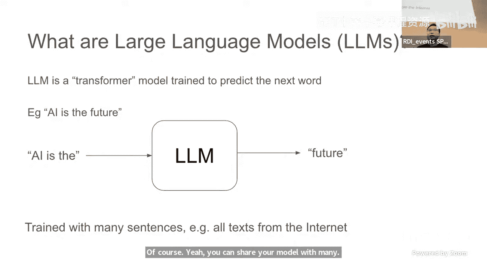

If you don't want to go to details， you can simply send over training LMs。

As children parentsrot who mimic human language。Actually， an I await this sentence。

And the one guy asked me hes very embarrassed about she parents。His local会 job。

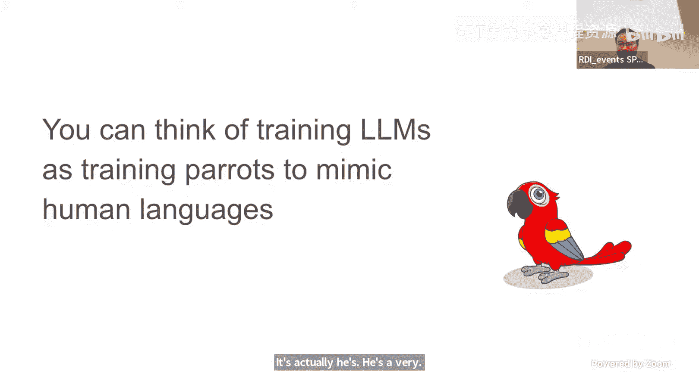

嗯。Why switch China is a model， okay？And then we can just mimic the process of the training。

 but the training is about creating that process。We can use whatever as input and to see what would be the output。

The model is just a pretty in thing and then。You can import the generated token and you can use the import generated token and put next that token as how can answer from AOMs。

And for this problem， we can simply contaminatnate。All the examples we have had as input。And also。

 can with test example。Brack Obama here。We can try this as use any LM and see what happened and problem I see you can rise it here。

Its called be key， of course' not crack， right， because king is the last night of a bread。And。

 and A is the last that of Obama。 The all would should be a K A。So it's wrong， right。

The this called fuel short property is's just a mimic of a machine learning process。

Instead of training model， we just use the examples as the input， that's the only difference。

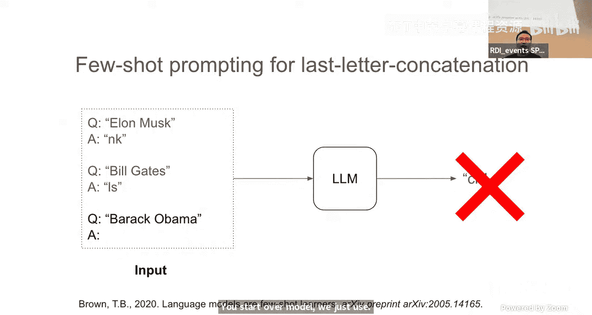

In the kind days， we know how to fix。Its this prompting idea。Wehich I need to add written process。

Before I。Like we just at the exclusive crisis here， the last land of is N。 the last of Mar is key。

 can N key is N key， like at that。It's called of great process。And similarly， if a bill case。

And now we the this as the new report and the US。

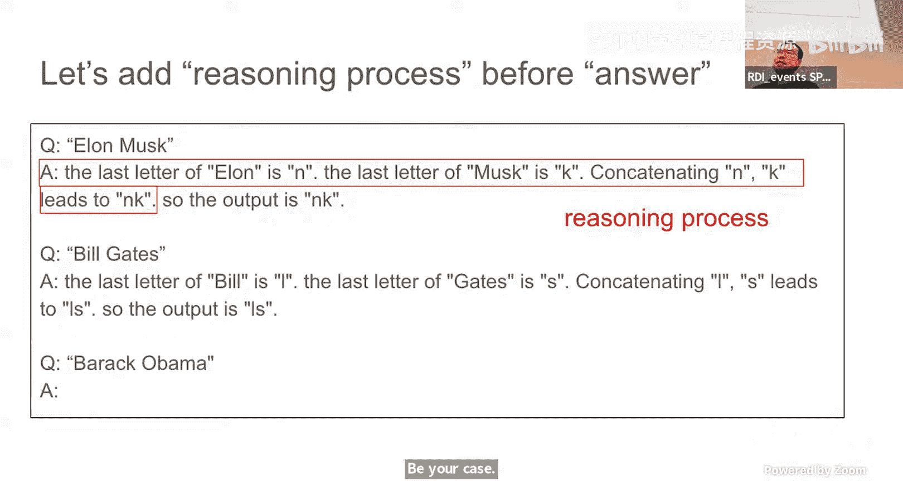

ok。Look at a perfect response。From the large auto modelss。

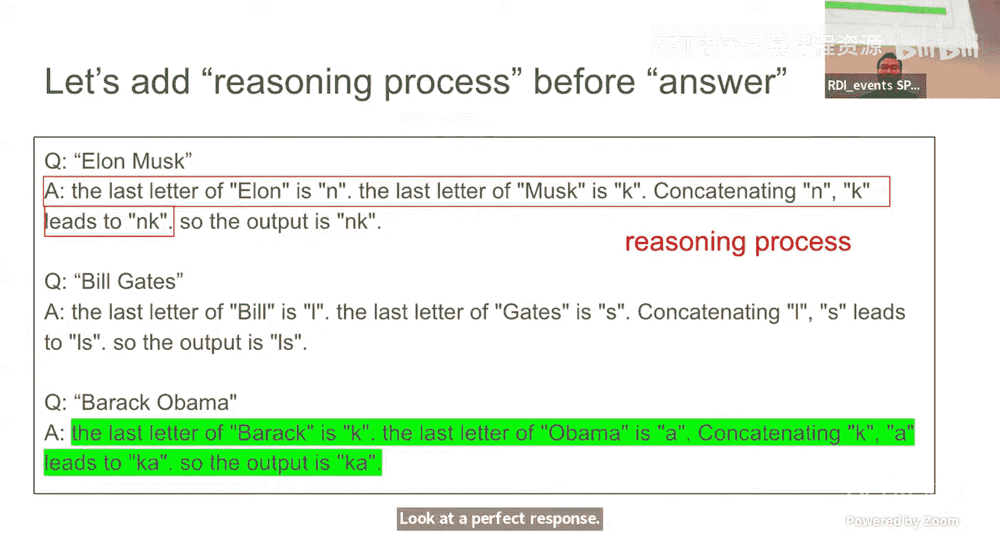

So even like a humans， one demonstration is enough。To at an accuracy，100%。

That's exactly what I looked for。We cannot imagine any machine investor。

Com ship is a perfect Cha season here。 There's no way。But by the way。

 don't overr what I said about machine learning， machine learning is still so useful and important for doing research in the candidates I saw many my naive mistakes from social media news even from the papers in the local conferencees。

Ord mistakes mostly from people who have no activities on mission learning。

They're just random had ideas。

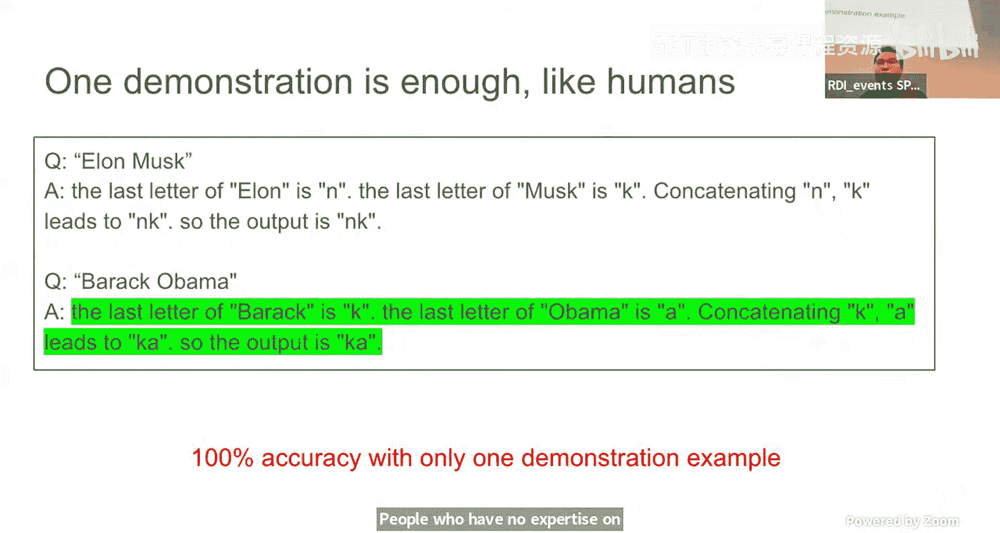

Its internally， you know， this kind of idea of adding in the media steps。

Has been proposed many years。In the literature。So this is the amazing paper when we know。

By researchers in the quoteium mind。Publish in the A203。So in this paper。

They use natural lung rationale to solve mass problems。In the paper。

 the even wrote derive the final answer through a series of small steps。

And then they trained a single model from scratch。You can know啊。

Channel to the work youll be surprising above。Hispa Act。The also are just like。T travelers。

They know how to make a different approach。In the 2021， a team。现在 o i。Plishて data G。

They are follow the idea in demand paper in3。In this dataset set， every problem。

Followed by in stack as solution and those of phsizer。嗯。This year。

Created this image data set and used that to you G3 model。

They are greatly scale up the work by working mind in two03。Even in the same year， 2021。

 group researchers in Google Bra now part of a coding mind。After the work I I show your work。

 so graduate paths for intermediate accommodation was a lot on models。

They discovered the similar ideas independently， but in the domain of。Program synthesis。

That's why they used abstract symbols hair instead of using natural language。

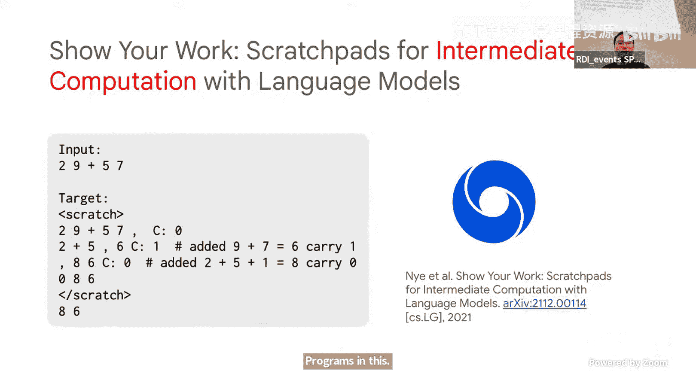

In the country， private many people know our work channel sort prompting and chain sort actually chain sort is not a term where invented。

 it's just common English phrase， it means more staff reason。So in this world。

 we extensively evaluated。From here was individual steps and showed amazing results on almost every ML house。

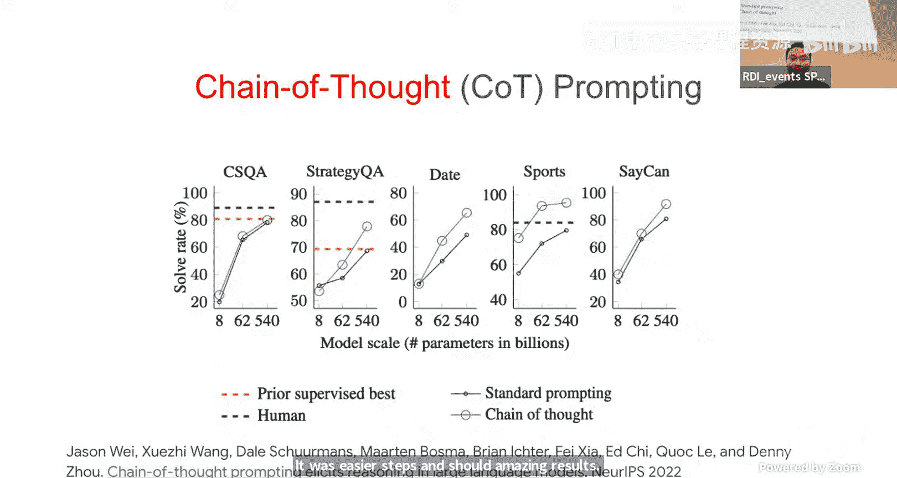

So， let's。我也可不是黑I单的。In 2017， Gold demand published paper training with intermediate steps。你发潘电话。

And few poverty papers。I here on Ls with intermediates。In2算25 and2算22。And。

Promping with intermediate steps。Obviously， okay， which part is more important？

You can see it in here。Actually呀 it doesn't matter。If you are a Cha or come or prompt model。

What really matters here。Intermediate steps。That是的 key。

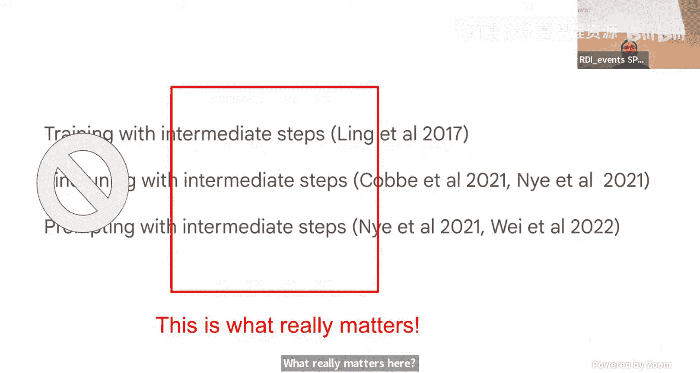

Okay。So let me summarize here。Regardless of traininging， fineing or proteining。

When provided with examples， that include intermediate steps。Ls will generate responses。

That are also including the media steps。

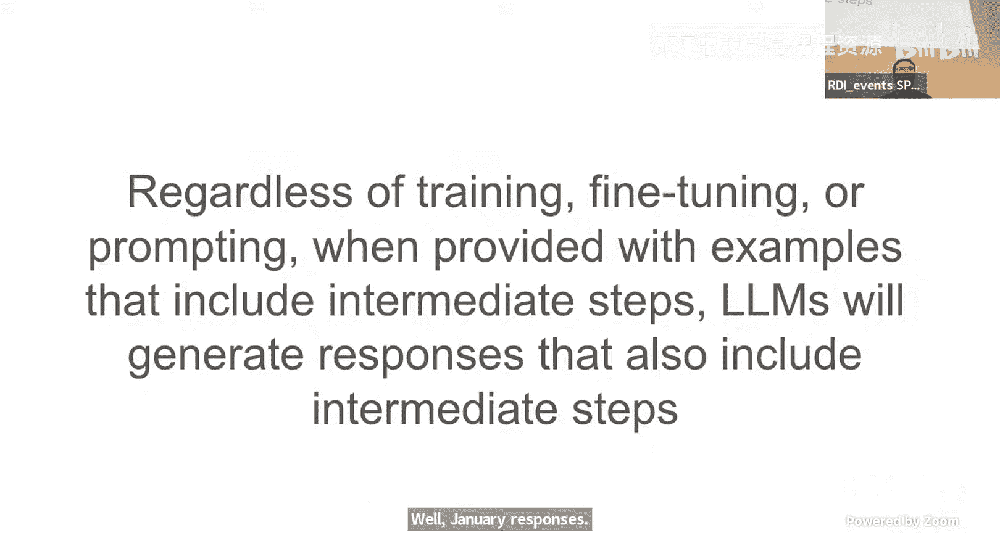

O。😊，Caing in the Middle steps。我们 ask question。Is it helpful to introduce reasons to as？

In those examples。For humans， they when they solve a problem， they could have。A strategy was holding。

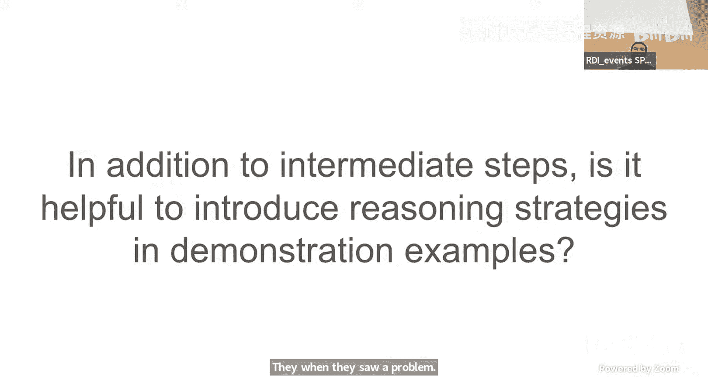

So， this。So here I work from our team is this most proud team。In this work。

 we enable easy to hire generation by the conversation。

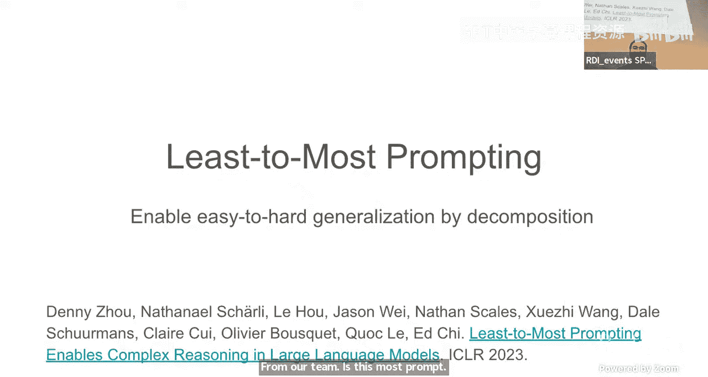

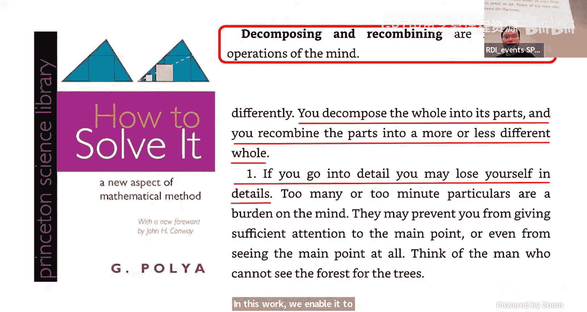

Probably many people saw this famous book， how to solve it。Ba Po， a classict book for math education。

So there's a chapter about de composition。So if youre just。If you go details。

You may loss yourself in details。Yeah。Notice what is difference by。But I get conversation。So。

 given this。Ms problem here。So batteries， so。In this talk。The mass is came at an element level。

So every time I at a talk。Before actually my daughter， I also killed my heart。And she gave like life。

 I maybe sure she could understand pizza at a fifth grade now。And。

He saidEA has three apple and now has two more apple than ESA。How many efforts do they have together？

Okay， we see the difference is that， okay， we first show light on the models。

 how to break down the problem to solve problems。And there's how what that one。

And that's why for least most from least the most complex problems。

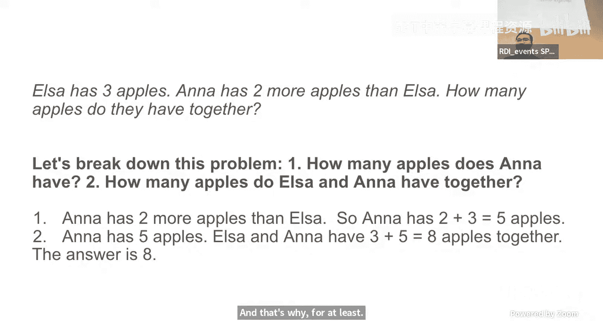

Is this。Simple idea， but surprisingly awful。So I suggest I assume how tocompose complex tasks into similar tasks。

So this is a。Scan task。Or composition or generalization。AndYou can look at examples here。

 give a natural line command。And we need to translate to a sequence of accents。

And that could be executed by robots， something like that。

So if you use a list to almost prompt chain。One Cat accuracy， 9927。So we just used 0。1%。

That is three examples。So why I want to why sure this task。哎陈理啊。

And you just passed from Xin to here today。And she invented a beautiful approach to solve this task。

乜嘢食噶。When I looked at the thiscourse， I was really surprised because really looks so straightforward for humans。

While consulting corporations？Finally， we can wait it by LM。

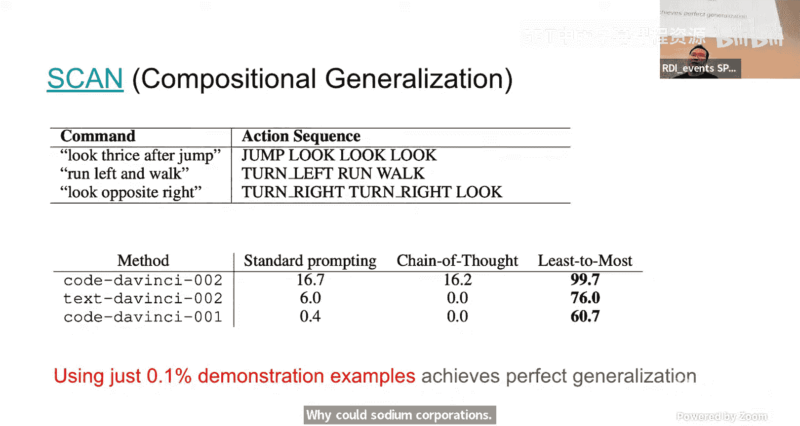

And this is another task would save chill has the code again with a compositional genetic past。

I don't believe if anyone。Knows the concept compositional transition。Rundly speaking。

 the test examples are more difficult than that。The training examples or or pro examples。

So for example， for the for the for the technical problems。

The types problems we need are are longer snippet。Here were now approach as a little bit change it's called dynamic least to most prompting。

 and we just use a one person data and achieved great results way better than the solar results in the literature share。

And the solar is addition actually by specialized。Architectural design and training。And they use。

 of course， all the chain data。

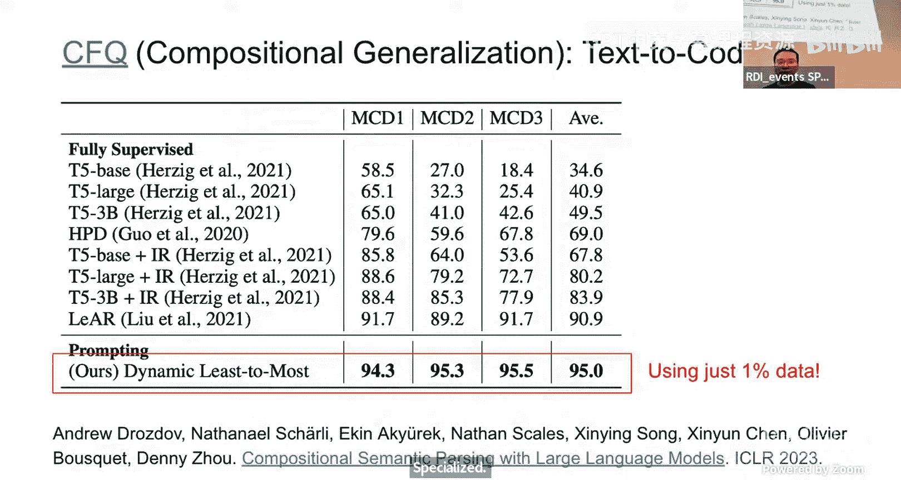

Yeah， stop far any questions here。Otherwise， I'll go to the next session。对啊。Okay。

 I suppose it part is quite a firm for everyone。I have two my audience is。10 years old and my my。

 seven years old。Actually wouldnt the shame of prompting people came out。

I heard a very useful ines in between my daughter and my son。买多的 ask。A little broader so was。

1even呃7 times three。嗯。Andita Brown said， I don't know。And then she ask， what's 10 times 3，30。

Was 7 type 3，21。 So whats the 17 type 3。 Oh， yeah， no，51。

And the family says my daughter showed to me， daddy Tian also cruing also was my little brothers grade。

好。O。😊，Now， okay， one might say， okay， why intermediate steps are helpful。Okay， so when we say， okay。

 that's so natural for humans。How to develop research。We have a little deeper。Yeah。

 that's just something say about that our electron models are just machineary models where I understand what happened。

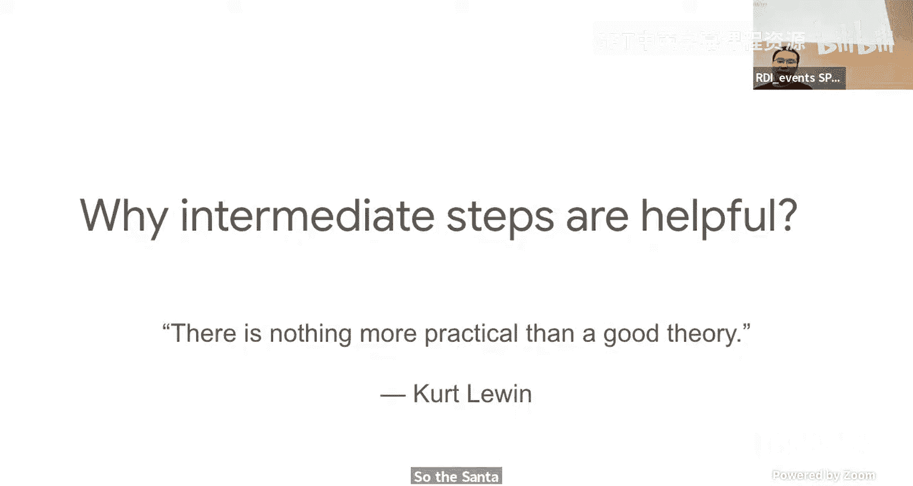

And this year we have work published at ICL 2024， and I collaborated with brilliant Setics from Stanford。

And in that work， we give a rigorous mathematical analysis。Okay， so here are key results。

Transformer generating intermediate steps can solve any inherently serious problem。

As long as its death， it。A constant shareholder。Ive emphasize they get constant。

That means being independent of your input。However， it as a formal。Generating their answers。

Either requires a huge depth to solve or kind solve at all。Yeah， police chated statements again。对等。

Moving to an next slide。

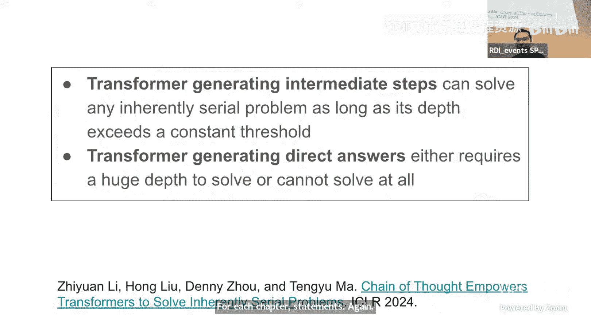

Probably has seen tons of practical implications of this theory。Yeah。If you couldn't solve a problem。

 you may think about generating more intelligent steps。And also， probably you could。

Call some mecinal cores。Thanks search。To help in steps。 so I started in this LM agent， course。

 many people would talk about how to use eal course。

And you can think about how to download in Lphiious and limitations。 Yeah。

 so I had one of my big fun。Is to find a problems。My daughter can solve in sadness。By LMs。Fil， yeah。

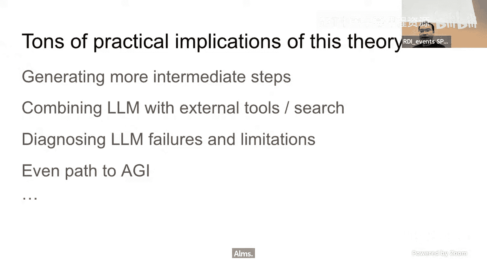

Okay， so I've thought about how to use examples。不缺个LM。To generate step by step reasonably。

So one matter is possible to trigger with without using the cloud。

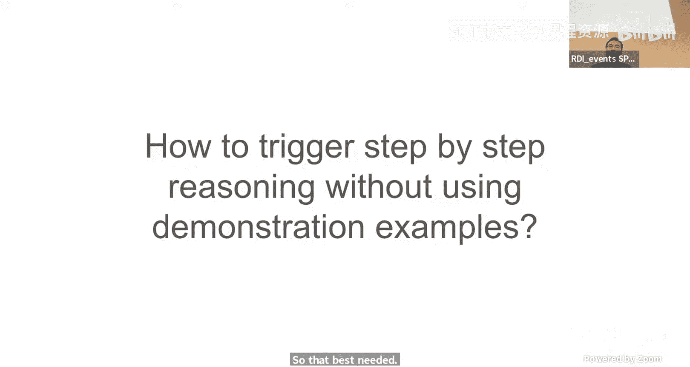

He's amazing work。Actually， when this paper came out， I thought it was a joke。It turned out more。

 and then I was inspired a along by his work is called thating step by step。So given this question。

 okay， we don't need any examples。We just need to see that's6 step and step。

And the model can generate。Business tasks。

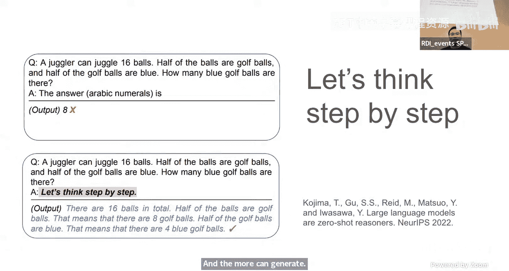

Yeah， it's really cool， but usually， you know， there zero short approach means short there's no examples。

 it's worse than few short。

So let wonder， okay， if wait to have a approach is dear to a job。But can do much better work。这底。

This to our another world is called LMs as and reasoners。

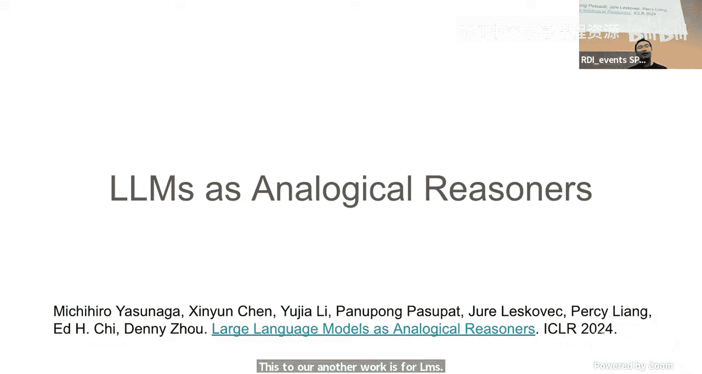

So again， this beautiful book called the Soet。嗯，你把它抽厉来。要系。So it's simple to say， okay。

 horrible and likely reasoning can solve mass problems。So we will see a new problem。

 you're first to ask your question。Do you know a related problem？On methods or strategies。

So after my talk， how youre going to can find dispose it。And the bread lot of paper。呃。

So this I really liked the code from B Yeah， if you started Fun analysis， you will know B space。And。

I was really amazed by the lost in this。The ultimate mathematic is one who can see analogies between analogies。

Of course， actually I show a certain here， but I you know how far away from AI。

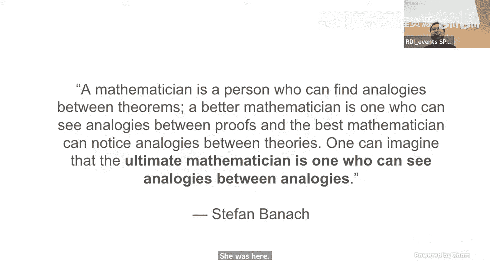

so given this simple problem， okay， of course you can see， okay， that that I said。

 but now we can see different way， okay， we call a related problem and then solve the one。

 solve this one， okay。You can see that actuallyC indeed will course relevant examples and knowledges here。

 but those problem are exactly the same problem。OhThat are useful， that's amazing。

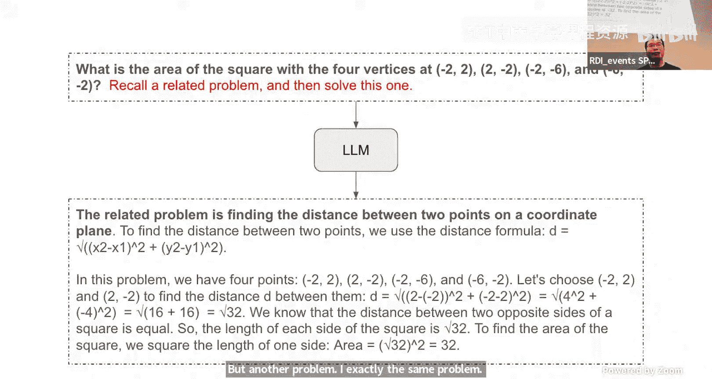

And we found out out， which of course， we tried a bit marks and see it works really well。

So I see that。The last row is from a logical reasoner by a problem。

 of course you can optimize the prompt by yourself。Get back for yourselves。

The most important thing here is that。It's much better than just see lessons things step by step。

Doest here means就需COT yeah。And even this approach。Out of froms。Mu手题 here。I think the main is that。

 you know when you thisapp approach， the model would automaticallyly generate。

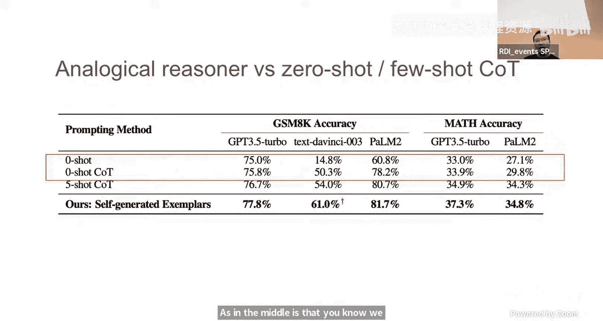

Were related to the questions which given problem。This resultss on a big bench。

It was a great performance。

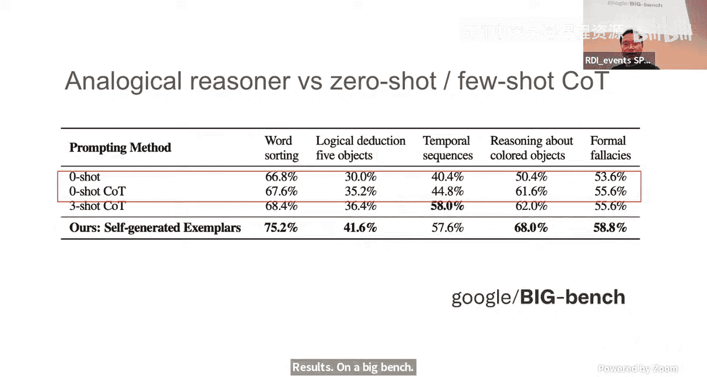

And。There results other with this。哎呀Comp programming。Yeah。

If you are interested in company programming， you could try this approach。

 So what we didn't do here is about scaling。要看呢。People has searched web from all related problems。

 knowledge。What a problem we to solve。

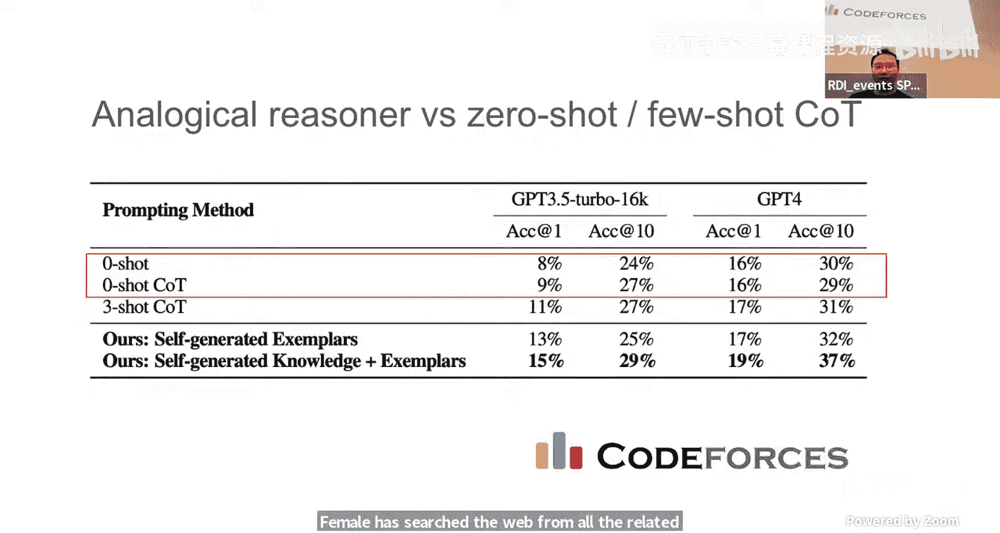

So the clear idea here I directly generate relevant examples and the knowledge for each given problem。

Instead of using a big set examples as a manual gen prompting。

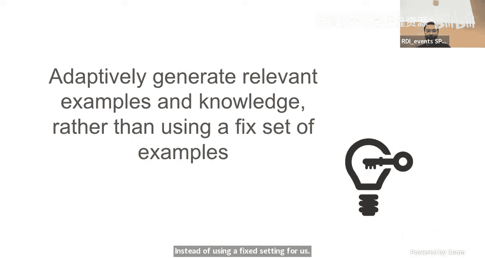

O。😊，Now we can see that，O。We can use few short examples to show the model how to do step by step reason。

What can do zero shock。Without using any examples， just see。Thus it was step best step。

No one could ask it another question。It's possible to trigger self by step with。

 even without using any problem that seems step by step。You could say， okay。

 what models in the countries are just like at， right。要 right the they is算听 or something。

That means there only user many examples in the。Data mixture for training or training。

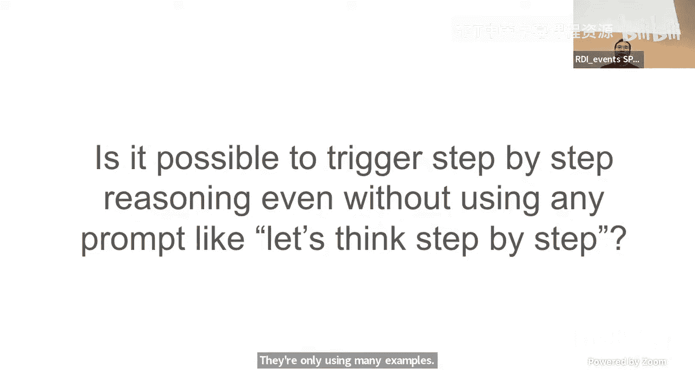

So。Yeah， we foundizer it is years。Dide in our written world chain of solar reasoning without property。

Without pro that without seeing anything saying just give problem to the model。

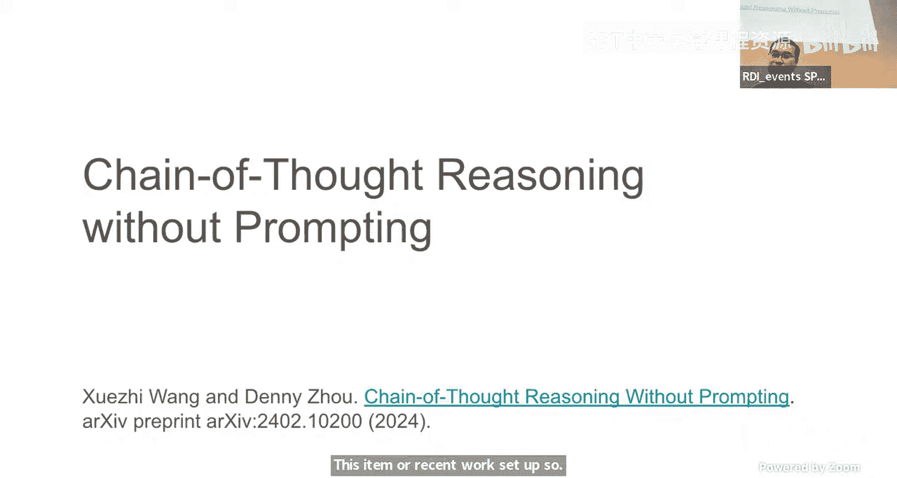

呢本课啊。P钱LN摩的。So。嗯，Let's look at example here。I have three apples。 My dad has two more apples with me。

 and how many apples do we have together。The for this example， we see。

The approach actually is very simple。And decoding at the first step。We look at all passport bookings。

Here， are listed five table here。O。So we started the first corecase， and then。Continue gra coding， O。

So the first one is a file Air， okay， the first one is the file and the network was the file Air。

And if you use Co two Co is I， then the full generation will be I has three apple。

 my I has two more apple， the me and so it has five applescribed yeah。系。I see that。 So that's。

That's very usually right， so we didn't see anything about raising you here or the model can do something。

It we started from different programss。

Here' is another example to say， okay。Was Nicho cage H born in even all year。The first one say， okay。

 Nick with poem in order yet the that in new class with the first token。And of the second one。

 that is even and then period， instead odd than period， okay？Nowll probably say， okay。

 if the industryice is， you know， the model could have had general sort。In their response。

They probably is home funded。I say， okay， you can take a longer sentences。

longer as it means the model code some written steps。Actually， it's surprising scene。更多的priity。

Ofpen that over on the bookken of。If you look at the probability on the first row here。

 a Niro cage was born in order in year。And the survey is are quite little。And however。

 if we see if there is a reason part like the last one， Kate was born in 1964 and an Eba。

 There's a reason process here and then privateed finally J to。P in at eight。That's amazing， right？

It said that the model is so well calibrated。I was really surprised at the same' probabilities。

Seey that like a to straight you modest say even for， and democra are really low。

So K of business。And patient As have had responses with step by step with new and among generations started with top key tokens。

会东你的。Builds any proud here。の二で。And higher confidence in decoding the final answer when a step by step with the pass is present。

So here is a comparisoning between gra decoding and the chance decoding。 We see that。

The channels for decoion perform much better。

Yeah， so far any questions here。Now let's move to that topic， right？

Generation inter stepss are helpful， even really helpful， know。

But。And you can of see on generate image steps instead of direct answers。Any concerns？一唔嘢。

So this the decision games。I learned more about things。不语再见。

So probleming ownership the city depends on your problem。所い嘅。So actually in the kind days， you know。

We need to always keep in mind。That ANs are p models。Of generating next tokens。They are not humans。

No matter if I use a case example or not。Keep is your mind。

So it's a previous model， so that's see what LM does in decoding。So it's actually Art Max。Probility。

Of reasoning， past and the final answer。Give him the problem。好玩。What we want is Archchemax。Probility。

 but answer given problem， right。That's what we learned in。没什么咧。

This doesn't mean which pass is not important。just see final answer。

 we have to make sure final answer is correct and then look at the reason pass。They are not alive。

 right， but two different。Ojective。

OK。😊，Now， let's look why that further， okay。The proial finalr are given the problem。On了 computeruter。

We should sum over all possible reason path。哎。The how computer is compute from our course we learn。

 right？So give it a mass problem。You could have found different solutions。

Which we live to the same eyesight when you started when you produce some amazing here。And then O。

 how to compute the some。If you are starting machine learning， you know answer， okay， right？Sampple。

说 simple o。Now， this due to our work， self consistency。Probably many people have no self access。

Part of my talk here is， I really want to let you see the underlying motivation。

How wei approach this problem from the first principles machine learning。

So let's look the question here。 Okay， give have this math problem。

And this could sample the I multiple times。

Yeah， again， and the finally， you see， okay， the most frequentizer is 18。O。

What we keep along here is。Notor most frequently recent past。We choose most frequent outside。

That's huge difference。Within is the pass here。Itslate in the Bible。

This idea is so simple。I by using self consistencyency。

We simply crushed solar results in the village share data。嗯。And see that I can doing research。会中意。

We can， you know， it's really just about idea， you don't have to know a lot sense。

And of course， you know， give our explanation on self consistencyency it's about probability。

 it's about sampling， So he imagine that more consistent results more likely for crash。

We are look at first here。If the Caency is more than 80%。Then the then the accuracy is nearly 100%。

Yeah二可 question吧O。So。When the IM was a direct answer。Without intermediate steps。

Will you steer some or separate hands and then choose the most common answer。系我 like嘅 okay here。对。嗯。

Okay， great。 Yeah， it one token。 Okay， that's already the the the people with muscle probability。

 Yeah， also。And for a celebration。嗯。Ch sur consistencysency by Latin AM generate multiple responses。

Instead of sampling multiple hands。And then choosing the most common answer。Does this make sense？

Yeah， no。Great， yeah， that is no。And for both answers， we just follow this principle。

A max prohibital finance given problem as all you need to understand self consistency is a very very simple principle of first one of the first principles in machine learning。

If you know management and more probably know， okay， this record marginal inference。

OK嗯。So I want to okay， how about freeform answers？嗯就是当。Universal South Mississippi。诶两个信 here。

So this idea is a little bit different。But the relation is what I put here。And given this problem。

 where do people drink the less coffee than they do in Mexico if you look the answers？

And each actually is different from。Others。But the most common response is to here， Japan， China。

 India。

嗯。Any question。Otherwise， I couldn't move to the next section。Okay。Now， yeah。

 this career what the still。对你。Self consistency or sample you answer multiple times and then choose the most frequent answer as the output。

Yeah。And next I'm talking about the patients。The first while about LOMs can be easily distracted by relevant compacts。

From psychology studies，Youographic information。May significantly decrease some children and even adults problems solving accuracy。

The want chair if this observation holds for Ls。

So these are some problems here。诶。The highlight tax。

Its manually added to Sir Marys massive rate is 10。It's relevant for or problem。系一师。After that。

 the model made it wrong。啊，什么审器。

So。Action interestOK。If we add a primem， like ignore ignore1 contacts。

And the model immediately noticed that and make a problem。

But it's still hard to take the point back if we make the problem， making even colors are pretty big。

So even work has simply just add irrelevant synthesis like the skyes the blue and the grass green or something or those mountains。

 you can make this input up to long US significant performance drawn across all LMs。

The next thing， Tea， I'm going to talk about LMS can not sell correct reasoning yet。

Let's start from a math public game。And I said this promise is that didn changing。用得去。

And you I see that the model。And give a round answer。And then， we。From to the model with。

Review your previous answer and find problems。With you， I sir。O。And then interestingly。

After reviewing the model recognized and take。And for size。This looks something amazing right。

 you see， and then we see another problem based on the problem youll find。Improve your answer。

And the final answer here is correct。对。

白粉。If the Or is a crack。Would the same prompt。The model could have made a mistake。That's a problem。

So。Overall， when allowing As to review their generated response can help correct inaccurate answers。

It may also risk changing credit answers into one。

We run extensive studies on。And some benchmarks like GSMK， copies sense QA and the hot power Q A。

And we didn't notice any improvements。From self correction methods。It just makes things worse。

嗯。Proably useful for some improvements from the literature you know。

 these improvements are reasoning。And actually， they use orac answers。

 you can seen the or here orac means。You're only prompt。

LMs to correct the answer when the answer is wrong。

The problem is that the model is not to know if it's either it's a crack or rock。Your p。

 because the Asian are wrong， it is crowded。

And also in this ability to moate the debate。The yo group one use more for AOs。

Debate each other and to to achieve agreement or consensus。And also， we try this approach。

 where we find out actually the truth is how many response are generated。For example。

 if we have three Os。And if have one candidate response that would be free， if we had debate。

 there we shared one， there would be9 response error。

So how about just to self agencyency with direct funds and say what happened？For the product。

Those employees cannot outperform self consistency。 Sa consistency is a very simple。

 because amount times。I did take the most frequent requirement prediction。

So the lesson we'll learn here is orac of is needed for AM to self correct。

If so， that we are little our work is self。Saba naturally leverage unit test as oracle。

You said about coding problems narrative how do the test to try。No。Actually。

 we started this work quite early and we didn't make that a selfpart work and then finally we work for the coding。

And the last takes an one call about the premise order matters in and reason。

So， you know， in the kind days where every time we use temporary reports from the archive point you somewhere and the people always show great results。

For example， recently a model could be a flash and it should put a bit without a givenK and I have probably tried numbers。

In the current， the model channel was all data from the internet。There provisionvari and what house。

So one of。My on my team is to generate different evolve tasks。So to test models。So that here。

 that here we just did a simple check。We are given this original TSMK problem。We re order。

The sentence。A little bit let's see if the modest here can solve it。So here。

 in the orange problem is that he lose 10 Bs while getting home。And we could just move this sentence。

To to the to them。And to see what happened。We just give you some changes for some chance problems。

And we noticed that there are about 10 points drop on solving rates across all frontier areas。

So here a response here， you can can it need compare response the problem， for the the problem。

 and then we order the problem。So。I see that the model actually just the model just know how to solve the problem initially。

They couldn't go back and forth。

And one would say， okay， that would maybe be related to some semanical understanding of what yourself said part of reason。

Then we are design another another task called logical inference。

Its even more pure than the mass problems。Yes say朋 if if they， if they， if they right。

 even we don use real real words， we just use a random。O care。And the given the rules and the facts。

And then the what model give an inference， logic inference in the query。

And the rules for the original problem， the rules are ordered according to the yield in the inference process。

Or how went out， not all rules are necessary for query。And a other of ways， you know。

 we could adjust randomly。Order those rules。Okay， I only remember order rules relevant from query。

If not well are away， they just keep as they or even。オジさ。And surprisingly。

 then we saw city parts board hold the job。Across all front L。嗯。From a personal experience。

 I thinks really important。To design experiments。When doing and research。

 so this just like to be bond。O。😊，Now let me summarize the poll here。

 so the first thing I talk about is generating the media steps improves airline's performance。还十分の。

And you can do training fine tu prompting with intermediate cells。

But you can do also do只 short analog reason or some kind of a special decoding来 safetying来。

Ppresent today。And also， self consistency greatly improves step by step， no matter your。

From fine total model or from P。And also a lot of limitations， know that you have the context。

 self correction and the premise order， all those and matters for reason performance。

So when I came a public， I say what the next， a what problem what more come right？嗯。

I think the most impressed here is home you see。We work on上于 put有效 work on AL AIs not problem。

The problem is define a right problem， work on and solve it from the first principles。

 not just in your increase consumption from the principles。

The last machine learning is still super important here。And actually apparently。

 I'm organizing a conference called conference Love Marine with a bundle of amazing people。

And this first ever happens dedicated to long glory and welcome joy。Yeah， that's it thanks。

